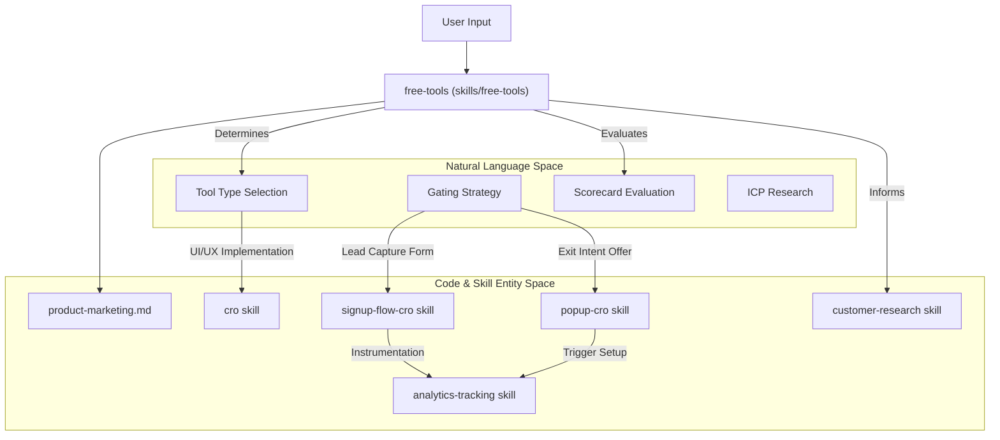
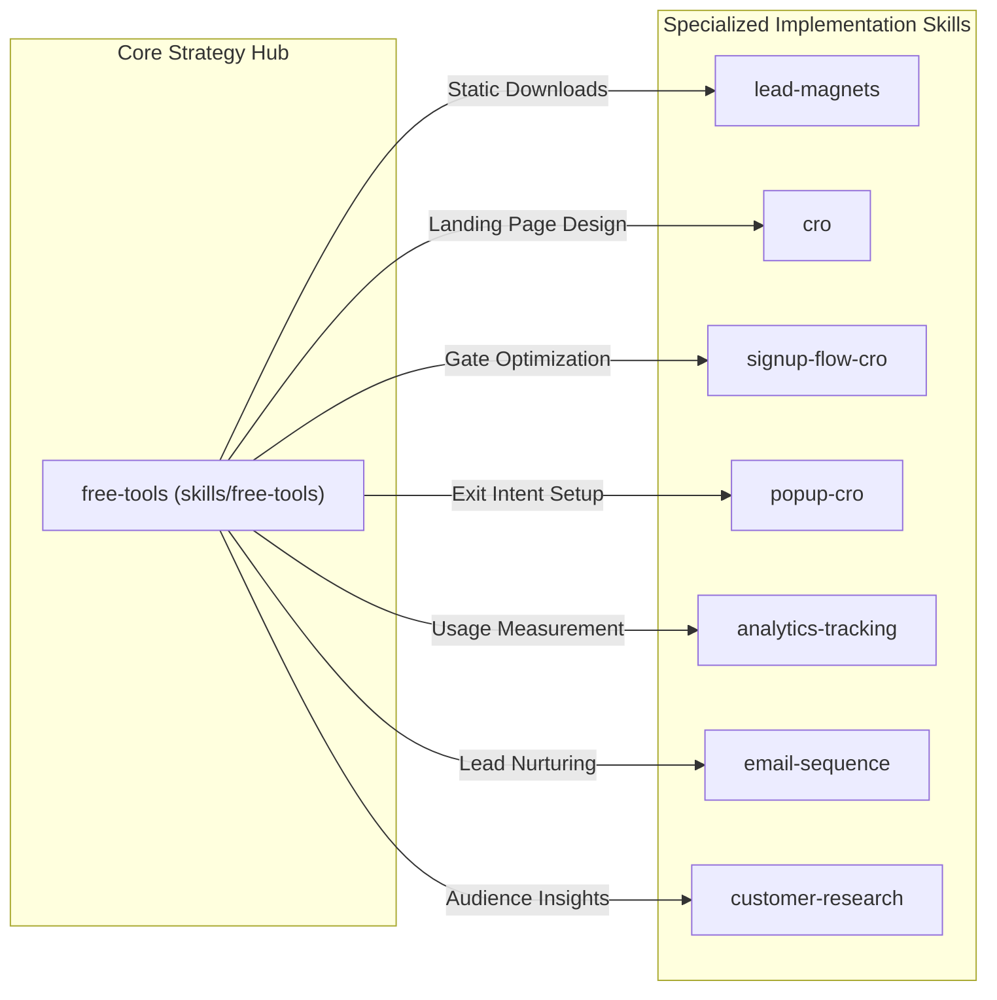

<!-- source: DeepWiki mcp.deepwiki.com · repo coreyhaines31/marketingskills · extra page Free Tool Strategy · fetched 2026-10-26 -->

# Free Tool Strategy

Relevant source files

The following files were used as context for generating this wiki page:

- [.claude-plugin/marketplace.json](.claude-plugin/marketplace.json)
- [.claude-plugin/plugin.json](.claude-plugin/plugin.json)
- [README.md](README.md)
- [VERSIONS.md](VERSIONS.md)

This page documents the `free-tool-strategy` skill (referenced in code as `free-tools`), which provides frameworks and workflows for planning, evaluating, and building free marketing tools—also known as "Engineering as Marketing"—that drive customer acquisition. The skill covers tool ideation, evaluation criteria, implementation approaches, SEO optimization, and lead generation mechanics.

For downloadable content lead magnets (ebooks, checklists), see [Lead Magnets](#4.4.6). For page optimization, see [Page CRO](#4.2.1).

**Sources:** [README.md:78-78](), [README.md:185-185]()

---

## Skill Overview

The `free-tool-strategy` skill is a knowledge module that helps AI agents guide users through creating interactive marketing tools. These tools serve to solve real problems for an audience while generating qualified leads and building brand awareness.

### When to Use This Skill

The skill activates when users express intent to:
- Plan, evaluate, or build a free tool for marketing (lead gen, SEO, brand).
- Mention "engineering as marketing," "calculator," "generator," "grader tool," or "ROI calculator."
- Build interactive resources rather than static downloads.

**Trigger phrases include:**
- "Should I build a free tool?"
- "Build a tool for leads"
- "Interactive ROI calculator"
- "Website grader strategy"
- "Engineering as marketing"

**Sources:** [README.md:78-78](), [VERSIONS.md:25-25]()

---

## Core Principles

The strategy is built on four pillars to ensure the tool actually drives business results:

1.  **Solve a Real Problem:** Must be useful even without the main product.
2.  **Adjacent to Core Product:** Create a natural path from the tool's solution to the product's value.
3.  **Simple and Focused:** Low friction, immediate value, does one thing well.
4.  **Worth the Investment:** Lead value × expected leads must exceed build and maintenance costs.

**Sources:** [README.md:13-20]()

---

## Tool Taxonomy

The skill categorizes tools to help select the right format for the marketing goal:

| Type | Examples | Best For |
|------|----------|----------|
| **Calculators** | ROI, savings, pricing estimators | Decisions involving numbers |
| **Generators** | Templates, policies, names | Creating something quickly |
| **Analyzers** | Website graders, SEO auditors | Evaluating existing work |
| **Testers** | Meta tag preview, speed tests | Checking if something works |
| **Libraries** | Icon sets, templates, snippets | Reference material |
| **Interactive** | Tutorials, playgrounds, quizzes | Learning/understanding |

**Sources:** [README.md:34-34](), [README.md:78-78]()

---

## Research-Driven Tool Planning

Effective free tools are grounded in customer intelligence. The `free-tool-strategy` leverages research to identify high-impact tool ideas.

### Discovery via Customer Research
Before building, agents use `customer-research` to identify "Digital Watering Holes" (Reddit, G2, Hacker News) where users complain about manual processes that could be automated by a tool.

- **Reddit/HN Mining:** Search for "anyone know a tool for X" or "frustrated with [manual process]" using `last30days` filters in search tools.
- **Review Mining:** Look for "I wish it could..." in 4-star reviews on G2 or Capterra to find gaps that a lightweight free tool can fill.
- **Demand Signals:** Identify first customers or design partners by finding public pain-demand-timing signals.

**Sources:** [README.md:75-75](), [VERSIONS.md:67-67]()

---

## Technical Implementation & Data Flow

### Logic to Code Mapping

This diagram bridges the strategy concepts to the specific code entities and skills that implement them.

**Sources:** [README.md:19-25](), [README.md:33-40](), [VERSIONS.md:22-25]()

---

## Integrated Workflow

The `free-tools` skill acts as a hub, delegating specific implementation details to other specialized skills.

**Sources:** [README.md:33-40](), [README.md:46-50](), [VERSIONS.md:25-28]()

---

## Evaluation & Evals

The system includes automated evals to ensure the AI agent correctly applies these frameworks.

### Key Assertions in Evals:
- **Context Awareness:** Must check for `product-marketing.md` (or legacy `product-marketing-context.md`) before suggesting tools.
- **MVP Scoping:** Must recommend minimum viable features (core logic, clear inputs) while skipping account creation or perfect design.
- **SEO Strategy:** Focus on landing page keywords like "[thing] calculator" or "[thing] generator".
- **Research Grounding:** Must warn against creating personas or tools without data points from actual research.

**Sources:** [README.md:19-20](), [README.md:78-78](), [VERSIONS.md:67-67]()

---

