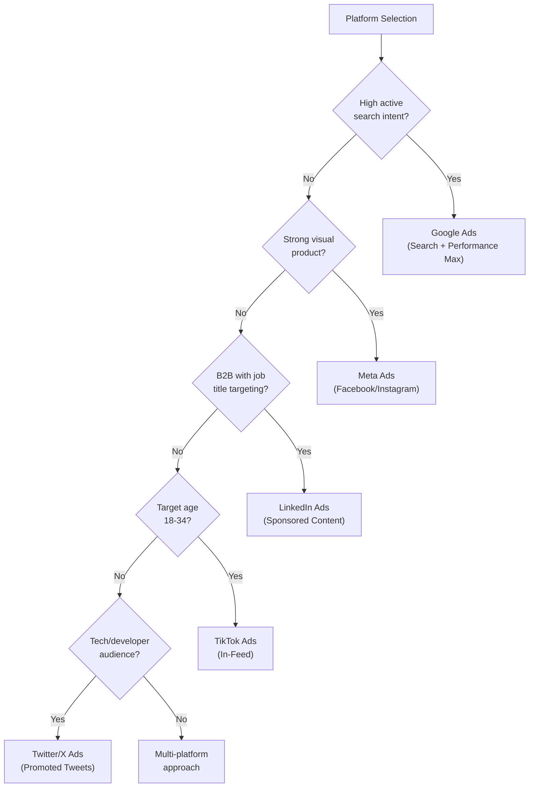
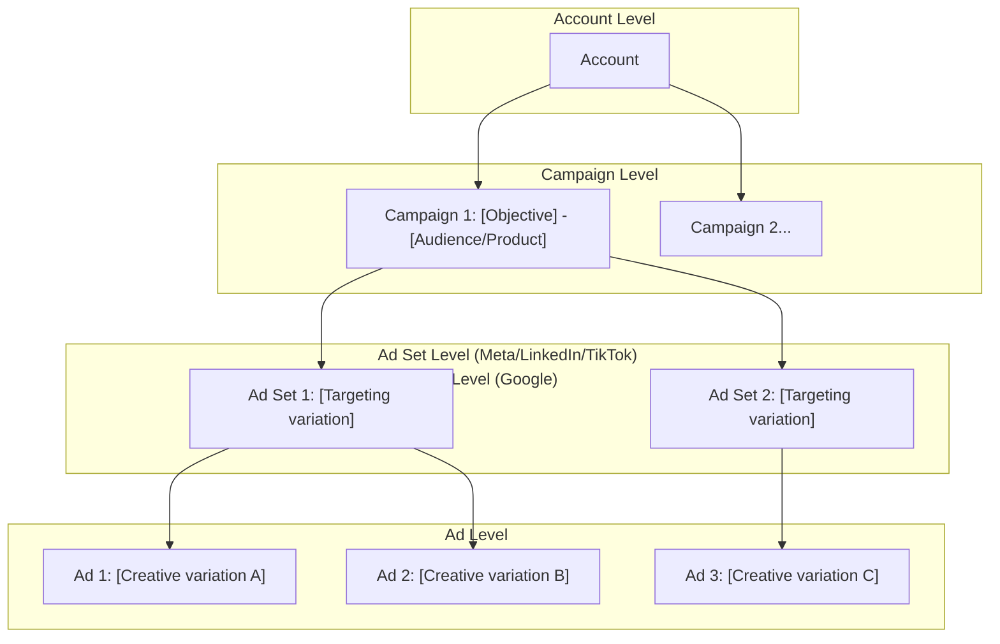
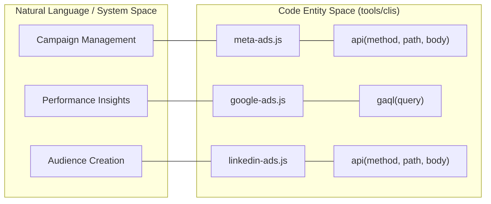

<!-- source: DeepWiki mcp.deepwiki.com · repo coreyhaines31/marketingskills · extra page Paid Ads Strategy · fetched 2026-10-26 -->

# Paid Ads Strategy

<details>
<summary>Relevant source files</summary>

The following files were used as context for generating this wiki page:

- [skills/ads/SKILL.md](skills/ads/SKILL.md)
- [skills/ads/references/abm-playbook.md](skills/ads/references/abm-playbook.md)
- [skills/ads/references/b2b-paid-playbook.md](skills/ads/references/b2b-paid-playbook.md)
- [skills/ads/references/google-search-playbook.md](skills/ads/references/google-search-playbook.md)
- [skills/ads/references/linkedin-b2b-playbook.md](skills/ads/references/linkedin-b2b-playbook.md)
- [skills/ads/references/meta-decision-system.md](skills/ads/references/meta-decision-system.md)
- [skills/ads/references/rsa-output-spec.md](skills/ads/references/rsa-output-spec.md)

</details>


## Purpose and Scope

This document covers the `ads` skill ([skills/ads/SKILL.md:1-316]()), which provides campaign strategy, audience targeting, budget allocation, and optimization frameworks for paid advertising platforms (Google Ads, Meta, LinkedIn, TikTok, Twitter/X). 

The skill distinguishes itself from **Ad Creative** (bulk generation of assets) and **CRO** (landing page optimization). It serves as the operational layer for performance marketing, using a "reference routing" pattern to load specific playbooks based on user intent (e.g., B2B, LinkedIn, or Google Search specific rules).

**Sources:** [skills/ads/SKILL.md:1-10](), [skills/ads/SKILL.md:43-56]()

---

## Platform Selection Framework

The skill provides a decision matrix for platform selection based on product type, audience intent, and campaign objectives.

### Platform Capabilities Matrix

| Platform | Best For | Use When |
|----------|----------|----------|
| **Google Ads** | High-intent search traffic | People actively search for your solution [skills/ads/SKILL.md:63]() |
| **Meta** | Demand generation, visual products | Creating demand, strong creative assets [skills/ads/SKILL.md:64]() |
| **LinkedIn** | B2B, decision-makers | Job title/company targeting matters, higher price points [skills/ads/SKILL.md:65]() |
| **Twitter/X** | Tech audiences, thought leadership | Audience is active on X, timely content [skills/ads/SKILL.md:66]() |
| **TikTok** | Younger demographics, viral creative | Audience skews 18-34, video capacity [skills/ads/SKILL.md:67]() |

**Sources:** [skills/ads/SKILL.md:59-68]()

### Platform Selection Decision Tree



**Sources:** [skills/ads/SKILL.md:59-68]()

---

## Campaign Structure Patterns

The skill enforces a three-tier account hierarchy with standardized naming conventions and budget allocation rules.

### Account Hierarchy Model



**Sources:** [skills/ads/SKILL.md:73-84]()

### Naming Convention Schema

The skill implements a structured naming format for consistent campaign identification [skills/ads/SKILL.md:86]():

```
[Platform]_[Objective]_[Audience]_[Offer]_[Date]
```

**Examples [skills/ads/SKILL.md:91-95]():**
- `META_Conv_Lookalike-Customers_FreeTrial_2024Q1`
- `GOOG_Search_Brand_Demo_Ongoing`
- `LI_LeadGen_CMOs-SaaS_Whitepaper_Mar24`

**Sources:** [skills/ads/SKILL.md:86-95]()

---

## B2B Operational Playbooks

The `ads` skill delegates operational depth to specific reference files.

### 1. Meta Decision System
Decisions are anchored by **TCPL (Target Cost Per Qualified Lead)** [skills/ads/references/meta-decision-system.md:22-30]().
- **Ad-count ceiling**: Calculated as `(daily budget × 14) / (2 × TCPL)` [skills/ads/references/meta-decision-system.md:36]().
- **Structure**: 80/20 split between Scaling and Testing campaigns [skills/ads/references/meta-decision-system.md:40-48]().
- **Kill Rules**: Pause test ads at 3× TCPL spend with zero pixel leads [skills/ads/references/meta-decision-system.md:65]().

### 2. LinkedIn B2B Playbook
- **Bidding**: Start with automated bidding, then switch to manual CPC ~20% below the average produced [skills/ads/references/linkedin-b2b-playbook.md:19-23]().
- **Scaling**: Triggered by audience penetration (reached ÷ audience size). Hold at 25-35%, scale horizontally at 35%+ [skills/ads/references/linkedin-b2b-playbook.md:50-56]().
- **Arbitrage**: **Thought Leader Ads (TLAs)** typically deliver 3–6× the CTR of company-page ads [skills/ads/references/linkedin-b2b-playbook.md:75-79]().

### 3. Google Search Playbook
- **Intent Ladder**: Spend opens rung-by-rung: Brand → High-intent non-brand → Competitor → Problem-aware [skills/ads/references/google-search-playbook.md:20-30]().
- **RSA Output Spec**: Mandatory 15 headlines (≤30 chars) and 4 descriptions (≤90 chars) [skills/ads/references/rsa-output-spec.md:5-12]().
- **Negative Ritual**: Weekly passes for waste, winners, and drift [skills/ads/references/google-search-playbook.md:79-86]().

**Sources:** [skills/ads/references/meta-decision-system.md:1-120](), [skills/ads/references/linkedin-b2b-playbook.md:1-95](), [skills/ads/references/google-search-playbook.md:1-110](), [skills/ads/references/rsa-output-spec.md:1-40]()

---

## Audience Targeting & ABM

Modern strategy emphasizes **creative-led targeting** over manual filters [skills/ads/SKILL.md:131]().

### Targeting Signals by Platform

| Platform | Audience knowledge → creative | Audience knowledge → targeting filters | Notes |
|----------|------------------------------|-------------------------------------|-------|
| **Meta** | **80%+** | 20% | Interest-stacking actively hurts [skills/ads/SKILL.md:139](). |
| **Google Search** | 40% | **60%** | Keywords are still the dominant signal [skills/ads/SKILL.md:140](). |
| **LinkedIn** | 40% | **60%** | Identity data (job title) is high-quality [skills/ads/SKILL.md:142](). |
| **TikTok** | **70%** | 30% | Broad targeting + native creative wins [skills/ads/SKILL.md:143](). |

**Sources:** [skills/ads/SKILL.md:135-145]()

### Account-Based Marketing (ABM) Mechanics
- **List Sizes**: LinkedIn needs 300 matched members minimum [skills/ads/references/abm-playbook.md:31]().
- **Cross-channel UTM Remarketing**: Build a Meta audience with the rule `URL contains utm_source=linkedin` to get LinkedIn-grade quality at Meta-grade CPMs [skills/ads/references/abm-playbook.md:62-71]().
- **Frequency Capping**: Target ~3 impressions/person/week in priority accounts [skills/ads/references/abm-playbook.md:39]().

**Sources:** [skills/ads/references/abm-playbook.md:1-90]()

---

## Tool Integration Workflow

The skill integrates with zero-dependency CLI tools for campaign management and performance reporting.

### CLI Tool Entity Mapping



**Sources:** [tools/clis/meta-ads.js:12-32](), [tools/clis/google-ads.js:34-36](), [tools/clis/linkedin-ads.js:11-31]()

### CLI Command Reference

| Platform | Command Example | Purpose |
|----------|-----------------|---------|
| **Meta** | `meta-ads.js campaigns insights --id <id>` | Fetch impressions, clicks, spend, and actions [tools/clis/meta-ads.js:162-173](). |
| **Google** | `google-ads.js keywords performance --days 30` | Query keyword metrics via SearchStream [tools/clis/google-ads.js:136-147](). |
| **LinkedIn** | `linkedin-ads.js campaigns analytics --id <id>` | Get conversion and cost data [tools/clis/linkedin-ads.js:110-129](). |

**Sources:** [tools/clis/meta-ads.js:162-173](), [tools/clis/google-ads.js:170-181](), [tools/clis/linkedin-ads.js:167-177]()

---

## Related Skills

- **Ad Creative**: For generating the assets defined in the strategy [skills/ads/SKILL.md:3]().
- **CRO**: For optimizing the landing pages that receive the traffic [skills/ads/SKILL.md:3]().
- **Marketing Loops**: For setting up recurring ad-fatigue and budget-watch loops [skills/marketing-loops/SKILL.md:119]().
- **Customer Research**: For defining the ICP data that feeds into targeting filters [skills/ads/SKILL.md:129]().

**Sources:** [skills/ads/SKILL.md:1-10](), [skills/ads/SKILL.md:127-134]()

---

