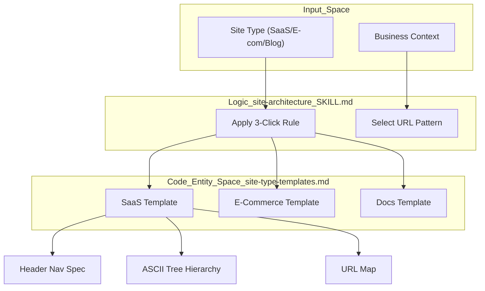
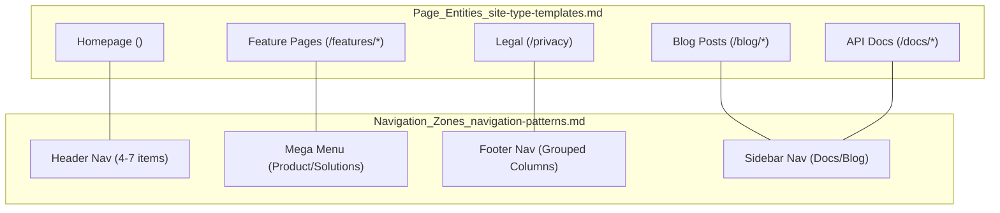

<!-- source: DeepWiki mcp.deepwiki.com · repo coreyhaines31/marketingskills · extra page Site Architecture · fetched 2026-10-26 -->

# Site Architecture

Relevant source files

The following files were used as context for generating this wiki page:

- [skills/site-architecture/SKILL.md](skills/site-architecture/SKILL.md)
- [skills/site-architecture/references/mermaid-templates.md](skills/site-architecture/references/mermaid-templates.md)
- [skills/site-architecture/references/navigation-patterns.md](skills/site-architecture/references/navigation-patterns.md)
- [skills/site-architecture/references/site-type-templates.md](skills/site-architecture/references/site-type-templates.md)

The `site-architecture` skill is a technical knowledge module designed to help AI agents plan, map, and restructure website page hierarchies, navigation systems, and URL structures. It focuses on the information architecture (IA) and user experience (UX) of a site, ensuring that content is discoverable for both users and search engine crawlers.

This skill is distinct from `seo-audit`, which handles technical SEO (like XML sitemaps), and `schema-markup`, which focuses on structured data implementation [skills/site-architecture/SKILL.md:3-3]().

## System Scope and Triggers

The skill is activated when users mention keywords related to website planning and organization.

| Category | Trigger Phrases |
| :--- | :--- |
| **Structure** | "site map", "visual sitemap", "page hierarchy", "information architecture", "IA" |
| **Navigation** | "navigation design", "breadcrumbs", "header nav", "footer organization" |
| **URL Strategy** | "URL structure", "slug patterns", "internal linking strategy" |
| **Planning** | "what pages do I need", "how should I organize my site" |

**Sources:** [skills/site-architecture/SKILL.md:3-3]()

## Information Gathering Flow

Before generating an architecture, the system is instructed to check for existing context in `.agents/product-marketing.md` (or legacy `product-marketing-context.md` filenames) [skills/site-architecture/SKILL.md:14-15](). If context is missing, it gathers data across four dimensions:

1.  **Business Context**: Goals (conversions, SEO traffic, education, or support) and primary audiences [skills/site-architecture/SKILL.md:19-22]().
2.  **Current State**: Whether it is a new site or a restructure of an existing one with identified "broken" elements (high bounce, poor SEO) [skills/site-architecture/SKILL.md:24-27]().
3.  **Site Type**: SaaS, E-commerce, Content/Blog, Documentation, Hybrid, or Small Business [skills/site-architecture/SKILL.md:29-35]().
4.  **Content Inventory**: Count of existing/planned pages and identification of high-value pages [skills/site-architecture/SKILL.md:37-40]().

**Sources:** [skills/site-architecture/SKILL.md:14-41]()

## Page Hierarchy Design Principles

The architecture follows specific technical constraints to ensure findability and SEO performance.

### The 3-Click Rule
The system aims for a structure where critical pages are reachable within 3 clicks from the homepage [skills/site-architecture/SKILL.md:61-63]().

### Hierarchy Levels (L0-L3)
| Level | Identifier | Example Path |
| :--- | :--- | :--- |
| **L0** | Homepage | `/` |
| **L1** | Primary Sections | `/features`, `/blog`, `/pricing` |
| **L2** | Section Pages | `/features/analytics`, `/blog/seo-guide` |
| **L3+** | Detail/API Pages | `/docs/api/authentication` |

**Sources:** [skills/site-architecture/SKILL.md:75-83]()

## Site-Type Templates

The codebase provides pre-defined templates for common website archetypes in `site-type-templates.md`.

### SaaS Marketing Site Template
A standard SaaS structure focuses on feature discovery and conversion.
*   **Primary Nav**: Features, Pricing, Customers, Resources, Integrations, Docs [skills/site-architecture/references/site-type-templates.md:63-63]().
*   **URL Pattern**: `/features/{slug}`, `/blog/{slug}`, `/compare/{competitor}` [skills/site-architecture/references/site-type-templates.md:45-59]().

### Documentation Site Template
Documentation sites prioritize deep nesting and persistent sidebars.
*   **Structure**: `/docs/getting-started`, `/docs/guides`, `/docs/api` [skills/site-architecture/references/site-type-templates.md:175-192]().
*   **Navigation**: Persistent left sidebar with collapsible sections [skills/site-architecture/references/navigation-patterns.md:124-126]().

**Sources:** [skills/site-architecture/references/site-type-templates.md:7-213](), [skills/site-architecture/references/navigation-patterns.md:124-126]()

## Visual Architecture Representation

The system uses Mermaid and ASCII to bridge natural language requirements to site entities.

### Logic Flow: Site Type to Navigation Spec
This diagram shows how the system selects a template based on the "Site Type" input and generates the corresponding navigation components.

**Sources:** [skills/site-architecture/SKILL.md:44-54](), [skills/site-architecture/references/site-type-templates.md:1-213]()

### Internal Linking and Navigation Zones
This diagram maps logical site sections to specific navigation implementation patterns defined in `navigation-patterns.md`.

**Sources:** [skills/site-architecture/references/navigation-patterns.md:7-169](), [skills/site-architecture/references/site-type-templates.md:45-59]()

## Technical Implementation Details

### URL Design Principles
The skill enforces core principles for URL construction [skills/site-architecture/SKILL.md:159-167]():
1.  **Human Readable**: Avoid IDs (e.g., use `/features/analytics` not `/f/123`) [skills/site-architecture/SKILL.md:161-161]().
2.  **Hyphens**: No underscores [skills/site-architecture/SKILL.md:162-162]().
3.  **Hierarchical Reflection**: Paths must match the site structure [skills/site-architecture/SKILL.md:163-163]().
4.  **Consistent Trailing Slash Policy**: Pick one and enforce it [skills/site-architecture/SKILL.md:164-164]().
5.  **Lowercase Always**: Redirect uppercase variants [skills/site-architecture/SKILL.md:165-165]().
6.  **Short but Descriptive**: Optimize slug length for readability [skills/site-architecture/SKILL.md:166-166]().

### Internal Linking Strategies
The skill provides primary models for linking in `mermaid-templates.md`:
*   **Hub-and-Spoke**: A central hub page (e.g., "SEO Guide") linking to multiple "spoke" articles that also link to each other [skills/site-architecture/references/mermaid-templates.md:90-108]().
*   **Cross-Sectional Linking**: Mapping how "Marketing" sections (Features) link to "Product" sections (Docs) or "Content" sections (Case Studies) [skills/site-architecture/references/mermaid-templates.md:116-150]().

**Sources:** [skills/site-architecture/SKILL.md:159-167](), [skills/site-architecture/references/mermaid-templates.md:90-150]()

## Navigation Implementation Patterns

Detailed specifications for UI components are stored in `navigation-patterns.md`.

| Pattern | Best For | Rules |
| :--- | :--- | :--- |
| **Simple Header** | Small sites | 4-6 items, CTA rightmost, Logo links home [skills/site-architecture/references/navigation-patterns.md:9-21]() |
| **Mega Menu** | Large SaaS/E-com | 2-4 columns max, group logically, "See all" link [skills/site-architecture/references/navigation-patterns.md:23-51]() |
| **Standard Footer** | Most sites | 3-5 themed columns (Product, Resources, Company, Legal) [skills/site-architecture/references/navigation-patterns.md:68-87]() |
| **Docs Sidebar** | API/Guide sites | Persistent, collapsible, search at top, highlight active [skills/site-architecture/references/navigation-patterns.md:124-159]() |

**Sources:** [skills/site-architecture/references/navigation-patterns.md:7-159]()

## Evals and Validation
The `site-architecture` skill includes automated evals to ensure it correctly identifies technical SEO tasks as out-of-scope and appropriately applies hierarchy principles for complex sites.

*   **SaaS Planning**: Validates that the agent checks for `product-marketing-context.md` and applies the 3-click rule [skills/site-architecture/SKILL.md:14-15](), [skills/site-architecture/SKILL.md:61-63]().
*   **Technical SEO Guardrail**: Ensures the agent defers to `seo-audit` when asked about XML sitemaps or technical crawl errors [skills/site-architecture/SKILL.md:3-3]().

**Sources:** [skills/site-architecture/SKILL.md:3-3](), [skills/site-architecture/SKILL.md:14-15](), [skills/site-architecture/SKILL.md:61-63]()

---

