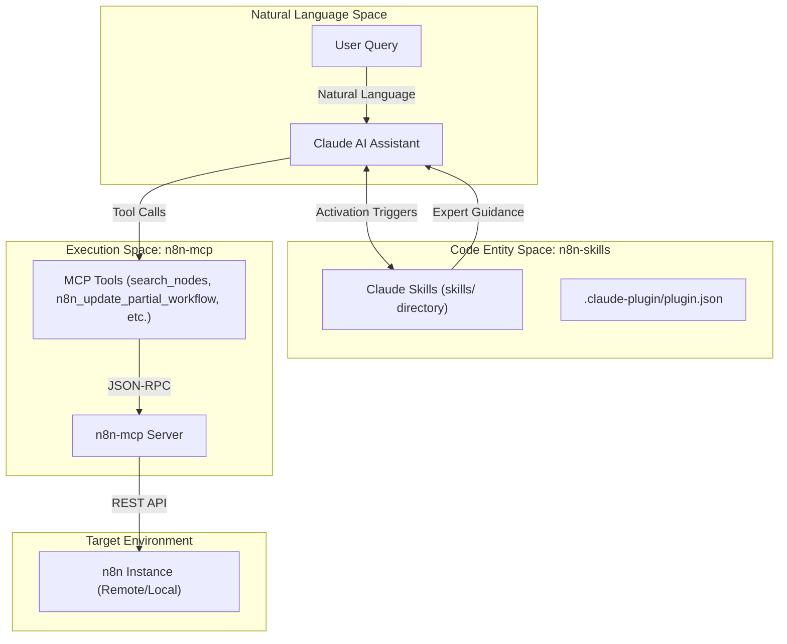
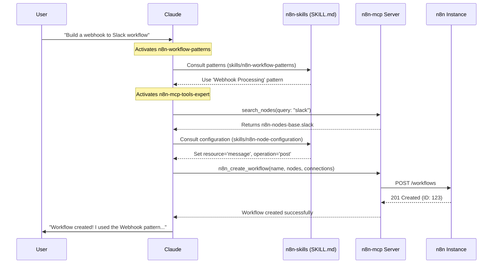

<!-- source: DeepWiki mcp.deepwiki.com · repo czlonkowski/n8n-skills · page 1 Overview · fetched 2026-10-26 -->

# Overview

Relevant source files

The following files were used as context for generating this wiki page:

- [.claude-plugin/marketplace.json](.claude-plugin/marketplace.json)
- [.claude-plugin/plugin.json](.claude-plugin/plugin.json)
- [CLAUDE.md](CLAUDE.md)
- [README.md](README.md)
- [skills.png](skills.png)

## Purpose and Scope

This document introduces the **n8n-skills** system: a collection of seven Claude Code skills designed to extend Claude's capabilities for creating production-ready n8n workflows. It explains the relationship between Claude Skills, the `n8n-mcp` server, and n8n instances, detailing the implementation and data flow of this expert guidance system.

**Sources:** [README.md:1-17](), [CLAUDE.md:1-12]()

---

## What is n8n-skills?

The **n8n-skills** repository contains **7 complementary Claude Code skills** that teach AI assistants how to build production-ready n8n workflows using the [n8n-mcp](https://github.com/czlonkowski/n8n-mcp) MCP server.

### Core Concept: Guidance vs. Execution

The system follows a strict separation of concerns. The **Skills** provide the "brain" (expert guidance), while the **MCP Server** provides the "hands" (data access and execution).

*   **Claude Skills**: Teach Claude *how* to use tools effectively, which patterns to follow, and how to fix errors.
*   **n8n-mcp Server**: Provides the actual tools to search 800+ nodes, validate workflows, and manage n8n instances via API.

**Sources:** [README.md:15-33](), [CLAUDE.md:13-17]()

---

## System Architecture

The n8n-skills system operates in a multi-layered architecture where skills act as an intermediary layer between the user's natural language intent and the technical execution of MCP tools.

### High-Level Ecosystem

Title: n8n-skills System Architecture

**Sources:** [CLAUDE.md:13-36](), [README.md:126-162]()

### Data Flow: From Intent to Workflow

When a user asks to build a workflow, the skills coordinate to ensure the resulting JSON structure is valid and follows best practices.

Title: Data Flow and Skill Composition

**Sources:** [README.md:176-214](), [CLAUDE.md:117-159]()

---

## The Seven Skills

The repository is structured into seven distinct skill directories under `skills/`. Each skill addresses a specific domain of n8n development.

| Skill | Directory | Primary Purpose |
| :--- | :--- | :--- |
| **n8n Expression Syntax** | `skills/n8n-expression-syntax/` | Teaches `{{}}` patterns and `$json.body` access. |
| **n8n MCP Tools Expert** | `skills/n8n-mcp-tools-expert/` | **Highest Priority.** Guides tool selection and parameter formatting. |
| **n8n Workflow Patterns** | `skills/n8n-workflow-patterns/` | Architecture for Webhook, API, DB, AI, and Scheduled tasks. |
| **n8n Validation Expert** | `skills/n8n-validation-expert/` | Interprets errors and handles the validation loop. |
| **n8n Node Configuration** | `skills/n8n-node-configuration/` | Manages property dependencies and operation-aware setup. |
| **n8n Code JavaScript** | `skills/n8n-code-javascript/` | Handles `$input.all()` and `$helpers.httpRequest()`. |
| **n8n Code Python** | `skills/n8n-code-python/` | Focuses on standard library limitations (no external libs). |

**Sources:** [CLAUDE.md:38-71](), [README.md:36-123]()

---

## Skill Implementation Details

Each skill is a self-contained unit defined by a `SKILL.md` file. These files use YAML frontmatter to define their metadata and activation triggers.

### Activation Mechanism
Skills activate automatically when Claude detects that a user's query matches the `description` or triggers defined in the skill's metadata.

*   **Example Trigger**: A query about "how to access webhook data" triggers `n8n-code-javascript` because of its focus on `$json.body` access patterns.
*   **Cross-Skill Integration**: For a complex task like "Build and validate a workflow," multiple skills (Patterns, Tools Expert, Validation Expert) activate simultaneously to provide holistic guidance.

**Sources:** [CLAUDE.md:145-159](), [README.md:178-214]()

### Distribution and Metadata
The system is packaged for different Claude platforms using metadata files located in `.claude-plugin/`.

*   **`plugin.json`**: Defines the name (`n8n-mcp-skills`), version (`1.4.0`), and author details for the Claude Code ecosystem. [[.claude-plugin/plugin.json:1-23]()]
*   **`marketplace.json`**: Contains the marketplace listing details, categorizing the plugin under "automation" and listing the 7-skill bundle. [[.claude-plugin/marketplace.json:1-36]()]

**Sources:** [.claude-plugin/plugin.json:1-23](), [.claude-plugin/marketplace.json:1-36](), [CLAUDE.md:166-172]()

---

