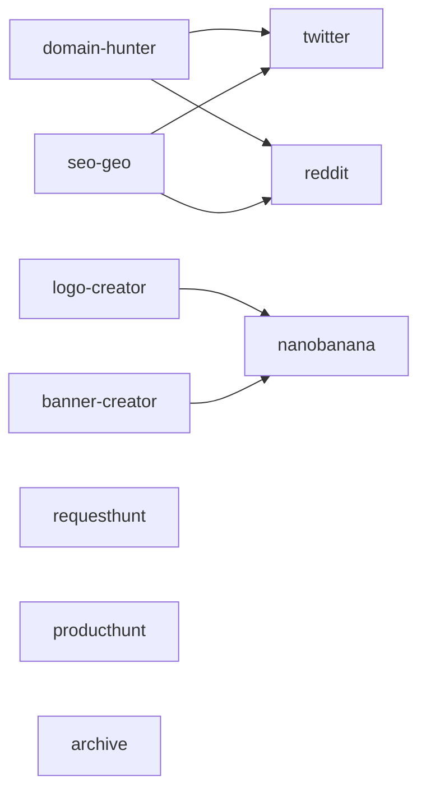
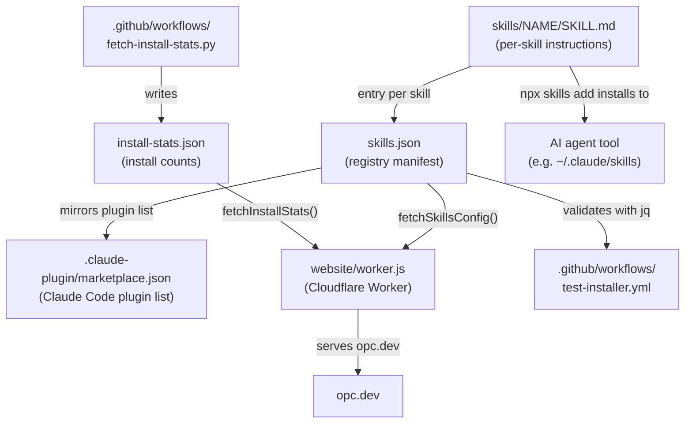

<!-- source: DeepWiki mcp.deepwiki.com · repo ReScienceLab/opc-skills · page 1 Overview · fetched 2026-10-26 -->

# Overview

<details>
<summary>Relevant source files</summary>

The following files were used as context for generating this wiki page:

- [README.md](README.md)
- [skill-logos/archive.svg](skill-logos/archive.svg)
- [skills.json](skills.json)
- [skills/archive/SKILL.md](skills/archive/SKILL.md)
- [skills/archive/references/TEMPLATE.md](skills/archive/references/TEMPLATE.md)
- [website/opc-banner.png](website/opc-banner.png)

</details>


This page introduces the OPC Skills repository: what the project is, the skills it contains, which AI platforms it supports, and how to install skills. For the internal architecture of the skills system (registry schema, skill directory layout, dependency model), see [Skills System](#2). For installation mechanics, see [Installation & Distribution](#3). For the website and API layer, see [Website & Content Delivery](#4).

---

## What is OPC Skills?

OPC Skills is an open-source collection of AI agent "skills" aimed at solopreneurs, indie hackers, and one-person companies. A **skill** is a self-contained directory containing a `SKILL.md` instruction file, optional Python scripts, and usage examples. When installed into a compatible AI coding assistant, the agent reads the skill's instructions and executes specialized tasks on demand — such as hunting domains, creating logos, or auditing a site for SEO.

The project conforms to the [Agent Skills standard](https://agentskills.io). Skills are distributed via GitHub and installable with a single `npx skills add` command or through the Claude Code plugin marketplace.

| Property | Value |
|---|---|
| Repository | `https://github.com/ReScienceLab/opc-skills` |
| License | MIT |
| Registry manifest | [`skills.json`](skills.json) |
| Website | `https://opc.dev` (served by [`website/worker.js`](website/worker.js)) |
| Claude Code plugin manifest | [`.claude-plugin/marketplace.json`](.claude-plugin/marketplace.json) |

Sources: [README.md:1-45](), [skills.json:1-8](), [website/worker.js:129-179]()

---

## The Skills Collection

Ten skills are registered in [`skills.json`](skills.json). Each entry declares a `name`, `version`, `description`, `triggers`, `dependencies`, `auth`, `install`, `commands`, and `links` field. The table below summarises the collection.

| Skill | Version | Category | Auth Required | Dependencies |
|---|---|---|---|---|
| `archive` | 1.0.1 | Foundation | None | — |
| `reddit` | 1.0.0 | Social / Research | None | — |
| `nanobanana` | 1.0.0 | Image Generation | `GEMINI_API_KEY` | — |
| `twitter` | 1.0.0 | Social / Research | `TWITTERAPI_API_KEY` | — |
| `producthunt` | 1.0.0 | Research / Discovery | `PRODUCTHUNT_ACCESS_TOKEN` | — |
| `requesthunt` | 1.0.0 | Research / Validation | `REQUESTHUNT_API_KEY` | — |
| `domain-hunter` | 1.0.0 | Business | None | `twitter`, `reddit` |
| `banner-creator` | 1.0.0 | Design | `GEMINI_API_KEY` | `nanobanana` |
| `logo-creator` | 1.0.0 | Design | `GEMINI_API_KEY` (+ optional keys) | `nanobanana` |
| `seo-geo` | 1.0.0 | SEO / GEO | Optional (`DATAFORSEO_LOGIN`, `DATAFORSEO_PASSWORD`) | `twitter`, `reddit` |

Optional keys for `logo-creator`: `REMOVE_BG_API_KEY` and `RECRAFT_API_KEY`.

Skills grouped by category are documented in detail starting at [Skill Categories & Reference](#2.4).

Sources: [skills.json:8-538](), [CHANGELOG.md:12-24]()

---

## Skill Dependency Graph

Three skills — `domain-hunter`, `logo-creator`, and `banner-creator` — depend on other skills in this collection. The `seo-geo` skill also depends on `twitter` and `reddit`. Dependencies are declared in the `dependencies` object of each skill's entry in [`skills.json`](skills.json) and must be installed alongside the dependent skill.

**Figure: Inter-skill dependencies as declared in `skills.json`**



Skills with no incoming edges (`twitter`, `reddit`, `nanobanana`, `requesthunt`, `producthunt`, `archive`) are standalone and have no prerequisites. For version constraints and CI checks on dependency integrity, see [Dependency Management](#2.3).

Sources: [skills.json:29-31](), [skills.json:143-146](), [skills.json:193-195](), [skills.json:259-261](), [CHANGELOG.md:14-23]()

---

## Compatible AI Platforms

Each skill's `install` field in [`skills.json`](skills.json) provides `user`- and `project`-level install commands for five explicitly supported platforms. The `npx skills add` installer also autodetects other tools that implement the Agent Skills standard.

| Platform | Install flag (`-a`) | User-level target | Project-level target |
|---|---|---|---|
| Claude Code | `claude` | `~/.claude/skills/` | `.claude/skills/` |
| Factory Droid | `droid` | `~/.factory/skills/` | `.factory/skills/` |
| Cursor | `cursor` | — | `.cursor/skills/` |
| OpenCode | `opencode` | user-level | project-level |
| Codex | `codex` | user-level | project-level |

Beyond these five, the `npx skills add` CLI supports 16+ tools including Windsurf, GitHub Copilot, Gemini CLI, Goose, Kilo Code, Roo Code, and Trae. Full platform install command strings are documented in [Platform-Specific Installation](#3.4).

Sources: [skills.json:48-62](), [README.md:109-128]()

---

## Quick Start

```bash
# Install all skills
npx skills add ReScienceLab/opc-skills

# Install a single skill
npx skills add ReScienceLab/opc-skills --skill reddit

# Install a skill that has dependencies (must include dependency skills)
npx skills add ReScienceLab/opc-skills --skill reddit --skill twitter --skill domain-hunter

# Install to a specific agent at user level
npx skills add ReScienceLab/opc-skills -a droid
```

For Claude Code's plugin marketplace:

```bash
/plugin marketplace add ReScienceLab/opc-skills
/plugin install domain-hunter@opc-skills
/plugin list opc-skills
```

Full installation options are covered in [Installation Methods Overview](#3.1). Claude Code marketplace specifics are in [Claude Code Plugin Marketplace](#3.2).

Sources: [README.md:57-107](), [.claude-plugin/marketplace.json:1-10]()

---

## Repository Architecture

The diagram below maps the major subsystems and files in the repository. `skills.json` is the central manifest consumed by all other subsystems.

**Figure: Major subsystems and their primary source files**



Sources: [website/worker.js:219-227](), [website/worker.js:252-256](), [skills.json:1-8](), [.claude-plugin/marketplace.json:1-30](), [README.md:36-56]()

The four main subsystems and where they are documented in this wiki:

| Subsystem | Root files | Wiki page |
|---|---|---|
| Skills definitions & registry | `skills.json`, `skills/*/SKILL.md` | [Skills System](#2) |
| Installation & distribution | `npx skills add`, `.claude-plugin/marketplace.json` | [Installation & Distribution](#3) |
| Website & API | `website/worker.js` | [Website & Content Delivery](#4) |
| CI/CD & development workflow | `.github/workflows/`, `CHANGELOG.md` | [Development & CI/CD](#6) |

Sources: [README.md:131-149](), [CHANGELOG.md:1-31]()

---

## External Resources

| Resource | URL / Location |
|---|---|
| Official website | `https://opc.dev` |
| Skills browser | `https://skills.sh/ReScienceLab/opc-skills` |
| Agent Skills standard | `https://agentskills.io` |
| GitHub repository | `https://github.com/ReScienceLab/opc-skills` |

Sources: [skills.json:5-7](), [README.md:131-148]()

---

