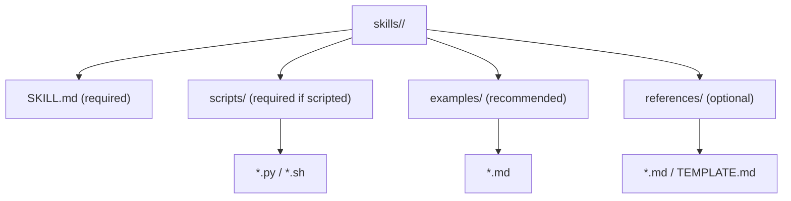
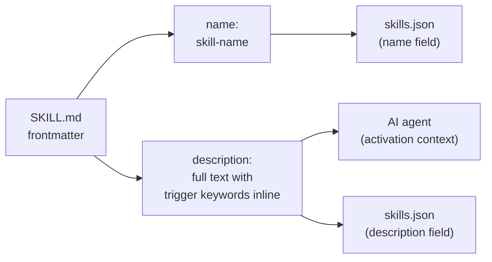
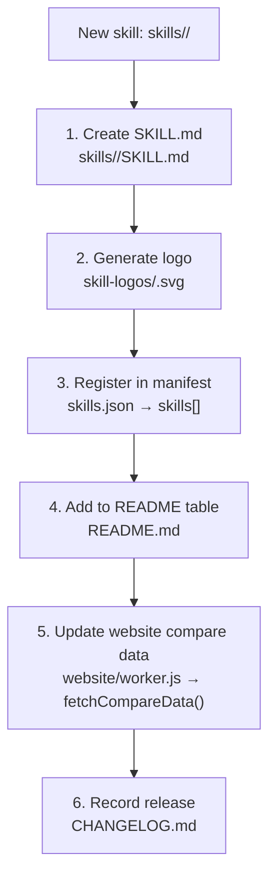
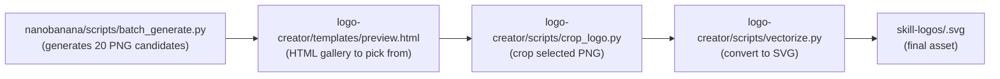

<!-- source: DeepWiki mcp.deepwiki.com · repo ReScienceLab/opc-skills · page 2.2 Skill Structure & Standards · fetched 2026-10-26 -->

# Skill Structure & Standards

<details>
<summary>Relevant source files</summary>

The following files were used as context for generating this wiki page:

- [.factory/AGENTS.md](.factory/AGENTS.md)
- [.factory/hooks.json](.factory/hooks.json)
- [.factory/skills/add-new-opc-skill/SKILL.md](.factory/skills/add-new-opc-skill/SKILL.md)
- [.gitignore](.gitignore)
- [CHANGELOG.md](CHANGELOG.md)
- [README.md](README.md)
- [skill-logos/archive.svg](skill-logos/archive.svg)
- [skills/domain-hunter/examples/auto-video-editing-domain.md](skills/domain-hunter/examples/auto-video-editing-domain.md)
- [template/SKILL.md](template/SKILL.md)
- [website/blog/posts/why-skills-beat-docs.md](website/blog/posts/why-skills-beat-docs.md)
- [website/opc-banner.png](website/opc-banner.png)
- [website/resciencelab-logo.svg](website/resciencelab-logo.svg)

</details>


This page covers the canonical on-disk layout every skill must follow, the required `SKILL.md` format, the six-file checklist for publishing a new skill, and the logo generation pipeline. It describes what goes *inside* a skill directory.

For how skills are registered in the global manifest and discovered at install time, see [Skills Registry (skills.json)](#2.1). For inter-skill dependency rules and CI validation, see [Dependency Management](#2.3).

---

## Standard Directory Layout

Every skill lives under `skills/<skill-name>/` and follows the same four-directory layout.

**Diagram: Skill directory layout**



Sources: [.factory/AGENTS.md:38-49](), [.factory/skills/add-new-opc-skill/SKILL.md:20-32]()

| Directory | Required | Purpose |
|---|---|---|
| `SKILL.md` | ✓ | Main instruction document; parsed by AI agents and the installer |
| `scripts/` | If scripted | Executable Python or shell scripts; each should accept `--help` |
| `examples/` | Recommended | Markdown files showing real end-to-end workflows |
| `references/` | Optional | API docs, data templates (e.g., `TEMPLATE.md` in archive skill) |

The `template/` directory at the repo root contains a starter `SKILL.md` that should be copied when creating a new skill:

```bash
cp -r template skills/my-new-skill
```

Sources: [template/SKILL.md:122-129](), [.factory/AGENTS.md:73-85]()

---

## SKILL.md Format

`SKILL.md` is the only file AI agents parse directly. It must open with a YAML frontmatter block followed by Markdown body content.

### YAML Frontmatter

The frontmatter follows the [Agent Skills Standard](https://agentskills.io) and uses only two required fields: `name` and `description`. As of v1.0.6 (Feb 2026), the `triggers` field was removed and trigger keywords are now embedded directly in the `description` field using "Use when..." phrasing.

**Diagram: SKILL.md frontmatter fields mapped to consuming systems**



Sources: [template/SKILL.md:1-4](), [template/SKILL.md:112-119](), [CHANGELOG.md:80-87](), [.factory/skills/add-new-opc-skill/SKILL.md:33-40]()

| Field | Type | Required | Notes |
|---|---|---|---|
| `name` | string | ✓ | Kebab-case; must match the directory name and `skills.json` entry |
| `description` | string | ✓ | Plain-text description. Embed trigger keywords inline using "Use when..." phrasing. This field serves dual purpose: human-readable description and AI agent activation context. |

**Standard format (all skills as of v1.0.6+):**

```yaml
---
name: skill-name
description: Clear description of what this skill does and when to use it. Include trigger keywords and contexts inline, e.g. "Use when user wants to X, Y, or Z."
---
```

**Real example from archive skill:**

```yaml
---
name: archive
description: Archive session learnings and debugging solutions with indexed markdown. Use when completing a significant task, solving a complex bug, or finishing a deployment. Maintains .archive/MEMORY.md index for cross-session knowledge reuse.
---
```

**Note on dependencies:** Dependencies are **not** declared in the SKILL.md frontmatter. They are specified in `skills.json` at the repository level. See [Dependency Management](#2.3) for details.

Sources: [template/SKILL.md:1-4](), [.factory/skills/add-new-opc-skill/SKILL.md:33-40](), [CHANGELOG.md:80-87]()

### Markdown Body Sections

The template defines the expected sections. Not all sections are mandatory for every skill, but the template serves as a checklist:

| Section | Purpose |
|---|---|
| `## Prerequisites` | Environment variables, API keys, installed tools |
| `## Quick Start` | Minimal command to invoke the skill |
| `## Usage Examples` | One or more concrete `bash` code blocks with expected output |
| `## Commands` | Full CLI reference per script |
| `## Scripts` | Bullet list mapping each `*.py` filename to its purpose |
| `## API Info` | Base URL, rate limits, auth scheme, official docs link |
| `## Troubleshooting` | Symptom/solution pairs for known failure modes |
| `## Examples` | Reference to the `examples/` directory |
| `## References` | External links and related skills |

Sources: [template/SKILL.md:10-110]()

### Script Guidelines

Scripts in `scripts/` should follow these conventions so agents can invoke them predictably:

- Accept `--help` and use descriptive argument names
- Output machine-readable formats: JSON for data, Markdown for reports
- Include error handling with meaningful messages
- Use relative paths rather than hardcoded absolute paths

Sources: [.factory/AGENTS.md:90-95]()

---

## Add-New-OPC-Skill Checklist

Adding a skill requires updating exactly **six locations** in the repository. The `.factory/skills/add-new-opc-skill/SKILL.md` file is an installable skill that automates and verifies this process.

**Diagram: Six required file updates when adding a skill**



Sources: [.factory/skills/add-new-opc-skill/SKILL.md:17-183]()

### File 1 — `skills/<skill-name>/SKILL.md`

Create the skill directory, write `SKILL.md` with valid frontmatter, and populate `scripts/`, `examples/`, and `references/` as needed. The template at `template/SKILL.md` is the canonical starting point.

Sources: [.factory/skills/add-new-opc-skill/SKILL.md:18-42]()

### File 2 — `skill-logos/<skill-name>.svg`

Each skill has a pixel-art style SVG logo. The generation pipeline uses three scripts:

**Diagram: Logo generation pipeline**



The prompt style for generation is: `"Pixel art <subject> logo, 8-bit retro style, black pixels on white background, minimalist icon, clean crisp edges, no text, centered"`.

The output SVG must match the visual style of existing logos in `skill-logos/`.

Sources: [.factory/skills/add-new-opc-skill/SKILL.md:49-70]()

### File 3 — `skills.json`

Add a complete entry to the `skills` array. All top-level fields are required. See [Skills Registry (skills.json)](#2.1) for the full schema description.

Key field notes specific to this checklist:

| Field | Requirement |
|---|---|
| `name` | Exact kebab-case match to directory name and `SKILL.md` `name` field |
| `logo` | Raw GitHub URL pointing to `skill-logos/<skill-name>.svg` |
| `icon` | A [Simple Icons](https://simpleicons.org) slug, or a generic like `"globe"`, `"archive"`, `"image"` |
| `color` | 6-char hex without `#` prefix (e.g., `"6B7280"`) |
| `triggers` | Array of keyword strings that activate this skill (maintained separately in `skills.json` for search/filtering) |
| `dependencies` | Object with skill names as keys and semver ranges as values (e.g., `{"twitter": ">=1.0.0"}`) |
| `auth.keys` | Array of objects with `env`, `url`, and `optional` fields |
| `commands` | List of CLI command strings; empty array `[]` if instructions-only |

**Note:** While `triggers` was removed from SKILL.md frontmatter in v1.0.6, it remains in `skills.json` for search indexing and marketplace filtering.

Validate after editing:

```bash
python3 -c "import json; json.load(open('skills.json')); print('valid')"
```

Sources: [.factory/skills/add-new-opc-skill/SKILL.md:72-126](), [CHANGELOG.md:80-87]()

### File 4 — `README.md`

Add one row to the "Included Skills" table using this format:

```markdown
| .svg" width="24"> | [<skill-name>](./skills/<skill-name>) | Short description |
```

Sources: [.factory/skills/add-new-opc-skill/SKILL.md:127-135]()

### File 5 — `website/worker.js`

Add a matching entry to the hardcoded skills array inside the `fetchCompareData()` function. This data drives the `/compare` page. The entry mirrors the `skills.json` structure but is written in JavaScript object literal syntax.

Sources: [.factory/skills/add-new-opc-skill/SKILL.md:137-171]()

### File 6 — `CHANGELOG.md`

Two additions are required:

1. A new row in the **Skill Compatibility & Dependency Matrix** table
2. An entry under `## [Unreleased]` (or the active release section) for the skill

```markdown
### <skill-name>
#### [1.0.0] - YYYY-MM-DD
- **Added**: Initial release - <description>
```

Sources: [.factory/skills/add-new-opc-skill/SKILL.md:173-188]()

---

## Verification

Before committing, run these commands to confirm all six locations are correct:

```bash
# 1. SKILL.md frontmatter present
head -5 skills/<skill-name>/SKILL.md

# 2. Logo SVG exists
ls -la skill-logos/<skill-name>.svg

# 3. skills.json valid and all required fields present
python3 -c "
import json
config = json.load(open('skills.json'))
skill = [s for s in config['skills'] if s['name'] == '<skill-name>'][0]
required = ['name','version','description','logo','icon','color','triggers','dependencies','auth','install','links']
missing = [f for f in required if f not in skill]
print('PASS' if not missing else f'MISSING: {missing}')
"

# 4. README.md lists the skill
grep '<skill-name>' README.md

# 5. worker.js has the skill
grep '<skill-name>' website/worker.js

# 6. CHANGELOG.md has the skill in matrix
grep '<skill-name>' CHANGELOG.md
```

Sources: [.factory/skills/add-new-opc-skill/SKILL.md:189-218]()

---

## Pre-commit Hook

A single pre-commit hook in `.factory/hooks.json` guards all commits. It prevents the `factory-droid[bot]` co-author signature from appearing in commit messages. It does not automate the six-file checklist; that verification is a manual step.

Sources: [.factory/hooks.json:1-12]()

---

## Git Workflow for New Skills

New skills always start on a feature branch branched from `develop`. The branch naming convention is:

```
feature/skill/<skill-name>
```

The commit, once all six files are updated, uses:

```bash
git add skills/<skill-name>/ skill-logos/<skill-name>.svg skills.json README.md website/worker.js CHANGELOG.md
git commit -m "feat(skill): add <skill-name> skill"
git push -u origin feature/skill/<skill-name>
gh pr create --base develop
```

Feature branches never merge directly; a PR through the GitHub UI is required. See [Git Workflow & Branching Strategy](#6.1) for the full branching model.

Sources: [.factory/skills/add-new-opc-skill/SKILL.md:221-233]()

---

