<!-- source: DeepWiki mcp.deepwiki.com · repo ReScienceLab/opc-skills · page 4 Website & Content Delivery · fetched 2026-10-26 -->

# Website & Content Delivery

<details>
<summary>Relevant source files</summary>

The following files were used as context for generating this wiki page:

- [website/worker.js](website/worker.js)
- [website/wrangler.toml](website/wrangler.toml)

</details>


## Purpose and Scope

This document covers the **opc.dev** website infrastructure built on Cloudflare Workers. The system serves dynamic content by fetching data from GitHub raw URLs, implementing edge caching, and providing multiple API endpoints for SEO/GEO optimization. 

For information about blog content management and publishing workflows, see [Blog & Content System](#5). For details about installation statistics tracking, see [Installation Statistics System](#3.5).

---

## Architecture Overview

The website operates as a serverless Cloudflare Worker that acts as a thin routing and rendering layer over GitHub-hosted content. This architecture enables zero-downtime deployments and instant content updates by treating GitHub as the source of truth.

### Deployment Configuration

The worker is deployed to both `opc.dev` and `www.opc.dev` domains via Cloudflare's routing system:

**Domain Routing**
| Pattern | Zone | Purpose |
|---------|------|---------|
| `opc.dev/*` | opc.dev | Primary domain |
| `www.opc.dev/*` | opc.dev | WWW subdomain |

Sources: [website/wrangler.toml:1-10]()

### Request Flow Architecture

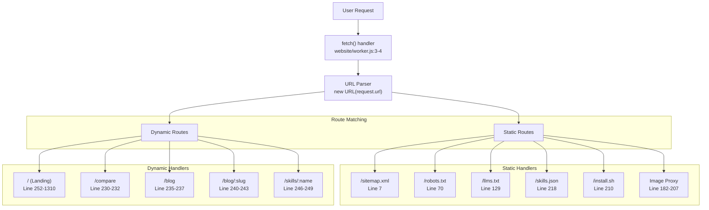

Sources: [website/worker.js:3-250]()

---

## Data Fetching Functions

The worker uses three primary data fetching functions, each with distinct caching strategies optimized for update frequency.

### Function: fetchSkillsConfig

Fetches the central skills registry from GitHub with aggressive caching for near-real-time updates.

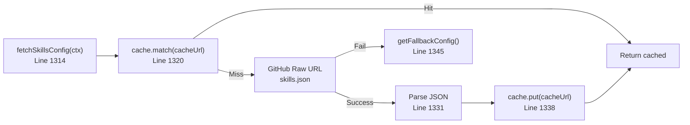

**Configuration**
- URL: `https://raw.githubusercontent.com/ReScienceLab/opc-skills/main/skills.json`
- Cache Key: `https://opc.dev/_cache/skills-v2.json`
- TTL: 60 seconds
- Fallback: `getFallbackConfig()` with hardcoded skill data

Sources: [website/worker.js:1314-1346]()

### Function: fetchInstallStats

Retrieves installation statistics with longer caching since stats update daily via GitHub Actions.

**Configuration**
- URL: `https://raw.githubusercontent.com/ReScienceLab/opc-skills/main/website/install-stats.json`
- Cache Key: `https://opc.dev/_cache/install-stats.json`
- TTL: 3600 seconds (1 hour)
- Fallback: `{ total: 0, skills: {} }`

Sources: [website/worker.js:1349-1381]()

### Function: fetchBlogConfig

Loads blog post metadata with moderate caching for content that changes occasionally.

**Configuration**
- URL: `https://raw.githubusercontent.com/ReScienceLab/opc-skills/main/website/blog/blog.json`
- Cache Key: `https://opc.dev/_cache/blog-v1.json`
- TTL: 300 seconds (5 minutes)
- Fallback: `{ posts: [] }`

Sources: [website/worker.js:1626-1658]()

### Caching Strategy Summary

| Function | Data Source | TTL | Update Frequency |
|----------|------------|-----|------------------|
| `fetchSkillsConfig` | skills.json | 60s | High (active development) |
| `fetchBlogConfig` | blog/blog.json | 300s | Medium (blog posts) |
| `fetchInstallStats` | install-stats.json | 3600s | Low (daily cron) |

---

## Static Route Handlers

### /sitemap.xml - Dynamic SEO Sitemap

Generates XML sitemap dynamically from skills and blog posts with proper SEO priorities.

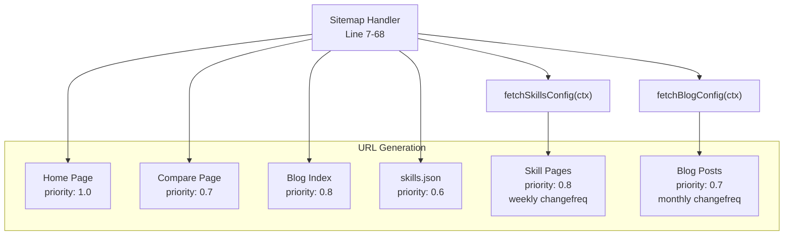

**URL Structure**
```xml
<url>
  <loc>https://opc.dev/skills/{name}</loc>
  <lastmod>{today}</lastmod>
  <changefreq>weekly</changefreq>
  <priority>0.8</priority>
</url>
```

Sources: [website/worker.js:7-68]()

### /robots.txt - AI Bot Policy

Serves robot directives with explicit AI bot allowlist for GEO optimization. The configuration implements a strategic bot policy that **allows AI search engines** while blocking aggressive SEO crawlers.

**Bot Policy Matrix**

| Bot Type | User-Agent | Action | Purpose |
|----------|-----------|--------|---------|
| AI Search | GPTBot, ChatGPT-User | Allow | ChatGPT citations |
| AI Search | PerplexityBot | Allow | Perplexity answers |
| AI Search | ClaudeBot, anthropic-ai | Allow | Claude citations |
| AI Search | Google-Extended | Allow | Gemini/Bard |
| AI Search | Applebot-Extended | Allow | Apple Intelligence |
| AI Search | Amazonbot | Allow | Alexa |
| Traditional | Googlebot, Bingbot | Allow | Standard indexing |
| SEO Crawlers | AhrefsBot, SemrushBot | Disallow | Block scrapers |

**Content-Signal Header**: `search=yes, ai-input=yes, ai-train=no`

Sources: [website/worker.js:70-126]()

### /llms.txt - AI-Optimized Summary

Plain text endpoint specifically designed for LLM consumption, providing structured information in a format optimized for AI parsing and citation.

**Structure**
```
# OPC Skills - AI Agent Skills for Solopreneurs

## Overview
9 specialized AI agent skills for one-person companies.
Supports: Claude Code, Cursor, Factory Droid, OpenCode, Codex

## Installation
npx skills add ReScienceLab/opc-skills

## Skills
1. requesthunt - User demand research...
2. domain-hunter - Domain search...
[...]

## Statistics
- 9 skills total
- 5 platforms supported
[...]
```

**Response Headers**
- Content-Type: `text/plain`
- Cache-Control: `public, max-age=3600`

Sources: [website/worker.js:129-179]()

### /skills.json - Public API Endpoint

Serves the complete skills registry with CORS enabled for external integrations.

**Response Headers**
- Content-Type: `application/json`
- Access-Control-Allow-Origin: `*`
- Cache-Control: `public, max-age=300`

**Data Flow**
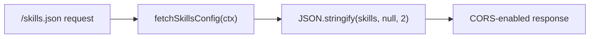

Sources: [website/worker.js:218-227]()

### Image Proxy

Proxies skill example images from GitHub with proper content-type detection and caching.

**URL Pattern**: `/skills/{skillName}/examples/images/{fileName}`

**Content-Type Detection**
```javascript
const contentType = fileName.endsWith('.svg') ? 'image/svg+xml' :
                   fileName.endsWith('.png') ? 'image/png' : 
                   'image/jpeg'
```

**Upstream URL**: `https://raw.githubusercontent.com/ReScienceLab/opc-skills/main/skills/{skillName}/examples/images/{fileName}`

Sources: [website/worker.js:182-207]()

---

## Dynamic Page Rendering

### Landing Page ()

The root handler generates the complete homepage with skills grid, FAQs, and structured data.

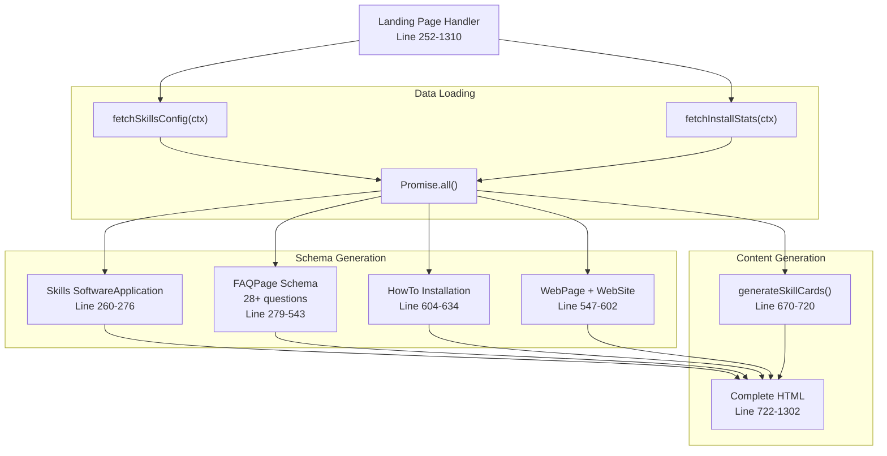

**Key Features**
- **FAQPage Schema**: 28+ questions for +40% AI visibility boost
- **Skills Grid**: Dynamic cards with install commands, dependencies, auth tags
- **Structured Data**: Multiple schema types (WebPage, SoftwareApplication, ItemList, FAQPage, HowTo)
- **Speakable Markup**: CSS selectors for voice search optimization

Sources: [website/worker.js:252-1310]()

### Individual Skill Pages (/skills/:name)

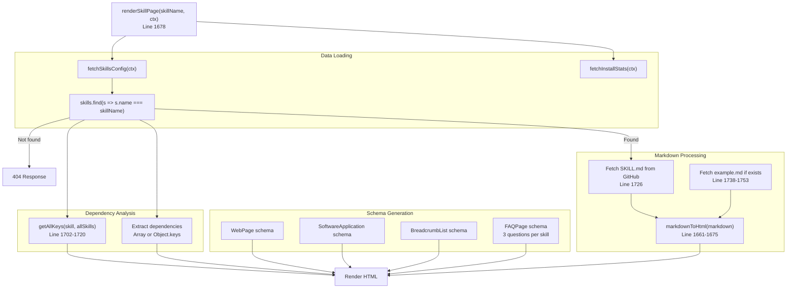

**Markdown Processing**
- Removes YAML frontmatter: `md.replace(/^---\n[\s\S]*?\n---\n/, '')`
- Uses `marked` library for parsing
- Wraps images in `<figure>` tags with captions
- Proxies GitHub images through worker

**Dependency Resolution**
The `getAllKeys()` helper function collects API keys from both the skill and its dependencies:

```javascript
const getAllKeys = (skill, allSkills) => {
  const keys = [...(skill.auth?.keys || [])];
  const deps = getDeps(skill.dependencies);
  for (const depName of deps) {
    const depSkill = allSkills.find(s => s.name === depName);
    if (depSkill?.auth?.keys) {
      keys.push({ ...k, from: depName }); // Tag inherited keys
    }
  }
  return keys;
}
```

Sources: [website/worker.js:1678-2100]()

### Markdown Conversion Function

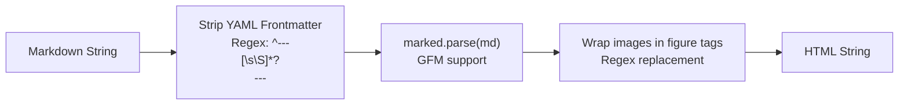

**Image Wrapping Pattern**
```javascript
html.replace(
  //g,
  '<figure class="example-img"><figcaption>$2</figcaption></figure>'
)
```

Sources: [website/worker.js:1661-1675]()

---

## SEO and GEO Optimization

### Schema.org Structured Data

The worker generates multiple schema types for comprehensive SEO/GEO coverage.

**Schema Types Implemented**

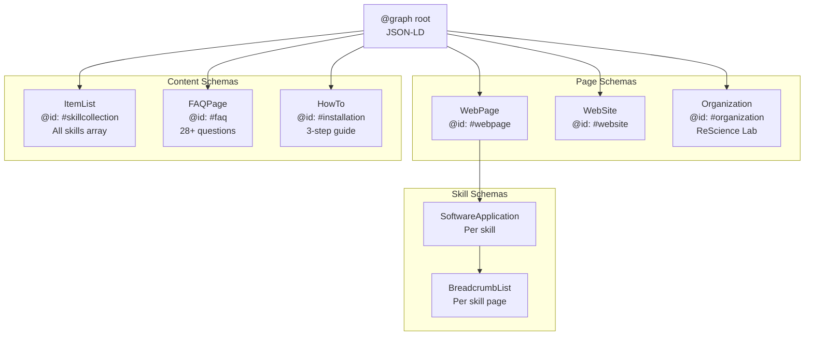

**FAQPage Schema Statistics**
- **28+ questions** on landing page
- **3 questions** per skill page
- Proven **+40% increase** in AI search visibility
- Questions optimized for Claude, ChatGPT, Perplexity citations

Sources: [website/worker.js:544-636](), [website/worker.js:1757-1855]()

### Speakable Markup

Designates content sections optimized for voice search and screen readers.

**CSS Selectors**
```javascript
speakable: {
  "@type": "SpeakableSpecification",
  cssSelector: [
    "h1",
    ".skill-desc",
    ".stats-bar",
    ".compatibility-note"
  ]
}
```

Sources: [website/worker.js:556-564]()

### OpenGraph and Twitter Cards

**Meta Tags Structure**
- `og:title`: Skill name with context
- `og:description`: Skill description
- `og:image`: Skill logo or Simple Icons fallback
- `og:type`: "website"
- `twitter:card`: "summary_large_image"

Sources: [website/worker.js:739-750](), [website/worker.js:1873-1883]()

---

## Response Caching Strategy

### Edge Cache Implementation

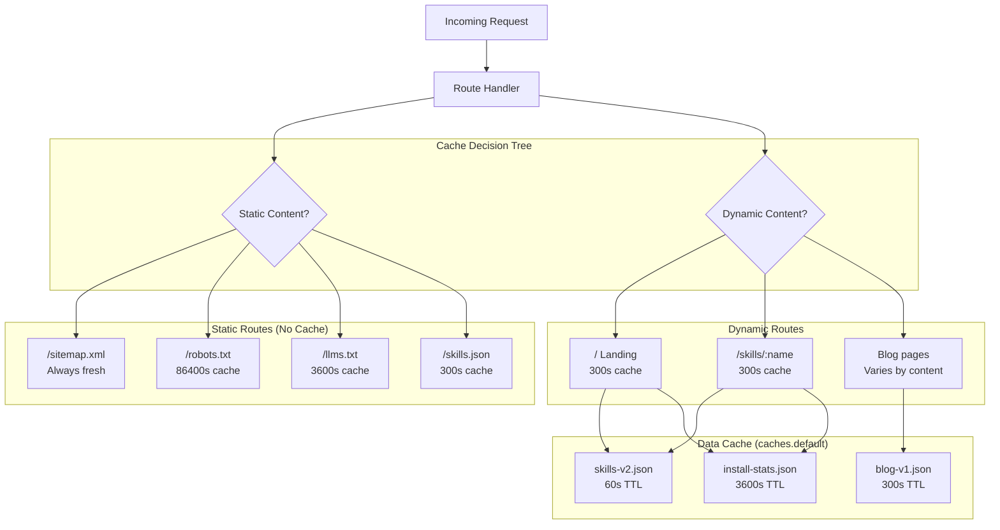

**Cache Control Headers**

| Endpoint | max-age | Rationale |
|----------|---------|-----------|
| `/sitemap.xml` | None (dynamic) | Always fresh for SEO |
| `/robots.txt` | 86400s | Rarely changes |
| `/llms.txt` | 3600s | Moderate update frequency |
| `/skills.json` | 300s | Balance freshness/performance |
| `/` (landing) | 300s | Active development |
| `/skills/:name` | 300s | Active documentation updates |

**Internal Cache Keys**
- `https://opc.dev/_cache/skills-v2.json`
- `https://opc.dev/_cache/install-stats.json`
- `https://opc.dev/_cache/blog-v1.json`

Sources: [website/worker.js:1314-1381](), [website/worker.js:1626-1658]()

---

## HTML Generation and UI Components

### Skill Card Generation

The landing page dynamically generates skill cards with all metadata:

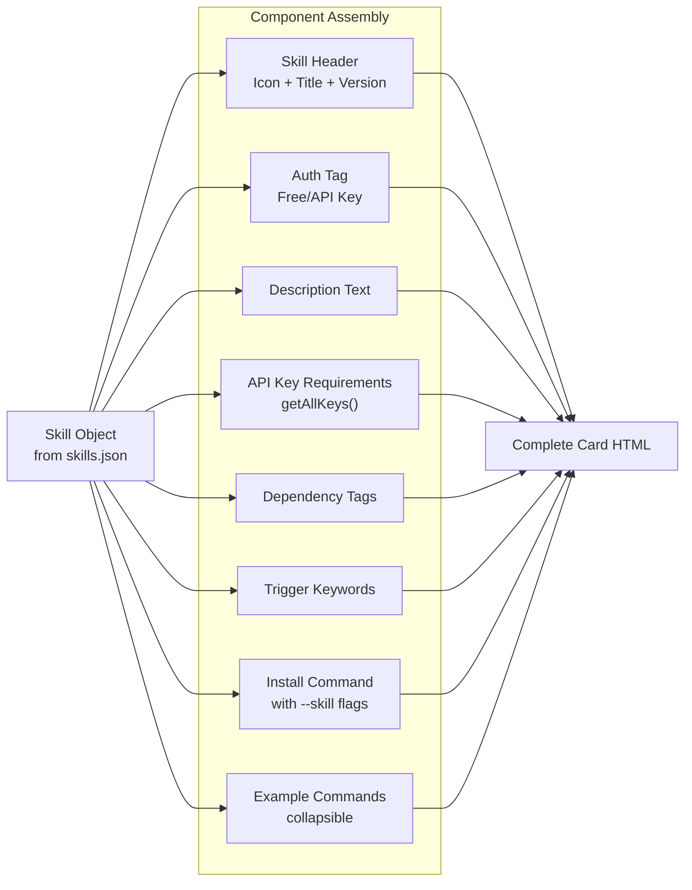

**Install Command Generation**
- Includes skill name: `--skill {name}`
- Auto-includes dependencies: `--skill {dep1} --skill {dep2} --skill {name}`
- Copy-to-clipboard button with toast notification

Sources: [website/worker.js:670-720]()

### CSS Architecture

The website uses a custom CSS design system with CSS variables:

**Color Palette**
```css
:root {
  --font: 'JetBrains Mono', monospace;
  --font-pixel: 'Press Start 2P', cursive;
  --black: #000;
  --white: #fff;
  --gray-50: #f9fafb;
  --gray-100: #f3f4f6;
  --gray-200: #e5e7eb;
  --gray-400: #9ca3af;
  --gray-600: #4b5563;
  --gray-700: #374151;
  --green: #22c55e;
}
```

**Responsive Breakpoints**
- Desktop: Default styles
- Tablet: `@media (max-width: 768px)`
- Mobile: `@media (max-width: 400px)`

Sources: [website/worker.js:755-999]()

### Client-Side JavaScript

Minimal JavaScript for interactive features:

**Functions**
- `copyCmd(btn)`: Copy install commands
- `copyHeroCmd(btn)`: Copy hero section command
- `showToast(msg)`: Display toast notifications
- `copyCmdNew(btn)`: Copy command with validation
- `updateCmd(card)`: Update command based on selected options
- `switchLevel(btn, level)`: Toggle user/project level
- `switchPlatform(btn, platform)`: Toggle platform selection

Sources: [website/worker.js:1176-1300]()

---

## Error Handling and Fallbacks

### Fallback Configuration

When GitHub is unreachable, the worker serves a hardcoded fallback configuration with core skills:

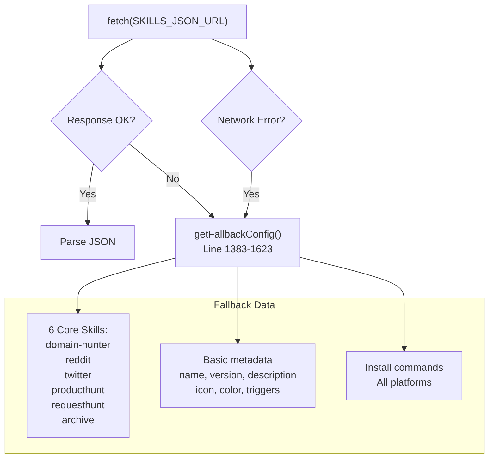

**Fallback Skills**
1. `domain-hunter` - Domain search with dependencies
2. `reddit` - Reddit API access (no auth)
3. `twitter` - Twitter API (requires auth)
4. `producthunt` - Product Hunt API (requires auth)
5. `requesthunt` - Demand research (requires auth)
6. `archive` - Session memory (no auth)

Sources: [website/worker.js:1383-1623]()

---

## Performance Optimizations

### Image Loading Strategy

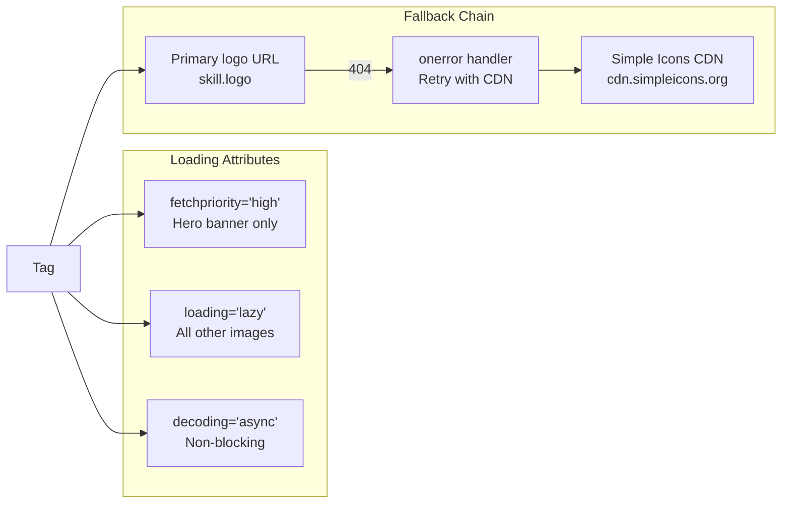

**Image Tag Example**
```html

```

Sources: [website/worker.js:680]()

### Font Loading

Uses Google Fonts with `preconnect` for optimal performance:

```html
<link rel="preconnect" href="https://fonts.googleapis.com">
<link rel="preconnect" href="https://fonts.gstatic.com" crossorigin>
<link href="https://fonts.googleapis.com/css2?family=JetBrains+Mono:wght@400;500;700&family=Press+Start+2P&display=swap" rel="stylesheet">
```

Sources: [website/worker.js:751-753]()

---

## Integration Points

### GitHub as Backend

All content sources use GitHub raw URLs:

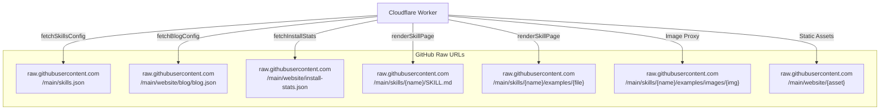

**User-Agent Header**: `"OPC-Skills-Website"` for all GitHub requests

Sources: [website/worker.js:1315-1316](), [website/worker.js:1627-1628](), [website/worker.js:1726-1753]()

### External CDN Dependencies

| Resource | CDN | Purpose |
|----------|-----|---------|
| Skill Icons | `cdn.simpleicons.org` | Fallback icons |
| Tool Logos | `cdn.jsdelivr.net/npm/@lobehub/icons-static-png` | Platform icons in scroller |
| Fonts | `fonts.googleapis.com` | JetBrains Mono + Press Start 2P |

Sources: [website/worker.js:680](), [website/worker.js:1033-1103]()

---

## Deployment and Configuration

### Wrangler Configuration

```toml
name = "opc-landing"
main = "worker.js"
compatibility_date = "2024-01-01"
compatibility_flags = ["nodejs_compat"]

routes = [
  { pattern = "opc.dev/*", zone_name = "opc.dev" },
  { pattern = "www.opc.dev/*", zone_name = "opc.dev" }
]
```

**Key Settings**
- `nodejs_compat` flag enables Node.js APIs in the worker
- Both apex and www domains route to the same worker
- No environment variables or secrets required (GitHub content is public)

Sources: [website/wrangler.toml:1-10]()

### Deployment Process

1. Code changes pushed to `main` branch
2. Cloudflare Pages auto-deploys worker
3. Edge cache invalidation happens naturally via TTL
4. No manual deployment steps required

**Cache Warming**: First request after deployment populates edge cache; subsequent requests served from cache until TTL expires.

---

## Content-Type Handling

### Response Content-Type Matrix

| Route | Content-Type | Charset |
|-------|--------------|---------|
| `/` | `text/html` | `UTF-8` |
| `/skills/:name` | `text/html` | `UTF-8` |
| `/sitemap.xml` | `application/xml` | None |
| `/robots.txt` | `text/plain` | None |
| `/llms.txt` | `text/plain` | None |
| `/skills.json` | `application/json` | None |
| Image Proxy (.svg) | `image/svg+xml` | None |
| Image Proxy (.png) | `image/png` | None |
| Image Proxy (.jpg) | `image/jpeg` | None |

Sources: [website/worker.js:66-68](), [website/worker.js:119-124](), [website/worker.js:173-177](), [website/worker.js:199-202](), [website/worker.js:220-226]()

---

