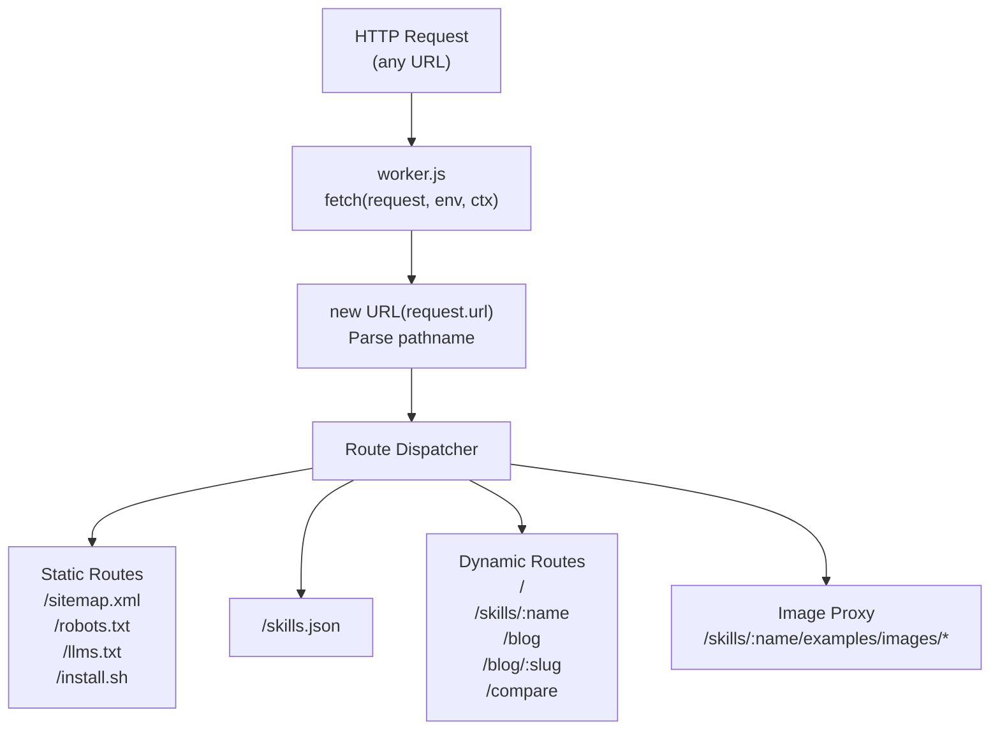
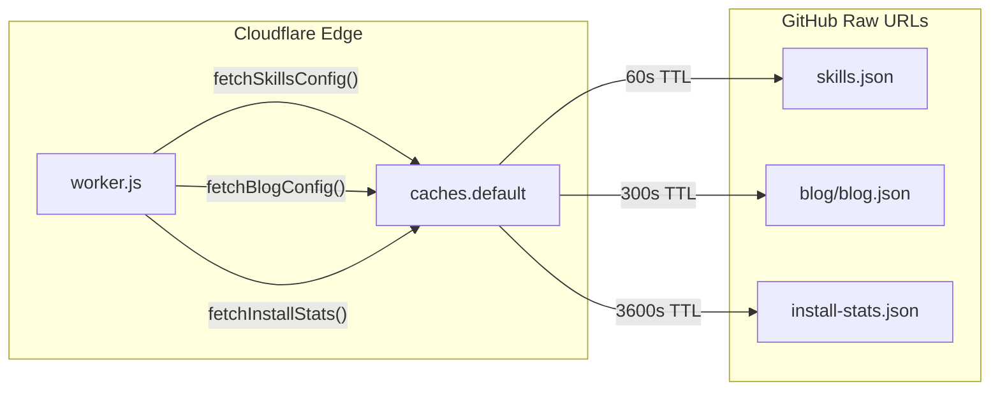
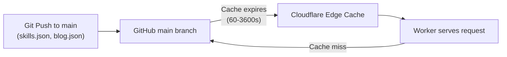

<!-- source: DeepWiki mcp.deepwiki.com · repo ReScienceLab/opc-skills · page 4.1 Website Architecture · fetched 2026-10-26 -->

# Website Architecture

<details>
<summary>Relevant source files</summary>

The following files were used as context for generating this wiki page:

- [website/worker.js](website/worker.js)
- [website/wrangler.toml](website/wrangler.toml)

</details>


## Purpose and Scope

This document covers the Cloudflare Workers-based website architecture that powers opc.dev and www.opc.dev. It explains the deployment configuration, request routing system, and the GitHub-as-backend data fetching strategy. For information about SEO/GEO optimization techniques, see [4.5](#4.5). For API endpoint documentation, see [4.4](#4.4). For caching implementation details, see [4.3](#4.3).

## Deployment Platform: Cloudflare Workers

The website runs entirely on Cloudflare's edge network using a single Worker script. The `worker.js` file implements a fetch handler that processes all HTTP requests at the edge, eliminating the need for traditional web servers or hosting infrastructure.

### Configuration

The Worker is configured via `wrangler.toml`:

| Configuration Key | Value | Purpose |
|-------------------|-------|---------|
| `name` | `"opc-landing"` | Worker identifier in Cloudflare dashboard |
| `main` | `"worker.js"` | Entry point for the Worker script |
| `compatibility_date` | `"2024-01-01"` | Cloudflare runtime compatibility version |
| `compatibility_flags` | `["nodejs_compat"]` | Enables Node.js compatibility APIs |
| `routes` | `opc.dev/*`, `www.opc.dev/*` | Domain patterns this Worker handles |

The Worker is bound to both the apex domain (`opc.dev`) and the `www` subdomain, with `zone_name: "opc.dev"` indicating the Cloudflare zone.

**Sources:** [website/wrangler.toml:1-10]()

### Worker Entry Point

The Worker exports a single `fetch` handler that receives all HTTP requests:



**Diagram: Worker Request Flow**

Sources: [website/worker.js:3-6]()

## GitHub-as-Backend Architecture

The website does not maintain its own database or content management system. Instead, it fetches all dynamic content from the GitHub repository's `main` branch via raw content URLs. This creates a "GitHub-as-CMS" architecture where the Git repository serves as the single source of truth.

### Data Fetching Functions

Three core functions fetch content from GitHub with different caching strategies:



**Diagram: Data Fetching Architecture**

| Function | GitHub URL | Cache TTL | Purpose |
|----------|-----------|-----------|---------|
| `fetchSkillsConfig()` | `raw.githubusercontent.com/.../skills.json` | 60 seconds | Skill metadata and registry |
| `fetchBlogConfig()` | `raw.githubusercontent.com/.../blog/blog.json` | 300 seconds | Blog post metadata |
| `fetchInstallStats()` | `raw.githubusercontent.com/.../install-stats.json` | 3600 seconds | Installation statistics from skills.sh |

Each function implements the same caching pattern:
1. Generate a unique cache URL (e.g., `https://opc.dev/_cache/skills-v2.json`)
2. Check Cloudflare's edge cache via `caches.default.match()`
3. If cache miss, fetch from GitHub raw URL
4. Store response in edge cache with appropriate TTL
5. Return parsed JSON data

**Sources:** [website/worker.js:1314-1381]()

### Fallback Configuration

The `getFallbackConfig()` function provides hardcoded skill data in case GitHub is unreachable. This ensures the website remains partially functional even if GitHub API fails. The fallback includes 6 core skills (domain-hunter, reddit, twitter, producthunt, requesthunt, archive) with full metadata.

**Sources:** [website/worker.js:1383-1623]()

## Request Routing System

The Worker implements pattern matching on `url.pathname` to dispatch requests to appropriate handlers. Routes are evaluated in order of appearance in the code.

### Route Dispatch Table

```mermaid
graph TB
    URLPath["url.pathname"]
    
    URLPath -->|"/sitemap.xml"| Sitemap["Generate Dynamic Sitemap<br/>Line 7-68"]
    URLPath -->|"/robots.txt"| Robots["Static robots.txt<br/>Line 70-126"]
    URLPath -->|"/llms.txt"| LLMs["AI-Optimized Summary<br/>Line 129-179"]
    URLPath -->|"/skills/:name/examples/images/*"| ImgProxy["Image Proxy<br/>Line 182-207"]
    URLPath -->|"/install.sh"| Redirect["302 Redirect to GitHub<br/>Line 210-215"]
    URLPath -->|"/skills.json"| SkillsJSON["Serve skills.json<br/>Line 218-227"]
    URLPath -->|"/compare"| Compare["renderComparePage()<br/>Line 230-232"]
    URLPath -->|"/blog"| BlogList["renderBlogListPage()<br/>Line 235-237"]
    URLPath -->|"/blog/:slug"| BlogPost["renderBlogPost(slug)<br/>Line 240-243"]
    URLPath -->|"/skills/:name"| SkillPage["renderSkillPage(name)<br/>Line 246-249"]
    URLPath -->|"/"| Landing["Render Landing Page<br/>Line 252+"]
```



**Diagram: Route Dispatcher Logic**

The routing logic uses regular expressions for parameterized routes:
- `/skills/([a-z-]+)` captures skill name (line 246)
- `/blog/([a-z0-9-]+)` captures blog post slug (line 240)
- `/skills/([a-z-]+)/examples/images/(.+)` captures skill name and image filename (line 182-183)

**Sources:** [website/worker.js:7-249]()

## Static Route Handlers

Static routes return pre-generated or templated responses without fetching dynamic data.

### /robots.txt

Returns a static text file with bot directives. Explicitly allows AI search engines (GPTBot, ClaudeBot, PerplexityBot, Google-Extended) while blocking SEO crawlers (AhrefsBot, SemrushBot). Includes custom `Content-Signal` header for GEO optimization.

**Sources:** [website/worker.js:70-126]()

### /llms.txt

Generates a plain-text summary optimized for AI language models. Includes:
- Overview of 9 skills
- Installation command
- Key statistics (platforms, license, FAQ count)
- Documentation links

This endpoint serves AI search engines that prefer plain text over HTML. Cache TTL is 3600 seconds.

**Sources:** [website/worker.js:129-179]()

### /sitemap.xml

Dynamically generates an XML sitemap by:
1. Fetching `skills.json` to enumerate all skills
2. Fetching `blog.json` to enumerate all blog posts
3. Constructing `<url>` entries for each skill and blog post
4. Including static pages (homepage, compare, blog index)

Each URL includes `lastmod`, `changefreq`, and `priority` metadata for SEO.

**Sources:** [website/worker.js:7-68]()

### /install.sh

Issues a 302 redirect to the GitHub README installation section. This allows the short URL `curl opc.dev/install.sh` to work while maintaining GitHub as the canonical installation documentation.

**Sources:** [website/worker.js:210-215]()

## Dynamic Route Handlers

Dynamic routes fetch content from GitHub and render HTML pages with embedded JSON-LD structured data.

### Landing Page ()

The root route renders the main landing page:

1. Fetches `skills.json` via `fetchSkillsConfig()`
2. Fetches `install-stats.json` via `fetchInstallStats()`
3. Generates skill cards for all skills with:
   - Install commands including dependencies
   - API key requirements
   - Trigger keywords
   - Installation statistics
4. Embeds extensive JSON-LD markup:
   - `WebPage` with speakable schema
   - `ItemList` with all skills
   - `FAQPage` with 28+ questions
   - `HowTo` schema for installation
5. Returns HTML with inline CSS (1300+ lines)

The HTML includes responsive design, copy-to-clipboard functionality, and platform-specific install commands.

**Sources:** [website/worker.js:252-1310]()

### Individual Skill Pages (/skills/:name)

The `renderSkillPage(skillName, ctx)` function:

1. Fetches skill metadata from `skills.json`
2. Returns 404 if skill not found
3. Fetches `SKILL.md` from GitHub: `raw.githubusercontent.com/.../skills/{skillName}/SKILL.md`
4. Converts markdown to HTML via `markdownToHtml()` using the `marked` library
5. If skill has an example link, fetches and renders the example markdown
6. Generates skill-specific JSON-LD with:
   - `SoftwareApplication` schema
   - `BreadcrumbList` navigation
   - `FAQPage` with skill-specific questions
7. Renders HTML with skill metadata, dependencies, API key requirements, and full documentation

The function collects API keys from both the skill itself and its dependencies using `getAllKeys()`.

**Sources:** [website/worker.js:1677-2338]()

### Blog Routes

Two blog routes are handled:

**Blog List (/blog):** Calls `renderBlogListPage(ctx)` which fetches `blog.json` and renders a list of all blog posts with metadata.

**Individual Posts (/blog/:slug):** Calls `renderBlogPost(slug, ctx)` which fetches the post's markdown file from GitHub and renders it with BlogPosting schema.

**Sources:** [website/worker.js:235-243]()

## Content Rendering Pipeline

### Markdown Processing

The `markdownToHtml(md)` function:

1. Strips YAML frontmatter (lines starting with `---\n`)
2. Converts markdown to HTML using `marked.parse()`
3. Wraps images in `<figure>` tags with captions for grid layout
4. Returns sanitized HTML

This function is used for rendering SKILL.md files, example workflows, and blog posts.

**Sources:** [website/worker.js:1661-1675]()

### Image Proxy

The Worker proxies images from GitHub to serve them with appropriate content types:

```
/skills/{skillName}/examples/images/{fileName}
  ↓
https://raw.githubusercontent.com/ReScienceLab/opc-skills/main/skills/{skillName}/examples/images/{fileName}
```

Detects content type from file extension (.svg → image/svg+xml, .png → image/png, .jpg → image/jpeg) and sets 3600-second cache control.

**Sources:** [website/worker.js:182-207]()

## Response Headers and Caching

### Standard Response Headers

All responses include appropriate headers:

| Route Type | Content-Type | Cache-Control | Additional Headers |
|-----------|--------------|---------------|-------------------|
| HTML pages | `text/html;charset=UTF-8` | `public, max-age=300` | - |
| /skills.json | `application/json` | `public, max-age=300` | `Access-Control-Allow-Origin: *` |
| /sitemap.xml | `application/xml` | - | - |
| /robots.txt | `text/plain` | `public, max-age=86400` | `X-Robots-Tag: all` |
| /llms.txt | `text/plain` | `public, max-age=3600` | - |
| Images | `image/*` | `public, max-age=3600` | - |

### Cache Key Strategy

Cloudflare edge cache uses synthetic URLs as cache keys:
- `https://opc.dev/_cache/skills-v2.json` for skills config
- `https://opc.dev/_cache/blog-v1.json` for blog config  
- `https://opc.dev/_cache/install-stats.json` for statistics

These cache keys are versioned (v1, v2) allowing cache busting when data structures change.

**Sources:** [website/worker.js:1318-1380]()

## Deployment and Updates

### Continuous Deployment

The Worker is deployed via Cloudflare Pages with automatic deployments from the `main` branch. Any push to main triggers:

1. Wrangler build of worker.js
2. Deployment to Cloudflare's edge network
3. Instant propagation to 200+ edge locations worldwide

There is no build step or static site generation. The Worker serves dynamic content on every request, fetching fresh data from GitHub with edge caching for performance.

### Zero-Downtime Updates

Content updates follow this flow:



**Diagram: Content Update Propagation**

Updates to `skills.json` propagate within 60 seconds (cache TTL). Updates to `install-stats.json` take up to 1 hour. This allows rapid content iteration without redeploying the Worker.

**Sources:** [website/worker.js:1314-1381]()

## Error Handling and Resilience

The Worker implements multiple fallback strategies:

1. **GitHub Fetch Failures:** If fetching from GitHub fails, `getFallbackConfig()` provides hardcoded skill data
2. **Missing Skills:** Individual skill pages return 404 with plain text "Skill not found"
3. **Missing Images:** Image proxy returns 404 with "Image not found" message
4. **Markdown Parse Errors:** The `markdownToHtml()` function gracefully handles malformed markdown

All fetch operations are wrapped in try-catch blocks that log errors but don't crash the Worker.

**Sources:** [website/worker.js:1325-1345](), [website/worker.js:1686-1689](), [website/worker.js:1728-1733](), [website/worker.js:193-206]()

---

