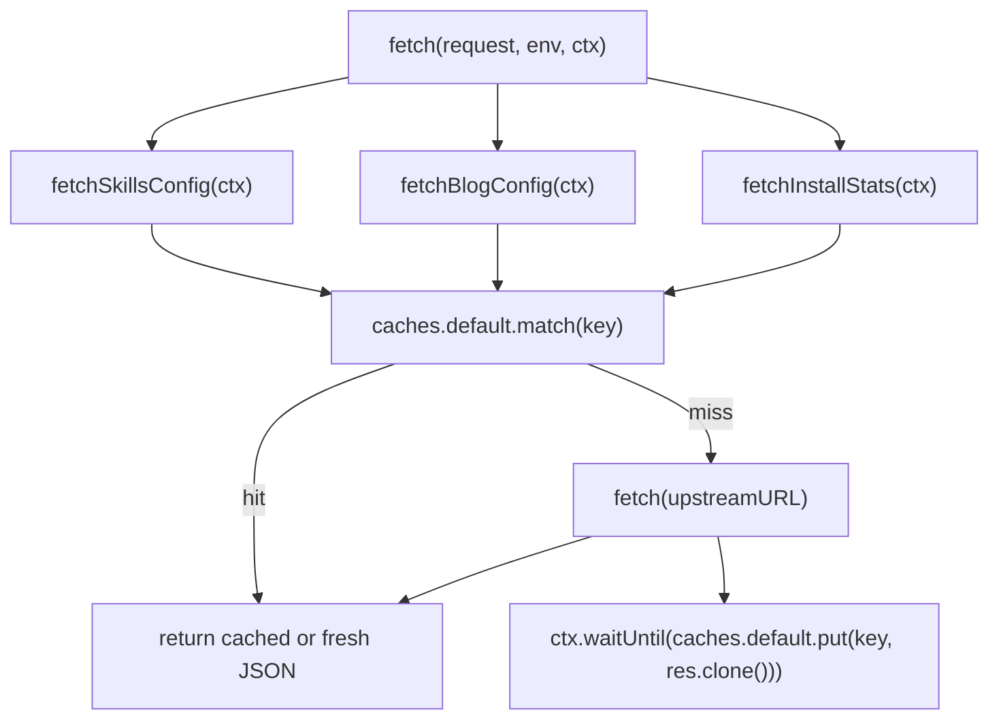
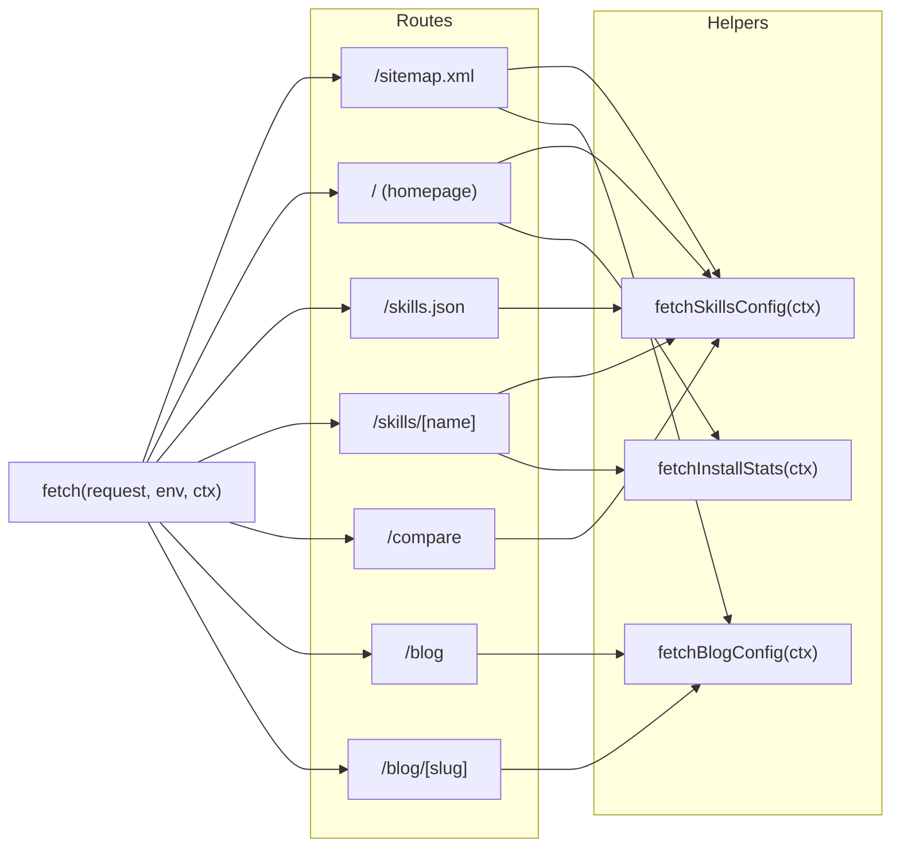
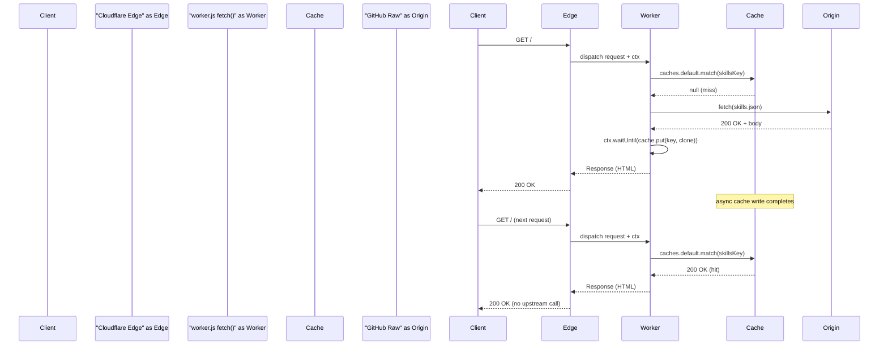

<!-- source: DeepWiki mcp.deepwiki.com · repo ReScienceLab/opc-skills · page 4.3 Caching Strategy · fetched 2026-10-26 -->

# Caching Strategy

<details>
<summary>Relevant source files</summary>

The following files were used as context for generating this wiki page:

- [website/worker.js](website/worker.js)
- [website/wrangler.toml](website/wrangler.toml)

</details>


This page documents how `website/worker.js` caches upstream data fetches at the Cloudflare edge. The focus is on the three helper functions — `fetchSkillsConfig`, `fetchBlogConfig`, and `fetchInstallStats` — and how they use the `ctx` execution context to avoid redundant network calls. For route-level details such as which URL paths call these helpers, see [4.2](#4.2). For the overall architecture of the worker, see [4.1](#4.1).

---

## Background: Cloudflare Worker Execution Context

The main entry point of the worker is:

[website/worker.js:3-4]()

```js
async fetch(request, env, ctx)
```

`ctx` is a [`ExecutionContext`](https://developers.cloudflare.com/workers/runtime-apis/context) object provided by the Cloudflare runtime. Its primary method relevant to caching is `ctx.waitUntil(promise)`, which extends the Worker's lifetime so that async side-effects (like writing to the Cache API) can complete *after* the response has been sent to the client.

The Cloudflare Cache API (`caches.default`) provides a per-datacenter, per-URL key-value store for HTTP responses. The standard pattern is:

1. Compute a cache key (typically a `Request` or URL string).
2. Call `caches.default.match(key)` — return cached response if found.
3. On a miss, fetch from the upstream origin.
4. Use `ctx.waitUntil(caches.default.put(key, response.clone()))` to write to cache without blocking the response.

---

## Cached Upstream Data Sources

Three upstream sources are fetched from GitHub (raw content) and cached at the edge:

| Helper Function | Upstream Source | Used By Routes |
|---|---|---|
| `fetchSkillsConfig(ctx)` | `skills.json` on GitHub | `/`, `/skills/[name]`, `/compare`, `/skills.json`, `/sitemap.xml` |
| `fetchBlogConfig(ctx)` | `blog.json` on GitHub | `/`, `/blog`, `/blog/[slug]`, `/sitemap.xml` |
| `fetchInstallStats(ctx)` | `website/install-stats.json` on GitHub | `/`, `/skills/[name]` |

All three accept `ctx` as their sole parameter, enabling them to read from and write to the Cloudflare edge cache.

**Sources:**
- [website/worker.js:8-11]()
- [website/worker.js:218-219]()
- [website/worker.js:251-255]()

---

## How `ctx` Flows Through the Worker

**Diagram: ctx parameter propagation**



Sources: [website/worker.js:3-255]()

---

## Route-Level Call Sites

Each route handler that needs data calls one or more of the helpers. The `ctx` object is passed through from the top-level `fetch` handler every time.

**Diagram: Route handlers and which fetch helpers they call**



Sources: [website/worker.js:7-255]()

---

## Response-Level `Cache-Control` Headers

In addition to the internal edge cache for upstream fetches, several final HTTP responses sent to clients include explicit `Cache-Control` headers. These instruct Cloudflare's CDN and end-user browsers to cache responses downstream.

| Route | `Cache-Control` value | TTL |
|---|---|---|
| `/robots.txt` | `public, max-age=86400` | 24 hours |
| `/llms.txt` | `public, max-age=3600` | 1 hour |
| `/skills/[name]/examples/images/...` | `public, max-age=3600` | 1 hour |
| `/skills.json` | `public, max-age=300` | 5 minutes |

The short TTL on `/skills.json` reflects that it exposes the live skills registry, which updates more frequently than static assets.

Sources: [website/worker.js:118-125]()  [website/worker.js:173-178]()  [website/worker.js:197-202]()  [website/worker.js:220-226]()

---

## Cache Miss vs. Cache Hit Request Flow

**Diagram: Full request lifecycle for a cache miss and subsequent hit**



Sources: [website/worker.js:3-255]()

---

## Relationship to the Install Stats Pipeline

`fetchInstallStats(ctx)` caches `website/install-stats.json`, which is committed to the repository daily by the GitHub Actions workflow in `.github/workflows/fetch-install-stats.yml`. The data originates from `scripts/fetch-install-stats.py`, which scrapes `skills.sh`. Because the file is updated only once per day (via cron at 06:00 UTC), the cached copy at the edge will remain accurate for its full TTL before needing a refresh.

For more details on how the stats file is generated and updated, see [3.5](#3.5).

Sources: [website/install-stats.json:1-16]()  [.github/workflows/fetch-install-stats.yml:1-36]()  [scripts/fetch-install-stats.py:1-67]()

---

