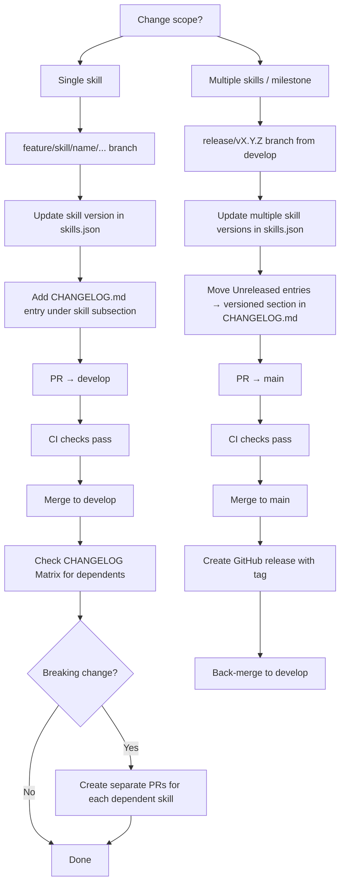
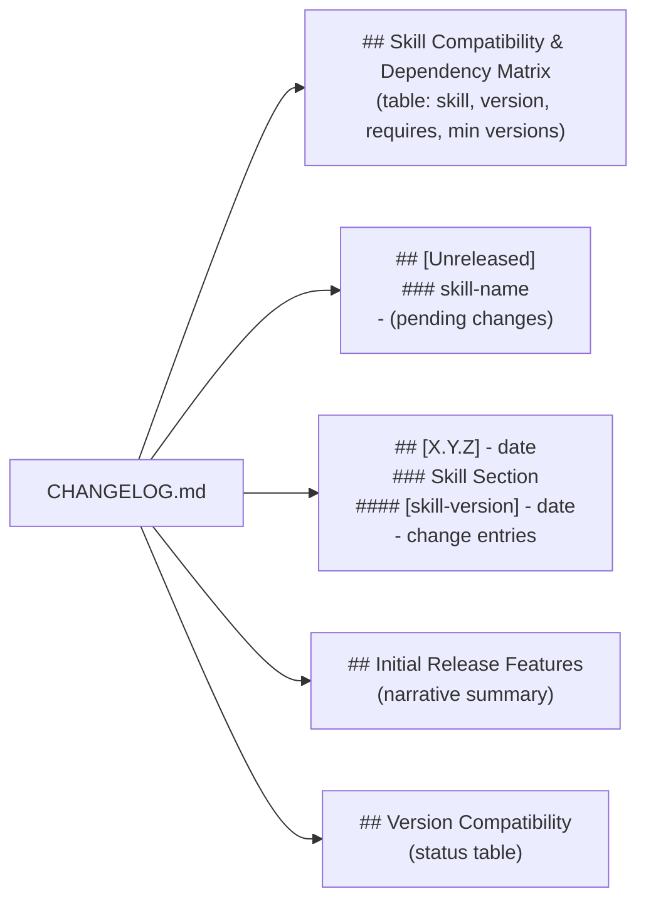
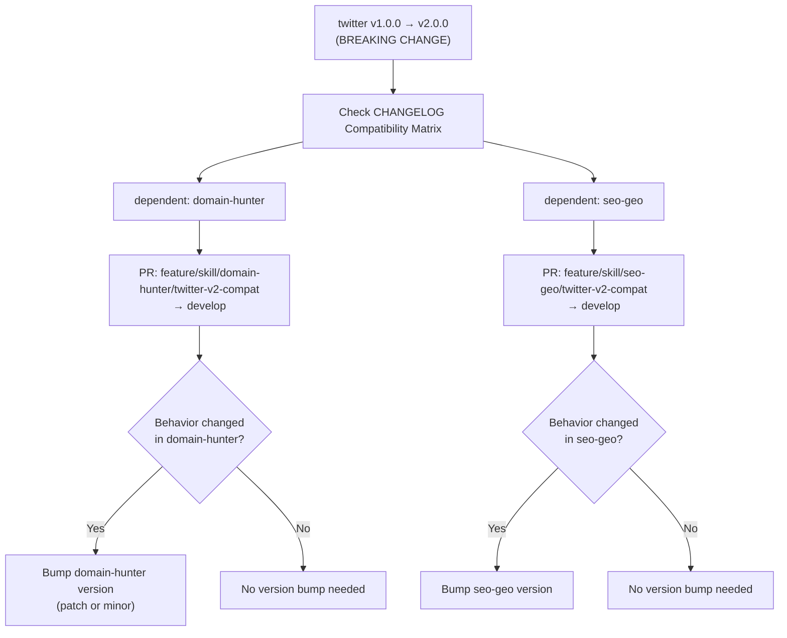
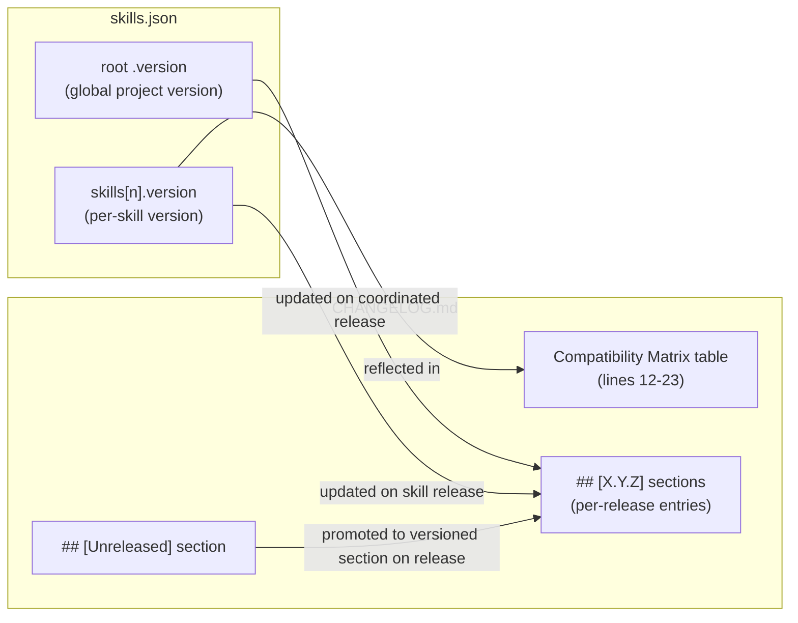

<!-- source: DeepWiki mcp.deepwiki.com · repo ReScienceLab/opc-skills · page 6.4 Release Management · fetched 2026-10-26 -->

# Release Management

<details>
<summary>Relevant source files</summary>

The following files were used as context for generating this wiki page:

- [.factory/AGENTS.md](.factory/AGENTS.md)
- [CHANGELOG.md](CHANGELOG.md)
- [template/SKILL.md](template/SKILL.md)
- [website/blog/posts/why-skills-beat-docs.md](website/blog/posts/why-skills-beat-docs.md)

</details>


This page documents the versioning strategy, release workflows, and changelog maintenance practices for the OPC Skills project. It covers how individual skill versions are managed independently, how multi-skill coordinated releases work, and how breaking changes in shared dependencies are handled.

For related topics, see:
- [6.1](#6.1) for the Git branching strategy (feature branches, release branches, hotfixes)
- [6.2](#6.2) for the CI/CD testing pipeline that must pass before any release
- [2.3](#2.3) for how dependency version constraints are declared and validated

---

## Versioning Model

OPC Skills uses two parallel version numbers:

| Version | Location | Purpose |
|---|---|---|
| **Global project version** | `skills.json` `"version"` field (line 2) | Tracks the overall project across coordinated releases |
| **Individual skill version** | Each skill's `"version"` field in `skills.json` | Tracks changes independently per skill |

Both follow [Semantic Versioning](https://semver.org): `MAJOR.MINOR.PATCH`.

As of the current codebase state, the global version is `1.0.10` and all skills are at `1.0.0` except `archive` which is at `1.0.1` — reflecting that skills can advance at different rates.

Sources: [skills.json:1-3](), [skills.json:494-497](), [CHANGELOG.md:1-30]()

---

## Version Bump Decision Logic

**When to bump and by how much:**

| Change Type | MAJOR | MINOR | PATCH | No bump |
|---|:---:|:---:|:---:|:---:|
| Breaking API change or incompatible update | ✓ | | | |
| New backward-compatible feature or enhancement | | ✓ | | |
| Bug fix or minor improvement | | | ✓ | |
| Documentation-only change | | | | ✓ |
| Internal refactoring with no behavior change | | | | ✓ |
| Dependency version bump (non-breaking) | | | | ✓ |

The rules are applied **per skill**. A change to `twitter` does not require a version bump to `reddit` unless `reddit`'s behavior changes.

Sources: [.factory/AGENTS.md:328-337]()

---

## Release Flows

There are two distinct release paths depending on the scope of changes.

**Release flow overview:**



Sources: [.factory/AGENTS.md:348-472]()

---

### Quick Release — Single Skill

Each skill can be released independently without coordinating with other skills. The steps below show an example update of `twitter` from `1.0.0` to `1.1.0`.

**Step-by-step:**

1. Create a feature branch from `develop`:
   ```
   feature/skill/twitter/rate-limit-improvement
   ```

2. Update only the relevant skill's `"version"` field in `skills.json`. No other skill versions change.

3. Add a CHANGELOG entry under the `[Unreleased]` section, nested under the skill name:
   ```
   ### twitter
   #### [1.1.0] - 2025-01-22
   - **Added**: Retry mechanism for rate limit handling
   ```

4. Commit using a conventional commit message:
   ```
   feat(twitter): Add retry mechanism and improve rate limiting
   ```

5. Open a PR targeting `develop`. After CI passes and it is merged, check the compatibility matrix in `CHANGELOG.md` to identify which skills depend on `twitter` (`domain-hunter`, `seo-geo`). Run compatibility checks. If no breaking changes, no further action is needed.

Sources: [.factory/AGENTS.md:352-396](), [CHANGELOG.md:8-30]()

---

### Coordinated Release — Multiple Skills

Used for milestone releases when multiple skills need to be versioned together. This is the less common path.

**Step-by-step:**

1. Branch from `develop`:
   ```
   release/v2.0.0
   ```

2. Update multiple skill version entries in `skills.json`.

3. In `CHANGELOG.md`, move all items out of `[Unreleased]` subsections and into a new top-level `## [2.0.0] - YYYY-MM-DD` section, preserving the per-skill sub-structure.

4. Run tests: `npm run test && npm run typecheck`.

5. Create a single PR targeting `main` with commit message:
   ```
   chore(release): Version 2.0.0 - multiple skill updates
   ```

6. After merge, create a GitHub release with a version tag.

7. Back-merge `main` to `develop` (hotfix branches also follow this pattern).

Sources: [.factory/AGENTS.md:399-437]()

---

## CHANGELOG.md Structure

The `CHANGELOG.md` file has two structural responsibilities: a **compatibility matrix** and a **versioned history**.

**CHANGELOG.md file structure:**



Sources: [CHANGELOG.md:1-50]()

### Skill Compatibility Matrix

The top of `CHANGELOG.md` contains a table showing every skill's current version and its required dependencies. This is the primary reference for identifying which skills are affected when a dependency changes.

| Skill | Current Version | Requires | Min Versions |
|---|---|---|---|
| **requesthunt** | 1.0.0 | — | — |
| **domain-hunter** | 1.0.0 | twitter, reddit | twitter ≥1.0.0, reddit ≥1.0.0 |
| **logo-creator** | 1.0.0 | nanobanana | nanobanana ≥1.0.0 |
| **banner-creator** | 1.0.0 | nanobanana | nanobanana ≥1.0.0 |
| **nanobanana** | 1.0.0 | — | — |
| **reddit** | 1.0.0 | — | — |
| **twitter** | 1.0.0 | — | — |
| **producthunt** | 1.0.0 | — | — |
| **seo-geo** | 1.0.0 | twitter, reddit | twitter ≥1.0.0, reddit ≥1.0.0 |
| **archive** | 1.0.1 | — | — |

This table is maintained manually in [CHANGELOG.md:12-23]().

Sources: [CHANGELOG.md:8-30]()

---

## Handling Breaking Changes in Dependency Skills

When a shared dependency skill (such as `twitter` or `nanobanana`) introduces a breaking change, dependent skills require their own adaptation work. This is managed through separate PRs.

**Breaking change propagation flow:**



The two adaptation PRs are **independent** — they can be reviewed and merged separately. The breaking change to the dependency does not force a version bump on dependents unless the dependent's own behavior changes.

Sources: [.factory/AGENTS.md:439-471]()

### Dependency Update Rules Reference

| Scenario | Required Action for Dependent Skill B | Version Bump on B? |
|---|---|---|
| Skill A releases minor update | No action needed | No |
| Skill A releases patch update | No action needed | No |
| Skill A releases breaking change | Must update to support new version | Patch or Minor |
| B wants to document support for new Skill A | Update B's CHANGELOG only | No |

Sources: [.factory/AGENTS.md:490-495]()

---

## CHANGELOG Entry Format

**Breaking change entry format** (annotated with `⚠️ BREAKING`):

```markdown
### twitter
#### [2.0.0] - 2025-01-23 ⚠️ BREAKING
- **Changed**: API now requires v2 endpoint authentication
- **Removed**: Deprecated v1 endpoint support
- **Migration Guide**: See docs/migration-guide.md
```

**Standard entry format:**

```markdown
### archive
#### [1.0.1] - 2026-02-23
- **Fixed**: Description YAML block scalar replaced with single-line string
```

Both formats appear in the actual changelog. See [CHANGELOG.md:40-45]() for the `archive` `1.0.1` entry as a concrete example.

Sources: [CHANGELOG.md:40-45](), [.factory/AGENTS.md:442-449]()

---

## Release Checklist

The following items must be verified before merging any release PR. This list is the authoritative pre-merge gate defined in [.factory/AGENTS.md:499-507]().

- [ ] Version numbers updated in `skills.json` (only for skills being changed)
- [ ] `CHANGELOG.md` entries created for each updated skill
- [ ] Skill's own dependencies tested (if applicable)
- [ ] Dependent skills tested if this release introduces a breaking change
- [ ] Conventional commit message used (`feat`, `fix`, `chore`, etc.)
- [ ] PR description references issue number(s) with closing keywords (`Fixes #123`)
- [ ] All CI/CD checks pass (see [6.2](#6.2) for what the automated test pipeline validates)
- [ ] Documentation (`SKILL.md`, examples) updated if behavior changed

Sources: [.factory/AGENTS.md:497-508]()

---

## Version Number Locations in the Codebase

This diagram maps version concepts to their exact storage locations, so it is clear what files must be edited during a release.



Sources: [skills.json:1-3](), [skills.json:9-10](), [CHANGELOG.md:1-50]()

---

