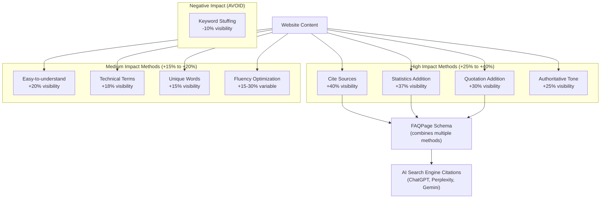
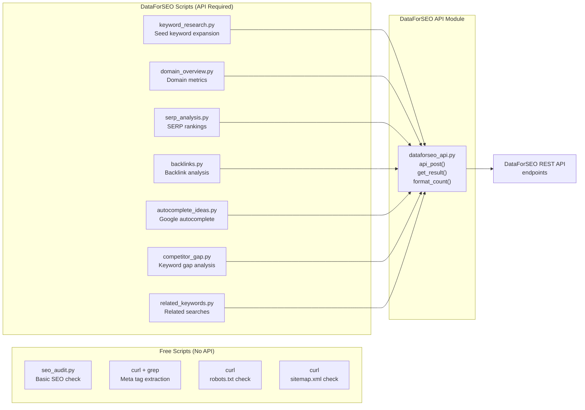
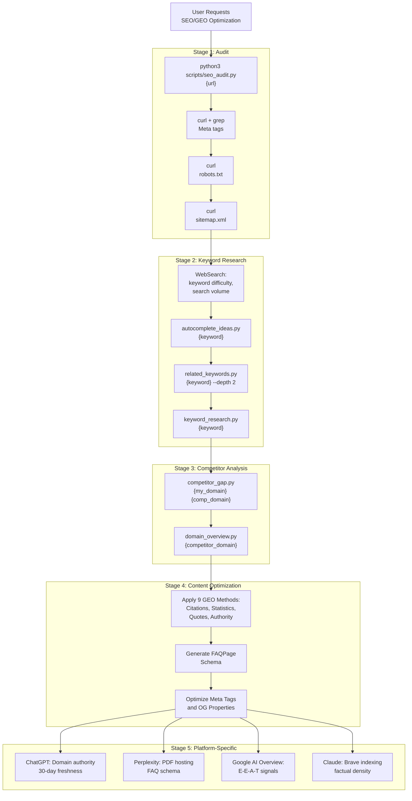
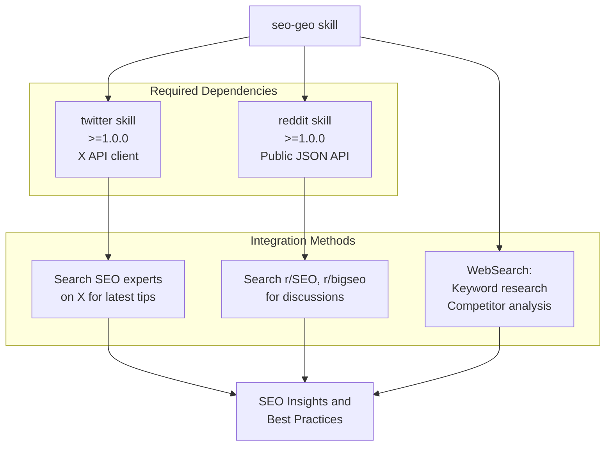

<!-- source: DeepWiki mcp.deepwiki.com · repo ReScienceLab/opc-skills · extra page SEO & GEO Optimization Skill · fetched 2026-10-26 -->

# SEO & GEO Optimization Skill

<details>
<summary>Relevant source files</summary>

The following files were used as context for generating this wiki page:

- [skills.json](skills.json)
- [skills/archive/SKILL.md](skills/archive/SKILL.md)
- [skills/archive/references/TEMPLATE.md](skills/archive/references/TEMPLATE.md)
- [skills/seo-geo/SKILL.md](skills/seo-geo/SKILL.md)
- [skills/seo-geo/scripts/autocomplete_ideas.py](skills/seo-geo/scripts/autocomplete_ideas.py)
- [skills/seo-geo/scripts/competitor_gap.py](skills/seo-geo/scripts/competitor_gap.py)
- [skills/seo-geo/scripts/domain_overview.py](skills/seo-geo/scripts/domain_overview.py)
- [skills/seo-geo/scripts/keyword_research.py](skills/seo-geo/scripts/keyword_research.py)
- [skills/seo-geo/scripts/related_keywords.py](skills/seo-geo/scripts/related_keywords.py)

</details>


## Purpose and Scope

This page documents the `seo-geo` skill, which provides comprehensive SEO (Search Engine Optimization) and GEO (Generative Engine Optimization) capabilities for websites. The skill optimizes content for both traditional search engines (Google, Bing) and AI search engines (ChatGPT, Perplexity, Gemini, Copilot, Claude) using research-backed methods from Princeton University.

The skill implements the 9 Princeton GEO methods that provide up to +40% visibility boost in AI search engine citations. It includes keyword research scripts, competitor analysis tools, and schema markup generation utilities.

For information about social media research workflows that complement SEO/GEO optimization, see [Social Media & Domain Skills](#2.4.5). For general skill structure and dependency management, see [Skill Structure & Standards](#2.2).

**Sources:** [skills/seo-geo/SKILL.md:1-251](), [skills.json:10-74]()

---

## Skill Definition

The `seo-geo` skill is registered in the skills manifest with the following characteristics:

| Property | Value |
|----------|-------|
| Name | `seo-geo` |
| Version | `1.0.0` |
| Auth Required | No (base functionality), Optional (DataForSEO API) |
| Dependencies | `twitter >= 1.0.0`, `reddit >= 1.0.0` |
| Primary API | DataForSEO (optional) |

**Trigger Keywords:** SEO, GEO, search optimization, schema markup, JSON-LD, meta tags, keyword research, AI visibility, ChatGPT ranking, Perplexity

**Optional API Keys:**
- `DATAFORSEO_LOGIN` - DataForSEO account login
- `DATAFORSEO_PASSWORD` - DataForSEO account password
- Acquisition URL: https://dataforseo.com

The skill operates in two modes:
1. **Free Mode** - Basic SEO audits, meta tag checks, robots.txt validation (no API required)
2. **Advanced Mode** - Keyword research, competitor analysis, SERP analysis (requires DataForSEO API)

**Sources:** [skills.json:10-74](), [skills/seo-geo/SKILL.md:1-7]()

---

## GEO Methods and Visibility Impact

### The 9 Princeton GEO Methods

The skill implements research-backed optimization methods from Princeton University's GEO study, which analyzed how content features affect AI search engine citation rates:



**Sources:** [skills/seo-geo/SKILL.md:84-99]()

### FAQPage Schema Implementation

The most effective GEO optimization combines multiple methods in a FAQPage schema structure:

**Template Structure:**
```json
{
  "@context": "https://schema.org",
  "@type": "FAQPage",
  "mainEntity": [{
    "@type": "Question",
    "name": "What is [topic]?",
    "acceptedAnswer": {
      "@type": "Answer",
      "text": "According to [source], [answer with statistics]."
    }
  }]
}
```

This schema type provides:
- **Authoritative citations** (+40% from cited sources)
- **Statistics inclusion** (+37% from data points)
- **Expert quotations** (+30% from attributed quotes)
- **Structured data** for AI parsing

**Sources:** [skills/seo-geo/SKILL.md:100-114]()

---

## Script Architecture

### Available Scripts and Commands



**Sources:** [skills.json:63-69](), [skills/seo-geo/SKILL.md:22-178]()

### Keyword Research Scripts

#### keyword_research.py

Expands a seed keyword into related keyword variations using the DataForSEO Keywords API.

**Usage:**
```bash
python3 scripts/keyword_research.py "seo tools" --limit 20
```

**Key Functions:**
- Accepts seed keyword and location code (default: 2840 = US)
- Queries `keywords_data/google_ads/keywords_for_keywords/live` endpoint
- Returns up to 20 related keywords with metrics
- Uses shared `api_post()`, `get_result()`, `print_keywords_list()` utilities

**Sources:** [skills/seo-geo/scripts/keyword_research.py:1-39]()

#### autocomplete_ideas.py

Retrieves real-time Google Autocomplete suggestions for a seed keyword.

**Usage:**
```bash
python3 scripts/autocomplete_ideas.py "Claude Code"
```

**Implementation Details:**
- Queries `serp/google/autocomplete/live/advanced` endpoint
- Handles multiple response formats (items, autocomplete, suggestions)
- Parses autocomplete_item objects with title field
- Provides long-tail keyword discovery

**Algorithm:**
```python
# Tries multiple field names for compatibility
items = result.get("items", [])
if not items:
    items = result.get("autocomplete", [])
    if not items:
        items = result.get("suggestions", [])

# Handles dict and string responses
for item in items:
    if isinstance(item, dict):
        if item.get("type") == "autocomplete_item":
            suggestion = item.get("title", "").strip()
        elif "value" in item:
            suggestion = item.get("value", "").strip()
    elif isinstance(item, str):
        suggestion = item.strip()
```

**Sources:** [skills/seo-geo/scripts/autocomplete_ideas.py:1-75]()

#### competitor_gap.py

Identifies keywords where a competitor ranks but your domain does not.

**Usage:**
```bash
python3 scripts/competitor_gap.py "opc.dev" "claudemarketplaces.com" --limit 50
```

**Key Parameters:**
- `my_domain` - Your domain (without https:)
- `competitor_domain` - Target competitor
- `--intersections False` - Only show gaps (not overlaps)
- `--limit` - Maximum results to return

**Output Format:**
```
keyword_gaps[N]{keyword,volume,difficulty,comp_position}:
  {keyword},{volume},{difficulty},{comp_pos}
```

Queries `dataforseo_labs/google/domain_intersection/live` with `intersections: False` to find keywords where only the competitor ranks.

**Sources:** [skills/seo-geo/scripts/competitor_gap.py:1-81]()

#### related_keywords.py

Retrieves Google "searches related to" keywords with configurable depth.

**Usage:**
```bash
python3 scripts/related_keywords.py "AI agent" --depth 2 --limit 50
```

**Depth Parameter:**
- `depth=1`: ~10 keywords
- `depth=2`: ~100 keywords  
- `depth=3`: ~1,000+ keywords (up to 4,680 max)

**Implementation:**
- Queries `dataforseo_labs/google/related_keywords/live` endpoint
- Sorts results by search volume descending
- Extracts keyword, volume, difficulty from nested structures
- Validates depth range 1-3

**Sources:** [skills/seo-geo/scripts/related_keywords.py:1-85]()

#### domain_overview.py

Provides domain-level organic search metrics.

**Usage:**
```bash
python3 scripts/domain_overview.py "example.com"
```

**Metrics Returned:**
- `organic_keywords` - Total ranking keywords
- `organic_traffic` - Estimated traffic value (ETV)
- `top_3_positions` - Keywords in positions 1-3

**Calculation:**
```python
organic = metrics.get("organic", {})
print(f"organic_keywords: {format_count(organic.get('count', 0))}")
print(f"organic_traffic: {format_count(organic.get('etv', 0))}")
print(f"top_3_positions: {organic.get('pos_1', 0) + organic.get('pos_2_3', 0)}")
```

Queries `dataforseo_labs/google/ranked_keywords/live` with `limit: 1` for overview metrics.

**Sources:** [skills/seo-geo/scripts/domain_overview.py:1-45]()

---

## Workflow Integration

### Multi-Stage Optimization Workflow



**Sources:** [skills/seo-geo/SKILL.md:16-201]()

### Command Execution Table

| Stage | Command | Dependencies | Output |
|-------|---------|-------------|--------|
| **Audit** | `python3 scripts/seo_audit.py "{url}"` | None | Title, meta, H1, robots, sitemap, load time |
| **Meta Check** | `curl -sL "{url}" \| grep -E "<title>\|<meta"` | None | Raw meta tags |
| **Robots** | `curl -s "{url}/robots.txt"` | None | Bot directives |
| **Sitemap** | `curl -s "{url}/sitemap.xml"` | None | Page list |
| **Keywords** | `python3 scripts/keyword_research.py "{keyword}"` | DataForSEO | Related keywords with metrics |
| **Autocomplete** | `python3 scripts/autocomplete_ideas.py "{keyword}"` | DataForSEO | User search suggestions |
| **Related** | `python3 scripts/related_keywords.py "{keyword}" --depth 2` | DataForSEO | Google related searches |
| **Gap** | `python3 scripts/competitor_gap.py "{domain}" "{comp}"` | DataForSEO | Competitor-only keywords |
| **Overview** | `python3 scripts/domain_overview.py "{domain}"` | DataForSEO | Organic metrics |
| **SERP** | `python3 scripts/serp_analysis.py "{keyword}"` | DataForSEO | Ranking positions |
| **Backlinks** | `python3 scripts/backlinks.py "{domain}"` | DataForSEO | Link profile |

**Sources:** [skills.json:63-69](), [skills/seo-geo/SKILL.md:18-178]()

---

## Platform-Specific Optimization Strategies

### AI Search Engine Algorithms

Different AI search engines use different ranking/citation algorithms. The skill provides platform-specific optimization guidance:

| Platform | Primary Factors | Optimization Strategy |
|----------|----------------|----------------------|
| **ChatGPT** | Branded domain authority (+11%), 30-day freshness (3.2x), backlinks (>350K domains = 8.4 avg citations) | Update content monthly, build authority backlinks, own branded domain |
| **Perplexity** | FAQ schema, PDF hosting, semantic relevance, PerplexityBot access | Allow PerplexityBot in robots.txt, host authoritative PDFs, use FAQ structured data |
| **Google AI Overview (SGE)** | E-E-A-T signals, structured data, topical authority (+132%), citations | Build content clusters, add authoritative citations, implement schema markup |
| **Microsoft Copilot / Bing** | Bing indexing required, page speed (<2s), Microsoft ecosystem signals | Optimize for Bing, improve load times, leverage LinkedIn/GitHub presence |
| **Claude AI** | Brave Search indexing, factual density, structural clarity | Ensure Brave indexing, increase data richness, clear information hierarchy |

**Critical Requirements:**

**ChatGPT:**
- Content updated within 30 days gets 3.2x more citations
- Branded domains cited 11% more than third-party
- 350K+ referring domains = 8.4 average citations

**Perplexity:**
- `PerplexityBot` must be allowed in robots.txt
- PDF documents prioritized for citation
- FAQ schema increases citation rate

**Google AI Overview:**
- Authoritative citations provide +132% visibility boost
- Topical authority via content clusters + internal linking
- E-E-A-T: Experience, Expertise, Authority, Trust

**Claude AI:**
- Uses Brave Search, NOT Google (must ensure Brave indexing)
- Prefers high factual density content
- Clear structural clarity for extraction

**Sources:** [skills/seo-geo/SKILL.md:203-235]()

---

## Bot Access Configuration

### robots.txt Allowlist

The skill requires specific AI bot access for citations. Required directives:

```
User-agent: Googlebot        # Google / Google AI Overview
Allow: /

User-agent: Bingbot           # Bing / Microsoft Copilot
Allow: /

User-agent: PerplexityBot     # Perplexity AI
Allow: /

User-agent: ChatGPT-User      # ChatGPT with browsing
Allow: /

User-agent: GPTBot            # OpenAI training
Allow: /

User-agent: ClaudeBot         # Claude AI
Allow: /

User-agent: anthropic-ai      # Alternative Claude identifier
Allow: /
```

**Verification Command:**
```bash
curl -s "https://example.com/robots.txt"
```

**Sources:** [skills/seo-geo/SKILL.md:38-64]()

---

## Dependencies and Integration

### Skill Dependencies



**Integration Examples:**

**Twitter Skill Usage:**
```bash
# Find latest SEO discussions
python3 <twitter>/scripts/search_tweets.py "SEO tips 2026" --type Latest --limit 20

# Follow SEO influencers
python3 <twitter>/scripts/get_user_tweets.py "aleyda" --limit 20
```

**Reddit Skill Usage:**
```bash
# Search SEO subreddits
python3 <reddit>/scripts/get_posts.py bigseo --limit 20
python3 <reddit>/scripts/search_posts.py "GEO optimization" --limit 20
```

**Dependency Declaration:**
The skill declares dependencies in [skills.json:28-31]():
```json
"dependencies": {
  "twitter": ">=1.0.0",
  "reddit": ">=1.0.0"
}
```

When installed via `npx skills add ReScienceLab/opc-skills --skill seo-geo`, the installer automatically resolves and installs `twitter` and `reddit` skills if not already present.

**Sources:** [skills.json:28-31](), [skills/seo-geo/SKILL.md:236-242]()

---

## Content Structure Optimization

### Answer-First Format

AI search engines prefer "answer-first" content structure:

```
1. Direct Answer (first paragraph)
   ↓
2. Supporting Evidence (statistics, citations)
   ↓
3. Detailed Explanation
   ↓
4. Related Information
```

**Implementation Guidelines:**
- Place direct answer in first 2-3 sentences
- Use clear H1 > H2 > H3 hierarchy
- Bullet points and numbered lists for scannability
- Tables for comparison data
- Short paragraphs (2-3 sentences maximum)

**Example Structure:**
```markdown
# What is GEO?

GEO (Generative Engine Optimization) is the practice of optimizing 
content to be cited by AI search engines like ChatGPT, Perplexity, 
and Google AI Overview. According to Princeton research, proper GEO 
methods can increase AI visibility by up to 40%.

## Key Methods
- Cite authoritative sources (+40%)
- Include statistics (+37%)
- Add expert quotations (+30%)

## Implementation
[Detailed implementation steps]
```

**Sources:** [skills/seo-geo/SKILL.md:116-122]()

---

## Meta Tags and Schema Templates

### HTML Meta Tags

Standard meta tag structure for SEO:

```html
<title>{Primary Keyword} - {Brand} | {Secondary Keyword}</title>
<meta name="description" content="{Compelling description with keyword, 150-160 chars}">
<meta name="keywords" content="{keyword1}, {keyword2}, {keyword3}">

<!-- Open Graph -->
<meta property="og:title" content="{Title}">
<meta property="og:description" content="{Description}">
<meta property="og:image" content="{Image URL 1200x630}">
<meta property="og:url" content="{Canonical URL}">
<meta property="og:type" content="website">

<!-- Twitter Cards -->
<meta name="twitter:card" content="summary_large_image">
<meta name="twitter:title" content="{Title}">
<meta name="twitter:description" content="{Description}">
<meta name="twitter:image" content="{Image URL}">
```

### JSON-LD Schema Types

The skill references multiple schema types for different page types:

| Page Type | Schema Type | Use Case |
|-----------|-------------|----------|
| Content Pages | `WebPage`, `Article` | Blog posts, documentation |
| FAQ Sections | `FAQPage` | Questions and answers (+40% AI visibility) |
| Product Pages | `Product` | E-commerce listings |
| About Pages | `Organization` | Company information |
| Tools/Apps | `SoftwareApplication` | Software products |

**Schema Validation Commands:**
```bash
# Google Rich Results Test
open "https://search.google.com/test/rich-results?url={encoded_url}"

# Schema.org Validator
open "https://validator.schema.org/?url={encoded_url}"
```

**Sources:** [skills/seo-geo/SKILL.md:125-169]()

---

## Installation and Configuration

### Installation Commands

**Universal Installation:**
```bash
npx skills add ReScienceLab/opc-skills --skill seo-geo
```

**Platform-Specific:**
```bash
# Claude Code
npx skills add ReScienceLab/opc-skills --skill seo-geo -a claude

# Factory Droid
npx skills add ReScienceLab/opc-skills --skill seo-geo -a droid

# Cursor
npx skills add ReScienceLab/opc-skills --skill seo-geo -a cursor
```

Auto-installs dependencies: `twitter >=1.0.0`, `reddit >=1.0.0`

### Optional API Configuration

For advanced features (keyword research, competitor analysis):

1. **Create DataForSEO Account:** https://dataforseo.com
2. **Set Environment Variables:**
   ```bash
   export DATAFORSEO_LOGIN="your_login"
   export DATAFORSEO_PASSWORD="your_password"
   ```

**Free Tier Limits:**
- DataForSEO offers $1 free credit on signup
- Sufficient for ~50-100 keyword research queries
- Paid plans start at $50/month

**Sources:** [skills.json:48-62](), [skills.json:32-47]()

---

## Validation and Monitoring

### SEO Audit Checklist

The skill provides a comprehensive validation checklist:

- [ ] H1 contains primary keyword
- [ ] Meta description 150-160 characters
- [ ] Images have descriptive alt text
- [ ] Internal links to related content
- [ ] External links have `rel="noopener noreferrer"`
- [ ] Content is mobile-friendly
- [ ] Page loads in < 3 seconds
- [ ] robots.txt allows AI bots
- [ ] sitemap.xml includes all pages
- [ ] Schema markup validates
- [ ] FAQPage schema for FAQ content
- [ ] Open Graph tags present
- [ ] Twitter Card tags present

**Indexing Status Check:**
```bash
# Google indexing
open "https://www.google.com/search?q=site:{domain}"

# Bing indexing (required for Copilot)
open "https://www.bing.com/search?q=site:{domain}"
```

**Report Generation Template:**
```markdown
## SEO/GEO Optimization Report

### Current Status
- Meta Tags: ✅/❌
- Schema Markup: ✅/❌
- AI Bot Access: ✅/❌
- Mobile Friendly: ✅/❌
- Page Speed: X seconds

### Recommendations
1. [Priority 1 action]
2. [Priority 2 action]
3. [Priority 3 action]

### GEO Optimizations Applied
- [ ] FAQPage schema added
- [ ] Statistics included
- [ ] Citations added
- [ ] Answer-first structure
```

**Sources:** [skills/seo-geo/SKILL.md:152-201]()

---

## Reference Documentation

The skill includes extensive reference documentation in the `references/` directory:

| File | Purpose |
|------|---------|
| `platform-algorithms.md` | Detailed ranking factors for each AI platform |
| `geo-research.md` | Princeton GEO research (9 methods with citations) |
| `schema-templates.md` | JSON-LD schema templates for common page types |
| `seo-checklist.md` | Complete SEO audit checklist |
| `tools-and-apis.md` | Tools and API reference documentation |

**Example Use Case:**
The skill includes a real-world case study in `examples/opc-skills-case-study.md` demonstrating optimization of the OPC Skills website using the 9 GEO methods.

**Sources:** [skills/seo-geo/SKILL.md:243-251]()

---

