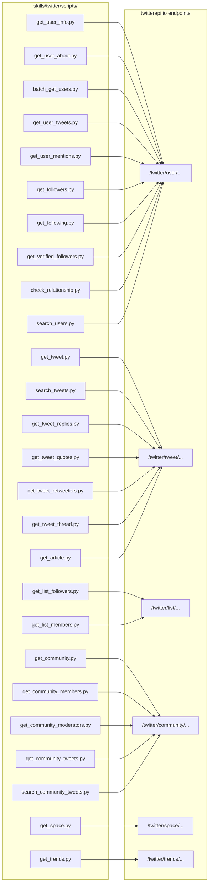
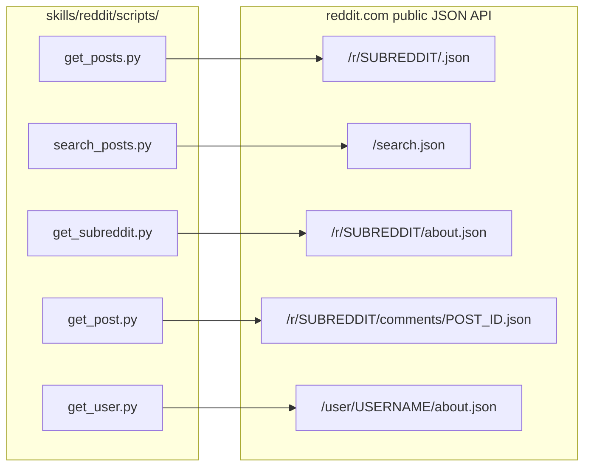
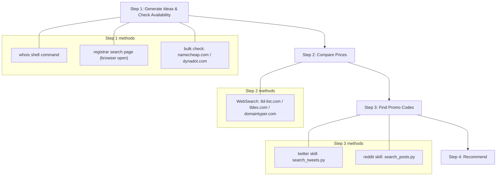
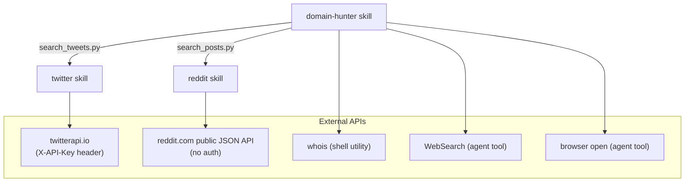

<!-- source: DeepWiki mcp.deepwiki.com · repo ReScienceLab/opc-skills · extra page Social Media & Domain Skills · fetched 2026-10-26 -->

# Social Media & Product Discovery Skills

<details>
<summary>Relevant source files</summary>

The following files were used as context for generating this wiki page:

- [.factory/hooks.json](.factory/hooks.json)
- [.factory/skills/add-new-opc-skill/SKILL.md](.factory/skills/add-new-opc-skill/SKILL.md)
- [.gitignore](.gitignore)
- [skills.json](skills.json)
- [skills/archive/SKILL.md](skills/archive/SKILL.md)
- [skills/archive/references/TEMPLATE.md](skills/archive/references/TEMPLATE.md)
- [skills/domain-hunter/SKILL.md](skills/domain-hunter/SKILL.md)
- [skills/domain-hunter/examples/auto-video-editing-domain.md](skills/domain-hunter/examples/auto-video-editing-domain.md)
- [skills/reddit/SKILL.md](skills/reddit/SKILL.md)
- [skills/twitter/SKILL.md](skills/twitter/SKILL.md)
- [website/resciencelab-logo.svg](website/resciencelab-logo.svg)

</details>


This page documents three skills that cover social media data retrieval and domain name research: the **twitter** skill (Twitter/X via twitterapi.io), the **reddit** skill (Reddit via the public JSON API), and the **domain-hunter** skill (WHOIS availability checking, price comparison, and promo code discovery). The domain-hunter skill directly orchestrates both the twitter and reddit skills as part of its workflow.

For documentation of the requesthunt and producthunt skills, which also involve social and community data, see [2.4.4](#2.4.4). For skill installation and API key setup across all skills, see [3.1](#3.1).

---

## Twitter Skill

The twitter skill wraps the [twitterapi.io](https://docs.twitterapi.io) API to give an AI agent programmatic access to Twitter/X data. All scripts live in `skills/twitter/scripts/` and are invoked directly from the skill directory.

### Authentication

The skill requires a single environment variable:

```bash
export TWITTERAPI_API_KEY="your_api_key"
```

This key is passed as an `X-API-Key` header against the base URL `https://api.twitterapi.io/twitter`.

> **Pricing note:** approximately $0.15–$0.18 per 1,000 requests.

Sources: [skills/twitter/SKILL.md:1-16]()

### Script Inventory

**Endpoint grouping → Script mapping:**

| Group | Script | Primary Argument |
|---|---|---|
| User | `get_user_info.py` | `USERNAME` |
| User | `get_user_about.py` | `USERNAME` |
| User | `batch_get_users.py` | `USER_ID1,USER_ID2` |
| User | `get_user_tweets.py` | `USERNAME --limit N` |
| User | `get_user_mentions.py` | `USERNAME --limit N` |
| User | `get_followers.py` | `USERNAME --limit N` |
| User | `get_following.py` | `USERNAME --limit N` |
| User | `get_verified_followers.py` | `USERNAME --limit N` |
| User | `check_relationship.py` | `USER1 USER2` |
| User | `search_users.py` | `"query" --limit N` |
| Tweet | `get_tweet.py` | `TWEET_ID [TWEET_ID2...]` |
| Tweet | `search_tweets.py` | `"query" --type --limit N` |
| Tweet | `get_tweet_replies.py` | `TWEET_ID --limit N` |
| Tweet | `get_tweet_quotes.py` | `TWEET_ID --limit N` |
| Tweet | `get_tweet_retweeters.py` | `TWEET_ID --limit N` |
| Tweet | `get_tweet_thread.py` | `TWEET_ID` |
| Tweet | `get_article.py` | `TWEET_ID` |
| List | `get_list_followers.py` | `LIST_ID --limit N` |
| List | `get_list_members.py` | `LIST_ID --limit N` |
| Community | `get_community.py` | `COMMUNITY_ID` |
| Community | `get_community_members.py` | `COMMUNITY_ID --limit N` |
| Community | `get_community_moderators.py` | `COMMUNITY_ID` |
| Community | `get_community_tweets.py` | `COMMUNITY_ID --limit N` |
| Community | `search_community_tweets.py` | `"query" --limit N` |
| Space | `get_space.py` | `SPACE_ID` |
| Trends | `get_trends.py` | `--woeid N` |

Sources: [skills/twitter/SKILL.md:27-71]()

### Search Query Syntax

`search_tweets.py` accepts standard Twitter/X search operators:

| Operator | Example |
|---|---|
| Keyword | `"AI agent"` |
| From user | `"from:elonmusk"` |
| Date range | `"AI since:2024-01-01 until:2024-12-31"` |
| Exclude retweets | `"AI -filter:retweets"` |
| Require media | `"AI filter:media"` |
| Minimum engagement | `"AI min_faves:1000"` |

Sources: [skills/twitter/SKILL.md:73-93]()

### Twitter Skill Architecture Diagram

**Twitter Skill: script-to-endpoint mapping**



Sources: [skills/twitter/SKILL.md:27-99]()

---

## Reddit Skill

The reddit skill reads from Reddit's public JSON API — no OAuth token or API key is required. Any Reddit URL can be queried by appending `.json` to the path.

### Authentication

None required. The API is publicly accessible at up to 100 requests/minute.

Sources: [skills/reddit/SKILL.md:7-12]()

### Script Inventory

| Script | Purpose | Key Arguments |
|---|---|---|
| `get_posts.py` | Retrieve subreddit posts | `SUBREDDIT --sort --time --limit N` |
| `search_posts.py` | Search across Reddit or a subreddit | `"query" --subreddit --sort --time --limit N` |
| `get_subreddit.py` | Retrieve subreddit metadata | `SUBREDDIT` |
| `get_post.py` | Retrieve a single post with comments | `POST_ID --comments N` |
| `get_user.py` | Retrieve user profile and posts | `USERNAME --posts N` |

Sources: [skills/reddit/SKILL.md:24-55]()

### Sort Options

| `--sort` Value | Description | Supports `--time` |
|---|---|---|
| `hot` | Trending posts (default) | No |
| `new` | Latest posts | No |
| `top` | Highest voted | Yes: `hour`, `day`, `week`, `month`, `year`, `all` |
| `rising` | Gaining traction | No |
| `controversial` | Mixed votes | Yes: same as `top` |

Sources: [skills/reddit/SKILL.md:57-65]()

### Reddit Skill Architecture Diagram

**Reddit Skill: script-to-API mapping**



Sources: [skills/reddit/SKILL.md:24-72]()

---

## Domain Hunter Skill

The domain-hunter skill is an orchestration layer — it does not have its own external API. Instead it combines WHOIS shell commands, web search, and invocations of the **twitter** and **reddit** skills to guide a user from domain idea to purchase.

The workflow is entirely agent-driven: the skill's `SKILL.md` defines the steps and the commands to run at each step. There are no Python scripts in this skill; it relies on shell utilities and other skills.

Sources: [skills/domain-hunter/SKILL.md:1-116]()

### Four-Step Workflow



Sources: [skills/domain-hunter/SKILL.md:11-103]()

### Step 1: Availability Check Methods

Three methods are available, in order of reliability:

| Method | Mechanism | Command |
|---|---|---|
| WHOIS (most reliable) | Shell `whois` with grep for availability keywords | `whois {domain}.{tld} 2>/dev/null \| grep -i "no match\|not found\|available\|no data found"` |
| Registrar search | Open browser to registrar search page | `open "https://www.spaceship.com/domains/?search={domain}.{tld}"` |
| Bulk check | Namecheap or Dynadot bulk search URLs | URL parameters |

The agent **must not present a domain to the user** until availability is confirmed. Uncertain domains should be marked `(unverified)`.

Sources: [skills/domain-hunter/SKILL.md:26-47]()

### Step 3: Promo Code Discovery via Twitter & Reddit

The domain-hunter skill calls the twitter skill's `search_tweets.py` and the reddit skill's `search_posts.py` directly. Both skill directories must already be installed.

**Twitter queries** — targets registrar official accounts:

```bash
cd <twitter_skill_directory>
python3 scripts/search_tweets.py "from:{registrar} promo code" --type Latest --limit 15
python3 scripts/search_tweets.py "{registrar} promo code coupon" --type Latest --limit 15
```

Tracked Twitter handles: `@spaceship`, `@Dynadot`, `@Namecheap`, `@Porkbun`, `@namesilo`, `@Cloudflare`

**Reddit queries** — searches the `r/Domains` community and general Reddit:

```bash
cd <reddit_skill_directory>
python3 scripts/search_posts.py "{registrar} promo code" --limit 15
python3 scripts/search_posts.py "{registrar} coupon discount" --subreddit Domains --limit 10
```

Sources: [skills/domain-hunter/SKILL.md:63-79]()

### Step 4: Recommendation Format

The agent produces a structured Markdown output:

```
## Recommendation

**Domain:** example.ai
**Best Registrar:** Spaceship
**Price:** $68.98/year
**Promo Code:** None available for .ai
**Purchase Link:** https://www.spaceship.com/

### Price Comparison
| Registrar | Year 1 | Renewal | 2-Year Total |
|-----------|--------|---------|--------------|
| Spaceship | $68.98 | $68.98  | $137.96      |
| Cloudflare| $70.00 | $70.00  | $140.00      |
```

Sources: [skills/domain-hunter/SKILL.md:85-103]()

### Important TLD and Registrar Notes

| Note | Detail |
|---|---|
| Premium TLDs (`.ai`, `.io`) | Rarely have promo codes — wholesale costs are too high |
| `.ai` domains | Require 2-year minimum registration |
| Cloudflare | At-cost pricing, no markup |
| Renewal pricing | Often differs from registration price — always check both |
| WHOIS privacy | Free at Cloudflare, Namecheap, Porkbun |

Sources: [skills/domain-hunter/SKILL.md:105-112]()

### Domain Hunter Reference Files

The skill ships two reference documents:

| File | Purpose |
|---|---|
| `references/registrars.md` | Detailed registrar comparison |
| `references/spaceship-api.md` | Spaceship API for automated domain operations |

Sources: [skills/domain-hunter/SKILL.md:113-116]()

---

## Skill Inter-Dependencies

The diagram below shows how these three skills relate to one another and to external APIs.

**Skill dependency and external API map**



Sources: [skills/domain-hunter/SKILL.md:63-79](), [skills/twitter/SKILL.md:95-99](), [skills/reddit/SKILL.md:67-72]()

---

## Skill Summary Comparison

| Attribute | twitter | reddit | domain-hunter |
|---|---|---|---|
| Auth required | Yes — `TWITTERAPI_API_KEY` env var | No | None directly (delegates to twitter/reddit) |
| External API | `api.twitterapi.io` | `reddit.com` (public JSON) | WHOIS, WebSearch, twitter skill, reddit skill |
| Script count | 26 Python scripts | 5 Python scripts | 0 (shell + skill orchestration) |
| API type | REST (JSON) | REST (JSON) | — |
| Rate limit | ~$0.15–0.18 / 1k requests (cost-based) | 100 requests/minute | Determined by delegated skills |
| Key trigger phrases | "Twitter", "X", "tweets" | "Reddit", "subreddit", "r/" | "buy a domain", "domain prices", "domain deals" |

Sources: [skills/twitter/SKILL.md:1-4](), [skills/reddit/SKILL.md:1-4](), [skills/domain-hunter/SKILL.md:1-4]()

---

