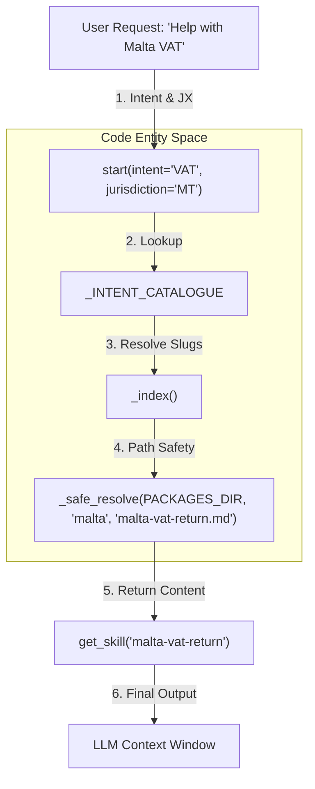
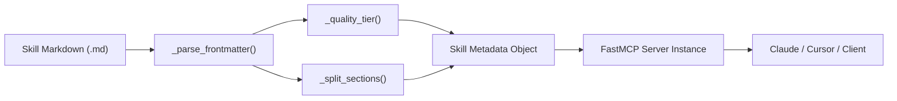

<!-- source: DeepWiki mcp.deepwiki.com · repo openaccountants/openaccountants · page 3 MCP Server · fetched 2026-10-26 -->

# MCP Server

Relevant source files

The following files were used as context for generating this wiki page:

- [.dockerignore](.dockerignore)
- [Dockerfile](Dockerfile)
- [mcp/.gitignore](mcp/.gitignore)
- [mcp/README.md](mcp/README.md)
- [mcp/openaccountants_mcp/__init__.py](mcp/openaccountants_mcp/__init__.py)
- [mcp/openaccountants_mcp/__main__.py](mcp/openaccountants_mcp/__main__.py)
- [mcp/openaccountants_mcp/server.py](mcp/openaccountants_mcp/server.py)
- [mcp/pyproject.toml](mcp/pyproject.toml)
- [mcp/server.json](mcp/server.json)
- [mcp/smoke_test.py](mcp/smoke_test.py)

The `openaccountants-mcp` Python package provides a read-only [Model Context Protocol](https://modelcontextprotocol.io) server. It enables AI assistants (such as Claude Desktop or Cursor) to programmatically discover, search, and retrieve accounting skills from the `packages/` directory without requiring manual file uploads [mcp/README.md:1-5]().

While the repository contains the source code for skills, the MCP server acts as the bridge that allows an LLM to "know" which tax rules apply to a specific jurisdiction and "fetch" them on-demand during a conversation [mcp/README.md:9-23]().

### System Architecture

The server is built using the `FastMCP` framework [mcp/openaccountants_mcp/server.py:48](). It indexes the local `packages/` tree to serve markdown content as structured tools and prompts [mcp/openaccountants_mcp/server.py:4-17]().

**From Natural Language to Skill Entities**
The following diagram illustrates how a user's natural language request is resolved into specific code entities and file paths by the MCP server.

**Natural Language Resolution Flow**

Sources: [mcp/openaccountants_mcp/server.py:55-83](), [mcp/README.md:59-79]()

---

### Capabilities

The MCP server exposes two primary interfaces to AI clients:

1.  **Tools**: Atomic functions the LLM can call to browse the library, search for specific tax sections, or retrieve full skill text [mcp/README.md:48-55]().
2.  **Prompts**: Pre-defined, high-level workflows that guide the LLM through complex tasks like performing a full tax return or comparing two jurisdictions [mcp/README.md:85-92]().

| Feature | Description |
| :--- | :--- |
| **Discovery** | The `start` tool acts as a "front door" to determine the user's intent and required jurisdiction [mcp/README.md:50](). |
| **Indexing** | The `_index()` function scans `packages/` and extracts metadata from YAML frontmatter [mcp/openaccountants_mcp/server.py:180-190](). |
| **Path Safety** | All file access is restricted to the `packages/` directory via `_safe_resolve` to prevent directory traversal [mcp/openaccountants_mcp/server.py:76-83](). |
| **Provenance** | Every skill returned includes an attribution footer and quality tier (Accountant-verified vs Research-verified) [mcp/openaccountants_mcp/server.py:127-129](). |

For a complete list of parameters and usage examples, see **[MCP Tools and Prompts Reference](#3.1)**.

---

### Internal Logic and Orchestration

The server manages a state machine via the `start()` tool to guide the AI assistant through the onboarding process [mcp/README.md:59-79](). It uses an internal `_INTENT_CATALOGUE` to map common user goals (e.g., "taxes", "formation") to specific skill sequences [mcp/smoke_test.py:108-125]().

**Internal Processing Pipeline**

Sources: [mcp/openaccountants_mcp/server.py:94-152](), [mcp/openaccountants_mcp/server.py:180-190]()

For a deep dive into the indexer, intent mapping, and transport layers, see **[MCP Server Internals](#3.2)**.

---

### Deployment and Connectivity

The server can be deployed in multiple environments depending on the use case:

*   **Local Development**: Installed via `pip` or `uv` and run over `stdio` for use with Claude Desktop or Cursor [mcp/README.md:98-112]().
*   **Containerized**: A `Dockerfile` is provided to run the server over `streamable-http`, allowing remote clients to connect via a reverse proxy [Dockerfile:1-19]().
*   **Hosted**: A production version exists at `openaccountants.com/api/mcp` which includes additional features like real-time tax rates and human-accountant handoffs [mcp/README.md:7]().

For configuration details and setup guides, see **[MCP Deployment](#3.3)**.

---
**Child Pages:**
*   [MCP Tools and Prompts Reference](#3.1)
*   [MCP Server Internals](#3.2)
*   [MCP Deployment](#3.3)

---

