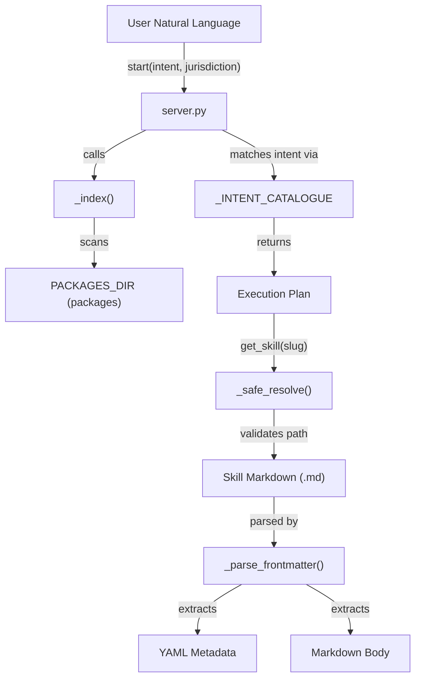
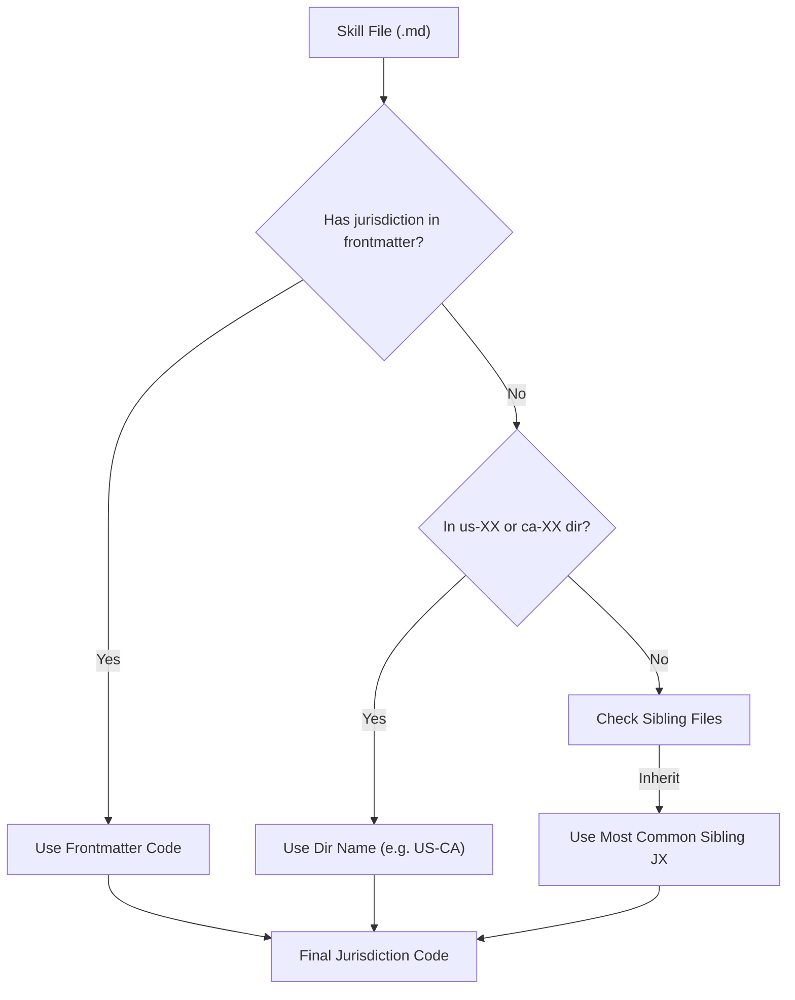

<!-- source: DeepWiki mcp.deepwiki.com · repo openaccountants/openaccountants · page 3.1 MCP Tools and Prompts Reference · fetched 2026-10-26 -->

# MCP Tools and Prompts Reference

Relevant source files

The following files were used as context for generating this wiki page:

- [.dockerignore](.dockerignore)
- [Dockerfile](Dockerfile)
- [mcp/.gitignore](mcp/.gitignore)
- [mcp/README.md](mcp/README.md)
- [mcp/openaccountants_mcp/__init__.py](mcp/openaccountants_mcp/__init__.py)
- [mcp/openaccountants_mcp/__main__.py](mcp/openaccountants_mcp/__main__.py)
- [mcp/openaccountants_mcp/server.py](mcp/openaccountants_mcp/server.py)
- [mcp/pyproject.toml](mcp/pyproject.toml)
- [mcp/server.json](mcp/server.json)
- [mcp/smoke_test.py](mcp/smoke_test.py)

This page provides a complete technical reference for the tools and prompts exposed by the OpenAccountants Model Context Protocol (MCP) server. The server, implemented in `openaccountants-mcp`, acts as a bridge between LLM clients (like Claude or Cursor) and the structured accounting skills stored in the `packages/` directory [mcp/openaccountants_mcp/server.py:1-17]().

## MCP Tools Reference

The self-hosted MCP server exposes six read-only tools designed to facilitate the discovery, retrieval, and application of accounting skills [mcp/README.md:48-55](). All skill access is path-sandboxed to the `packages/` directory for security [mcp/README.md:57-57]().

### 1. `start`
The primary entry point for any session. It functions as an intent orchestrator that maps user requests to specific skill-loading plans [mcp/README.md:50-50]().

*   **Parameters:**
    *   `intent` (optional string): Free text describing the goal (e.g., "VAT return", "company setup").
    *   `jurisdiction` (optional string): ISO country code or sub-national code (e.g., "MT", "US-CA").
*   **Returns:** A JSON object with a `status` ("ready", "needs_input", or "needs_clarification").
    *   If "ready": Includes `skills_to_load`, `expectations`, `next_action`, and `guardrails` [mcp/README.md:50-50]().
    *   If "needs_input": Includes lists of `available_intents` or `available_jurisdictions` [mcp/smoke_test.py:87-106]().

### 2. `list_skills`
Returns a catalog of available skills, filtered by jurisdiction or category [mcp/README.md:51-51]().

*   **Parameters:**
    *   `jurisdiction` (optional string): Filter by ISO code.
    *   `category` (optional string): Filter by skill category (e.g., "tax", "formation").
*   **Return Fields:** `slug`, `title`, `jurisdiction`, `category`, `quality_tier`, `verified_by`, `last_updated` [mcp/smoke_test.py:65-68]().

### 3. `get_skill`
Fetches the full content of a specific skill [mcp/README.md:52-52]().

*   **Parameters:**
    *   `slug` (string): The unique identifier for the skill (e.g., "malta-income-tax").
*   **Returns:** Full markdown content appended with a provenance/attribution footer generated by the server [mcp/smoke_test.py:72-74]().

### 4. `get_skill_sections`
Parses a skill into discrete logical blocks for step-by-step processing [mcp/README.md:53-53]().

*   **Parameters:**
    *   `slug` (string): The skill identifier.
*   **Returns:** A list of sections, each containing `heading`, `content`, and `level` (header depth) [mcp/openaccountants_mcp/server.py:132-152]().

### 5. `search_skills`
Performs a keyword search across the markdown content of all indexed skills [mcp/README.md:54-54]().

*   **Parameters:**
    *   `query` (string): Search terms.
    *   `jurisdiction` (optional string): Scope search to a specific region.
*   **Returns:** Matched section headings and snippets, limited to 25 results [mcp/openaccountants_mcp/server.py:60-60]().

### 6. `submit_feedback`
Constructs a GitHub issue URL for reporting errors or requesting features [mcp/README.md:55-55]().

*   **Parameters:** `summary`, `skill_slug` (optional), `jurisdiction` (optional), `rating` (optional).
*   **Returns:** `github_url`, `title`, `body`, and `labels` [mcp/README.md:55-55]().

**Sources:** [mcp/README.md:44-57](), [mcp/openaccountants_mcp/server.py:51-152](), [mcp/smoke_test.py:51-159]()

---

## MCP Prompts Reference

Prompts provide high-level guided workflows that instruct the LLM on how to use the tools and skills effectively as a "tax engine" [mcp/README.md:81-83]().

| Prompt | Arguments | Purpose |
| :--- | :--- | :--- |
| `tax-return` | `country`, `tax_year`, `entity_type` | Orchestrates intake, transaction classification, and working paper generation [mcp/README.md:87-87](). |
| `vat-check` | `country`, `period` | Guides the user through VAT/GST classification for a specific period [mcp/README.md:88-88](). |
| `find-deductions` | `country`, `entity_type` | Specifically reviews expenses against deductibility rules in the loaded skills [mcp/README.md:89-89](). |
| `compare-jurisdictions`| `countries`, `income`, `entity_type` | Performs side-by-side tax liability comparison for cross-border planning [mcp/README.md:90-90](). |
| `skill-feedback` | `skill_slug`, `country` | Collects structured feedback after a specific skill application [mcp/README.md:91-91](). |
| `skill-review` | `skillSlug`, `scenario` | Loads a skill's sections and applies them sequentially to a user scenario [mcp/README.md:92-92](). |

**Sources:** [mcp/README.md:81-93](), [mcp/openaccountants_mcp/server.py:12-13]()

---

## Implementation Architecture

The server logic bridges the natural language intent of the user to the physical files on disk.

### Natural Language to Code Entity Mapping
The following diagram illustrates how user requests are routed through the server's internal functions to reach the skill content.

**Title: Intent Resolution and Skill Retrieval Flow**

**Sources:** [mcp/openaccountants_mcp/server.py:55-57](), [mcp/openaccountants_mcp/server.py:76-83](), [mcp/openaccountants_mcp/server.py:94-106](), [mcp/openaccountants_mcp/server.py:179-190]()

### Data Flow: Skill Indexing
The server builds a lazy-loaded index of all skills. Because many skills lack explicit jurisdiction fields in their YAML frontmatter, the server implements an inheritance logic.

**Title: Jurisdiction Inheritance Logic**

**Sources:** [mcp/openaccountants_mcp/server.py:165-176](), [mcp/openaccountants_mcp/server.py:179-200]()

### Key Functions and Classes

*   **`_safe_resolve(packages_dir, *segments)`**: Prevents directory traversal attacks by ensuring resolved paths remain within the `packages/` root [mcp/openaccountants_mcp/server.py:76-83]().
*   **`_parse_frontmatter(text)`**: Uses `PyYAML` to separate the skill's configuration from its logic/content [mcp/openaccountants_mcp/server.py:94-106]().
*   **`_quality_tier(meta)`**: Determines if a skill is `accountant-verified` or `research-verified` based on the presence of a non-pending `verified_by` field [mcp/openaccountants_mcp/server.py:116-129]().
*   **`_index()`**: A cached function that maps every skill slug to its metadata, including quality tier and inherited jurisdiction [mcp/openaccountants_mcp/server.py:179-200]().

**Sources:** [mcp/openaccountants_mcp/server.py:35-200](), [mcp/pyproject.toml:8-8]()

---

