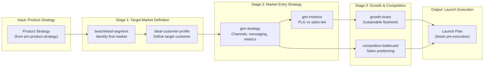
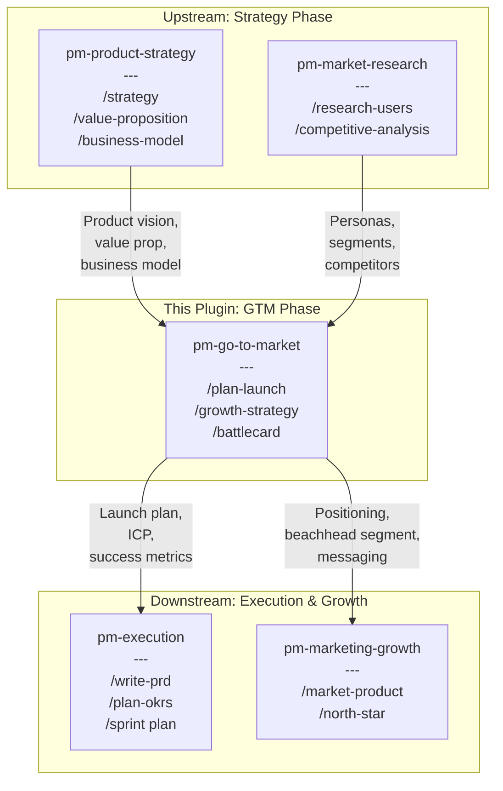

<!-- source: DeepWiki mcp.deepwiki.com · repo phuryn/pm-skills · page 4.6 pm-go-to-market · fetched 2026-10-26 -->

# pm-go-to-market

<details>
<summary>Relevant source files</summary>

The following files were used as context for generating this wiki page:

- [README.md](README.md)
- [pm-go-to-market/README.md](pm-go-to-market/README.md)

</details>


## Purpose and Scope

The `pm-go-to-market` plugin provides AI-guided workflows for launching products and driving sustainable growth. This plugin bridges product strategy and market execution through six specialized skills and three orchestrated commands.

**Scope:** This plugin covers go-to-market strategy formulation, customer segmentation, growth mechanism design, and competitive positioning for launches. It focuses on the **Launch** stage of the product lifecycle (see [Product Lifecycle Coverage](#3.2) in Architecture).

**Related plugins:**
- For pre-launch strategy work (vision, business models), see [pm-product-strategy](#4.2)
- For post-launch growth tactics (positioning, marketing ideas), see [pm-marketing-growth](#4.7)
- For customer research informing GTM decisions, see [pm-market-research](#4.4)

**Sources:** [pm-go-to-market/README.md:1-12](), [README.md:298-328]()

---

## Plugin Structure

The plugin is organized as a standard marketplace plugin with manifest, skills, and commands:

```
pm-go-to-market/
├── plugin.json          # Manifest with metadata and skill/command registry
├── README.md            # Plugin documentation
├── skills/              # 6 skill definitions
│   ├── beachhead-segment/
│   │   └── SKILL.md
│   ├── competitive-battlecard/
│   │   └── SKILL.md
│   ├── growth-loops/
│   │   └── SKILL.md
│   ├── gtm-motions/
│   │   └── SKILL.md
│   ├── gtm-strategy/
│   │   └── SKILL.md
│   └── ideal-customer-profile/
│       └── SKILL.md
└── commands/            # 3 command orchestrations
    ├── battlecard/
    ├── growth-strategy/
    └── plan-launch/
```

### Framework Attribution

The skills in this plugin codify methodologies from:

- **Maja Voje** — GTM Strategist, beachhead segment identification
- **Sean Ellis** — Growth hacking, viral loops, and sustainable growth mechanisms
- **Geoffrey Moore** — Crossing the Chasm, beachhead market strategy

**Sources:** [pm-go-to-market/README.md:1-26](), [README.md:414]()

---

## GTM Workflow Architecture

### Workflow Stages



**Diagram: GTM Plugin Workflow** — Shows the logical progression from market selection through launch planning.

**Sources:** [pm-go-to-market/README.md:5-12](), [README.md:298-328]()

---

## Skills Reference

### 1. beachhead-segment

**Location:** [pm-go-to-market/skills/beachhead-segment/SKILL.md]()

**Purpose:** Identifies the first target market segment for a product launch using Geoffrey Moore's Crossing the Chasm methodology. Focuses on finding a narrow, winnable segment with urgent pain points.

**Key capabilities:**
- Segment evaluation against 7 criteria (size, pain intensity, budget authority, accessibility, competition)
- Risk assessment for each candidate segment
- Recommendation of single beachhead with rationale

**Typical inputs:**
- Product description and value proposition
- Known market segments or customer types
- Existing customer research data

**Output format:** Beachhead segment recommendation with scoring matrix, rationale, and GTM implications.

**Usage pattern:**
```
Direct invocation: "What's the best beachhead segment for a developer productivity tool?"
Command chain: /plan-launch (uses this skill in step 1)
```

**Sources:** [pm-go-to-market/README.md:7](), [README.md:305-306, 320]()

---

### 2. ideal-customer-profile

**Location:** [pm-go-to-market/skills/ideal-customer-profile/SKILL.md]()

**Purpose:** Defines the Ideal Customer Profile (ICP) with demographics, firmographics, behavioral characteristics, Jobs-to-be-Done, and needs. More granular than personas—focused on buying criteria.

**Key capabilities:**
- B2B: company size, industry, tech stack, decision-maker roles
- B2C: demographics, psychographics, behavior patterns
- JTBD analysis for target customer
- Needs mapping and pain point prioritization

**Typical inputs:**
- Beachhead segment definition (often from `beachhead-segment` skill)
- Customer interview transcripts
- Sales call notes or CRM data

**Output format:** Structured ICP document with demographic table, behavioral profile, JTBD analysis, and qualification criteria.

**Usage pattern:**
```
Direct invocation: "Define our ICP for an AI-powered HR screening platform"
Command chain: /plan-launch (uses this skill in step 2)
```

**Sources:** [pm-go-to-market/README.md:12](), [README.md:306, 322]()

---

### 3. gtm-strategy

**Location:** [pm-go-to-market/skills/gtm-strategy/SKILL.md]()

**Purpose:** Creates comprehensive go-to-market strategy covering channels, messaging, success metrics, and phased launch plan. Core orchestration skill for full GTM planning.

**Key capabilities:**
- Channel strategy (owned, earned, paid)
- Messaging framework (value props, positioning)
- Success metrics and KPI definition
- Launch phases (alpha, beta, GA) with gates
- Resource requirements and timeline

**Typical inputs:**
- ICP definition
- Product positioning statement
- Available budget and team resources

**Output format:** Multi-section GTM strategy document with channel mix, messaging hierarchy, metrics dashboard, and 90-day launch plan.

**Usage pattern:**
```
Direct invocation: "Create a GTM strategy for our B2B analytics platform"
Command chain: /plan-launch (uses this skill as core orchestrator)
```

**Sources:** [pm-go-to-market/README.md:11](), [README.md:304, 318]()

---

### 4. growth-loops

**Location:** [pm-go-to-market/skills/growth-loops/SKILL.md]()

**Purpose:** Designs sustainable growth loops (flywheels) where outputs of growth activities become inputs. Based on Brian Balfour's growth loop frameworks and viral coefficient mechanics.

**Key capabilities:**
- Growth loop identification (viral, content, paid, sales)
- Loop mapping with trigger → action → output → trigger cycle
- Viral coefficient estimation
- Bottleneck identification and optimization recommendations

**Typical inputs:**
- Product mechanics (how users interact)
- User journey map
- Current growth metrics (if product is live)

**Output format:** 3-5 growth loop diagrams with viral coefficient calculations, optimization priorities, and implementation roadmap.

**Usage pattern:**
```
Direct invocation: "Design a growth loop for a B2B SaaS with a freemium tier"
Command chain: /growth-strategy (uses this skill alongside gtm-motions)
```

**Sources:** [pm-go-to-market/README.md:9](), [README.md:307, 321]()

---

### 5. gtm-motions

**Location:** [pm-go-to-market/skills/gtm-motions/SKILL.md]()

**Purpose:** Evaluates GTM motions (product-led growth, sales-led, community-led, partner-led) and recommends optimal motion with supporting tools/processes.

**Key capabilities:**
- Motion evaluation against product type, ACV, sales cycle
- Hybrid motion design (e.g., PLG → sales-assisted)
- Tool stack recommendations (CRM, analytics, automation)
- Go-to-market team structure and roles

**Typical inputs:**
- Product type (B2B SaaS, marketplace, consumer app)
- Average contract value (ACV)
- Sales cycle complexity
- Available GTM budget

**Output format:** Motion recommendation matrix, hybrid motion design, tool stack, and hiring plan.

**Usage pattern:**
```
Direct invocation: "Should we use PLG or sales-led for our $50K ACV enterprise product?"
Command chain: /growth-strategy (evaluates motions alongside growth loops)
```

**Sources:** [pm-go-to-market/README.md:10](), [README.md:308]()

---

### 6. competitive-battlecard

**Location:** [pm-go-to-market/skills/competitive-battlecard/SKILL.md]()

**Purpose:** Creates sales-ready competitive battlecards for specific competitors. Includes positioning, feature comparison, objection handling, and win strategies.

**Key capabilities:**
- Feature-by-feature comparison matrix
- Competitive positioning and differentiation
- Objection handling playbook
- Win/loss pattern analysis
- Pricing comparison and negotiation guidance

**Typical inputs:**
- Competitor name and product details
- Your product's feature set
- Past sales conversations or lost deals
- Competitive intelligence data

**Output format:** Sales enablement battlecard with comparison table, talk tracks, objection responses, and win strategies.

**Usage pattern:**
```
Direct invocation: "Create a battlecard comparing our CRM to Salesforce for SMBs"
Command chain: /battlecard (dedicated command for this skill)
```

**Sources:** [pm-go-to-market/README.md:8](), [README.md:309, 326]()

---

## Commands Reference

### Command Execution Model

```mermaid
graph TD
    subgraph "/plan-launch"
        PL1["Step 1:<br/>beachhead-segment"]
        PL2["Step 2:<br/>ideal-customer-profile"]
        PL3["Step 3:<br/>gtm-strategy"]
        PL4["Output:<br/>Full launch plan"]
        
        PL1 --> PL2
        PL2 --> PL3
        PL3 --> PL4
    end
    
    subgraph "/growth-strategy"
        GS1["Step 1:<br/>growth-loops"]
        GS2["Step 2:<br/>gtm-motions"]
        GS3["Output:<br/>Growth playbook"]
        
        GS1 --> GS2
        GS2 --> GS3
    end
    
    subgraph "/battlecard"
        BC1["Single skill:<br/>competitive-battlecard"]
        BC2["Output:<br/>Sales battlecard"]
        
        BC1 --> BC2
    end
```



**Diagram: Command Orchestration Patterns** — Shows how the 3 commands chain skills into workflows.

**Sources:** [pm-go-to-market/README.md:14-18](), [README.md:312-327]()

---

### 1. /plan-launch

**Location:** [pm-go-to-market/commands/plan-launch/]()

**Invocation:** `/plan-launch <product-description>`

**Purpose:** Orchestrates a complete go-to-market strategy from beachhead segment identification through full launch plan. This is the primary GTM planning workflow.

**Skill sequence:**
1. `beachhead-segment` — Identify target market
2. `ideal-customer-profile` — Define target customer
3. `gtm-strategy` — Build channel, messaging, and launch plan

**Example usage:**
```
/plan-launch AI code review tool targeting mid-size engineering teams
```

**Output deliverables:**
- Beachhead segment analysis with scoring
- Detailed ICP document
- Multi-channel GTM strategy
- 90-day launch timeline
- Success metrics dashboard

**Suggested next steps:** After completion, the command suggests:
- `/write-prd` (from pm-execution) to document product requirements
- `/battlecard` to prepare sales materials
- `/market-product` (from pm-marketing-growth) for marketing assets

**Sources:** [pm-go-to-market/README.md:18](), [README.md:313, 325]()

---

### 2. /growth-strategy

**Location:** [pm-go-to-market/commands/growth-strategy/]()

**Invocation:** `/growth-strategy <product-description>`

**Purpose:** Designs sustainable growth mechanisms by combining growth loop design with GTM motion evaluation. Focuses on post-launch growth acceleration.

**Skill sequence:**
1. `growth-loops` — Identify viral/retention/paid loops
2. `gtm-motions` — Evaluate PLG, sales-led, partner-led strategies

**Example usage:**
```
/growth-strategy Two-sided marketplace for connecting freelancers with startups
```

**Output deliverables:**
- 3-5 growth loop diagrams with viral coefficients
- GTM motion recommendation (e.g., hybrid PLG → sales-assisted)
- Tool stack for growth execution
- 6-month growth experimentation roadmap

**Suggested next steps:**
- `/plan-okrs` (from pm-execution) to set growth goals
- `/north-star` (from pm-marketing-growth) to define metrics
- `/brainstorm experiments` (from pm-product-discovery) to test loops

**Sources:** [pm-go-to-market/README.md:17](), [README.md:314, 327]()

---

### 3. /battlecard

**Location:** [pm-go-to-market/commands/battlecard/]()

**Invocation:** `/battlecard <your-product> vs <competitor> for <target-segment>`

**Purpose:** Creates sales enablement materials for competitive situations. Single-skill command optimized for rapid battlecard generation.

**Skill sequence:**
1. `competitive-battlecard` — Generate sales-ready battlecard

**Example usage:**
```
/battlecard Our CRM vs Salesforce for the SMB market
```

**Output deliverables:**
- Feature comparison matrix
- Positioning statement and differentiation
- Objection handling playbook (5-7 common objections)
- Win strategies and talk tracks
- Pricing comparison

**Suggested next steps:**
- `/plan-launch` to build full GTM strategy
- `/value-proposition` (from pm-product-strategy) to refine messaging
- Train sales team on battlecard usage

**Sources:** [pm-go-to-market/README.md:16](), [README.md:315, 326]()

---

## Workflow Integration Patterns

### Cross-Plugin Dependencies



**Diagram: Cross-Plugin Integration** — Shows how pm-go-to-market receives inputs from strategy/research and feeds execution/marketing.

**Sources:** [README.md:98-413]()

---

### Common Workflow Sequences

| User Goal | Recommended Sequence | Rationale |
|-----------|---------------------|-----------|
| **First product launch** | `/strategy` → `/research-users` → `/plan-launch` → `/write-prd` | Build strategy foundation before GTM planning |
| **New market entry** | `/competitive-analysis` → `/plan-launch` → `/battlecard` | Understand competition before market entry |
| **Optimize existing GTM** | `/analyze-feedback` → `/growth-strategy` → `/north-star` | Data-driven growth optimization |
| **Sales enablement** | `/plan-launch` → `/battlecard` → `/value-proposition` | Launch plan informs competitive positioning |

**Sources:** [README.md:15-19, 41-45]()

---

## Skill Loading Behavior

### Automatic Loading Scenarios

The following natural language queries will automatically load relevant skills without explicit invocation:

| User Query | Auto-Loaded Skill | Reason |
|------------|-------------------|--------|
| "How should we segment our market for launch?" | `beachhead-segment` | Market segmentation keywords |
| "What channels should we use for GTM?" | `gtm-strategy` | Channel strategy keywords |
| "Design a referral loop for our product" | `growth-loops` | Growth mechanism terminology |
| "Should we use PLG or sales-led?" | `gtm-motions` | GTM motion decision keywords |
| "How do we beat Competitor X?" | `competitive-battlecard` | Competitive positioning keywords |

**Manual override:** Users can force-load specific skills with `/pm-go-to-market:skill-name` or `/skill-name`.

**Sources:** [README.md:33-43]()

---

## Technical Implementation Details

### Plugin Manifest Structure

The plugin is registered in [pm-go-to-market/plugin.json]() with the following structure:

```
{
  "name": "pm-go-to-market",
  "version": "1.x.x",
  "description": "Go-to-market strategy, growth loops, GTM motions, beachhead segments",
  "skills": [
    "beachhead-segment",
    "competitive-battlecard",
    "growth-loops",
    "gtm-motions",
    "gtm-strategy",
    "ideal-customer-profile"
  ],
  "commands": [
    "battlecard",
    "growth-strategy",
    "plan-launch"
  ]
}
```

### Validation Requirements

All skills in this plugin must pass validation checks from [validate_plugins.py]():

**Manifest validation:**
- Plugin name matches directory name `pm-go-to-market`
- All 6 skills listed in manifest match skill directories
- All 3 commands listed in manifest match command directories

**Skill validation (per skill):**
- `SKILL.md` exists in each skill directory
- Frontmatter includes: `name`, `description` (≥30 chars), `tags`
- Word count between 50-3000 per skill
- No cross-plugin skill references (violates isolation)

**Command validation (per command):**
- Frontmatter includes: `description`, `argument-hint`
- References only skills within `pm-go-to-market` plugin
- No invalid skill references

**Sources:** [README.md:446-461](), [CONTRIBUTING.md]()

---

## Skill Metadata Matrix

| Skill | Word Count Range | Key Tags | Framework Attribution |
|-------|------------------|----------|----------------------|
| `beachhead-segment` | 800-1200 | segmentation, GTM, strategy | Geoffrey Moore |
| `ideal-customer-profile` | 600-900 | customer, targeting, ICP | Standard PM practice |
| `gtm-strategy` | 1500-2000 | GTM, channels, launch | Maja Voje |
| `growth-loops` | 1000-1400 | growth, viral, loops | Brian Balfour, Sean Ellis |
| `gtm-motions` | 800-1100 | PLG, sales-led, motion | Standard PM practice |
| `competitive-battlecard` | 700-1000 | competition, sales, positioning | Sales enablement best practices |

**Note:** Word counts are estimated ranges. Actual implementation may vary.

**Sources:** [pm-go-to-market/README.md:5-12]()

---

## Installation and Access

### Claude Cowork Installation

```
1. Open Customize (bottom-left)
2. Browse plugins → Personal → +
3. Add marketplace from GitHub
4. Enter: phuryn/pm-skills
```

All pm-go-to-market skills and commands are immediately available.

### Claude Code CLI Installation

```bash
# Add marketplace
claude plugin marketplace add phuryn/pm-skills

# Install this plugin
claude plugin install pm-go-to-market@pm-skills
```

### Skills-Only Installation (Other AI Tools)

For Gemini, Cursor, Codex, or Kiro:

```bash
# Copy skills to your AI tool's skills directory
cp -r pm-go-to-market/skills/* ~/.gemini/skills/
# or ~/.cursor/skills/, ~/.codex/skills/, ~/.kiro/skills/
```

**Limitation:** Commands (`/plan-launch`, `/growth-strategy`, `/battlecard`) are **not available** in non-Claude environments. Only individual skills can be invoked.

**Sources:** [README.md:47-94]()

---

## Framework Knowledge Sources

The skills in this plugin encode methodologies from these sources:

- **Maja Voje** — [GTM Strategist](https://gtmstrategist.com) — Beachhead segment identification, GTM strategy frameworks
- **Geoffrey Moore** — *Crossing the Chasm* — Beachhead market selection, technology adoption lifecycle
- **Sean Ellis** — *Hacking Growth* — Growth loops, viral mechanics, sustainable growth
- **Brian Balfour** — Reforge Growth Series — Growth loop frameworks, PLG mechanics

**Sources:** [README.md:401-415]()

---

