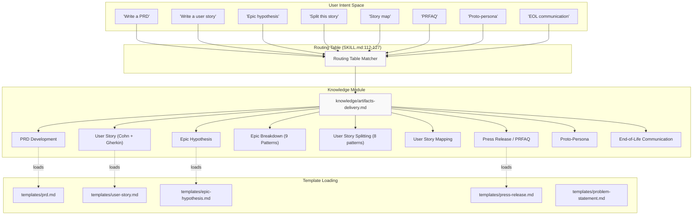
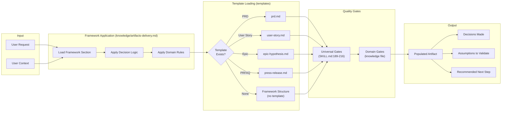
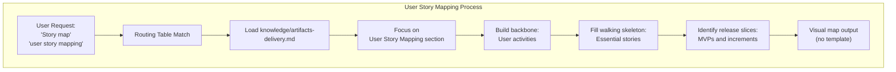

<!-- source: DeepWiki mcp.deepwiki.com · repo Digidai/product-manager-skills · page 4.3 Artifacts & Delivery · fetched 2026-10-26 -->

# Artifacts & Delivery

<details>
<summary>Relevant source files</summary>

The following files were used as context for generating this wiki page:

- [README.md](README.md)
- [SKILL.md](SKILL.md)

</details>


## Purpose and Scope

The Artifacts & Delivery domain contains frameworks and templates for creating execution artifacts that bridge product strategy to engineering implementation. This domain handles 11 distinct artifact types, from Product Requirements Documents (PRDs) to user stories, epics, press releases, and end-of-life communications.

**Scope:** This domain focuses on creating, critiquing, and structuring deliverables that communicate product decisions to engineering teams, stakeholders, and users. It does not cover discovery methods (see [Discovery & Research](#4.1)) or strategic positioning (see [Strategy & Positioning](#4.2)). For metrics and financial modeling, see [Finance & Metrics](#4.4).

**Key characteristics:**
- Enforces vertical slicing over horizontal (technical layer) slicing
- Applies Mike Cohn's user story structure plus Gherkin acceptance criteria
- Flags solution smuggling, overscoping, and metrics theater
- Integrates templates from `templates/` with frameworks from `knowledge/artifacts-delivery.md`

Sources: [SKILL.md:112-127](), [SKILL.md:168-186](), [README.md:122]()

---

## Artifact Catalog

The domain supports 11 artifact types, each mapped to specific frameworks and templates:

| Artifact Type | Framework | Template Path | Primary Use Case |
|---------------|-----------|---------------|------------------|
| PRD | PRD Development | `templates/prd.md` | Product requirements specification |
| User Story | Cohn + Gherkin | `templates/user-story.md` | Granular feature work items |
| Epic | Epic Hypothesis / Epic Breakdown (9 Patterns) | `templates/epic-hypothesis.md` | Large multi-story initiatives |
| Problem Statement | Problem Framing | `templates/problem-statement.md` | Empathetic problem articulation |
| Press Release / PRFAQ | Working Backwards | `templates/press-release.md` | Amazon-style future vision documents |
| Story Map | User Story Mapping | (none - visual output) | Journey-based story prioritization |
| Proto-Persona | Proto-Persona Framework | (none - inline output) | Lightweight user archetypes |
| Storyboard | Storyboard Framework | (none - visual output) | Visual user journey narrative |
| Recommendation Canvas | Recommendation Framework | (none - structured output) | Decision proposal to stakeholders |
| EOL Communication | End-of-Life Framework | (none - structured output) | Product deprecation messaging |
| User Story Split | 8 Splitting Patterns | (none - transformation rules) | Breaking down oversized stories |

Sources: [SKILL.md:112-127](), [SKILL.md:172-186]()

---

## Routing Architecture

### Intent to Framework Flow



**Routing mechanism:** When a user makes a request, the system matches intent phrases (column 1 in routing table) to frameworks (column 2) and loads `knowledge/artifacts-delivery.md` (column 3). The routing table at [SKILL.md:112-127]() uses exact string matching on intent phrases, with multiple phrases mapping to the same framework.

**Multi-phrase routing example:**
- `"Write a PRD"` → PRD Development
- `"product requirements"` → PRD Development (same framework, different user phrase)

Sources: [SKILL.md:79-98](), [SKILL.md:112-127](), [SKILL.md:161-165]()

---

## Template Integration System

### Knowledge Module + Template → Output Flow



**Template loading logic:** At step 5 of the execution workflow [SKILL.md:71](), the system checks the Template Index [SKILL.md:168-186](). If a matching template exists for the artifact type, it loads the template file and populates it with framework-driven content. If no template exists (e.g., Story Mapping, Storyboards), the system structures the output using the framework's internal logic.

**Critical distinction:** Templates are "pure scaffolding" [SKILL.md:23]() — the thinking comes from the framework in the knowledge module, not from the template. The template provides section headers and field names; the knowledge module provides validation rules, decision criteria, and quality gates.

Sources: [SKILL.md:63-74](), [SKILL.md:168-186](), [SKILL.md:22-24]()

---

## PRD Development Framework

### PRD Structure and Quality Enforcement

| PRD Section | Framework Requirement | Anti-Pattern Detected |
|-------------|----------------------|----------------------|
| Problem Statement | Must not smuggle solution | Solution Smuggling: "Users need a dashboard" |
| Success Metrics | Must have baseline, target, guardrail | Metrics Theater: tracking stats without decision logic |
| Scope | Must use vertical slices | Horizontal Slicing: splitting by tech layer |
| User | Must specify role, context, motivation | Generic personas: "users" without context |
| Acceptance Criteria | Must be testable | Vague criteria: "improve experience" |

**Workflow:**
1. User requests PRD via `"Write a PRD"` → routes to PRD Development
2. System loads `knowledge/artifacts-delivery.md` and searches for PRD Development section
3. System loads `templates/prd.md` as scaffolding
4. System applies PRD-specific quality gates (see Quality Gates section below)
5. Output includes populated PRD + decisions + assumptions + next step

**Example routing:**
- Input: `"Write a PRD for notification preferences"`
- Routing: [SKILL.md:116]() → `"Write a PRD"` → PRD Development → `knowledge/artifacts-delivery.md`
- Template: [SKILL.md:174]() → `templates/prd.md`

Sources: [SKILL.md:116](), [SKILL.md:174](), [README.md:80-94]()

---

## User Story Frameworks

### Mike Cohn Structure + Gherkin Acceptance Criteria

The system combines Mike Cohn's three-part user story format with Gherkin-style acceptance criteria:

**User Story Format:**
```
As a [specific role with context]
I want to [concrete action]
So that [measurable outcome]

Acceptance Criteria:
Given [precondition]
When [action]
Then [testable result]
```

**Quality enforcement:**
- Role must be specific [SKILL.md:201-203](): "mid-market ops manager running 3 product lines" not "user"
- Outcome must be measurable [SKILL.md:198-200](): "reduce time-to-first-value from 14 days to 3 days" not "improve onboarding"
- Criteria must be testable: Gherkin format enforces boolean pass/fail

Sources: [SKILL.md:117](), [SKILL.md:175](), [README.md:122]()

### User Story Splitting (8 Patterns)

When a story is too large, the system applies 8 splitting patterns referenced at [SKILL.md:118](). These patterns prioritize vertical slicing (end-to-end user value) over horizontal slicing (technical layers).

**Routing:**
- Input: `"Split this story"` or `"story too big"`
- Framework: User Story Splitting (8 patterns)
- Process: Analyzes the story, identifies splitting dimension (workflow steps, business rules, data variations, etc.), proposes vertical slices

**Anti-pattern flagged:** Horizontal Slicing [SKILL.md:214]() — splitting work by architecture layer (frontend/backend/database) instead of user value increments.

Sources: [SKILL.md:118](), [SKILL.md:214]()

### User Story Mapping



**No template:** Story Mapping produces visual/textual output structured by the framework, not a pre-defined template. The framework guides the creation of: (1) user activities (backbone), (2) user tasks (walking skeleton), (3) release slices (horizontal cuts).

Sources: [SKILL.md:119](), [SKILL.md:168-186]()

---

## Epic Management

### Epic Hypothesis Framework

**Template:** `templates/epic-hypothesis.md` [SKILL.md:178]()

Epics are framed as testable hypotheses, not feature lists. The Epic Hypothesis framework structures epics as:

```
We believe that [specific user segment]
Will achieve [measurable outcome]
If we provide [capability, not solution]
We'll know this is true when [leading indicator metric]
```

**Quality gate enforcement:**
- Outcome must be measurable (Universal Gate 2) [SKILL.md:198-200]()
- User segment must be specific (Universal Gate 3) [SKILL.md:201-203]()
- Must avoid solution smuggling (Universal Gate 5) [SKILL.md:215]()

Sources: [SKILL.md:120](), [SKILL.md:178]()

### Epic Breakdown (9 Patterns)

When breaking down epics into stories, the system applies 9 breakdown patterns referenced at [SKILL.md:121](). These patterns ensure vertical slicing across:
- User journey steps
- User roles
- Data variations
- Business rules
- CRUD operations
- Platforms
- Performance tiers
- Complexity levels
- Time-based phases

**Routing:**
- Input: `"Break down this epic"` or `"epic breakdown"`
- Framework: Epic Breakdown (9 Patterns)
- Output: Set of vertically-sliced stories, each delivering end-to-end value

Sources: [SKILL.md:121]()

---

## Press Release / PRFAQ (Working Backwards)

### Amazon-Style Future Vision

**Template:** `templates/press-release.md` [SKILL.md:179]()

The PRFAQ (Press Release / Frequently Asked Questions) format follows Amazon's Working Backwards methodology. This artifact is used for major product launches or strategic initiatives.

**Structure:**
1. Press Release (written from future launch date)
   - Headline
   - Subheadline
   - Customer problem
   - Solution
   - Customer quote
   - How it works
   - Executive quote
2. FAQ (internal questions and answers)

**Routing:**
- Input: `"Press release"`, `"PRFAQ"`, or `"working backwards"`
- Framework: Press Release / PRFAQ [SKILL.md:123]()
- Template: `templates/press-release.md` [SKILL.md:179]()

Sources: [SKILL.md:123](), [SKILL.md:179]()

---

## Other Artifact Types

### Proto-Persona

**No template** — inline structured output.

Lightweight user archetypes created without extensive research. Used when full persona research is not feasible but role specificity is required (Universal Gate 3).

**Routing:** `"Proto-persona"`, `"persona"`, `"who is the user"` → Proto-Persona framework

Sources: [SKILL.md:122]()

### Storyboards

**No template** — visual narrative output.

Visual representations of user journeys, typically combining sketches with narrative text describing each frame.

**Routing:** `"Storyboard"`, `"visual narrative"` → Storyboards framework

Sources: [SKILL.md:124]()

### Recommendation Canvas

**No template** — structured output.

Decision proposal format for stakeholder communication, typically covering: problem, options evaluated, recommendation with tradeoffs, decision criteria.

**Routing:** `"Recommendation canvas"`, `"solution proposal"` → Recommendation Canvas framework

Sources: [SKILL.md:125]()

### End-of-Life Communication

**No template** — structured output.

Product deprecation and sunset messaging, covering: timeline, customer impact, migration path, support plan.

**Routing:** `"EOL"`, `"end of life"`, `"sunset"`, `"deprecation"` → End-of-Life Communication framework

Sources: [SKILL.md:126]()

---

## Quality Gates for Artifacts & Delivery

### Two-Tier Validation System

```mermaid
graph TB
    ARTIFACT["Generated Artifact<br/>(PRD, Story, Epic, etc.)"]
    
    subgraph "Universal Gates (Apply to ALL outputs)"
        U1["Gate 1: Assumptions Labeled<br/>[assumption] inline"]
        U2["Gate 2: Outcomes Measurable<br/>Number + direction + timeframe"]
        U3["Gate 3: Roles Specific<br/>Context + motivation"]
        U4["Gate 4: Tradeoffs Named<br/>Acknowledge downsides"]
        U5["Gate 5: Anti-Patterns Flagged"]
    end
    
    subgraph "Domain-Specific Gates (Artifacts & Delivery)"
        DG1["Acceptance criteria<br/>must be testable"]
        DG2["Stories must be<br/>vertically sliced"]
        DG3["No solution smuggling<br/>in problem statements"]
        DG4["Scope must name<br/>what's NOT included"]
        DG5["Success metrics must have<br/>baseline + target + guardrail"]
    end
    
    subgraph "Anti-Pattern Detection (Gate 5 Detail)"
        AP1["Metrics Theater:<br/>Stats without decision logic"]
        AP2["Feature Factory:<br/>No problem validation"]
        AP3["Horizontal Slicing:<br/>Tech layers not value"]
        AP4["Solution Smuggling:<br/>'Users need a dashboard'"]
        AP5["Overscoping:<br/>Multiple releases in one PRD"]
    end
    
    DECISION{"All Gates<br/>Pass?"}
    REVISE["Revise Artifact"]
    APPROVE["Approve Output"]
    
    ARTIFACT --> U1
    ARTIFACT --> U2
    ARTIFACT --> U3
    ARTIFACT --> U4
    ARTIFACT --> U5
    
    ARTIFACT --> DG1
    ARTIFACT --> DG2
    ARTIFACT --> DG3
    ARTIFACT --> DG4
    ARTIFACT --> DG5
    
    U5 --> AP1
    U5 --> AP2
    U5 --> AP3
    U5 --> AP4
    U5 --> AP5
    
    U1 --> DECISION
    U2 --> DECISION
    U3 --> DECISION
    U4 --> DECISION
    U5 --> DECISION
    DG1 --> DECISION
    DG2 --> DECISION
    DG3 --> DECISION
    DG4 --> DECISION
    DG5 --> DECISION
    
    DECISION -->|"No"| REVISE
    DECISION -->|"Yes"| APPROVE
    REVISE --> ARTIFACT
```



### Universal Gates (Apply to All Artifacts)

All five universal gates defined at [SKILL.md:189-216]() apply to artifacts:

1. **Assumptions Labeled:** Any inferred or estimated content must be marked with `[assumption]` inline
2. **Outcomes Measurable:** Success criteria must include number, direction, timeframe (not "improve retention" but "reduce 30-day churn from 8% to 5% by Q3")
3. **Roles Specific:** User descriptions must include role, context, motivation (not "users" but "mid-market ops managers running 3 product lines")
4. **Tradeoffs Named:** Recommendations must acknowledge downsides (e.g., "faster to market, lower initial quality")
5. **Anti-Patterns Flagged:** System detects and calls out common PM failures

### Domain-Specific Gates (Artifacts & Delivery)

Additional validation rules specific to this domain:

| Gate | Requirement | Example Failure |
|------|-------------|----------------|
| Testable Criteria | Acceptance criteria must be boolean pass/fail | "Should feel intuitive" (not testable) |
| Vertical Slicing | Stories/epics must deliver end-to-end value | Story: "Build API layer" (horizontal slice) |
| No Solution Smuggling | Problem statements must not embed solutions | "Users need a dashboard to see metrics" |
| Explicit Scope Boundaries | PRDs must state what's NOT included | No mention of out-of-scope features |
| Three-Part Metrics | Success metrics need baseline, target, guardrail | "Increase engagement" (missing baseline/target) |

Sources: [SKILL.md:189-216](), [README.md:132]()

### Anti-Pattern Detection in PRD Review

The system actively detects and flags seven anti-patterns [SKILL.md:208-216](), with these being most common in Artifacts & Delivery:

1. **Metrics Theater:** Tracking metrics that look good but drive no decisions
   - Example: PRD lists 12 success metrics with no decision logic for what happens if they move
2. **Feature Factory:** Shipping features without validating the problem
   - Example: PRD jumps to solution without problem evidence
3. **Solution Smuggling:** Problem statements that embed a solution
   - Example: "Users need a preferences dashboard" (should be "Managers can't control notification frequency")
4. **Horizontal Slicing:** Splitting work by architecture layer instead of user value
   - Example: Story 1: "Backend API", Story 2: "Frontend UI" (should be one vertical slice)
5. **Overscoping:** Mixing multiple releases into one PRD
   - Example: PRD includes channels, digests, quiet hours, admin rules, and migration (should be separate releases)

Sources: [SKILL.md:208-216](), [README.md:88-94]()

---

## Common Usage Patterns

### Weekly PRD Critique Workflow

**Typical usage:** Mid-week, before sharing PRD with engineering.

**User input:**
```
Review this PRD for a notification preferences center. 
Flag solution smuggling, weak metrics, overscoping, and delivery risk.
```

**System process:**
1. Routes to PRD Development [SKILL.md:116]()
2. Loads `knowledge/artifacts-delivery.md`
3. Applies PRD quality gates
4. Flags anti-patterns
5. Outputs critique with line-by-line feedback

**Expected output structure:**
- Problem statement issues (solution smuggling)
- Success metrics gaps (missing baseline/target/guardrail)
- Scope concerns (horizontal slicing, overscoping)
- Delivery risk assessment
- Recommended revisions

Sources: [README.md:80-94](), [README.md:162-165]()

### Story Splitting During Sprint Planning

**Typical usage:** Sprint planning when a story is too large for one sprint.

**User input:**
```
Split this story: "As an admin, I want to manage team notification settings 
so that I can control what my team receives."
```

**System process:**
1. Routes to User Story Splitting (8 patterns) [SKILL.md:118]()
2. Analyzes story dimensions (user roles, workflow steps, complexity)
3. Proposes vertical slices
4. Validates each slice delivers end-to-end value

**Example vertical slices:**
- Story 1: Admin sets email opt-in/opt-out for team
- Story 2: Admin configures digest frequency for team
- Story 3: Admin defines quiet hours for team

Sources: [SKILL.md:118](), [SKILL.md:214]()

### Epic Breakdown for Quarterly Planning

**Typical usage:** Quarterly planning to decompose large initiatives.

**User input:**
```
Break down this epic: "Self-service analytics for operations teams"
```

**System process:**
1. Routes to Epic Breakdown (9 Patterns) [SKILL.md:121]()
2. Applies breakdown patterns (user journey, data variations, etc.)
3. Creates vertically-sliced stories
4. Each story maps to Epic Hypothesis framework

Sources: [SKILL.md:120-121]()

---

## Integration with Other Domains

### Cross-Domain Handoffs

| Source Domain | Artifact Type | Target Domain | Purpose |
|---------------|---------------|---------------|---------|
| Discovery & Research ([4.1](#4.1)) | Problem validation findings | PRD Development | Populate problem statement with evidence |
| Strategy & Positioning ([4.2](#4.2)) | Prioritization decision | Roadmap Plan / Epic Hypothesis | Justify why this epic now |
| Finance & Metrics ([4.4](#4.4)) | ROI calculation | PRD / Epic Hypothesis | Populate success metrics, investment case |
| AI Product Craft ([4.6](#4.6)) | Context engineering design | User Story / PRD | Define AI feature acceptance criteria |

**Example multi-domain flow:**
1. User validates problem using Discovery & Research frameworks
2. User prioritizes solution using Strategy & Positioning frameworks
3. User writes PRD using Artifacts & Delivery frameworks, pulling in evidence from steps 1-2
4. User defines success metrics using Finance & Metrics frameworks

This cross-domain integration is handled via the multi-domain request logic at [SKILL.md:76]().

Sources: [SKILL.md:75-77](), [README.md:118-126]()

---

