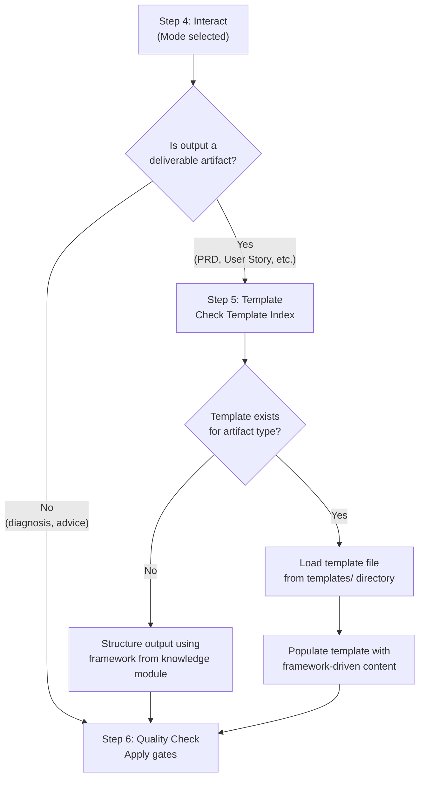
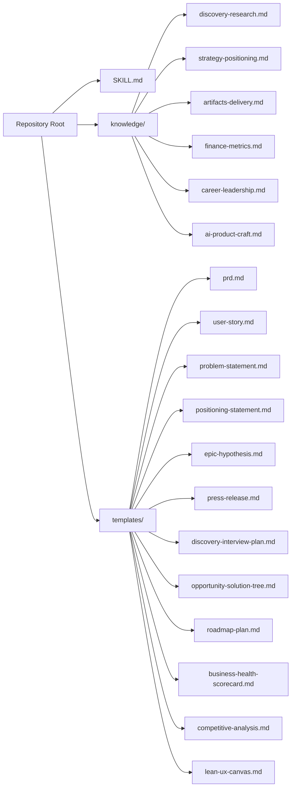
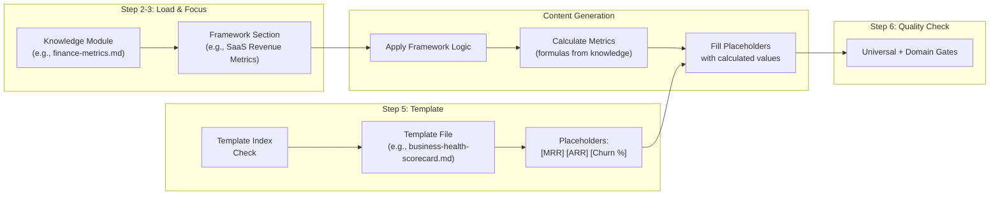
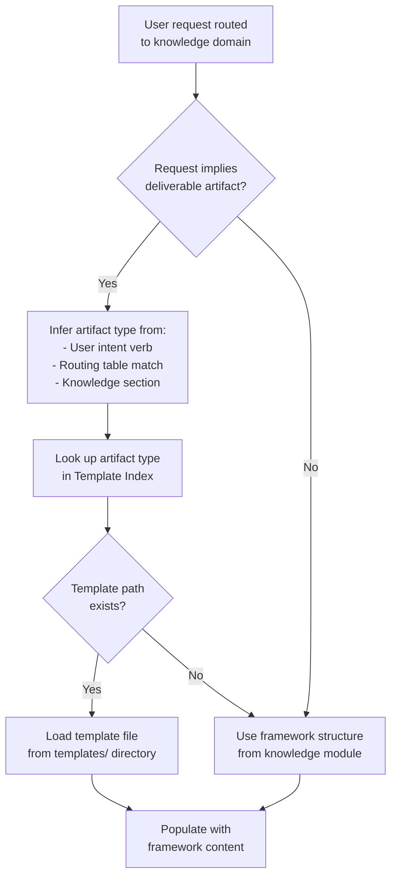

<!-- source: DeepWiki mcp.deepwiki.com · repo Digidai/product-manager-skills · page 5 Templates & Artifacts · fetched 2026-10-26 -->

# Templates & Artifacts

<details>
<summary>Relevant source files</summary>

The following files were used as context for generating this wiki page:

- [SKILL.md](SKILL.md)
- [templates/competitive-analysis.md](templates/competitive-analysis.md)
- [templates/lean-ux-canvas.md](templates/lean-ux-canvas.md)

</details>


## Purpose and Scope

This page documents the template system in Product Manager Skills: the collection of 12+ Markdown templates that provide structured scaffolding for PM deliverables. Templates are pure structure files that get populated with framework-driven content from knowledge modules during the execution workflow.

For details on how templates are selected and loaded during execution, see [Execution Workflow](#3.1). For documentation of the knowledge modules that provide the substance to fill templates, see [Knowledge Domains](#4). For reference documentation of individual templates, see [Core Templates Reference](#5.2).

---

## Template System Architecture

Templates serve as structural scaffolding that gets populated with domain-specific content from knowledge modules. This separation enables the system to generate rigorous, framework-driven outputs rather than generic placeholder text.

### Key Distinctions

| Aspect | Templates | Knowledge Modules |
|--------|-----------|-------------------|
| **Purpose** | Provide document structure | Provide frameworks and decision logic |
| **Content** | Section headers, field labels, formatting | Domain expertise, formulas, benchmarks |
| **Location** | `templates/` directory | `knowledge/` directory |
| **Reusability** | One template serves many use cases | One module serves many templates |
| **Filled by** | Framework application | PM expertise |

**Sources:** [SKILL.md:170](), [SKILL.md:68]()

---

## Integration with Execution Workflow

Templates are loaded at step 5 of the 7-step execution pipeline defined in SKILL.md. The system determines whether to load a template based on the artifact type being produced.

### Template Loading Decision Flow



**Sources:** [SKILL.md:63-74](), [SKILL.md:168-186]()

### Execution Context

The template loading step occurs after:
1. **Route** — Intent matched to framework [SKILL.md:67]()
2. **Load knowledge** — Domain module loaded [SKILL.md:68]()
3. **Focus** — Framework section identified [SKILL.md:69]()
4. **Interact** — Mode selected (guided/dump/guess) [SKILL.md:70]()

And before:
6. **Quality check** — Universal and domain gates applied [SKILL.md:72]()
7. **Close** — Decisions/assumptions/next step appended [SKILL.md:73]()

**Sources:** [SKILL.md:63-74]()

---

## Template Index and File System

Templates are stored as Markdown files in the `templates/` directory, which is a sibling to SKILL.md. The Template Index in SKILL.md maps artifact types to template file paths.

### Template Index Routing Table

The following table from SKILL.md defines the complete template routing system:

| Template | Path | Use When |
|----------|------|----------|
| PRD | `templates/prd.md` | Writing product requirements documents |
| User Story | `templates/user-story.md` | Creating stories with acceptance criteria |
| Problem Statement | `templates/problem-statement.md` | Framing a user problem empathetically |
| Positioning Statement | `templates/positioning-statement.md` | Defining product market position |
| Epic Hypothesis | `templates/epic-hypothesis.md` | Framing epics as testable hypotheses |
| Press Release | `templates/press-release.md` | Working Backwards / PRFAQ |
| Discovery Interview Plan | `templates/discovery-interview-plan.md` | Preparing for customer interviews |
| Opportunity Solution Tree | `templates/opportunity-solution-tree.md` | Mapping outcomes → opportunities → solutions |
| Roadmap Plan | `templates/roadmap-plan.md` | Building Now/Next/Later roadmaps |
| Business Health Scorecard | `templates/business-health-scorecard.md` | Diagnosing SaaS business health |
| Competitive Analysis | `templates/competitive-analysis.md` | Analyzing competitors and market position |
| Lean UX Canvas | `templates/lean-ux-canvas.md` | Structuring hypotheses and experiments |

**Sources:** [SKILL.md:168-186]()

### Directory Structure



**Sources:** [SKILL.md:68](), [SKILL.md:172-185]()

---

## Template Structure and Conventions

Templates follow consistent Markdown formatting conventions. Each template contains:

1. **Section headers** — Markdown `##` or `###` headers defining structure
2. **Field placeholders** — Bracketed labels indicating what content to fill
3. **Inline guidance** — Descriptive hints about expected content
4. **Tables** — For structured comparisons or multi-dimensional data
5. **Footer** — Attribution line with repo link

### Example: Lean UX Canvas Structure

The Lean UX Canvas template demonstrates standard conventions:

```markdown
## Lean UX Canvas

### 1. Business Problem

[What business outcome are we trying to improve? State in terms of a measurable metric.]

### 2. Business Outcomes

- **Primary metric:** [metric + current value + target value + timeframe]
- **Leading indicator:** [metric that moves before the primary]

### 3. Users & Customers

- **Target user:** [specific role/persona with context]
- **Their current behavior:** [what they do today]
- **Underserved need:** [what's painful or missing]
```

**Placeholder patterns:**
- `[description of content]` — Single-value fields
- `[option1/option2/option3]` — Multiple choice fields
- `[metric + current value + target value + timeframe]` — Structured data with multiple components

**Sources:** [templates/lean-ux-canvas.md:1-25]()

### Example: Competitive Analysis Structure

The Competitive Analysis template demonstrates table-based structure:

```markdown
## Competitive Analysis

### Overview

**Product:** [your product name]
**Analysis Date:** [date]
**Market Category:** [category]

### Competitive Landscape

| Dimension | Your Product | Competitor A | Competitor B | Competitor C |
|-----------|-------------|-------------|-------------|-------------|
| **Positioning** | | | | |
| **Target Segment** | | | | |
| **Pricing Model** | | | | |
```

**Table conventions:**
- Row headers in bold
- Empty cells to be filled during execution
- Column structure defines comparison dimensions

**Sources:** [templates/competitive-analysis.md:1-18]()

---

## Templates vs. Knowledge Modules: Execution Flow

The separation between templates (structure) and knowledge modules (substance) is enforced during the execution workflow. This diagram shows how content flows from knowledge modules into template structure.

### Content Population Flow



**Sources:** [SKILL.md:68-73](), [SKILL.md:170]()

### Concrete Example: SaaS Metrics Diagnostic

**User request:** "Analyze these metrics: MRR $50k, 500 customers, gross margin 80%, churn 8%, CAC $500"

**Execution flow:**

1. **Route:** "SaaS metrics" → Finance & Metrics domain [SKILL.md:132]()
2. **Load knowledge:** `knowledge/finance-metrics.md` loaded
3. **Focus:** "SaaS Revenue & Growth Metrics" section
4. **Interact:** Direct output (simple request)
5. **Template:** Load `templates/business-health-scorecard.md` [SKILL.md:183]()
6. **Populate template with framework calculations:**
   - Apply ARPA formula from knowledge module
   - Apply LTV formula from knowledge module
   - Apply LTV:CAC ratio calculation
   - Fill scorecard template with calculated values
7. **Quality check:** Verify formulas shown, benchmarks cited
8. **Close:** Append decisions, assumptions, next step

**Output structure:** Template provides scorecard sections; knowledge module provides formulas, benchmarks, and diagnostic logic.

**Sources:** [SKILL.md:132](), [SKILL.md:183]()

---

## Template-to-Knowledge Module Mapping

Most templates are populated by multiple knowledge domains. This matrix shows the primary and secondary domain relationships.

```mermaid
graph TB
    subgraph Templates["Templates (templates)"]
        T_PRD["prd.md"]
        T_Story["user-story.md"]
        T_ProbStmt["problem-statement.md"]
        T_Position["positioning-statement.md"]
        T_EpicHyp["epic-hypothesis.md"]
        T_PRFAQ["press-release.md"]
        T_Interview["discovery-interview-plan.md"]
        T_OST["opportunity-solution-tree.md"]
        T_Roadmap["roadmap-plan.md"]
        T_BizHealth["business-health-scorecard.md"]
        T_CompAnal["competitive-analysis.md"]
        T_LeanCanvas["lean-ux-canvas.md"]
    end
    
    subgraph Knowledge["Knowledge Modules (knowledge)"]
        K_Disc["discovery-research.md"]
        K_Strat["strategy-positioning.md"]
        K_Artif["artifacts-delivery.md"]
        K_Fin["finance-metrics.md"]
        K_Career["career-leadership.md"]
        K_AI["ai-product-craft.md"]
    end
    
    T_PRD --> K_Artif
    T_Story --> K_Artif
    T_ProbStmt --> K_Disc
    T_Position --> K_Strat
    T_EpicHyp --> K_Artif
    T_PRFAQ --> K_Artif
    T_Interview --> K_Disc
    T_OST --> K_Disc
    T_Roadmap --> K_Strat
    T_BizHealth --> K_Fin
    T_CompAnal --> K_Strat
    T_LeanCanvas --> K_Disc
    
    T_PRD -.->|"Secondary"| K_Disc
    T_Story -.->|"Secondary"| K_Disc
    T_EpicHyp -.->|"Secondary"| K_Disc
    T_Roadmap -.->|"Secondary"| K_Artif
```



**Mapping rules:**

- Solid lines indicate primary knowledge module (provides main framework)
- Dotted lines indicate secondary module (provides supporting context)
- Templates in `artifacts-delivery` domain often pull from `discovery-research` for problem framing
- Templates in `strategy-positioning` domain may pull from `artifacts-delivery` for execution details

**Sources:** [SKILL.md:79-160](), [SKILL.md:168-186]()

---

## Operating Principles for Template Usage

SKILL.md defines strict operating principles that govern how templates are used:

### Principle 1: Templates Are Scaffolding, Not Fill-in-the-Blank Forms

From [SKILL.md:22]():
> "A template filler. Templates are scaffolding — the thinking matters more than the format."

**Implementation:** Templates provide structure but must be filled with framework-driven content. Generic placeholder text like "Improve user experience" is rejected by quality gates.

### Principle 2: Specific > Complete

From [SKILL.md:18]():
> "Specific > complete. One sharp example beats a page of generic advice."

**Implementation:** Templates encourage specific values over exhaustive coverage. A competitive analysis with 2 deeply analyzed competitors is preferred over 10 shallow entries.

### Principle 3: Compression by Default

From [SKILL.md:18]():
> "Compression by default. Say it in 3 bullets, not 3 paragraphs."

**Implementation:** Template sections guide toward bullet lists and tables rather than prose. User can request expansion.

**Sources:** [SKILL.md:13-19](), [SKILL.md:22]()

---

## Template Quality Validation

Templates are validated using the same two-tier quality gate system as all other outputs. The Universal Quality Gates ensure template-filled outputs meet rigorous standards.

### Universal Gates Applied to Template Outputs

| Gate | Template Validation |
|------|---------------------|
| **Assumptions Labeled** | Inferred data marked with `[assumption]` inline in template fields |
| **Outcomes Measurable** | Metric fields require quantified values with timeframes |
| **Roles Specific** | Persona fields reject generic "users", require role + context |
| **Tradeoffs Named** | Recommendation sections must include downsides |
| **Anti-Patterns Flagged** | Template content checked for 7 PM failure modes |

### Anti-Patterns in Template Context

Common anti-patterns that trigger validation failures in template outputs:

1. **Metrics Theater** — Filling metrics fields with vanity stats that drive no decisions
2. **Solution Smuggling** — Problem statement templates that embed solutions in the framing
3. **Feature Factory** — PRD templates missing problem validation sections
4. **Horizontal Slicing** — Epic/story templates split by architecture layer not user value

**Sources:** [SKILL.md:189-216]()

---

## Template File Format Specifications

### Standard Structure

All templates follow this structure:

1. **Title** — Level 2 header (`##`) with template name
2. **Sections** — Level 3 headers (`###`) with numbered or named sections
3. **Fields** — Bracketed placeholders or table cells
4. **Footer** — Attribution line: `---\n*Generated with [product-manager-skills](https://github.com/Digidai/product-manager-skills)*`

### Placeholder Syntax Patterns

| Pattern | Meaning | Example |
|---------|---------|---------|
| `[description]` | Free text field | `[What business outcome are we improving?]` |
| `[option1/option2]` | Multiple choice | `[High/Med/Low]` |
| `[metric + context]` | Structured field | `[metric + current value + target value + timeframe]` |
| Empty table cell | To be populated | Used in competitive matrices |
| `**Label:** [value]` | Labeled field | `**Primary metric:** [metric]` |

**Sources:** [templates/lean-ux-canvas.md:1-54](), [templates/competitive-analysis.md:1-47]()

### Footer Convention

Every template ends with:

```markdown
---
*Generated with [product-manager-skills](https://github.com/Digidai/product-manager-skills)*
```

This attribution line is preserved when templates are filled and delivered to users.

**Sources:** [templates/lean-ux-canvas.md:52-54](), [templates/competitive-analysis.md:45-47]()

---

## Template Lookup Algorithm

The system determines which template to load using this decision logic:



**Artifact type inference examples:**

| User Intent | Inferred Artifact | Template Loaded |
|-------------|-------------------|-----------------|
| "Write a PRD" | PRD | `templates/prd.md` |
| "Position my product" | Positioning Statement | `templates/positioning-statement.md` |
| "SaaS metrics diagnostic" | Business Health Scorecard | `templates/business-health-scorecard.md` |
| "Career advice" | None (not an artifact) | No template loaded |

**Sources:** [SKILL.md:79-160](), [SKILL.md:168-186]()

---

## Summary

The template system provides structural scaffolding for 12+ PM deliverables, integrated into the execution workflow at step 5. Templates are stored as Markdown files in `templates/`, referenced via the Template Index in SKILL.md, and populated with framework-driven content from knowledge modules. The system enforces that templates are scaffolding, not fill-in-the-blank forms, through strict quality gates that reject generic placeholder text.

**Key technical points:**

- Templates live in `templates/` as siblings to SKILL.md
- Template Index maps artifact types to file paths [SKILL.md:168-186]()
- Templates are loaded after framework selection but before quality validation
- Content flows from knowledge modules → framework logic → template placeholders
- Universal quality gates validate template outputs for rigor

For detailed documentation of individual templates, see [Core Templates Reference](#5.2). For the execution workflow context, see [Execution Workflow](#3.1).

---

