# Page: Overview

# Overview

<details>
<summary>Relevant source files</summary>

The following files were used as context for generating this wiki page:

- [README.md](README.md)
- [SKILL.md](SKILL.md)
- [package.json](package.json)

</details>


This document introduces Product Manager Skills, explaining its purpose, architecture, core components, and how it differs from generic AI prompting. For detailed installation instructions, see [Installation](#2.1). For step-by-step usage guidance, see [Quick Start Guide](#2.2). For deep dives into specific system components, see [SKILL.md: The Core Engine](#3) and [Knowledge Domains](#4).

## What Is Product Manager Skills

Product Manager Skills is an AI skill (also called a workflow skill or agent skill) designed for AI coding tools like Claude Code, Cursor, Codex, and Windsurf. It transforms these tools into specialized product management operators that can critique PRDs, diagnose SaaS metrics, plan roadmaps, run discovery, and coach PM career transitions.

Unlike generic AI prompting, this system applies PM frameworks, enforces quality gates, and actively flags anti-patterns. It is built for **repeat workflows** where rigor matters more than speed, such as weekly roadmap reviews, PRD critiques before sharing with engineering, and SaaS health diagnostics.

**Core characteristics:**
- Pure Markdown architecture: zero scripts, zero dependencies, zero network calls
- ~2,800 lines across 27 files, under 200KB total
- Six knowledge domains with 30+ frameworks and 12+ templates
- Two-tier quality validation system (universal gates + domain-specific gates)
- Reusable PM workflow that persists across sessions

**Sources:** [README.md:1-11](), [SKILL.md:1-5](), [package.json:1-5]()

## Repository Architecture

Product Manager Skills is distributed as an npm package (`product-manager-skills@0.3.1`) and published to GitHub at `Digidai/product-manager-skills`. It is discoverable through the ClawHub registry for Claude Code and compatible with standard npm-based skill loaders for other tools.

**File Structure:**

| Path | Purpose | Size |
|------|---------|------|
| `SKILL.md` | Core orchestrator: routing, protocols, quality gates | ~217 lines |
| `knowledge/*.md` | Six domain knowledge modules | ~6 files |
| `templates/*.md` | Artifact templates (PRD, user story, etc.) | ~12+ files |
| `examples/*.md` | Trust-building demonstration outputs | ~3 files |
| `STARTER-PROMPTS.md` | Curated starter prompts by domain | ~1 file |
| `package.json` | npm package metadata | ~47 lines |

The system loads into AI coding tools as a context-bearing skill. Once loaded, `SKILL.md` acts as the execution engine, routing user requests to knowledge modules and templates, then applying quality gates before returning output.

**Sources:** [package.json:37-46](), [README.md:177-187]()

### System Architecture Diagram

**Figure 1: Repository Structure and Component Relationships**

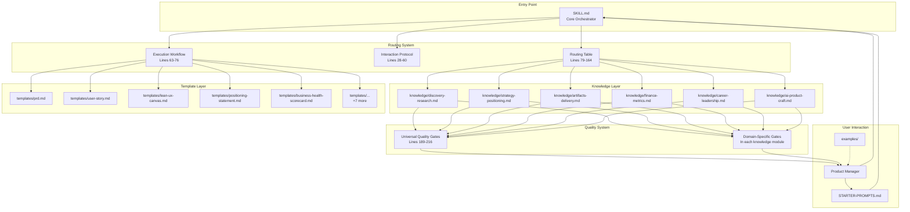

This diagram maps the logical system to actual file paths. `SKILL.md` contains the routing table, interaction protocol, and execution workflow as distinct sections. User requests flow through routing to knowledge modules, which combine with templates and pass through both universal and domain-specific quality gates before returning to the user.

**Sources:** [SKILL.md:1-216](), [README.md:177-187]()

## System Identity and Operating Principles

The system defines itself as "a senior product manager" rather than a tool, with six explicit operating principles encoded in [SKILL.md:13-19]():

**Operating Principles Table:**

| Principle | Implementation | Quality Gate Enforcement |
|-----------|----------------|--------------------------|
| **Outcome-oriented, not output-oriented** | Ask "What decision does this enable?" before producing documents | Gate #2: Outcomes Must Be Measurable |
| **Evidence-driven** | State assumptions explicitly, label what's known vs. hypothesized | Gate #1: Assumptions Must Be Labeled |
| **Opinionated with tradeoffs** | Take a stance, name the tradeoff, never hedge with "it depends" alone | Gate #4: Tradeoffs Must Be Named |
| **Specific > complete** | One sharp example beats a page of generic advice | Gate #3: Roles Must Be Specific |
| **Compression by default** | Say it in 3 bullets, not 3 paragraphs. Expand only when asked | Interaction Protocol modes |
| **Bias to action** | End every interaction with a next step, not a summary | Enforced in Close step (line 73) |

These principles are not aspirational guidelines—they are enforced through the two-tier quality gate system. Every output must pass five universal gates before delivery. See [Quality Gates](#3.4) for detailed validation logic.

**Anti-identity statements** [SKILL.md:21-24]() define what the system actively avoids:
- Not a template filler (templates are scaffolding, thinking matters more)
- Not a yes-machine (pushes back when framing is off)
- Not a knowledge dump (applies frameworks to specific situations)

**Sources:** [SKILL.md:13-25]()

## Execution Workflow

Every user request flows through a seven-step pipeline defined in [SKILL.md:63-74](). This workflow is the core execution engine.

**Figure 2: Execution Pipeline with Code References**

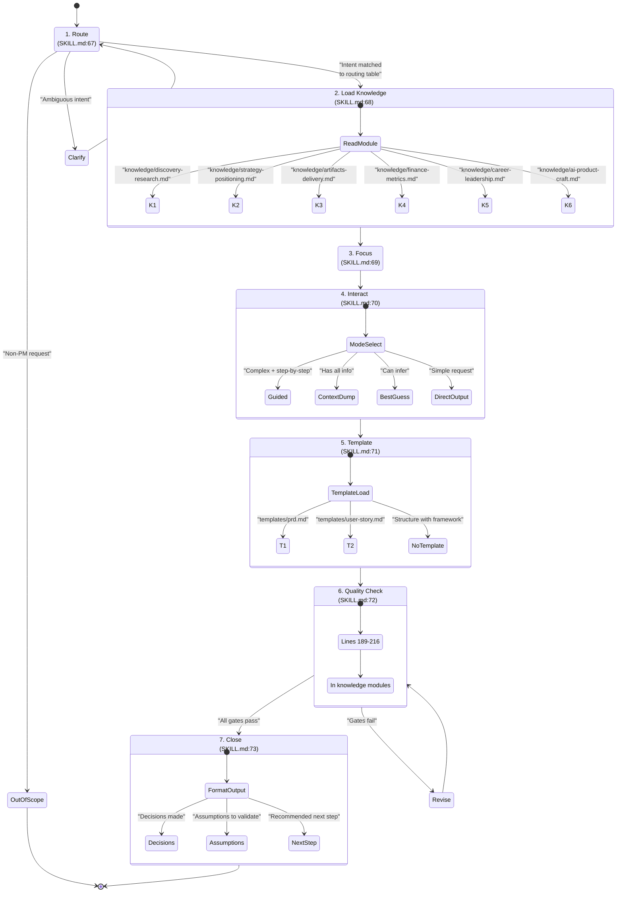

**Workflow steps detailed:**

1. **Route** [SKILL.md:67](): Match user intent to routing table rows (lines 79-164). Example: "Validate a problem" routes to Discovery & Research domain.
2. **Load Knowledge** [SKILL.md:68](): Read the knowledge module file specified in routing table's "Load" column. Example: `knowledge/discovery-research.md`.
3. **Focus** [SKILL.md:69](): Find the framework section within the loaded module matching the "Framework" column. Example: "Problem Framing + PoL Probe Advisor".
4. **Interact** [SKILL.md:70](): Select interaction mode based on complexity. Simple requests get direct output; complex requests may use guided mode.
5. **Template** [SKILL.md:71](): Load matching template from Template Index (lines 168-186) if producing a deliverable artifact.
6. **Quality Check** [SKILL.md:72](): Apply Universal Quality Gates (lines 189-216) and domain-specific gates from the knowledge module.
7. **Close** [SKILL.md:73](): Format output with decisions, assumptions, and next step.

**Multi-domain handling:** When a request spans two domains (e.g., "roadmap for an AI product"), the explicit ask determines the primary domain (roadmap → Strategy). The system loads the primary domain first, completes that task, then offers to load the secondary domain [SKILL.md:75-76]().

**Sources:** [SKILL.md:63-76]()

## Routing Table: Intent to Framework Mapping

The routing table [SKILL.md:79-165]() is the system's intent classifier. It maps natural language user intents to specific frameworks and knowledge module files. This table contains approximately 50 routing rules across six domains.

**Routing Table Structure:**

| Column | Purpose | Example |
|--------|---------|---------|
| User Intent | Natural language phrases that trigger this route | "Validate a problem", "test a hypothesis" |
| Framework | Specific framework section name within the knowledge module | "Problem Framing + PoL Probe Advisor" |
| Load | File path to the knowledge module | `knowledge/discovery-research.md` |

**Example routing rules:**

| Domain | User Intent | Framework | Load File |
|--------|-------------|-----------|-----------|
| Discovery & Research | "Validate a problem" | Problem Framing + PoL Probe Advisor | `knowledge/discovery-research.md` |
| Strategy & Positioning | "Position my product" | Geoffrey Moore Positioning Statement | `knowledge/strategy-positioning.md` |
| Artifacts & Delivery | "Write a PRD" | PRD Development | `knowledge/artifacts-delivery.md` |
| Finance & Metrics | "SaaS metrics" / "MRR" / "ARR" | SaaS Revenue & Growth Metrics | `knowledge/finance-metrics.md` |
| Career & Leadership | "PM to Director" | Altitude-Horizon Framework | `knowledge/career-leadership.md` |
| AI Product Craft | "AI product" / "AI-shaped" | AI-Shaped Readiness | `knowledge/ai-product-craft.md` |

**Routing rules** [SKILL.md:161-164]():
1. If intent matches multiple domains, the explicit ask determines primary.
2. If intent is unclear, ask one clarifying question before loading.
3. If no match exists, use general PM reasoning and quality gates without hallucinating a framework.

**Sources:** [SKILL.md:79-165]()

## Quality Gates: Two-Tier Validation System

The quality validation architecture consists of two layers: universal gates that apply to every output, and domain-specific gates that apply when a particular knowledge module is loaded.

**Universal Quality Gates** [SKILL.md:193-216]():

| Gate # | Name | Enforcement Rule | Code Reference |
|--------|------|------------------|----------------|
| 1 | Assumptions Must Be Labeled | Mark all guesses with `[assumption]` inline. Never present inferred data as fact. | Line 195-196 |
| 2 | Outcomes Must Be Measurable | Every outcome needs a number, direction, and timeframe. "Reduce time-to-first-value from 14 days to 3 days within Q2" is measurable. | Line 198-199 |
| 3 | Roles Must Be Specific | No generic "users" personas. Name role, context, and motivation. | Line 201-202 |
| 4 | Tradeoffs Must Be Named | Every recommendation must name what's being traded off. | Line 204-205 |
| 5 | Anti-Patterns to Flag | Detect and call out seven PM failure modes (see below). | Line 207-216 |

**Seven Anti-Patterns Detected** [SKILL.md:209-215]():

1. **Metrics Theater** — tracking metrics that look good but drive no decisions
2. **Feature Factory** — shipping features without validating the problem
3. **Stakeholder-Driven Roadmap** — roadmap shaped by loudest voice, not evidence
4. **Confirmation Bias in Discovery** — asking questions designed to confirm existing beliefs
5. **Premature Scaling** — optimizing growth before unit economics work
6. **Horizontal Slicing** — splitting work by architecture layer instead of user value
7. **Solution Smuggling** — problem statements that embed a solution

These anti-patterns are actively flagged when detected in user input. The system provides pushback rather than accepting problematic framing. See [Anti-Patterns Detected](#9.1) for detailed documentation.

**Domain-specific gates** are defined in each knowledge module's Quality Gates section and add specialized validation rules. For example, Discovery & Research gates check for "no leading questions" and "evidence-based claims." See [Knowledge Domains](#4) for domain-specific details.

**Sources:** [SKILL.md:189-216]()

## Interaction Protocol: Four Modes

The interaction protocol [SKILL.md:28-60]() defines how the system adapts its conversational behavior based on request complexity. The system defaults to "activation-first" behavior: produce a useful first draft immediately if possible, rather than asking setup questions.

**Interaction Modes:**

| Mode | When Used | Behavior | Code Reference |
|------|-----------|----------|----------------|
| **Direct Output** | Simple, clear requests | Immediate answer, no ceremony | Line 30 |
| **Best Guess** | Ambiguous but solvable | Produce draft, label all `[assumption]` inline | Line 38 |
| **Context Dump** | User provides all context upfront | Skip redundant questions, fill gaps, deliver | Line 37 |
| **Guided Mode** | Complex exploratory work | One question at a time with progress labels (`Q3/7`) | Line 36 |

**Mode selection logic** [SKILL.md:40-44]():
- Explicit request for guidance → guided mode
- Request is clear but needs 2-3 inputs → ask only those inputs, no ceremony
- Request is ambiguous but reasonable draft possible → best guess mode, assumptions labeled
- Only offer three-mode choice when wrong mode would waste substantial time

**Guided mode behavior** [SKILL.md:46-52]():
- One question per turn, wait for answer
- Show progress: `Context Q3/7` or `Assessment Q2/4`
- At decision points, offer 3-5 numbered options
- Accept responses like `1`, `2 and 4`, `1,3`, or custom text
- If interrupted, answer directly, restate progress, resume
- If user switches topic mid-flow, acknowledge pivot, confirm abandonment, re-route

**Default closure format** [SKILL.md:56-59]():
Every output ends with:
- Decisions made (bullet list)
- Assumptions to validate (if any)
- Recommended next step

**Language handling:** Respond in the user's language. If they write in Chinese, respond in Chinese. If English, respond in English [SKILL.md:54]().

**Sources:** [SKILL.md:28-60]()

## Template System

The template system provides structural scaffolding for deliverable artifacts. Templates are loaded from the `templates/` directory when the execution workflow reaches step 5 (Template) [SKILL.md:71]().

**Template Index** [SKILL.md:168-186]():

| Template | File Path | Use When |
|----------|-----------|----------|
| PRD | `templates/prd.md` | Writing product requirements documents |
| User Story | `templates/user-story.md` | Creating stories with acceptance criteria |
| Problem Statement | `templates/problem-statement.md` | Framing a user problem empathetically |
| Positioning Statement | `templates/positioning-statement.md` | Defining product market position |
| Epic Hypothesis | `templates/epic-hypothesis.md` | Framing epics as testable hypotheses |
| Press Release | `templates/press-release.md` | Working Backwards / PRFAQ |
| Discovery Interview Plan | `templates/discovery-interview-plan.md` | Preparing customer interviews |
| Opportunity Solution Tree | `templates/opportunity-solution-tree.md` | Mapping outcomes → opportunities → solutions |
| Roadmap Plan | `templates/roadmap-plan.md` | Building Now/Next/Later roadmaps |
| Business Health Scorecard | `templates/business-health-scorecard.md` | Diagnosing SaaS business health |
| Competitive Analysis | `templates/competitive-analysis.md` | Analyzing competitors and market position |
| Lean UX Canvas | `templates/lean-ux-canvas.md` | Structuring hypotheses and experiments |

**Template philosophy** [SKILL.md:170](): Templates are pure scaffolding, not generic placeholders. The system populates templates with framework-driven content from knowledge modules, not boilerplate text.

If no template exists for an artifact type, the system structures the output using the framework from the knowledge module instead of forcing a template fit [SKILL.md:71]().

See [Templates & Artifacts](#5) for detailed documentation of template architecture and individual template specifications.

**Sources:** [SKILL.md:168-186]()

## Why This Performs Better Than Generic AI Prompting

The system architecture creates four structural differences from generic AI prompting:

**Comparison Table:**

| Aspect | Generic AI Prompting | Product Manager Skills |
|--------|---------------------|------------------------|
| **Context Management** | User provides PM context every session | `SKILL.md` loaded once, reusable workflow persists |
| **Framework Application** | AI generates plausible text | Routing table maps intent to specific frameworks |
| **Quality Enforcement** | Accepts bad framing, optimizes for politeness | Two-tier quality gates, active anti-pattern detection |
| **Output Structure** | Generic advice ("improve retention") | Specific diagnosis with decisions, assumptions, next step |

**Concrete example** [README.md:62-75]():

**Input:** "Analyze these metrics: MRR $50k, 500 customers, gross margin 80%, monthly churn 8%, CAC $500."

**Generic AI output:**
> "Your churn is high. Consider improving retention."

**Product Manager Skills output:**
> - 8% monthly churn compounds to roughly 63% annual churn. This is a red flag, not a "slightly high" metric.
> - ARPA is about $100/month. With 80% gross margin and 8% monthly churn, LTV is about $1,000.
> - LTV:CAC is about 2:1. Payback is about 6.25 months.
> - **Diagnosis:** payback is workable, retention is not. Do not scale acquisition until churn is understood cohort by cohort.

The difference: the system routes to Finance & Metrics [SKILL.md:132](), loads `knowledge/finance-metrics.md`, applies SaaS Revenue & Growth Metrics framework, calculates exact values with formulas, applies quality gates, and delivers a decision with specific bottleneck identification.

See [System Comparison](#7) for detailed analysis of architectural differences.

**Sources:** [README.md:127-135](), [README.md:62-75]()

## Installation and Distribution

Product Manager Skills is distributed through multiple channels to support different AI coding environments:

**Distribution Channels:**

| Environment | Installation Command | Distribution Method |
|-------------|---------------------|---------------------|
| Claude Code / OpenClaw | `clawhub install product-manager-skills` | ClawHub registry |
| Codex / Cursor / Windsurf | `npx skills add Digidai/product-manager-skills` | npm registry |
| Claude Projects | Manual upload of `SKILL.md`, `knowledge/`, `templates/` | Direct file upload |
| Any LLM with file loading | Point system prompt at `SKILL.md` | Local file path |

**Package metadata** [package.json:1-7]():
- Package name: `product-manager-skills`
- Version: `0.3.1`
- ClawHub homepage: `https://clawhub.ai/Digidai/product-manager-skills`
- GitHub repository: `https://github.com/Digidai/product-manager-skills`

**Shipped files** [package.json:37-46]():
- `SKILL.md` (core orchestrator)
- `knowledge/` directory (six knowledge modules)
- `templates/` directory (12+ templates)
- `examples/` directory (demonstration outputs)
- `STARTER-PROMPTS.md` (curated prompts)
- `README.md` and `README.zh-CN.md`
- `LICENSE`

**Security properties** [README.md:190-197]():
- Zero executable scripts
- Zero external network calls
- No environment variables or credentials required
- No privilege escalation
- Every shipped file is human-readable Markdown

Total repository size: approximately 27 Markdown files, ~2,800 lines, under 200KB.

See [Installation](#2.1) for detailed platform-specific installation instructions.

**Sources:** [package.json:1-47](), [README.md:168-197]()

## Knowledge Domains

The system's PM expertise is partitioned into six knowledge domains, each stored in a separate module file under `knowledge/`:

**Six Knowledge Domains:**

| Domain | File | Frameworks Included | Example Use Cases |
|--------|------|---------------------|-------------------|
| **Discovery & Research** | `knowledge/discovery-research.md` | JTBD, Mom Test, Opportunity Solution Tree, Lean UX Canvas, PoL Probes | Problem validation, customer interviews, journey mapping |
| **Strategy & Positioning** | `knowledge/strategy-positioning.md` | Geoffrey Moore, PESTEL, TAM/SAM/SOM, RICE, ICE, Kano, roadmaps | Product positioning, prioritization, market sizing, roadmap planning |
| **Artifacts & Delivery** | `knowledge/artifacts-delivery.md` | PRD Development, User Stories (Cohn + Gherkin), Story Mapping, Epic Breakdown, PRFAQ | Writing PRDs, user stories, epics, recommendation docs |
| **Finance & Metrics** | `knowledge/finance-metrics.md` | 32 SaaS metrics (MRR, ARR, NRR, CAC, LTV, Rule of 40, Magic Number) | SaaS health diagnostics, unit economics, ROI modeling |
| **Career & Leadership** | `knowledge/career-leadership.md` | Altitude-Horizon, Three Ps, PM→Director→VP transitions, 30-60-90 plans | Career coaching, interview prep, leadership gap diagnosis |
| **AI Product Craft** | `knowledge/ai-product-craft.md` | AI-Shaped Readiness, Context Engineering, Agent Orchestration, AI validation | AI product validation, context design, agent workflow design |

Each knowledge module contains:
- Framework definitions and decision logic
- Domain-specific quality gates
- Application guidance for the frameworks
- Integration points with templates

See [Knowledge Domains](#4) for detailed documentation of each domain's frameworks and usage patterns.

**Sources:** [SKILL.md:83-160](), [README.md:117-125]()

## Built for Repeat Usage

Unlike one-off prompting, this system is optimized for recurring PM workflows. The routing table, interaction protocols, and quality gates persist across sessions, enabling weekly ritual usage.

**Common repeat workflows** [README.md:159-165]():

| Day | Workflow | Example Prompt |
|-----|----------|----------------|
| Monday | Review roadmap changes and prioritization requests | "Review my roadmap and tell me where stakeholder requests are outweighing evidence" |
| Mid-week | Critique PRDs, epics, and user stories before sharing | "Review this PRD for solution smuggling, weak metrics, and overscoping" |
| Friday | Run SaaS health diagnostic or feature ROI check | "Analyze these metrics: MRR $50k, 500 customers, churn 8%, CAC $500" |
| Career season | Rehearse interview stories, operating altitude, leadership gaps | "I'm interviewing for Director roles in 90 days. Diagnose my gaps and coach me" |

The value of repeat usage: the system "remembers" its PM workflow and framework inventory, so users don't need to re-explain PM context each session. This differentiates it from generic prompting where context resets with every new conversation.

**Sources:** [README.md:159-165](), [README.md:14-22]()

## Summary

Product Manager Skills is a pure Markdown AI skill that transforms AI coding tools into specialized PM operators. Its architecture consists of:

- **SKILL.md**: Core orchestrator with routing table, interaction protocols, execution workflow, and quality gates
- **Six knowledge domains**: Modular expertise in Discovery, Strategy, Artifacts, Finance, Career, and AI Craft
- **Template system**: Structural scaffolding for deliverable artifacts
- **Two-tier quality validation**: Universal gates + domain-specific gates + anti-pattern detection

The system performs better than generic AI prompting through framework application, quality enforcement, and reusable workflow persistence. It is designed for repeat usage in weekly PM rituals.

For next steps:
- Installation: see [Installation](#2.1)
- First usage: see [Quick Start Guide](#2.2)
- Deep dives: see [SKILL.md: The Core Engine](#3) and [Knowledge Domains](#4)

**Sources:** [SKILL.md:1-216](), [README.md:1-211](), [package.json:1-47]()

---

# Page: Getting Started

# Getting Started

<details>
<summary>Relevant source files</summary>

The following files were used as context for generating this wiki page:

- [README.md](README.md)
- [package.json](package.json)

</details>


This page guides you through installing Product Manager Skills and running your first workflows. You will install the skill into an AI coding tool (Claude Code, Cursor, Codex, Windsurf, or Claude Projects), verify it loaded correctly, and run three starter prompts to understand the system's output format.

**Scope**: This page covers the complete installation-to-first-use journey. For detailed installation instructions by platform, see [Installation](#2.1). For comprehensive starter prompts and interaction patterns, see [Quick Start Guide](#2.2). For understanding how the system processes requests, see [SKILL.md: The Core Engine](#3).

---

## Prerequisites

Before installing, verify you have one of the following:

| Platform | Requirement | Verification |
|----------|-------------|--------------|
| **Claude Code / OpenClaw** | ClawHub CLI installed | Run `clawhub --version` |
| **Codex / Cursor / Windsurf** | npm installed | Run `npx --version` |
| **Claude Projects** | Manual upload capability | Access to Claude.ai Projects interface |
| **Other LLM tools** | Local file loading support | Ability to point system prompt at `SKILL.md` |

**System Requirements**:
- No executable scripts required
- No network calls during execution
- No environment variables or credentials needed
- Approximately 200 KB of disk space for all files

**Sources**: [README.md:167-174](), [README.md:189-198]()

---

## Installation Flow

The installation process differs by platform but follows the same core pattern: download the package, load `SKILL.md` as the orchestrator, and make the `knowledge/` and `templates/` directories accessible to the AI tool.

### Installation Architecture

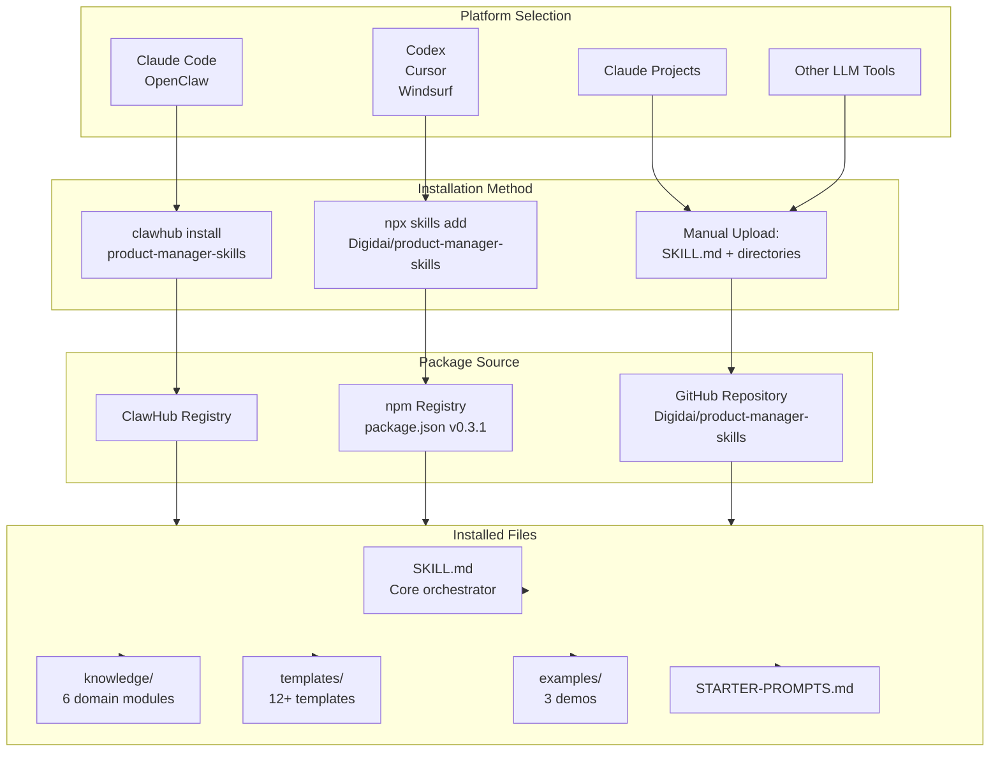

**Sources**: [README.md:34-56](), [README.md:167-174](), [package.json:1-47]()

---

## Installation Instructions by Platform

### Claude Code / OpenClaw

```bash
clawhub install product-manager-skills
```

The ClawHub CLI downloads the skill from the ClawHub registry and registers it with your Claude Code environment. The skill becomes available in all new chats.

**Verification**: Open Claude Code and type:
```text
What skill version are you using?
```

Expected response: Reference to `product-manager-skills` version 0.3.1.

---

### Codex / Cursor / Windsurf

```bash
npx skills add Digidai/product-manager-skills
```

This command uses npm to download version 0.3.1 from the npm registry, which includes the files defined in [package.json:37-46]():
- `SKILL.md` (core orchestrator)
- `knowledge/` (6 domain modules)
- `templates/` (12+ artifact templates)
- `examples/` (3 demonstration outputs)
- `STARTER-PROMPTS.md` (starter prompts collection)

**Verification**: The skill loader should display confirmation. Start a new session and type:
```text
Load the product manager skills context.
```

The AI should acknowledge access to the PM skill system.

---

### Claude Projects (Manual Upload)

1. Create a new Claude Project
2. Upload these items from the repository:
   - `SKILL.md`
   - `knowledge/` directory (all `.md` files)
   - `templates/` directory (all `.md` files)
   - `STARTER-PROMPTS.md` (optional, for reference)

3. In Project Instructions, add:
```text
You are a product manager operator. Follow the instructions in SKILL.md.
```

**Verification**: In the project chat, type:
```text
What frameworks are available in the Discovery & Research domain?
```

Expected response: JTBD, Mom Test, Opportunity Solution Tree, Lean UX Canvas, PoL Probes.

**Sources**: [README.md:173]()

---

### Other LLM Tools with Local File Loading

1. Clone the repository or download the release
2. Point your LLM's system prompt at `SKILL.md`
3. Ensure `knowledge/` and `templates/` are accessible in the same directory structure

**Directory Structure Required**:
```text
SKILL.md              (root orchestrator)
knowledge/            (sibling directory)
  discovery-research.md
  strategy-positioning.md
  artifacts-delivery.md
  finance-metrics.md
  career-leadership.md
  ai-product-craft.md
templates/            (sibling directory)
  prd.md
  user-story.md
  lean-ux-canvas.md
  [9+ more templates]
```

**Sources**: [README.md:174](), [README.md:177-186]()

---

## First Interaction: System Handshake

After installation, run a system handshake to verify the skill loaded correctly and understand the output format.

### Verification Prompt

```text
What PM domains and frameworks are available in this skill?
```

### Expected Response Structure

The system should enumerate:

| Domain | Framework Examples |
|--------|-------------------|
| **Discovery & Research** | JTBD, Mom Test, Opportunity Solution Tree, Lean UX Canvas, PoL Probes |
| **Strategy & Positioning** | Geoffrey Moore, PESTEL, TAM/SAM/SOM, RICE, ICE, Kano |
| **Artifacts & Delivery** | PRD, User Story (Cohn + Gherkin), Story Mapping, Epic Breakdown, PRFAQ |
| **Finance & Metrics** | 32 SaaS metrics: MRR, ARR, NRR, CAC, LTV, Rule of 40, Magic Number |
| **Career & Leadership** | Altitude-Horizon, Three Ps, IC to Director transitions, 30-60-90 plans |
| **AI Product Craft** | AI-Shaped Readiness, Context Engineering, Agent Orchestration |

If the system cannot enumerate these domains, the `knowledge/` directory was not loaded correctly. Re-check the installation.

**Sources**: [README.md:116-125]()

---

## Three Starter Workflows

The system is designed for three high-value workflows that demonstrate its core capabilities: framework application, quality gates, and anti-pattern detection.

### Workflow Selection Map

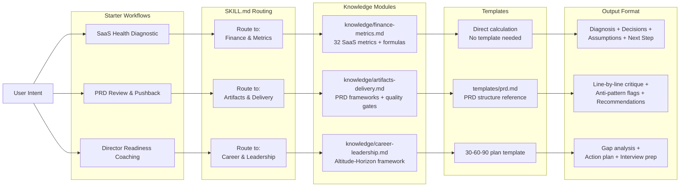

**Sources**: [README.md:23-31]()

---

### Workflow 1: SaaS Health Diagnostic

**Prompt**:
```text
Analyze these metrics: MRR $50k, 500 customers, gross margin 80%, monthly churn 8%, CAC $500.
```

**What the System Does**:
1. Routes to Finance & Metrics domain
2. Loads `knowledge/finance-metrics.md` (32 SaaS metrics with formulas)
3. Calculates ARPA, LTV, LTV:CAC ratio, payback period
4. Applies finance quality gates (formulas shown, benchmarks cited)
5. Outputs diagnosis with specific bottleneck identification

**Expected Output Structure**:
```text
Calculations:
- ARPA = $50k / 500 = $100/month
- Monthly churn 8% = ~63% annual churn [RED FLAG]
- LTV (simplified) = $100 / 0.08 × 0.80 = $1,000
- LTV:CAC = $1,000 / $500 = 2:1
- Payback = $500 / ($100 × 0.80) = 6.25 months

Diagnosis:
- Payback is workable (6.25 months < 12 months benchmark)
- Retention is NOT workable (63% annual churn vs. <5% best-in-class)
- Bottleneck: Retention, not acquisition efficiency

Decision: Do not scale acquisition until churn is understood cohort by cohort.

Assumptions:
- [assumption] Gross margin applies uniformly across customer base
- [assumption] Churn is evenly distributed, not cohort-driven

Next Step: Run cohort retention analysis to identify if churn is early-life (onboarding issue) or late-life (product-market fit issue).
```

**Anti-Patterns Detected**: Metrics Theater (if metrics were presented without context or action)

**Full Example**: See `examples/saas-health-diagnostic.md`

**Sources**: [README.md:60-77](), [README.md:25-27]()

---

### Workflow 2: PRD Review & Pushback

**Prompt**:
```text
Review this PRD for a notification preferences center. Flag solution smuggling, weak metrics, overscoping, and delivery risk.
```

**What the System Does**:
1. Routes to Artifacts & Delivery domain
2. Loads `knowledge/artifacts-delivery.md` and `templates/prd.md`
3. Checks for solution smuggling (problem statement assumes solution)
4. Validates success metrics (baseline, target, guardrail)
5. Flags scope creep and horizontal slicing
6. Applies artifacts quality gates (acceptance criteria testable, vertical slices enforced)

**Expected Output Structure**:
```text
Problem Statement [SOLUTION SMUGGLING DETECTED]:
- Current: "Users need a preferences dashboard to manage notifications"
- Issue: This assumes the solution (dashboard) in the problem statement
- Reframe: "Users unsubscribe from all emails when they only want to reduce email volume, resulting in lost re-engagement opportunities"

Success Metrics [WEAK]:
- Current: "Increase user satisfaction"
- Issue: No baseline, no target, no guardrail, not measurable
- Recommendation: 
  * Baseline: Current unsubscribe rate = X%
  * Target: Reduce unsubscribe rate to Y% within 90 days
  * Guardrail: Email open rate must not drop below Z%

Scope [OVERSCOPED]:
- Current scope includes: Email preferences, push preferences, SMS preferences, digest scheduling, quiet hours, admin override rules, and migration from legacy system
- Issue: This is 3-4 releases, not one. Horizontal slicing across channels.
- Recommendation: Thin vertical slice: Email opt-out + account-level preferences + measurable reduction in unsubscribe-driven churn. Ship this first, validate impact, then extend to other channels.

Next Step: Rewrite problem statement to describe user behavior and business impact without assuming the solution. Define one measurable success metric with baseline and target.
```

**Anti-Patterns Detected**: Solution Smuggling, Metrics Theater, Horizontal Slicing

**Full Example**: See `examples/prd-review.md`

**Sources**: [README.md:79-96](), [README.md:28]()

---

### Workflow 3: Director Readiness Coaching

**Prompt**:
```text
I'm a senior PM managing two PMs, strong on execution, weak on org influence, and interviewing for Director roles in 3 months. Coach me.
```

**What the System Does**:
1. Routes to Career & Leadership domain
2. Loads `knowledge/career-leadership.md` (Altitude-Horizon framework)
3. Diagnoses current altitude (team) vs. target altitude (org)
4. Identifies specific skill gaps (e.g., portfolio tradeoffs, cross-functional influence)
5. Generates 30-60-90 action plan with concrete milestones
6. Applies career quality gates (altitude-appropriate advice, concrete action items)

**Expected Output Structure**:
```text
Current State:
- Altitude: Team (managing 2 PMs, strong execution)
- Horizon: Delivery-focused (shipping features well)

Target State:
- Altitude: Org (Director = managing 3-8 PMs, influencing cross-functional roadmap)
- Horizon: Strategy + Delivery (portfolio tradeoffs, not just feature execution)

Gap Analysis:
- Strong: Team execution, delivery velocity, PM coaching
- Weak: Org-level influence, portfolio tradeoffs, cross-functional storytelling
- Missing: Stories that demonstrate org-level impact (not just team wins)

Action Plan (30-60-90):
- Days 1-30: Collect 3 stories showing org-level impact using this format: "I influenced [cross-functional stakeholder group] to [deprioritize X / invest in Y] by [specific evidence], which resulted in [business outcome]"
- Days 31-60: Build weekly visibility loop with Director/VP (share roadmap tradeoffs, not just progress updates)
- Days 61-90: Practice decision framing with explicit tradeoffs in 5 real scenarios. Record yourself and refine.

Interview Prep:
- Expect: "Tell me about a time you influenced a decision outside your team"
- Expect: "How do you prioritize across multiple products or teams?"
- Expect: "Describe a strategic bet you made and what you would do differently"

Next Step: Draft one org-level impact story this week using the format above. Send to a Director-level mentor for feedback.
```

**Anti-Patterns Detected**: None in the input, but the system would flag if the user described only execution wins without strategic framing.

**Full Example**: See `examples/director-coaching.md`

**Sources**: [README.md:98-114](), [README.md:29]()

---

## Understanding Output Format

Every output from the system follows a standardized structure enforced by the quality gates in `SKILL.md`.

### Standard Output Components

| Component | Purpose | Validation Gate |
|-----------|---------|-----------------|
| **Calculations / Analysis** | Framework-driven content (not generic advice) | Framework correctly applied |
| **Decisions Made** | Specific, actionable choices with rationale | Outcomes measurable |
| **Assumptions Labeled** | Explicit uncertainties marked `[assumption]` | Assumptions must be labeled |
| **Tradeoffs Named** | Downsides and alternatives acknowledged | Tradeoffs must be named |
| **Next Step** | One concrete action to take immediately | Bias to action |

### Output Format Diagram

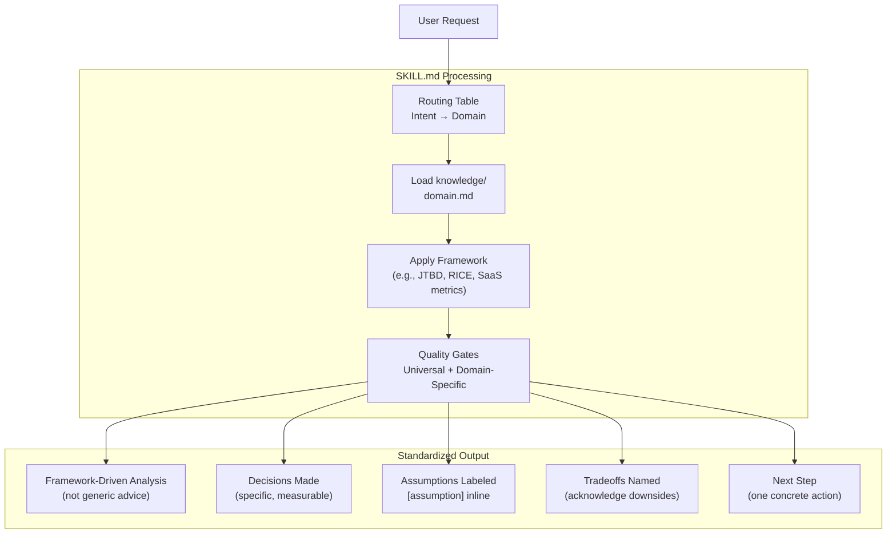

**Sources**: [README.md:149-157]()

---

## Common Installation Issues

| Issue | Symptom | Solution |
|-------|---------|----------|
| **`knowledge/` not loaded** | System cannot enumerate domains or frameworks | Verify directory structure; `knowledge/` must be sibling to `SKILL.md` |
| **`templates/` not loaded** | System cannot generate structured PRDs or user stories | Verify `templates/` directory is accessible; re-upload if using Claude Projects |
| **Version mismatch** | System references outdated frameworks or templates | Check `npx skills list` or ClawHub registry; current version is 0.3.1 |
| **Generic responses** | Output lacks framework application or quality gates | System may not have loaded `SKILL.md`; verify with "What skill are you using?" prompt |

**Sources**: [package.json:2]()

---

## Next Steps

After completing your first three workflows:

1. **Explore More Prompts**: See [Quick Start Guide](#2.2) for 20+ starter prompts across all six domains
2. **Understand the Engine**: Read [SKILL.md: The Core Engine](#3) to learn how routing, interaction protocols, and quality gates work
3. **Deep Dive into Domains**: Explore individual knowledge domains:
   - [Discovery & Research](#4.1)
   - [Strategy & Positioning](#4.2)
   - [Artifacts & Delivery](#4.3)
   - [Finance & Metrics](#4.4)
   - [Career & Leadership](#4.5)
   - [AI Product Craft](#4.6)
4. **Build Weekly Workflows**: See [Weekly PM Workflows](#6.1) for recurring usage patterns like Monday roadmap reviews and Friday metrics diagnostics
5. **Compare to Generic Prompting**: See [System Comparison](#7) to understand why this performs better than standard AI interactions

**Sources**: [README.md:159-166]()

---

## Security and Trust

This system is instruction-only:
- **No executable scripts**: All files are human-readable Markdown
- **No network calls**: Zero external dependencies during execution
- **No credentials**: No environment variables or API keys required
- **No privilege escalation**: Pure text-based knowledge transfer

**Total size**: ~2,800 lines across 27 Markdown files, under 200 KB

You can inspect every line before installation. See `SKILL.md`, `knowledge/*.md`, and `templates/*.md` in the repository.

**Sources**: [README.md:189-198](), [README.md:187]()

---

# Page: Installation

# Installation

<details>
<summary>Relevant source files</summary>

The following files were used as context for generating this wiki page:

- [README.md](README.md)
- [package.json](package.json)

</details>


This page documents the installation procedures for the Product Manager Skills system across different AI coding tool environments. Installation is platform-specific, with each AI coding tool using its own package loading mechanism. All installation methods are zero-script and dependency-free, installing only Markdown files that can be inspected before use.

For usage patterns and first prompts after installation, see [Quick Start Guide](#2.2). For understanding what gets loaded and how the core engine works, see [SKILL.md: The Core Engine](#3).

---

## Prerequisites

Before installing, verify you have one of the supported AI coding environments:

| Environment | Version Requirement | Package Manager |
|-------------|---------------------|-----------------|
| Claude Code / OpenClaw | Latest stable | ClawHub registry |
| Codex | Latest stable | npm-based skill loader |
| Cursor | Latest stable | npm-based skill loader |
| Windsurf | Latest stable | npm-based skill loader |
| Claude Projects | Any version | Manual file upload |
| Any LLM with file loading | Supports local file context | Manual file placement |

**Network Access**: Installation methods using ClawHub or npm require network access to download the package. Manual installation requires only file system access.

**File System**: The installation requires write access to the AI tool's skill storage directory. Typical installation size is under 200 KB for all files.

Sources: [README.md:167-175](), [README.md:12]()

---

## Installation Methods

### Diagram: Installation Flow by Platform

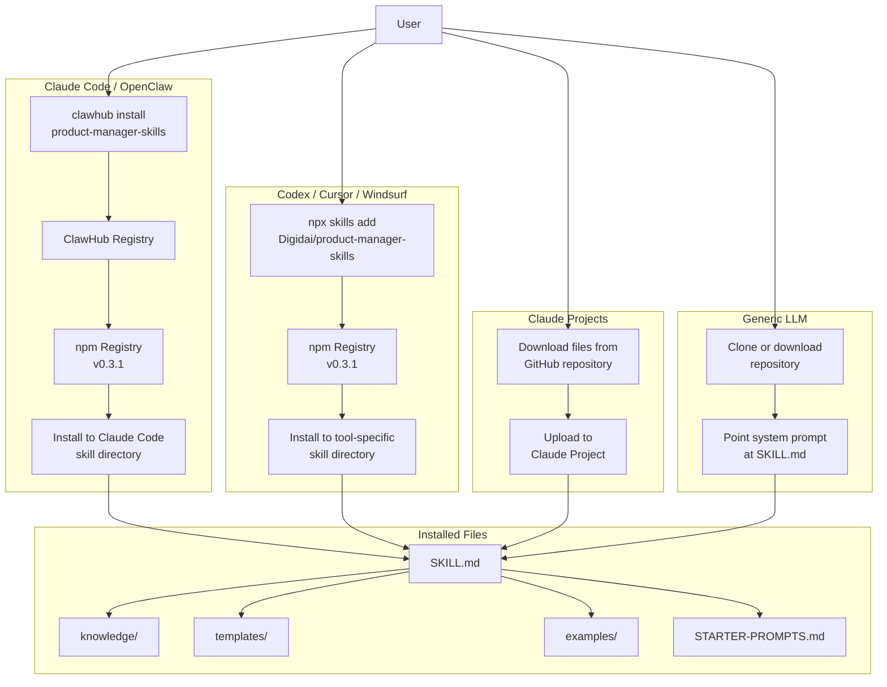

Sources: [README.md:34-56](), [README.md:167-175]()

---

### Method 1: Claude Code / OpenClaw

Claude Code and OpenClaw use the ClawHub registry for skill discovery and installation.

**Installation Command**:
```bash
clawhub install product-manager-skills
```

**Process**:
1. The `clawhub` CLI fetches skill metadata from the ClawHub registry
2. ClawHub retrieves the package from npm registry at version specified in [package.json:3]()
3. Files listed in [package.json:37-46]() are installed to Claude Code's skill directory
4. Claude Code loads `SKILL.md` into context on next activation

**Post-Installation**:
The skill is available immediately in Claude Code sessions. The AI tool reads [SKILL.md:1-end]() as the entry point, which contains routing logic that references files in `knowledge/` and `templates/` directories.

**Verification Command**:
```text
List installed skills
```

Expected output should include `product-manager-skills` at version `0.3.1`.

Sources: [README.md:36-40](), [package.json:1-47]()

---

### Method 2: Codex / Cursor / Windsurf

Codex, Cursor, and Windsurf use npm-based skill loaders that reference GitHub repositories.

**Installation Command**:
```bash
npx skills add Digidai/product-manager-skills
```

**Process**:
1. The `skills` npm package resolves `Digidai/product-manager-skills` to the GitHub repository
2. Files are downloaded from the latest release or main branch
3. Files specified in [package.json:37-46]() are installed to the tool's skill storage location
4. The AI tool loads `SKILL.md` on next prompt

**Directory Structure After Installation**:
```text
<tool-skill-directory>/
└── product-manager-skills/
    ├── SKILL.md
    ├── knowledge/
    ├── templates/
    ├── examples/
    ├── STARTER-PROMPTS.md
    ├── README.zh-CN.md
    ├── README.md
    └── LICENSE
```

**Verification**:
Test with a simple prompt:
```text
List the PM domains you have knowledge about
```

Expected response should reference the six domains defined in the routing table within [SKILL.md]().

Sources: [README.md:42-46](), [package.json:37-46]()

---

### Method 3: Claude Projects (Manual Upload)

Claude Projects require manual file upload through the web interface.

**Download Files**:
1. Navigate to https://github.com/Digidai/product-manager-skills
2. Download the repository as ZIP or clone via Git
3. Extract files if using ZIP

**Upload to Claude Project**:
1. Create a new Claude Project or open an existing one
2. Upload the following files and directories:
   - `SKILL.md` (required - core engine)
   - `knowledge/` directory (required - framework content)
   - `templates/` directory (required - artifact templates)
   - `examples/` directory (optional - reference outputs)
   - `STARTER-PROMPTS.md` (optional - prompt library)

**File Upload Order**:
Upload `SKILL.md` first. The routing logic in [SKILL.md]() expects sibling directories `knowledge/` and `templates/` to be present in the project context.

**Verification**:
In the project chat, enter:
```text
What is your primary function according to SKILL.md?
```

Expected response should describe the PM workflow orchestration and routing system.

Sources: [README.md:173]()

---

### Method 4: Generic LLM with Local File Loading

Any LLM that supports local file context can use this skill.

**Setup Process**:
1. Clone or download the repository from https://github.com/Digidai/product-manager-skills
2. Place files in a directory accessible to your LLM environment
3. Configure the system prompt to load `SKILL.md` as the primary instruction file
4. Ensure `knowledge/` and `templates/` directories are in the same parent directory as `SKILL.md`

**System Prompt Configuration**:
Point the LLM's system prompt at `SKILL.md` with this structure:
```text
You are a product management assistant. Load and follow instructions from SKILL.md.
The knowledge/ and templates/ directories are sibling directories to SKILL.md.
```

**Directory Integrity**:
The system assumes this file structure:
```text
<base-directory>/
├── SKILL.md
├── knowledge/
│   ├── discovery-research.md
│   ├── strategy-positioning.md
│   ├── artifacts-delivery.md
│   ├── finance-metrics.md
│   ├── career-leadership.md
│   └── ai-product-craft.md
└── templates/
    ├── prd.md
    ├── user-story.md
    ├── lean-ux-canvas.md
    └── [other templates]
```

Do not separate `SKILL.md` from its sibling directories, as the routing table references these paths.

Sources: [README.md:174](), [README.md:178-186]()

---

## Installed File Structure

### Diagram: File Organization and Dependencies

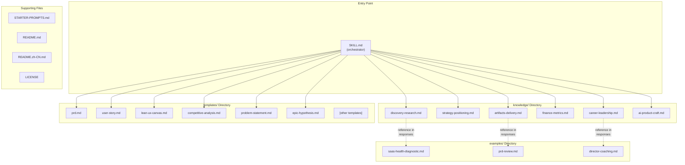

Sources: [package.json:37-46](), [README.md:178-186]()

---

### File Manifest

The following table lists all files included in the installation package as defined in [package.json:37-46]():

| File/Directory | Type | Purpose | Required |
|----------------|------|---------|----------|
| `SKILL.md` | File | Core orchestrator with routing table, interaction protocols, and quality gates | Yes |
| `knowledge/` | Directory | Six domain-specific Markdown files containing PM frameworks and methodologies | Yes |
| `templates/` | Directory | 12+ artifact templates (PRDs, user stories, canvases, etc.) | Yes |
| `examples/` | Directory | Reference outputs demonstrating expected quality and format | No |
| `STARTER-PROMPTS.md` | File | Library of example prompts for common PM workflows | No |
| `README.zh-CN.md` | File | Chinese language documentation | No |
| `README.md` | File | Repository documentation and usage guide | No |
| `LICENSE` | File | CC BY-NC-SA 4.0 license terms | No |

**Total Size**: Approximately 27 Markdown files, ~2,800 lines, under 200 KB.

Sources: [README.md:187](), [package.json:37-46]()

---

## Verification Steps

After installation, verify the system is properly loaded and accessible.

### Step 1: Confirm File Presence

Depending on your AI tool, check that files are present:

**Claude Code**:
```bash
clawhub list
```

**Cursor/Codex/Windsurf**:
Check the skill directory for the `product-manager-skills` folder.

**Claude Projects**:
Verify uploaded files appear in the project's "Knowledge" section.

### Step 2: Test Routing System

Send a test prompt that requires routing to a specific domain:

```text
What SaaS metrics should I track for a B2B product?
```

**Expected Behavior**:
- The AI should load knowledge from `knowledge/finance-metrics.md`
- Response should reference specific metrics like MRR, ARR, NRR, CAC, LTV
- Response should include formulas and benchmarks

**Failure Symptoms**:
- Generic advice without specific metric formulas
- No mention of the 32 SaaS metrics framework
- No domain-specific terminology

### Step 3: Test Template Loading

Request an artifact that requires template loading:

```text
Help me write a PRD for a notification preferences feature
```

**Expected Behavior**:
- The AI should load `templates/prd.md`
- Output structure should match the template sections
- Quality gates should apply (assumptions labeled, metrics defined, etc.)

**Failure Symptoms**:
- Generic document structure
- No standardized section headers
- Missing template-specific sections like "Success Metrics" or "Out of Scope"

### Step 4: Test Quality Gates

Request a review that should trigger anti-pattern detection:

```text
Review this problem statement: "Users need a dashboard to manage their settings"
```

**Expected Behavior**:
- The AI should flag "solution smuggling" (anti-pattern #7)
- Response should challenge the framing: what problem does the dashboard solve?
- Response should reference the quality gate for assumptions

**Failure Symptoms**:
- AI accepts the framing without pushback
- No mention of solution smuggling or anti-patterns
- Generic suggestions to "improve clarity"

Sources: [README.md:58-115]()

---

## Troubleshooting

### Issue: "Skill not found" or "Cannot load SKILL.md"

**Cause**: Installation did not complete or files are in wrong location.

**Resolution**:
1. Re-run installation command
2. For manual installations, verify `SKILL.md` is at the root of the uploaded directory
3. Check that `knowledge/` and `templates/` are sibling directories to `SKILL.md`

### Issue: Generic responses without framework application

**Cause**: `SKILL.md` is present but `knowledge/` directory is missing or inaccessible.

**Resolution**:
1. Verify all files from [package.json:37-46]() are present
2. Check directory structure matches the expected layout
3. For manual installations, ensure entire directories were uploaded, not just individual files

### Issue: Templates not loading

**Cause**: `templates/` directory missing or AI tool cannot access sibling directories.

**Resolution**:
1. Confirm `templates/` directory exists in same parent as `SKILL.md`
2. Check file permissions allow read access
3. For Claude Projects, re-upload the templates directory if needed

### Issue: No quality gate enforcement

**Cause**: Older version of skill installed or partial installation.

**Resolution**:
1. Verify installed version is `0.3.1` from [package.json:3]()
2. For npm-based installations, update: `npx skills update Digidai/product-manager-skills`
3. For manual installations, download latest version from GitHub

### Issue: Different behavior across AI tools

**Cause**: AI tools have different context window sizes and file loading behaviors.

**Expected Behavior**:
- Claude Code and Claude Projects: Full context loading, best performance
- Cursor/Codex/Windsurf: May have context limits affecting large requests
- Generic LLMs: Performance depends on system prompt configuration

**Resolution**:
1. For complex multi-domain requests, break into smaller prompts
2. Reference specific domain or template explicitly if needed
3. Use [STARTER-PROMPTS.md]() examples which are tested across platforms

Sources: [README.md:167-175](), [package.json:1-47]()

---

## Security Considerations

The Product Manager Skills system adheres to zero-script security principles:

| Security Property | Implementation |
|-------------------|----------------|
| **No executable code** | All files are Markdown (`.md` extension) |
| **No network calls** | No URLs, APIs, or external service references in SKILL.md or knowledge files |
| **No credentials** | No environment variables, API keys, or authentication required |
| **No privilege escalation** | No file system writes, shell commands, or system modifications |
| **Full transparency** | Every file is human-readable before installation |

**Inspection Before Installation**:
For manual installations, inspect `SKILL.md` before uploading. The file contains:
- Routing table (pure data structure)
- Interaction protocol definitions (text instructions)
- Quality gate criteria (validation rules as text)
- No JavaScript, Python, or other executable code

Sources: [README.md:189-198]()

---

## Next Steps

After successful installation and verification:

1. **Try starter prompts**: See [Quick Start Guide](#2.2) for tested first prompts
2. **Understand the workflow**: Read [SKILL.md: The Core Engine](#3) to understand routing and quality gates
3. **Explore domains**: Review [Knowledge Domains](#4) to see available frameworks
4. **Review examples**: Check [Usage Patterns](#6) for real PM workflow scenarios

For installation issues not covered here, open an issue at https://github.com/Digidai/product-manager-skills/issues.

Sources: [README.md:199-204]()

---

# Page: Quick Start Guide

# Quick Start Guide

<details>
<summary>Relevant source files</summary>

The following files were used as context for generating this wiki page:

- [README.md](README.md)
- [STARTER-PROMPTS.md](STARTER-PROMPTS.md)

</details>


This page guides you through your first interactions with the Product Manager Skills system after installation. It provides starter prompts, explains expected outputs, and introduces basic interaction patterns.

For installation instructions, see [Installation](#2.1). For detailed workflow examples, see [Weekly PM Workflows](#6.1) and [Example Sessions](#6.2).

---

## Purpose and Scope

After installing the Product Manager Skills system, this guide helps you:

- Verify the installation works correctly
- Submit your first prompts and interpret the outputs
- Understand the standardized output format (decisions, assumptions, next steps)
- Learn which prompts route to which knowledge domains
- Recognize the four interaction modes the system uses

This is a practical guide focused on immediate usage. For architectural details about how routing and quality gates work internally, see [SKILL.md: The Core Engine](#3).

---

## Your First Interaction

Once installed, the system loads `SKILL.md` into your AI coding tool's context. When you submit a prompt, the following execution flow occurs:

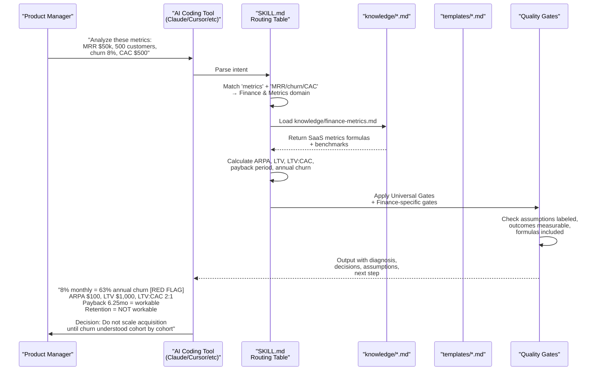

**Sources:** [README.md:60-76](), [SKILL.md]() (referenced in architectural diagrams)

---

## Starter Prompts by Domain

The system routes prompts to six knowledge domains. Below are recommended first prompts for each domain, organized by complexity.

### First-Run Prompts (Simplest)

These three prompts demonstrate the core workflows with minimal context required:

| Prompt | Domain Routed | Expected Behavior |
|--------|---------------|-------------------|
| `Help me write a PRD for a notification preferences feature. Make reasonable assumptions and label them.` | Artifacts & Delivery | Generates structured PRD using `templates/prd.md`, labels assumptions inline with `[assumption]` tags |
| `Analyze these metrics: MRR $50k, 500 customers, gross margin 80%, monthly churn 8%, CAC $500.` | Finance & Metrics | Calculates ARPA, LTV, LTV:CAC, payback, annual churn; diagnoses bottlenecks |
| `Review this roadmap and tell me where evidence is weak, where tradeoffs are missing, and where stakeholder pressure is dominating.` | Strategy & Positioning | Applies prioritization frameworks, flags stakeholder-driven roadmap anti-pattern |

**Sources:** [STARTER-PROMPTS.md:5-17](), [README.md:23-31]()

### Discovery & Research Prompts

| Prompt | Frameworks Applied |
|--------|-------------------|
| `I think customers need a dashboard. Push back on this framing and help me write the actual problem statement.` | Jobs-to-be-Done, Problem Framing, flags Solution Smuggling anti-pattern |
| `Help me prepare 10 discovery interview questions for ops managers at mid-market SaaS companies. Avoid confirmation bias.` | Mom Test, avoids leading questions |
| `Build an opportunity solution tree for improving activation in our first 14 days.` | Opportunity Solution Tree (OST) structure |

**Sources:** [STARTER-PROMPTS.md:19-31]()

### Strategy & Prioritization Prompts

| Prompt | Frameworks Applied |
|--------|-------------------|
| `We have 6 candidate features and limited engineering capacity. Recommend a prioritization framework and apply it.` | RICE, ICE, or Kano (context-dependent selection) |
| `Write a positioning statement for a B2B analytics tool that helps RevOps teams spot pipeline risk earlier.` | Geoffrey Moore positioning template |
| `Help me draft a Now / Next / Later roadmap for an AI meeting assistant. Name the tradeoffs explicitly.` | Now/Next/Later structure + explicit tradeoff requirement |

**Sources:** [STARTER-PROMPTS.md:33-45]()

### Artifacts & Delivery Prompts

| Prompt | Frameworks Applied |
|--------|-------------------|
| `Review this PRD draft like a strong PM peer. Flag solution smuggling, missing metrics, overscoping, weak evidence, and delivery risks.` | PRD quality gates, anti-pattern detection |
| `Turn this feature idea into 5 user stories with testable Gherkin acceptance criteria.` | User story template (`templates/user-story.md`), Cohn + Gherkin format |
| `This epic is too big for one sprint. Split it vertically and explain the logic.` | Vertical slicing, epic breakdown framework |

**Sources:** [STARTER-PROMPTS.md:47-59]()

### Finance & Metrics Prompts

| Prompt | Frameworks Applied |
|--------|-------------------|
| `Our SaaS has ARR $3.2M, NRR 92%, gross margin 72%, burn $180k/month, runway 11 months. Diagnose business health and tell me what not to ignore.` | 32 SaaS metrics from `knowledge/finance-metrics.md`, Rule of 40, burn multiple |
| `Should we build this retention feature? Assume dev cost is $60k and estimate ROI from churn reduction.` | LTV impact modeling, payback ROI calculation |
| `Compare these two acquisition channels on payback, LTV:CAC, and strategic fit.` | Unit economics comparison |

**Sources:** [STARTER-PROMPTS.md:61-73]()

### Career & Leadership Prompts

| Prompt | Frameworks Applied |
|--------|-------------------|
| `I'm a senior PM managing two PMs and preparing for Director interviews in 90 days. Diagnose my readiness and give me a focused plan.` | Altitude-Horizon framework, IC to Director transitions |
| `I just became Head of Product. Build a 30-60-90 day plan with the right altitude for the role.` | 30-60-90 template, altitude-appropriate focus |
| `Review these 4 interview stories and tell me which ones actually show org-level influence.` | Three Ps framework, altitude assessment |

**Sources:** [STARTER-PROMPTS.md:75-87]()

### AI Product Craft Prompts

| Prompt | Frameworks Applied |
|--------|-------------------|
| `Pressure-test this AI product idea. What context, orchestration, and validation risks are we underestimating?` | AI-Shaped Readiness, context engineering risks |
| `Our AI assistant works in demos but fails in production. Diagnose likely context engineering issues.` | Context engineering failure patterns |
| `Recommend an agent workflow for triaging support tickets, but call out where humans should stay in the loop.` | Agent orchestration, human-in-loop design |

**Sources:** [STARTER-PROMPTS.md:89-101]()

---

## Understanding Output Structure

Every output from the system follows a standardized format enforced by quality gates. This format ensures actionability and transparency.

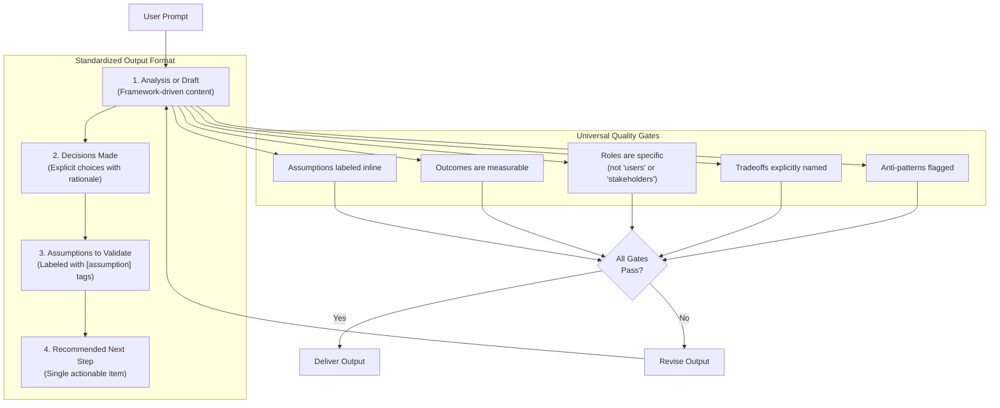

**Sources:** [README.md:149-156](), quality gates referenced in architectural diagrams

### Example: SaaS Diagnostic Output

For the prompt `Analyze these metrics: MRR $50k, 500 customers, gross margin 80%, monthly churn 8%, CAC $500`:

| Output Section | Content |
|----------------|---------|
| **Analysis** | `8% monthly churn compounds to roughly 63% annual churn. This is a red flag, not a "slightly high" metric.`<br/>`ARPA is about $100/month. With 80% gross margin and 8% monthly churn, better LTV is about $1,000.`<br/>`LTV:CAC is about 2:1. Payback is about 6.25 months.` |
| **Diagnosis** | `Payback is workable, retention is not.` |
| **Decision** | `Do not scale acquisition until churn is understood cohort by cohort.` |
| **Assumptions** | `[assumption: churn is evenly distributed across cohorts]`<br/>`[assumption: gross margin calculation excludes support costs]` |
| **Next Step** | `Segment churn by acquisition cohort, customer segment, and contract value to find retention bottleneck.` |

**Sources:** [README.md:62-75]()

---

## Four Interaction Modes

The system adapts its interaction style based on request complexity and available context. Understanding these modes helps you predict whether the system will ask follow-up questions or provide immediate output.

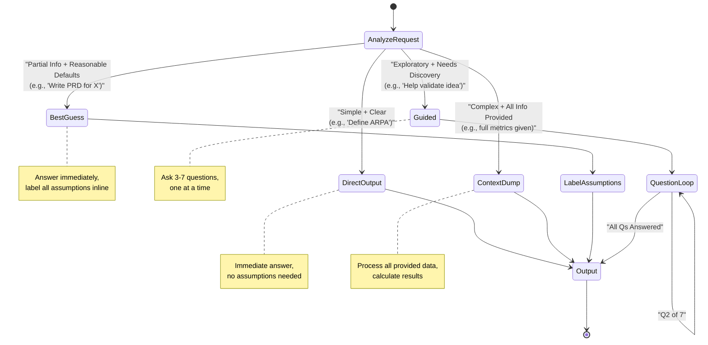

**Sources:** [README.md:149-156](), interaction protocol referenced in architectural diagrams

### Mode Selection Logic

| Mode | When Used | Example Prompt | Expected Behavior |
|------|-----------|----------------|-------------------|
| **Direct Output** | Definition requests, simple lookups | `What is Net Revenue Retention?` | Single-paragraph answer with formula and benchmark |
| **Context Dump** | All required data provided | `Analyze these metrics: MRR $50k, 500 customers, churn 8%, CAC $500` | Immediate calculation and diagnosis |
| **Best Guess** | Partial context, reasonable defaults exist | `Help me write a PRD for a notification preferences feature` | Draft PRD with `[assumption]` tags for missing context |
| **Guided** | Exploratory work requiring discovery | `Help me validate this product idea` | Question 1 of 5: "What job is this solving for which specific user?" |

**Sources:** [README.md:149-156]()

---

## Validating Installation Success

After submitting your first prompt, check for these indicators that the system is working correctly:

### Checklist: Successful Installation

| Indicator | What to Look For | Example |
|-----------|------------------|---------|
| **Framework Application** | Output references specific PM frameworks by name | "Applying RICE prioritization..." or "Using Mom Test principles..." |
| **Inline Assumptions** | Assumptions tagged with `[assumption]` | `[assumption: monthly churn is evenly distributed]` |
| **Quality Gate Enforcement** | Output includes measurable outcomes, specific roles, named tradeoffs | "Reduce unsubscribe-driven churn from 8% to 5% within 60 days (not 'improve retention')" |
| **Standardized Sections** | Every output ends with Decisions + Assumptions + Next Step | See structure diagram above |
| **Anti-Pattern Detection** | System flags common PM mistakes when present | "This problem statement is solution-smuggled" or "Success metrics lack baseline and target (Metrics Theater)" |
| **Domain Routing** | Prompts about metrics load `knowledge/finance-metrics.md`, PRDs load `templates/prd.md` | Visible in output or can be inferred from framework names |

**Sources:** [README.md:127-135]()

### Troubleshooting: Installation Not Working

If outputs are generic and lack framework references:

1. **Verify file structure**: Ensure `SKILL.md`, `knowledge/`, and `templates/` directories are present and readable
2. **Check tool compatibility**: Confirm your AI coding tool supports loading skill files (see [Installation](#2.1))
3. **Retry prompt**: Some tools require restarting the session after installation
4. **Use explicit routing**: Add "using Product Manager Skills" to your prompt to force activation

---

## Next Steps

After validating installation with starter prompts:

1. **Explore domain-specific workflows**: See [Weekly PM Workflows](#6.1) for recurring usage patterns
2. **Review detailed examples**: See [Example Sessions](#6.2) for full walkthroughs with screenshots
3. **Understand the engine**: See [SKILL.md: The Core Engine](#3) to learn how routing and quality gates work
4. **Customize for your context**: See [Contributing](#8) to add team-specific frameworks or templates

**Sources:** [README.md:159-165]()

---

# Page: SKILL.md: The Core Engine


<details>
<summary>Relevant source files</summary>

The following files were used as context for generating this wiki page:

- [SKILL.md](SKILL.md)

</details>


---

# Page: Execution Workflow

# Execution Workflow

<details>
<summary>Relevant source files</summary>

The following files were used as context for generating this wiki page:

- [SKILL.md](SKILL.md)

</details>


## Purpose and Scope

This document describes the seven-step execution pipeline that processes every user request in the Product Manager Skills system. The workflow transforms user intent into structured, framework-driven output by routing through knowledge modules, applying templates, and enforcing quality gates.

For details on how user intent maps to specific frameworks, see [Routing System](#3.2). For interaction mode selection logic, see [Interaction Protocols](#3.3). For quality validation rules, see [Quality Gates](#3.4).

**Sources:** [SKILL.md:63-76]()

---

## Pipeline Overview

Every user request flows through a sequential seven-step pipeline defined in `SKILL.md`. The workflow is deterministic: each step feeds the next, with validation loops at the quality check phase.

| Step | Name | Purpose | Input | Output |
|------|------|---------|-------|--------|
| 1 | Route | Match user intent to framework | User request text | Domain + framework identifier |
| 2 | Load Knowledge | Read relevant knowledge module | Framework identifier | Loaded framework content |
| 3 | Focus | Locate specific section in module | Framework content | Section-specific logic |
| 4 | Interact | Select and execute interaction mode | User context + request type | Raw output content |
| 5 | Template | Apply structural scaffolding | Output content + artifact type | Structured artifact |
| 6 | Quality Check | Validate against gates | Artifact | Validated artifact or revision request |
| 7 | Close | Format final output | Validated artifact | Decisions + Assumptions + Next Step |

**Sources:** [SKILL.md:63-76]()

---

## Pipeline State Machine

The following state machine shows the complete execution flow, including conditional branches and revision loops:

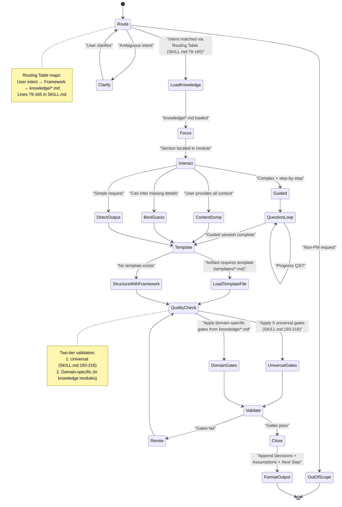

**Sources:** [SKILL.md:63-76](), [SKILL.md:79-165](), [SKILL.md:189-216]()

---

## Step 1: Route

### Intent Matching

The routing step maps user intent phrases to specific frameworks using the Routing Table defined at [SKILL.md:79-165](). The table is organized by six knowledge domains:

| Domain | Intent Examples | Framework Loaded | Knowledge Module |
|--------|----------------|------------------|------------------|
| Discovery & Research | "Validate a problem", "customer interview" | Problem Framing, Mom Test | `knowledge/discovery-research.md` |
| Strategy & Positioning | "Position my product", "roadmap" | Geoffrey Moore, Now/Next/Later | `knowledge/strategy-positioning.md` |
| Artifacts & Delivery | "Write a PRD", "user story" | PRD Development, Cohn + Gherkin | `knowledge/artifacts-delivery.md` |
| Finance & Metrics | "SaaS metrics", "unit economics" | 32 SaaS Metrics, LTV/CAC | `knowledge/finance-metrics.md` |
| Career & Leadership | "PM to Director", "first 90 days" | Altitude-Horizon, 30-60-90 | `knowledge/career-leadership.md` |
| AI Product Craft | "AI product", "context engineering" | AI-Shaped Readiness | `knowledge/ai-product-craft.md` |

### Routing Logic

The routing algorithm follows these rules ([SKILL.md:161-164]()):

1. **Direct match**: If intent matches a single row, load that framework immediately
2. **Ambiguous intent**: Ask one clarifying question before loading
3. **Multi-domain**: Explicit ask determines primary domain (see Multi-Domain Handling below)
4. **No match**: Use general PM reasoning with quality gates only

### Example Routing Paths

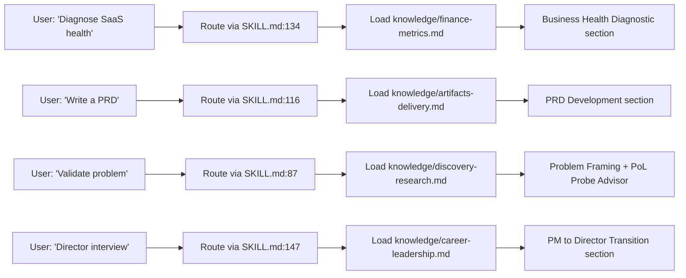

**Sources:** [SKILL.md:67](), [SKILL.md:79-165](), [SKILL.md:161-164]()

---

## Step 2: Load Knowledge

### Module Loading

Once the framework is identified, the system loads the corresponding knowledge module file. The `Load` column in the Routing Table ([SKILL.md:79-165]()) specifies which file to read:

| Module File | Domain | Typical Content |
|-------------|--------|----------------|
| `knowledge/discovery-research.md` | Discovery & Research | JTBD, Mom Test, OST, PoL Probes, Lean UX Canvas |
| `knowledge/strategy-positioning.md` | Strategy & Positioning | Geoffrey Moore, PESTEL, TAM/SAM/SOM, RICE/ICE/Kano |
| `knowledge/artifacts-delivery.md` | Artifacts & Delivery | PRD Development, User Stories, Story Mapping, PRFAQ |
| `knowledge/finance-metrics.md` | Finance & Metrics | 32 SaaS metrics, formulas, benchmarks, diagnostics |
| `knowledge/career-leadership.md` | Career & Leadership | Altitude-Horizon, Three Ps, IC→Director transitions |
| `knowledge/ai-product-craft.md` | AI Product Craft | AI-Shaped Readiness, Context Engineering, Validation |

### Loading Behavior

Per [SKILL.md:68-69]():

- **Pre-loaded environments** (e.g., Claude Projects): Content already in context; search by section name
- **On-demand environments** (e.g., file-based tools): Read file from sibling directory `knowledge/`
- **File structure**: Knowledge modules are siblings of `SKILL.md` in the repository root

**Sources:** [SKILL.md:68-69]()

---

## Step 3: Focus

### Section Location

After loading the knowledge module, the system locates the specific section matching the Framework column from the Routing Table ([SKILL.md:69-70]()).

### Multi-Section Loading

When the route maps to multiple sections (e.g., "A + B"), the system reads both sections and applies combined logic. Example from [SKILL.md:87]():

```
User Intent: "Validate a problem"
Framework: Problem Framing + PoL Probe Advisor
Action: Read both sections in knowledge/discovery-research.md
```

### Domain-Specific Logic Application

Each section contains:
- **Framework description**: Conceptual model and when to use it
- **Decision logic**: Step-by-step application rules
- **Domain-specific quality gates**: Validation rules for outputs from this framework

**Sources:** [SKILL.md:69-70]()

---

## Step 4: Interact

### Mode Selection

The Interaction Protocol ([SKILL.md:28-60]()) defines four modes. The system selects based on request complexity and available context:

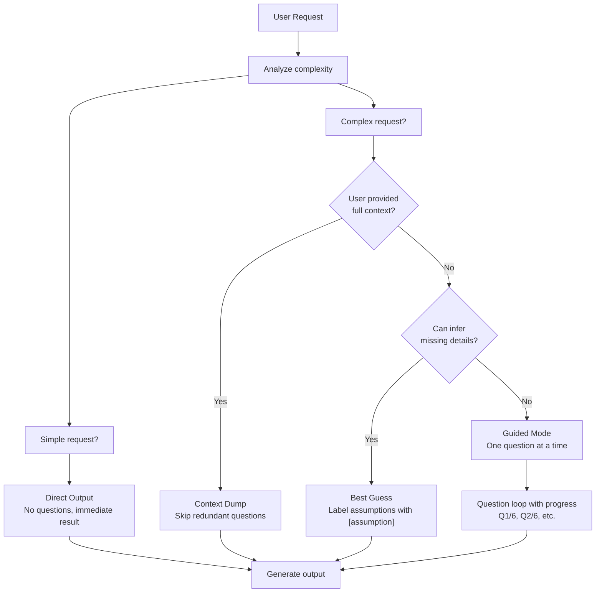

### Mode Selection Rules

From [SKILL.md:40-44]():

| Condition | Mode | Rationale |
|-----------|------|-----------|
| User explicitly requests guidance | Guided | Explicit request overrides defaults |
| Request clear + <3 missing inputs | Ask only those inputs | No mode ceremony overhead |
| Request ambiguous but draftable | Best Guess | Activation-first default |
| User pastes extensive context | Context Dump | Avoid redundant questions |

### Guided Mode Mechanics

During guided sessions ([SKILL.md:46-52]()):

1. **One question per turn**: Wait for answer before continuing
2. **Progress labels**: Show `Context Q3/7` or `Assessment Q2/4`
3. **Decision points**: Offer 3-5 numbered options; accept `1`, `2 and 4`, `1,3`, or custom text
4. **Interruptions**: Answer directly, restate progress, resume
5. **Topic switches**: Acknowledge pivot, confirm abandoning current flow, re-route

**Sources:** [SKILL.md:28-60](), [SKILL.md:40-44](), [SKILL.md:46-52]()

---

## Step 5: Template

### Template Loading Decision

The system loads a template when producing a deliverable artifact ([SKILL.md:71]()). The Template Index ([SKILL.md:168-186]()) maps artifact types to template files:

| Artifact Type | Template File | Triggered By |
|---------------|---------------|--------------|
| PRD | `templates/prd.md` | "Write a PRD" intent |
| User Story | `templates/user-story.md` | "Write a user story" intent |
| Problem Statement | `templates/problem-statement.md` | Problem framing output |
| Positioning Statement | `templates/positioning-statement.md` | Geoffrey Moore positioning |
| Epic Hypothesis | `templates/epic-hypothesis.md` | Epic framing output |
| Press Release | `templates/press-release.md` | PRFAQ / Working Backwards |
| Discovery Interview Plan | `templates/discovery-interview-plan.md` | Interview prep |
| Opportunity Solution Tree | `templates/opportunity-solution-tree.md` | OST mapping |
| Roadmap Plan | `templates/roadmap-plan.md` | Roadmap planning |
| Business Health Scorecard | `templates/business-health-scorecard.md` | SaaS diagnostics |
| Competitive Analysis | `templates/competitive-analysis.md` | Competitive research |
| Lean UX Canvas | `templates/lean-ux-canvas.md` | Hypothesis structuring |

### Template vs. Framework Structure

Per [SKILL.md:71]():

- **Template exists**: Load from `templates/` directory and populate with framework-driven content
- **No template**: Structure output using framework logic from knowledge module

### Template Philosophy

From [SKILL.md:170](): "Templates are pure scaffolding — not generic placeholders." The system fills templates with specific content from the Focus step, not boilerplate text.

**Sources:** [SKILL.md:71](), [SKILL.md:168-186](), [SKILL.md:170]()

---

## Step 6: Quality Check

### Two-Tier Validation

The quality check applies two layers of gates ([SKILL.md:72](), [SKILL.md:189-216]()):

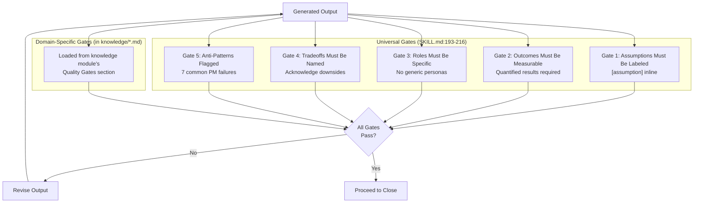

### Universal Gates Details

From [SKILL.md:193-216]():

| Gate | Rule | Example Violation | Correct Approach |
|------|------|-------------------|------------------|
| 1. Assumptions Labeled | Mark guesses with `[assumption]` | "Users will adopt this in 30 days" | "Users will adopt this in 30 days [assumption]" |
| 2. Outcomes Measurable | Quantify results with number, direction, timeframe | "Improve the experience" | "Reduce time-to-first-value from 14 days to 3 days within Q2" |
| 3. Roles Specific | Name role, context, motivation | "Users" | "A mid-market ops manager running 3 product lines with no dedicated analytics support" |
| 4. Tradeoffs Named | State what's being traded off | "Recommend Option A" | "Recommend Option A (faster to market, lower initial quality) over Option B (more robust, 6-week delay)" |
| 5. Anti-Patterns Detected | Flag 7 common PM failures | Accepting "We need a dashboard" | "This is solution smuggling. Reframe: 'Managers can't see team velocity'" |

### Anti-Patterns Detected

The system actively flags seven anti-patterns ([SKILL.md:208-216]()):

1. **Metrics Theater**: Tracking metrics that look good but drive no decisions
2. **Feature Factory**: Shipping features without validating the problem
3. **Stakeholder-Driven Roadmap**: Roadmap shaped by loudest voice, not evidence
4. **Confirmation Bias in Discovery**: Questions designed to confirm existing beliefs
5. **Premature Scaling**: Optimizing growth before unit economics work
6. **Horizontal Slicing**: Splitting work by architecture layer instead of user value
7. **Solution Smuggling**: Problem statements that embed a solution

### Domain Gates

Each knowledge module contains a "Quality Gates" section with domain-specific validation rules. These apply in addition to universal gates when that domain is loaded.

**Sources:** [SKILL.md:72](), [SKILL.md:189-216](), [SKILL.md:193-216](), [SKILL.md:208-216]()

---

## Step 7: Close

### Standardized Output Format

Every output ends with three required sections ([SKILL.md:56-59](), [SKILL.md:73]()):

1. **Decisions made**: Bullet list of concrete decisions
2. **Assumptions to validate**: List of labeled assumptions that need validation
3. **Recommended next step**: Single action to take next

### Format Example

```
## Decisions Made
- Focus retention before scaling acquisition
- Investigate churn cohort-by-cohort, starting with Q3 signups
- Defer new acquisition channels until monthly churn < 5%

## Assumptions to Validate
- 8% monthly churn is evenly distributed across customer segments [assumption]
- CAC can be maintained at $500 with current channels [assumption]

## Recommended Next Step
Run a churn analysis segmented by signup cohort, industry vertical, and contract size to identify highest-risk segment.
```

### Bias to Action

From [SKILL.md:19](): "Bias to action. End every interaction with a next step, not a summary." The recommended next step must be:
- **Specific**: Not "improve retention" but "run churn analysis segmented by X, Y, Z"
- **Actionable**: User knows what to do tomorrow
- **Single**: One clear action, not a list of possibilities

**Sources:** [SKILL.md:56-59](), [SKILL.md:73](), [SKILL.md:19]()

---

## Multi-Domain Handling

### Primary-Secondary Domain Logic

When a request spans multiple domains ([SKILL.md:75-76]()), the explicit ask determines the primary domain:

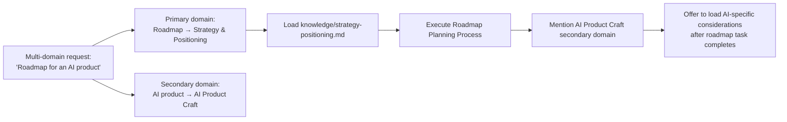

### Multi-Domain Routing Examples

| User Intent | Primary Domain | Secondary Domain | Handling |
|-------------|----------------|------------------|----------|
| "Roadmap for an AI product" | Strategy (roadmap) | AI Product Craft (AI) | Load Strategy first, mention AI considerations |
| "PRD for SaaS metrics dashboard" | Artifacts (PRD) | Finance (metrics) | Load Artifacts first, reference metrics knowledge |
| "Discovery for Director role" | Discovery (research) | Career (Director) | Load Discovery first, offer Career after |

**Sources:** [SKILL.md:75-76]()

---

## Error Handling and Edge Cases

### Out of Scope Requests

From [SKILL.md:67](): If a request is "clearly outside PM scope," the system says so and offers to redirect.

### Ambiguous Intent

When intent is unclear ([SKILL.md:67](), [SKILL.md:162]()):
1. Ask **one** clarifying question
2. Do not load any knowledge module yet
3. Resume routing after user clarifies

### No Framework Match

From [SKILL.md:164](): "If no match, use general PM reasoning and the Quality Gates below. Don't hallucinate a framework."

### Interrupted Guided Sessions

Per [SKILL.md:50-52]():
- **"How many questions left?"**: Answer directly, restate progress, resume
- **"Stop/pause"**: Halt immediately, resume on explicit request
- **Topic switch**: Acknowledge pivot, confirm abandoning current flow, re-route

**Sources:** [SKILL.md:67](), [SKILL.md:162](), [SKILL.md:164](), [SKILL.md:50-52]()

---

## Workflow Execution Flow Diagram

The following diagram shows the complete execution path with file references:

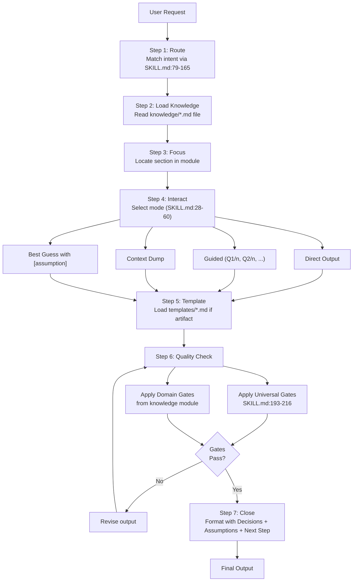

**Sources:** [SKILL.md:63-76](), [SKILL.md:28-60](), [SKILL.md:79-165](), [SKILL.md:193-216]()

---

# Page: Routing System

# Routing System

<details>
<summary>Relevant source files</summary>

The following files were used as context for generating this wiki page:

- [SKILL.md](SKILL.md)

</details>


## Purpose and Scope

The Routing System is the intent classification mechanism in SKILL.md that maps natural language user requests to specific PM frameworks and knowledge modules. It functions as step 1 in the 7-step Execution Workflow (see [Execution Workflow](#3.1)), determining which domain-specific content to load before the system applies frameworks, interaction protocols, and quality gates.

This page documents the routing table structure, intent matching algorithm, multi-domain handling, and routing rules. For details on what happens after routing (guided mode, context dump, etc.), see [Interaction Protocols](#3.3). For the content of each knowledge domain, see [Knowledge Domains](#4).

**Sources:** [SKILL.md:63-165]()

---

## Routing Table Architecture

The routing system consists of a single consolidated table partitioned into six domain sections. Each row maps a user intent phrase to a target framework and knowledge module file path.

### Table Structure

The routing table has three columns per domain:

| Column | Purpose | Example Value |
|--------|---------|---------------|
| **User Intent** | Natural language phrases that trigger this route | `"Validate a problem"` / `"test a hypothesis"` |
| **Framework** | Specific framework section name within the knowledge module | `Problem Framing + PoL Probe Advisor` |
| **Load** | File path to the knowledge module (relative to SKILL.md) | `knowledge/discovery-research.md` |

The Framework column specifies the exact section heading within the loaded knowledge module. When the value contains a `+` (e.g., `A + B`), the system loads both sections per the Focus step in the execution workflow.

**Sources:** [SKILL.md:79-165]()

---

## Domain Partition Structure

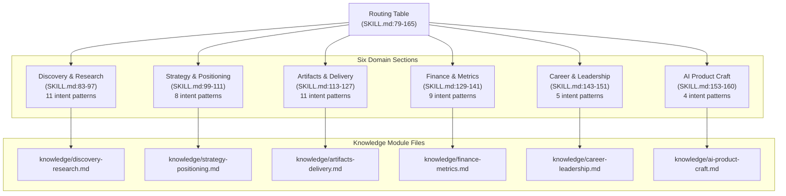

**Diagram: Routing Table Domain Partitions and Knowledge Module Mapping**

The table contains 48 total intent patterns across six domains. Each domain section routes to a single knowledge module file, but different intent patterns within the same domain may target different framework sections within that file.

**Sources:** [SKILL.md:79-165]()

---

## Intent Matching Algorithm

### Matching Process

When a user makes a request, the system scans all 48 intent patterns sequentially, top to bottom within each domain section. The first match determines the route.

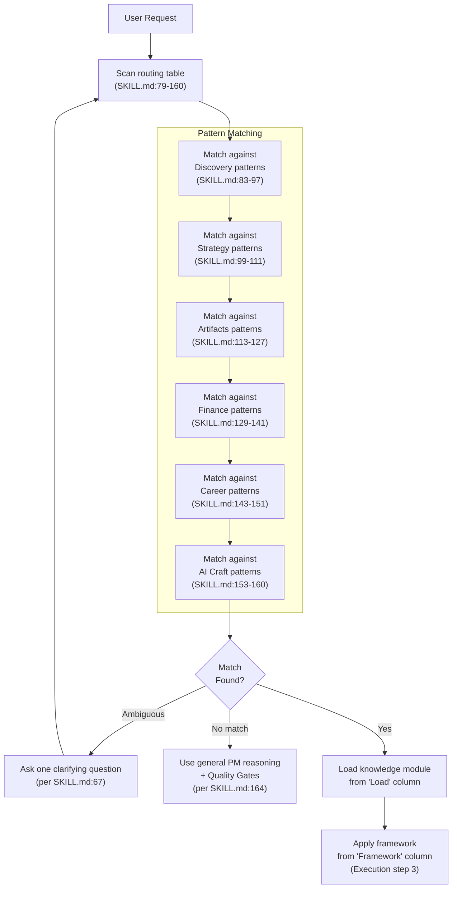

**Diagram: Intent Matching and Routing Decision Flow**

**Sources:** [SKILL.md:63-68](), [SKILL.md:161-165]()

---

## Intent Pattern Examples by Domain

### Discovery & Research Domain

| User Intent | Framework | File Section |
|-------------|-----------|--------------|
| `"Validate a problem"` / `"test a hypothesis"` | Problem Framing + PoL Probe Advisor | Problem Framing, PoL Probe Advisor |
| `"Customer interview"` / `"discovery interview"` | Interview Prep | Interview Prep |
| `"Jobs to be done"` / `"JTBD"` / `"customer needs"` | JTBD Framework | JTBD Framework |
| `"PoL probe"` / `"proof of life"` / `"validation experiment"` | PoL Probe Advisor | PoL Probe Advisor |

**Sources:** [SKILL.md:83-97]()

### Strategy & Positioning Domain

| User Intent | Framework | File Section |
|-------------|-----------|--------------|
| `"Position my product"` / `"positioning statement"` | Geoffrey Moore Positioning Statement | Geoffrey Moore Positioning Statement |
| `"Prioritize"` / `"prioritization framework"` / `"what to build next"` | Prioritization > Framework Selection Matrix | Framework Selection Matrix |
| `"Roadmap"` / `"roadmap planning"` / `"release plan"` | Roadmap Planning Process | Roadmap Planning Process |
| `"TAM SAM SOM"` / `"market size"` / `"addressable market"` | TAM/SAM/SOM Calculation | TAM/SAM/SOM Calculation |

**Sources:** [SKILL.md:99-111]()

### Artifacts & Delivery Domain

| User Intent | Framework | File Section |
|-------------|-----------|--------------|
| `"Write a PRD"` / `"product requirements"` | PRD Development | PRD Development |
| `"Write a user story"` / `"acceptance criteria"` | User Story (Cohn + Gherkin) | User Story |
| `"Epic"` / `"epic hypothesis"` / `"frame this epic"` | Epics > Epic Hypothesis | Epic Hypothesis |
| `"Break down this epic"` / `"epic breakdown"` | Epics > Epic Breakdown (9 Patterns) | Epic Breakdown |

**Sources:** [SKILL.md:113-127]()

### Finance & Metrics Domain

| User Intent | Framework | File Section |
|-------------|-----------|--------------|
| `"SaaS metrics"` / `"revenue metrics"` / `"MRR"` / `"ARR"` | SaaS Revenue & Growth Metrics | SaaS Revenue & Growth Metrics |
| `"Unit economics"` / `"CAC"` / `"LTV"` / `"payback"` | Unit Economics & Efficiency | Unit Economics & Efficiency |
| `"Business health"` / `"diagnostic"` / `"board meeting prep"` | Business Health Diagnostic | Business Health Diagnostic |
| `"Retention"` / `"churn"` / `"why are users leaving"` | Retention & Expansion Metrics + Business Health Diagnostic | Both sections loaded |

**Sources:** [SKILL.md:129-141]()

### Career & Leadership Domain

| User Intent | Framework | File Section |
|-------------|-----------|--------------|
| `"PM to Director"` / `"director transition"` / `"altitude horizon"` | Altitude-Horizon Framework | Altitude-Horizon Framework |
| `"Director interview"` / `"director readiness"` / `"preparing for Director"` | PM to Director Transition | PM to Director Transition |
| `"New role"` / `"first 90 days"` / `"onboarding as VP"` / `"onboarding as CPO"` | Executive Onboarding (30-60-90) | Executive Onboarding (30-60-90) |

**Sources:** [SKILL.md:143-151]()

### AI Product Craft Domain

| User Intent | Framework | File Section |
|-------------|-----------|--------------|
| `"AI product"` / `"AI-shaped"` / `"AI readiness"` | AI-Shaped Readiness | AI-Shaped Readiness |
| `"Context engineering"` / `"context stuffing"` / `"prompt design"` | Context Engineering | Context Engineering |
| `"Agent workflow"` / `"multi-agent"` / `"AI orchestration"` | Agent Orchestration | Agent Orchestration |
| `"AI validation"` / `"test my AI feature"` | AI Validation (PoL Probes) | AI Validation |

**Sources:** [SKILL.md:153-160]()

---

## Multi-Domain Routing

### Multi-Domain Request Handling

When a user request contains intent patterns from multiple domains, the routing system applies a primary-secondary precedence rule.

**Rule:** The explicit artifact or task name determines the primary domain. Load primary first, then offer to load secondary after completion.

**Sources:** [SKILL.md:75-76](), [SKILL.md:161-163]()

### Example Multi-Domain Routes

```mermaid
flowchart LR
    subgraph "Example 1: 'Roadmap for an AI product'"
        EX1_IN["User: Roadmap for an AI product"]
        EX1_PRIMARY["Primary: Strategy & Positioning<br/>(explicit ask: roadmap)"]
        EX1_FILE1["Load: knowledge/strategy-positioning.md"]
        EX1_SECONDARY["Secondary: AI Product Craft<br/>(context: AI product)"]
        EX1_OFFER["Offer to load AI-Shaped Readiness<br/>after roadmap completes"]
    end
    
    subgraph "Example 2: 'PRD for a SaaS feature'"
        EX2_IN["User: PRD for a SaaS feature"]
        EX2_PRIMARY["Primary: Artifacts & Delivery<br/>(explicit ask: PRD)"]
        EX2_FILE2["Load: knowledge/artifacts-delivery.md"]
        EX2_SECONDARY["Secondary: Finance & Metrics<br/>(context: SaaS)"]
        EX2_OFFER["May reference SaaS metrics<br/>in success criteria section"]
    end
    
    subgraph "Example 3: 'Validate problem with interviews'"
        EX3_IN["User: Validate problem with interviews"]
        EX3_PRIMARY["Primary: Discovery & Research<br/>(dual match: validate + interviews)"]
        EX3_FILE3["Load: knowledge/discovery-research.md"]
        EX3_BOTH["Load both:<br/>Problem Framing + Interview Prep"]
    end
    
    EX1_IN --> EX1_PRIMARY
    EX1_PRIMARY --> EX1_FILE1
    EX1_FILE1 --> EX1_SECONDARY
    EX1_SECONDARY --> EX1_OFFER
    
    EX2_IN --> EX2_PRIMARY
    EX2_PRIMARY --> EX2_FILE2
    EX2_FILE2 --> EX2_SECONDARY
    EX2_SECONDARY --> EX2_OFFER
    
    EX3_IN --> EX3_PRIMARY
    EX3_PRIMARY --> EX3_FILE3
    EX3_FILE3 --> EX3_BOTH
```

**Diagram: Multi-Domain Routing Examples**

When both patterns match within the same domain (Example 3), the system loads both framework sections per the Focus step. When patterns span domains (Examples 1-2), the explicit task determines primary routing.

**Sources:** [SKILL.md:75-76](), [SKILL.md:161-163]()

---

## Routing Rules and Edge Cases

### Routing Rule Set

The system applies three explicit routing rules defined at [SKILL.md:161-165]():

#### Rule 1: Multi-Domain Precedence
**Code reference:** [SKILL.md:162]()

"If intent matches multiple domains, the explicit ask determines primary."

The user's explicit artifact request (PRD, roadmap, positioning statement) overrides contextual cues (AI, SaaS, B2B). Load primary domain first, mention secondary, offer to load after completion.

#### Rule 2: Ambiguity Clarification
**Code reference:** [SKILL.md:163]()

"If intent is unclear, ask one clarifying question before loading."

When multiple patterns could match and the best route is ambiguous, ask a single targeted question to disambiguate. Do not present the full routing table or mode-selection ceremony. Examples:
- "help with discovery" → Ask: "Are you preparing for interviews, or validating a specific problem?"
- "product strategy" → Ask: "Are you positioning a new product, planning a roadmap, or analyzing competitors?"

#### Rule 3: No-Match Fallback
**Code reference:** [SKILL.md:164]()

"If no match, use general PM reasoning and the Quality Gates below. Don't hallucinate a framework."

When the request is clearly outside PM scope (e.g., "write a Python script") or genuinely has no framework match, say so explicitly. Offer to redirect or apply general PM reasoning with quality gates but no domain-specific knowledge. Do not force a route.

**Sources:** [SKILL.md:161-165]()

---

## Routing to Template Integration

When the matched framework produces a deliverable artifact, the routing decision also triggers template loading in step 5 of the Execution Workflow.

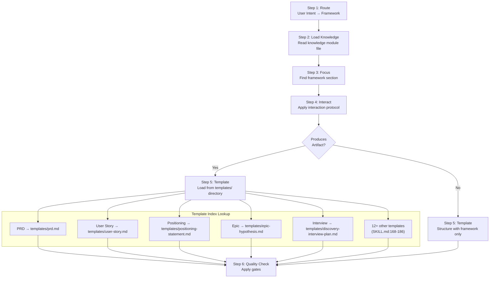

**Diagram: Routing to Template Integration in Execution Workflow**

The Template Index at [SKILL.md:168-186]() maps artifact types to template file paths. The routing decision indirectly determines which template (if any) gets loaded. For example:
- Route to `PRD Development` → Template `templates/prd.md`
- Route to `User Story (Cohn + Gherkin)` → Template `templates/user-story.md`
- Route to `Geoffrey Moore Positioning Statement` → Template `templates/positioning-statement.md`

**Sources:** [SKILL.md:68-74](), [SKILL.md:168-186]()

---

## Intent Pattern Coverage Summary

### Coverage Statistics

| Domain | Intent Patterns | Knowledge Module File | Template Count |
|--------|----------------|----------------------|----------------|
| Discovery & Research | 11 | `knowledge/discovery-research.md` | 3 (Problem Statement, Interview Plan, Lean UX Canvas, OST) |
| Strategy & Positioning | 8 | `knowledge/strategy-positioning.md` | 3 (Positioning Statement, Roadmap Plan, Competitive Analysis) |
| Artifacts & Delivery | 11 | `knowledge/artifacts-delivery.md` | 4 (PRD, User Story, Epic Hypothesis, Press Release) |
| Finance & Metrics | 9 | `knowledge/finance-metrics.md` | 1 (Business Health Scorecard) |
| Career & Leadership | 5 | `knowledge/career-leadership.md` | 0 (framework-structured only) |
| AI Product Craft | 4 | `knowledge/ai-product-craft.md` | 0 (framework-structured only) |
| **Total** | **48** | **6 files** | **12+ templates** |

The routing system achieves broad coverage across PM disciplines while maintaining a compact implementation. Each intent pattern maps to 1-2 framework sections, and approximately 25% of patterns also trigger template loading.

**Sources:** [SKILL.md:79-186]()

---

## Routing System Implementation Details

### File Location and Context

The routing table is embedded directly in [SKILL.md:79-165](). It exists as Markdown tables, not as executable code. AI coding tools parse this structure when SKILL.md is loaded into their context.

### Pre-Loaded Environment Behavior

When knowledge modules are pre-loaded (e.g., Claude Projects with all files uploaded), the routing system instructs the AI to "search by section name" rather than re-reading files. The Load column still specifies the file path for reference, but the content is already in context.

**Code reference:** [SKILL.md:68]()

> "In pre-loaded environments (e.g., Claude Projects), the content is already in context — search by section name."

### Knowledge Module File Paths

All knowledge modules and templates use relative paths from the SKILL.md file location:

```
repository-root/
├── SKILL.md                          (routing table lines 79-165)
├── knowledge/
│   ├── discovery-research.md         (routes from lines 83-97)
│   ├── strategy-positioning.md       (routes from lines 99-111)
│   ├── artifacts-delivery.md         (routes from lines 113-127)
│   ├── finance-metrics.md            (routes from lines 129-141)
│   ├── career-leadership.md          (routes from lines 143-151)
│   └── ai-product-craft.md           (routes from lines 153-160)
└── templates/
    ├── prd.md
    ├── user-story.md
    ├── positioning-statement.md
    └── ... (12+ total templates)
```

**Sources:** [SKILL.md:68](), [SKILL.md:79-186]()

---

## Routing System Design Rationale

### Why a Static Table Instead of Dynamic Classification

The routing table is intentionally static rather than using AI-based intent classification for three reasons:

1. **Transparency:** Users can inspect exactly how their requests will be routed by reading the table at [SKILL.md:79-165](). No hidden logic.

2. **Consistency:** The same intent phrase always routes to the same framework. No model drift or session-to-session variation.

3. **Framework Enforcement:** The system forces explicit mapping of intents to named frameworks rather than allowing generic responses. If no pattern matches, the system acknowledges this per [SKILL.md:164]() rather than inventing a route.

### Pattern Phrase Design

Intent patterns use forward-slash separators (`/`) to indicate synonyms:

```
"Validate a problem" / "test a hypothesis"
"Customer interview" / "discovery interview"
"Jobs to be done" / "JTBD" / "customer needs"
```

This notation makes the table human-readable while enabling straightforward pattern matching. The AI tool treats each phrase variant as equivalent for routing purposes.

**Sources:** [SKILL.md:79-165]()

---

## Integration with Execution Workflow

The routing system functions as step 1 in the 7-step Execution Workflow defined at [SKILL.md:63-74](). The complete sequence:

```mermaid
stateDiagram-v2
    [*] --> Route
    Route --> LoadKnowledge
    LoadKnowledge --> Focus
    Focus --> Interact
    Interact --> Template
    Template --> QualityCheck
    QualityCheck --> Close
    Close --> [*]
    
    note right of Route
        Routing System
        (SKILL.md:79-165)
        Maps intent → framework
    end note
    
    note right of LoadKnowledge
        Reads knowledge module file
        from "Load" column
        (SKILL.md:68)
    end note
    
    note right of Focus
        Finds framework section
        from "Framework" column
        (SKILL.md:69)
    end note
```

**Diagram: Routing System Position in Execution Workflow**

After routing completes, the Load step reads the specified knowledge module file, and the Focus step navigates to the specific framework section name. Subsequent steps (Interact, Template, Quality Check, Close) operate on the loaded framework content.

**Sources:** [SKILL.md:63-74](), [SKILL.md:79-165]()

---

# Page: Interaction Protocols

# Interaction Protocols

<details>
<summary>Relevant source files</summary>

The following files were used as context for generating this wiki page:

- [SKILL.md](SKILL.md)

</details>


## Purpose and Scope

This document details the interaction protocol system defined in [SKILL.md:28-60](), which determines how the AI skill communicates with users. The protocol defines four interaction modes (Guided, Context Dump, Best Guess, Direct Output) and the logic for selecting between them based on request complexity and available context.

For information about the overall execution pipeline that invokes these protocols, see [Execution Workflow](#3.1). For the routing logic that precedes interaction mode selection, see [Routing System](#3.2). For the output validation applied after interaction, see [Quality Gates](#3.4).

---

## Interaction Mode Architecture

The system implements four distinct interaction modes, each optimized for different request characteristics. Mode selection occurs during the **Interact** step of the execution workflow (after routing and knowledge loading, before template application).

### Mode Comparison Table

| Mode | Use Case | Question Count | Assumption Handling | Example Request |
|------|----------|----------------|---------------------|-----------------|
| **Direct Output** | Simple, well-scoped requests | 0 | Minimal assumptions needed | "Write a user story for export feature" |
| **Guided** | Complex, step-by-step collaboration | 3-10 questions, one at a time | User provides all context through dialogue | "Help me plan a discovery sprint" |
| **Context Dump** | User has complete context ready | 0 (context provided upfront) | Fill gaps, skip redundant questions | *Pastes full product spec, metrics, customer data* |
| **Best Guess** | Reasonable draft possible despite gaps | 0 | Label every assumption with `[assumption]` | "Diagnose these metrics: MRR $50k, churn 8%" |

**Sources:** [SKILL.md:28-44]()

---

## Mode Selection Decision Tree

The following diagram maps request characteristics to the appropriate interaction mode:

```mermaid
graph TD
    START["User Request Received"]
    
    START --> SIMPLE{"Is request<br/>simple and<br/>well-scoped?"}
    
    SIMPLE -->|"Yes"| DIRECT["Direct Output Mode<br/>(SKILL.md:30)"]
    SIMPLE -->|"No"| EXPLICIT{"Did user<br/>explicitly ask<br/>for guidance?"}
    
    EXPLICIT -->|"Yes"| GUIDED["Guided Mode<br/>(SKILL.md:36)"]
    EXPLICIT -->|"No"| CONTEXT{"Did user<br/>provide complete<br/>context?"}
    
    CONTEXT -->|"Yes (paste/dump)"| DUMP["Context Dump Mode<br/>(SKILL.md:37)"]
    CONTEXT -->|"No"| DRAFT{"Can reasonable<br/>first draft be<br/>produced?"}
    
    DRAFT -->|"Yes"| GUESS["Best Guess Mode<br/>(SKILL.md:38)<br/>Label assumptions"]
    DRAFT -->|"No"| AMBIG{"Is request<br/>fundamentally<br/>ambiguous?"}
    
    AMBIG -->|"Yes"| CLARIFY["Ask 2-3 clarifying<br/>questions only<br/>(SKILL.md:43)"]
    AMBIG -->|"No"| OFFER["Offer mode choice<br/>to user<br/>(SKILL.md:44)"]
    
    CLARIFY --> START
    OFFER --> GUIDED
    OFFER --> DUMP
    OFFER --> GUESS
    
    DIRECT --> OUTPUT["Generate output"]
    GUIDED --> OUTPUT
    DUMP --> OUTPUT
    GUESS --> OUTPUT
```

**Sources:** [SKILL.md:30-44]()

---

## Activation-First Default

The system prioritizes action over ceremony. When a reasonable first draft can be produced with labeled assumptions, the system generates output immediately rather than entering a mode-selection dialogue.

### Principle Statement

> "On the first response, prefer the fastest useful draft over a mode-selection ceremony. If you can produce a solid first version with reasonable assumptions, do that and label the assumptions inline." — [SKILL.md:32-33]()

### Implementation Logic

```mermaid
flowchart LR
    REQ["Request:<br/>'Analyze these metrics:<br/>MRR 50k, churn 8%'"]
    
    REQ --> EVAL["Evaluation:<br/>Can produce draft?"]
    
    EVAL --> YES["YES<br/>(have MRR, churn)<br/>missing: customers,<br/>CAC, ARPA"]
    
    YES --> DRAFT["Generate diagnostic<br/>with labeled assumptions:<br/>'ARPA [assumption]: $100'<br/>'Customer count [assumption]: 500'"]
    
    DRAFT --> OUTPUT["Output includes:<br/>- Calculated LTV<br/>- Churn impact<br/>- Bottleneck diagnosis<br/>- Assumptions to validate"]
    
    EVAL --> NO["NO<br/>(fundamental ambiguity:<br/>B2B or B2C? SaaS or<br/>e-commerce?)"]
    
    NO --> ASK["Ask 1-2 clarifying<br/>questions"]
```

This approach reduces friction in the **Interact** phase of the [Execution Workflow](#3.1) by defaulting to productive output rather than meta-conversation about modes.

**Sources:** [SKILL.md:32-33](), [SKILL.md:41-44]()

---

## Guided Mode Mechanics

Guided mode implements a structured question-and-answer flow for complex requests requiring step-by-step collaboration. This mode is most commonly used for discovery sessions, diagnostics, and strategy planning.

### Question Flow Protocol

```mermaid
stateDiagram-v2
    [*] --> Q1
    
    Q1: "Q1/7: What problem are we solving?"
    Q2: "Q2/7: Who experiences this problem?"
    Q3: "Q3/7: How are they solving it today?"
    
    Q1 --> AwaitAnswer1
    AwaitAnswer1 --> Q2: "User provides answer"
    Q2 --> AwaitAnswer2
    AwaitAnswer2 --> Q3: "User provides answer"
    Q3 --> AwaitAnswer3
    
    AwaitAnswer3 --> Interrupt: "User asks:<br/>'How many<br/>questions left?'"
    Interrupt --> Resume: "Answer directly,<br/>restate progress"
    Resume --> Q3
    
    AwaitAnswer3 --> Pivot: "User says:<br/>'Actually, let's talk<br/>about roadmaps'"
    Pivot --> Confirm: "Acknowledge pivot,<br/>confirm abandon<br/>current flow"
    Confirm --> [*]: "Re-route to new intent"
    
    AwaitAnswer3 --> Q4: "User provides answer"
    Q4 --> Complete: "All questions answered"
    Complete --> [*]
    
    note right of Q1
        Progress labels required
        SKILL.md:48
    end note
    
    note right of Interrupt
        Interruption handling
        SKILL.md:50-52
    end note
```

### Guided Session Rules

The following rules govern guided mode behavior, as specified in [SKILL.md:46-52]():

| Rule | Implementation | Line Reference |
|------|----------------|----------------|
| **One question per turn** | Wait for user answer before proceeding to next question | [SKILL.md:47]() |
| **Progress labels** | Display `Context Q3/7` or `Assessment Q2/4` with each question | [SKILL.md:48]() |
| **Numbered options** | At decision points, offer 3-5 numbered choices | [SKILL.md:49]() |
| **Flexible input** | Accept `1`, `2 and 4`, `1,3`, or custom text as answers | [SKILL.md:49]() |
| **Interruption transparency** | If interrupted, answer directly, restate progress, resume | [SKILL.md:50]() |
| **Explicit pause/stop** | Halt immediately when user says stop/pause; resume only on explicit request | [SKILL.md:51]() |
| **Topic switching** | Acknowledge pivot, confirm abandoning current flow, re-route to new intent | [SKILL.md:52]() |

### Progress Labeling Examples

```
Context Q1/6: What is the user's primary goal when using this feature?
Context Q2/6: What obstacles prevent them from achieving this goal today?
Context Q3/6: How are they currently working around these obstacles?
```

```
Assessment Q1/4: What is your current monthly recurring revenue (MRR)?
Assessment Q2/4: How many active customers do you have?
Assessment Q3/4: What is your month-over-month MRR growth rate?
```

The format `[Type] Q[Current]/[Total]` provides:
- **Type**: Context, Assessment, Discovery, Strategy, etc.
- **Current**: Question number being asked
- **Total**: Total questions in this guided session

**Sources:** [SKILL.md:46-52]()

---

## Context Dump Mode

Context dump mode handles scenarios where users provide all necessary information upfront (e.g., pasting complete specifications, metrics dashboards, or interview notes). The system skips redundant information gathering and proceeds directly to analysis or artifact generation.

### Context Dump Flow

```mermaid
sequenceDiagram
    participant U as "User"
    participant S as "SKILL.md Interact Phase"
    participant K as "Knowledge Module"
    participant T as "Template"
    
    U->>S: "Paste complete context:<br/>MRR: $50k<br/>Customers: 500<br/>Churn: 8%/mo<br/>CAC: $500<br/>Gross Margin: 80%"
    
    S->>S: "Detect mode: Context Dump<br/>(SKILL.md:37)"
    
    S->>K: "Load finance-metrics.md"
    
    K-->>S: "SaaS metrics frameworks,<br/>formulas, benchmarks"
    
    S->>S: "Calculate:<br/>ARPA = $100<br/>LTV = $1,000<br/>LTV:CAC = 2:1<br/>Payback = 6.25 mo<br/>Annual churn = 63%"
    
    S->>T: "Load business-health-scorecard.md"
    
    T-->>S: "Template structure"
    
    S->>U: "Diagnostic output:<br/>- Calculations (no gaps)<br/>- Bottleneck: Retention<br/>- Decision: Don't scale acquisition<br/>- Next: Churn cohort analysis"
    
    Note over S,U: "No questions asked—<br/>all data provided"
```

**Key characteristic:** The system "fills gaps" by performing calculations or inferences from provided data, but does not ask for missing information if analysis can proceed without it.

**Sources:** [SKILL.md:37]()

---

## Best Guess Mode

Best guess mode generates immediate output when partial information allows for a reasonable first draft. Every inferred detail is labeled with `[assumption]` inline, enabling rapid iteration followed by user validation.

### Assumption Labeling Pattern

When producing output in best guess mode, assumptions must be marked using the `[assumption]` tag as specified in [SKILL.md:38]() and enforced by Quality Gate 1 in [SKILL.md:195-196]().

**Example: PRD Draft with Labeled Assumptions**

```markdown
## Success Metrics

- Reduce customer onboarding time from 14 days [assumption] to 3 days within Q2
- Increase trial-to-paid conversion from 12% [assumption] to 18%
- Support tier: Mid-market customers (10-200 employees) [assumption]

## User Persona

**Role:** Operations Manager [assumption: primary user]
**Context:** Managing 3 product lines [assumption] with no dedicated analytics support [assumption]
**Pain point:** Manually consolidating data across 5 tools [assumption: tool count]
```

### Best Guess Decision Logic

```mermaid
graph TB
    INPUT["Request received with<br/>partial information"]
    
    INPUT --> CHECK1{"Can produce<br/>reasonable draft?"}
    
    CHECK1 -->|"No"| ASK["Ask 1-3 clarifying<br/>questions"]
    CHECK1 -->|"Yes"| CHECK2{"Missing details<br/>critical to decision?"}
    
    CHECK2 -->|"Yes"| ASK
    CHECK2 -->|"No"| INFER["Infer missing details<br/>from context or<br/>domain knowledge"]
    
    INFER --> LABEL["Label every assumption<br/>with [assumption] tag"]
    
    LABEL --> GENERATE["Generate output"]
    
    GENERATE --> VALIDATE["Include 'Assumptions<br/>to validate' section"]
    
    VALIDATE --> OUTPUT["Deliver to user"]
    
    ASK --> INPUT
```

**When to use Best Guess over asking questions:**

| Scenario | Action | Rationale |
|----------|--------|-----------|
| User says "draft a PRD for export feature" | Use Best Guess | Can draft structure with industry-standard assumptions about export use cases |
| User says "should we build feature X?" | Ask 2-3 questions | Decision requires specific context (market, resources, strategy) |
| User provides metrics: "MRR $50k, churn 8%" | Use Best Guess | Can calculate unit economics with reasonable ARPA/customer count assumptions |
| User says "help me prioritize" | Ask clarifying questions | Prioritization framework depends on stage, constraints, goals |

**Sources:** [SKILL.md:38](), [SKILL.md:41-44]()

---

## Direct Output Mode

Direct output mode handles simple, well-scoped requests that require no clarifying questions or assumption labeling. This is the fastest path from request to deliverable.

### Eligibility Criteria

A request qualifies for direct output when:

1. **Intent is unambiguous** — One clear framework match in the [Routing Table](#3.2)
2. **Scope is bounded** — User specifies the artifact type (e.g., "write a user story")
3. **Context is sufficient** — Minimum information present to generate useful output
4. **No strategic decisions required** — Output is execution-focused, not strategic

### Direct Output Examples

| Request | Mode | Output Type | Questions Asked |
|---------|------|-------------|-----------------|
| "Write a user story for CSV export" | Direct Output | User Story with Gherkin acceptance criteria | 0 |
| "Give me the formula for LTV" | Direct Output | Formula with variable definitions | 0 |
| "Format this as a problem statement: [text]" | Direct Output | Structured problem statement | 0 |
| "Explain RICE prioritization" | Direct Output | Framework explanation with example | 0 |

### Direct Output Flow

```mermaid
flowchart TD
    REQ["Simple Request:<br/>'Write a user story<br/>for export feature'"]
    
    REQ --> ROUTE["Route to<br/>Artifacts & Delivery<br/>User Story framework"]
    
    ROUTE --> LOAD["Load:<br/>knowledge/artifacts-delivery.md<br/>templates/user-story.md"]
    
    LOAD --> GEN["Generate:<br/>- As a [role]<br/>- I want [capability]<br/>- So that [outcome]<br/>- Gherkin criteria"]
    
    GEN --> GATES["Apply Quality Gates:<br/>- Specific role?<br/>- Measurable outcome?<br/>- Testable criteria?"]
    
    GATES --> OUTPUT["Deliver user story<br/>(no questions asked)"]
```

**Key principle from [SKILL.md:30]():**
> "If the user asks for a user story, write one. Don't ask 10 setup questions."

This principle prevents unnecessary ceremony for straightforward requests.

**Sources:** [SKILL.md:30](), [SKILL.md:41-44]()

---

## Language Handling

The system responds in the language used by the user, as specified in [SKILL.md:54]():

> "Respond in the user's language. If they write in Chinese, respond in Chinese. If English, respond in English."

This applies across all interaction modes. Progress labels, assumption tags, and output format requirements remain consistent regardless of language.

**Sources:** [SKILL.md:54]()

---

## Standardized Output Format

Every output, regardless of interaction mode, must end with three specific elements as defined in [SKILL.md:56-59]():

### Required Output Components

```markdown
## [Output content generated by the system]

---

**Decisions made:**
- [Decision 1]
- [Decision 2]
- [Decision 3]

**Assumptions to validate:**
- [Assumption 1]
- [Assumption 2]

**Recommended next step:**
[Specific, actionable next step]
```

### Component Specifications

| Component | Purpose | Format | Example |
|-----------|---------|--------|---------|
| **Decisions made** | Explicit record of choices embedded in the output | Bullet list | "Recommended RICE over ICE for prioritization" |
| **Assumptions to validate** | List of inferred details that need user confirmation | Bullet list (omit if none) | "Assumed mid-market segment (10-200 employees)" |
| **Recommended next step** | Single actionable next action | One sentence or short paragraph | "Run 5 customer interviews using the Mom Test questions above" |

### Output Format Examples

**Example 1: Direct Output (User Story)**

```markdown
## User Story: CSV Export

**As a** data analyst at a mid-market SaaS company
**I want** to export customer cohort data as CSV
**So that** I can perform churn analysis in Excel without manual data entry

**Acceptance Criteria:**
```gherkin
Given I am viewing the cohort analysis dashboard
When I click "Export to CSV"
Then a CSV file downloads containing:
  - Customer ID
  - Cohort month
  - MRR at cohort start
  - Current MRR
  - Months retained
```

---

**Decisions made:**
- Scoped to cohort analysis (not all dashboard exports)
- CSV format chosen over Excel/JSON for analyst flexibility

**Assumptions to validate:**
- Primary user is data analyst (not executive or customer success)
- Excel is the primary analysis tool

**Recommended next step:**
Validate with 2-3 data analysts whether CSV format and included fields match their actual workflow.
```

**Example 2: Best Guess Mode (SaaS Diagnostic)**

```markdown
## SaaS Health Diagnostic

**Calculated Metrics:**
- ARPA: $100 [assumption: 500 customers]
- LTV: $1,000 (based on $100 ARPA, 8% monthly churn)
- LTV:CAC: 2:1
- Payback Period: 6.25 months
- Annual Churn: 63%

**Assessment:**
- **Retention:** RED FLAG — 63% annual churn is unsustainable
- **Unit Economics:** WORKABLE — 2:1 LTV:CAC and 6.25 month payback are within acceptable range
- **Bottleneck:** Retention, not acquisition efficiency

---

**Decisions made:**
- Do not scale acquisition until churn is understood
- Prioritize cohort analysis over growth optimization

**Assumptions to validate:**
- Customer count: 500 [assumption]
- Churn rate applies uniformly across customer segments [assumption]
- CAC of $500 includes fully-loaded costs [assumption]

**Recommended next step:**
Segment churn by cohort (month of acquisition) and customer tier to identify if specific segments are churning at different rates.
```

**Example 3: Guided Mode (Discovery Session)**

```markdown
## Discovery Interview Plan

[... generated interview questions ...]

---

**Decisions made:**
- Focus interviews on operations managers, not executives
- Use Mom Test approach (evidence-based, not hypothetical questions)
- Limit to 5 interviews before synthesis

**Assumptions to validate:**
- None (context provided through guided questions)

**Recommended next step:**
Schedule 5 customer interviews within the next 2 weeks. After each interview, document evidence in the Opportunity Solution Tree format.
```

These three components enable the "bias to action" principle from [SKILL.md:19]() by ensuring every interaction concludes with a clear next step, not just a summary.

**Sources:** [SKILL.md:56-59](), [SKILL.md:19]()

---

## Integration with Execution Workflow

Interaction protocols execute during Step 4 of the [Execution Workflow](#3.1), after routing and knowledge loading but before template application:

```mermaid
graph LR
    ROUTE["Step 1: Route<br/>(Routing System)"]
    LOAD["Step 2: Load Knowledge<br/>(Knowledge Modules)"]
    FOCUS["Step 3: Focus<br/>(Framework Selection)"]
    INTERACT["Step 4: Interact<br/>(THIS SYSTEM)"]
    TEMPLATE["Step 5: Template<br/>(Template Index)"]
    QUALITY["Step 6: Quality Check<br/>(Quality Gates)"]
    CLOSE["Step 7: Close<br/>(Output Format)"]
    
    ROUTE --> LOAD
    LOAD --> FOCUS
    FOCUS --> INTERACT
    INTERACT --> TEMPLATE
    TEMPLATE --> QUALITY
    QUALITY --> CLOSE
    
    INTERACT -.->|"Select mode based on<br/>request complexity"| MODE["Guided<br/>Context Dump<br/>Best Guess<br/>Direct Output"]
```

The interaction mode selected in Step 4 determines:
- **How information is gathered** (questions vs. inference vs. user-provided)
- **What gets labeled as assumptions** (Best Guess labels more than Direct Output)
- **When to proceed to Step 5** (Guided waits for all answers; Direct Output proceeds immediately)

**Sources:** [SKILL.md:64-74](), [SKILL.md:28-60]()

---

## Code Location Map

The interaction protocol system is implemented entirely within the "Interaction Protocol" section of SKILL.md. The following table maps concepts to specific line ranges:

| Concept | Line Range | Description |
|---------|------------|-------------|
| Simple request → direct output | [SKILL.md:30]() | Direct output principle |
| Activation-first default | [SKILL.md:32-33]() | Prefer draft over ceremony |
| Mode definitions | [SKILL.md:36-38]() | Guided, Context Dump, Best Guess |
| Mode selection logic | [SKILL.md:40-44]() | Decision tree for picking mode |
| Guided session rules | [SKILL.md:46-52]() | Question flow, progress labels, interruptions |
| Language handling | [SKILL.md:54]() | Respond in user's language |
| Output format requirements | [SKILL.md:56-59]() | Decisions, assumptions, next step |
| Integration with workflow | [SKILL.md:64-74]() | Step 4 of execution pipeline |

**Sources:** [SKILL.md:28-74]()

---

# Page: Quality Gates

# Quality Gates

<details>
<summary>Relevant source files</summary>

The following files were used as context for generating this wiki page:

- [SKILL.md](SKILL.md)

</details>


## Purpose and Scope

This document describes the two-tier quality validation system that ensures all outputs meet rigorous product management standards. Quality Gates are validation checkpoints applied at step 6 of the execution workflow (see [Execution Workflow](#3.1)) after content generation but before delivery to the user.

The system consists of **Universal Quality Gates** that apply to every output regardless of domain, and **Domain-Specific Quality Gates** that enforce specialized standards for each knowledge area (see [Knowledge Domains](#4) for domain details). Additionally, the system includes **Anti-Pattern Detection** that actively identifies and flags common PM failure modes.

For information about how Quality Gates integrate with the overall execution pipeline, see [Execution Workflow](#3.1). For details on specific frameworks that gates validate against, see individual domain pages under [Knowledge Domains](#4).

---

## Architecture Overview

The Quality Gates system implements a two-tier validation architecture that differentiates this skill from generic AI prompting by enforcing rigor rather than accepting all plausible outputs.

### Two-Tier Validation Model

```mermaid
graph TB
    Input["Generated Output<br/>(from Template or Framework)"]
    
    subgraph Tier1["Tier 1: Universal Quality Gates"]
        U1["Gate 1:<br/>Assumptions Labeled"]
        U2["Gate 2:<br/>Outcomes Measurable"]
        U3["Gate 3:<br/>Roles Specific"]
        U4["Gate 4:<br/>Tradeoffs Named"]
        U5["Gate 5:<br/>Anti-Patterns Flagged"]
    end
    
    subgraph Tier2["Tier 2: Domain-Specific Gates"]
        DS1["knowledge/discovery-research.md<br/>Quality Gates section"]
        DS2["knowledge/strategy-positioning.md<br/>Quality Gates section"]
        DS3["knowledge/artifacts-delivery.md<br/>Quality Gates section"]
        DS4["knowledge/finance-metrics.md<br/>Quality Gates section"]
        DS5["knowledge/career-leadership.md<br/>Quality Gates section"]
        DS6["knowledge/ai-product-craft.md<br/>Quality Gates section"]
    end
    
    Decision{"All Gates<br/>Pass?"}
    Revise["Revision Loop:<br/>Re-apply loaded framework"]
    Approve["Close:<br/>Deliver output with<br/>Decisions + Assumptions + Next Step"]
    
    Input --> U1
    Input --> U2
    Input --> U3
    Input --> U4
    Input --> U5
    
    U1 --> Decision
    U2 --> Decision
    U3 --> Decision
    U4 --> Decision
    U5 --> Decision
    
    Input --> DS1
    Input --> DS2
    Input --> DS3
    Input --> DS4
    Input --> DS5
    Input --> DS6
    
    DS1 --> Decision
    DS2 --> Decision
    DS3 --> Decision
    DS4 --> Decision
    DS5 --> Decision
    DS6 --> Decision
    
    Decision -->|"Fail"| Revise
    Decision -->|"Pass"| Approve
    Revise --> Input
```

**Sources:** [SKILL.md:189-216]()

The validation sequence operates as follows:

1. **Universal Gates Execute First**: All five universal gates evaluate the output against operating principles defined in [SKILL.md:13-19]()
2. **Domain Gates Execute in Parallel**: The loaded knowledge module (determined by routing, see [Routing System](#3.2)) provides additional domain-specific validation criteria
3. **Decision Point**: If any gate fails, the output enters a revision loop that re-applies the loaded framework
4. **Close**: Passing outputs proceed to the Close step with standardized structure

### Gate Hierarchy

| Tier | Scope | Enforcement | Defined In |
|------|-------|-------------|------------|
| **Universal** | All outputs, all domains | Mandatory on every request | [SKILL.md:193-216]() |
| **Domain-Specific** | Outputs within specific domains | Mandatory when domain module loaded | Individual `knowledge/*.md` files |
| **Anti-Pattern Detection** | Subset of Universal Gate 5 | Active flagging of user input | [SKILL.md:208-215]() |

**Sources:** [SKILL.md:189-191]()

---

## Universal Quality Gates

Five gates apply to every output regardless of domain or request type. These gates enforce the operating principles defined in [SKILL.md:13-19]() and ensure transparency, measurability, specificity, honesty, and rigor.

### Gate 1: Assumptions Must Be Labeled

**Enforcement Rule**: Any inferred, hypothesized, or uncertain data point must be marked with `[assumption]` inline.

**Implementation**:
```
Correct:   "Assuming an 8% monthly churn rate [assumption], annual churn is 63%."
Incorrect: "With an 8% monthly churn rate, annual churn is 63%."
```

**Rationale**: This gate enforces the "Evidence-driven" operating principle from [SKILL.md:15](). Users must know which elements require validation vs. which are factual.

**Code Reference**: [SKILL.md:195-196]()

---

### Gate 2: Outcomes Must Be Measurable

**Enforcement Rule**: Every success metric, outcome, or goal must include:
- A quantified target (number)
- A direction (increase/decrease/maintain)
- A timeframe (when)

**Implementation**:

| ❌ Generic Outcome | ✅ Measurable Outcome |
|-------------------|----------------------|
| "Improve retention" | "Reduce monthly churn from 8% to 5% by Q3" |
| "Faster onboarding" | "Reduce time-to-first-value from 14 days to 3 days within 60 days" |
| "Better engagement" | "Increase DAU/MAU from 0.32 to 0.45 within Q2" |

**Rationale**: This gate enforces the "Outcome-oriented, not output-oriented" principle from [SKILL.md:14](). Vague goals enable no decisions.

**Code Reference**: [SKILL.md:198-199]()

---

### Gate 3: Roles Must Be Specific

**Enforcement Rule**: Generic personas ("users", "customers", "stakeholders") are rejected. Every role reference must include:
- Job title or function
- Context or constraint
- Motivation or goal

**Implementation**:
```
Correct:   "A mid-market ops manager running 3 product lines with no 
            dedicated analytics support, seeking to reduce reporting 
            time by 50%."

Incorrect: "Operations users who want better reporting."
```

**Rationale**: This gate enforces the "Specific > complete" principle from [SKILL.md:17](). Generic personas produce generic solutions.

**Code Reference**: [SKILL.md:201-202]()

---

### Gate 4: Tradeoffs Must Be Named

**Enforcement Rule**: Every recommendation, decision, or option comparison must explicitly state what is being sacrificed or deprioritized.

**Implementation**:
```
Correct:   "Recommend Option A (faster to market, accepts 20% lower initial 
            quality) over Option B (production-ready, 6-week delay)."

Incorrect: "Option A is better because it ships faster."
```

**Rationale**: This gate enforces the "Opinionated with tradeoffs" principle from [SKILL.md:16](). All decisions have costs; hiding them creates false confidence.

**Code Reference**: [SKILL.md:204-205]()

---

### Gate 5: Anti-Patterns Must Be Flagged

**Enforcement Rule**: When user input exhibits any of seven common PM failure modes, the system must actively call out the anti-pattern and provide corrective guidance. This is "pushback", not acceptance.

See [Anti-Pattern Detection](#anti-pattern-detection) below for the complete detection logic.

**Code Reference**: [SKILL.md:207-215]()

---

## Anti-Pattern Detection

Gate 5 implements active detection of seven PM failure modes. This subsystem provides the "pushback" capability that distinguishes this skill from yes-machine AI responses.

### Detection Architecture

```mermaid
graph TB
    UserInput["User Input:<br/>Request + Context"]
    
    AP1["Metrics Theater<br/>Detection"]
    AP2["Feature Factory<br/>Detection"]
    AP3["Stakeholder-Driven<br/>Roadmap Detection"]
    AP4["Confirmation Bias<br/>Detection"]
    AP5["Premature Scaling<br/>Detection"]
    AP6["Horizontal Slicing<br/>Detection"]
    AP7["Solution Smuggling<br/>Detection"]
    
    Flag["Flag Anti-Pattern:<br/>Call out directly"]
    Correct["Provide Corrective<br/>Framework"]
    
    UserInput --> AP1
    UserInput --> AP2
    UserInput --> AP3
    UserInput --> AP4
    UserInput --> AP5
    UserInput --> AP6
    UserInput --> AP7
    
    AP1 -->|"Detected"| Flag
    AP2 -->|"Detected"| Flag
    AP3 -->|"Detected"| Flag
    AP4 -->|"Detected"| Flag
    AP5 -->|"Detected"| Flag
    AP6 -->|"Detected"| Flag
    AP7 -->|"Detected"| Flag
    
    Flag --> Correct
    
    Correct --> Output["Revised Output:<br/>Reframe with correct approach"]
```

**Sources:** [SKILL.md:207-215]()

### Seven Anti-Patterns

| Anti-Pattern | Detection Trigger | Corrective Action |
|--------------|------------------|-------------------|
| **Metrics Theater** | Tracking metrics that drive no decisions or actions | Redirect to outcome-oriented metrics that enable specific decisions |
| **Feature Factory** | Shipping features without validating underlying problem | Force problem framing before solution discussion (see [Discovery & Research](#4.1)) |
| **Stakeholder-Driven Roadmap** | Roadmap shaped by loudest voice rather than evidence | Apply prioritization frameworks (RICE, ICE, see [Strategy & Positioning](#4.2)) |
| **Confirmation Bias in Discovery** | Interview questions designed to confirm existing beliefs | Rewrite questions using Mom Test principles (see [Discovery & Research](#4.1)) |
| **Premature Scaling** | Optimizing growth before unit economics work | Redirect to unit economics validation (see [Finance & Metrics](#4.4)) |
| **Horizontal Slicing** | Work split by architecture layer instead of user value | Apply vertical slicing patterns (see [Artifacts & Delivery](#4.3)) |
| **Solution Smuggling** | Problem statements that embed a solution | Reframe problem without assuming solution (see [Discovery & Research](#4.1)) |

**Example Detection**:
```
User Input: "We need a dashboard to solve our reporting problem."

Detection: Solution Smuggling (assumes dashboard is the solution)

Corrective Response:
"This problem statement embeds a solution. Let's reframe:
- Current: 'We need a dashboard'
- Reframed: 'Ops managers spend 6 hours/week manually compiling reports 
  across 3 systems, delaying weekly planning by 48 hours'

Now we can evaluate whether a dashboard, automated reports, or better 
integrations solve the actual problem."
```

**Sources:** [SKILL.md:208-215]()

For detailed explanations of each anti-pattern, see [Anti-Patterns Detected](#9.1).

---

## Domain-Specific Quality Gates

Each knowledge module defines additional validation criteria that apply when that module is loaded. Domain gates complement universal gates by enforcing specialized standards for each PM discipline.

### Domain Gate Implementation Map

```mermaid
graph LR
    Router["Routing Table<br/>SKILL.md lines 79-164"]
    
    D1["knowledge/discovery-research.md"]
    D2["knowledge/strategy-positioning.md"]
    D3["knowledge/artifacts-delivery.md"]
    D4["knowledge/finance-metrics.md"]
    D5["knowledge/career-leadership.md"]
    D6["knowledge/ai-product-craft.md"]
    
    G1["Discovery Gates:<br/>No leading questions<br/>Evidence-based claims"]
    G2["Strategy Gates:<br/>TAM calculation shown<br/>Competitive positioning clear"]
    G3["Artifacts Gates:<br/>Acceptance criteria testable<br/>Vertical slices enforced"]
    G4["Finance Gates:<br/>Formulas included<br/>Benchmarks referenced"]
    G5["Career Gates:<br/>Altitude-appropriate advice<br/>Concrete action items"]
    G6["AI Craft Gates:<br/>Context engineering explicit<br/>Human-in-loop defined"]
    
    Router -->|"Route"| D1
    Router -->|"Route"| D2
    Router -->|"Route"| D3
    Router -->|"Route"| D4
    Router -->|"Route"| D5
    Router -->|"Route"| D6
    
    D1 --> G1
    D2 --> G2
    D3 --> G3
    D4 --> G4
    D5 --> G5
    D6 --> G6
    
    G1 --> Validation["Quality Check<br/>SKILL.md step 6"]
    G2 --> Validation
    G3 --> Validation
    G4 --> Validation
    G5 --> Validation
    G6 --> Validation
```

**Sources:** [SKILL.md:69-73](), [SKILL.md:79-164](), [SKILL.md:191]()

### Domain Gate Examples

Each domain module contains a "Quality Gates" section with specialized validation criteria. Examples:

#### Discovery & Research Domain
- **No Leading Questions**: Interview questions must not guide respondents toward desired answers
- **Evidence-Based Claims**: Every problem statement must cite specific user evidence or research data
- **PoL Probe Validity**: Validation experiments must test assumptions, not confirm beliefs

#### Strategy & Positioning Domain
- **TAM Calculation Shown**: Market sizing must show work, not just cite final numbers
- **Competitive Positioning Clear**: Positioning statements must name specific competitors and differentiation
- **Prioritization Transparency**: Framework scores must show individual criteria, not just totals

#### Artifacts & Delivery Domain
- **Acceptance Criteria Testable**: Gherkin criteria must be binary pass/fail with no ambiguity
- **Vertical Slices Enforced**: Epic breakdowns must deliver end-to-end user value, not technical layers
- **Solution Context Included**: Every artifact must explain why this solution addresses the problem

#### Finance & Metrics Domain
- **Formulas Included**: Metric calculations must show formulas, not just results
- **Benchmarks Referenced**: Diagnostic assessments must compare against industry standards
- **Unit Economics Complete**: LTV, CAC, and payback period must all be calculated together

#### Career & Leadership Domain
- **Altitude-Appropriate Advice**: Recommendations must match the user's current level (IC, Manager, Director, VP)
- **Concrete Action Items**: Career guidance must provide specific next steps, not generic advice
- **Skill Gaps Named**: Readiness assessments must identify specific competency gaps

#### AI Product Craft Domain
- **Context Engineering Explicit**: AI product designs must specify what context is needed and how it's obtained
- **Human-in-Loop Defined**: AI workflows must specify where humans review, approve, or intervene
- **Failure Modes Addressed**: AI validation plans must anticipate and test failure scenarios

**Sources:** Individual `knowledge/*.md` files (referenced via routing table)

---

## Validation Execution Flow

This section documents how Quality Gates integrate into the execution workflow defined in [Execution Workflow](#3.1).

### Step-by-Step Validation Process

```mermaid
stateDiagram-v2
    [*] --> GenerateOutput
    
    GenerateOutput --> ApplyUniversalGates: "Output generated from<br/>template or framework"
    
    state ApplyUniversalGates {
        [*] --> CheckAssumptions
        CheckAssumptions --> CheckMeasurability: "Gate 1"
        CheckMeasurability --> CheckSpecificity: "Gate 2"
        CheckSpecificity --> CheckTradeoffs: "Gate 3"
        CheckTradeoffs --> CheckAntiPatterns: "Gate 4"
        CheckAntiPatterns --> [*]: "Gate 5"
    }
    
    ApplyUniversalGates --> ApplyDomainGates
    
    state ApplyDomainGates {
        [*] --> LoadDomainModule
        LoadDomainModule --> ExecuteDomainChecks: "Read Quality Gates section<br/>from knowledge/*.md"
        ExecuteDomainChecks --> [*]
    }
    
    ApplyDomainGates --> EvaluateResults
    
    EvaluateResults --> RevisionRequired: "Any gate fails"
    EvaluateResults --> CloseStep: "All gates pass"
    
    RevisionRequired --> ReapplyFramework: "Re-execute step 3 (Focus)<br/>from SKILL.md workflow"
    ReapplyFramework --> GenerateOutput
    
    CloseStep --> FormatOutput: "Add Decisions + Assumptions + Next Step"
    FormatOutput --> [*]
    
    note right of ApplyUniversalGates
        Lines 193-216
        in SKILL.md
    end note
    
    note right of ApplyDomainGates
        Domain module's
        Quality Gates section
    end note
    
    note right of CloseStep
        Lines 56-59
        in SKILL.md
    end note
```

**Sources:** [SKILL.md:63-74](), [SKILL.md:189-216]()

### Validation Sequence Detail

1. **Output Generation** (Steps 4-5 of execution workflow)
   - Interaction protocol produces draft content
   - Template loaded if applicable
   - Framework applied from knowledge module

2. **Universal Gate Evaluation** (Step 6a)
   - Execute all five universal gates sequentially
   - Each gate operates independently
   - Failures accumulate; no short-circuit

3. **Domain Gate Evaluation** (Step 6b)
   - Read "Quality Gates" section from loaded knowledge module (determined in step 2 of workflow)
   - Apply all domain-specific criteria
   - Examples: formula validation for Finance domain, vertical slice enforcement for Artifacts domain

4. **Decision Point**
   - **If any gate fails**: Enter revision loop
     - Return to step 3 (Focus) of execution workflow
     - Re-apply framework with gate failure context
     - Regenerate output
     - Re-evaluate gates
   - **If all gates pass**: Proceed to Close step

5. **Close** (Step 7 of execution workflow)
   - Add standardized closing structure per [SKILL.md:56-59]()
   - Output includes: Decisions made, Assumptions to validate, Recommended next step

**Sources:** [SKILL.md:63-74]()

---

## Quality Gates vs. Generic AI Prompting

The Quality Gates system differentiates this skill from generic AI interactions by enforcing rigor rather than accepting all plausible outputs.

### Comparison Table

| Aspect | Generic AI Prompting | Product Manager Skills Quality Gates |
|--------|---------------------|--------------------------------------|
| **Assumption Handling** | Presents inferred data as fact | Requires `[assumption]` inline labels |
| **Outcome Specification** | Accepts vague goals ("improve retention") | Enforces measurable targets with timeframes |
| **Role Specificity** | Accepts generic personas ("users") | Requires job title + context + motivation |
| **Tradeoff Transparency** | Omits downsides and costs | Mandates explicit tradeoff naming |
| **Anti-Pattern Response** | Accepts problematic framing | Actively flags and corrects failure modes |
| **Domain Rigor** | No specialized validation | Applies domain-specific standards |
| **Revision Mechanism** | One-shot generation | Iterative validation with revision loops |

**Example Comparison**:

**Generic AI Output**:
```
"Your churn rate is high. Consider improving your retention strategy 
and enhancing the customer experience to reduce churn."
```

**Quality Gates-Validated Output**:
```
8% monthly churn = 63% annual churn [RED FLAG]

Current unit economics:
- ARPA: $100/month
- LTV: $1,000 (at 8% churn)
- CAC: $500
- LTV:CAC ratio: 2:1
- Payback period: 6.25 months

Assessment:
- Payback = workable (< 12 months)
- Retention = NOT workable (63% annual churn unsustainable)

Decision: Do not scale acquisition until churn is understood cohort by cohort.

Assumptions to validate:
- [assumption] Churn is evenly distributed across cohorts
- [assumption] No seasonality in churn pattern

Next step: Run cohort analysis segmented by signup month, feature adoption, 
and customer segment to identify churn drivers.
```

The second output passes all five universal gates and Finance domain gates (formulas shown, benchmarks referenced, unit economics complete).

**Sources:** [SKILL.md:13-25](), [SKILL.md:189-216]()

---

## Implementation Notes

### Gate Enforcement Mechanism

Quality Gates are **declarative validation criteria** embedded in the prompt architecture, not executable code. The AI coding tool (Claude Code, Cursor, etc.) interprets gate requirements from:

1. **SKILL.md lines 189-216**: Universal gate definitions
2. **Knowledge module "Quality Gates" sections**: Domain-specific criteria
3. **Operating principles (lines 13-19)**: Foundational behavioral constraints

The system relies on the AI's instruction-following capability to self-validate outputs against these criteria before delivery.

### Multi-Domain Validation

When a request spans multiple domains (see [Routing System](#3.2) for multi-domain handling), gates from all loaded modules apply. Example:

```
Request: "Write a roadmap for an AI product"
Loaded Modules: strategy-positioning.md (primary), ai-product-craft.md (secondary)
Applied Gates: Universal + Strategy Gates + AI Craft Gates
```

**Sources:** [SKILL.md:75-76]()

### Revision Loop Limits

The system does not specify a maximum number of revision iterations. In practice, the revision loop terminates when:
- All gates pass (success path)
- The framework cannot be further improved (pragmatic termination)
- The user interrupts (manual termination)

**Sources:** [SKILL.md:72]()

---

## Related Pages

- [Execution Workflow](#3.1) — Quality Gates are step 6 in the 7-step pipeline
- [Routing System](#3.2) — Routing determines which domain gates apply
- [Operating Principles](#3.5) — Gates enforce the six operating principles
- [Knowledge Domains](#4) — Each domain defines specialized quality gates
- [Anti-Patterns Detected](#9.1) — Detailed explanation of all seven failure modes

---

**Sources:** [SKILL.md:1-216](), high-level architecture diagrams

---

# Page: Operating Principles

# Operating Principles

<details>
<summary>Relevant source files</summary>

The following files were used as context for generating this wiki page:

- [SKILL.md](SKILL.md)

</details>


## Purpose and Scope

This document defines the six operating principles that govern all outputs produced by the Product Manager Skills system. These principles are declared in [SKILL.md:13-19]() and enforced through the Universal Quality Gates documented in [3.4](#3.4). They represent the philosophical foundation that differentiates this system from generic AI prompting.

Operating principles are **not** the same as quality gates. Principles define "how we think," while gates enforce "what we check." For information about the specific validation rules that enforce these principles, see [Quality Gates](#3.4). For information about how these principles shape interaction modes, see [Interaction Protocols](#3.3).

**Sources:** [SKILL.md:13-19]()

---

## The Six Operating Principles

The system declares its operating principles in the Identity section of SKILL.md. Each principle has specific enforcement mechanisms and quality gate mappings.

### 1. Outcome-Oriented, Not Output-Oriented

**Principle:** "What decision does this enable?" before "What document should I produce?"

Every request is evaluated for the decision it enables, not just the artifact it produces. When a user asks for a PRD, the system does not immediately generate a document template. Instead, it considers: What decision needs to be made? What is blocking that decision? What is the minimum information required to unblock it?

This principle manifests in two key behaviors:
- The system defaults to **compression** (see principle 5) rather than exhaustive documentation
- Every output ends with "Decisions made" and "Recommended next step" ([SKILL.md:57-59]())

**Example:** User requests "Write a PRD for a dashboard feature." An output-oriented system generates a 10-page PRD. This system asks: "What decision is blocked? If it's 'should we build this,' start with a problem statement and PoL probe. If it's 'how should engineering build this,' then we write the PRD."

**Sources:** [SKILL.md:14](), [SKILL.md:57-59]()

---

### 2. Evidence-Driven

**Principle:** "State assumptions explicitly. Label what's known vs. hypothesized."

All inferred information must be marked with `[assumption]` inline. The system never presents guessed data as fact. This principle is enforced by Universal Gate 1: "Assumptions Must Be Labeled" ([SKILL.md:196]()).

The system distinguishes between:
- **Known facts** (provided by user or verifiable)
- **Assumptions** (inferred from context, marked inline)
- **Hypotheses** (testable claims with validation criteria)

**Implementation:** When using Best Guess interaction mode ([SKILL.md:38]()), every inferred detail receives an `[assumption]` tag. For example:
- "Your target customer is a mid-market ops manager [assumption based on SaaS pricing tier mentioned]"
- "CAC is approximately $500 [assumption: industry average for PLG SaaS]"

**Sources:** [SKILL.md:15](), [SKILL.md:38](), [SKILL.md:196]()

---

### 3. Opinionated with Tradeoffs

**Principle:** "Take a stance, name the tradeoff, never hedge with 'it depends' alone."

The system makes concrete recommendations and explicitly names what is traded off. This principle is enforced by Universal Gate 4: "Tradeoffs Must Be Named" ([SKILL.md:204-205]()).

Every recommendation follows this structure:
- **Stance:** "Recommend Option A"
- **Tradeoff:** "(faster to market, lower initial quality) over Option B (more robust, 6-week delay)"

The system is explicitly **not** a yes-machine ([SKILL.md:23]()). It pushes back when framing is off, scope is wrong, or the problem is unclear. This is operationalized through Anti-Pattern Detection ([SKILL.md:207-216]()).

**Sources:** [SKILL.md:16](), [SKILL.md:204-205](), [SKILL.md:23]()

---

### 4. Specific > Complete

**Principle:** "One sharp example beats a page of generic advice."

The system prioritizes concrete specificity over exhaustive coverage. This principle is enforced by Universal Gate 3: "Roles Must Be Specific" ([SKILL.md:201-202]()).

Generic personas are rejected. Instead of "users," the system requires:
- "A mid-market ops manager running 3 product lines with no dedicated analytics support"

Generic metrics are rejected. Instead of "improve retention," the system requires:
- "Reduce churn from 8% monthly (63% annually) to 3% monthly (31% annually) within Q3"

This principle enables **activation-first default** ([SKILL.md:32]()): produce a solid first version with reasonable assumptions rather than asking 10 setup questions.

**Sources:** [SKILL.md:17](), [SKILL.md:201-202](), [SKILL.md:32]()

---

### 5. Compression by Default

**Principle:** "Say it in 3 bullets, not 3 paragraphs. Expand only when asked."

Outputs default to compressed format. This principle is declared at [SKILL.md:18]() but has no dedicated quality gate. Instead, it is embedded in the interaction protocol's **activation-first default** and the closing format requirement ([SKILL.md:57-59]()).

Compression does not mean incompleteness. It means:
- Prioritize **decision-enabling information** (principle 1)
- Omit **generic advice** (principle 4)
- Structure as **bulleted decisions** rather than prose

The system expands only when explicitly requested or when compression would sacrifice rigor.

**Sources:** [SKILL.md:18](), [SKILL.md:32](), [SKILL.md:57-59]()

---

### 6. Bias to Action

**Principle:** "End every interaction with a next step, not a summary."

Every output concludes with a "Recommended next step" ([SKILL.md:59]()). This is enforced structurally by the required closing format ([SKILL.md:56-59]()).

The next step must be:
- **Concrete** (not "think about retention")
- **Actionable** (not "consider various options")
- **Sequenced** (the immediate next action, not a list of future possibilities)

**Example:**
- ❌ "Consider improving your retention strategy"
- ✅ "Run a cohort analysis on last 12 months' signups. Group by signup source. Identify where 8% monthly churn concentrates. Report back with top 2 cohorts."

**Sources:** [SKILL.md:19](), [SKILL.md:59]()

---

## Enforcement Architecture

Operating principles are enforced through three mechanisms: quality gates, interaction protocols, and anti-pattern detection.

### Diagram: Principle Enforcement Flow

```mermaid
graph TB
    INPUT["User Request"]
    
    subgraph PRINCIPLES["Operating Principles<br/>[SKILL.md:13-19]"]
        P1["1. Outcome-oriented"]
        P2["2. Evidence-driven"]
        P3["3. Opinionated with tradeoffs"]
        P4["4. Specific > complete"]
        P5["5. Compression by default"]
        P6["6. Bias to action"]
    end
    
    subgraph PROTOCOLS["Interaction Protocols<br/>[SKILL.md:28-60]"]
        ACTIVATION["Activation-first default<br/>[SKILL.md:32]"]
        MODES["Mode selection<br/>Guided/Dump/Guess<br/>[SKILL.md:34-44]"]
        CLOSING["Required closing format<br/>[SKILL.md:56-59]"]
    end
    
    subgraph GATES["Universal Quality Gates<br/>[SKILL.md:189-216]"]
        GATE1["Gate 1: Assumptions labeled<br/>[SKILL.md:195-196]"]
        GATE2["Gate 2: Outcomes measurable<br/>[SKILL.md:198-199]"]
        GATE3["Gate 3: Roles specific<br/>[SKILL.md:201-202]"]
        GATE4["Gate 4: Tradeoffs named<br/>[SKILL.md:204-205]"]
        GATE5["Gate 5: Anti-patterns flagged<br/>[SKILL.md:207-216]"]
    end
    
    subgraph OUTPUT["Output Structure"]
        DECISIONS["Decisions made"]
        ASSUMPTIONS["Assumptions to validate"]
        NEXTSTEP["Recommended next step"]
    end
    
    INPUT --> P1
    INPUT --> P2
    INPUT --> P3
    INPUT --> P4
    INPUT --> P5
    INPUT --> P6
    
    P1 --> ACTIVATION
    P4 --> ACTIVATION
    P5 --> ACTIVATION
    
    P2 --> GATE1
    P3 --> GATE4
    P4 --> GATE3
    
    P1 --> GATE2
    P3 --> GATE5
    
    P6 --> CLOSING
    
    ACTIVATION --> MODES
    MODES --> CLOSING
    
    GATE1 --> OUTPUT
    GATE2 --> OUTPUT
    GATE3 --> OUTPUT
    GATE4 --> OUTPUT
    GATE5 --> OUTPUT
    
    CLOSING --> DECISIONS
    CLOSING --> ASSUMPTIONS
    CLOSING --> NEXTSTEP
```

**Sources:** [SKILL.md:13-19](), [SKILL.md:28-60](), [SKILL.md:189-216]()

---

## Principle-to-Enforcement Mapping

The following table maps each operating principle to its enforcement mechanisms in the codebase.

| Operating Principle | Primary Enforcement | Secondary Enforcement | Location |
|---------------------|---------------------|------------------------|----------|
| **1. Outcome-oriented** | Required closing format: "Decisions made" | Universal Gate 2: Measurable outcomes | [SKILL.md:14](), [SKILL.md:57-59](), [SKILL.md:198-199]() |
| **2. Evidence-driven** | Universal Gate 1: Assumptions labeled with `[assumption]` | Best Guess mode protocol | [SKILL.md:15](), [SKILL.md:195-196](), [SKILL.md:38]() |
| **3. Opinionated with tradeoffs** | Universal Gate 4: Tradeoffs named | Universal Gate 5: Anti-pattern detection | [SKILL.md:16](), [SKILL.md:204-205](), [SKILL.md:207-216]() |
| **4. Specific > complete** | Universal Gate 3: Roles specific (no "users") | Activation-first default | [SKILL.md:17](), [SKILL.md:201-202](), [SKILL.md:32]() |
| **5. Compression by default** | Activation-first default: solid first version vs. 10 questions | Interaction protocol: "Say it in 3 bullets" | [SKILL.md:18](), [SKILL.md:32]() |
| **6. Bias to action** | Required closing format: "Recommended next step" | None | [SKILL.md:19](), [SKILL.md:59]() |

**Sources:** [SKILL.md:13-19](), [SKILL.md:32](), [SKILL.md:57-59](), [SKILL.md:189-216]()

---

## Code Entity Mapping: Principles to Quality Gate Functions

The following diagram maps abstract operating principles to specific code constructs in SKILL.md where they are validated.

### Diagram: Principle Validation in SKILL.md

```mermaid
graph LR
    subgraph ABSTRACT["Operating Principles<br/>(Conceptual)"]
        OP1["Outcome-oriented"]
        OP2["Evidence-driven"]
        OP3["Opinionated"]
        OP4["Specific"]
        OP5["Compression"]
        OP6["Bias to action"]
    end
    
    subgraph CODE["SKILL.md Code Constructs"]
        L57["'Decisions made'<br/>line 57"]
        L58["'Assumptions to validate'<br/>line 58"]
        L59["'Recommended next step'<br/>line 59"]
        
        L196["assumption marker<br/>line 196"]
        L199["Measurable outcome requirement<br/>line 199"]
        L202["Specific role requirement<br/>line 202"]
        L205["Named tradeoff requirement<br/>line 205"]
        
        L209["Metrics Theater detection<br/>line 209"]
        L210["Feature Factory detection<br/>line 210"]
        L211["Stakeholder-Driven detection<br/>line 211"]
        L212["Confirmation Bias detection<br/>line 212"]
        L213["Premature Scaling detection<br/>line 213"]
        L214["Horizontal Slicing detection<br/>line 214"]
        L215["Solution Smuggling detection<br/>line 215"]
        
        L32["activation-first default<br/>line 32"]
    end
    
    OP1 --> L57
    OP1 --> L199
    
    OP2 --> L196
    OP2 --> L58
    
    OP3 --> L205
    OP3 --> L209
    OP3 --> L210
    OP3 --> L211
    OP3 --> L212
    OP3 --> L213
    OP3 --> L214
    OP3 --> L215
    
    OP4 --> L202
    OP4 --> L32
    
    OP5 --> L32
    
    OP6 --> L59
```

**Sources:** [SKILL.md:32](), [SKILL.md:57-59](), [SKILL.md:196](), [SKILL.md:199](), [SKILL.md:202](), [SKILL.md:205](), [SKILL.md:209-215]()

---

## Principle Application Examples

### Example 1: SaaS Metrics Diagnostic

**Input:** "MRR is $50k, 500 customers, gross margin 80%, churn 8%, CAC $500"

**Generic AI Response (violates principles):**
- "Your churn is high. Consider improving retention." ❌ Not specific (principle 4)
- No tradeoffs named ❌ (principle 3)
- No next step ❌ (principle 6)
- No measurable outcome ❌ (principle 1)

**Principle-Compliant Response:**

```
Decisions made:
- 8% monthly = 63% annual churn [RED FLAG]
- ARPA: $100 ($50k / 500)
- LTV: $1,000 (ARPA $100 / 8% churn)
- LTV:CAC = 2:1 ($1,000 / $500)
- Payback period: 6.25 months = workable
- Retention economics: NOT workable

Recommendation: Do not scale acquisition until churn is < 3% monthly.
Tradeoff: Slower revenue growth (capping new customer adds) for sustainable unit economics.

Assumptions to validate:
- [assumption] Churn is consistent across cohorts (not improving)
- [assumption] Gross margin 80% holds at scale

Recommended next step:
Run cohort retention analysis on last 12 months. Group by signup month and acquisition source. Identify if churn is improving over time or if specific cohorts have structural issues. Report back top 2 problem cohorts.
```

**Principle enforcement:**
- ✅ Outcome-oriented: Identifies the decision (don't scale) and the metric that matters (churn < 3%)
- ✅ Evidence-driven: Assumptions labeled inline
- ✅ Opinionated with tradeoffs: Clear stance (don't scale) + named tradeoff (slower growth vs. sustainability)
- ✅ Specific > complete: Exact thresholds (3% monthly, 2:1 LTV:CAC)
- ✅ Compression: 8 bullets, not 3 paragraphs
- ✅ Bias to action: Concrete next step (cohort analysis, not "think about retention")

**Sources:** [SKILL.md:13-19](), [SKILL.md:57-59]()

---

### Example 2: PRD Review with Anti-Pattern Detection

**Input:** User submits PRD that says "Build a dashboard so managers can see metrics"

**Generic AI Response:**
- "This PRD looks good. Consider adding more details about the UI."

**Principle-Compliant Response:**

```
Anti-pattern detected: Solution Smuggling [SKILL.md line 215]

The problem statement is: "Managers can't see metrics"
This embeds the solution ("dashboard") in the problem definition.

Reframe:
Problem: "Ops managers running 3+ product lines report they discover pipeline bottlenecks 2-3 weeks after they occur, causing missed revenue targets."

Evidence gap: What decisions are managers making late? What's the current detection method? What's the cost of the delay?

Recommendation: Pause PRD development. Run 5 Mom Test interviews with target managers.
Tradeoff: 2-week discovery delay vs. risk of building a dashboard no one needs.

Assumptions to validate:
- [assumption] The real problem is *detection delay*, not *lack of metrics*
- [assumption] Managers have time to check a dashboard daily

Recommended next step:
Script 3 interview questions using Mom Test format (knowledge/discovery-research.md). Focus on: "Walk me through the last time you missed a bottleneck. When did you find out? What happened next?"
```

**Principle enforcement:**
- ✅ Opinionated with tradeoffs: Recommends pausing (not just "consider")
- ✅ Evidence-driven: Flags evidence gaps, labels assumptions
- ✅ Specific > complete: Names exact user ("Ops managers running 3+ product lines")
- ✅ Outcome-oriented: Focuses on decision quality (do we build this?) not document quality (is the PRD formatted correctly?)
- ✅ Anti-pattern detection: Calls out Solution Smuggling explicitly

**Sources:** [SKILL.md:215](), [SKILL.md:23]()

---

## Contrast with Generic AI Behavior

The following table contrasts how generic AI systems and this system handle the same request, showing which principles cause the divergence.

| User Request | Generic AI Output | Principle-Compliant Output | Principle Applied |
|--------------|-------------------|----------------------------|-------------------|
| "Write a PRD for a recommendation engine" | Generates 10-page PRD template with placeholder text | "What decision is blocked? If it's *should we build this*, start with problem validation. If it's *how to build it*, then PRD. Which?" | Outcome-oriented (1) |
| "Our churn is 8%" | "That's high. Consider improving retention and customer success." | "8% monthly = 63% annually [RED FLAG]. Calculate LTV. If LTV:CAC < 3:1, do not scale acquisition. Next: cohort analysis." | Specific > complete (4), Bias to action (6) |
| "Should we build Feature A or Feature B?" | "Feature A has benefits X, Y. Feature B has benefits Z. Both are valid options." | "Recommend Feature A (addresses current bottleneck, 4-week build) over Feature B (addresses future need, 12-week build). Tradeoff: delayed optimization for faster value." | Opinionated with tradeoffs (3) |
| "Our target user is small businesses" | Accepts this and generates generic persona | "Anti-pattern: Role too broad. Define: employee count? revenue range? industry? pain point? Reframe as '10-50 employee B2B SaaS companies with <$5M ARR struggling with manual invoicing.'" | Specific > complete (4), Anti-pattern detection (3) |

**Sources:** [SKILL.md:13-19](), [SKILL.md:207-216]()

---

## Principle Violations and Detection

The system actively detects when user input or generated output violates operating principles. These violations are flagged through the anti-pattern detection system.

### Anti-Pattern to Principle Mapping

| Anti-Pattern | Violated Principle | Detection Location |
|--------------|-------------------|-------------------|
| **Metrics Theater** | Outcome-oriented (1) | [SKILL.md:209]() |
| **Feature Factory** | Evidence-driven (2) | [SKILL.md:210]() |
| **Stakeholder-Driven Roadmap** | Evidence-driven (2) | [SKILL.md:211]() |
| **Confirmation Bias in Discovery** | Evidence-driven (2) | [SKILL.md:212]() |
| **Premature Scaling** | Evidence-driven (2) | [SKILL.md:213]() |
| **Horizontal Slicing** | Outcome-oriented (1) | [SKILL.md:214]() |
| **Solution Smuggling** | Evidence-driven (2) | [SKILL.md:215]() |

When the system detects an anti-pattern in user input, it:
1. Names the anti-pattern explicitly (e.g., "Anti-pattern detected: Solution Smuggling")
2. Explains why it violates a principle
3. Provides a reframe
4. Recommends a corrective action

This is operationalized through Universal Gate 5 ([SKILL.md:207-216]()).

**Sources:** [SKILL.md:207-216]()

---

## Implementation Notes

### Principle Declaration

Operating principles are declared once in the Identity section ([SKILL.md:13-19]()). They are not repeated in domain-specific knowledge modules. This creates a single source of truth.

### Principle Enforcement

Enforcement is distributed across:
- **Universal Quality Gates** ([SKILL.md:189-216]()): Structural validation
- **Interaction Protocol** ([SKILL.md:28-60]()): Behavioral guidance
- **Required Output Format** ([SKILL.md:56-59]()): Closing structure

### Principle Evolution

To modify a principle:
1. Update the declaration at [SKILL.md:13-19]()
2. Update the corresponding quality gate or interaction protocol rule
3. Update any anti-pattern definitions that enforce it
4. Test that domain-specific knowledge modules still align

No code execution is required — all changes are pure Markdown edits.

**Sources:** [SKILL.md:13-19](), [SKILL.md:28-60](), [SKILL.md:189-216]()

---

# Page: Knowledge Domains

# Knowledge Domains

<details>
<summary>Relevant source files</summary>

The following files were used as context for generating this wiki page:

- [README.md](README.md)
- [SKILL.md](SKILL.md)

</details>


This document explains the knowledge domain architecture that partitions product management expertise into six distinct areas. Each domain contains specialized frameworks, templates, and quality gates that are loaded on-demand based on user intent.

For detailed information about individual domains and their frameworks, see pages [4.1](#4.1) through [4.6](#4.6). For information about how user requests are routed to these domains, see [3.2 Routing System](#3.2). For information about domain-specific quality gates, see [3.4 Quality Gates](#3.4).

---

## Domain Partitioning Strategy

The system divides product management knowledge into six non-overlapping domains. Each domain:

1. Maps to a dedicated knowledge file in the `knowledge/` directory
2. Contains 5-30+ frameworks and methodologies specific to that domain
3. Declares domain-specific quality gates beyond the universal five gates
4. Links to relevant templates in the `templates/` directory

The partitioning follows the natural phases and responsibilities of PM work: problem discovery, strategic positioning, artifact creation, financial analysis, career progression, and AI product specialization.

**Sources:** [SKILL.md:63-74](), [README.md:117-125]()

---

## Six Knowledge Domains

| Domain | Knowledge File | Primary Focus | Example Frameworks |
|--------|---------------|---------------|-------------------|
| **Discovery & Research** | `knowledge/discovery-research.md` | Problem validation, customer research, opportunity mapping | JTBD, Mom Test, Opportunity Solution Tree, Lean UX Canvas, PoL Probes |
| **Strategy & Positioning** | `knowledge/strategy-positioning.md` | Market positioning, prioritization, roadmap planning | Geoffrey Moore, PESTEL, TAM/SAM/SOM, RICE, ICE, Kano |
| **Artifacts & Delivery** | `knowledge/artifacts-delivery.md` | PRDs, user stories, epics, execution documents | Cohn + Gherkin, Story Mapping, Epic Breakdown, PRFAQ |
| **Finance & Metrics** | `knowledge/finance-metrics.md` | SaaS metrics calculation, business health diagnostics | MRR/ARR/NRR, CAC/LTV/Payback, Rule of 40, Magic Number |
| **Career & Leadership** | `knowledge/career-leadership.md` | PM career transitions, leadership development | Altitude-Horizon, Three Ps, 30-60-90 plans |
| **AI Product Craft** | `knowledge/ai-product-craft.md` | AI-native product decisions, context engineering | AI-Shaped Readiness, Context Engineering, Agent Orchestration |

**Sources:** [SKILL.md:83-160](), [README.md:117-125]()

---

## Domain Architecture and File Structure

```mermaid
graph TB
    subgraph "SKILL.md Core Engine"
        ROUTE["Routing Table<br/>(lines 79-160)"]
        EXEC["Execution Workflow<br/>(lines 63-74)"]
    end
    
    subgraph "knowledge/ Directory"
        K1["discovery-research.md<br/>Problem Framing<br/>JTBD Framework<br/>Interview Prep<br/>OST<br/>PoL Probe Advisor"]
        K2["strategy-positioning.md<br/>Geoffrey Moore<br/>PESTEL Analysis<br/>TAM/SAM/SOM<br/>Prioritization<br/>Roadmap Planning"]
        K3["artifacts-delivery.md<br/>PRD Development<br/>User Story (Cohn + Gherkin)<br/>Story Splitting<br/>Epic Breakdown<br/>PRFAQ"]
        K4["finance-metrics.md<br/>SaaS Revenue Metrics<br/>Unit Economics<br/>Business Health Diagnostic<br/>Channel Economics<br/>Pricing Analysis"]
        K5["career-leadership.md<br/>Altitude-Horizon<br/>PM to Director Transition<br/>VP/CPO Transition<br/>Executive Onboarding"]
        K6["ai-product-craft.md<br/>AI-Shaped Readiness<br/>Context Engineering<br/>Agent Orchestration<br/>AI Validation"]
    end
    
    subgraph "templates/ Directory"
        T1["prd.md"]
        T2["user-story.md"]
        T3["lean-ux-canvas.md"]
        T4["competitive-analysis.md"]
        T5["roadmap-plan.md"]
        T6["business-health-scorecard.md"]
        T7["positioning-statement.md"]
        T8["12+ other templates"]
    end
    
    ROUTE -->|"Load knowledge module"| K1
    ROUTE -->|"Load knowledge module"| K2
    ROUTE -->|"Load knowledge module"| K3
    ROUTE -->|"Load knowledge module"| K4
    ROUTE -->|"Load knowledge module"| K5
    ROUTE -->|"Load knowledge module"| K6
    
    K1 -.->|"Referenced by"| T3
    K2 -.->|"Referenced by"| T5
    K2 -.->|"Referenced by"| T7
    K3 -.->|"Referenced by"| T1
    K3 -.->|"Referenced by"| T2
    K4 -.->|"Referenced by"| T6
    
    EXEC -->|"Step 2: Load knowledge"| ROUTE
```

**Domain-to-File Mapping**

Each domain in the routing table specifies exactly which knowledge file to load. The AI tool reads the file path from the "Load" column and retrieves the content from the `knowledge/` directory, which is a sibling directory to `SKILL.md`.

**Sources:** [SKILL.md:68-69](), [SKILL.md:79-160](), [SKILL.md:172-186]()

---

## Intent-Based Routing to Domains

The routing table maps natural language user intents to specific frameworks within domains. The matching algorithm uses exact phrase matching and semantic similarity.

### Discovery & Research Domain Routing

| User Intent | Framework | Load Path |
|------------|-----------|-----------|
| "Validate a problem" / "test a hypothesis" | Problem Framing + PoL Probe Advisor | `knowledge/discovery-research.md` |
| "Customer interview" / "discovery interview" | Interview Prep | `knowledge/discovery-research.md` |
| "Map the customer journey" | Customer Journey > Journey Map / Journey Mapping Workshop | `knowledge/discovery-research.md` |
| "Opportunity mapping" / "solution tree" | Opportunity Solution Tree | `knowledge/discovery-research.md` |
| "Jobs to be done" / "JTBD" / "customer needs" | JTBD Framework | `knowledge/discovery-research.md` |
| "PoL probe" / "proof of life" / "validation experiment" | PoL Probe Advisor | `knowledge/discovery-research.md` |

**Sources:** [SKILL.md:83-97]()

### Strategy & Positioning Domain Routing

| User Intent | Framework | Load Path |
|------------|-----------|-----------|
| "Position my product" / "positioning statement" | Geoffrey Moore Positioning Statement | `knowledge/strategy-positioning.md` |
| "Product strategy" / "strategy session" / "GTM strategy" | Strategy Session Phases | `knowledge/strategy-positioning.md` |
| "Prioritize" / "prioritization framework" / "what to build next" | Prioritization > Framework Selection Matrix | `knowledge/strategy-positioning.md` |
| "Roadmap" / "roadmap planning" / "release plan" | Roadmap Planning Process | `knowledge/strategy-positioning.md` |
| "TAM SAM SOM" / "market size" / "addressable market" | TAM/SAM/SOM Calculation | `knowledge/strategy-positioning.md` |

**Sources:** [SKILL.md:99-111]()

### Artifacts & Delivery Domain Routing

| User Intent | Framework | Load Path |
|------------|-----------|-----------|
| "Write a PRD" / "product requirements" | PRD Development | `knowledge/artifacts-delivery.md` |
| "Write a user story" / "acceptance criteria" | User Story (Cohn + Gherkin) | `knowledge/artifacts-delivery.md` |
| "Split this story" / "story too big" | User Story Splitting (8 patterns) | `knowledge/artifacts-delivery.md` |
| "Epic" / "epic hypothesis" / "frame this epic" | Epics > Epic Hypothesis | `knowledge/artifacts-delivery.md` |
| "Break down this epic" / "epic breakdown" | Epics > Epic Breakdown (9 Patterns) | `knowledge/artifacts-delivery.md` |
| "Press release" / "PRFAQ" / "working backwards" | Press Release / PRFAQ | `knowledge/artifacts-delivery.md` |

**Sources:** [SKILL.md:113-127]()

### Finance & Metrics Domain Routing

| User Intent | Framework | Load Path |
|------------|-----------|-----------|
| "SaaS metrics" / "revenue metrics" / "MRR" / "ARR" | SaaS Revenue & Growth Metrics | `knowledge/finance-metrics.md` |
| "Unit economics" / "CAC" / "LTV" / "payback" | Unit Economics & Efficiency | `knowledge/finance-metrics.md` |
| "Business health" / "diagnostic" / "board meeting prep" | Business Health Diagnostic | `knowledge/finance-metrics.md` |
| "Feature ROI" / "should we build this" / "investment case" | Feature Investment Analysis | `knowledge/finance-metrics.md` |
| "Rule of 40" / "magic number" / "burn rate" | Capital Efficiency (Unit Economics) | `knowledge/finance-metrics.md` |
| "Retention" / "churn" / "why are users leaving" | Retention & Expansion Metrics + Business Health Diagnostic | `knowledge/finance-metrics.md` |

**Sources:** [SKILL.md:129-141]()

### Career & Leadership Domain Routing

| User Intent | Framework | Load Path |
|------------|-----------|-----------|
| "PM to Director" / "director transition" / "altitude horizon" | Altitude-Horizon Framework | `knowledge/career-leadership.md` |
| "Director interview" / "director readiness" / "preparing for Director" | PM to Director Transition | `knowledge/career-leadership.md` |
| "VP" / "CPO" / "executive transition" | Director to VP/CPO Transition | `knowledge/career-leadership.md` |
| "New role" / "first 90 days" / "onboarding as VP" / "onboarding as CPO" | Executive Onboarding (30-60-90) | `knowledge/career-leadership.md` |

**Sources:** [SKILL.md:143-151]()

### AI Product Craft Domain Routing

| User Intent | Framework | Load Path |
|------------|-----------|-----------|
| "AI product" / "AI-shaped" / "AI readiness" | AI-Shaped Readiness | `knowledge/ai-product-craft.md` |
| "Context engineering" / "context stuffing" / "prompt design" | Context Engineering | `knowledge/ai-product-craft.md` |
| "Agent workflow" / "multi-agent" / "AI orchestration" | Agent Orchestration | `knowledge/ai-product-craft.md` |
| "AI validation" / "test my AI feature" | AI Validation (PoL Probes) | `knowledge/ai-product-craft.md` |

**Sources:** [SKILL.md:153-160]()

---

## Domain Loading Execution Flow

```mermaid
sequenceDiagram
    participant User
    participant AI as "AI Tool"
    participant Router as "SKILL.md<br/>Routing Table<br/>(lines 79-160)"
    participant Loader as "SKILL.md<br/>Execution Workflow<br/>(lines 63-74)"
    participant KnowledgeFile as "knowledge/<br/>domain-specific.md"
    participant Framework as "Framework Section<br/>within Knowledge File"
    participant Gates as "Quality Gates<br/>(universal + domain)"
    
    User->>AI: "Analyze these metrics:<br/>MRR $50k, churn 8%"
    AI->>Router: "Match intent to domain"
    Router->>Router: "Intent matches:<br/>'SaaS metrics' / 'MRR'"
    Router->>Router: "Route to: Finance & Metrics<br/>Framework: SaaS Revenue & Growth Metrics<br/>Load: knowledge/finance-metrics.md"
    
    Router->>Loader: "Domain identified"
    Loader->>KnowledgeFile: "Load knowledge/finance-metrics.md"
    KnowledgeFile-->>Loader: "Return file content"
    
    Loader->>Framework: "Focus on section:<br/>SaaS Revenue & Growth Metrics"
    Framework-->>Loader: "Framework logic + formulas"
    
    Loader->>Loader: "Apply framework:<br/>Calculate ARPA, LTV, churn impact"
    Loader->>Gates: "Apply universal gates +<br/>domain-specific gates"
    Gates-->>Loader: "Validation passed"
    
    Loader->>AI: "Structured output with<br/>decisions + assumptions + next step"
    AI->>User: "Display diagnostic:<br/>8% monthly = 63% annual churn [RED FLAG]<br/>ARPA $100, LTV $1,000, LTV:CAC 2:1<br/>Decision: Do not scale acquisition"
```

**Step-by-Step Loading Process**

1. **Route (line 67):** The routing table matches user intent to a domain and framework
2. **Load knowledge (line 68):** The system reads the file path from the "Load" column and retrieves the knowledge file from the `knowledge/` directory
3. **Focus (line 69):** Within the loaded file, the system locates the section matching the framework name
4. **Apply framework:** The framework's decision logic, formulas, and methodologies are applied to the user's specific context
5. **Quality check (line 72):** Both universal gates (lines 189-216) and domain-specific gates are applied

**Sources:** [SKILL.md:63-74](), [SKILL.md:67-73]()

---

## Multi-Domain Request Handling

Some user requests span multiple domains. The system uses an explicit primary domain rule to determine the execution sequence.

```mermaid
graph LR
    REQ["User Request:<br/>'roadmap for an AI product'"]
    
    subgraph "Domain Analysis"
        PRIMARY["Primary Domain:<br/>Strategy & Positioning<br/>(explicit ask: 'roadmap')"]
        SECONDARY["Secondary Domain:<br/>AI Product Craft<br/>(context: 'AI product')"]
    end
    
    subgraph "Execution Sequence"
        LOAD1["Load:<br/>knowledge/strategy-positioning.md"]
        FOCUS1["Apply:<br/>Roadmap Planning Process"]
        OUTPUT1["Deliver:<br/>Now/Next/Later roadmap"]
        OFFER["Offer:<br/>'I can also apply AI-Shaped<br/>Readiness to validate features'"]
    end
    
    LOAD2["Load:<br/>knowledge/ai-product-craft.md<br/>(if user accepts)"]
    FOCUS2["Apply:<br/>AI-Shaped Readiness"]
    OUTPUT2["Deliver:<br/>AI validation overlay"]
    
    REQ --> PRIMARY
    REQ --> SECONDARY
    
    PRIMARY --> LOAD1
    LOAD1 --> FOCUS1
    FOCUS1 --> OUTPUT1
    OUTPUT1 --> OFFER
    
    OFFER --> LOAD2
    LOAD2 --> FOCUS2
    FOCUS2 --> OUTPUT2
```

**Multi-Domain Routing Rules**

From [SKILL.md:75-76]():

> **Multi-domain requests:** When intent spans two domains (e.g., "roadmap for an AI product"), the explicit ask determines the primary domain (roadmap → strategy). Load primary first. Mention secondary and offer to load it after the primary task completes.

From [SKILL.md:161-164]():

> **Routing rules:**
> 1. If intent matches multiple domains, the explicit ask determines primary (see Execution Workflow above).
> 2. If intent is unclear, ask one clarifying question before loading.
> 3. If no match, use general PM reasoning and the Quality Gates below. Don't hallucinate a framework.

**Sources:** [SKILL.md:75-76](), [SKILL.md:161-164]()

---

## Domain-Specific Components

Each domain includes three categories of components beyond the core frameworks:

### 1. Templates Linked to Domains

Templates in the `templates/` directory are referenced by specific domains but are loaded separately during the template application phase (step 5 of the execution workflow).

| Domain | Associated Templates |
|--------|---------------------|
| Discovery & Research | `discovery-interview-plan.md`, `opportunity-solution-tree.md`, `lean-ux-canvas.md` |
| Strategy & Positioning | `positioning-statement.md`, `roadmap-plan.md`, `competitive-analysis.md` |
| Artifacts & Delivery | `prd.md`, `user-story.md`, `epic-hypothesis.md`, `press-release.md` |
| Finance & Metrics | `business-health-scorecard.md` |
| Career & Leadership | None (coaching outputs are unstructured) |
| AI Product Craft | None (validation outputs are analysis-driven) |

**Sources:** [SKILL.md:168-186]()

### 2. Domain-Specific Quality Gates

Beyond the five universal quality gates (lines 189-216), each domain declares additional validation rules. These are documented within each knowledge file's "Quality Gates" section.

**Examples of domain-specific gates:**

- **Discovery Gates:** No leading questions, evidence-based claims
- **Strategy Gates:** TAM calculation shown, competitive positioning clear
- **Artifacts Gates:** Acceptance criteria testable, vertical slices enforced
- **Finance Gates:** Formulas included, benchmarks referenced
- **Career Gates:** Altitude-appropriate advice, concrete action items
- **AI Craft Gates:** Context engineering explicit, human-in-loop defined

**Sources:** [SKILL.md:189-216](), High-level diagram 4 (Quality Gates Validation Architecture)

### 3. Anti-Pattern Detection Per Domain

The universal quality gates include seven anti-patterns (lines 207-216) that are checked across all domains:

1. **Metrics Theater** — tracking metrics that look good but drive no decisions
2. **Feature Factory** — shipping features without validating the problem
3. **Stakeholder-Driven Roadmap** — roadmap shaped by loudest voice, not evidence
4. **Confirmation Bias in Discovery** — asking questions designed to confirm existing beliefs
5. **Premature Scaling** — optimizing growth before unit economics work
6. **Horizontal Slicing** — splitting work by architecture layer instead of user value
7. **Solution Smuggling** — problem statements that embed a solution

Certain anti-patterns are more relevant to specific domains (e.g., Solution Smuggling in Discovery & Research, Horizontal Slicing in Artifacts & Delivery).

**Sources:** [SKILL.md:207-216]()

---

## Domain Knowledge Depth

Each knowledge file contains:

- **5-30+ frameworks and methodologies** specific to that domain
- **Decision trees and selection matrices** for choosing the right framework
- **Formulas and calculations** (especially in Finance & Metrics)
- **Step-by-step processes** for complex workflows
- **Real-world examples** to illustrate framework application
- **Domain-specific quality gates** for output validation

The total system contains approximately 2,800 lines of structured PM knowledge across 27 files, totaling under 200KB.

**Sources:** [README.md:187](), [README.md:117-125]()

---

## Example: Domain Selection in Action

**User Input:**
```text
"Review this PRD for a notification preferences center. Flag solution smuggling, weak metrics, overscoping, and delivery risk."
```

**Routing Logic:**

1. **Intent matching:** "Review this PRD" matches "Write a PRD" / "product requirements" in the Artifacts & Delivery routing table
2. **Domain selected:** Artifacts & Delivery
3. **Framework selected:** PRD Development
4. **Knowledge file loaded:** `knowledge/artifacts-delivery.md`
5. **Section focused:** PRD Development section within the file
6. **Template loaded:** `templates/prd.md` (from Template Index, line 174)
7. **Quality gates applied:**
   - Universal gates: assumptions labeled, outcomes measurable, roles specific, tradeoffs named, anti-patterns flagged
   - Domain-specific gates: acceptance criteria testable, vertical slices enforced
   - Anti-pattern detection: solution smuggling (line 216), feature factory (line 210), horizontal slicing (line 215)

**Expected Output Characteristics:**

- Flags solution-smuggled problem statements
- Identifies missing success metrics baselines and targets
- Highlights scope that mixes multiple releases
- Recommends thinner first slices with measurable outcomes

**Sources:** [SKILL.md:116](), [SKILL.md:174](), [SKILL.md:207-216](), [README.md:79-94]()

---

## Summary: Domain Architecture Benefits

The domain partitioning achieves three key system goals:

1. **Precision:** User intents route to specialized frameworks rather than generic PM advice
2. **Modularity:** Each domain can evolve independently while maintaining consistent quality gates
3. **Discoverability:** The routing table makes explicit which frameworks apply to which problems

This architecture differentiates the system from generic AI prompting by applying the *right* framework to each request, not just providing plausible-sounding output.

**Sources:** [SKILL.md:79-164](), [README.md:127-135]()

---

# Page: Discovery & Research

# Discovery & Research

<details>
<summary>Relevant source files</summary>

The following files were used as context for generating this wiki page:

- [README.md](README.md)
- [SKILL.md](SKILL.md)

</details>


## Purpose and Scope

The Discovery & Research domain provides frameworks and workflows for validating product problems before building solutions. This domain handles user requests related to problem framing, customer interviews, hypothesis testing, opportunity mapping, and experimental validation.

For information about positioning validated problems in the market, see [Strategy & Positioning](#4.2). For creating artifacts based on validated problems (PRDs, user stories), see [Artifacts & Delivery](#4.3). For the overall domain architecture and routing system, see [Knowledge Domains](#4).

Sources: [SKILL.md:83-97](), [README.md:120]()

---

## Domain Position in the System

Discovery & Research is one of six knowledge domains in the Product Manager Skills system. It sits at the beginning of the product development workflow, handling validation before strategy or delivery.

```mermaid
graph LR
    UserRequest["User Request:<br/>'Validate a problem'<br/>'Customer interview'<br/>'Test a hypothesis'"]
    
    Router["SKILL.md<br/>Routing Table<br/>Lines 83-97"]
    
    KnowledgeFile["knowledge/<br/>discovery-research.md"]
    
    Frameworks["Frameworks:<br/>- JTBD Framework<br/>- Mom Test<br/>- Problem Framing<br/>- OST<br/>- PoL Probes<br/>- Lean UX Canvas"]
    
    Templates["templates/<br/>- problem-statement.md<br/>- discovery-interview-plan.md<br/>- opportunity-solution-tree.md<br/>- lean-ux-canvas.md"]
    
    QualityGates["Discovery-Specific<br/>Quality Gates:<br/>- No leading questions<br/>- Evidence-based claims"]
    
    Output["Output:<br/>Validated problem<br/>Interview plan<br/>Experiment design"]
    
    UserRequest --> Router
    Router --> KnowledgeFile
    KnowledgeFile --> Frameworks
    Frameworks --> Templates
    Templates --> QualityGates
    QualityGates --> Output
```

**Execution Flow**: When a user request matches discovery intent patterns (e.g., "validate a problem", "run customer interviews"), the router at [SKILL.md:83-97]() loads `knowledge/discovery-research.md`. The system selects the appropriate framework, applies optional templates from `templates/`, validates against discovery-specific quality gates, and produces output with decisions, assumptions, and next steps.

Sources: [SKILL.md:1-216](), [README.md:118-125]()

---

## Routing Table: Intent to Framework Mapping

The routing table at [SKILL.md:83-97]() maps natural language intent patterns to specific frameworks in the Discovery & Research domain. All routes load `knowledge/discovery-research.md` but target different frameworks within that file.

| User Intent Pattern | Framework Loaded | Knowledge File |
|---|---|---|
| "Validate a problem" / "test a hypothesis" | Problem Framing + PoL Probe Advisor | `knowledge/discovery-research.md` |
| "Customer interview" / "discovery interview" | Interview Prep | `knowledge/discovery-research.md` |
| "Map the customer journey" | Customer Journey > Journey Map / Journey Mapping Workshop | `knowledge/discovery-research.md` |
| "Opportunity mapping" / "solution tree" | Opportunity Solution Tree | `knowledge/discovery-research.md` |
| "Jobs to be done" / "JTBD" / "customer needs" | JTBD Framework | `knowledge/discovery-research.md` |
| "Frame the problem" / "problem canvas" | Problem Framing Canvas (MITRE) | `knowledge/discovery-research.md` |
| "Write a problem statement" | Problem Statement | `knowledge/discovery-research.md` |
| "Lean canvas" / "validate assumptions" | Lean UX Canvas | `knowledge/discovery-research.md` |
| "Run a discovery cycle" / "discovery sprint" | Discovery Process | `knowledge/discovery-research.md` |
| "PoL probe" / "proof of life" / "validation experiment" | PoL Probe Advisor | `knowledge/discovery-research.md` |
| "A/B test" / "experiment design" / "test plan" | PoL Probe Advisor | `knowledge/discovery-research.md` |

**Routing Logic**: The router uses substring matching on user intent. Multiple intent patterns (e.g., "PoL probe", "validation experiment", "A/B test") can map to the same framework (PoL Probe Advisor). The explicit user ask determines which framework section is loaded from the knowledge file.

Sources: [SKILL.md:83-97](), [SKILL.md:66-69]()

---

## Framework Execution Workflow

```mermaid
stateDiagram-v2
    [*] --> IntentDetection
    
    IntentDetection --> LoadKnowledge: "Match in<br/>routing table<br/>lines 83-97"
    
    LoadKnowledge --> SelectFramework: "Load<br/>knowledge/<br/>discovery-research.md"
    
    SelectFramework --> JTBD: "JTBD Framework"
    SelectFramework --> MomTest: "Interview Prep"
    SelectFramework --> OST: "Opportunity Solution Tree"
    SelectFramework --> ProblemFraming: "Problem Framing Canvas"
    SelectFramework --> LeanUX: "Lean UX Canvas"
    SelectFramework --> PoL: "PoL Probe Advisor"
    SelectFramework --> Journey: "Customer Journey"
    SelectFramework --> Discovery: "Discovery Process"
    SelectFramework --> ProblemStatement: "Problem Statement"
    
    JTBD --> ApplyFramework
    MomTest --> ApplyFramework
    OST --> ApplyFramework
    ProblemFraming --> ApplyFramework
    LeanUX --> ApplyFramework
    PoL --> ApplyFramework
    Journey --> ApplyFramework
    Discovery --> ApplyFramework
    ProblemStatement --> ApplyFramework
    
    ApplyFramework --> CheckTemplate: "Framework logic applied"
    
    CheckTemplate --> LoadTemplate: "Template exists"
    CheckTemplate --> StructureOutput: "No template"
    
    LoadTemplate --> ProblemStatementTemplate: "templates/<br/>problem-statement.md"
    LoadTemplate --> InterviewTemplate: "templates/<br/>discovery-interview-plan.md"
    LoadTemplate --> OSTTemplate: "templates/<br/>opportunity-solution-tree.md"
    LoadTemplate --> LeanUXTemplate: "templates/<br/>lean-ux-canvas.md"
    
    ProblemStatementTemplate --> QualityGates
    InterviewTemplate --> QualityGates
    OSTTemplate --> QualityGates
    LeanUXTemplate --> QualityGates
    StructureOutput --> QualityGates
    
    QualityGates --> UniversalGates: "Lines 193-216"
    QualityGates --> DiscoveryGates: "Domain-specific"
    
    UniversalGates --> ValidateOutput
    DiscoveryGates --> ValidateOutput
    
    ValidateOutput --> Output: "Gates pass"
    ValidateOutput --> Revise: "Gates fail"
    
    Revise --> ApplyFramework
    
    Output --> [*]
    
    note right of DiscoveryGates
        Discovery Gates:
        - No leading questions
        - Evidence-based claims
    end note
```

**Workflow Steps**:

1. **Intent Detection** ([SKILL.md:67]()):  Router matches user request against routing table patterns
2. **Load Knowledge** ([SKILL.md:68]()): System loads `knowledge/discovery-research.md` 
3. **Select Framework** ([SKILL.md:69]()): Within loaded module, find framework section matching the routing table's "Framework" column
4. **Apply Framework**: Execute framework-specific logic and decision rules
5. **Template Loading** ([SKILL.md:71]()): If producing deliverable artifact, load matching template from `templates/` directory
6. **Quality Gates** ([SKILL.md:72]()): Apply universal gates (lines 193-216) plus domain-specific gates
7. **Output** ([SKILL.md:57-59]()): Deliver with decisions made, assumptions to validate, and recommended next step

Sources: [SKILL.md:63-74](), [SKILL.md:168-186]()

---

## Core Frameworks

### JTBD Framework

**Intent Pattern**: "Jobs to be done" / "JTBD" / "customer needs"

**Purpose**: Frames customer needs as jobs the customer is trying to accomplish, separate from current solution approaches. Prevents solution smuggling by focusing on outcomes rather than features.

**Framework Name in Code**: `JTBD Framework` (referenced in routing table at [SKILL.md:91]())

**Related Anti-Pattern Detection**: Flags "Solution Smuggling" when problem statements embed specific solutions ([SKILL.md:215]())

---

### Mom Test / Interview Prep

**Intent Pattern**: "Customer interview" / "discovery interview"

**Purpose**: Prepares structured customer interviews using Mom Test principles: ask about past behavior, not future intent; avoid leading questions; focus on specific examples.

**Framework Name in Code**: `Interview Prep` (referenced in routing table at [SKILL.md:88]())

**Template Integration**: Loads `templates/discovery-interview-plan.md` when producing interview guides ([SKILL.md:180]())

**Domain-Specific Quality Gate**: Enforces "No leading questions" rule - flags questions designed to confirm existing beliefs rather than uncover truth ([SKILL.md:209](), anti-pattern: "Confirmation Bias in Discovery")

---

### Opportunity Solution Tree (OST)

**Intent Pattern**: "Opportunity mapping" / "solution tree"

**Purpose**: Maps desired outcomes to opportunities (user problems) to potential solutions. Visualizes the problem space before committing to specific solutions.

**Framework Name in Code**: `Opportunity Solution Tree` (referenced in routing table at [SKILL.md:90]())

**Template Integration**: Loads `templates/opportunity-solution-tree.md` for structured tree visualization ([SKILL.md:181]())

---

### Problem Framing Canvas

**Intent Pattern**: "Frame the problem" / "problem canvas"

**Purpose**: Structures problem definition using MITRE's Problem Framing Canvas methodology. Separates problem from solution, identifies stakeholders, and defines success criteria.

**Framework Name in Code**: `Problem Framing Canvas (MITRE)` (referenced in routing table at [SKILL.md:92]())

**Combined Usage**: Often paired with PoL Probe Advisor for validation experiments ([SKILL.md:87]())

---

### Lean UX Canvas

**Intent Pattern**: "Lean canvas" / "validate assumptions"

**Purpose**: Structures hypothesis-driven product development. Identifies business problem, target users, outcomes, hypotheses, and experiments to run.

**Framework Name in Code**: `Lean UX Canvas` (referenced in routing table at [SKILL.md:94]())

**Template Integration**: Loads `templates/lean-ux-canvas.md` for canvas structure ([SKILL.md:186]())

**Quality Gate Integration**: Every outcome must be measurable with quantified success criteria ([SKILL.md:199]())

---

### PoL Probe Advisor

**Intent Pattern**: "PoL probe" / "proof of life" / "validation experiment" / "A/B test" / "experiment design"

**Purpose**: Designs low-cost validation experiments to test hypotheses before building full solutions. "Proof of Life" probes validate whether a problem exists and whether customers care.

**Framework Name in Code**: `PoL Probe Advisor` (referenced in routing table at [SKILL.md:96-97]())

**Combined Usage**: Paired with Problem Framing for hypothesis testing ([SKILL.md:87]())

**Related Anti-Pattern Detection**: Flags "Premature Scaling" - optimizing before validating core assumptions ([SKILL.md:213]())

---

### Customer Journey Mapping

**Intent Pattern**: "Map the customer journey"

**Purpose**: Visualizes customer experience across touchpoints, identifying pain points and opportunities for intervention.

**Framework Name in Code**: `Customer Journey > Journey Map / Journey Mapping Workshop` (referenced in routing table at [SKILL.md:89]())

**Hierarchical Loading**: The `>` syntax indicates loading a sub-section within the Customer Journey section of `knowledge/discovery-research.md`

---

### Discovery Process

**Intent Pattern**: "Run a discovery cycle" / "discovery sprint"

**Purpose**: Structures end-to-end discovery workflow from problem identification through validation experiments to decision-making.

**Framework Name in Code**: `Discovery Process` (referenced in routing table at [SKILL.md:95]())

**Multi-Framework Integration**: Discovery Process typically orchestrates multiple frameworks (JTBD, interviews, PoL probes) in sequence

---

### Problem Statement

**Intent Pattern**: "Write a problem statement"

**Purpose**: Creates empathetic, specific problem statements that avoid solution smuggling and establish clear validation criteria.

**Framework Name in Code**: `Problem Statement` (referenced in routing table at [SKILL.md:93]())

**Template Integration**: Loads `templates/problem-statement.md` ([SKILL.md:176]())

**Universal Quality Gate**: Must specify roles with context and motivation, not generic personas ([SKILL.md:201-202]())

Sources: [SKILL.md:83-97](), [SKILL.md:168-186](), [README.md:120]()

---

## Template Integration

Discovery & Research integrates four core templates from the `templates/` directory. Templates provide scaffolding; frameworks provide substance.

| Template File | Referenced At | Use When | Framework Integration |
|---|---|---|---|
| `templates/problem-statement.md` | [SKILL.md:176]() | Writing empathetic problem statements | Problem Statement framework |
| `templates/discovery-interview-plan.md` | [SKILL.md:180]() | Preparing customer interviews | Interview Prep framework |
| `templates/opportunity-solution-tree.md` | [SKILL.md:181]() | Mapping outcomes to opportunities to solutions | Opportunity Solution Tree framework |
| `templates/lean-ux-canvas.md` | [SKILL.md:186]() | Structuring hypotheses and experiments | Lean UX Canvas framework |

**Template Loading Logic** ([SKILL.md:71]()):
1. Framework execution produces content and structure
2. If producing deliverable artifact, system checks Template Index ([SKILL.md:168-186]())
3. If template exists, loads from `templates/` directory
4. Template provides structure; framework-driven content fills template
5. If no template exists, framework logic structures output directly

**Not Generic Placeholders**: Templates are not pre-filled with generic text. The system populates them with user-specific content based on framework application ([SKILL.md:22-23]()).

Sources: [SKILL.md:168-186](), [SKILL.md:71]()

---

## Quality Gates

Discovery & Research outputs pass through two quality gate tiers: universal gates (apply to all domains) and discovery-specific gates.

### Universal Quality Gates

All Discovery & Research outputs must pass five universal gates defined at [SKILL.md:193-216]():

| Gate | Requirement | Example Violation | Example Pass |
|---|---|---|---|
| **Assumptions Labeled** ([SKILL.md:195-196]()) | Mark guesses with `[assumption]` inline | "Users want email notifications" | "Users want email notifications `[assumption - validate in interviews]`" |
| **Outcomes Measurable** ([SKILL.md:198-199]()) | Every outcome needs number, direction, timeframe | "Improve the experience" | "Reduce time-to-first-value from 14 days to 3 days within Q2" |
| **Roles Specific** ([SKILL.md:201-202]()) | Name role, context, motivation - not generic personas | "Users need better dashboards" | "Mid-market ops managers running 3 product lines with no analytics support need..." |
| **Tradeoffs Named** ([SKILL.md:204-205]()) | Every recommendation must name what's traded off | "Recommend Option A" | "Recommend Option A (faster validation, lower confidence) over Option B (comprehensive study, 6-week delay)" |
| **Anti-Patterns Flagged** ([SKILL.md:207-216]()) | Detect and call out PM failure modes | Accepting "we need a dashboard" | Flagging "Solution Smuggling: problem statement embeds solution" |

### Discovery-Specific Quality Gates

Additional gates specific to Discovery & Research (referenced in Diagram 4 of high-level architecture):

| Gate | Purpose | Enforced By |
|---|---|---|
| **No Leading Questions** | Interview questions must not suggest desired answers or confirm existing beliefs | Mom Test framework, Interview Prep validation |
| **Evidence-Based Claims** | Problem statements must cite specific user evidence, not assumptions presented as facts | Problem Framing framework validation |

**Anti-Patterns Detected in Discovery** ([SKILL.md:207-216]()):

- **Confirmation Bias in Discovery** ([SKILL.md:212]()): Asking questions designed to confirm existing beliefs rather than uncover truth
- **Solution Smuggling** ([SKILL.md:215]()): Problem statements that embed a specific solution (e.g., "We need a dashboard" vs. "Managers can't see team velocity")
- **Feature Factory** ([SKILL.md:210]()): Shipping features without validating the underlying problem
- **Premature Scaling** ([SKILL.md:213]()): Running growth experiments before validating core problem-solution fit

Sources: [SKILL.md:189-216](), High-level architecture Diagram 4

---

## Multi-Domain Request Handling

Discovery & Research frequently pairs with other domains. When user intent spans multiple domains, the routing system applies multi-domain logic defined at [SKILL.md:75]().

```mermaid
graph TB
    UserRequest["User Request:<br/>'Validate a problem<br/>for an AI product'"]
    
    Router["SKILL.md Router<br/>Lines 67-75"]
    
    IntentAnalysis{"Intent Analysis"}
    
    PrimaryDomain["Primary Domain:<br/>Discovery & Research<br/>(explicit ask)"]
    
    SecondaryDomain["Secondary Domain:<br/>AI Product Craft<br/>(context modifier)"]
    
    LoadPrimary["Load:<br/>knowledge/<br/>discovery-research.md<br/><br/>Framework:<br/>PoL Probe Advisor"]
    
    CompletePrimary["Execute primary task:<br/>Design validation<br/>experiment"]
    
    OfferSecondary["Offer to load<br/>AI Product Craft<br/>for AI-specific<br/>validation strategies"]
    
    UserRequest --> Router
    Router --> IntentAnalysis
    
    IntentAnalysis --> PrimaryDomain
    IntentAnalysis --> SecondaryDomain
    
    PrimaryDomain --> LoadPrimary
    LoadPrimary --> CompletePrimary
    CompletePrimary --> OfferSecondary
```

**Multi-Domain Routing Rules** ([SKILL.md:75-76]()):

1. **Explicit ask determines primary domain**: "Roadmap for an AI product" → primary is Strategy (roadmap), secondary is AI Product Craft
2. **Load primary domain first**: Execute primary framework and produce output
3. **Mention secondary domain**: Note the cross-domain context
4. **Offer to load secondary after completion**: User can request deeper dive into secondary domain

**Common Discovery Pairings**:
- Discovery + AI Product Craft: Validating AI product hypotheses
- Discovery + Strategy: Problem validation before market positioning
- Discovery + Artifacts: Validated problems inform PRD development

Sources: [SKILL.md:75-76](), [SKILL.md:161-164]()

---

## Interaction Protocol Application

Discovery & Research workflows use the interaction protocol defined at [SKILL.md:28-60]() to adapt to request complexity.

### Protocol Decision Tree for Discovery Requests

| Request Type | Protocol Mode | Example | Rationale |
|---|---|---|---|
| Simple problem statement | **Direct Output** | "Write a problem statement for slow onboarding" | Clear request, reasonable assumptions possible |
| Interview prep with context | **Best Guess** | "Prep interviews for mid-market ops managers" | Some context missing (specific problems to explore), but draft possible with labeled assumptions |
| Full discovery cycle | **Guided Mode** | "Run a discovery sprint" | Complex, multi-step process requiring sequential decisions |
| Problem validation with all data | **Context Dump** | User pastes problem description, user quotes, usage data | All needed context provided, skip redundant questions |

**Activation-First Default** ([SKILL.md:32]()):  On first response, the system prefers producing a useful draft over asking mode selection questions. If a reasonable first version is possible with labeled assumptions, it outputs that immediately.

**Guided Mode Mechanics** ([SKILL.md:36-52]()):
- One question per turn, wait for answer
- Show progress: `Context Q3/7` or `Assessment Q2/4`
- Numbered options at decision points (accept `1`, `2 and 4`, `1,3`, or custom text)
- User can interrupt, pause, or pivot topics mid-flow

**Output Format** ([SKILL.md:56-59]()): Every Discovery & Research output ends with:
- Decisions made (bullet list)
- Assumptions to validate (if any)
- Recommended next step

Sources: [SKILL.md:28-60]()

---

## Common Discovery Workflows

### Workflow 1: Problem Validation

**User Intent**: "Validate a problem" / "test a hypothesis"

**Routing**: [SKILL.md:87]() → Problem Framing + PoL Probe Advisor

**Execution Sequence**:
1. Load `knowledge/discovery-research.md`
2. Apply Problem Framing framework to structure the problem
3. Apply PoL Probe Advisor to design validation experiment
4. Load `templates/problem-statement.md` if producing problem statement artifact
5. Validate against quality gates (no solution smuggling, measurable outcomes, evidence-based claims)
6. Output decisions + assumptions + next step

**Example Output Structure**:
- **Problem Statement**: Specific role + context + pain point (no solution embedded)
- **Evidence**: Cited user data or `[assumption - validate via X]` markers
- **PoL Probe**: Low-cost experiment to validate problem existence
- **Success Criteria**: Measurable outcomes (e.g., "3/5 target users confirm pain point in interviews")
- **Decisions**: Which hypothesis to test first
- **Assumptions**: What's inferred vs. known
- **Next Step**: Concrete action (e.g., "Schedule 5 customer interviews by Friday")

---

### Workflow 2: Customer Interview Preparation

**User Intent**: "Customer interview" / "discovery interview"

**Routing**: [SKILL.md:88]() → Interview Prep

**Execution Sequence**:
1. Load `knowledge/discovery-research.md` → Interview Prep section
2. Apply Mom Test principles (no leading questions, past behavior not future intent, specific examples)
3. Load `templates/discovery-interview-plan.md`
4. Populate template with non-leading questions
5. Validate against discovery quality gates (no confirmation bias)
6. Output interview plan + decisions + next step

**Quality Gate Application**:
- Flags leading questions: "Would you use a dashboard?" → "Tell me about the last time you needed to see team performance"
- Enforces specificity: "How do you feel about the product?" → "Walk me through the last time you tried to accomplish X"

---

### Workflow 3: Opportunity Mapping

**User Intent**: "Opportunity mapping" / "solution tree"

**Routing**: [SKILL.md:90]() → Opportunity Solution Tree

**Execution Sequence**:
1. Load `knowledge/discovery-research.md` → Opportunity Solution Tree section
2. Structure tree: Outcome → Opportunities (problems) → Solutions
3. Load `templates/opportunity-solution-tree.md`
4. Validate opportunities are problem-focused, not solution-focused
5. Ensure multiple solution options per opportunity
6. Output tree + decisions + next step

**Anti-Pattern Detection**: Flags if "opportunities" are actually solutions (e.g., "Build a dashboard" is a solution, not an opportunity)

---

### Workflow 4: Hypothesis-Driven Development

**User Intent**: "Lean canvas" / "validate assumptions"

**Routing**: [SKILL.md:94]() → Lean UX Canvas

**Execution Sequence**:
1. Load `knowledge/discovery-research.md` → Lean UX Canvas section
2. Structure business problem, target users, outcomes, hypotheses
3. Load `templates/lean-ux-canvas.md`
4. Design experiments to test hypotheses (integrates PoL Probe Advisor)
5. Ensure outcomes are measurable (universal quality gate)
6. Output canvas + experiment plan + next step

**Integration with PoL Probes**: Canvas hypotheses feed directly into PoL Probe design for validation experiments

Sources: [SKILL.md:83-97](), [SKILL.md:168-186](), [README.md:25-29]()

---

## Example: Discovery Request Execution

### Input Request
```text
Validate this problem: users need better notification controls
```

### System Execution Trace

```mermaid
sequenceDiagram
    participant User
    participant Router as "SKILL.md Router<br/>(lines 67-80)"
    participant Knowledge as "knowledge/<br/>discovery-research.md"
    participant Template as "templates/<br/>problem-statement.md"
    participant Gates as "Quality Gates<br/>(lines 193-216)"
    
    User->>Router: "Validate this problem:<br/>users need better<br/>notification controls"
    
    Router->>Router: "Match intent pattern:<br/>'Validate a problem'"
    
    Router->>Knowledge: "Load Problem Framing +<br/>PoL Probe Advisor<br/>(line 87)"
    
    Knowledge->>Knowledge: "Apply Problem Framing:<br/>Detect solution smuggling<br/>('notification controls' = solution)"
    
    Knowledge->>User: "PUSHBACK: This is solution<br/>smuggling. What's the<br/>actual user problem?"
    
    User->>Knowledge: "Users unsubscribe from<br/>all email because they<br/>can't control frequency"
    
    Knowledge->>Knowledge: "Re-frame as:<br/>Role: Active email users<br/>Problem: All-or-nothing<br/>unsubscribe binary<br/>Impact: Lost engagement"
    
    Knowledge->>Template: "Load problem-statement.md"
    
    Template->>Gates: "Validate output"
    
    Gates->>Gates: "Check:<br/>✓ Assumptions labeled<br/>✓ Outcomes measurable<br/>✓ Roles specific<br/>✓ No solution smuggling<br/>✓ Evidence-based"
    
    Gates->>User: "Output problem statement +<br/>PoL probe + next step"
```

### Output Example

**Problem Statement**:
Active email users who engage with product updates face an all-or-nothing unsubscribe binary. When a single email type becomes too frequent, they unsubscribe from all product communication, losing visibility into critical updates.

**Evidence**: `[assumption - validate in user interviews]` 15% unsubscribe rate correlates with email frequency increases

**PoL Probe**: Send 50 recently-unsubscribed users a survey: "Would you re-subscribe if you could control email types and frequency?" Track re-subscription rate. Success = 20%+ re-subscribe.

**Decisions Made**:
- Re-framed solution ("notification controls") as user problem (all-or-nothing binary)
- Defined specific role (active email users) not generic "users"
- Designed low-cost PoL probe before building solution

**Assumptions to Validate**:
- `[assumption]` Unsubscribe rate correlates with frequency (validate via data analysis)
- `[assumption]` Users would re-engage with granular controls (validate via PoL probe)

**Recommended Next Step**: Run data analysis on unsubscribe events vs. email frequency this week. Then launch PoL probe to 50 users if correlation confirmed.

Sources: [SKILL.md:87](), [SKILL.md:215](), [SKILL.md:56-59]()

---

## Integration with Other Domains

Discovery & Research outputs frequently become inputs to other knowledge domains:

| Discovery Output | Feeds Into | Domain | Workflow Example |
|---|---|---|---|
| Validated problem statement | Positioning statement | [Strategy & Positioning](#4.2) | Problem → Geoffrey Moore positioning |
| Customer interview insights | PRD development | [Artifacts & Delivery](#4.3) | Validated pain points → PRD problem section |
| PoL probe results | Business case | [Finance & Metrics](#4.4) | Validation data → feature ROI analysis |
| Opportunity Solution Tree | Roadmap planning | [Strategy & Positioning](#4.2) | Opportunities → prioritization → roadmap |
| Lean UX Canvas | AI validation strategy | [AI Product Craft](#4.6) | Hypothesis → AI-specific validation experiments |

**Cross-Domain Routing**: When a request spans domains (e.g., "Write a PRD for a validated problem"), the routing system loads Discovery & Research for problem validation first, then offers to load Artifacts & Delivery for PRD development ([SKILL.md:75-76]()).

Sources: [SKILL.md:75-76](), [README.md:118-125]()

---

## System Comparison: Discovery vs. Generic Prompting

The Discovery & Research domain demonstrates the system's architectural advantages over generic AI prompting.

| Generic AI Prompting | Discovery & Research Domain |
|---|---|
| Accepts "users need better notifications" as valid problem framing | Flags solution smuggling, asks for actual user problem ([SKILL.md:215]()) |
| Suggests generic interview questions: "How do you feel about...?" | Applies Mom Test: asks about past behavior, specific examples, avoids leading questions |
| Produces generic problem statements with placeholder personas | Enforces specific roles with context ([SKILL.md:201-202]()): "mid-market ops managers running 3 product lines" |
| Recommends "validate with users" without specifics | Designs concrete PoL probes with success criteria (e.g., "3/5 users confirm pain point") |
| No framework application | Routes to JTBD, OST, Lean UX Canvas based on intent ([SKILL.md:83-97]()) |
| Accepts bad framing | Active pushback when anti-patterns detected ([SKILL.md:207-216]()) |

**Architectural Difference**: Generic prompting produces plausible text. Discovery & Research loads framework logic from `knowledge/discovery-research.md`, applies domain-specific quality gates, and actively detects anti-patterns like confirmation bias and solution smuggling.

Sources: [SKILL.md:83-97](), [SKILL.md:189-216](), [README.md:129-135]()

---

## Files and Components

### Core Files
- [SKILL.md:1-216]() - Main orchestrator, routing table at lines 83-97
- `knowledge/discovery-research.md` - Framework logic and domain knowledge (not provided in source files but referenced extensively)

### Templates
- `templates/problem-statement.md` - Problem statement structure ([SKILL.md:176]())
- `templates/discovery-interview-plan.md` - Interview guide template ([SKILL.md:180]())
- `templates/opportunity-solution-tree.md` - OST visualization template ([SKILL.md:181]())
- `templates/lean-ux-canvas.md` - Hypothesis canvas template ([SKILL.md:186]())

### Quality Gates
- Universal gates: [SKILL.md:193-216]()
- Discovery-specific gates: Referenced in high-level architecture Diagram 4
- Anti-pattern detection: [SKILL.md:207-216]()

### Integration Points
- Routing system: [SKILL.md:79-97]()
- Template loading: [SKILL.md:168-186]()
- Multi-domain handling: [SKILL.md:75-76]()
- Interaction protocol: [SKILL.md:28-60]()
- Output format: [SKILL.md:56-59]()

Sources: [SKILL.md:1-216](), [README.md:1-211]()

---

# Page: Strategy & Positioning

# Strategy & Positioning

<details>
<summary>Relevant source files</summary>

The following files were used as context for generating this wiki page:

- [README.md](README.md)
- [SKILL.md](SKILL.md)

</details>


## Purpose and Scope

The Strategy & Positioning domain provides frameworks and templates for market positioning, prioritization, roadmap planning, competitive analysis, and market sizing. This knowledge module is loaded when user requests match strategic planning intents, as defined in the routing table at [SKILL.md:99-110]().

This domain focuses on **pre-delivery strategy work**: defining market position, choosing what to build, planning releases, and sizing opportunities. For problem validation and customer discovery, see [Discovery & Research](#4.1). For execution artifacts like PRDs and user stories, see [Artifacts & Delivery](#4.3).

**Sources:** [SKILL.md:99-110](), [README.md:119-125]()

---

## Domain Architecture

The Strategy & Positioning domain operates as one of six knowledge modules in the SKILL.md routing system. When a user request matches strategic intent phrases, the system loads `knowledge/strategy-positioning.md` and applies the matched framework.

### Routing Table Entry Points

```mermaid
graph LR
    subgraph "User Intent Space"
        U1["Position my product"]
        U2["Prioritize"]
        U3["Roadmap"]
        U4["TAM SAM SOM"]
        U5["PESTEL"]
        U6["Research a company"]
        U7["Product strategy"]
        U8["Positioning workshop"]
    end
    
    subgraph "SKILL.md Routing Table [99-110]"
        R1["Geoffrey Moore Positioning Statement"]
        R2["Prioritization > Framework Selection Matrix"]
        R3["Roadmap Planning Process"]
        R4["TAM/SAM/SOM Calculation"]
        R5["PESTEL Analysis"]
        R6["Company Research Framework"]
        R7["Strategy Session Phases"]
        R8["Positioning Workshop Flow"]
    end
    
    subgraph "knowledge/strategy-positioning.md"
        K1["Section: Geoffrey Moore"]
        K2["Section: Prioritization"]
        K3["Section: Roadmap Planning"]
        K4["Section: TAM/SAM/SOM"]
        K5["Section: PESTEL"]
        K6["Section: Company Research"]
        K7["Section: Strategy Session"]
        K8["Section: Positioning Workshop"]
    end
    
    U1 --> R1
    U2 --> R2
    U3 --> R3
    U4 --> R4
    U5 --> R5
    U6 --> R6
    U7 --> R7
    U8 --> R8
    
    R1 --> K1
    R2 --> K2
    R3 --> K3
    R4 --> K4
    R5 --> K5
    R6 --> K6
    R7 --> K7
    R8 --> K8
    
    K1 -.->|"Uses"| T1["templates/positioning-statement.md"]
    K3 -.->|"Uses"| T2["templates/roadmap-plan.md"]
    K6 -.->|"Uses"| T3["templates/competitive-analysis.md"]
```

**Routing Table Mapping**

| User Intent | Framework | Load Command | Line Reference |
|-------------|-----------|--------------|----------------|
| "Position my product" / "positioning statement" | Geoffrey Moore Positioning Statement | `knowledge/strategy-positioning.md` | [SKILL.md:103]() |
| "Positioning workshop" / "find our position" | Positioning Workshop Flow | `knowledge/strategy-positioning.md` | [SKILL.md:104]() |
| "Product strategy" / "strategy session" / "GTM strategy" | Strategy Session Phases | `knowledge/strategy-positioning.md` | [SKILL.md:105]() |
| "Research a company" / "competitive intel" / "competitive analysis" | Company Research Framework | `knowledge/strategy-positioning.md` | [SKILL.md:106]() |
| "PESTEL" / "macro environment" / "external factors" | PESTEL Analysis | `knowledge/strategy-positioning.md` | [SKILL.md:107]() |
| "Prioritize" / "prioritization framework" / "what to build next" | Prioritization > Framework Selection Matrix | `knowledge/strategy-positioning.md` | [SKILL.md:108]() |
| "Roadmap" / "roadmap planning" / "release plan" | Roadmap Planning Process | `knowledge/strategy-positioning.md` | [SKILL.md:109]() |
| "TAM SAM SOM" / "market size" / "addressable market" | TAM/SAM/SOM Calculation | `knowledge/strategy-positioning.md` | [SKILL.md:110]() |

**Sources:** [SKILL.md:99-110](), [SKILL.md:67-73]()

---

## Framework Coverage

The Strategy & Positioning domain includes eight primary framework categories. Each framework has specific decision logic, formulas, and quality gates defined in `knowledge/strategy-positioning.md`.

### 1. Geoffrey Moore Positioning Statement

Structures product positioning using Moore's canonical format: "For [target customer] who [statement of need], the [product name] is a [product category] that [key benefit]. Unlike [primary competitive alternative], our product [primary differentiation]."

**Used for:** Market positioning, competitive differentiation, messaging alignment.

**Template integration:** Loads [templates/positioning-statement.md:1-end]() for structured output.

### 2. Prioritization Framework Selection Matrix

Decision matrix for choosing the right prioritization framework based on context:
- **RICE** (Reach, Impact, Confidence, Effort) for data-driven teams with quantitative inputs
- **ICE** (Impact, Confidence, Ease) for rapid scoring when reach data is unavailable
- **Kano Model** for balancing delighters, performance features, and must-haves
- **Value vs. Effort** for simple 2x2 prioritization
- **Weighted Scoring** for stakeholder-heavy environments requiring explicit criteria

**Used for:** Choosing what to build next, evaluating feature requests, roadmap sequencing.

### 3. Roadmap Planning Process

Structures roadmaps using Now/Next/Later horizons with clear outcomes and success metrics per item.

**Used for:** Release planning, stakeholder communication, quarterly planning cycles.

**Template integration:** Loads [templates/roadmap-plan.md:1-end]() for structured roadmap output.

### 4. TAM/SAM/SOM Calculation

Market sizing methodology:
- **TAM (Total Addressable Market):** Total market demand for the category
- **SAM (Serviceable Addressable Market):** Segment reachable with current GTM
- **SOM (Serviceable Obtainable Market):** Realistic capture in timeframe

**Used for:** Investor pitches, market validation, strategic planning, resource allocation decisions.

### 5. PESTEL Analysis

Macro-environmental analysis framework covering:
- **Political:** Regulations, government stability, trade policies
- **Economic:** Growth rates, inflation, employment
- **Social:** Demographics, cultural trends, lifestyle changes
- **Technological:** Innovation rate, automation, infrastructure
- **Environmental:** Sustainability requirements, climate impact
- **Legal:** Employment law, consumer protection, IP protection

**Used for:** Strategic planning, risk assessment, long-term product strategy.

### 6. Company Research Framework

Structured competitive intelligence gathering covering:
- Product positioning and messaging
- Pricing and packaging
- Target customer segments
- Key features and gaps
- GTM strategy and channels
- Funding and growth trajectory

**Template integration:** Loads [templates/competitive-analysis.md:1-end]() for structured competitive analysis.

### 7. Strategy Session Phases

Multi-phase process for product strategy development:
1. **Context:** Market trends, customer needs, competitive landscape
2. **Diagnosis:** Key bottlenecks and opportunities
3. **Guiding Policy:** Strategic choices and tradeoffs
4. **Coherent Actions:** Specific initiatives with measurable outcomes

**Used for:** Quarterly strategy reviews, pivot decisions, new product strategy.

### 8. Positioning Workshop Flow

Facilitated workshop structure for collaborative positioning development:
1. Customer problem identification
2. Competitive alternative mapping
3. Key differentiator brainstorming
4. Positioning statement drafting
5. Validation against real customer language

**Used for:** Cross-functional alignment, repositioning efforts, new product launches.

**Sources:** [SKILL.md:99-110](), [README.md:119-125]()

---

## Template Integration Architecture

The Strategy & Positioning domain integrates with three primary templates from the `templates/` directory. The system loads these when producing deliverable artifacts.

```mermaid
graph TB
    subgraph "User Request Flow"
        REQ1["User: Position my product for mid-market ops managers"]
        REQ2["User: Build a Q3 roadmap"]
        REQ3["User: Research competitor X"]
    end
    
    subgraph "SKILL.md Execution [64-74]"
        ROUTE["Route: Match intent to table [99-110]"]
        LOAD["Load: knowledge/strategy-positioning.md"]
        FOCUS["Focus: Find section in knowledge module"]
        INTERACT["Interact: Choose mode (guided/dump/guess)"]
        TEMPLATE["Template: Load from templates/ directory"]
        GATES["Quality Check: Universal + domain gates"]
    end
    
    subgraph "Templates"
        T1["templates/positioning-statement.md"]
        T2["templates/roadmap-plan.md"]
        T3["templates/competitive-analysis.md"]
    end
    
    subgraph "Output with Quality Gates"
        OUT1["Geoffrey Moore statement + TAM + differentiation"]
        OUT2["Now/Next/Later roadmap + measurable outcomes"]
        OUT3["Competitive intel + positioning gaps"]
    end
    
    REQ1 --> ROUTE
    REQ2 --> ROUTE
    REQ3 --> ROUTE
    
    ROUTE --> LOAD
    LOAD --> FOCUS
    FOCUS --> INTERACT
    INTERACT --> TEMPLATE
    
    TEMPLATE -->|"Positioning request"| T1
    TEMPLATE -->|"Roadmap request"| T2
    TEMPLATE -->|"Competitive analysis"| T3
    
    T1 --> GATES
    T2 --> GATES
    T3 --> GATES
    
    GATES --> OUT1
    GATES --> OUT2
    GATES --> OUT3
```

**Template Loading Logic**

When `SKILL.md` reaches step 5 (Template) in the execution workflow [SKILL.md:71](), it checks the Template Index [SKILL.md:168-186]() for matching templates:

| Request Type | Knowledge Section | Template Path | Template Index Reference |
|--------------|-------------------|---------------|-------------------------|
| Positioning statement | Geoffrey Moore | `templates/positioning-statement.md` | [SKILL.md:177]() |
| Roadmap planning | Roadmap Planning Process | `templates/roadmap-plan.md` | [SKILL.md:182]() |
| Competitive analysis | Company Research Framework | `templates/competitive-analysis.md` | [SKILL.md:184]() |

If no template exists, the system structures output using the framework defined in `knowledge/strategy-positioning.md` [SKILL.md:71]().

**Sources:** [SKILL.md:64-74](), [SKILL.md:168-186]()

---

## Quality Gates

The Strategy & Positioning domain applies both universal quality gates [SKILL.md:189-216]() and domain-specific gates defined in `knowledge/strategy-positioning.md`.

### Universal Gates Applied

All outputs from this domain must pass:

1. **Assumptions Labeled** [SKILL.md:195-196](): Market size estimates, competitive assumptions, and addressable segment definitions must be marked with `[assumption]` inline when inferred.

2. **Outcomes Measurable** [SKILL.md:198-199](): Roadmap items must include quantified success metrics. "Improve market position" is rejected; "Capture 15% of mid-market segment (estimated 2,000 companies) by Q4" passes.

3. **Roles Specific** [SKILL.md:201-202](): Positioning statements must name specific personas. "Enterprise users" is rejected; "Mid-market ops managers running 3+ product lines with no dedicated analytics support" passes.

4. **Tradeoffs Named** [SKILL.md:204-205](): Prioritization recommendations must state what is being deprioritized and why. "Build Feature A (faster revenue, defers technical debt cleanup)" passes.

5. **Anti-Patterns Flagged** [SKILL.md:207-216](): The system detects and calls out:
   - **Stakeholder-Driven Roadmap:** Roadmap shaped by loudest voice, not evidence
   - **Feature Factory:** Prioritization without problem validation
   - **Premature Scaling:** Market expansion before unit economics work

### Domain-Specific Quality Gates

Outputs from `knowledge/strategy-positioning.md` must additionally pass:

**TAM/SAM/SOM Calculations:**
- Calculation methodology shown (top-down vs. bottom-up)
- Assumptions about segment size labeled explicitly
- Timeframe specified for SOM estimate

**Positioning Statements:**
- Competitive alternative explicitly named (not generic "other tools")
- Differentiation maps to measurable customer outcome
- Target customer segment validated with real personas

**Roadmap Plans:**
- Each Now/Next/Later item has quantified success metric
- Items vertically sliced by user value, not technical layer
- Guardrail metrics defined to detect negative side effects

**Prioritization:**
- Framework choice justified based on context
- Scoring inputs documented with sources
- De-prioritized items named with explicit tradeoff

**Competitive Analysis:**
- Claims backed by specific evidence (not generic impressions)
- Pricing comparison includes packaging and feature tiers
- Positioning gaps identified with opportunity sizing

**Sources:** [SKILL.md:189-216]()

---

## Usage Patterns

The Strategy & Positioning domain supports recurring PM workflows. Most users reuse these patterns weekly or quarterly.

### Weekly Roadmap Review

**Prompt pattern:**
```text
Review my roadmap. Flag where stakeholder requests are outweighing evidence, and where items lack measurable outcomes.
```

**Execution flow:**
1. Routes to Roadmap Planning Process [SKILL.md:109]()
2. Loads `knowledge/strategy-positioning.md`
3. Applies roadmap quality gates (measurable outcomes, vertical slicing)
4. Flags Stakeholder-Driven Roadmap anti-pattern [SKILL.md:211]()
5. Returns specific line-by-line critique with recommendations

**Expected output format:**
- Decisions: Which items to keep/remove/reframe
- Assumptions: Market readiness, customer demand estimates
- Next step: Validate specific roadmap item with customer interviews

### Quarterly Prioritization

**Prompt pattern:**
```text
Help me prioritize these 8 feature requests. We have quantitative data on reach and impact but fuzzy effort estimates.
```

**Execution flow:**
1. Routes to Prioritization > Framework Selection Matrix [SKILL.md:108]()
2. Recommends RICE (has reach/impact data, can estimate effort ranges)
3. Applies framework with user's data
4. Names tradeoffs explicitly (feature X deprioritized due to low reach)
5. Returns ranked list with scoring breakdown

### Positioning Workshop

**Prompt pattern:**
```text
Run a positioning workshop for our new observability product targeting mid-market DevOps teams.
```

**Execution flow:**
1. Routes to Positioning Workshop Flow [SKILL.md:104]()
2. Enters guided mode (one question at a time) [SKILL.md:36-37]()
3. Walks through 5-phase workshop structure
4. Loads `templates/positioning-statement.md` [SKILL.md:177]()
5. Returns Geoffrey Moore positioning statement with competitive differentiation

**Guided mode progress indicators:**
```text
Context Q1/5: What customer problem are you solving?
Context Q2/5: What do customers use today as an alternative?
Context Q3/5: What is your key differentiator?
...
```

### Competitive Intelligence

**Prompt pattern:**
```text
Research Company X. Focus on pricing, positioning, and target customer segments.
```

**Execution flow:**
1. Routes to Company Research Framework [SKILL.md:106]()
2. Loads `templates/competitive-analysis.md` [SKILL.md:184]()
3. Structures research across 6 categories (positioning, pricing, features, GTM, funding, gaps)
4. Applies domain gate: claims must have evidence sources
5. Returns structured competitive analysis with positioning gap opportunities

**Sources:** [SKILL.md:99-110](), [SKILL.md:28-53](), [README.md:159-165]()

---

## Multi-Domain Integration

Strategy & Positioning requests often span multiple knowledge domains. The routing system handles these using the multi-domain protocol [SKILL.md:75-76]().

### Cross-Domain Routing Examples

```mermaid
graph LR
    subgraph "User Requests Spanning Domains"
        R1["Build a roadmap for an AI product"]
        R2["Prioritize features using SaaS metrics"]
        R3["Research competitor and validate with customers"]
    end
    
    subgraph "Multi-Domain Resolution"
        PRIMARY["Primary domain determined by explicit ask"]
        SECONDARY["Secondary domain offered after primary completes"]
    end
    
    subgraph "Domain Pairs"
        D1["Strategy & Positioning (roadmap)"]
        D2["AI Product Craft (AI validation)"]
        D3["Strategy & Positioning (prioritization)"]
        D4["Finance & Metrics (SaaS metrics)"]
        D5["Strategy & Positioning (competitive research)"]
        D6["Discovery & Research (customer validation)"]
    end
    
    R1 --> PRIMARY
    R2 --> PRIMARY
    R3 --> PRIMARY
    
    PRIMARY --> D1
    PRIMARY --> D3
    PRIMARY --> D5
    
    D1 -.->|"After roadmap complete"| D2
    D3 -.->|"After prioritization complete"| D4
    D5 -.->|"After research complete"| D6
    
    D2 --> SECONDARY
    D4 --> SECONDARY
    D6 --> SECONDARY
```

**Multi-Domain Handling Logic:**

1. **"Roadmap for an AI product"**
   - Primary: Strategy & Positioning (explicit ask = roadmap) [SKILL.md:109]()
   - Secondary: AI Product Craft (context modifier = AI product) [SKILL.md:156]()
   - Execution: Load `knowledge/strategy-positioning.md` → produce roadmap → offer to validate AI-specific risks

2. **"Prioritize features using SaaS metrics"**
   - Primary: Strategy & Positioning (explicit ask = prioritize) [SKILL.md:108]()
   - Secondary: Finance & Metrics (context modifier = SaaS metrics) [SKILL.md:132-140]()
   - Execution: Load prioritization framework → apply RICE/ICE → reference SaaS metrics for impact scoring

3. **"Research competitor and validate with customers"**
   - Primary: Strategy & Positioning (first action = research) [SKILL.md:106]()
   - Secondary: Discovery & Research (second action = customer validation) [SKILL.md:87-88]()
   - Execution: Complete competitive analysis → offer to design discovery interview plan

**Resolution rule:** The explicit verb determines primary domain. Load primary first, complete that task, then mention secondary and offer to load it [SKILL.md:75-76]().

**Sources:** [SKILL.md:75-76](), [SKILL.md:99-160]()

---

## File Structure Reference

The Strategy & Positioning domain spans three directories in the repository:

```text
knowledge/
  strategy-positioning.md          # Core frameworks and decision logic

templates/
  positioning-statement.md         # Geoffrey Moore positioning format
  roadmap-plan.md                  # Now/Next/Later roadmap structure
  competitive-analysis.md          # Structured competitive research

examples/
  (No Strategy & Positioning examples currently included)
```

**Knowledge module:** [knowledge/strategy-positioning.md:1-end]() contains:
- Framework definitions and decision logic
- Domain-specific quality gates
- Formulas for TAM/SAM/SOM calculations
- Prioritization framework selection criteria

**Templates:** [templates/positioning-statement.md:1-end](), [templates/roadmap-plan.md:1-end](), [templates/competitive-analysis.md:1-end]() provide structured output formats that the system populates with framework-driven content [SKILL.md:170-171]().

**Routing integration:** [SKILL.md:99-110]() maps user intents to frameworks in the knowledge module.

**Sources:** [SKILL.md:168-186](), [README.md:176-187]()

---

## Comparison to Generic AI Prompting

The Strategy & Positioning domain demonstrates the architectural differences between this system and generic prompting:

| Generic AI Prompting | Strategy & Positioning Domain |
|---------------------|-------------------------------|
| "Here are 5 prioritization frameworks to consider" | Applies Framework Selection Matrix to choose RICE vs. ICE vs. Kano based on user's data availability |
| "Your TAM is large, good opportunity" | Calculates TAM/SAM/SOM with explicit methodology, labels assumptions, flags if SOM estimate is unrealistic given GTM constraints |
| Accepts "improve market position" as roadmap goal | Rejects vague outcomes, requires quantified metric like "Capture 15% of mid-market segment by Q4" |
| Produces Geoffrey Moore statement with generic placeholders | Populates positioning statement with specific competitive alternative, measurable differentiation, validated persona |
| Generates roadmap from stakeholder requests | Flags Stakeholder-Driven Roadmap anti-pattern, requires evidence for each item |

**Architectural enabler:** The routing system [SKILL.md:79-165]() loads domain-specific frameworks and quality gates [SKILL.md:189-216]() that enforce rigor, not just plausibility.

**Sources:** [SKILL.md:79-165](), [SKILL.md:189-216](), [README.md:127-135]()

---

# Page: Artifacts & Delivery

# Artifacts & Delivery

<details>
<summary>Relevant source files</summary>

The following files were used as context for generating this wiki page:

- [README.md](README.md)
- [SKILL.md](SKILL.md)

</details>


## Purpose and Scope

The Artifacts & Delivery domain contains frameworks and templates for creating execution artifacts that bridge product strategy to engineering implementation. This domain handles 11 distinct artifact types, from Product Requirements Documents (PRDs) to user stories, epics, press releases, and end-of-life communications.

**Scope:** This domain focuses on creating, critiquing, and structuring deliverables that communicate product decisions to engineering teams, stakeholders, and users. It does not cover discovery methods (see [Discovery & Research](#4.1)) or strategic positioning (see [Strategy & Positioning](#4.2)). For metrics and financial modeling, see [Finance & Metrics](#4.4).

**Key characteristics:**
- Enforces vertical slicing over horizontal (technical layer) slicing
- Applies Mike Cohn's user story structure plus Gherkin acceptance criteria
- Flags solution smuggling, overscoping, and metrics theater
- Integrates templates from `templates/` with frameworks from `knowledge/artifacts-delivery.md`

Sources: [SKILL.md:112-127](), [SKILL.md:168-186](), [README.md:122]()

---

## Artifact Catalog

The domain supports 11 artifact types, each mapped to specific frameworks and templates:

| Artifact Type | Framework | Template Path | Primary Use Case |
|---------------|-----------|---------------|------------------|
| PRD | PRD Development | `templates/prd.md` | Product requirements specification |
| User Story | Cohn + Gherkin | `templates/user-story.md` | Granular feature work items |
| Epic | Epic Hypothesis / Epic Breakdown (9 Patterns) | `templates/epic-hypothesis.md` | Large multi-story initiatives |
| Problem Statement | Problem Framing | `templates/problem-statement.md` | Empathetic problem articulation |
| Press Release / PRFAQ | Working Backwards | `templates/press-release.md` | Amazon-style future vision documents |
| Story Map | User Story Mapping | (none - visual output) | Journey-based story prioritization |
| Proto-Persona | Proto-Persona Framework | (none - inline output) | Lightweight user archetypes |
| Storyboard | Storyboard Framework | (none - visual output) | Visual user journey narrative |
| Recommendation Canvas | Recommendation Framework | (none - structured output) | Decision proposal to stakeholders |
| EOL Communication | End-of-Life Framework | (none - structured output) | Product deprecation messaging |
| User Story Split | 8 Splitting Patterns | (none - transformation rules) | Breaking down oversized stories |

Sources: [SKILL.md:112-127](), [SKILL.md:172-186]()

---

## Routing Architecture

### Intent to Framework Flow

```mermaid
graph TB
    subgraph "User Intent Space"
        I1["'Write a PRD'"]
        I2["'Write a user story'"]
        I3["'Epic hypothesis'"]
        I4["'Split this story'"]
        I5["'Story map'"]
        I6["'PRFAQ'"]
        I7["'Proto-persona'"]
        I8["'EOL communication'"]
    end
    
    subgraph "Routing Table (SKILL.md:112-127)"
        RT["Routing Table Matcher"]
    end
    
    subgraph "Knowledge Module"
        KM["knowledge/artifacts-delivery.md"]
        
        F1["PRD Development"]
        F2["User Story (Cohn + Gherkin)"]
        F3["Epic Hypothesis"]
        F4["Epic Breakdown (9 Patterns)"]
        F5["User Story Splitting (8 patterns)"]
        F6["User Story Mapping"]
        F7["Press Release / PRFAQ"]
        F8["Proto-Persona"]
        F9["End-of-Life Communication"]
    end
    
    subgraph "Template Loading"
        T1["templates/prd.md"]
        T2["templates/user-story.md"]
        T3["templates/epic-hypothesis.md"]
        T4["templates/press-release.md"]
        T5["templates/problem-statement.md"]
    end
    
    I1 --> RT
    I2 --> RT
    I3 --> RT
    I4 --> RT
    I5 --> RT
    I6 --> RT
    I7 --> RT
    I8 --> RT
    
    RT --> KM
    
    KM --> F1
    KM --> F2
    KM --> F3
    KM --> F4
    KM --> F5
    KM --> F6
    KM --> F7
    KM --> F8
    KM --> F9
    
    F1 -.->|"loads"| T1
    F2 -.->|"loads"| T2
    F3 -.->|"loads"| T3
    F7 -.->|"loads"| T4
    
    style RT fill:#f9f9f9
    style KM fill:#f9f9f9
```

**Routing mechanism:** When a user makes a request, the system matches intent phrases (column 1 in routing table) to frameworks (column 2) and loads `knowledge/artifacts-delivery.md` (column 3). The routing table at [SKILL.md:112-127]() uses exact string matching on intent phrases, with multiple phrases mapping to the same framework.

**Multi-phrase routing example:**
- `"Write a PRD"` → PRD Development
- `"product requirements"` → PRD Development (same framework, different user phrase)

Sources: [SKILL.md:79-98](), [SKILL.md:112-127](), [SKILL.md:161-165]()

---

## Template Integration System

### Knowledge Module + Template → Output Flow

```mermaid
graph LR
    subgraph "Input"
        REQ["User Request"]
        CTX["User Context"]
    end
    
    subgraph "Framework Application (knowledge/artifacts-delivery.md)"
        LOAD["Load Framework Section"]
        LOGIC["Apply Decision Logic"]
        RULES["Apply Domain Rules"]
    end
    
    subgraph "Template Loading (templates)"
        CHECK{"Template<br/>Exists?"}
        TPRD["prd.md"]
        TSTORY["user-story.md"]
        TEPIC["epic-hypothesis.md"]
        TPR["press-release.md"]
        STRUCT["Framework Structure<br/>(no template)"]
    end
    
    subgraph "Quality Gates"
        UNIVG["Universal Gates<br/>(SKILL.md:189-216)"]
        DOMG["Domain Gates<br/>(knowledge file)"]
    end
    
    subgraph "Output"
        DRAFT["Populated Artifact"]
        DEC["Decisions Made"]
        ASM["Assumptions to Validate"]
        NEXT["Recommended Next Step"]
    end
    
    REQ --> LOAD
    CTX --> LOAD
    LOAD --> LOGIC
    LOGIC --> RULES
    
    RULES --> CHECK
    
    CHECK -->|"PRD"| TPRD
    CHECK -->|"User Story"| TSTORY
    CHECK -->|"Epic"| TEPIC
    CHECK -->|"PRFAQ"| TPR
    CHECK -->|"None"| STRUCT
    
    TPRD --> UNIVG
    TSTORY --> UNIVG
    TEPIC --> UNIVG
    TPR --> UNIVG
    STRUCT --> UNIVG
    
    UNIVG --> DOMG
    DOMG --> DRAFT
    DRAFT --> DEC
    DRAFT --> ASM
    DRAFT --> NEXT
```

**Template loading logic:** At step 5 of the execution workflow [SKILL.md:71](), the system checks the Template Index [SKILL.md:168-186](). If a matching template exists for the artifact type, it loads the template file and populates it with framework-driven content. If no template exists (e.g., Story Mapping, Storyboards), the system structures the output using the framework's internal logic.

**Critical distinction:** Templates are "pure scaffolding" [SKILL.md:23]() — the thinking comes from the framework in the knowledge module, not from the template. The template provides section headers and field names; the knowledge module provides validation rules, decision criteria, and quality gates.

Sources: [SKILL.md:63-74](), [SKILL.md:168-186](), [SKILL.md:22-24]()

---

## PRD Development Framework

### PRD Structure and Quality Enforcement

| PRD Section | Framework Requirement | Anti-Pattern Detected |
|-------------|----------------------|----------------------|
| Problem Statement | Must not smuggle solution | Solution Smuggling: "Users need a dashboard" |
| Success Metrics | Must have baseline, target, guardrail | Metrics Theater: tracking stats without decision logic |
| Scope | Must use vertical slices | Horizontal Slicing: splitting by tech layer |
| User | Must specify role, context, motivation | Generic personas: "users" without context |
| Acceptance Criteria | Must be testable | Vague criteria: "improve experience" |

**Workflow:**
1. User requests PRD via `"Write a PRD"` → routes to PRD Development
2. System loads `knowledge/artifacts-delivery.md` and searches for PRD Development section
3. System loads `templates/prd.md` as scaffolding
4. System applies PRD-specific quality gates (see Quality Gates section below)
5. Output includes populated PRD + decisions + assumptions + next step

**Example routing:**
- Input: `"Write a PRD for notification preferences"`
- Routing: [SKILL.md:116]() → `"Write a PRD"` → PRD Development → `knowledge/artifacts-delivery.md`
- Template: [SKILL.md:174]() → `templates/prd.md`

Sources: [SKILL.md:116](), [SKILL.md:174](), [README.md:80-94]()

---

## User Story Frameworks

### Mike Cohn Structure + Gherkin Acceptance Criteria

The system combines Mike Cohn's three-part user story format with Gherkin-style acceptance criteria:

**User Story Format:**
```
As a [specific role with context]
I want to [concrete action]
So that [measurable outcome]

Acceptance Criteria:
Given [precondition]
When [action]
Then [testable result]
```

**Quality enforcement:**
- Role must be specific [SKILL.md:201-203](): "mid-market ops manager running 3 product lines" not "user"
- Outcome must be measurable [SKILL.md:198-200](): "reduce time-to-first-value from 14 days to 3 days" not "improve onboarding"
- Criteria must be testable: Gherkin format enforces boolean pass/fail

Sources: [SKILL.md:117](), [SKILL.md:175](), [README.md:122]()

### User Story Splitting (8 Patterns)

When a story is too large, the system applies 8 splitting patterns referenced at [SKILL.md:118](). These patterns prioritize vertical slicing (end-to-end user value) over horizontal slicing (technical layers).

**Routing:**
- Input: `"Split this story"` or `"story too big"`
- Framework: User Story Splitting (8 patterns)
- Process: Analyzes the story, identifies splitting dimension (workflow steps, business rules, data variations, etc.), proposes vertical slices

**Anti-pattern flagged:** Horizontal Slicing [SKILL.md:214]() — splitting work by architecture layer (frontend/backend/database) instead of user value increments.

Sources: [SKILL.md:118](), [SKILL.md:214]()

### User Story Mapping

```mermaid
graph TB
    subgraph "User Story Mapping Process"
        INPUT["User Request:<br/>'Story map'<br/>'user story mapping'"]
        
        ROUTE["Routing Table Match"]
        
        LOAD["Load knowledge/artifacts-delivery.md"]
        
        FOCUS["Focus on<br/>User Story Mapping section"]
        
        BUILD["Build backbone:<br/>User activities"]
        
        FILL["Fill walking skeleton:<br/>Essential stories"]
        
        SLICE["Identify release slices:<br/>MVPs and increments"]
        
        OUTPUT["Visual map output<br/>(no template)"]
    end
    
    INPUT --> ROUTE
    ROUTE --> LOAD
    LOAD --> FOCUS
    FOCUS --> BUILD
    BUILD --> FILL
    FILL --> SLICE
    SLICE --> OUTPUT
```

**No template:** Story Mapping produces visual/textual output structured by the framework, not a pre-defined template. The framework guides the creation of: (1) user activities (backbone), (2) user tasks (walking skeleton), (3) release slices (horizontal cuts).

Sources: [SKILL.md:119](), [SKILL.md:168-186]()

---

## Epic Management

### Epic Hypothesis Framework

**Template:** `templates/epic-hypothesis.md` [SKILL.md:178]()

Epics are framed as testable hypotheses, not feature lists. The Epic Hypothesis framework structures epics as:

```
We believe that [specific user segment]
Will achieve [measurable outcome]
If we provide [capability, not solution]
We'll know this is true when [leading indicator metric]
```

**Quality gate enforcement:**
- Outcome must be measurable (Universal Gate 2) [SKILL.md:198-200]()
- User segment must be specific (Universal Gate 3) [SKILL.md:201-203]()
- Must avoid solution smuggling (Universal Gate 5) [SKILL.md:215]()

Sources: [SKILL.md:120](), [SKILL.md:178]()

### Epic Breakdown (9 Patterns)

When breaking down epics into stories, the system applies 9 breakdown patterns referenced at [SKILL.md:121](). These patterns ensure vertical slicing across:
- User journey steps
- User roles
- Data variations
- Business rules
- CRUD operations
- Platforms
- Performance tiers
- Complexity levels
- Time-based phases

**Routing:**
- Input: `"Break down this epic"` or `"epic breakdown"`
- Framework: Epic Breakdown (9 Patterns)
- Output: Set of vertically-sliced stories, each delivering end-to-end value

Sources: [SKILL.md:121]()

---

## Press Release / PRFAQ (Working Backwards)

### Amazon-Style Future Vision

**Template:** `templates/press-release.md` [SKILL.md:179]()

The PRFAQ (Press Release / Frequently Asked Questions) format follows Amazon's Working Backwards methodology. This artifact is used for major product launches or strategic initiatives.

**Structure:**
1. Press Release (written from future launch date)
   - Headline
   - Subheadline
   - Customer problem
   - Solution
   - Customer quote
   - How it works
   - Executive quote
2. FAQ (internal questions and answers)

**Routing:**
- Input: `"Press release"`, `"PRFAQ"`, or `"working backwards"`
- Framework: Press Release / PRFAQ [SKILL.md:123]()
- Template: `templates/press-release.md` [SKILL.md:179]()

Sources: [SKILL.md:123](), [SKILL.md:179]()

---

## Other Artifact Types

### Proto-Persona

**No template** — inline structured output.

Lightweight user archetypes created without extensive research. Used when full persona research is not feasible but role specificity is required (Universal Gate 3).

**Routing:** `"Proto-persona"`, `"persona"`, `"who is the user"` → Proto-Persona framework

Sources: [SKILL.md:122]()

### Storyboards

**No template** — visual narrative output.

Visual representations of user journeys, typically combining sketches with narrative text describing each frame.

**Routing:** `"Storyboard"`, `"visual narrative"` → Storyboards framework

Sources: [SKILL.md:124]()

### Recommendation Canvas

**No template** — structured output.

Decision proposal format for stakeholder communication, typically covering: problem, options evaluated, recommendation with tradeoffs, decision criteria.

**Routing:** `"Recommendation canvas"`, `"solution proposal"` → Recommendation Canvas framework

Sources: [SKILL.md:125]()

### End-of-Life Communication

**No template** — structured output.

Product deprecation and sunset messaging, covering: timeline, customer impact, migration path, support plan.

**Routing:** `"EOL"`, `"end of life"`, `"sunset"`, `"deprecation"` → End-of-Life Communication framework

Sources: [SKILL.md:126]()

---

## Quality Gates for Artifacts & Delivery

### Two-Tier Validation System

```mermaid
graph TB
    ARTIFACT["Generated Artifact<br/>(PRD, Story, Epic, etc.)"]
    
    subgraph "Universal Gates (Apply to ALL outputs)"
        U1["Gate 1: Assumptions Labeled<br/>[assumption] inline"]
        U2["Gate 2: Outcomes Measurable<br/>Number + direction + timeframe"]
        U3["Gate 3: Roles Specific<br/>Context + motivation"]
        U4["Gate 4: Tradeoffs Named<br/>Acknowledge downsides"]
        U5["Gate 5: Anti-Patterns Flagged"]
    end
    
    subgraph "Domain-Specific Gates (Artifacts & Delivery)"
        DG1["Acceptance criteria<br/>must be testable"]
        DG2["Stories must be<br/>vertically sliced"]
        DG3["No solution smuggling<br/>in problem statements"]
        DG4["Scope must name<br/>what's NOT included"]
        DG5["Success metrics must have<br/>baseline + target + guardrail"]
    end
    
    subgraph "Anti-Pattern Detection (Gate 5 Detail)"
        AP1["Metrics Theater:<br/>Stats without decision logic"]
        AP2["Feature Factory:<br/>No problem validation"]
        AP3["Horizontal Slicing:<br/>Tech layers not value"]
        AP4["Solution Smuggling:<br/>'Users need a dashboard'"]
        AP5["Overscoping:<br/>Multiple releases in one PRD"]
    end
    
    DECISION{"All Gates<br/>Pass?"}
    REVISE["Revise Artifact"]
    APPROVE["Approve Output"]
    
    ARTIFACT --> U1
    ARTIFACT --> U2
    ARTIFACT --> U3
    ARTIFACT --> U4
    ARTIFACT --> U5
    
    ARTIFACT --> DG1
    ARTIFACT --> DG2
    ARTIFACT --> DG3
    ARTIFACT --> DG4
    ARTIFACT --> DG5
    
    U5 --> AP1
    U5 --> AP2
    U5 --> AP3
    U5 --> AP4
    U5 --> AP5
    
    U1 --> DECISION
    U2 --> DECISION
    U3 --> DECISION
    U4 --> DECISION
    U5 --> DECISION
    DG1 --> DECISION
    DG2 --> DECISION
    DG3 --> DECISION
    DG4 --> DECISION
    DG5 --> DECISION
    
    DECISION -->|"No"| REVISE
    DECISION -->|"Yes"| APPROVE
    REVISE --> ARTIFACT
```

### Universal Gates (Apply to All Artifacts)

All five universal gates defined at [SKILL.md:189-216]() apply to artifacts:

1. **Assumptions Labeled:** Any inferred or estimated content must be marked with `[assumption]` inline
2. **Outcomes Measurable:** Success criteria must include number, direction, timeframe (not "improve retention" but "reduce 30-day churn from 8% to 5% by Q3")
3. **Roles Specific:** User descriptions must include role, context, motivation (not "users" but "mid-market ops managers running 3 product lines")
4. **Tradeoffs Named:** Recommendations must acknowledge downsides (e.g., "faster to market, lower initial quality")
5. **Anti-Patterns Flagged:** System detects and calls out common PM failures

### Domain-Specific Gates (Artifacts & Delivery)

Additional validation rules specific to this domain:

| Gate | Requirement | Example Failure |
|------|-------------|----------------|
| Testable Criteria | Acceptance criteria must be boolean pass/fail | "Should feel intuitive" (not testable) |
| Vertical Slicing | Stories/epics must deliver end-to-end value | Story: "Build API layer" (horizontal slice) |
| No Solution Smuggling | Problem statements must not embed solutions | "Users need a dashboard to see metrics" |
| Explicit Scope Boundaries | PRDs must state what's NOT included | No mention of out-of-scope features |
| Three-Part Metrics | Success metrics need baseline, target, guardrail | "Increase engagement" (missing baseline/target) |

Sources: [SKILL.md:189-216](), [README.md:132]()

### Anti-Pattern Detection in PRD Review

The system actively detects and flags seven anti-patterns [SKILL.md:208-216](), with these being most common in Artifacts & Delivery:

1. **Metrics Theater:** Tracking metrics that look good but drive no decisions
   - Example: PRD lists 12 success metrics with no decision logic for what happens if they move
2. **Feature Factory:** Shipping features without validating the problem
   - Example: PRD jumps to solution without problem evidence
3. **Solution Smuggling:** Problem statements that embed a solution
   - Example: "Users need a preferences dashboard" (should be "Managers can't control notification frequency")
4. **Horizontal Slicing:** Splitting work by architecture layer instead of user value
   - Example: Story 1: "Backend API", Story 2: "Frontend UI" (should be one vertical slice)
5. **Overscoping:** Mixing multiple releases into one PRD
   - Example: PRD includes channels, digests, quiet hours, admin rules, and migration (should be separate releases)

Sources: [SKILL.md:208-216](), [README.md:88-94]()

---

## Common Usage Patterns

### Weekly PRD Critique Workflow

**Typical usage:** Mid-week, before sharing PRD with engineering.

**User input:**
```
Review this PRD for a notification preferences center. 
Flag solution smuggling, weak metrics, overscoping, and delivery risk.
```

**System process:**
1. Routes to PRD Development [SKILL.md:116]()
2. Loads `knowledge/artifacts-delivery.md`
3. Applies PRD quality gates
4. Flags anti-patterns
5. Outputs critique with line-by-line feedback

**Expected output structure:**
- Problem statement issues (solution smuggling)
- Success metrics gaps (missing baseline/target/guardrail)
- Scope concerns (horizontal slicing, overscoping)
- Delivery risk assessment
- Recommended revisions

Sources: [README.md:80-94](), [README.md:162-165]()

### Story Splitting During Sprint Planning

**Typical usage:** Sprint planning when a story is too large for one sprint.

**User input:**
```
Split this story: "As an admin, I want to manage team notification settings 
so that I can control what my team receives."
```

**System process:**
1. Routes to User Story Splitting (8 patterns) [SKILL.md:118]()
2. Analyzes story dimensions (user roles, workflow steps, complexity)
3. Proposes vertical slices
4. Validates each slice delivers end-to-end value

**Example vertical slices:**
- Story 1: Admin sets email opt-in/opt-out for team
- Story 2: Admin configures digest frequency for team
- Story 3: Admin defines quiet hours for team

Sources: [SKILL.md:118](), [SKILL.md:214]()

### Epic Breakdown for Quarterly Planning

**Typical usage:** Quarterly planning to decompose large initiatives.

**User input:**
```
Break down this epic: "Self-service analytics for operations teams"
```

**System process:**
1. Routes to Epic Breakdown (9 Patterns) [SKILL.md:121]()
2. Applies breakdown patterns (user journey, data variations, etc.)
3. Creates vertically-sliced stories
4. Each story maps to Epic Hypothesis framework

Sources: [SKILL.md:120-121]()

---

## Integration with Other Domains

### Cross-Domain Handoffs

| Source Domain | Artifact Type | Target Domain | Purpose |
|---------------|---------------|---------------|---------|
| Discovery & Research ([4.1](#4.1)) | Problem validation findings | PRD Development | Populate problem statement with evidence |
| Strategy & Positioning ([4.2](#4.2)) | Prioritization decision | Roadmap Plan / Epic Hypothesis | Justify why this epic now |
| Finance & Metrics ([4.4](#4.4)) | ROI calculation | PRD / Epic Hypothesis | Populate success metrics, investment case |
| AI Product Craft ([4.6](#4.6)) | Context engineering design | User Story / PRD | Define AI feature acceptance criteria |

**Example multi-domain flow:**
1. User validates problem using Discovery & Research frameworks
2. User prioritizes solution using Strategy & Positioning frameworks
3. User writes PRD using Artifacts & Delivery frameworks, pulling in evidence from steps 1-2
4. User defines success metrics using Finance & Metrics frameworks

This cross-domain integration is handled via the multi-domain request logic at [SKILL.md:76]().

Sources: [SKILL.md:75-77](), [README.md:118-126]()

---

# Page: Finance & Metrics

# Finance & Metrics

<details>
<summary>Relevant source files</summary>

The following files were used as context for generating this wiki page:

- [README.md](README.md)
- [SKILL.md](SKILL.md)

</details>


This document covers the Finance & Metrics knowledge domain, which provides frameworks for calculating SaaS business metrics, analyzing unit economics, diagnosing business health, and evaluating feature investments. This domain transforms raw business data (MRR, churn, CAC) into actionable diagnostic output with specific bottlenecks identified and decisions recommended.

For artifact creation workflows (PRDs, user stories), see [Artifacts & Delivery](#4.3). For strategic market analysis and prioritization, see [Strategy & Positioning](#4.2).

## Domain Purpose

The Finance & Metrics domain enables product managers to:

- Calculate 32+ SaaS metrics with formulas and industry benchmarks
- Diagnose business health by identifying specific growth bottlenecks
- Evaluate feature ROI and channel economics
- Analyze pricing changes and unit economics shifts
- Make data-driven decisions about scaling acquisition vs. fixing retention

This domain is loaded when user intent matches patterns in the routing table [SKILL.md:128-140](). The system applies specific frameworks from `knowledge/finance-metrics.md` and enforces domain-specific quality gates that require formulas, benchmarks, and specific bottleneck identification.

**Sources:** [SKILL.md:128-140](), [README.md:118-125]()

## Routing Architecture

```mermaid
graph TB
    subgraph "User Intent Patterns"
        I1["SaaS metrics / revenue metrics / MRR / ARR"]
        I2["Unit economics / CAC / LTV / payback"]
        I3["Business health / diagnostic / board meeting prep"]
        I4["Feature ROI / should we build this / investment case"]
        I5["Acquisition channel / channel ROI / marketing spend"]
        I6["Pricing / price change / ARPU impact"]
        I7["Rule of 40 / magic number / burn rate"]
        I8["Retention / churn / why are users leaving"]
        I9["NRR / net revenue retention / expansion revenue"]
    end
    
    subgraph "Routing Table (SKILL.md:128-140)"
        RT["Finance & Metrics Domain<br/>Load: knowledge/finance-metrics.md"]
    end
    
    subgraph "Framework Selection"
        F1["SaaS Revenue & Growth Metrics"]
        F2["Unit Economics & Efficiency"]
        F3["Business Health Diagnostic"]
        F4["Feature Investment Analysis"]
        F5["Channel Economics"]
        F6["Pricing Analysis"]
        F7["Capital Efficiency"]
        F8["Retention & Expansion Metrics"]
    end
    
    subgraph "Output Format"
        O1["Calculated Metrics<br/>with formulas shown"]
        O2["Benchmarks Referenced<br/>industry standards"]
        O3["Bottleneck Identified<br/>specific constraint"]
        O4["Decision Recommended<br/>actionable next step"]
    end
    
    I1 --> RT
    I2 --> RT
    I3 --> RT
    I4 --> RT
    I5 --> RT
    I6 --> RT
    I7 --> RT
    I8 --> RT
    I9 --> RT
    
    RT --> F1
    RT --> F2
    RT --> F3
    RT --> F4
    RT --> F5
    RT --> F6
    RT --> F7
    RT --> F8
    
    F1 --> O1
    F2 --> O1
    F3 --> O2
    F4 --> O3
    F5 --> O3
    F6 --> O4
    F7 --> O2
    F8 --> O4
```

**Sources:** [SKILL.md:128-140](), [SKILL.md:79-165]()

## Metrics Categories

The Finance & Metrics domain organizes metrics into eight categories, each with specific formulas and benchmarks:

| Category | Key Metrics | Primary Use Case |
|----------|-------------|------------------|
| **Revenue & Growth** | MRR, ARR, New MRR, Expansion MRR, Contraction MRR | Track revenue composition and growth rate |
| **Retention & Expansion** | Churn Rate (Gross/Net), NRR, GRR, ARPA Expansion | Identify retention vs. expansion bottlenecks |
| **Unit Economics** | CAC, LTV, LTV:CAC Ratio, Payback Period | Evaluate customer acquisition efficiency |
| **Capital Efficiency** | Rule of 40, Magic Number, Burn Multiple, Months of Runway | Assess growth/profitability balance |
| **Engagement** | DAU, MAU, WAU, Stickiness (DAU/MAU), Feature Adoption | Measure product usage patterns |
| **Conversion** | Lead-to-Customer Rate, Trial-to-Paid Rate, Time-to-Value | Optimize conversion funnels |
| **Channel Economics** | Channel-specific CAC, Channel LTV:CAC, Channel Payback | Compare acquisition channel efficiency |
| **Pricing** | ARPU, ARPA, Price Elasticity, Expansion Revenue % | Analyze pricing strategy impact |

Each category includes:
- Formula definition with variables explained
- Calculation methodology with edge cases handled
- Industry benchmarks by company stage and segment
- Common misinterpretations flagged
- Diagnostic guidance for interpreting results

**Sources:** [README.md:123](), [SKILL.md:128-140]()

## Calculation Engine Workflow

```mermaid
graph LR
    subgraph "Input Processing"
        IN["Raw Metrics<br/>MRR, Customers,<br/>CAC, Churn, Margin"]
    end
    
    subgraph "Metric Calculation (knowledge/finance-metrics.md)"
        C1["Calculate ARPA<br/>MRR / Customers"]
        C2["Calculate Annual Churn<br/>1 - (1 - monthly)^12"]
        C3["Calculate LTV<br/>ARPA × Margin / Churn"]
        C4["Calculate Ratios<br/>LTV:CAC, Payback"]
        C5["Compare Benchmarks<br/>industry standards"]
    end
    
    subgraph "Business Health Diagnostic"
        D1["Identify Bottleneck<br/>Retention? Acquisition?"]
        D2["Flag Red Flags<br/>compound effects"]
        D3["Recommend Decision<br/>scale/fix/investigate"]
    end
    
    subgraph "Quality Gates"
        Q1["Formulas Included<br/>show calculation"]
        Q2["Benchmarks Referenced<br/>cite standards"]
        Q3["Specific Bottleneck<br/>not generic advice"]
    end
    
    subgraph "Output (templates/business-health-scorecard.md)"
        OUT["Scorecard:<br/>- Calculated metrics<br/>- Benchmark comparison<br/>- Bottleneck diagnosis<br/>- Decision + Next step"]
    end
    
    IN --> C1
    C1 --> C2
    C2 --> C3
    C3 --> C4
    C4 --> C5
    
    C5 --> D1
    D1 --> D2
    D2 --> D3
    
    D3 --> Q1
    Q1 --> Q2
    Q2 --> Q3
    
    Q3 --> OUT
```

**Calculation Sequence:**

1. **ARPA Calculation**: MRR ÷ Number of Customers = Average Revenue Per Account
2. **Annual Churn Conversion**: 1 - (1 - monthly_churn_rate)^12 = Annual Churn Rate
3. **LTV Calculation**: (ARPA × Gross Margin %) ÷ Churn Rate = Customer Lifetime Value
4. **Efficiency Ratios**: LTV ÷ CAC, CAC ÷ (ARPA × Gross Margin %) = Payback Period
5. **Benchmark Comparison**: Compare calculated values against stage-appropriate industry standards
6. **Bottleneck Identification**: Determine which metric is the primary constraint on growth

**Sources:** [README.md:62-75](), [SKILL.md:128-140]()

## Business Health Diagnostic Process

The Business Health Diagnostic is the most frequently used workflow in this domain. It systematically analyzes SaaS metrics to identify growth bottlenecks.

### Diagnostic State Machine

```mermaid
stateDiagram-v2
    [*] --> CollectMetrics
    
    CollectMetrics --> ValidateInputs
    
    ValidateInputs --> InsufficientData: Missing critical metrics
    ValidateInputs --> CalculateCore: Core metrics present
    
    InsufficientData --> IdentifyGaps
    IdentifyGaps --> RequestMinimum
    RequestMinimum --> CollectMetrics
    
    CalculateCore --> CalculateARPA
    CalculateARPA --> CalculateChurn
    CalculateChurn --> CalculateLTV
    CalculateLTV --> CalculateRatios
    
    CalculateRatios --> BenchmarkAnalysis
    
    BenchmarkAnalysis --> RetentionCheck
    RetentionCheck --> AcquisitionCheck
    AcquisitionCheck --> GrowthCheck
    
    RetentionCheck --> RetentionBottleneck: Churn > 5% monthly
    RetentionCheck --> PassRetention: Churn acceptable
    
    AcquisitionCheck --> AcquisitionBottleneck: LTV:CAC < 3:1 or Payback > 12mo
    AcquisitionCheck --> PassAcquisition: Unit economics workable
    
    GrowthCheck --> GrowthBottleneck: Growth < 5% monthly
    GrowthCheck --> PassGrowth: Growth healthy
    
    RetentionBottleneck --> DiagnoseRetention
    AcquisitionBottleneck --> DiagnoseAcquisition
    GrowthBottleneck --> DiagnoseGrowth
    PassRetention --> RecommendScale
    PassAcquisition --> RecommendScale
    PassGrowth --> RecommendScale
    
    DiagnoseRetention --> OutputDiagnostic
    DiagnoseAcquisition --> OutputDiagnostic
    DiagnoseGrowth --> OutputDiagnostic
    RecommendScale --> OutputDiagnostic
    
    OutputDiagnostic --> [*]
    
    note right of CalculateCore
        Core Metrics Required:
        - MRR or ARR
        - Number of customers
        - Gross margin %
        - Churn rate (monthly)
        - CAC per customer
    end note
    
    note right of BenchmarkAnalysis
        Stage-Appropriate Benchmarks:
        - Early: 10%+ monthly growth acceptable
        - Growth: 5%+ monthly growth expected
        - Scale: 3%+ monthly growth mature
        
        LTV:CAC targets:
        - Minimum: 3:1
        - Good: 5:1+
        - Best-in-class: 7:1+
    end note
    
    note right of OutputDiagnostic
        Output Format (templates/business-health-scorecard.md):
        - All calculated metrics with formulas
        - Benchmark comparison
        - Specific bottleneck identified
        - Recommended decision
        - Next validation step
    end note
```

**Sources:** [README.md:62-75](), [SKILL.md:128-140]()

### Example Diagnostic Flow

**Input:**
```
MRR: $50,000
Customers: 500
Gross Margin: 80%
Monthly Churn: 8%
CAC: $500
```

**Calculation Steps:**

1. **ARPA**: $50,000 ÷ 500 = $100/month
2. **Annual Churn**: 1 - (1 - 0.08)^12 = 63% annually
3. **LTV**: ($100 × 80%) ÷ 8% = $1,000
4. **LTV:CAC**: $1,000 ÷ $500 = 2:1
5. **Payback Period**: $500 ÷ ($100 × 80%) = 6.25 months

**Diagnostic Output:**

| Metric | Value | Benchmark | Status |
|--------|-------|-----------|--------|
| Monthly Churn | 8% | <5% target | ❌ RED FLAG |
| Annual Churn | 63% | <40% target | ❌ RED FLAG |
| LTV:CAC | 2:1 | 3:1 minimum | ⚠️ Below target |
| Payback Period | 6.25 months | <12 months | ✅ Workable |

**Bottleneck Identified:** Retention failure. 63% annual churn means the business is losing nearly two-thirds of its customer base each year.

**Decision:** Do not scale acquisition until churn is understood cohort-by-cohort. Current unit economics (2:1 LTV:CAC) would be 5:1+ with healthy retention.

**Next Step:** Cohort analysis by signup month, feature usage, and customer segment to identify churn drivers.

**Sources:** [README.md:62-75](), [examples/saas-health-diagnostic.md]()

## Domain-Specific Quality Gates

The Finance & Metrics domain enforces specialized quality gates beyond the universal gates [SKILL.md:189-216]():

### Finance Gates

| Gate | Requirement | Example Violation | Correct Implementation |
|------|-------------|-------------------|------------------------|
| **Formulas Included** | Show calculation methodology, not just final numbers | "LTV is $1,000" | "LTV = ($100 ARPA × 80% margin) ÷ 8% churn = $1,000" |
| **Benchmarks Referenced** | Cite industry standards or stage-appropriate targets | "Churn is high" | "8% monthly churn = 63% annual, vs. <40% target for SaaS" |
| **Compound Effects Shown** | Demonstrate non-linear impacts, especially for churn | "8% monthly churn is bad" | "8% monthly compounds to 63% annually [RED FLAG]" |
| **Specific Bottleneck Named** | Identify the constraint, not list all metrics | "Improve all metrics" | "Retention is NOT workable. Payback IS workable. Fix retention first." |
| **Units Explicit** | Never assume time units; state monthly vs. annual | "5% churn" | "5% monthly churn (46% annually)" |

### Anti-Pattern Detection

The system actively flags these finance-specific anti-patterns:

**1. Metrics Theater**
- **Definition:** Tracking metrics that look impressive but drive no decisions
- **Example:** "We have 100 metrics dashboards" but can't answer "Should we scale acquisition?"
- **Detection:** Output mentions many metrics but provides no diagnostic conclusion

**2. Vanity Metrics**
- **Definition:** Reporting absolute numbers without context or growth rate
- **Example:** "We have 10,000 users!" (no retention, engagement, or revenue data)
- **Detection:** User requests metric celebration without trend analysis or efficiency ratios

**3. Premature Scaling**
- **Definition:** Increasing acquisition spend before unit economics are validated
- **Example:** "Let's 10x marketing budget" when LTV:CAC is 1.5:1
- **Detection:** Scaling recommendation when payback >12 months or LTV:CAC <3:1

**Sources:** [SKILL.md:189-216](), [SKILL.md:207-215]()

## Framework-to-Code Mapping

```mermaid
graph TB
    subgraph "User Request"
        REQ["Analyze these metrics:<br/>MRR $50k, 500 customers,<br/>gross margin 80%, churn 8%, CAC $500"]
    end
    
    subgraph "SKILL.md Routing (Line 128-140)"
        ROUTE["Match intent: 'SaaS metrics'<br/>Framework: SaaS Revenue & Growth Metrics<br/>Load: knowledge/finance-metrics.md"]
    end
    
    subgraph "Knowledge Module (knowledge/finance-metrics.md)"
        KM1["Section: SaaS Revenue & Growth Metrics<br/>- MRR definition<br/>- ARR calculation<br/>- Growth rate formulas"]
        KM2["Section: Unit Economics & Efficiency<br/>- ARPA calculation<br/>- LTV formula with margin<br/>- CAC payback methodology"]
        KM3["Section: Retention & Expansion Metrics<br/>- Churn compounding formula<br/>- Annual churn conversion<br/>- Benchmarks by stage"]
        KM4["Section: Business Health Diagnostic<br/>- Bottleneck identification logic<br/>- Red flag thresholds<br/>- Decision framework"]
        KM5["Quality Gates Section<br/>- Formula requirement<br/>- Benchmark citation requirement<br/>- Specific bottleneck requirement"]
    end
    
    subgraph "Template Loading (templates/business-health-scorecard.md)"
        TMPL["Business Health Scorecard Template<br/>- Metric calculation section<br/>- Benchmark comparison table<br/>- Bottleneck diagnosis<br/>- Decision + Next step"]
    end
    
    subgraph "Calculation Execution"
        CALC1["ARPA = MRR / Customers<br/>= $50,000 / 500 = $100"]
        CALC2["Annual Churn = 1 - (1 - 0.08)^12<br/>= 63%"]
        CALC3["LTV = (ARPA × Margin) / Churn<br/>= ($100 × 0.80) / 0.08 = $1,000"]
        CALC4["LTV:CAC = $1,000 / $500<br/>= 2:1"]
        CALC5["Payback = CAC / (ARPA × Margin)<br/>= $500 / $80 = 6.25 months"]
    end
    
    subgraph "Quality Validation (SKILL.md:189-216)"
        Q1["Universal Gates:<br/>- Assumptions labeled<br/>- Outcomes measurable<br/>- Tradeoffs named"]
        Q2["Finance Gates:<br/>- Formulas shown<br/>- Benchmarks cited<br/>- Bottleneck specific"]
    end
    
    subgraph "Output Structure"
        OUT1["Calculated Metrics:<br/>ARPA $100, LTV $1,000, etc."]
        OUT2["Benchmark Comparison:<br/>63% annual churn vs <40% target [RED FLAG]"]
        OUT3["Bottleneck Diagnosis:<br/>Retention NOT workable, Payback IS workable"]
        OUT4["Decision:<br/>Do not scale acquisition until churn understood"]
        OUT5["Next Step:<br/>Cohort analysis by signup month"]
    end
    
    REQ --> ROUTE
    ROUTE --> KM1
    ROUTE --> KM2
    ROUTE --> KM3
    ROUTE --> KM4
    ROUTE --> KM5
    
    KM1 --> CALC1
    KM2 --> CALC1
    KM2 --> CALC3
    KM3 --> CALC2
    KM4 --> TMPL
    
    CALC1 --> CALC2
    CALC2 --> CALC3
    CALC3 --> CALC4
    CALC3 --> CALC5
    
    CALC4 --> Q1
    CALC5 --> Q1
    Q1 --> Q2
    
    Q2 --> OUT1
    OUT1 --> OUT2
    OUT2 --> OUT3
    OUT3 --> OUT4
    OUT4 --> OUT5
```

**Sources:** [SKILL.md:66-74](), [SKILL.md:128-140](), [SKILL.md:189-216]()

## Template Integration

The Finance & Metrics domain uses `templates/business-health-scorecard.md` as its primary artifact template.

### Template Structure

| Section | Purpose | Populated From |
|---------|---------|----------------|
| **Input Metrics** | Raw data provided by user | User's original request |
| **Core Calculations** | ARPA, Churn, LTV, ratios with formulas shown | `knowledge/finance-metrics.md` calculation methodology |
| **Benchmark Comparison** | Actual vs. target for each metric | `knowledge/finance-metrics.md` benchmark tables |
| **Bottleneck Analysis** | Identify the specific constraint | `knowledge/finance-metrics.md` diagnostic logic |
| **Decisions Made** | Recommended action with tradeoff | Universal output format [SKILL.md:56-59]() |
| **Assumptions to Validate** | What's inferred vs. known | Universal quality gate [SKILL.md:196]() |
| **Next Step** | Concrete next action | Universal output format [SKILL.md:56-59]() |

**Template Loading Logic:**

1. User request routed to Finance & Metrics domain [SKILL.md:128-140]()
2. SKILL.md loads `knowledge/finance-metrics.md` [SKILL.md:68]()
3. If producing diagnostic artifact, also load `templates/business-health-scorecard.md` [SKILL.md:71]()
4. Populate template with calculated values and framework-driven analysis
5. Apply quality gates [SKILL.md:72]()
6. Output structured scorecard [SKILL.md:74]()

**Sources:** [SKILL.md:168-186](), [SKILL.md:66-74]()

## Metrics Formula Reference

### Revenue Metrics

| Metric | Formula | Variables |
|--------|---------|-----------|
| **MRR** | Sum of all recurring monthly revenue | Excludes one-time fees |
| **ARR** | MRR × 12 | Annualized recurring revenue |
| **New MRR** | MRR from new customers this month | Only first-month revenue |
| **Expansion MRR** | Additional MRR from existing customers | Upgrades, add-ons |
| **Contraction MRR** | Lost MRR from downgrades | Excluding full churn |
| **Churned MRR** | Lost MRR from canceled customers | Full account cancellations |
| **Net New MRR** | New + Expansion - Contraction - Churned | Monthly change |

### Unit Economics

| Metric | Formula | Variables |
|--------|---------|-----------|
| **ARPA** | MRR ÷ Number of Customers | Average revenue per account |
| **CAC** | Total S&M Spend ÷ New Customers Acquired | Fully-loaded acquisition cost |
| **Gross Margin %** | (Revenue - COGS) ÷ Revenue | Cost of goods sold % |
| **LTV** | (ARPA × Gross Margin %) ÷ Churn Rate | Customer lifetime value |
| **LTV:CAC Ratio** | LTV ÷ CAC | Efficiency of customer acquisition |
| **Payback Period** | CAC ÷ (ARPA × Gross Margin %) | Months to recover CAC |

### Retention Metrics

| Metric | Formula | Variables |
|--------|---------|-----------|
| **Gross Churn Rate** | Churned MRR ÷ Starting MRR | Monthly percentage |
| **Net Churn Rate** | (Churned MRR - Expansion MRR) ÷ Starting MRR | Can be negative |
| **Logo Churn** | Churned Customers ÷ Starting Customers | Customer count-based |
| **Annual Churn** | 1 - (1 - Monthly Churn Rate)^12 | Compounded annually |
| **GRR (Gross Revenue Retention)** | (Starting MRR - Churned - Contraction) ÷ Starting MRR | Retention without expansion |
| **NRR (Net Revenue Retention)** | (Starting MRR - Churned - Contraction + Expansion) ÷ Starting MRR | Retention with expansion |

### Capital Efficiency

| Metric | Formula | Variables |
|--------|---------|-----------|
| **Rule of 40** | Revenue Growth Rate % + Profit Margin % | Should exceed 40% |
| **Magic Number** | Net New ARR ÷ Prior Quarter S&M Spend | Sales efficiency |
| **Burn Multiple** | Net Burn ÷ Net New ARR | Capital efficiency of growth |
| **Months of Runway** | Cash Balance ÷ Monthly Burn Rate | Time until cash out |

**Sources:** [README.md:123](), [SKILL.md:128-140]()

## Common Usage Patterns

### Pattern 1: Weekly SaaS Health Check

**Frequency:** Weekly (typically Friday)

**Input Format:**
```
Analyze these metrics from this week:
MRR: $X, Customers: Y, Churn: Z%, New MRR: $A, Expansion MRR: $B
```

**Output:** Business Health Scorecard with week-over-week changes, bottleneck identification, and recommended focus area for next week.

**Triggered Route:** `knowledge/finance-metrics.md` → Business Health Diagnostic section

### Pattern 2: Feature ROI Evaluation

**Frequency:** Ad-hoc (before committing to large features)

**Input Format:**
```
Should we build [feature]? Expected impact: [metric] improves by [%]
Current: MRR $X, Churn Y%, [other context]
Investment: [engineering weeks/months]
```

**Output:** ROI calculation showing:
- Expected MRR impact
- Payback period for engineering investment
- Comparison to alternative features or channels
- Decision with named tradeoffs

**Triggered Route:** `knowledge/finance-metrics.md` → Feature Investment Analysis section

### Pattern 3: Pre-Board Meeting Diagnostic

**Frequency:** Monthly or quarterly

**Input Format:**
```
Board meeting prep. Diagnose our SaaS health:
[Full metric dump including MRR, ARR, NRR, CAC, churn, growth rate, etc.]
```

**Output:** Comprehensive scorecard formatted for board presentation with:
- All key metrics calculated
- Benchmark comparisons
- Trend analysis (if historical data provided)
- Top 3 priorities identified
- Risks flagged with mitigation recommendations

**Triggered Route:** `knowledge/finance-metrics.md` → Business Health Diagnostic section + `templates/business-health-scorecard.md`

**Sources:** [README.md:159-165](), [STARTER-PROMPTS.md]()

## Integration with Other Domains

The Finance & Metrics domain frequently combines with other knowledge domains for multi-faceted analysis:

### Cross-Domain Routing Examples

| Primary Domain | Secondary Domain | Example Request | Routing Logic |
|----------------|------------------|-----------------|---------------|
| Finance & Metrics | Strategy & Positioning | "Diagnose SaaS health and recommend roadmap priorities" | Finance primary, then offer Strategy after metrics diagnosis |
| Finance & Metrics | Artifacts & Delivery | "Evaluate ROI for this PRD feature" | Finance calculates ROI, Artifacts reviews PRD structure |
| Strategy & Positioning | Finance & Metrics | "Size the market and calculate unit economics" | Strategy for TAM/SAM/SOM, Finance for LTV/CAC |
| Discovery & Research | Finance & Metrics | "Validate this problem and estimate revenue impact" | Discovery for problem validation, Finance for revenue modeling |

**Multi-Domain Handling:** When a request spans two domains, the explicit ask determines the primary domain [SKILL.md:76](). Load primary first, complete that task, then offer to load secondary for follow-up analysis.

**Sources:** [SKILL.md:76](), [SKILL.md:161-164]()

## Error Handling and Edge Cases

### Insufficient Data

**Scenario:** User provides partial metrics (e.g., MRR but no churn rate)

**Handling:**
1. Calculate metrics that are possible with available data
2. Flag which calculations require missing inputs
3. Show example calculation with assumed values labeled `[assumption]`
4. Request only the minimum additional data needed

**Example Output:**
```
With MRR $50k and 500 customers, ARPA is $100.

Cannot calculate LTV without churn rate. If churn were 5% monthly [assumption],
LTV would be approximately $1,600 at 80% margin.

To complete the diagnostic, provide: churn rate (monthly preferred).
```

### Ambiguous Time Units

**Scenario:** User says "5% churn" without specifying monthly or annual

**Handling:**
1. Ask clarifying question: "Is that 5% monthly or annual churn?"
2. If user doesn't clarify, assume monthly (more common in SaaS) and label assumption
3. Show both monthly and annual churn in output to surface any misunderstanding

**Example Output:**
```
Assuming 5% monthly churn [assumption based on SaaS convention].
This compounds to 46% annual churn.

If you meant 5% annual churn, please clarify and I'll recalculate.
```

### Benchmark Unavailability

**Scenario:** Metric lacks established industry benchmark

**Handling:**
1. Calculate the metric with formula shown
2. State explicitly that no standard benchmark exists
3. Provide context-based reasoning (e.g., trend over time, comparison to similar companies)
4. Avoid fabricating benchmarks

**Sources:** [SKILL.md:196](), [SKILL.md:14-19]()

## Output Format Standards

Every Finance & Metrics output must include [SKILL.md:56-59]():

### Required Components

1. **Calculated Metrics with Formulas**
   - Show calculation methodology, not just final number
   - Example: `LTV = ($100 ARPA × 80% margin) / 8% churn = $1,000`

2. **Benchmark Comparison**
   - Cite industry standards or stage-appropriate targets
   - Example: `8% monthly churn = 63% annually [RED FLAG vs. <40% target]`

3. **Bottleneck Identification**
   - Name the specific constraint, not generic advice
   - Example: `Retention NOT workable. Payback IS workable. Fix retention first.`

4. **Decisions Made**
   - Concrete recommendation with tradeoff named
   - Example: `Decision: Do not scale acquisition until churn understood. Tradeoff: Slower top-line growth in Q1.`

5. **Assumptions to Validate**
   - List what's inferred vs. known
   - Example: `[assumption] Churn is evenly distributed across segments. Validate with cohort analysis.`

6. **Recommended Next Step**
   - Actionable next step, not summary
   - Example: `Next step: Cohort analysis by signup month and feature usage to identify churn drivers.`

**Sources:** [SKILL.md:56-59](), [SKILL.md:189-216]()

## Domain-Specific Vocabulary

| Term | Definition | Context |
|------|------------|---------|
| **ARPA** | Average Revenue Per Account | Per-customer revenue metric |
| **ARPU** | Average Revenue Per User | Per-user revenue metric (ARPA if 1 user = 1 account) |
| **NRR** | Net Revenue Retention | Retention rate including expansion revenue |
| **GRR** | Gross Revenue Retention | Retention rate excluding expansion revenue |
| **Magic Number** | Net New ARR ÷ Prior Quarter S&M Spend | Sales efficiency metric |
| **Rule of 40** | Growth Rate % + Profit Margin % | Should exceed 40% for healthy SaaS |
| **Burn Multiple** | Net Burn ÷ Net New ARR | Capital efficiency of growth |
| **Payback Period** | Months to recover CAC from gross margin | CAC ÷ (ARPA × Gross Margin %) |
| **Logo Churn** | Customer count-based churn | Distinct from revenue-based churn |
| **Expansion MRR** | Additional revenue from existing customers | Upgrades, add-ons, seat expansion |

For full terminology reference, see [Terminology](#9.2).

**Sources:** [SKILL.md:128-140](), [README.md:123]()

---

# Page: Career & Leadership

# Career & Leadership

<details>
<summary>Relevant source files</summary>

The following files were used as context for generating this wiki page:

- [README.md](README.md)
- [SKILL.md](SKILL.md)

</details>


This document describes the Career & Leadership knowledge domain, which provides frameworks for coaching product managers through role transitions, diagnosing readiness gaps, and developing leadership capabilities. This domain covers individual contributor (IC) to Director transitions, Director to VP/CPO progressions, executive onboarding, and career trajectory planning using altitude-based assessment frameworks.

For frameworks about building and delivering product artifacts, see [Artifacts & Delivery](#4.3). For organizational strategy and positioning work, see [Strategy & Positioning](#4.2).

---

## Purpose and Scope

The Career & Leadership domain enables AI coding tools to function as a career coach for product managers. Unlike generic career advice that optimizes for encouragement, this domain applies specific PM career frameworks that:

- Diagnose readiness gaps using the **Altitude-Horizon Framework** to assess operating level versus role requirements
- Structure career transitions using the **Three Ps Model** (People, Product, Process) to identify capability gaps
- Prepare interview narratives with concrete examples of organizational influence and portfolio management
- Build **30-60-90 day plans** for executive onboarding with measurable outcomes
- Provide pushback on weak interview stories, vague leadership claims, and altitude mismatches

The domain is optimized for PMs preparing for specific transitions (Senior PM → Director, Director → VP) rather than general career exploration.

**Sources:** [SKILL.md:143-151](), [README.md:124-125]()

---

## Knowledge Module Structure

The Career & Leadership domain is stored in `knowledge/career-leadership.md` and loaded when user intent matches career-related patterns in the routing table.

### Routing Table Mappings

The following user intents route to this domain:

| User Intent Pattern | Framework Applied | Context |
|---|---|---|
| `"PM to Director"` / `"director transition"` / `"altitude horizon"` | Altitude-Horizon Framework | Diagnosing IC vs. Director operating differences |
| `"Director interview"` / `"director readiness"` / `"preparing for Director"` | PM to Director Transition | Interview preparation, gap analysis, story framing |
| `"VP"` / `"CPO"` / `"executive transition"` | Director to VP/CPO Transition | Portfolio management, org-level impact, strategic influence |
| `"New role"` / `"first 90 days"` / `"onboarding as VP"` / `"onboarding as CPO"` | Executive Onboarding (30-60-90) | Structured onboarding with measurable deliverables |
| `"Career advice"` / `"next step in my career"` | Altitude-Horizon + Readiness Coaching | General career trajectory assessment |

**Sources:** [SKILL.md:143-151]()

---

## Career Progression Framework Architecture

The domain organizes PM career development around two core concepts:

1. **Altitude** — The scope at which a PM operates (feature, product, portfolio, org)
2. **Horizon** — The time horizon a PM influences (sprint, quarter, year, multi-year)

```mermaid
graph TB
    subgraph "Career Progression Levels"
        IC["Associate/PM<br/>Altitude: Feature<br/>Horizon: Sprint/Quarter"]
        SENIOR["Senior PM<br/>Altitude: Product<br/>Horizon: Quarter/Year"]
        DIRECTOR["Director of Product<br/>Altitude: Portfolio<br/>Horizon: Year"]
        VP["VP/CPO<br/>Altitude: Organization<br/>Horizon: Multi-Year"]
    end
    
    subgraph "Altitude-Horizon Framework"
        ALT_TEAM["Team Altitude:<br/>1-2 products,<br/>1-2 direct reports"]
        ALT_ORG["Org Altitude:<br/>Portfolio tradeoffs,<br/>cross-functional influence"]
        ALT_MARKET["Market Altitude:<br/>Company strategy,<br/>competitive positioning"]
    end
    
    subgraph "Three Ps Assessment"
        PEOPLE["People:<br/>Team building,<br/>hiring,<br/>coaching,<br/>performance mgmt"]
        PRODUCT["Product:<br/>Vision,<br/>strategy,<br/>execution,<br/>market understanding"]
        PROCESS["Process:<br/>Rituals,<br/>decision frameworks,<br/>cross-functional systems"]
    end
    
    IC --> SENIOR
    SENIOR --> DIRECTOR
    DIRECTOR --> VP
    
    SENIOR -.-> ALT_TEAM
    DIRECTOR -.-> ALT_ORG
    VP -.-> ALT_MARKET
    
    DIRECTOR --> PEOPLE
    DIRECTOR --> PRODUCT
    DIRECTOR --> PROCESS
    
    VP --> PEOPLE
    VP --> PRODUCT
    VP --> PROCESS
```

**Diagram: Career Progression and Assessment Frameworks**

The progression model distinguishes between altitude (scope of responsibility) and horizon (time scale of impact). The Three Ps model assesses capabilities across People, Product, and Process dimensions. Director-level roles require all three; VP-level roles require mastery at organizational scale.

**Sources:** [SKILL.md:143-151](), [README.md:124-125]()

---

## Execution Workflow for Career Coaching

When a user requests career coaching, the system follows this workflow:

```mermaid
stateDiagram-v2
    [*] --> RouteIntent
    
    RouteIntent --> LoadKnowledge: "Matches career intent"
    LoadKnowledge --> DiagnoseAltitude: "Load knowledge/career-leadership.md"
    
    DiagnoseAltitude --> AssessCurrentState: "Apply Altitude-Horizon Framework"
    AssessCurrentState --> IdentifyGaps: "Current altitude vs. target role"
    
    IdentifyGaps --> ThreePsAnalysis: "Assess People/Product/Process"
    ThreePsAnalysis --> CollectEvidence: "Review claimed accomplishments"
    
    CollectEvidence --> FlagWeaknesses: "No weak claims pass"
    FlagWeaknesses --> BuildActionPlan
    
    BuildActionPlan --> StructureStories: "Director+ roles"
    BuildActionPlan --> Build30_60_90: "Executive onboarding"
    BuildActionPlan --> RecommendActions: "General coaching"
    
    StructureStories --> QualityGates
    Build30_60_90 --> QualityGates
    RecommendActions --> QualityGates
    
    QualityGates --> ValidateSpecificity: "Universal Gates"
    ValidateSpecificity --> ValidateDomain: "Career Domain Gates"
    
    ValidateDomain --> OutputCoaching: "Gates pass"
    ValidateDomain --> Revise: "Gates fail"
    
    Revise --> FlagWeaknesses
    
    OutputCoaching --> [*]
    
    note right of FlagWeaknesses
        Common weak patterns:
        - "I improved retention"
        - "Led cross-functional teams"
        - "Drove strategic initiatives"
        - No numbers, no tradeoffs,
          no altitude-appropriate scope
    end note
    
    note right of ValidateDomain
        Career-specific gates:
        - Altitude-appropriate advice
        - Concrete action items
        - Stories have measurable impact
        - Gaps are specific, not generic
    end note
```

**Diagram: Career Coaching Execution Workflow**

The workflow diagnoses current operating altitude, compares it to target role requirements, assesses gaps across People/Product/Process dimensions, and produces altitude-appropriate coaching with concrete action items. The system actively flags weak interview stories and vague leadership claims.

**Sources:** [SKILL.md:63-74](), [SKILL.md:143-151]()

---

## Altitude-Horizon Framework Application

The Altitude-Horizon Framework is the core diagnostic tool for assessing PM career readiness. It maps a PM's current operating level against role requirements.

### Altitude Levels

| Altitude Level | Scope | Key Responsibilities | Horizon |
|---|---|---|---|
| **Feature Altitude** | Individual features or small components | Execute well-defined work, write clear specs, collaborate with 1-2 engineers | Sprint to Quarter |
| **Product Altitude** | Single product or product area | Own product vision, set roadmap priorities, manage stakeholder tradeoffs | Quarter to Year |
| **Team Altitude** | Small portfolio (2-4 products), managing 1-2 PMs | Balance portfolio, coach direct reports, influence adjacent teams | Year |
| **Org Altitude** | Cross-functional portfolio, 5-10+ product managers | Set portfolio strategy, resource allocation, organizational process design | Year to Multi-Year |
| **Market Altitude** | Company strategy, competitive positioning | Define company product direction, market positioning, executive leadership | Multi-Year |

**Common Mismatches Detected:**

1. **Senior PM operating at feature altitude** — Strong execution skills but no product-level vision or roadmap ownership
2. **Director candidate with no org altitude evidence** — Can describe team wins but not cross-functional influence or portfolio tradeoffs
3. **VP candidate with product altitude only** — Deep product expertise but no organizational systems or market-level strategy

**Sources:** [SKILL.md:143-151](), [README.md:99-114]()

---

## Three Ps Model (People, Product, Process)

Director and VP roles require demonstrated capability across all three dimensions:

```mermaid
graph TB
    subgraph "People Dimension"
        HIRE["Hiring:<br/>Define role requirements,<br/>assess candidates,<br/>build diverse teams"]
        COACH["Coaching:<br/>Develop direct reports,<br/>provide growth paths,<br/>manage performance"]
        INFLUENCE["Influence:<br/>Build coalitions,<br/>manage stakeholders,<br/>resolve conflict"]
    end
    
    subgraph "Product Dimension"
        VISION["Vision:<br/>Define multi-year direction,<br/>position in market,<br/>strategic bets"]
        EXECUTION["Execution:<br/>Set priorities,<br/>manage tradeoffs,<br/>deliver outcomes"]
        METRICS["Metrics:<br/>Define success measures,<br/>diagnose health,<br/>course-correct"]
    end
    
    subgraph "Process Dimension"
        RITUALS["Rituals:<br/>Design team ceremonies,<br/>decision frameworks,<br/>communication systems"]
        SYSTEMS["Systems:<br/>Resource allocation,<br/>portfolio planning,<br/>escalation paths"]
        CULTURE["Culture:<br/>Set operating principles,<br/>model behavior,<br/>shape team identity"]
    end
    
    DIRECTOR_ROLE["Director Role"]
    VP_ROLE["VP/CPO Role"]
    
    DIRECTOR_ROLE --> HIRE
    DIRECTOR_ROLE --> COACH
    DIRECTOR_ROLE --> VISION
    DIRECTOR_ROLE --> EXECUTION
    DIRECTOR_ROLE --> RITUALS
    
    VP_ROLE --> HIRE
    VP_ROLE --> COACH
    VP_ROLE --> INFLUENCE
    VP_ROLE --> VISION
    VP_ROLE --> EXECUTION
    VP_ROLE --> METRICS
    VP_ROLE --> RITUALS
    VP_ROLE --> SYSTEMS
    VP_ROLE --> CULTURE
```

**Diagram: Three Ps Model for Director and VP Roles**

Directors must demonstrate competence across all three Ps at team altitude. VPs must demonstrate mastery at organizational altitude, with particular strength in organizational systems and cross-functional influence.

**Sources:** [README.md:124-125]()

---

## Interview Story Structure

For Director+ interviews, the system coaches PMs to structure stories using the **STAR + Impact + Tradeoff** format:

### Standard STAR Format (Insufficient for Director Roles)

- **S**ituation — Context of the problem
- **T**ask — What needed to be done
- **A**ction — What you did
- **R**esult — What happened

### Director-Level Enhancement

The system enforces additional requirements:

1. **Impact must be measurable** — "Improved retention" → "Reduced voluntary churn from 8% to 4% monthly, extending LTV from 12.5 months to 25 months"
2. **Tradeoffs must be named** — "Chose Option A (faster to market, lower quality bar) over Option B (more robust, 6-week delay)"
3. **Altitude must match role** — Feature-level stories don't demonstrate Director readiness
4. **Organizational influence must be concrete** — "Influenced 3 engineering teams" → "Built alignment across iOS, Android, and Backend by creating a shared quarterly planning ritual that surfaced cross-team dependencies 2 sprints earlier"

**Example Weak Story Flagged by System:**

> "I led the migration to a new analytics platform. I worked with engineering and design to deliver the project on time."

**System Pushback:**

```
This story is feature-altitude, not org-altitude. It describes execution 
of a defined project, not strategic decision-making or organizational 
influence. For Director readiness:

- What was the tradeoff? (Cost, technical debt, team capacity, timing)
- What alternatives did you reject and why?
- How did this impact the portfolio, not just one product?
- What organizational process did you change as a result?
```

**Sources:** [README.md:99-114](), [SKILL.md:189-216]()

---

## 30-60-90 Day Executive Onboarding Plans

For executive onboarding (VP, CPO), the system structures plans with three phases:

```mermaid
graph LR
    subgraph "First 30 Days: Listen"
        L1["1-on-1s with<br/>all direct reports"]
        L2["Stakeholder<br/>interviews<br/>(CEO, CTO, CFO, Sales)"]
        L3["Customer<br/>listening tour"]
        L4["Review product<br/>roadmap and backlog"]
        L5["Assess team<br/>structure and gaps"]
    end
    
    subgraph "Days 31-60: Diagnose"
        D1["Draft portfolio<br/>assessment"]
        D2["Identify 2-3<br/>strategic gaps"]
        D3["Propose<br/>organizational changes"]
        D4["Build decision<br/>framework for<br/>prioritization"]
        D5["Present diagnosis<br/>to exec team"]
    end
    
    subgraph "Days 61-90: Act"
        A1["Implement 1-2<br/>quick wins"]
        A2["Hire for<br/>critical gaps"]
        A3["Launch new<br/>planning rituals"]
        A4["Ship first<br/>strategic initiative"]
        A5["Measure and<br/>course-correct"]
    end
    
    L1 --> D1
    L2 --> D1
    L3 --> D2
    L4 --> D2
    L5 --> D3
    
    D1 --> A1
    D2 --> A2
    D3 --> A3
    D4 --> A3
    D5 --> A4
```

**Diagram: 30-60-90 Day Executive Onboarding Structure**

The onboarding framework emphasizes listening before diagnosing, and diagnosing before acting. Each phase has measurable deliverables. The system enforces that "quick wins" in days 61-90 must be outcome-based, not activity-based.

**Sources:** [SKILL.md:143-151]()

---

## Domain-Specific Quality Gates

When the Career & Leadership domain is loaded, the following quality gates are applied in addition to universal gates:

### Career Domain Gates

| Gate | Description | Example Violation | Corrected Output |
|---|---|---|---|
| **Altitude-Appropriate Advice** | Coaching must match target role altitude | "Focus on writing better PRDs" (feature-altitude advice for Director candidate) | "Demonstrate portfolio prioritization by showing how you balanced 3 product roadmaps with conflicting timelines" |
| **Concrete Action Items** | Next steps must be specific and measurable | "Improve your leadership presence" | "Collect 3 stories where you influenced teams outside your reporting chain, using STAR + Impact + Tradeoff format" |
| **Stories Have Measurable Impact** | Interview narratives must include quantified outcomes | "I improved team velocity" | "I reduced sprint spillover from 40% to 15% by implementing vertical slicing and explicit WIP limits" |
| **Gaps Are Specific** | Readiness gaps must identify discrete missing capabilities | "You need more leadership experience" | "Gap: No evidence of org-wide process design. Recommend: Launch a cross-functional planning ritual and measure adoption across 3+ teams" |
| **No Generic Encouragement** | Avoid motivational language without tactical guidance | "You're ready for the next level, just be confident!" | "Current altitude: Team. Target altitude: Org. Gap: Portfolio tradeoff stories. Action: Document 2 examples where you said no to stakeholder requests and explain resource allocation rationale" |

**Sources:** [SKILL.md:189-216]()

---

## Integration with Other Domains

Career coaching often requires loading frameworks from other domains:

### Cross-Domain Scenarios

| User Request | Primary Domain | Secondary Domain | Integration Point |
|---|---|---|---|
| "Prepare me for a Director interview at a SaaS company" | Career & Leadership | Finance & Metrics | Load SaaS metrics for business acumen questions |
| "Coach me on positioning my product experience for VP roles" | Career & Leadership | Strategy & Positioning | Load Geoffrey Moore positioning for interview narratives |
| "Help me build a 30-60-90 plan for a new CPO role at a B2B company" | Career & Leadership | Strategy & Positioning | Load TAM/SAM/SOM, PESTEL for market assessment phase |
| "Review my Director interview story about a discovery sprint" | Career & Leadership | Discovery & Research | Validate discovery methodology cited in story |

The routing system loads Career & Leadership as primary and mentions secondary domains, offering to load them after the initial coaching deliverable.

**Sources:** [SKILL.md:63-74](), [SKILL.md:75-76]()

---

## Example Workflow: Director Readiness Coaching

This workflow demonstrates how the system applies the Altitude-Horizon Framework and Three Ps Model to diagnose gaps and structure a coaching plan.

### User Input

```
I'm a senior PM managing two PMs, strong on execution, weak on org 
influence, and interviewing for Director roles in 3 months. Coach me.
```

### System Execution

1. **Route:** Intent matches `"Director interview"` → Load `knowledge/career-leadership.md`
2. **Focus:** Apply Altitude-Horizon Framework + PM to Director Transition
3. **Interact:** Use Best Guess mode with labeled assumptions
4. **Diagnose:**
   - Current altitude: **Team** (managing 2 PMs)
   - Target altitude: **Org** (portfolio management, cross-functional influence)
   - Gap: Weak org altitude, no evidence of portfolio tradeoffs or organizational process design
5. **Apply Three Ps:**
   - **People:** Managing 2 PMs = some capability, but need hiring/performance management evidence
   - **Product:** "Strong on execution" = likely product altitude, not org altitude
   - **Process:** "Weak on org influence" = missing process design and cross-functional systems
6. **Structure Action Plan:** Build 3 interview stories demonstrating org-level impact
7. **Quality Gates:** Check for altitude-appropriate advice, concrete actions, specific gaps

### System Output

```
Diagnosis: Strong team altitude, weak org altitude.

Current State:
- Managing 2 PMs → demonstrates some People capability
- "Strong on execution" → likely means product-level delivery, not portfolio strategy
- Self-diagnosed weak org influence → missing Process and cross-functional alignment

Gap Analysis (Three Ps):
1. People: Need evidence of hiring, performance management, coaching at scale
2. Product: Need portfolio prioritization stories with explicit tradeoffs
3. Process: Need organizational system design (rituals, decision frameworks, escalation paths)

Action Plan (Next 90 Days):
1. Collect 3 org-altitude stories:
   - Portfolio tradeoff: "I said no to Feature X to resource Feature Y because [measurable outcome]"
   - Cross-functional influence: "I built alignment across Engineering, Sales, and Support by [specific ritual/process]"
   - Organizational process: "I changed how we [plan/review/escalate] across 3+ teams"
2. Build a weekly visibility loop:
   - Share portfolio status with stakeholders outside your reporting chain
   - Document decisions and tradeoffs in a format others can reuse
3. Practice decision framing with tradeoffs:
   - Every recommendation must name what you're NOT doing and why

Assumptions to Validate:
- [assumption] You have access to cross-functional work in next 90 days
- [assumption] Your current role allows portfolio-level visibility
- [assumption] You can influence adjacent teams without formal authority

Next Step:
Draft your strongest org-level story using STAR + Impact + Tradeoff format. 
Bring it back for review.
```

**Sources:** [README.md:99-114](), [SKILL.md:56-59]()

---

## Anti-Patterns Detected in Career Coaching

The Career & Leadership domain actively flags these anti-patterns:

### 1. Feature Altitude Stories for Org Altitude Roles

**Example:**
> "I wrote a PRD for our notification system and shipped it in Q3."

**System Pushback:**
```
This is feature-altitude work. For Director roles, interviewers expect 
portfolio-level decisions and organizational influence, not individual 
feature execution.
```

### 2. Vague Leadership Claims

**Example:**
> "I'm a strong leader who drives cross-functional alignment."

**System Pushback:**
```
Generic leadership claim with no evidence. Reframe with:
- Specific cross-functional scenario
- Measurable impact
- What you traded off
```

### 3. Process Theater (Rituals Without Outcomes)

**Example:**
> "I launched weekly stakeholder syncs to improve communication."

**System Pushback:**
```
What decision did the ritual enable? What outcome did it improve? 
"Launched a ritual" is an output. "Reduced planning cycle time from 
6 weeks to 3 weeks by surfacing dependencies earlier" is an outcome.
```

### 4. Confirmation Bias in Self-Assessment

**Example:**
> "I'm ready for VP because I have 8 years of PM experience."

**System Pushback:**
```
Years of experience ≠ altitude progression. Assess using Altitude-Horizon:
- What's the largest scope you've managed? (altitude)
- What's the longest time horizon you've influenced? (horizon)
- Do you have org-altitude evidence across People/Product/Process?
```

**Sources:** [SKILL.md:207-216]()

---

## Templates Used in Career Coaching

The Career & Leadership domain does not use templates from the `templates/` directory. Instead, it applies structured frameworks directly:

| Framework | Structure | Output Format |
|---|---|---|
| **Altitude-Horizon Diagnostic** | Current altitude vs. target altitude, gap analysis | Bullet list with specific gaps |
| **Three Ps Assessment** | People/Product/Process capability matrix | Table with strengths and gaps per dimension |
| **Interview Story Coaching** | STAR + Impact + Tradeoff | Structured narrative with labeled components |
| **30-60-90 Plan** | Listen/Diagnose/Act phases with deliverables | Phased plan with measurable outcomes per phase |

All outputs follow the universal closing format: decisions made, assumptions to validate, recommended next step.

**Sources:** [SKILL.md:168-186](), [SKILL.md:56-59]()

---

## Repeat Usage Patterns

The Career & Leadership domain is optimized for repeat coaching sessions:

### Typical Usage Cadence

| Scenario | Frequency | Example Prompt |
|---|---|---|
| **Interview Preparation** | Weekly, 8-12 weeks before interviews | "Review my latest Director story and flag weak altitude signals" |
| **New Role Onboarding** | First 90 days, weekly check-ins | "I'm in day 45 of my VP onboarding. Critique my portfolio assessment draft" |
| **Career Trajectory Planning** | Quarterly | "I want to transition from Senior PM to Director in 18 months. Diagnose my gaps" |
| **Performance Review Prep** | Twice yearly | "Help me structure my accomplishments for review using altitude-appropriate framing" |

The system maintains context about the user's target role altitude and previously identified gaps, enabling progressive coaching without repeating diagnostic questions.

**Sources:** [README.md:159-165]()

---

## Comparison to Generic Career Advice

| Generic Career Coaching | Career & Leadership Domain |
|---|---|
| "You're ready for the next level" | "Gap: No org-altitude evidence. Need 2-3 portfolio tradeoff stories" |
| "Improve your leadership presence" | "Collect 3 examples of cross-functional influence with measurable outcomes" |
| "Build more strategic thinking" | "Current altitude: Product. Target: Org. Practice framing decisions as portfolio tradeoffs with named constraints" |
| "Focus on people management" | "Three Ps gap: Strong Product, weak Process. Recommend: Design one org-wide ritual and measure adoption" |
| Accepts vague interview stories | Flags feature-altitude stories when org-altitude is required |
| Optimizes for encouragement | Optimizes for concrete capability gaps and tactical next steps |

The domain applies PM-specific career frameworks rather than generic professional development advice. It enforces altitude-appropriate coaching and actively pushes back on weak evidence.

**Sources:** [README.md:127-135]()

---

## File Structure and Code Entities

The Career & Leadership domain consists of:

| File | Purpose | Key Sections |
|---|---|---|
| `knowledge/career-leadership.md` | Core knowledge module | Altitude-Horizon Framework, Three Ps Model, PM to Director Transition, Director to VP/CPO Transition, Executive Onboarding, Interview Story Structures |
| `SKILL.md` | Routing and orchestration | Routing Table (lines 143-151), Quality Gates (lines 189-216) |
| `examples/director-coaching.md` | Reference example | Full Director readiness coaching session |

No templates are used for career coaching. All outputs are structured using frameworks directly from `knowledge/career-leadership.md`.

**Sources:** [SKILL.md:143-151](), [SKILL.md:68](), [README.md:113-114]()

---

## Summary

The Career & Leadership domain provides altitude-based frameworks for coaching PMs through role transitions. It diagnoses readiness using the Altitude-Horizon Framework, assesses capabilities using the Three Ps Model, and structures interview preparation and executive onboarding with measurable deliverables. The domain actively flags feature-altitude stories when org-altitude is required, pushes back on vague leadership claims, and enforces concrete action items over generic encouragement.

**Sources:** [SKILL.md:143-151](), [README.md:124-125](), [README.md:99-114]()

---

# Page: AI Product Craft

# AI Product Craft

<details>
<summary>Relevant source files</summary>

The following files were used as context for generating this wiki page:

- [README.md](README.md)
- [SKILL.md](SKILL.md)

</details>


This page documents the AI Product Craft knowledge domain, which provides frameworks for building and validating AI-native products. It covers product-specific considerations for AI features, not general AI usage or prompting techniques. For frameworks on using AI tools in PM workflows, see the main system documentation in [Overview](#1).

The AI Product Craft domain addresses four core areas: assessing AI-shaped product readiness, designing context engineering strategies, orchestrating multi-agent workflows, and validating AI features with proof-of-life experiments.

**Sources:** [SKILL.md:152-159](), [README.md:125]()

---

## Domain Scope and Routing

The AI Product Craft domain handles user requests related to building, validating, and shipping AI-native product features. Unlike the other five domains (Discovery, Strategy, Artifacts, Finance, Career), this domain addresses the unique product management challenges introduced by AI capabilities.

### Intent to Framework Mapping

The routing table in `SKILL.md` maps user intents to specific frameworks within `knowledge/ai-product-craft.md`:

| User Intent | Framework Loaded | File Section |
|---|---|---|
| "AI product" / "AI-shaped" / "AI readiness" | AI-Shaped Readiness | `knowledge/ai-product-craft.md` |
| "Context engineering" / "context stuffing" / "prompt design" | Context Engineering | `knowledge/ai-product-craft.md` |
| "Agent workflow" / "multi-agent" / "AI orchestration" | Agent Orchestration | `knowledge/ai-product-craft.md` |
| "AI validation" / "test my AI feature" | AI Validation (PoL Probes) | `knowledge/ai-product-craft.md` |

When a user request contains these intent phrases, the routing system (step 1 in the execution workflow) matches to this domain and loads the corresponding framework from the knowledge module.

**Sources:** [SKILL.md:152-159](), [SKILL.md:66-73]()

---

## Execution Flow for AI Product Requests

```mermaid
stateDiagram-v2
    [*] --> IntentDetection
    
    IntentDetection --> LoadAIKnowledge: "AI product intent detected"
    IntentDetection --> MultiDomain: "AI + another domain (e.g., roadmap)"
    
    LoadAIKnowledge --> ReadKnowledgeFile: "Load knowledge/ai-product-craft.md"
    
    ReadKnowledgeFile --> AIShapedReadiness: "Intent: AI readiness"
    ReadKnowledgeFile --> ContextEngineering: "Intent: prompt design"
    ReadKnowledgeFile --> AgentOrchestration: "Intent: multi-agent workflow"
    ReadKnowledgeFile --> AIValidation: "Intent: test AI feature"
    
    MultiDomain --> PrimaryDomain: "Load primary domain first"
    MultiDomain --> SecondaryAI: "Offer AI Product Craft after"
    
    AIShapedReadiness --> ApplyFramework
    ContextEngineering --> ApplyFramework
    AgentOrchestration --> ApplyFramework
    AIValidation --> ApplyFramework
    
    ApplyFramework --> DomainGates: "Apply AI Product Craft quality gates"
    
    DomainGates --> Gate1: "Context engineering explicit"
    DomainGates --> Gate2: "Human-in-loop defined"
    
    Gate1 --> UniversalGates
    Gate2 --> UniversalGates
    
    UniversalGates --> OutputFormat
    
    OutputFormat --> [*]
    
    note right of LoadAIKnowledge
        knowledge/ai-product-craft.md
        contains 4 framework sections:
        - AI-Shaped Readiness
        - Context Engineering
        - Agent Orchestration
        - AI Validation (PoL Probes)
    end note
    
    note right of DomainGates
        AI-specific quality gates:
        AIG1: Context engineering explicit
        AIG2: Human-in-loop defined
        
        From SKILL.md Quality Gates
    end note
```

**Execution Workflow for AI Product Craft Domain**

This diagram shows how AI product requests flow through the routing system. When the intent detector identifies AI-related phrases at [SKILL.md:152-159](), it loads `knowledge/ai-product-craft.md` and navigates to the appropriate framework section. Multi-domain requests (e.g., "roadmap for an AI product") trigger primary domain loading first, with AI Product Craft offered as secondary context per [SKILL.md:75]().

**Sources:** [SKILL.md:64-76](), [SKILL.md:152-159]()

---

## Framework 1: AI-Shaped Readiness

The AI-Shaped Readiness framework assesses whether a product or organization is ready to ship AI-native features. This framework is loaded when users ask about "AI product," "AI-shaped," or "AI readiness."

### Core Assessment Dimensions

The framework evaluates readiness across multiple dimensions specific to AI product development:

```mermaid
graph TB
    Request["User request: 'Is our product AI-ready?'"]
    
    Route["SKILL.md routing table<br/>Line 156"]
    
    LoadFramework["Load knowledge/ai-product-craft.md<br/>AI-Shaped Readiness section"]
    
    subgraph "Readiness Assessment Dimensions"
        D1["Data Infrastructure:<br/>Training data availability,<br/>quality, labeling pipeline"]
        D2["Context Management:<br/>What context is available,<br/>how to surface it efficiently"]
        D3["Evaluation Strategy:<br/>Ground truth sources,<br/>success metrics for AI outputs"]
        D4["User Expectations:<br/>Determinism vs. probabilistic,<br/>error tolerance, transparency"]
        D5["Human-in-Loop:<br/>Where humans review,<br/>approve, or override AI"]
    end
    
    subgraph "Quality Gates Applied"
        QG1["Context engineering explicit:<br/>Show exact context strategy"]
        QG2["Human-in-loop defined:<br/>Specify review points"]
    end
    
    Output["Output includes:<br/>- Readiness gaps<br/>- Assumptions to validate<br/>- Recommended next step"]
    
    Request --> Route
    Route --> LoadFramework
    LoadFramework --> D1
    LoadFramework --> D2
    LoadFramework --> D3
    LoadFramework --> D4
    LoadFramework --> D5
    
    D1 --> QG1
    D2 --> QG1
    D3 --> QG2
    D4 --> QG2
    D5 --> QG2
    
    QG1 --> Output
    QG2 --> Output
```

**AI-Shaped Readiness Assessment Flow**

The readiness assessment applies five evaluation dimensions from `knowledge/ai-product-craft.md`. Each dimension must produce specific, measurable gaps rather than generic observations, enforced by universal quality gates at [SKILL.md:189-216]() and AI-specific gates.

**Sources:** [SKILL.md:156]()

### Application Example

When a user asks "Is our customer support product ready for AI-powered response suggestions?", the framework:

1. Routes to `knowledge/ai-product-craft.md` via [SKILL.md:156]()
2. Loads the AI-Shaped Readiness section
3. Assesses data infrastructure (historical support tickets, resolution outcomes)
4. Evaluates context availability (customer history, product state, previous interactions)
5. Defines evaluation strategy (CSAT correlation, agent acceptance rate, resolution time)
6. Sets user expectations (probabilistic suggestions, not guaranteed answers)
7. Specifies human-in-loop (agent reviews all responses before sending)

The output must satisfy quality gate AIG1 (context engineering explicit) by detailing exactly what context feeds the AI and quality gate AIG2 (human-in-loop defined) by specifying agent review as the approval gate.

**Sources:** [SKILL.md:156](), [SKILL.md:189-216]()

---

## Framework 2: Context Engineering

Context engineering frameworks help product managers design what information to provide to AI systems and how to structure it for optimal performance. This is loaded when users mention "context engineering," "context stuffing," or "prompt design."

### Context Engineering Components

```mermaid
graph LR
    UserRequest["User intent:<br/>'context engineering' or<br/>'prompt design'"]
    
    RoutingTable["SKILL.md:157<br/>Routes to Context Engineering"]
    
    KnowledgeModule["knowledge/ai-product-craft.md<br/>Context Engineering section"]
    
    subgraph "Context Strategy Decisions"
        C1["Context Source:<br/>Where does context come from?<br/>(DB, user input, prior messages)"]
        C2["Context Selection:<br/>What context is included?<br/>(Relevance ranking, recency, completeness)"]
        C3["Context Structure:<br/>How is context formatted?<br/>(Key-value, narrative, structured data)"]
        C4["Context Limits:<br/>Token budget management,<br/>compression vs. completeness"]
        C5["Context Refresh:<br/>When to reload vs. cache,<br/>staleness tolerance"]
    end
    
    QualityGate["Quality Gate AIG1:<br/>Context engineering explicit<br/>(must show exact strategy)"]
    
    TradeoffNaming["Universal Gate 4:<br/>Tradeoffs must be named<br/>(e.g., completeness vs. latency)"]
    
    Output["Output format:<br/>- Context strategy with sources<br/>- Tradeoffs named<br/>- Assumptions labeled"]
    
    UserRequest --> RoutingTable
    RoutingTable --> KnowledgeModule
    KnowledgeModule --> C1
    KnowledgeModule --> C2
    KnowledgeModule --> C3
    KnowledgeModule --> C4
    KnowledgeModule --> C5
    
    C1 --> QualityGate
    C2 --> QualityGate
    C3 --> QualityGate
    C4 --> TradeoffNaming
    C5 --> TradeoffNaming
    
    QualityGate --> Output
    TradeoffNaming --> Output
```

**Context Engineering Decision Flow**

Context engineering requests route through [SKILL.md:157]() to the Context Engineering section in `knowledge/ai-product-craft.md`. The framework forces explicit decisions about context sourcing, selection, structure, limits, and refresh strategies. Quality gate AIG1 requires these decisions to be concrete, not abstract. Universal gate 4 at [SKILL.md:204-205]() requires tradeoff naming (e.g., "Include full conversation history for accuracy but adds 2s latency" vs "Include last 3 messages for speed but risks missing context").

**Sources:** [SKILL.md:157](), [SKILL.md:204-205]()

### Context Engineering vs. Prompt Engineering

This framework addresses **product-level** context engineering decisions, not individual prompt optimization:

| Scope | Context Engineering (This Framework) | Prompt Engineering (Not Covered) |
|---|---|---|
| **Level** | Product architecture | Individual prompt tuning |
| **Questions** | What context sources to build? How to structure context? What to cache? | How to phrase a specific prompt? What examples to include? |
| **Artifacts** | Context sourcing strategy, token budget allocation, refresh policies | Optimized prompt templates, few-shot examples |
| **Validation** | Latency, accuracy, cost at scale | Single-prompt performance |

The framework applies when designing the context architecture for an AI feature, not when optimizing a specific prompt string.

**Sources:** [SKILL.md:157]()

---

## Framework 3: Agent Orchestration

Agent orchestration frameworks help design multi-agent workflows where multiple AI components coordinate to accomplish complex tasks. This framework is loaded when users ask about "agent workflow," "multi-agent," or "AI orchestration."

### Orchestration Architecture Patterns

```mermaid
graph TB
    Intent["User intent:<br/>'agent workflow' or<br/>'multi-agent' or<br/>'AI orchestration'"]
    
    Route["SKILL.md:158<br/>Routes to Agent Orchestration"]
    
    Load["knowledge/ai-product-craft.md<br/>Agent Orchestration section"]
    
    subgraph "Orchestration Patterns"
        P1["Sequential:<br/>Agent A → Agent B → Agent C<br/>(e.g., research → draft → review)"]
        P2["Parallel:<br/>Multiple agents process simultaneously<br/>(e.g., competitive analysis + user research)"]
        P3["Hierarchical:<br/>Supervisor agent coordinates sub-agents<br/>(e.g., PM agent delegates to research/finance agents)"]
        P4["Iterative:<br/>Agent loops until condition met<br/>(e.g., refine until quality gates pass)"]
    end
    
    subgraph "Design Decisions Required"
        D1["Agent Boundaries:<br/>What does each agent own?<br/>How to prevent overlap?"]
        D2["Handoff Protocol:<br/>What data passes between agents?<br/>What format?"]
        D3["Error Handling:<br/>What if agent fails?<br/>Retry? Fallback? Human escalation?"]
        D4["State Management:<br/>Who owns workflow state?<br/>How to track progress?"]
        D5["Human-in-Loop:<br/>Where do humans approve,<br/>reject, or redirect?"]
    end
    
    Gate["Quality Gate AIG2:<br/>Human-in-loop defined"]
    
    Output["Output includes:<br/>- Agent roles and boundaries<br/>- Orchestration pattern<br/>- Handoff protocols<br/>- Error handling strategy"]
    
    Intent --> Route
    Route --> Load
    Load --> P1
    Load --> P2
    Load --> P3
    Load --> P4
    
    P1 --> D1
    P2 --> D1
    P3 --> D1
    P4 --> D1
    
    D1 --> D2
    D2 --> D3
    D3 --> D4
    D4 --> D5
    
    D5 --> Gate
    Gate --> Output
```

**Agent Orchestration Pattern Selection**

Agent orchestration requests route via [SKILL.md:158]() to the Agent Orchestration section in `knowledge/ai-product-craft.md`. The framework provides four architectural patterns (sequential, parallel, hierarchical, iterative) and forces five design decisions. Quality gate AIG2 requires explicit specification of where humans intervene in the workflow.

**Sources:** [SKILL.md:158]()

### Multi-Domain Agent Example

When the user asks "Design a multi-agent workflow for quarterly board reporting," the framework:

1. Routes to Agent Orchestration at [SKILL.md:158]()
2. Identifies required agents (Finance Metrics Agent, Competitive Intelligence Agent, Roadmap Synthesis Agent)
3. Selects parallel pattern (all three agents work simultaneously on separate sections)
4. Defines handoff protocol (each agent outputs structured JSON to Report Assembly Agent)
5. Specifies error handling (if Finance Agent fails, Report Assembly uses previous quarter's data with `[stale data]` flag)
6. Defines human-in-loop (PM reviews assembled report before Board submission, can override any section)

This satisfies AIG2 (human-in-loop defined) and Universal Gate 3 (roles must be specific) at [SKILL.md:201-202]().

**Sources:** [SKILL.md:158](), [SKILL.md:201-202]()

---

## Framework 4: AI Validation (PoL Probes)

AI validation frameworks adapt Proof-of-Life (PoL) probe methodology from the Discovery domain to test AI features. This is loaded when users ask about "AI validation" or "test my AI feature."

### PoL Probes Adapted for AI

```mermaid
graph TB
    Request["User intent:<br/>'AI validation' or<br/>'test my AI feature'"]
    
    RouteAI["SKILL.md:159<br/>Routes to AI Validation"]
    
    LoadAI["knowledge/ai-product-craft.md<br/>AI Validation (PoL Probes) section"]
    
    CrossReference["Also references:<br/>knowledge/discovery-research.md<br/>PoL Probe Advisor section"]
    
    subgraph "AI-Specific Validation Dimensions"
        V1["Accuracy:<br/>Ground truth comparison,<br/>error rate by category"]
        V2["Latency:<br/>Response time p50/p95/p99,<br/>user tolerance threshold"]
        V3["Cost:<br/>Token usage per request,<br/>unit economics at scale"]
        V4["User Acceptance:<br/>Do users trust the output?<br/>Override rate, feedback signals"]
        V5["Edge Case Handling:<br/>Graceful degradation,<br/>error message quality"]
    end
    
    subgraph "PoL Probe Structure"
        Hyp["Hypothesis:<br/>'We believe [AI feature]<br/>will deliver [measurable outcome]<br/>for [specific user]'"]
        
        Test["Test Design:<br/>- Specific user cohort<br/>- Input scenarios (realistic data)<br/>- Success criteria (numeric thresholds)"]
        
        Measure["Measurement:<br/>- Quantitative metrics (accuracy, latency, cost)<br/>- Qualitative signals (user feedback)<br/>- Comparison to baseline (human performance, rule-based system)"]
        
        Learn["Learning Criteria:<br/>What result causes us to<br/>ship / iterate / kill?"]
    end
    
    QG["Quality Gates:<br/>AIG1 (context engineering explicit)<br/>AIG2 (human-in-loop defined)<br/>Universal Gate 2 (outcomes measurable)"]
    
    Request --> RouteAI
    RouteAI --> LoadAI
    LoadAI --> CrossReference
    CrossReference --> V1
    CrossReference --> V2
    CrossReference --> V3
    CrossReference --> V4
    CrossReference --> V5
    
    V1 --> Hyp
    V2 --> Hyp
    V3 --> Hyp
    V4 --> Hyp
    V5 --> Hyp
    
    Hyp --> Test
    Test --> Measure
    Measure --> Learn
    
    Learn --> QG
```

**AI Validation with PoL Probes**

AI validation requests route via [SKILL.md:159]() and load both the AI Validation section from `knowledge/ai-product-craft.md` and cross-reference the PoL Probe Advisor section from `knowledge/discovery-research.md`. The framework adapts PoL probe structure (hypothesis → test → measure → learn) to AI-specific dimensions (accuracy, latency, cost, user acceptance, edge cases).

**Sources:** [SKILL.md:159](), [SKILL.md:87](), [SKILL.md:96]()

### Validation Example: AI-Powered Search

For a request like "Design a validation test for AI-powered search in our docs," the framework:

1. Routes to AI Validation at [SKILL.md:159]()
2. Cross-references PoL Probe structure from Discovery domain
3. Applies AI-specific validation dimensions:
   - **Accuracy:** Does the AI return the correct doc page? (Top-3 accuracy > 85%)
   - **Latency:** Response time < 500ms for p95
   - **Cost:** Token usage < $0.02 per search at 10k searches/day
   - **User Acceptance:** Click-through rate on top result > 70%
   - **Edge Cases:** Graceful handling of typos, incomplete queries, unavailable docs
4. Structures as PoL probe:
   - **Hypothesis:** "We believe AI-powered semantic search will increase docs engagement (measured by time-on-page after search) by 30% for enterprise customers compared to keyword search"
   - **Test:** 100 enterprise users, split 50/50 AI vs. keyword, realistic search queries from support tickets
   - **Measure:** Top-3 accuracy, click-through rate, time-on-page, cost per search
   - **Learn:** If accuracy < 80% or cost > $0.03/search → iterate on context engineering. If user acceptance > 70% and cost workable → ship to all enterprise.
5. Satisfies quality gates:
   - AIG1: Context engineering explicit (semantic embeddings from which doc sections)
   - AIG2: Human-in-loop defined (support team reviews edge case failures weekly)
   - Universal Gate 2: Outcomes measurable (specific thresholds for each metric)

**Sources:** [SKILL.md:159](), [SKILL.md:199-200]()

---

## Domain-Specific Quality Gates

The AI Product Craft domain enforces two specialized quality gates in addition to the five universal gates at [SKILL.md:189-216]().

### AIG1: Context Engineering Explicit

**Requirement:** Every AI product output must specify exactly what context the AI receives, where it comes from, and how it's selected.

**Bad output:**
```
The AI will use customer data to personalize recommendations.
```

**Good output:**
```
The AI receives:
- Last 30 days of purchase history (from orders table)
- Current cart contents (from session state)
- Category preferences (inferred from click stream, last 90 days)
- Similar users' purchases (collaborative filtering, top 20 matches)

Context selection: Prioritize recent purchases (last 7 days weighted 3x), then category preferences, then collaborative signals. Token limit: 2000 tokens, truncate collaborative signals first if exceeded.
```

This gate prevents vague "AI will use data" statements and forces product-level context architecture decisions.

**Sources:** [SKILL.md:189-216]()

### AIG2: Human-in-Loop Defined

**Requirement:** Every AI product output must specify where humans review, approve, override, or escalate AI decisions.

**Bad output:**
```
The AI will generate customer support responses.
```

**Good output:**
```
The AI generates draft responses. Human-in-loop:
- Support agent reviews every AI draft before sending (approval required)
- Agent can edit, reject, or send as-is
- If agent edits >50% of draft, flag for retraining review
- If customer escalates, AI suggestions disabled for that ticket
- Weekly review of agent override rate by ticket category
```

This gate ensures AI features maintain human oversight and accountability, preventing fully autonomous AI deployments without defined review points.

**Sources:** [SKILL.md:189-216]()

### Quality Gate Application Flow

```mermaid
stateDiagram-v2
    [*] --> GenerateOutput
    
    GenerateOutput --> UniversalGates: "Apply 5 universal gates"
    
    UniversalGates --> CheckAIG1: "Check AIG1: Context engineering explicit"
    
    CheckAIG1 --> ContextExplicit: "Does output specify context sources?"
    
    ContextExplicit --> CheckAIG2: "Yes, pass AIG1"
    ContextExplicit --> Revise: "No, fail AIG1"
    
    CheckAIG2 --> HumanLoopDefined: "Does output specify human review points?"
    
    HumanLoopDefined --> AllGatesPass: "Yes, pass AIG2"
    HumanLoopDefined --> Revise: "No, fail AIG2"
    
    AllGatesPass --> FinalOutput
    FinalOutput --> [*]
    
    Revise --> GenerateOutput: "Re-generate with gate requirements"
    
    note right of CheckAIG1
        AIG1 requires:
        - Context sources named
        - Selection strategy defined
        - Token budget specified
        - Refresh policy stated
    end note
    
    note right of CheckAIG2
        AIG2 requires:
        - Review points specified
        - Approval/override process defined
        - Escalation conditions named
        - Human authority preserved
    end note
```

**AI Product Craft Quality Gate Validation**

After universal gates at [SKILL.md:193-216]() pass, the system applies AI-specific gates AIG1 and AIG2. If either fails, the output returns to revision with explicit gate requirements. This two-tier validation (universal + domain-specific) is documented in the Quality Gates architecture at [SKILL.md:189-192]().

**Sources:** [SKILL.md:189-216]()

---

## Integration with Other Domains

AI Product Craft frequently combines with other knowledge domains for multi-domain requests.

### Common Domain Combinations

| User Request | Primary Domain | Secondary Domain | Integration Pattern |
|---|---|---|---|
| "Roadmap for AI product launch" | Strategy & Positioning ([#4.2](#4.2)) | AI Product Craft | Load roadmap framework first, apply AI readiness assessment to each milestone |
| "PRD for AI-powered feature" | Artifacts & Delivery ([#4.3](#4.3)) | AI Product Craft | Load PRD template, apply context engineering and human-in-loop sections |
| "Calculate ROI for AI feature" | Finance & Metrics ([#4.4](#4.4)) | AI Product Craft | Load unit economics framework, add AI-specific costs (tokens, compute, training) |
| "Validate AI product hypothesis" | Discovery & Research ([#4.1](#4.1)) | AI Product Craft | Load PoL Probe framework, adapt for AI validation dimensions |
| "AI product career positioning" | Career & Leadership ([#4.5](#4.5)) | AI Product Craft | Load altitude-horizon framework, identify AI-specific PM skills for level |

**Integration mechanism:** Per [SKILL.md:75](), when intent spans two domains, the explicit request determines primary. The system loads primary domain knowledge first, completes that workflow, then offers to load secondary domain for additional context.

**Sources:** [SKILL.md:75]()

### Cross-Domain Example: PRD for AI Feature

When a user requests "Write a PRD for AI-powered email categorization," the system:

1. **Route:** Intent contains "PRD" → primary domain is Artifacts & Delivery
2. **Load primary:** Load `knowledge/artifacts-delivery.md` and `templates/prd.md`
3. **Generate PRD structure:** Apply standard PRD framework with problem statement, success metrics, scope, requirements
4. **Detect AI context:** PRD mentions "AI-powered" → secondary domain is AI Product Craft
5. **Load secondary:** Load `knowledge/ai-product-craft.md` for context engineering and human-in-loop frameworks
6. **Enhance PRD sections:**
   - Add "Context Engineering" section specifying email metadata, user categorization history, and label examples provided
   - Add "Human-in-Loop" section defining user review and correction workflow
   - Add "Validation Strategy" section with AI-specific success metrics (accuracy, latency, cost)
7. **Apply quality gates:**
   - Universal gates from [SKILL.md:193-216]()
   - PRD-specific gates from Artifacts & Delivery domain
   - AIG1 and AIG2 from AI Product Craft domain
8. **Output:** Complete PRD with AI-specific sections integrated

This multi-domain integration pattern allows AI Product Craft knowledge to enhance artifacts from other domains without requiring separate workflows.

**Sources:** [SKILL.md:75](), [SKILL.md:116](), [SKILL.md:156-159]()

---

## Usage Patterns and Examples

### Common AI Product Craft Workflows

The AI Product Craft domain is designed for recurring validation and design workflows, not one-time consultations.

**Typical usage patterns:**

| Workflow | Frequency | Typical Prompt | Framework Applied |
|---|---|---|---|
| **AI feature readiness assessment** | Per feature kick-off | "Assess our readiness to build AI-powered X" | AI-Shaped Readiness |
| **Context architecture design** | Per AI feature spec | "Design context strategy for AI feature X" | Context Engineering |
| **Agent workflow design** | Per complex AI feature | "Design agent orchestration for multi-step workflow X" | Agent Orchestration |
| **AI validation experiment** | Per feature milestone | "Design validation test for AI feature X" | AI Validation (PoL Probes) |

**Weekly ritual example:** A PM building AI features might:
- **Monday:** Review AI feature roadmap, apply readiness assessment to each planned feature
- **Wednesday:** Critique AI PRD drafts, validate context engineering and human-in-loop specifications
- **Friday:** Design or review PoL probe experiments for in-flight AI features

**Sources:** [README.md:159-166]()

### Example Session: AI Search Validation

**User prompt:**
```
Design a validation strategy for AI-powered search in our documentation. 
We have 5,000 doc pages, 10k searches per day, currently using keyword search.
```

**System execution:**

1. **Route:** [SKILL.md:159]() matches "validation" + "AI" → AI Validation framework
2. **Load knowledge:** `knowledge/ai-product-craft.md`, AI Validation section
3. **Cross-reference:** Also loads PoL Probe structure from `knowledge/discovery-research.md`
4. **Interact:** Direct output mode (request is clear, no additional context needed)
5. **Apply framework:** Structures validation across five AI dimensions (accuracy, latency, cost, user acceptance, edge cases)
6. **Template:** No specific template for validation experiments, structures using PoL probe format
7. **Quality check:**
   - **AIG1 pass:** Context engineering explicit (semantic embeddings from doc sections X, Y, Z)
   - **AIG2 pass:** Human-in-loop defined (weekly review of low-accuracy searches)
   - **Universal Gate 2 pass:** Outcomes measurable (specific numeric thresholds)
8. **Close:** Output includes decisions (test design, metrics), assumptions (baseline accuracy unknown), next step (implement test with 100-user cohort)

**Sources:** [SKILL.md:64-74](), [SKILL.md:159]()

---

## File Structure and Code Entities

The AI Product Craft domain implementation spans these files and sections:

### Primary Files

| File | Purpose | Key Sections |
|---|---|---|
| `SKILL.md` | Routing and orchestration | Lines 152-159 (routing table), 189-216 (quality gates) |
| `knowledge/ai-product-craft.md` | Framework content | AI-Shaped Readiness, Context Engineering, Agent Orchestration, AI Validation |
| `templates/` | Supporting artifacts | No AI-specific templates (uses PRD, User Story, etc. with AI enhancements) |

### Routing Table Entries

The routing table at [SKILL.md:152-159]() contains four intent patterns:

```
| "AI product" / "AI-shaped" / "AI readiness" | AI-Shaped Readiness | knowledge/ai-product-craft.md |
| "Context engineering" / "context stuffing" / "prompt design" | Context Engineering | knowledge/ai-product-craft.md |
| "Agent workflow" / "multi-agent" / "AI orchestration" | Agent Orchestration | knowledge/ai-product-craft.md |
| "AI validation" / "test my AI feature" | AI Validation (PoL Probes) | knowledge/ai-product-craft.md |
```

These patterns are matched in step 1 of the execution workflow at [SKILL.md:67]().

### Quality Gate Implementation

AI Product Craft adds two domain-specific gates enforced at step 6 of the execution workflow [SKILL.md:72]():

- **AIG1:** Context engineering explicit (referenced in quality gate diagrams)
- **AIG2:** Human-in-loop defined (referenced in quality gate diagrams)

These gates are applied **after** universal gates at [SKILL.md:193-216]() pass, following the two-tier validation architecture documented at [SKILL.md:189-192]().

**Sources:** [SKILL.md:67](), [SKILL.md:72](), [SKILL.md:152-159](), [SKILL.md:189-216]()

---

## Relationship to System Architecture

The AI Product Craft domain fits into the larger system architecture as one of six knowledge modules:

```mermaid
graph TB
    User["Product Manager User"]
    
    Prompt["User prompt:<br/>'Design AI search validation'"]
    
    SKILL["SKILL.md<br/>Core orchestrator"]
    
    Router["Routing Table<br/>SKILL.md:152-159"]
    
    Loader["Knowledge Loader<br/>SKILL.md:68"]
    
    AIModule["knowledge/ai-product-craft.md<br/>AI Product Craft domain"]
    
    subgraph "Other Knowledge Domains"
        Discovery["knowledge/discovery-research.md"]
        Strategy["knowledge/strategy-positioning.md"]
        Artifacts["knowledge/artifacts-delivery.md"]
        Finance["knowledge/finance-metrics.md"]
        Career["knowledge/career-leadership.md"]
    end
    
    Gates["Quality Gates<br/>Universal + AIG1 + AIG2"]
    
    Output["Structured output:<br/>- Decisions<br/>- Assumptions<br/>- Next step"]
    
    User --> Prompt
    Prompt --> SKILL
    SKILL --> Router
    Router --> Loader
    Loader --> AIModule
    
    AIModule -.->|"Cross-reference for<br/>PoL Probes"| Discovery
    AIModule -.->|"Integrate for<br/>AI PRDs"| Artifacts
    AIModule -.->|"Integrate for<br/>AI ROI"| Finance
    
    AIModule --> Gates
    Gates --> Output
    Output --> User
```

**AI Product Craft in System Architecture**

The AI Product Craft module (`knowledge/ai-product-craft.md`) is one of six knowledge domains loaded by the routing system at [SKILL.md:67-68](). It frequently cross-references Discovery (for PoL Probes) and integrates with Artifacts (for PRDs), Finance (for ROI), and Strategy (for roadmaps) via the multi-domain integration pattern at [SKILL.md:75]().

**Sources:** [SKILL.md:67-68](), [SKILL.md:75](), [SKILL.md:152-159]()

---

# Page: Templates & Artifacts

# Templates & Artifacts

<details>
<summary>Relevant source files</summary>

The following files were used as context for generating this wiki page:

- [SKILL.md](SKILL.md)
- [templates/competitive-analysis.md](templates/competitive-analysis.md)
- [templates/lean-ux-canvas.md](templates/lean-ux-canvas.md)

</details>


## Purpose and Scope

This page documents the template system in Product Manager Skills: the collection of 12+ Markdown templates that provide structured scaffolding for PM deliverables. Templates are pure structure files that get populated with framework-driven content from knowledge modules during the execution workflow.

For details on how templates are selected and loaded during execution, see [Execution Workflow](#3.1). For documentation of the knowledge modules that provide the substance to fill templates, see [Knowledge Domains](#4). For reference documentation of individual templates, see [Core Templates Reference](#5.2).

---

## Template System Architecture

Templates serve as structural scaffolding that gets populated with domain-specific content from knowledge modules. This separation enables the system to generate rigorous, framework-driven outputs rather than generic placeholder text.

### Key Distinctions

| Aspect | Templates | Knowledge Modules |
|--------|-----------|-------------------|
| **Purpose** | Provide document structure | Provide frameworks and decision logic |
| **Content** | Section headers, field labels, formatting | Domain expertise, formulas, benchmarks |
| **Location** | `templates/` directory | `knowledge/` directory |
| **Reusability** | One template serves many use cases | One module serves many templates |
| **Filled by** | Framework application | PM expertise |

**Sources:** [SKILL.md:170](), [SKILL.md:68]()

---

## Integration with Execution Workflow

Templates are loaded at step 5 of the 7-step execution pipeline defined in SKILL.md. The system determines whether to load a template based on the artifact type being produced.

### Template Loading Decision Flow

```mermaid
flowchart TD
    Start["Step 4: Interact<br/>(Mode selected)"]
    Check{"Is output a<br/>deliverable artifact?"}
    LookupTemplate["Step 5: Template<br/>Check Template Index"]
    TemplateExists{"Template exists<br/>for artifact type?"}
    LoadTemplate["Load template file<br/>from templates/ directory"]
    UseFramework["Structure output using<br/>framework from knowledge module"]
    FillTemplate["Populate template with<br/>framework-driven content"]
    QualityCheck["Step 6: Quality Check<br/>Apply gates"]
    
    Start --> Check
    Check -->|"Yes<br/>(PRD, User Story, etc.)"| LookupTemplate
    Check -->|"No<br/>(diagnosis, advice)"| QualityCheck
    LookupTemplate --> TemplateExists
    TemplateExists -->|Yes| LoadTemplate
    TemplateExists -->|No| UseFramework
    LoadTemplate --> FillTemplate
    UseFramework --> QualityCheck
    FillTemplate --> QualityCheck
```

**Sources:** [SKILL.md:63-74](), [SKILL.md:168-186]()

### Execution Context

The template loading step occurs after:
1. **Route** — Intent matched to framework [SKILL.md:67]()
2. **Load knowledge** — Domain module loaded [SKILL.md:68]()
3. **Focus** — Framework section identified [SKILL.md:69]()
4. **Interact** — Mode selected (guided/dump/guess) [SKILL.md:70]()

And before:
6. **Quality check** — Universal and domain gates applied [SKILL.md:72]()
7. **Close** — Decisions/assumptions/next step appended [SKILL.md:73]()

**Sources:** [SKILL.md:63-74]()

---

## Template Index and File System

Templates are stored as Markdown files in the `templates/` directory, which is a sibling to SKILL.md. The Template Index in SKILL.md maps artifact types to template file paths.

### Template Index Routing Table

The following table from SKILL.md defines the complete template routing system:

| Template | Path | Use When |
|----------|------|----------|
| PRD | `templates/prd.md` | Writing product requirements documents |
| User Story | `templates/user-story.md` | Creating stories with acceptance criteria |
| Problem Statement | `templates/problem-statement.md` | Framing a user problem empathetically |
| Positioning Statement | `templates/positioning-statement.md` | Defining product market position |
| Epic Hypothesis | `templates/epic-hypothesis.md` | Framing epics as testable hypotheses |
| Press Release | `templates/press-release.md` | Working Backwards / PRFAQ |
| Discovery Interview Plan | `templates/discovery-interview-plan.md` | Preparing for customer interviews |
| Opportunity Solution Tree | `templates/opportunity-solution-tree.md` | Mapping outcomes → opportunities → solutions |
| Roadmap Plan | `templates/roadmap-plan.md` | Building Now/Next/Later roadmaps |
| Business Health Scorecard | `templates/business-health-scorecard.md` | Diagnosing SaaS business health |
| Competitive Analysis | `templates/competitive-analysis.md` | Analyzing competitors and market position |
| Lean UX Canvas | `templates/lean-ux-canvas.md` | Structuring hypotheses and experiments |

**Sources:** [SKILL.md:168-186]()

### Directory Structure

```mermaid
graph LR
    Root["Repository Root"]
    Skill["SKILL.md"]
    KnowledgeDir["knowledge/"]
    TemplatesDir["templates/"]
    
    K1["discovery-research.md"]
    K2["strategy-positioning.md"]
    K3["artifacts-delivery.md"]
    K4["finance-metrics.md"]
    K5["career-leadership.md"]
    K6["ai-product-craft.md"]
    
    T1["prd.md"]
    T2["user-story.md"]
    T3["problem-statement.md"]
    T4["positioning-statement.md"]
    T5["epic-hypothesis.md"]
    T6["press-release.md"]
    T7["discovery-interview-plan.md"]
    T8["opportunity-solution-tree.md"]
    T9["roadmap-plan.md"]
    T10["business-health-scorecard.md"]
    T11["competitive-analysis.md"]
    T12["lean-ux-canvas.md"]
    
    Root --> Skill
    Root --> KnowledgeDir
    Root --> TemplatesDir
    
    KnowledgeDir --> K1
    KnowledgeDir --> K2
    KnowledgeDir --> K3
    KnowledgeDir --> K4
    KnowledgeDir --> K5
    KnowledgeDir --> K6
    
    TemplatesDir --> T1
    TemplatesDir --> T2
    TemplatesDir --> T3
    TemplatesDir --> T4
    TemplatesDir --> T5
    TemplatesDir --> T6
    TemplatesDir --> T7
    TemplatesDir --> T8
    TemplatesDir --> T9
    TemplatesDir --> T10
    TemplatesDir --> T11
    TemplatesDir --> T12
```

**Sources:** [SKILL.md:68](), [SKILL.md:172-185]()

---

## Template Structure and Conventions

Templates follow consistent Markdown formatting conventions. Each template contains:

1. **Section headers** — Markdown `##` or `###` headers defining structure
2. **Field placeholders** — Bracketed labels indicating what content to fill
3. **Inline guidance** — Descriptive hints about expected content
4. **Tables** — For structured comparisons or multi-dimensional data
5. **Footer** — Attribution line with repo link

### Example: Lean UX Canvas Structure

The Lean UX Canvas template demonstrates standard conventions:

```markdown
## Lean UX Canvas

### 1. Business Problem

[What business outcome are we trying to improve? State in terms of a measurable metric.]

### 2. Business Outcomes

- **Primary metric:** [metric + current value + target value + timeframe]
- **Leading indicator:** [metric that moves before the primary]

### 3. Users & Customers

- **Target user:** [specific role/persona with context]
- **Their current behavior:** [what they do today]
- **Underserved need:** [what's painful or missing]
```

**Placeholder patterns:**
- `[description of content]` — Single-value fields
- `[option1/option2/option3]` — Multiple choice fields
- `[metric + current value + target value + timeframe]` — Structured data with multiple components

**Sources:** [templates/lean-ux-canvas.md:1-25]()

### Example: Competitive Analysis Structure

The Competitive Analysis template demonstrates table-based structure:

```markdown
## Competitive Analysis

### Overview

**Product:** [your product name]
**Analysis Date:** [date]
**Market Category:** [category]

### Competitive Landscape

| Dimension | Your Product | Competitor A | Competitor B | Competitor C |
|-----------|-------------|-------------|-------------|-------------|
| **Positioning** | | | | |
| **Target Segment** | | | | |
| **Pricing Model** | | | | |
```

**Table conventions:**
- Row headers in bold
- Empty cells to be filled during execution
- Column structure defines comparison dimensions

**Sources:** [templates/competitive-analysis.md:1-18]()

---

## Templates vs. Knowledge Modules: Execution Flow

The separation between templates (structure) and knowledge modules (substance) is enforced during the execution workflow. This diagram shows how content flows from knowledge modules into template structure.

### Content Population Flow

```mermaid
flowchart LR
    subgraph "Step 2-3: Load & Focus"
        KM["Knowledge Module<br/>(e.g., finance-metrics.md)"]
        Framework["Framework Section<br/>(e.g., SaaS Revenue Metrics)"]
    end
    
    subgraph "Step 5: Template"
        TI["Template Index<br/>Check"]
        TF["Template File<br/>(e.g., business-health-scorecard.md)"]
        Placeholders["Placeholders:<br/>[MRR] [ARR] [Churn %]"]
    end
    
    subgraph "Content Generation"
        Apply["Apply Framework Logic"]
        Calculate["Calculate Metrics<br/>(formulas from knowledge)"]
        Populate["Fill Placeholders<br/>with calculated values"]
    end
    
    subgraph "Step 6: Quality Check"
        Gates["Universal + Domain Gates"]
    end
    
    KM --> Framework
    Framework --> Apply
    TI --> TF
    TF --> Placeholders
    Apply --> Calculate
    Calculate --> Populate
    Placeholders --> Populate
    Populate --> Gates
```

**Sources:** [SKILL.md:68-73](), [SKILL.md:170]()

### Concrete Example: SaaS Metrics Diagnostic

**User request:** "Analyze these metrics: MRR $50k, 500 customers, gross margin 80%, churn 8%, CAC $500"

**Execution flow:**

1. **Route:** "SaaS metrics" → Finance & Metrics domain [SKILL.md:132]()
2. **Load knowledge:** `knowledge/finance-metrics.md` loaded
3. **Focus:** "SaaS Revenue & Growth Metrics" section
4. **Interact:** Direct output (simple request)
5. **Template:** Load `templates/business-health-scorecard.md` [SKILL.md:183]()
6. **Populate template with framework calculations:**
   - Apply ARPA formula from knowledge module
   - Apply LTV formula from knowledge module
   - Apply LTV:CAC ratio calculation
   - Fill scorecard template with calculated values
7. **Quality check:** Verify formulas shown, benchmarks cited
8. **Close:** Append decisions, assumptions, next step

**Output structure:** Template provides scorecard sections; knowledge module provides formulas, benchmarks, and diagnostic logic.

**Sources:** [SKILL.md:132](), [SKILL.md:183]()

---

## Template-to-Knowledge Module Mapping

Most templates are populated by multiple knowledge domains. This matrix shows the primary and secondary domain relationships.

```mermaid
graph TB
    subgraph Templates["Templates (templates)"]
        T_PRD["prd.md"]
        T_Story["user-story.md"]
        T_ProbStmt["problem-statement.md"]
        T_Position["positioning-statement.md"]
        T_EpicHyp["epic-hypothesis.md"]
        T_PRFAQ["press-release.md"]
        T_Interview["discovery-interview-plan.md"]
        T_OST["opportunity-solution-tree.md"]
        T_Roadmap["roadmap-plan.md"]
        T_BizHealth["business-health-scorecard.md"]
        T_CompAnal["competitive-analysis.md"]
        T_LeanCanvas["lean-ux-canvas.md"]
    end
    
    subgraph Knowledge["Knowledge Modules (knowledge)"]
        K_Disc["discovery-research.md"]
        K_Strat["strategy-positioning.md"]
        K_Artif["artifacts-delivery.md"]
        K_Fin["finance-metrics.md"]
        K_Career["career-leadership.md"]
        K_AI["ai-product-craft.md"]
    end
    
    T_PRD --> K_Artif
    T_Story --> K_Artif
    T_ProbStmt --> K_Disc
    T_Position --> K_Strat
    T_EpicHyp --> K_Artif
    T_PRFAQ --> K_Artif
    T_Interview --> K_Disc
    T_OST --> K_Disc
    T_Roadmap --> K_Strat
    T_BizHealth --> K_Fin
    T_CompAnal --> K_Strat
    T_LeanCanvas --> K_Disc
    
    T_PRD -.->|"Secondary"| K_Disc
    T_Story -.->|"Secondary"| K_Disc
    T_EpicHyp -.->|"Secondary"| K_Disc
    T_Roadmap -.->|"Secondary"| K_Artif
```

**Mapping rules:**

- Solid lines indicate primary knowledge module (provides main framework)
- Dotted lines indicate secondary module (provides supporting context)
- Templates in `artifacts-delivery` domain often pull from `discovery-research` for problem framing
- Templates in `strategy-positioning` domain may pull from `artifacts-delivery` for execution details

**Sources:** [SKILL.md:79-160](), [SKILL.md:168-186]()

---

## Operating Principles for Template Usage

SKILL.md defines strict operating principles that govern how templates are used:

### Principle 1: Templates Are Scaffolding, Not Fill-in-the-Blank Forms

From [SKILL.md:22]():
> "A template filler. Templates are scaffolding — the thinking matters more than the format."

**Implementation:** Templates provide structure but must be filled with framework-driven content. Generic placeholder text like "Improve user experience" is rejected by quality gates.

### Principle 2: Specific > Complete

From [SKILL.md:18]():
> "Specific > complete. One sharp example beats a page of generic advice."

**Implementation:** Templates encourage specific values over exhaustive coverage. A competitive analysis with 2 deeply analyzed competitors is preferred over 10 shallow entries.

### Principle 3: Compression by Default

From [SKILL.md:18]():
> "Compression by default. Say it in 3 bullets, not 3 paragraphs."

**Implementation:** Template sections guide toward bullet lists and tables rather than prose. User can request expansion.

**Sources:** [SKILL.md:13-19](), [SKILL.md:22]()

---

## Template Quality Validation

Templates are validated using the same two-tier quality gate system as all other outputs. The Universal Quality Gates ensure template-filled outputs meet rigorous standards.

### Universal Gates Applied to Template Outputs

| Gate | Template Validation |
|------|---------------------|
| **Assumptions Labeled** | Inferred data marked with `[assumption]` inline in template fields |
| **Outcomes Measurable** | Metric fields require quantified values with timeframes |
| **Roles Specific** | Persona fields reject generic "users", require role + context |
| **Tradeoffs Named** | Recommendation sections must include downsides |
| **Anti-Patterns Flagged** | Template content checked for 7 PM failure modes |

### Anti-Patterns in Template Context

Common anti-patterns that trigger validation failures in template outputs:

1. **Metrics Theater** — Filling metrics fields with vanity stats that drive no decisions
2. **Solution Smuggling** — Problem statement templates that embed solutions in the framing
3. **Feature Factory** — PRD templates missing problem validation sections
4. **Horizontal Slicing** — Epic/story templates split by architecture layer not user value

**Sources:** [SKILL.md:189-216]()

---

## Template File Format Specifications

### Standard Structure

All templates follow this structure:

1. **Title** — Level 2 header (`##`) with template name
2. **Sections** — Level 3 headers (`###`) with numbered or named sections
3. **Fields** — Bracketed placeholders or table cells
4. **Footer** — Attribution line: `---\n*Generated with [product-manager-skills](https://github.com/Digidai/product-manager-skills)*`

### Placeholder Syntax Patterns

| Pattern | Meaning | Example |
|---------|---------|---------|
| `[description]` | Free text field | `[What business outcome are we improving?]` |
| `[option1/option2]` | Multiple choice | `[High/Med/Low]` |
| `[metric + context]` | Structured field | `[metric + current value + target value + timeframe]` |
| Empty table cell | To be populated | Used in competitive matrices |
| `**Label:** [value]` | Labeled field | `**Primary metric:** [metric]` |

**Sources:** [templates/lean-ux-canvas.md:1-54](), [templates/competitive-analysis.md:1-47]()

### Footer Convention

Every template ends with:

```markdown
---
*Generated with [product-manager-skills](https://github.com/Digidai/product-manager-skills)*
```

This attribution line is preserved when templates are filled and delivered to users.

**Sources:** [templates/lean-ux-canvas.md:52-54](), [templates/competitive-analysis.md:45-47]()

---

## Template Lookup Algorithm

The system determines which template to load using this decision logic:

```mermaid
flowchart TD
    Start["User request routed<br/>to knowledge domain"]
    ArtifactCheck{"Request implies<br/>deliverable artifact?"}
    InferType["Infer artifact type from:<br/>- User intent verb<br/>- Routing table match<br/>- Knowledge section"]
    TemplateIndex["Look up artifact type<br/>in Template Index"]
    TemplateFound{"Template path<br/>exists?"}
    LoadFile["Load template file<br/>from templates/ directory"]
    NoTemplate["Use framework structure<br/>from knowledge module"]
    Populate["Populate with<br/>framework content"]
    
    Start --> ArtifactCheck
    ArtifactCheck -->|Yes| InferType
    ArtifactCheck -->|No| NoTemplate
    InferType --> TemplateIndex
    TemplateIndex --> TemplateFound
    TemplateFound -->|Yes| LoadFile
    TemplateFound -->|No| NoTemplate
    LoadFile --> Populate
    NoTemplate --> Populate
```

**Artifact type inference examples:**

| User Intent | Inferred Artifact | Template Loaded |
|-------------|-------------------|-----------------|
| "Write a PRD" | PRD | `templates/prd.md` |
| "Position my product" | Positioning Statement | `templates/positioning-statement.md` |
| "SaaS metrics diagnostic" | Business Health Scorecard | `templates/business-health-scorecard.md` |
| "Career advice" | None (not an artifact) | No template loaded |

**Sources:** [SKILL.md:79-160](), [SKILL.md:168-186]()

---

## Summary

The template system provides structural scaffolding for 12+ PM deliverables, integrated into the execution workflow at step 5. Templates are stored as Markdown files in `templates/`, referenced via the Template Index in SKILL.md, and populated with framework-driven content from knowledge modules. The system enforces that templates are scaffolding, not fill-in-the-blank forms, through strict quality gates that reject generic placeholder text.

**Key technical points:**

- Templates live in `templates/` as siblings to SKILL.md
- Template Index maps artifact types to file paths [SKILL.md:168-186]()
- Templates are loaded after framework selection but before quality validation
- Content flows from knowledge modules → framework logic → template placeholders
- Universal quality gates validate template outputs for rigor

For detailed documentation of individual templates, see [Core Templates Reference](#5.2). For the execution workflow context, see [Execution Workflow](#3.1).

---

# Page: Template Architecture

# Template Architecture

<details>
<summary>Relevant source files</summary>

The following files were used as context for generating this wiki page:

- [SKILL.md](SKILL.md)
- [templates/competitive-analysis.md](templates/competitive-analysis.md)
- [templates/lean-ux-canvas.md](templates/lean-ux-canvas.md)

</details>


## Purpose and Scope

This document explains the template system architecture: how templates are stored in the `templates/` directory, indexed in SKILL.md, loaded during execution, and integrated with knowledge modules to produce structured outputs. Templates provide scaffolding while knowledge modules provide substance—the template defines the format, the knowledge module supplies the framework-driven content.

For information about the knowledge modules that populate templates, see [Knowledge Domains](#4). For the complete list of available templates, see [Core Templates Reference](#5.2). For how templates are invoked during execution, see [Execution Workflow](#3.1).

---

## Template Storage and Discovery Architecture

Templates are stored as standalone Markdown files in the `templates/` directory, which is a sibling to SKILL.md. The Template Index in SKILL.md maps template names to file paths and use cases.

### Template Directory Structure

```mermaid
graph TB
    ROOT["Repository Root"]
    SKILL["SKILL.md<br/>(Orchestrator)"]
    TDIR["templates/<br/>(Template Directory)"]
    KDIR["knowledge/<br/>(Knowledge Modules)"]
    
    ROOT --> SKILL
    ROOT --> TDIR
    ROOT --> KDIR
    
    subgraph "Template Index<br/>[SKILL.md:168-186]()"
        INDEX["Template Index Table"]
    end
    
    subgraph "Template Files"
        T1["templates/prd.md"]
        T2["templates/user-story.md"]
        T3["templates/problem-statement.md"]
        T4["templates/positioning-statement.md"]
        T5["templates/epic-hypothesis.md"]
        T6["templates/press-release.md"]
        T7["templates/discovery-interview-plan.md"]
        T8["templates/opportunity-solution-tree.md"]
        T9["templates/roadmap-plan.md"]
        T10["templates/business-health-scorecard.md"]
        T11["templates/competitive-analysis.md"]
        T12["templates/lean-ux-canvas.md"]
    end
    
    subgraph "Knowledge Modules"
        K1["knowledge/discovery-research.md"]
        K2["knowledge/strategy-positioning.md"]
        K3["knowledge/artifacts-delivery.md"]
        K4["knowledge/finance-metrics.md"]
        K5["knowledge/career-leadership.md"]
        K6["knowledge/ai-product-craft.md"]
    end
    
    SKILL --> INDEX
    INDEX --> T1
    INDEX --> T2
    INDEX --> T3
    INDEX --> T4
    INDEX --> T5
    INDEX --> T6
    INDEX --> T7
    INDEX --> T8
    INDEX --> T9
    INDEX --> T10
    INDEX --> T11
    INDEX --> T12
    
    K1 -.->|"Provides content for"| T3
    K1 -.->|"Provides content for"| T7
    K1 -.->|"Provides content for"| T8
    K1 -.->|"Provides content for"| T12
    K2 -.->|"Provides content for"| T4
    K2 -.->|"Provides content for"| T9
    K2 -.->|"Provides content for"| T11
    K3 -.->|"Provides content for"| T1
    K3 -.->|"Provides content for"| T2
    K3 -.->|"Provides content for"| T5
    K3 -.->|"Provides content for"| T6
    K4 -.->|"Provides content for"| T10
```

**Sources:** [SKILL.md:168-186](), [SKILL.md:68]()

---

## Template Index Lookup Table

The Template Index maps deliverable artifact types to file paths and usage triggers. This table is consulted during step 5 of the execution workflow.

| Template | File Path | Use When | Populated By |
|----------|-----------|----------|--------------|
| PRD | `templates/prd.md` | Writing product requirements documents | `knowledge/artifacts-delivery.md` (PRD Development) |
| User Story | `templates/user-story.md` | Creating stories with acceptance criteria | `knowledge/artifacts-delivery.md` (User Story frameworks) |
| Problem Statement | `templates/problem-statement.md` | Framing a user problem empathetically | `knowledge/discovery-research.md` (Problem Framing) |
| Positioning Statement | `templates/positioning-statement.md` | Defining product market position | `knowledge/strategy-positioning.md` (Geoffrey Moore) |
| Epic Hypothesis | `templates/epic-hypothesis.md` | Framing epics as testable hypotheses | `knowledge/artifacts-delivery.md` (Epic frameworks) |
| Press Release | `templates/press-release.md` | Working Backwards / PRFAQ | `knowledge/artifacts-delivery.md` (PRFAQ) |
| Discovery Interview Plan | `templates/discovery-interview-plan.md` | Preparing for customer interviews | `knowledge/discovery-research.md` (Interview Prep) |
| Opportunity Solution Tree | `templates/opportunity-solution-tree.md` | Mapping outcomes → opportunities → solutions | `knowledge/discovery-research.md` (OST) |
| Roadmap Plan | `templates/roadmap-plan.md` | Building Now/Next/Later roadmaps | `knowledge/strategy-positioning.md` (Roadmap Planning) |
| Business Health Scorecard | `templates/business-health-scorecard.md` | Diagnosing SaaS business health | `knowledge/finance-metrics.md` (Business Health Diagnostic) |
| Competitive Analysis | `templates/competitive-analysis.md` | Analyzing competitors and market position | `knowledge/strategy-positioning.md` (Competitive Intel) |
| Lean UX Canvas | `templates/lean-ux-canvas.md` | Structuring hypotheses and experiments | `knowledge/discovery-research.md` (Lean UX Canvas) |

**Sources:** [SKILL.md:168-186]()

---

## Template Loading Mechanism in Execution Workflow

Templates are loaded during step 5 of the 7-step execution workflow, after the knowledge module has been loaded and the interaction mode determined.

### Execution Sequence with Template Loading

```mermaid
stateDiagram-v2
    [*] --> Route
    
    Route --> LoadKnowledge
    
    state LoadKnowledge {
        [*] --> ReadKnowledgeModule
        ReadKnowledgeModule --> knowledge/discoveryresearchmd
        ReadKnowledgeModule --> knowledge/strategypositioningmd
        ReadKnowledgeModule --> knowledge/artifactsdeliverymd
        ReadKnowledgeModule --> knowledge/financemetricsmd
        ReadKnowledgeModule --> knowledge/careerleadershipmd
        ReadKnowledgeModule --> knowledge/aiproductcraftmd
    }
    
    LoadKnowledge --> Focus
    Focus --> Interact
    Interact --> Template
    
    state Template {
        [*] --> CheckArtifactType
        CheckArtifactType --> LookupTemplateIndex: "Deliverable artifact needed"
        CheckArtifactType --> UseFrameworkStructure: "No template exists"
        
        LookupTemplateIndex --> LoadTemplateFile
        state LoadTemplateFile {
            [*] --> ReadTemplateMarkdown
            ReadTemplateMarkdown --> templates/prdmd
            ReadTemplateMarkdown --> templates/userstorymd
            ReadTemplateMarkdown --> templates/leanuxcanvasmd
            ReadTemplateMarkdown --> templates/competitiveanalysismd
            ReadTemplateMarkdown --> OtherTemplates
        }
        
        LoadTemplateFile --> PopulateWithKnowledgeContent
        UseFrameworkStructure --> PopulateWithKnowledgeContent
        
        PopulateWithKnowledgeContent --> [*]
    }
    
    Template --> QualityCheck
    QualityCheck --> Close
    Close --> [*]
    
    note right of Template
        Step 5: Template
        "If producing a deliverable artifact,
        load the matching template from
        the Template Index."
        [SKILL.md:71]()
    end note
```

**Sources:** [SKILL.md:63-74](), [SKILL.md:168-186]()

---

## Template-Knowledge Integration Model

Templates provide structure (sections, headings, prompts), while knowledge modules provide substance (frameworks, decision logic, quality gates). This separation enables reusable scaffolding with domain-specific content.

### Integration Pattern

```mermaid
graph LR
    subgraph "User Request Flow"
        REQ["User: 'Write a PRD for<br/>checkout optimization'"]
    end
    
    subgraph "Routing & Knowledge Loading<br/>[SKILL.md:79-165]()"
        ROUTE["Route Table Match:<br/>'Write a PRD' →<br/>Artifacts & Delivery"]
        LOAD["Load Module:<br/>knowledge/artifacts-delivery.md"]
        FRAMEWORK["Apply Framework:<br/>PRD Development section"]
    end
    
    subgraph "Template Loading<br/>[SKILL.md:168-186]()"
        INDEX["Template Index Lookup:<br/>'PRD' → templates/prd.md"]
        TEMPLATE["Load Template Structure:<br/>Problem, Goals, Requirements,<br/>Success Metrics, etc."]
    end
    
    subgraph "Content Population"
        POPULATE["Populate Template with<br/>Framework-Driven Content"]
        CHECK["Apply Quality Gates:<br/>Universal + Domain-Specific"]
    end
    
    subgraph "Output"
        OUTPUT["Complete PRD:<br/>Structure (template) +<br/>Substance (knowledge)"]
    end
    
    REQ --> ROUTE
    ROUTE --> LOAD
    LOAD --> FRAMEWORK
    FRAMEWORK --> INDEX
    INDEX --> TEMPLATE
    TEMPLATE --> POPULATE
    FRAMEWORK --> POPULATE
    POPULATE --> CHECK
    CHECK --> OUTPUT
```

**Sources:** [SKILL.md:63-74](), [SKILL.md:168-186](), [SKILL.md:22-24]()

---

## Template File Structure

Templates are pure Markdown files containing section headings, prompts, and placeholders. They do not contain framework logic or decision trees—those live in knowledge modules.

### Example: Lean UX Canvas Template Structure

The `templates/lean-ux-canvas.md` file demonstrates the template pattern:

```
## Lean UX Canvas

### 1. Business Problem
[What business outcome are we trying to improve? State in terms of a measurable metric.]

### 2. Business Outcomes
- **Primary metric:** [metric + current value + target value + timeframe]
- **Leading indicator:** [metric that moves before the primary]

### 3. Users & Customers
- **Target user:** [specific role/persona with context]
- **Their current behavior:** [what they do today]
- **Underserved need:** [what's painful or missing]

### 4. User Outcomes & Benefits
If we solve this well, users will:
1. [behavior change or benefit]
2. [behavior change or benefit]

We'll know they got value when: [observable signal]

### 5. Solution Ideas
| Idea | Addresses | Effort | Confidence |
|------|----------|--------|------------|
| [idea 1] | [which need] | S/M/L | High/Med/Low |

### 6. Hypotheses
**We believe that** [solution idea]
**for** [target user]
**will achieve** [user outcome]
**We will know this is true when** [measurable signal + threshold]

### 7. Riskiest Assumption
[The single assumption that, if wrong, invalidates the hypothesis]

### 8. Experiment to Run
- **Type:** [PoL probe / A-B test / prototype test / concierge]
- **What we'll do:** [specific steps]
- **Success criteria:** [quantitative threshold]
- **Timeline:** [duration]
```

**Key characteristics:**
- Numbered sections with descriptive headings
- Bracketed placeholders `[...]` indicate what content should be filled in
- Structural prompts guide the type of content expected ("State in terms of a measurable metric")
- No framework logic—the knowledge module determines how to populate these sections
- Footer attribution: `*Generated with [product-manager-skills](...)*`

**Sources:** [templates/lean-ux-canvas.md:1-54]()

---

## Template vs. Knowledge Module Responsibilities

The system enforces a clear separation of concerns between templates (structure) and knowledge modules (substance).

| Aspect | Template Responsibility | Knowledge Module Responsibility |
|--------|-------------------------|--------------------------------|
| **Structure** | Defines sections, headings, table layouts | N/A |
| **Prompts** | Provides placeholder text to guide content type | N/A |
| **Frameworks** | N/A | Contains framework definitions (e.g., JTBD, Geoffrey Moore) |
| **Decision Logic** | N/A | Contains when/how to apply frameworks |
| **Quality Gates** | N/A | Contains domain-specific validation rules |
| **Examples** | N/A | Contains reference examples and patterns |
| **Content** | Empty brackets `[...]` | Fills brackets with framework-driven content |
| **Format** | Markdown structure only | N/A |

**Design principle (from SKILL.md):**
> "A template filler. Templates are scaffolding — the thinking matters more than the format."

This means templates never contain:
- Generic placeholder text ("Enter your goal here")
- Framework explanations
- Decision trees
- Validation logic

Templates are intentionally "dumb" structures that enable the knowledge modules to be the intelligent layer.

**Sources:** [SKILL.md:22-24](), [SKILL.md:71]()

---

## Template Resolution Logic

When producing output, the system follows this logic to determine whether and which template to use:

```mermaid
flowchart TD
    START["Step 5: Template<br/>[SKILL.md:71]()"]
    
    CHECK{"Is the request for a<br/>deliverable artifact?<br/>(PRD, user story,<br/>positioning statement, etc.)"}
    
    LOOKUP["Consult Template Index<br/>[SKILL.md:172-186]()"]
    
    MATCH{"Does a template<br/>exist for this<br/>artifact type?"}
    
    LOAD["Load template file<br/>from templates/ directory"]
    
    POPULATE1["Populate template sections<br/>with knowledge module content"]
    
    FRAMEWORK["Structure output using<br/>framework from knowledge module<br/>(No template used)"]
    
    POPULATE2["Generate output using<br/>framework structure"]
    
    GATES["Proceed to Quality Check<br/>(Step 6)"]
    
    START --> CHECK
    CHECK -->|"Yes<br/>(PRD, story, canvas, etc.)"| LOOKUP
    CHECK -->|"No<br/>(Analysis, advice, diagnostic)"| FRAMEWORK
    
    LOOKUP --> MATCH
    
    MATCH -->|"Yes<br/>(Match found in index)"| LOAD
    MATCH -->|"No<br/>(No matching template)"| FRAMEWORK
    
    LOAD --> POPULATE1
    FRAMEWORK --> POPULATE2
    
    POPULATE1 --> GATES
    POPULATE2 --> GATES
```

**Examples:**

| Request | Deliverable Artifact? | Template Used | Structure Source |
|---------|----------------------|---------------|-----------------|
| "Write a PRD" | Yes | `templates/prd.md` | Template structure |
| "Create a user story" | Yes | `templates/user-story.md` | Template structure |
| "Analyze these SaaS metrics" | No | None | `knowledge/finance-metrics.md` framework |
| "Position my product" | Yes | `templates/positioning-statement.md` | Template structure |
| "Advice on director transition" | No | None | `knowledge/career-leadership.md` framework |
| "Build a Lean UX Canvas" | Yes | `templates/lean-ux-canvas.md` | Template structure |

**Sources:** [SKILL.md:71](), [SKILL.md:168-186]()

---

## Template Design Principles

Templates in this system follow specific design constraints derived from the operating principles.

### 1. Scaffolding, Not Generic Placeholders

**Principle from SKILL.md:**
> "Templates are pure scaffolding — not generic placeholders." [SKILL.md:170]()

Templates use **prompts** rather than **generic placeholder text**.

**Example from `templates/competitive-analysis.md`:**

```markdown
### Strategic Implications

1. **Where we win:** [specific scenarios where you have advantage]
2. **Where we lose:** [specific scenarios where competitors win]
3. **Underserved gap:** [unmet need no competitor addresses well]
```

The bracketed text tells the user what type of content to provide ("specific scenarios"), not generic advice ("enter your competitive advantage"). This enables the knowledge module to apply frameworks like Geoffrey Moore positioning or PESTEL analysis to populate these fields with rigorous content.

**Sources:** [templates/competitive-analysis.md:35-37](), [SKILL.md:170]()

### 2. Measurability Enforced in Structure

Templates embed the "Outcomes Must Be Measurable" quality gate [SKILL.md:199]() into their structure.

**Example from `templates/lean-ux-canvas.md`:**

```markdown
### 2. Business Outcomes

- **Primary metric:** [metric + current value + target value + timeframe]
- **Leading indicator:** [metric that moves before the primary]
```

The template explicitly prompts for `current value + target value + timeframe`, enforcing measurability at the structural level. This prevents vague statements like "improve the experience."

**Sources:** [templates/lean-ux-canvas.md:8-10](), [SKILL.md:199]()

### 3. Tables for Comparative Structure

Templates use Markdown tables when the artifact requires comparison or multi-dimensional evaluation.

**Example from `templates/competitive-analysis.md`:**

```markdown
| Dimension | Your Product | Competitor A | Competitor B | Competitor C |
|-----------|-------------|-------------|-------------|-------------|
| **Positioning** | | | | |
| **Target Segment** | | | | |
| **Pricing Model** | | | | |
| **Key Differentiator** | | | | |
| **Biggest Weakness** | | | | |
```

This structure enables side-by-side comparison, which the knowledge module populates using frameworks like competitive positioning or PESTEL analysis.

**Sources:** [templates/competitive-analysis.md:11-17]()

### 4. Footer Attribution

All templates include a footer attribution linking back to the repository:

```markdown
---
*Generated with [product-manager-skills](https://github.com/Digidai/product-manager-skills)*
```

This establishes provenance for generated artifacts.

**Sources:** [templates/lean-ux-canvas.md:53](), [templates/competitive-analysis.md:46]()

---

## Template File Naming Convention

Template files follow a consistent naming pattern:

| Template Name | File Name |
|--------------|-----------|
| PRD | `prd.md` |
| User Story | `user-story.md` |
| Problem Statement | `problem-statement.md` |
| Positioning Statement | `positioning-statement.md` |
| Epic Hypothesis | `epic-hypothesis.md` |
| Press Release | `press-release.md` |
| Discovery Interview Plan | `discovery-interview-plan.md` |
| Opportunity Solution Tree | `opportunity-solution-tree.md` |
| Roadmap Plan | `roadmap-plan.md` |
| Business Health Scorecard | `business-health-scorecard.md` |
| Competitive Analysis | `competitive-analysis.md` |
| Lean UX Canvas | `lean-ux-canvas.md` |

**Pattern:** Lowercase, hyphen-separated, `.md` extension. Template names in the Template Index use title case.

**Sources:** [SKILL.md:172-186]()

---

## Integration with Quality Gates

Templates do not enforce quality gates themselves—that responsibility belongs to the knowledge modules and the universal quality gates. However, template structure often reflects quality gate requirements.

### Example: Assumptions Labeling

**Universal Quality Gate:**
> "Assumptions Must Be Labeled. If you're guessing, say so. Mark assumptions with `[assumption]` inline." [SKILL.md:196]()

Templates do not contain `[assumption]` markers—those are added by the knowledge module during content population. The template provides the structure; the knowledge module applies the gate.

### Example: Tradeoffs Must Be Named

**Universal Quality Gate:**
> "Tradeoffs Must Be Named. Never present a recommendation without naming what you're trading off." [SKILL.md:204]()

The `templates/competitive-analysis.md` includes a "Recommended Actions" section where each action is paired with what it addresses:

```markdown
### Recommended Actions

1. [action] -- addresses [gap/threat]
2. [action] -- leverages [strength]
3. [action] -- defends against [competitive move]
```

The template structure encourages tradeoff thinking, but the knowledge module enforces it during population.

**Sources:** [templates/competitive-analysis.md:39-43](), [SKILL.md:196](), [SKILL.md:204]()

---

## Summary

The template architecture enables a clean separation between:
- **Structure** (templates): Markdown files with sections, headings, tables, and prompts
- **Substance** (knowledge modules): Frameworks, decision logic, quality gates, and domain expertise

Templates are loaded from the `templates/` directory via the Template Index in SKILL.md during step 5 of the execution workflow. If no template exists for an artifact type, the system structures output using the framework from the knowledge module directly. This architecture allows the system to produce rigorous, framework-driven outputs in standardized formats without requiring templates to embed framework logic.

---

# Page: Core Templates Reference

# Core Templates Reference

<details>
<summary>Relevant source files</summary>

The following files were used as context for generating this wiki page:

- [templates/business-health-scorecard.md](templates/business-health-scorecard.md)
- [templates/competitive-analysis.md](templates/competitive-analysis.md)
- [templates/discovery-interview-plan.md](templates/discovery-interview-plan.md)
- [templates/epic-hypothesis.md](templates/epic-hypothesis.md)
- [templates/lean-ux-canvas.md](templates/lean-ux-canvas.md)
- [templates/opportunity-solution-tree.md](templates/opportunity-solution-tree.md)
- [templates/positioning-statement.md](templates/positioning-statement.md)
- [templates/prd.md](templates/prd.md)

</details>


This document provides detailed technical reference for the 12+ production templates located in the `templates/` directory. Each template defines a structured Markdown format that SKILL.md populates with framework-driven content from the knowledge domains.

For information about how templates integrate with knowledge modules and the loading mechanism, see [Template Architecture](#5.1). For practical usage examples demonstrating template application in real workflows, see [Example Sessions](#6.2).

---

## Template File Structure

The templates are stored as standalone Markdown files in the `templates/` directory. Each file defines section headers, field placeholders, and output structure. SKILL.md loads these templates during the Template phase of the execution workflow (see [Execution Workflow](#3.1)).

**Template File Organization Diagram**

```mermaid
graph TB
    subgraph "templates/"
        PRD["prd.md<br/>10 sections<br/>Full product spec"]
        USER_STORY["user-story.md<br/>Gherkin format<br/>Acceptance criteria"]
        LEAN["lean-ux-canvas.md<br/>8 sections<br/>Hypothesis-driven"]
        COMP["competitive-analysis.md<br/>Landscape + features<br/>Strategic implications"]
        POSITION["positioning-statement.md<br/>Value prop<br/>Differentiation"]
        EPIC["epic-hypothesis.md<br/>If/Then format<br/>Validation measures"]
        OST["opportunity-solution-tree.md<br/>Outcome → opportunities<br/>Solutions + experiments"]
        INTERVIEW["discovery-interview-plan.md<br/>Research goal<br/>Question framework"]
        SCORECARD["business-health-scorecard.md<br/>32 SaaS metrics<br/>Red flags + actions"]
    end
    
    subgraph "Knowledge Domain Routing"
        DISCOVERY["Discovery & Research<br/>knowledge/discovery-research.md"]
        STRATEGY["Strategy & Positioning<br/>knowledge/strategy-positioning.md"]
        ARTIFACTS["Artifacts & Delivery<br/>knowledge/artifacts-delivery.md"]
        FINANCE["Finance & Metrics<br/>knowledge/finance-metrics.md"]
    end
    
    DISCOVERY --> LEAN
    DISCOVERY --> INTERVIEW
    DISCOVERY --> OST
    
    STRATEGY --> POSITION
    STRATEGY --> COMP
    
    ARTIFACTS --> PRD
    ARTIFACTS --> USER_STORY
    ARTIFACTS --> EPIC
    
    FINANCE --> SCORECARD
```

Sources: [templates/prd.md](), [templates/lean-ux-canvas.md](), [templates/competitive-analysis.md](), [templates/business-health-scorecard.md](), [templates/discovery-interview-plan.md](), [templates/epic-hypothesis.md](), [templates/opportunity-solution-tree.md](), [templates/positioning-statement.md]()

---

## Template Selection Logic

SKILL.md routes user intents to templates based on the artifact type requested and the knowledge domain activated. The routing table maps intent phrases to specific template files.

**Intent → Template Routing Diagram**

```mermaid
graph LR
    subgraph "User Intent Phrases"
        I1["'Write a PRD'"]
        I2["'Create user stories'"]
        I3["'Validate this idea'"]
        I4["'Analyze competitors'"]
        I5["'Position this product'"]
        I6["'Break down this epic'"]
        I7["'Plan discovery interviews'"]
        I8["'Diagnose SaaS health'"]
    end
    
    subgraph "Template Files Loaded"
        T1["prd.md"]
        T2["user-story.md"]
        T3["lean-ux-canvas.md"]
        T4["competitive-analysis.md"]
        T5["positioning-statement.md"]
        T6["epic-hypothesis.md"]
        T7["discovery-interview-plan.md"]
        T8["business-health-scorecard.md"]
    end
    
    I1 --> T1
    I2 --> T2
    I3 --> T3
    I7 --> T7
    I4 --> T4
    I5 --> T5
    I6 --> T6
    I8 --> T8
```

Sources: [SKILL.md]() (routing table section), [templates/]() (all template files)

---

## Discovery & Research Templates

### lean-ux-canvas.md

Implements the Lean UX Canvas framework for hypothesis-driven product development. Used when validating product ideas or planning experiments.

**Structure:**

| Section | Purpose | Enforced Quality Gates |
|---------|---------|------------------------|
| 1. Business Problem | Measurable business outcome to improve | Must be quantified metric |
| 2. Business Outcomes | Primary metric + leading indicator | Current → target values required |
| 3. Users & Customers | Target user + current behavior + need | Must be specific role, not generic persona |
| 4. User Outcomes & Benefits | Behavior changes + observable signals | Observable = measurable |
| 5. Solution Ideas | Idea matrix with effort/confidence | Effort must be S/M/L, confidence High/Med/Low |
| 6. Hypotheses | "We believe... for... will achieve... when..." | Must follow hypothesis format |
| 7. Riskiest Assumption | Single assumption that invalidates hypothesis | Must label as `[assumption]` |
| 8. Experiment to Run | Type + steps + success criteria + timeline | Success criteria must be quantitative threshold |

**Key Fields:**

```markdown
### 2. Business Outcomes
- **Primary metric:** [metric + current value + target value + timeframe]
- **Leading indicator:** [metric that moves before the primary]
```

The primary metric field enforces the universal quality gate for measurable outcomes. The system validates that all four components are present: metric name, current baseline, target value, and timeframe.

```markdown
### 7. Riskiest Assumption
[The single assumption that, if wrong, invalidates the hypothesis]
```

This field integrates with the universal quality gate requiring all assumptions to be labeled. The system checks that this assumption is also referenced in the hypothesis section.

Sources: [templates/lean-ux-canvas.md:1-54]()

---

### discovery-interview-plan.md

Structures Mom Test-style discovery interviews. Used when planning user research to validate problems (not solutions).

**Structure:**

| Section | Purpose | Anti-Pattern Detection |
|---------|---------|------------------------|
| Research Goal | What to learn (not prove) | Flags confirmation bias framing |
| Target Segment | Who/sample size/access | Validates specificity (no "users") |
| Methodology | JTBD/problem validation/cohort | Ensures methodology matches goal |
| Interview Framework | Opening/Core/Closing timings | Validates question structure |
| Biases to Watch | Leading questions, solution-first | Flags anti-pattern #4 (Confirmation Bias) |
| Success Criteria | "Learned enough" threshold | Must be quantified (e.g., "3+ users") |

**Core Questions Section:**

[templates/discovery-interview-plan.md:19-25]() defines the question framework. The system enforces that questions focus on past behavior (not hypotheticals), explore current workarounds (not feature requests), and probe emotional drivers (not feature prioritization).

**Bias Detection:**

[templates/discovery-interview-plan.md:29-30]() triggers anti-pattern detection for:
- Leading questions (phrasing that suggests desired answer)
- Confirmation bias (testing what you want to prove)
- Solution-first thinking (asking about solutions before understanding problems)

Sources: [templates/discovery-interview-plan.md:1-36]()

---

### opportunity-solution-tree.md

Implements Teresa Torres' Opportunity Solution Tree framework. Used when mapping multiple solution paths to a desired outcome.

**Structure:**

```markdown
## Desired Outcome
- [Business or product metric to move]

## Opportunities (Problems to Solve)
1. [Opportunity 1]
2. [Opportunity 2]

## Solutions per Opportunity
**Opportunity 1 Solutions:**
- [Solution 1]
- [Solution 2]

## Experiments (per solution)
- [Experiment for Solution 1]

## POC Selection
- **Chosen solution:** [Solution]
- **Rationale:** [Feasibility, Impact, Market Fit]
```

The tree structure enforces the principle that multiple solutions can address each opportunity, and experiments validate solutions before full build. The system validates that:
1. Desired outcome is a measurable metric (universal gate)
2. Opportunities are framed as problems, not solutions (anti-pattern #7: Solution Smuggling)
3. Each solution has at least one experiment defined
4. POC selection includes explicit rationale with tradeoffs named (universal gate)

Sources: [templates/opportunity-solution-tree.md:1-28]()

---

## Strategy & Positioning Templates

### positioning-statement.md

Implements Geoffrey Moore's positioning statement framework. Used when defining market positioning and differentiation.

**Structure:**

[templates/positioning-statement.md:1-18]() defines two core sections:

1. **Value Proposition** - Five-part statement:
   - For [target customer/persona]
   - that need [underserved need]
   - [product name]
   - is a [product category]
   - that [benefit statement focused on outcomes]

2. **Differentiation Statement** - Three-part statement:
   - Unlike [primary competitor or alternative]
   - [product name]
   - provides [unique differentiation focused on outcomes]

**Quality Gates Applied:**

- Target customer must be specific role (universal gate: specific > generic)
- Underserved need must be outcome-focused (operating principle: outcome-oriented)
- Benefit statement must focus on outcomes, not features (anti-pattern #2: Feature Factory)
- Primary competitor must be named specifically (anti-pattern #3: vague competitive positioning)
- Differentiation must be measurable or observable

Sources: [templates/positioning-statement.md:1-18]()

---

### competitive-analysis.md

Structured competitive landscape analysis with feature comparison matrix.

**Structure:**

| Section | Contents | Validation Applied |
|---------|----------|-------------------|
| Overview | Product/date/market category | - |
| Competitive Landscape | 5-dimension comparison table | Validates specific competitor names |
| Feature Comparison | Weighted capability matrix | Validates weight (High/Med/Low) |
| Competitive Dynamics | Direct/indirect/substitute | Validates all three categories filled |
| Strategic Implications | Win/lose scenarios + gap | Must be specific scenarios |
| Recommended Actions | 3 actions with rationale | Each action must address gap/threat/strength |

**Competitive Landscape Table:**

[templates/competitive-analysis.md:11-17]() defines the key dimensions:
- Positioning
- Target Segment
- Pricing Model
- Key Differentiator
- Biggest Weakness

The system validates that "Biggest Weakness" is filled for your own product (enforces operating principle: opinionated with tradeoffs).

**Feature Comparison Matrix:**

[templates/competitive-analysis.md:21-25]() includes weight column. The system checks that high-weight capabilities are specifically addressed in Strategic Implications section.

**Strategic Implications Format:**

[templates/competitive-analysis.md:35-37]() enforces three required elements:
1. Where we win - specific scenarios (not "better UX")
2. Where we lose - specific scenarios (acknowledges tradeoffs)
3. Underserved gap - opportunity no competitor addresses

Sources: [templates/competitive-analysis.md:1-47]()

---

## Artifacts & Delivery Templates

### prd.md

Full Product Requirements Document template with 10 standard sections.

**Section Reference Table:**

| Section | Key Fields | Quality Gates Applied |
|---------|-----------|----------------------|
| 1. Executive Summary | Problem + solution + impact | Must be one paragraph (compression) |
| 2. Problem Statement | Who/what/why/evidence | Evidence required (evidence-driven principle) |
| 3. Target Users & Personas | Primary/secondary/JTBD | Must be specific roles (universal gate) |
| 4. Strategic Context | OKRs/TAM-SAM-SOM/competitive/timing | TAM calculation must be shown (domain gate) |
| 5. Solution Overview | Description/flows/features | - |
| 6. Success Metrics | Primary/secondary/targets | Current → goal required (universal gate) |
| 7. User Stories & Requirements | Epic hypothesis + stories + criteria | Acceptance criteria must be testable (domain gate) |
| 8. Out of Scope | What NOT building + why | Must include rationale (enforces tradeoffs) |
| 9. Dependencies & Risks | Technical/external/mitigations | Each risk must have mitigation |
| 10. Open Questions | Unresolved decisions/discovery needed | Must label as `[assumption]` if blocking |

**Problem Statement Structure:**

[templates/prd.md:7-10]() requires four components:
- Who has this problem? (specific persona)
- What is the problem? (framed as current state pain)
- Why is it painful? (outcome impact)
- Evidence (customer quotes, data, research)

The system flags anti-pattern #7 (Solution Smuggling) if the problem statement describes the absence of a solution rather than an independent problem.

**Success Metrics Structure:**

[templates/prd.md:28-31]() enforces:
- Primary metric (what we're optimizing for) - must be single metric
- Secondary metrics - leading indicators
- Targets in format: current → goal

The system validates that primary metric appears in Business Outcomes section and that current baseline is provided (not just target).

**Out of Scope Section:**

[templates/prd.md:38-39]() is mandatory. The system checks that this section is populated and includes rationale for exclusions. This enforces the operating principle of naming tradeoffs.

Sources: [templates/prd.md:1-52]()

---

### epic-hypothesis.md

If/Then hypothesis format for epic-level user stories. Used when breaking down large initiatives into testable hypotheses.

**Structure:**

[templates/epic-hypothesis.md:1-21]() defines three sections:

1. **If/Then Hypothesis:**
   ```markdown
   **If we** [action or solution on behalf of the target persona]
   **for** [target persona]
   **Then we will** [desirable outcome or job-to-be-done]
   ```

2. **Tiny Acts of Discovery Experiments:**
   - List of 2+ experiments to validate hypothesis

3. **Validation Measures:**
   ```markdown
   **We know our hypothesis is valid if within** [timeframe]
   **we observe:**
   - [Quantitative measurable outcome]
   - [Qualitative measurable outcome]
   ```

**Quality Gates:**

- Target persona must be specific (universal gate)
- Desirable outcome must be measurable or observable (universal gate)
- Timeframe required (enables measurement)
- Experiments must be defined before full build (anti-pattern #5: Premature Scaling)
- Both quantitative and qualitative measures required

Sources: [templates/epic-hypothesis.md:1-21]()

---

## Finance & Metrics Templates

### business-health-scorecard.md

SaaS business health diagnostic using 32 metrics from the Finance & Metrics knowledge domain. Used when diagnosing business performance or preparing board reports.

**Section Structure:**

[templates/business-health-scorecard.md:1-46]() organizes metrics into four categories:

1. **Growth & Retention** - Revenue Growth, NRR, Gross Churn, Quick Ratio
2. **Unit Economics** - CAC, LTV, LTV:CAC, Payback Period, Gross Margin
3. **Capital Efficiency** - Burn Rate, Runway, Rule of 40, Magic Number
4. **Red Flags** - Checklist format with severity levels
5. **Priority Actions** - Ranked list with expected impact

**Metric Table Format:**

Each category uses consistent table structure:

| Metric | Value | Benchmark | Status |
|--------|-------|-----------|--------|

The system populates:
- **Value** from user-provided data or calculations
- **Benchmark** from [knowledge/finance-metrics.md]() benchmark tables
- **Status** calculated by comparing value to benchmark (RED/YELLOW/GREEN)

**Calculation Enforcement:**

[templates/business-health-scorecard.md:17-25]() for Unit Economics section triggers automatic calculation:
- LTV = ARPA / churn_rate (assumes churn_rate is monthly unless specified)
- LTV:CAC = LTV / CAC
- Payback Period = CAC / (ARPA × gross_margin)

The system includes formulas in output (domain-specific quality gate: formulas included).

**Red Flags Section:**

[templates/business-health-scorecard.md:36-37]() uses checklist format with severity:
- Critical - business-threatening (e.g., <3 months runway)
- High - urgent action required (e.g., LTV:CAC < 1:1)
- Medium - monitor closely (e.g., payback > 18 months)

The system maps specific metric thresholds to red flag severity from the Finance & Metrics knowledge domain.

Sources: [templates/business-health-scorecard.md:1-46](), [knowledge/finance-metrics.md]() (referenced for benchmarks)

---

## Template Field Types & Validation

All templates use consistent field placeholder syntax that SKILL.md recognizes during the Template phase.

**Field Type Reference:**

| Placeholder Syntax | Meaning | Validation Applied | Example |
|-------------------|---------|-------------------|---------|
| `[description]` | Free-text field | Length, specificity checks | `[target customer]` |
| `[metric + current + target + timeframe]` | Composite metric field | All four components required | `[MRR + $50k + $100k + Q4]` |
| `[assumption]` | Labeled assumption | Automatically wrapped in assumption tag | Becomes `[assumption: X]` |
| `High/Med/Low` | Enumerated choice | Must match exactly | Priority, confidence, weight |
| `S/M/L` | Effort estimate | Must match exactly | Shirt-size estimation |
| `| table |` | Structured comparison | Row/column validation | Feature comparison |
| `- [ ] checkbox` | Checklist item | Can be marked complete | Red flags, action items |

**Validation Rules:**

1. **Specific > Generic:** Fields like `[target customer]` reject generic terms:
   - ❌ "users", "customers", "people"
   - ✓ "SaaS finance directors at $10M-$50M ARR companies"

2. **Measurable Outcomes:** Metric fields require quantification:
   - ❌ "improve retention"
   - ✓ "reduce gross churn from 8% to 5% by Q4"

3. **Evidence-Based:** Fields like `[evidence]` in PRD Problem Statement:
   - ❌ "We think users need this"
   - ✓ "15/20 interviews mentioned manual reconciliation taking 4+ hours/week"

4. **Tradeoffs Named:** Fields like "Out of Scope" or "Biggest Weakness":
   - Cannot be left empty
   - Must include rationale for exclusions

Sources: All template files in [templates/]()

---

## Template Footer Convention

All templates include standardized footer:

```markdown
---
*Generated with [product-manager-skills](https://github.com/Digidai/product-manager-skills)*
```

This footer:
1. Marks output as AI-assisted (transparency)
2. Links to repository for version/methodology context
3. Enables tracking of template usage in the wild

The system automatically appends this footer during the Close phase of execution workflow.

Sources: [templates/lean-ux-canvas.md:52-53](), [templates/competitive-analysis.md:45-46](), [templates/prd.md:50-51]() (all templates use identical footer)

---

## Template Extension Points

Templates are designed to be extended with domain-specific sections. The system supports dynamic section injection based on context.

**Common Extension Patterns:**

1. **PRD Template + AI Product Context:**
   - Adds "Context Engineering Strategy" section
   - Adds "Human-in-Loop Definition" section
   - References [knowledge/ai-product-craft.md]()

2. **Competitive Analysis + Finance Context:**
   - Adds "Unit Economics Comparison" table
   - Adds "Capital Efficiency Benchmark" row
   - References [knowledge/finance-metrics.md]()

3. **Lean UX Canvas + Career Context:**
   - Adds "Altitude-Appropriate Scope" validation
   - Checks experiment scope matches PM level (IC vs Director)
   - References [knowledge/career-leadership.md]()

The extension logic is handled by SKILL.md during the Template phase, not in the template files themselves.

Sources: [SKILL.md]() (template loading and extension logic), [knowledge/]() (domain-specific extensions)

---

# Page: Usage Patterns

# Usage Patterns

<details>
<summary>Relevant source files</summary>

The following files were used as context for generating this wiki page:

- [README.md](README.md)

</details>


## Purpose and Scope

This page documents how to use the Product Manager Skills system in real PM workflows. It covers invocation patterns, interaction modes in practice, and common usage scenarios. For detailed weekly workflow rituals, see [Weekly PM Workflows](#6.1). For step-by-step walkthroughs of key examples, see [Example Sessions](#6.2).

This is not about installation (see [Installation](#2.1)) or the internal routing mechanics (see [Routing System](#3.2)). This is about how you actually work with the skill after it's loaded into your AI coding tool.

---

## Core Usage Model: Reusable Workflows vs. One-Off Prompting

The fundamental architectural difference between this skill and generic AI prompting is **persistent PM context**. Once installed, SKILL.md loads into your AI tool's context and remains available across sessions. You don't re-explain PM concepts or frameworks each time you use it.

```mermaid
graph LR
    subgraph "Generic Prompting Pattern"
        GP1["User restates context<br/>each session"]
        GP2["AI generates response<br/>no framework memory"]
        GP3["User repeats context<br/>next session"]
        GP1 --> GP2 --> GP3
    end
    
    subgraph "Product Manager Skills Pattern"
        PMS1["SKILL.md loaded once"]
        PMS2["User invokes with<br/>minimal context"]
        PMS3["System routes to<br/>knowledge/ + templates/"]
        PMS4["Quality gates applied"]
        PMS5["Structured output"]
        PMS6["Reuse next week<br/>same workflow"]
        PMS1 --> PMS2 --> PMS3 --> PMS4 --> PMS5 --> PMS6
        PMS6 -.-> PMS2
    end
    
    style PMS1 fill:#f9f9f9
    style PMS6 fill:#f9f9f9
```

**Sources:** [README.md:159-165](), [README.md:127-135]()

This enables **weekly ritual usage**:
- Same diagnostic prompt every Friday to check SaaS health
- Same PRD review prompt before sharing with engineering
- Same roadmap pressure-test prompt every planning cycle

The skill carries the routing table, frameworks, and quality gates. You carry the product context.

---

## Entry Points: Three Starter Workflows

The system is designed around three high-leverage entry points that demonstrate routing, interaction modes, and quality validation. These are documented in detail in [Example Sessions](#6.2), but here's how to invoke them:

| Workflow | Invocation Prompt | Routing Target | Output Type |
|----------|------------------|----------------|-------------|
| **SaaS Health Diagnostic** | `"Analyze these metrics: MRR $50k, 500 customers, gross margin 80%, monthly churn 8%, CAC $500."` | `knowledge/finance-metrics.md` | Direct Output with calculations |
| **PRD Review** | `"Review this PRD draft like a strong PM peer. Flag bad framing, missing metrics, solution smuggling, and delivery risk."` | `knowledge/artifacts-delivery.md` + anti-pattern detection | Context Dump with pushback |
| **Director Readiness Coaching** | `"I'm a senior PM interviewing for Director roles in 90 days. Diagnose my gaps and coach me."` | `knowledge/career-leadership.md` | Guided interaction (multi-turn) |

**Sources:** [README.md:23-30](), [README.md:59-114]()

These three workflows exercise different parts of the system:
- SaaS diagnostic uses **formula-based calculations** from the Finance domain
- PRD review uses **anti-pattern detection** and applies quality gates
- Director coaching uses **Guided interaction mode** because it requires gathering context about experience, team size, and specific gaps

---

## Interaction Mode Selection in Practice

The system selects one of four interaction modes based on request complexity and available context. This is governed by the routing logic in SKILL.md, but from a user perspective, here's what triggers each mode:

```mermaid
graph TD
    USER["User request received"]
    ANALYZE["SKILL.md analyzes:<br/>- Task complexity<br/>- Context completeness<br/>- Domain type"]
    
    DIRECT["Direct Output Mode"]
    CONTEXT["Context Dump Mode"]
    GUESS["Best Guess Mode"]
    GUIDED["Guided Mode"]
    
    USER --> ANALYZE
    
    ANALYZE -->|"Simple calculation<br/>All data provided"| DIRECT
    ANALYZE -->|"Complex artifact<br/>All context available"| CONTEXT
    ANALYZE -->|"Partial context<br/>Can infer reasonably"| GUESS
    ANALYZE -->|"Exploratory task<br/>Requires discovery"| GUIDED
    
    DIRECT --> D_OUT["Immediate answer<br/>Labeled assumptions<br/>Next step"]
    CONTEXT --> C_OUT["Full artifact<br/>No questions asked<br/>Quality gates applied"]
    GUESS --> G_OUT["Draft with assumptions<br/>Optional follow-up<br/>Bias to action"]
    GUIDED --> GU_OUT["Question 1/N<br/>Incremental refinement<br/>User controls depth"]
    
    style ANALYZE fill:#f9f9f9
```

**Sources:** [README.md:149-157]()

### Direct Output Mode
**Trigger:** Metrics calculation, simple framing question, diagnostic request with complete data.

**Example:**
```
Input: "What's the payback period if CAC is $800 and ARPA is $120 with 82% gross margin?"
Output: Payback = CAC / (ARPA × Gross Margin) = $800 / ($120 × 0.82) = 8.13 months
```

Routed through: SKILL.md → `knowledge/finance-metrics.md` → Direct calculation → Output

### Context Dump Mode
**Trigger:** User provides full context upfront (e.g., "Here's my PRD draft [paste], review it").

**Behavior:** No questions asked. System applies frameworks from appropriate knowledge domain, runs quality gates, outputs critique. This is the mode used for PRD reviews, roadmap critiques, and user story rewrites.

### Best Guess Mode
**Trigger:** Partial context but task is clear enough to draft something useful.

**Example:**
```
Input: "Write a PRD for notification preferences."
Behavior: Generates draft PRD with [assumption] labels, then offers: "Would you like me to refine the problem statement, success metrics, or scope?"
```

Routed through: SKILL.md → `knowledge/artifacts-delivery.md` → `templates/prd.md` → Populated with reasonable defaults → Quality gates → Output with labeled assumptions

### Guided Mode
**Trigger:** Genuinely exploratory tasks like career coaching, problem discovery, or complex strategy questions.

**Example:**
```
Input: "Help me validate this product idea."
Behavior: "Let's use the Mom Test approach. Question 1/5: What specific problem are you solving, and how do you currently know it exists?"
```

This mode uses incremental discovery as defined in the Discovery & Research domain.

**Sources:** Referenced in SKILL.md execution workflow (see [Execution Workflow](#3.1) and [Interaction Protocols](#3.3))

---

## Session Structure and Output Format

Every interaction follows a consistent structure, regardless of which mode is used:

```mermaid
graph LR
    INPUT["User prompt"]
    ROUTE["Routing logic<br/>SKILL.md"]
    KNOWLEDGE["Load knowledge/<br/>domain file"]
    TEMPLATE["Load templates/<br/>if needed"]
    GATES["Apply quality gates"]
    OUTPUT["Structured output"]
    
    INPUT --> ROUTE
    ROUTE --> KNOWLEDGE
    KNOWLEDGE --> TEMPLATE
    TEMPLATE --> GATES
    GATES --> OUTPUT
    
    OUTPUT --> OUT1["Decisions made"]
    OUTPUT --> OUT2["Assumptions to validate"]
    OUTPUT --> OUT3["Recommended next step"]
    
    style ROUTE fill:#f9f9f9
    style GATES fill:#f9f9f9
```

**Sources:** [README.md:149-157]()

### Standard Output Components

Every output includes three mandatory sections:

1. **Decisions Made**: What choices were made, what was prioritized, what was explicitly excluded
2. **Assumptions to Validate**: Inline `[assumption]` labels plus a summary list
3. **Recommended Next Step**: Concrete action, not generic advice

Example from SaaS diagnostic:
```
Decisions Made:
- Do not scale acquisition until retention is understood
- Focus on cohort-by-cohort churn analysis before growth initiatives

Assumptions to Validate:
- [assumption] Churn is evenly distributed across customer cohorts
- [assumption] CAC is consistent across channels

Recommended Next Step:
Run cohort retention analysis for last 6 months to identify if churn concentrates in specific segments.
```

**Sources:** [README.md:68-75]()

---

## Weekly Ritual Patterns (Overview)

The skill is strongest when reused in recurring PM workflows. The typical pattern:

| Day | Workflow | Invocation |
|-----|----------|-----------|
| **Monday** | Roadmap review + prioritization | `"Review this roadmap and tell me where stakeholder requests are outweighing evidence"` |
| **Mid-week** | PRD/Epic/Story critique | `"Review this PRD for solution smuggling, weak metrics, and overscoping"` |
| **Friday** | SaaS health check | `"Analyze these metrics: [paste current numbers]"` |
| **Quarterly** | Career/altitude check | `"I'm targeting [role]. Diagnose gaps based on [recent wins]"` |

**Sources:** [README.md:159-165]()

This creates a **reusable PM operator** pattern:
1. Load the skill once per environment (Claude Code, Cursor, etc.)
2. Invoke the same diagnostic/review prompts weekly
3. System applies the same frameworks and gates each time
4. You get consistent rigor without re-teaching PM concepts

For detailed workflow walkthroughs, see [Weekly PM Workflows](#6.1).

---

## Invocation Syntax and Routing

The routing table in SKILL.md maps natural language intent phrases to specific knowledge domains and templates. Here's how common phrases route:

```mermaid
graph TD
    subgraph "User Intent Phrases"
        I1["'Analyze these metrics'<br/>'Diagnose SaaS health'"]
        I2["'Review this PRD'<br/>'Critique this spec'"]
        I3["'Help me prioritize'<br/>'Build a roadmap'"]
        I4["'Validate this problem'<br/>'Prep discovery interviews'"]
        I5["'Coach me for Director role'<br/>'Diagnose career gaps'"]
        I6["'Pressure-test this AI product'<br/>'Validate AI assumptions'"]
    end
    
    subgraph "Routing Targets"
        R1["knowledge/finance-metrics.md"]
        R2["knowledge/artifacts-delivery.md<br/>+ templates/prd.md"]
        R3["knowledge/strategy-positioning.md"]
        R4["knowledge/discovery-research.md"]
        R5["knowledge/career-leadership.md"]
        R6["knowledge/ai-product-craft.md"]
    end
    
    I1 --> R1
    I2 --> R2
    I3 --> R3
    I4 --> R4
    I5 --> R5
    I6 --> R6
    
    R1 --> OUT1["32 SaaS metrics + formulas<br/>+ benchmarks"]
    R2 --> OUT2["Anti-pattern detection<br/>+ quality gates"]
    R3 --> OUT3["RICE/ICE/Kano frameworks<br/>+ tradeoff analysis"]
    R4 --> OUT4["JTBD/Mom Test/OST<br/>+ interview guides"]
    R5 --> OUT5["Altitude-Horizon framework<br/>+ gap analysis"]
    R6 --> OUT6["AI-Shaped Readiness<br/>+ validation strategies"]
```

**Sources:** Referenced in [Routing System](#3.2), implemented across knowledge domain files

You don't need to memorize routing rules. The system matches intent phrases to domains automatically. Key insight: **use domain-specific vocabulary** to get better routing:
- "Churn" and "CAC" → Finance domain
- "Solution smuggling" and "acceptance criteria" → Artifacts domain
- "Positioning" and "TAM" → Strategy domain
- "Mom Test" and "JTBD" → Discovery domain
- "Altitude" and "Three Ps" → Career domain
- "Context engineering" and "agent orchestration" → AI Craft domain

---

## Common Usage Scenarios

Beyond the three starter workflows, here are other frequent usage patterns:

### Scenario: Feature Prioritization Request

**Input:**
```
Stakeholder wants feature X. We have features Y and Z in backlog. 
Current capacity: 2 engineers for 3 weeks. Help me prioritize.
```

**Routing:** `knowledge/strategy-positioning.md` (RICE/ICE frameworks)

**Interaction Mode:** Context Dump (enough info to evaluate)

**Output:** RICE scores with explicit tradeoffs, recommendation, and what gets deferred

---

### Scenario: User Story Rewrite

**Input:**
```
Rewrite this user story with proper Gherkin acceptance criteria:
"As a user, I want to export data so I can analyze it offline."
```

**Routing:** `knowledge/artifacts-delivery.md` → `templates/user-story.md`

**Interaction Mode:** Best Guess (will make assumptions about export format, data scope)

**Output:** Rewritten story with Given/When/Then criteria, labeled assumptions, scope constraints

---

### Scenario: Interview Prep for PM → Director

**Input:**
```
I'm interviewing for Director PM at a B2B SaaS company. 
I manage 3 PMs, strong on execution, less proven on org-level strategy. 
What stories do I need?
```

**Routing:** `knowledge/career-leadership.md` (Altitude-Horizon, Three Ps frameworks)

**Interaction Mode:** Guided (needs to probe for specific experiences)

**Output:** Gap diagnosis, 3-5 story templates, interview rehearsal questions

---

### Scenario: Lean UX Canvas for New Initiative

**Input:**
```
Help me create a Lean UX Canvas for [initiative description].
```

**Routing:** `knowledge/discovery-research.md` → `templates/lean-ux-canvas.md`

**Interaction Mode:** Best Guess if minimal context, Guided if no context provided

**Output:** Populated canvas with business problem, outcomes, users, solutions, hypotheses, and what's most risky

---

## Integration with Templates and Examples

The skill references three types of supporting files:

| Directory | Purpose | Usage Pattern |
|-----------|---------|---------------|
| `knowledge/` | Framework content and domain expertise | Loaded during routing to provide substance |
| `templates/` | Structural scaffolds for artifacts | Populated with framework-driven content |
| `examples/` | Trust-building demonstrations | Referenced for expected output quality |

When you invoke a workflow, the system:
1. Routes to the appropriate `knowledge/*.md` file(s)
2. Loads relevant `templates/*.md` if generating an artifact
3. Applies frameworks from knowledge to populate templates
4. Runs quality gates to ensure rigor
5. Outputs in the format demonstrated in `examples/`

**Sources:** [README.md:177-187](), directory structure

For detailed template mechanics, see [Template Architecture](#5.1). For example walkthroughs, see [Example Sessions](#6.2).

---

## Summary: How to Use This Skill Effectively

1. **Install once** per AI coding environment (see [Installation](#2.1))
2. **Invoke with starter prompts** from [Quick Start Guide](#2.2) or [STARTER-PROMPTS.md]()
3. **Reuse weekly** for recurring PM tasks (roadmap reviews, PRD critiques, metrics checks)
4. **Trust the routing** — use domain-specific vocabulary and let the system select frameworks
5. **Expect structured output** — every response includes decisions, assumptions, and next steps
6. **Leverage interaction modes** — provide more context for Direct/Context Dump, less for Guided mode

The skill performs best when you treat it as a **persistent PM operator** rather than a one-off prompt assistant. Load it, use it weekly, and let the frameworks compound.

For recurring workflow patterns, see [Weekly PM Workflows](#6.1). For detailed example sessions, see [Example Sessions](#6.2).

**Sources:** [README.md:14-22](), [README.md:159-165]()

---

# Page: Weekly PM Workflows

# Weekly PM Workflows

<details>
<summary>Relevant source files</summary>

The following files were used as context for generating this wiki page:

- [README.md](README.md)

</details>


## Purpose and Scope

This page documents recurring usage patterns for the Product Manager Skills system. Unlike generic AI prompting that requires fresh context each session, this skill is designed for weekly rituals where PMs repeatedly perform similar workflows (roadmap reviews, PRD critiques, metrics diagnostics, career coaching). The system maintains PM workflow context across sessions through the loaded SKILL.md routing and knowledge base.

For detailed walkthrough examples of specific sessions, see [Example Sessions](#6.2). For general usage guidance, see [Usage Patterns](#6). For installation and initial setup, see [Quick Start Guide](#2.2).

**Sources:** [README.md:159-165]()

---

## Weekly Ritual Architecture

Product management work is inherently cyclical: roadmaps are reviewed at regular intervals, PRDs are critiqued before engineering handoff, metrics are diagnosed weekly or monthly, and career development happens in seasonal bursts. The Product Manager Skills system is architected to support these recurring patterns by loading the PM workflow once and reusing it across sessions.

The key architectural difference from generic prompting is that `SKILL.md` remains loaded in the AI tool's context, eliminating the need to re-explain PM frameworks, quality standards, or evaluation criteria each time you perform a similar task.

### Weekly Rhythm Overview

```mermaid
gantt
    title "Typical PM Weekly Workflow Rhythm"
    dateFormat YYYY-MM-DD
    axisFormat %a
    
    section "Monday"
    "Roadmap Review Session" :m1, 2024-01-01, 1d
    "Prioritization Request Triage" :m2, 2024-01-01, 1d
    
    section "Tuesday-Thursday"
    "PRD Critique (Draft Review)" :t1, 2024-01-02, 1d
    "Epic Breakdown Validation" :t2, 2024-01-03, 1d
    "User Story Review" :t3, 2024-01-04, 1d
    
    section "Friday"
    "SaaS Health Diagnostic" :f1, 2024-01-05, 1d
    "Feature ROI Check" :f2, 2024-01-05, 1d
    
    section "Ad-Hoc"
    "Discovery Session Prep" :a1, 2024-01-02, 1d
    "Stakeholder Strategy Doc" :a2, 2024-01-04, 1d
```

**Sources:** [README.md:159-165]()

---

## Monday: Roadmap & Prioritization Review

### Workflow Purpose

Monday sessions focus on roadmap adjustments, prioritization framework application, and stakeholder request evaluation. The goal is to pressure-test new requests and roadmap changes before they cascade into planning and delivery commitments.

### Routing and Knowledge Loading

When you prompt for roadmap or prioritization work, `SKILL.md` routes to the **Strategy & Positioning** domain and loads frameworks including RICE, ICE, Kano, Geoffrey Moore positioning, and Now/Next/Later roadmap structures.

```mermaid
stateDiagram-v2
    [*] --> "Parse_Intent"
    
    "Parse_Intent" --> "Route_To_Strategy": "Roadmap/Prioritization keywords detected"
    
    "Route_To_Strategy" --> "Load_Knowledge"
    note right of "Load_Knowledge"
        Files loaded:
        - knowledge/strategy-positioning.md
        - Frameworks: RICE, ICE, Kano
        - Now/Next/Later structure
    end note
    
    "Load_Knowledge" --> "Apply_Framework"
    
    "Apply_Framework" --> "RICE_Scoring": "Quantitative request"
    "Apply_Framework" --> "Moore_Positioning": "Market context needed"
    "Apply_Framework" --> "Kano_Analysis": "Feature category unclear"
    
    "RICE_Scoring" --> "Quality_Gates"
    "Moore_Positioning" --> "Quality_Gates"
    "Kano_Analysis" --> "Quality_Gates"
    
    "Quality_Gates" --> "Check_Anti_Patterns"
    
    "Check_Anti_Patterns" --> "Flag_Stakeholder_Driven": "Evidence weak"
    "Check_Anti_Patterns" --> "Flag_Feature_Factory": "Problem framing missing"
    "Check_Anti_Patterns" --> "Pass": "Gates satisfied"
    
    "Flag_Stakeholder_Driven" --> "Output_With_Pushback"
    "Flag_Feature_Factory" --> "Output_With_Pushback"
    "Pass" --> "Output_With_Recommendations"
    
    "Output_With_Pushback" --> [*]
    "Output_With_Recommendations" --> [*]
```

**Sources:** [SKILL.md]() (routing logic), [knowledge/strategy-positioning.md]() (framework content)

### Typical Monday Prompts

| Prompt Pattern | Routed Framework | Expected Output |
|---|---|---|
| "Review this roadmap and flag where stakeholder requests outweigh evidence" | Stakeholder-Driven Roadmap anti-pattern detection | List of items with weak evidence, recommended validation steps |
| "Score these 5 features using RICE" | RICE prioritization framework | Reach × Impact × Confidence / Effort scores with assumptions labeled |
| "Position this feature in a Now/Next/Later roadmap" | Now/Next/Later structure | Placement with explicit rationale and tradeoffs |
| "Analyze this request using Kano" | Kano model (Must-be/Performance/Delight) | Category classification with customer satisfaction impact |

### Output Structure for Roadmap Reviews

Every roadmap review session outputs:
- **Decisions Made:** Which items are recommended for Now vs. Next vs. Later
- **Assumptions to Validate:** Market sizing, customer demand, competitive timing
- **Recommended Next Step:** Specific validation activity (e.g., "Run 3 Mom Test interviews with target persona")

**Sources:** [README.md:159-165](), [SKILL.md]() (operating principles section)

---

## Mid-Week: PRD & Artifact Critique

### Workflow Purpose

Mid-week sessions focus on critiquing PRDs, user stories, epics, and other delivery artifacts before they reach engineering. The system applies domain-specific quality gates to catch solution smuggling, weak metrics, overscoping, and horizontal slicing.

### Routing and Knowledge Loading

PRD and artifact critique prompts route to the **Artifacts & Delivery** domain, loading templates and quality validation logic.

```mermaid
graph TB
    subgraph "User_Input"
        I1["Review this PRD"]
        I2["Critique these user stories"]
        I3["Validate this epic breakdown"]
    end
    
    subgraph "SKILL_md_Routing"
        R1["Parse intent keywords:<br/>PRD, user story, epic, acceptance criteria"]
        R2["Route to Artifacts & Delivery domain"]
    end
    
    subgraph "Knowledge_Loading"
        K1["Load knowledge/artifacts-delivery.md"]
        K2["Load templates/prd.md"]
        K3["Load templates/user-story.md"]
        K4["Load Cohn + Gherkin frameworks"]
    end
    
    subgraph "Quality_Gate_Application"
        Q1["Universal Gates:<br/>- Assumptions labeled?<br/>- Outcomes measurable?<br/>- Roles specific?"]
        Q2["Domain Gates:<br/>- Acceptance criteria testable?<br/>- Vertical slices enforced?<br/>- Solution smuggling detected?"]
        Q3["Anti-Pattern Detection:<br/>- Metrics Theater?<br/>- Feature Factory?<br/>- Horizontal Slicing?"]
    end
    
    subgraph "Output_With_Pushback"
        O1["Line-by-line critique"]
        O2["Flagged issues with severity"]
        O3["Recommended fixes"]
        O4["Decisions + Assumptions + Next Step"]
    end
    
    I1 --> R1
    I2 --> R1
    I3 --> R1
    
    R1 --> R2
    R2 --> K1
    R2 --> K2
    R2 --> K3
    R2 --> K4
    
    K1 --> Q1
    K2 --> Q1
    K3 --> Q1
    K4 --> Q1
    
    Q1 --> Q2
    Q2 --> Q3
    
    Q3 --> O1
    O1 --> O2
    O2 --> O3
    O3 --> O4
```

**Sources:** [SKILL.md]() (routing table and quality gates section), [templates/prd.md](), [templates/user-story.md]()

### Typical Mid-Week Prompts

| Prompt Pattern | Applied Quality Gates | Detected Anti-Patterns |
|---|---|---|
| "Review this PRD for a notification preferences feature" | Measurable outcomes, testable acceptance criteria, vertical slicing | Solution Smuggling, Metrics Theater, Overscoping |
| "Critique these user stories for login flow" | Gherkin Given/When/Then format, specific roles, independent/negotiable | Horizontal Slicing (tech layers instead of value slices) |
| "Validate this epic breakdown for onboarding" | Testable hypotheses, thin vertical slices, measurable outcomes | Premature Scaling, Feature Factory |

### PRD Critique Workflow Detail

When you prompt "Review this PRD", the system executes:

1. **Load Template Structure:** `templates/prd.md` defines expected sections
2. **Check Universal Gates:** Assumptions labeled inline with `[assumption]` tags?
3. **Check Artifacts Gates:** Are acceptance criteria testable? Are success metrics quantified with baseline/target/guardrail?
4. **Detect Solution Smuggling:** Does the problem statement pre-assume the solution? (e.g., "Users need a dashboard")
5. **Detect Metrics Theater:** Are metrics cited without context, benchmarks, or tradeoff analysis?
6. **Output Critique:** Line-by-line flags with severity (RED FLAG, MISSING, WEAK)

**Sources:** [README.md:79-96](), [templates/prd.md](), [SKILL.md]() (quality gates section)

---

## Friday: Metrics & Business Health Diagnostic

### Workflow Purpose

Friday sessions focus on SaaS health diagnostics, feature ROI checks, and business metric analysis. The goal is to calculate precise metrics, identify bottlenecks, and make actionable decisions about scaling, retention, or acquisition strategy.

### Routing and Knowledge Loading

Metrics-related prompts route to the **Finance & Metrics** domain, loading the 32 SaaS metrics with formulas, benchmarks, and diagnostic logic.

```mermaid
sequenceDiagram
    participant "User" as U
    participant "SKILL.md" as S
    participant "knowledge/finance-metrics.md" as K
    participant "Quality_Gates" as Q
    
    U->>S: "Analyze these metrics:<br/>MRR $50k, 500 customers,<br/>churn 8%, CAC $500"
    
    S->>S: "Parse intent: SaaS health diagnostic"
    S->>S: "Route to Finance & Metrics domain"
    
    S->>K: "Load 32 SaaS metrics knowledge"
    K-->>S: "Return formulas:<br/>ARPA, LTV, LTV:CAC, Payback Period,<br/>Annual Churn Compound"
    
    S->>S: "Calculate metrics:<br/>- ARPA = $50k / 500 = $100<br/>- Monthly churn 8% = 63% annual<br/>- LTV = ARPA / churn<br/>- LTV:CAC ratio<br/>- Payback period"
    
    S->>Q: "Apply quality gates:<br/>- Formulas shown?<br/>- Benchmarks referenced?<br/>- Bottleneck identified?"
    
    Q-->>S: "Pass: Bottleneck named (retention),<br/>decision actionable (don't scale yet)"
    
    S->>U: "Output structured diagnostic:<br/>**Calculated Metrics**<br/>**Diagnosis**<br/>**Decision**<br/>**Assumptions to Validate**<br/>**Next Step**"
```

**Sources:** [README.md:59-77](), [knowledge/finance-metrics.md]()

### Typical Friday Prompts

| Prompt Pattern | Calculated Metrics | Diagnostic Focus |
|---|---|---|
| "Analyze these metrics: MRR $50k, 500 customers, churn 8%, CAC $500" | ARPA, LTV, LTV:CAC, Payback Period, Annual Churn | Retention bottleneck, acquisition scaling risk |
| "Calculate unit economics for this SaaS: ARR $2M, 200 customers, CAC $5k, gross margin 75%" | ARPA, LTV, LTV:CAC, Months to Recover CAC, Rule of 40 | Efficient growth vs. profitability tradeoff |
| "Diagnose churn: 500 customers, 40 churned this month" | Monthly Churn Rate, Annual Churn Compound, Cohort Analysis needs | Retention crisis, need cohort-level breakdown |

### SaaS Health Diagnostic Output Structure

A Friday metrics session outputs:

1. **Calculated Metrics:** Exact formulas shown (not just results)
2. **Diagnosis:** Specific bottleneck identified (e.g., "retention is NOT workable")
3. **Decision:** Actionable directive (e.g., "Do not scale acquisition until churn understood cohort by cohort")
4. **Assumptions to Validate:** What data is missing or estimated
5. **Next Step:** Specific next action (e.g., "Run cohort analysis by signup month")

**Sources:** [README.md:69-75](), [SKILL.md]() (operating principles: outcome-oriented, bias to action)

---

## Career Season: Leadership Development Sessions

### Workflow Purpose

Career season sessions focus on PM-to-Director, Director-to-VP transitions, interview story rehearsal, 30-60-90 onboarding plans, and altitude-appropriate skill coaching. These are typically used in quarterly bursts when interviewing, onboarding, or seeking promotion.

### Routing and Knowledge Loading

Career and leadership prompts route to the **Career & Leadership** domain, loading the Altitude-Horizon framework, Three Ps (People/Product/Process), and transition coaching logic.

```mermaid
graph LR
    subgraph "Career_Prompts"
        C1["I'm a Senior PM<br/>interviewing for Director roles.<br/>Coach me."]
        C2["I'm onboarding as a new PM.<br/>Write my 30-60-90 plan."]
        C3["Diagnose my gaps for<br/>VP Product role."]
    end
    
    subgraph "Routing_To_Career_Domain"
        R1["Detect keywords:<br/>Director, VP, transition,<br/>onboarding, interview, altitude"]
        R2["Route to Career & Leadership"]
    end
    
    subgraph "Framework_Loading"
        F1["Load Altitude-Horizon Framework:<br/>Team, Org, Company altitudes"]
        F2["Load Three Ps:<br/>People, Product, Process"]
        F3["Load IC → Director → VP<br/>transition patterns"]
        F4["Load 30-60-90 template"]
    end
    
    subgraph "Diagnostic_Logic"
        D1["Parse current altitude<br/>and target altitude"]
        D2["Identify gaps:<br/>- Team altitude strong?<br/>- Org altitude weak?<br/>- Portfolio tradeoffs missing?"]
        D3["Match gaps to<br/>interview story needs"]
    end
    
    subgraph "Output_Coaching"
        O1["Gap diagnosis with<br/>altitude labels"]
        O2["3 concrete stories to build"]
        O3["Weekly visibility loop plan"]
        O4["Decision framing practice"]
    end
    
    C1 --> R1
    C2 --> R1
    C3 --> R1
    
    R1 --> R2
    R2 --> F1
    R2 --> F2
    R2 --> F3
    R2 --> F4
    
    F1 --> D1
    F2 --> D1
    F3 --> D1
    
    D1 --> D2
    D2 --> D3
    
    D3 --> O1
    O1 --> O2
    O2 --> O3
    O3 --> O4
```

**Sources:** [README.md:99-114](), [knowledge/career-leadership.md]()

### Typical Career Season Prompts

| Prompt Pattern | Applied Framework | Coaching Output |
|---|---|---|
| "I'm a Senior PM interviewing for Director roles in 90 days. Coach me." | Altitude-Horizon, Three Ps | Gap diagnosis (weak org altitude), 3 stories to build, visibility loop plan |
| "Write my 30-60-90 plan as a new PM at a B2B SaaS company" | 30-60-90 template, Discovery frameworks | Onboarding plan with listening tour, discovery sessions, first decisions |
| "Diagnose my readiness for VP Product" | Altitude-Horizon (Company altitude), Three Ps at portfolio scale | Portfolio tradeoff fluency check, cross-functional influence assessment |

### Career Coaching Output Structure

Career sessions output:

1. **Current State Diagnosis:** Altitude strengths and weaknesses (e.g., "Strong team altitude, weak org altitude")
2. **Gap Analysis:** Specific missing skills or story types (e.g., "You describe execution wins but not portfolio tradeoffs")
3. **Action Plan:** 3-5 concrete next steps with weekly cadence (e.g., "Collect 3 stories showing org-level impact")
4. **Practice Areas:** Skills to rehearse (e.g., "Decision framing with explicit tradeoffs")

**Sources:** [README.md:107-112](), [knowledge/career-leadership.md]()

---

## Session Context Persistence

### How Context Reuse Works

Unlike generic prompting, where you must re-explain PM context every session, the Product Manager Skills system loads `SKILL.md` once into the AI tool's context. This file contains:

- The **routing table** mapping intent keywords to knowledge domains
- The **interaction protocol** logic (Guided/Context Dump/Best Guess/Direct Output)
- The **quality gates** (universal and domain-specific)
- The **operating principles** (outcome-oriented, evidence-driven, etc.)

Once loaded, these remain available across sessions. When you return on Friday to run another SaaS diagnostic, the system immediately routes to `knowledge/finance-metrics.md` without needing you to explain "calculate LTV as ARPA divided by churn rate" again.

### Generic Prompting vs. Skill-Based Workflow

```mermaid
sequenceDiagram
    participant "User" as U
    participant "Generic_AI" as G
    participant "PM_Skills_System" as P
    
    Note over U,G: Week 1 Monday - First Roadmap Review
    U->>G: "Review this roadmap.<br/>I want you to check for:<br/>- Weak evidence<br/>- RICE scores<br/>- Stakeholder pressure"
    G->>U: "Generic output with plausible advice"
    
    U->>P: "Review this roadmap"
    P->>P: "Route to Strategy domain,<br/>load RICE framework,<br/>check Stakeholder-Driven anti-pattern"
    P->>U: "Structured output with RICE scores,<br/>evidence flags, pushback"
    
    Note over U,P: Week 2 Monday - Second Roadmap Review
    U->>G: "Review this roadmap.<br/>[Must re-explain PM context:<br/>RICE, evidence-driven, etc.]"
    G->>U: "Generic output, context re-taught"
    
    U->>P: "Review this roadmap"
    Note over P: "Context already loaded.<br/>Routing, frameworks, gates ready."
    P->>U: "Structured output, zero re-teaching"
    
    Note over U,P: Week 3 Friday - SaaS Diagnostic
    U->>G: "Analyze these metrics.<br/>[Must explain SaaS formulas,<br/>LTV, CAC, churn math, etc.]"
    G->>U: "Generic advice: 'improve retention'"
    
    U->>P: "Analyze these metrics:<br/>MRR $50k, churn 8%"
    Note over P: "Finance domain already loaded.<br/>32 metrics + formulas ready."
    P->>U: "Calculated LTV, payback period,<br/>specific bottleneck identified"
```

**Sources:** [README.md:134]() (comparison table), Diagram 5 from system architecture

### Files Persisted in Tool Context

When installed, these files remain loaded:

| File Path | Size | Purpose |
|---|---|---|
| `SKILL.md` | ~500 lines | Core orchestrator: routing, protocols, quality gates |
| `knowledge/discovery-research.md` | ~400 lines | Discovery frameworks (JTBD, Mom Test, PoL Probes) |
| `knowledge/strategy-positioning.md` | ~400 lines | Strategy frameworks (RICE, Moore, Kano, roadmaps) |
| `knowledge/artifacts-delivery.md` | ~400 lines | Artifact frameworks (PRD, user stories, epics) |
| `knowledge/finance-metrics.md` | ~500 lines | 32 SaaS metrics with formulas and benchmarks |
| `knowledge/career-leadership.md` | ~400 lines | Career frameworks (Altitude-Horizon, Three Ps) |
| `knowledge/ai-product-craft.md` | ~300 lines | AI product frameworks (Context Engineering, Agent Orchestration) |
| `templates/*.md` | ~1,200 lines total | 12+ templates (PRD, user story, Lean UX Canvas, etc.) |

**Total:** ~27 files, ~2,800 lines, <200KB

**Sources:** [README.md:187]()

---

## Customizing Weekly Rituals

### Defining Your Own Recurring Workflows

While the default weekly patterns (Monday roadmap, mid-week PRD, Friday metrics) match common PM rhythms, you can define custom recurring prompts based on your team's cadence.

**Examples of Custom Rituals:**

| Custom Workflow | Frequency | Prompt Pattern |
|---|---|---|
| Sprint Planning Validation | Every 2 weeks | "Review these stories for vertical slicing and testable acceptance criteria" |
| Quarterly OKR Review | Every 13 weeks | "Evaluate these OKRs: are outcomes measurable? Are key results leading or lagging?" |
| Monthly Churn Cohort Analysis | First Friday of month | "Analyze churn by cohort for customers who signed up in [Month]. Diagnose retention." |
| Bi-Weekly Competitive Intel Review | Every other Monday | "Update competitive positioning for [Product] based on this intel" |
| Weekly Discovery Session Prep | Every Thursday | "Prep Mom Test questions for interviews on [Problem Space]" |

### Saving Prompt Templates

You can maintain a personal `my-prompts.md` file with your recurring workflows:

```markdown
# My Weekly PM Rituals

## Monday 9am: Roadmap Triage
Review this roadmap and flag where stakeholder requests outweigh evidence:
[paste roadmap]

## Wednesday 2pm: PRD Review
Review this PRD for solution smuggling, weak metrics, and overscoping:
[paste PRD]

## Friday 10am: SaaS Health Check
Analyze these metrics: MRR [X], customers [Y], churn [Z]%, CAC $[W]
```

**Sources:** [STARTER-PROMPTS.md]()

### Adapting to Your PM Context

The system's routing and quality gates work across different PM contexts (B2B SaaS, B2C marketplace, AI products, internal tools) because they apply universal PM principles (measurable outcomes, labeled assumptions, named tradeoffs). However, you can bias the system toward your context by including context keywords in your prompts:

- "Review this PRD for a B2B SaaS feature targeting enterprise IT buyers"
- "Analyze these marketplace metrics: GMV, take rate, buyer retention"
- "Validate this AI product hypothesis using PoL probes"

The routing system will still apply the correct domain and frameworks, but the output will be contextualized to your stated environment.

**Sources:** [SKILL.md]() (routing table with multi-domain handling)

---

## Summary: Weekly Rhythm Benefits

By establishing weekly PM rituals with the Product Manager Skills system, you:

1. **Eliminate Context Re-Teaching:** The routing table, frameworks, and quality gates remain loaded across sessions
2. **Enforce Consistent Standards:** Every roadmap, PRD, or metric diagnostic applies the same rigor
3. **Build Muscle Memory:** Recurring prompts become shorthand for complex PM workflows
4. **Catch Problems Early:** Friday metrics checks and mid-week PRD critiques prevent downstream issues
5. **Maintain Accountability:** Outputs always include Decisions, Assumptions, and Next Steps

The system's value compounds with repeated usage: the more you run the same type of diagnostic (e.g., SaaS health check), the faster you can interpret results and make decisions.

**Sources:** [README.md:159-165](), [README.md:134]() (comparison table)

---

# Page: Example Sessions

# Example Sessions

<details>
<summary>Relevant source files</summary>

The following files were used as context for generating this wiki page:

- [examples/director-coaching.md](examples/director-coaching.md)
- [examples/prd-review.md](examples/prd-review.md)
- [examples/saas-health-diagnostic.md](examples/saas-health-diagnostic.md)

</details>


This page provides detailed walkthroughs of three representative sessions that demonstrate how the Product Manager Skills system applies frameworks, enforces quality gates, and produces rigorous outputs. Each session shows the complete execution flow from user prompt through routing, knowledge application, and validation.

For information about recurring weekly workflows (Monday roadmap reviews, Friday metrics checks), see [Weekly PM Workflows](#6.1). For the technical details of the routing system and quality gates, see [Routing System](#3.2) and [Quality Gates](#3.4).

---

## Session 1: SaaS Health Diagnostic

### Scenario

A product manager has a small set of business metrics and needs a fast diagnosis of what is actually broken, not a generic finance lecture. This session demonstrates routing to the Finance & Metrics domain and application of the 32 SaaS metrics framework.

**Sources:** [examples/saas-health-diagnostic.md:1-38]()

### User Prompt

```text
Analyze these metrics: MRR $50k, 500 customers, gross margin 80%, monthly churn 8%, CAC $500.
```

### Execution Flow

```mermaid
flowchart TD
    P["User Prompt:<br/>MRR $50k, 500 customers,<br/>gross margin 80%,<br/>monthly churn 8%, CAC $500"]
    R["SKILL.md Routing Table<br/>Intent: 'analyze these metrics'<br/>Match: Finance & Metrics domain"]
    K["Load knowledge/finance-metrics.md<br/>32 SaaS Metrics<br/>LTV/CAC/Payback formulas<br/>Churn compounding<br/>Benchmarks"]
    C["Calculate Derived Metrics:<br/>ARPA = MRR / customers<br/>LTV = (ARPA × gross margin) / churn<br/>LTV:CAC ratio<br/>Payback period<br/>Annual churn equivalent"]
    G1["Quality Gate: Measurability<br/>All outcomes quantified<br/>Benchmarks referenced"]
    G2["Quality Gate: Tradeoffs Named<br/>Identify acquisition vs retention bottleneck"]
    G3["Anti-Pattern Check:<br/>Metrics Theater?<br/>No - includes actionable diagnosis"]
    O["Structured Output:<br/>Diagnosis (what is broken)<br/>Root causes to inspect<br/>Recommended next step"]
    
    P --> R
    R --> K
    K --> C
    C --> G1
    G1 --> G2
    G2 --> G3
    G3 --> O
```

**Sources:** [examples/saas-health-diagnostic.md:1-15](), [SKILL.md:routing-table-section]()

### Output Breakdown

The system produces a three-part structured response following the standardized output format defined in [SKILL.md:close-section]():

| Section | Content | Framework Applied |
|---------|---------|-------------------|
| **Diagnosis** | 8% monthly churn → 63% annual churn (RED FLAG)<br/>ARPA $100, LTV $1,000, LTV:CAC 2:1<br/>Payback 6.25 months = workable<br/>Retention = NOT workable | Churn compounding formula from `knowledge/finance-metrics.md`<br/>LTV calculation: (ARPA × gross margin) / monthly churn<br/>LTV:CAC benchmark: healthy = 3:1+ |
| **Root Causes** | Weak activation in first 14 days<br/>Low repeat value for core job<br/>Poor fit in acquisition cohorts | Pattern recognition from `knowledge/finance-metrics.md` churn analysis section |
| **Next Step** | Pull 3 monthly cohorts<br/>Compare retention at day 30/60/90<br/>Isolate biggest drop-off before changing spend | Evidence-driven principle:<br/>Cohort analysis before optimization |

**Sources:** [examples/saas-health-diagnostic.md:14-29]()

### Framework Application Details

The system applies multiple frameworks from [knowledge/finance-metrics.md]():

1. **ARPA Calculation**: `MRR / total_customers = $50,000 / 500 = $100`
2. **LTV Calculation**: `(ARPA × gross_margin) / monthly_churn = ($100 × 0.80) / 0.08 = $1,000`
3. **LTV:CAC Ratio**: `$1,000 / $500 = 2:1` (benchmark: 3:1 for healthy SaaS)
4. **Payback Period**: `CAC / (ARPA × gross_margin) = $500 / $80 = 6.25 months` (benchmark: <12 months)
5. **Annual Churn Equivalent**: `1 - (1 - 0.08)^12 ≈ 63%` (compounding formula)

**Sources:** [examples/saas-health-diagnostic.md:16-19](), [knowledge/finance-metrics.md]()

### Quality Gates Applied

| Gate Type | Validation | Result |
|-----------|------------|--------|
| **Universal: Measurability** | All metrics quantified with specific numbers | ✓ Pass |
| **Universal: Tradeoffs Named** | Explicitly states "bottleneck is retention, not acquisition" | ✓ Pass |
| **Universal: Assumptions Labeled** | Output uses "about" and "roughly" for estimates | ✓ Pass |
| **Domain-Specific: Formulas Included** | LTV, payback calculations shown inline | ✓ Pass |
| **Domain-Specific: Benchmarks Referenced** | Compares to "healthy SaaS target" | ✓ Pass |
| **Anti-Pattern: Metrics Theater** | Not just stats - includes actionable diagnosis | ✓ Pass |

**Sources:** [examples/saas-health-diagnostic.md:31-37](), [SKILL.md:quality-gates-section]()

### Comparison: Generic vs Skilled Output

```mermaid
graph LR
    Input["Input:<br/>MRR $50k, churn 8%"]
    
    subgraph Generic["Generic AI Response"]
        G1["Your churn rate is high"]
        G2["You should improve<br/>customer retention"]
        G3["Consider adding<br/>more features"]
    end
    
    subgraph Skilled["Product Manager Skills Output"]
        S1["8% monthly = 63% annual<br/>[RED FLAG]"]
        S2["LTV:CAC 2:1 = below target<br/>Payback 6.25mo = workable"]
        S3["Decision: Do not scale<br/>acquisition until<br/>churn understood"]
        S4["Next step: Pull cohorts<br/>at day 30/60/90"]
    end
    
    Input --> G1
    Input --> S1
    G1 --> G2
    G2 --> G3
    S1 --> S2
    S2 --> S3
    S3 --> S4
```

**Key Differences:**

| Dimension | Generic AI | Product Manager Skills |
|-----------|------------|------------------------|
| **Diagnosis Specificity** | "Churn is high" | "8% monthly compounds to 63% annual - RED FLAG" |
| **Framework Application** | No calculations shown | LTV, payback, LTV:CAC formulas with benchmarks |
| **Decision Guidance** | "Improve retention" | "Do not scale acquisition until churn understood cohort by cohort" |
| **Next Action** | Generic advice | Specific analysis: "Pull 3 monthly cohorts, compare at day 30/60/90" |
| **Tradeoff Clarity** | Not addressed | Explicitly states retention vs acquisition bottleneck |

**Sources:** [examples/saas-health-diagnostic.md:31-37]()

---

## Session 2: PRD Review with Pushback

### Scenario

A product manager has a PRD draft and wants rigorous peer review, not grammar cleanup. This session demonstrates routing to the Artifacts & Delivery domain and anti-pattern detection (Solution Smuggling, Metrics Theater, Horizontal Slicing).

**Sources:** [examples/prd-review.md:1-37]()

### User Prompt

```text
Review this PRD for a notification preferences center. Flag solution smuggling, weak metrics, overscoping, and delivery risk. Be opinionated.
```

### Execution Flow

```mermaid
flowchart TD
    P["User Prompt:<br/>Review this PRD..."]
    R["SKILL.md Routing Table<br/>Intent: 'review PRD'<br/>Match: Artifacts & Delivery domain"]
    K["Load knowledge/artifacts-delivery.md<br/>PRD framework<br/>User story best practices<br/>Vertical slicing principles"]
    T["Load templates/prd.md<br/>Check for required sections:<br/>Problem statement<br/>Success metrics<br/>User stories"]
    AP["Anti-Pattern Detection:<br/>Solution Smuggling check<br/>Metrics Theater check<br/>Horizontal Slicing check"]
    G1["Quality Gate: Specificity<br/>Are metrics baselined and targeted?"]
    G2["Quality Gate: Measurability<br/>Are success criteria testable?"]
    G3["Domain Gate: Vertical Slices<br/>Stories organized by user value?"]
    O["Structured Output:<br/>Findings (anti-patterns flagged)<br/>Suggested reframing<br/>Recommended next step"]
    
    P --> R
    R --> K
    K --> T
    T --> AP
    AP --> G1
    G1 --> G2
    G2 --> G3
    G3 --> O
```

**Sources:** [examples/prd-review.md:1-28](), [SKILL.md:anti-pattern-section]()

### Output Breakdown

| Section | Content | Anti-Pattern Detected |
|---------|---------|----------------------|
| **Findings** | Problem statement is solution-smuggled: "users need a preferences dashboard" starts from UI, not user problem | **Solution Smuggling** ([SKILL.md:anti-pattern-7]()) |
| **Findings** | Success metrics incomplete: no baseline, no target, no guardrail | **Metrics Theater** ([SKILL.md:anti-pattern-1]()) |
| **Findings** | Scope too broad: channel controls, digest preferences, quiet hours, admin policy, migration = multiple slices | **Overscoping** (common PRD failure) |
| **Findings** | User stories are horizontal: API, UI, notification service separated instead of cut by user value | **Horizontal Slicing** ([SKILL.md:anti-pattern-6]()) |
| **Suggested Reframing** | Problem: users receive too many irrelevant notifications and lack confidence they can control frequency without missing critical updates | Proper problem framing from `knowledge/artifacts-delivery.md` |
| **Suggested Reframing** | First release: account-level email preferences + unsubscribe rescue flow + instrumentation | Vertical slice approach |
| **Next Step** | Rewrite problem statement and success metrics first. Do not expand solution detail until scope is sliced vertically. | Bias to action principle |

**Sources:** [examples/prd-review.md:14-28]()

### Anti-Pattern Detection Details

The system applies the anti-pattern detection logic from [SKILL.md:anti-pattern-section]():

**1. Solution Smuggling Detection**
- **Trigger**: Problem statement begins with "users need a [UI component]"
- **Pattern**: Starting from solution instead of user problem
- **Consequence**: Locks in design assumptions before validating problem
- **Remediation**: Reframe as user struggle or unmet outcome

**2. Metrics Theater Detection**
- **Trigger**: Success metrics present but no baseline, target, or guardrail
- **Pattern**: Metrics listed for appearance, not measurement
- **Consequence**: No way to determine success or failure
- **Remediation**: Add baseline (current state), target (success threshold), guardrail (acceptable risk)

**3. Horizontal Slicing Detection**
- **Trigger**: User stories organized by technical layer (API, UI, backend)
- **Pattern**: Stories cannot be independently shipped as value to users
- **Consequence**: Long integration phase, delayed user feedback
- **Remediation**: Reorganize by user-facing capability (e.g., "User can unsubscribe from email digests")

**Sources:** [examples/prd-review.md:14-21](), [SKILL.md:anti-pattern-detection]()

### Quality Gates Applied

| Gate Type | Validation | Result |
|-----------|------------|--------|
| **Universal: Anti-Patterns Flagged** | 3 anti-patterns explicitly named (Solution Smuggling, Metrics Theater, Horizontal Slicing) | ✓ Pass |
| **Universal: Tradeoffs Named** | Explains consequence of each anti-pattern | ✓ Pass |
| **Universal: Specificity** | Proposes specific reframing, not just "improve the PRD" | ✓ Pass |
| **Domain-Specific: Acceptance Criteria Testable** | Flags missing baseline/target as untestable | ✓ Pass |
| **Domain-Specific: Vertical Slices Enforced** | Explicitly calls out horizontal slicing and proposes vertical alternative | ✓ Pass |

**Sources:** [examples/prd-review.md:30-37]()

### Comparison: Generic vs Skilled Output

| Review Type | Problem Identification | Remediation Provided | Actionable Next Step |
|-------------|----------------------|---------------------|---------------------|
| **Generic AI Review** | "The problem statement could be clearer" | "Try to make the problem more user-focused" | "Revise and resubmit" |
| **Product Manager Skills Review** | "Problem statement is solution-smuggled: 'users need a preferences dashboard' starts from UI, not user problem" | "Reframe as: users receive too many irrelevant notifications and lack confidence they can control frequency without missing critical updates" | "Rewrite problem statement and success metrics first. Do not expand solution detail until scope is sliced vertically." |

**Critique Quality Breakdown:**

```mermaid
graph TD
    subgraph Generic["Generic AI Critique"]
        G1["Identifies vague issues"]
        G2["Suggests general improvements"]
        G3["No framework application"]
    end
    
    subgraph Skilled["Product Manager Skills Critique"]
        S1["Names specific anti-pattern:<br/>Solution Smuggling"]
        S2["Explains consequence:<br/>Locks in design assumptions<br/>before validating problem"]
        S3["Proposes thinner slice:<br/>Email preferences +<br/>unsubscribe rescue"]
        S4["Provides rewritten<br/>problem statement"]
    end
    
    G1 --> G2
    G2 --> G3
    
    S1 --> S2
    S2 --> S3
    S3 --> S4
```

**Sources:** [examples/prd-review.md:30-37]()

---

## Session 3: Director Readiness Coaching

### Scenario

A senior product manager is transitioning to Director-level responsibilities and needs altitude-appropriate coaching, not generic career advice. This session demonstrates routing to the Career & Leadership domain and application of the Altitude-Horizon Framework.

**Sources:** [examples/director-coaching.md:1-34]()

### User Prompt

```text
I'm a senior PM managing two PMs, strong on execution, weak on org influence, and interviewing for Director roles in 3 months. Coach me.
```

### Execution Flow

```mermaid
flowchart TD
    P["User Prompt:<br/>Senior PM → Director transition<br/>Strong execution,<br/>weak org influence,<br/>3 month timeline"]
    R["SKILL.md Routing Table<br/>Intent: 'coach me', 'Director roles'<br/>Match: Career & Leadership domain"]
    K["Load knowledge/career-leadership.md<br/>Altitude-Horizon Framework<br/>Three Ps (People/Product/Process)<br/>IC to Director transitions<br/>30-60-90 Plans"]
    F["Apply Altitude-Horizon:<br/>User is strong at team altitude<br/>Inconsistent at org altitude<br/>Director requires company altitude"]
    G1["Quality Gate: Altitude-Appropriate<br/>Advice must match Director expectations<br/>not senior IC best practices"]
    G2["Quality Gate: Concrete Actions<br/>Not motivational - specific deliverables<br/>with timelines"]
    G3["Quality Gate: Specificity<br/>3 stories, 5 rewrites, weekly loop<br/>not 'build influence'"]
    O["Structured Output:<br/>Diagnosis (altitude gap)<br/>Gaps to close in 90 days<br/>Recommended plan with weeks"]
    
    P --> R
    R --> K
    K --> F
    F --> G1
    G1 --> G2
    G2 --> G3
    G3 --> O
```

**Sources:** [examples/director-coaching.md:8-29](), [SKILL.md:career-domain-routing]()

### Output Breakdown

The system structures the coaching using the Altitude-Horizon Framework from [knowledge/career-leadership.md]():

| Section | Content | Framework Applied |
|---------|---------|-------------------|
| **Diagnosis** | Operating strongly at team altitude<br/>Inconsistent at org altitude<br/>Interview risk is not execution depth - it's proving you can shape priorities across teams and influence without direct authority | **Altitude-Horizon Framework**<br/>Team altitude = one team's roadmap<br/>Org altitude = portfolio across teams<br/>Company altitude = strategic bets |
| **Gaps to Close** | Build 3 stories showing portfolio tradeoffs, not just feature delivery<br/>Practice framing decisions in terms of company bets, not team output<br/>Create weekly visibility loop with engineering, design, GTM stakeholders | **Three Ps Framework**<br/>People = stakeholder relationships<br/>Product = portfolio thinking<br/>Process = cross-functional systems |
| **Recommended Plan** | Weeks 1-2: Inventory past projects, rewrite 5 stories using org-level impact language<br/>Weeks 3-6: Run mock interviews on conflict, strategy, delegation<br/>Weeks 7-12: Ship one visible cross-functional improvement and capture evidence of influence | **30-60-90 Plan Structure**<br/>Immediate = storytelling inventory<br/>Near-term = interview preparation<br/>Long-term = evidence creation |

**Sources:** [examples/director-coaching.md:14-29]()

### Altitude-Horizon Framework Application

```mermaid
graph TB
    subgraph Team["Team Altitude (Current Strength)"]
        T1["Feature delivery"]
        T2["Sprint planning"]
        T3["Direct team roadmap"]
    end
    
    subgraph Org["Org Altitude (Inconsistent)"]
        O1["Portfolio tradeoffs"]
        O2["Cross-team prioritization"]
        O3["Influence without authority"]
    end
    
    subgraph Company["Company Altitude (Required for Director)"]
        C1["Strategic bets"]
        C2["Company-wide frameworks"]
        C3["Executive communication"]
    end
    
    Gap1["Gap: Cannot demonstrate<br/>portfolio thinking<br/>in interview stories"]
    Gap2["Gap: Framing is<br/>team-centric,<br/>not org-centric"]
    Gap3["Gap: No visible<br/>cross-functional<br/>improvements"]
    
    T1 --> Gap1
    O1 -.-> Gap1
    T2 --> Gap2
    O2 -.-> Gap2
    T3 --> Gap3
    O3 -.-> Gap3
    
    Gap1 --> Action1["Rewrite 5 stories<br/>with org-level impact"]
    Gap2 --> Action2["Practice framing<br/>in company bets"]
    Gap3 --> Action3["Ship cross-functional<br/>improvement"]
```

**Sources:** [examples/director-coaching.md:16-18](), [knowledge/career-leadership.md:altitude-horizon-section]()

### Quality Gates Applied

| Gate Type | Validation | Result |
|-----------|------------|--------|
| **Universal: Specificity** | "3 stories", "5 rewrites", "weekly loop" - concrete numbers, not vague goals | ✓ Pass |
| **Universal: Measurability** | Timeline with specific week ranges (1-2, 3-6, 7-12) | ✓ Pass |
| **Universal: Assumptions Labeled** | "likely interview risk" acknowledges assumption | ✓ Pass |
| **Domain-Specific: Altitude-Appropriate** | Advice targets org/company altitude, not team altitude | ✓ Pass |
| **Domain-Specific: Concrete Actions** | Each gap has specific deliverable (stories, mock interviews, shipped improvement) | ✓ Pass |

**Sources:** [examples/director-coaching.md:20-29]()

### Comparison: Generic vs Skilled Output

| Dimension | Generic Career Coaching | Product Manager Skills Coaching |
|-----------|------------------------|--------------------------------|
| **Problem Diagnosis** | "You need to work on leadership skills" | "Operating strongly at team altitude, inconsistent at org altitude. Interview risk is proving portfolio tradeoffs." |
| **Gap Identification** | "Improve communication and influence" | "Build 3 stories showing portfolio tradeoffs. Practice framing in company bets. Create weekly stakeholder loop." |
| **Action Plan** | "Network more, take on bigger projects" | Week-by-week plan: 1-2 (inventory + rewrite), 3-6 (mock interviews), 7-12 (ship visible improvement) |
| **Framework** | Motivational, generic | Altitude-Horizon Framework + Three Ps |
| **Timeboxing** | "Over the next few months" | Specific week ranges tied to 90-day interview deadline |

**Why This Gets Reused:**

Career coaching becomes a weekly ritual when the advice is:
- **Altitude-specific**: Director advice differs from senior IC advice
- **Timeline-bound**: 90 days with weekly milestones
- **Evidence-oriented**: "Capture evidence of influence" for interview stories
- **Actionable**: Rewrite 5 stories vs "build influence"

**Sources:** [examples/director-coaching.md:31-34]()

---

## Cross-Session Execution Patterns

All three sessions follow the same execution architecture defined in [SKILL.md:execution-workflow]():

### Standardized Output Structure

Every session produces output in this three-part format:

```mermaid
flowchart LR
    I["User Input"]
    
    subgraph Output["Standardized Output"]
        D["Diagnosis or Findings<br/>(What is broken or<br/>what the system observed)"]
        R["Root Causes or Gaps<br/>(Why it's broken or<br/>what needs to change)"]
        N["Recommended Next Step<br/>(Specific action with<br/>decision clarity)"]
    end
    
    I --> D
    D --> R
    R --> N
```

**Sources:** [SKILL.md:close-section](), [examples/saas-health-diagnostic.md:14-29](), [examples/prd-review.md:14-28](), [examples/director-coaching.md:14-29]()

### Framework-to-Output Mapping

| Session | Domain Routed | Framework(s) Applied | Quality Gates Enforced | Anti-Pattern(s) Checked |
|---------|---------------|---------------------|----------------------|------------------------|
| **SaaS Health** | Finance & Metrics | 32 SaaS Metrics<br/>LTV/CAC/Payback<br/>Churn Compounding | Measurability<br/>Benchmarks Referenced<br/>Formulas Included | Metrics Theater |
| **PRD Review** | Artifacts & Delivery | PRD Structure<br/>Vertical Slicing<br/>User Story Best Practices | Testable Criteria<br/>Vertical Slices<br/>Anti-Patterns Flagged | Solution Smuggling<br/>Metrics Theater<br/>Horizontal Slicing |
| **Director Coaching** | Career & Leadership | Altitude-Horizon<br/>Three Ps<br/>30-60-90 Plans | Altitude-Appropriate<br/>Concrete Actions<br/>Specificity | None (coaching session) |

**Sources:** [SKILL.md:routing-table](), [SKILL.md:quality-gates]()

### Decision-Oriented Output Pattern

All three sessions convert analysis into **decisions**, not just observations:

| Session | Analysis | Decision |
|---------|----------|----------|
| **SaaS Health** | LTV:CAC is 2:1, churn is 63% annually | **Decision:** Do not scale acquisition until churn understood cohort by cohort |
| **PRD Review** | Scope includes 5 separate features with horizontal stories | **Decision:** Rewrite problem statement and success metrics first. Do not expand solution detail until scope is sliced vertically. |
| **Director Coaching** | Strong at team altitude, weak at org altitude, 3 months to interview | **Decision:** Inventory past projects and rewrite 5 stories using org-level impact language (weeks 1-2) |

This decision-oriented structure is enforced by the **Bias to Action** operating principle in [SKILL.md:operating-principles]().

**Sources:** [SKILL.md:operating-principles](), [examples/saas-health-diagnostic.md:26-29](), [examples/prd-review.md:26-28](), [examples/director-coaching.md:25-29]()

### Routing Table Pattern Recognition

The routing table in [SKILL.md:routing-section]() matches these intent phrases:

| User Intent Phrase | Domain Matched | Knowledge File Loaded | Template Loaded |
|-------------------|----------------|---------------------|-----------------|
| "analyze these metrics" | Finance & Metrics | `knowledge/finance-metrics.md` | None (direct calculation) |
| "review this PRD" | Artifacts & Delivery | `knowledge/artifacts-delivery.md` | `templates/prd.md` |
| "coach me" + "Director roles" | Career & Leadership | `knowledge/career-leadership.md` | None (guided interaction) |

**Sources:** [SKILL.md:routing-table]()

---

## Reusability Mechanisms

These three sessions become reusable workflows because they demonstrate:

1. **Consistent Framework Application**: The same Finance formulas apply to any set of SaaS metrics. The same Altitude-Horizon framework applies to any career transition.

2. **Quality Gate Enforcement**: The system always checks for Solution Smuggling, Metrics Theater, and Horizontal Slicing in PRD reviews.

3. **Standardized Output Format**: Users learn to expect Diagnosis → Root Causes → Next Step in every session.

4. **Decision Clarity**: Every session ends with a specific decision or action, not "keep improving."

These patterns enable weekly ritual usage documented in [Weekly PM Workflows](#6.1).

**Sources:** [examples/saas-health-diagnostic.md:31-37](), [examples/prd-review.md:30-37](), [examples/director-coaching.md:31-34]()

---

# Page: System Comparison

# System Comparison

<details>
<summary>Relevant source files</summary>

The following files were used as context for generating this wiki page:

- [README.md](README.md)

</details>


This page explains the architectural and functional differences between the Product Manager Skills system and generic AI prompting. It documents the specific technical mechanisms that enable superior performance on product management workflows: framework routing, two-tier quality validation, anti-pattern detection, and reusable context architecture.

For information about the specific frameworks applied by the system, see [Knowledge Domains](#4). For details on the quality validation implementation, see [Quality Gates](#3.4). For the routing mechanism that selects frameworks, see [Routing System](#3.2).

---

## Architectural Comparison Overview

The fundamental difference is that generic AI prompting generates plausible text without enforced structure, while this system routes requests through a framework-based pipeline with validation checkpoints.

```mermaid
graph TB
    subgraph GenericPrompting["Generic AI Prompting"]
        GP_Input["User Prompt"]
        GP_LLM["LLM Inference"]
        GP_Output["Text Output"]
        
        GP_Input --> GP_LLM
        GP_LLM --> GP_Output
    end
    
    subgraph PMSkillsSystem["Product Manager Skills System"]
        PMS_Input["User Prompt"]
        PMS_Route["Routing Table<br/>(SKILL.md:42-137)"]
        PMS_Knowledge["Knowledge Module<br/>(knowledge/*.md)"]
        PMS_Framework["Framework Application"]
        PMS_Template["Template Loading<br/>(templates/*.md)"]
        PMS_QualityGates["Quality Gates<br/>(SKILL.md:170-222)"]
        PMS_Output["Validated Output"]
        
        PMS_Input --> PMS_Route
        PMS_Route --> PMS_Knowledge
        PMS_Knowledge --> PMS_Framework
        PMS_Framework --> PMS_Template
        PMS_Template --> PMS_QualityGates
        PMS_QualityGates --> PMS_Output
        
        PMS_QualityGates -->|"Fails Gates"| PMS_Framework
    end
    
    GenericPrompting -.->|"No Structure"| GP_Output
    PMSkillsSystem -.->|"Enforced Rigor"| PMS_Output
```

**Sources:** [SKILL.md:1-300](), [README.md:127-135]()

---

## Core Architectural Differences

### 1. Framework Application vs. Text Generation

Generic AI prompting relies on pattern matching from training data. This system loads specific PM frameworks from the `knowledge/` directory based on routing table matches.

| Aspect | Generic Prompting | Product Manager Skills System |
|--------|-------------------|-------------------------------|
| **Knowledge Source** | Training data patterns | Explicit knowledge modules in `knowledge/*.md` |
| **Framework Selection** | Implicit/probabilistic | Explicit routing table in `SKILL.md:42-137` |
| **Consistency** | Varies by prompt phrasing | Deterministic based on intent classification |
| **Framework Coverage** | Generic concepts | 30+ specific frameworks across 6 domains |
| **Extensibility** | Requires model retraining | Add files to `knowledge/` directory |

**Example Framework Application:**

When a user submits: *"Analyze these metrics: MRR $50k, 500 customers, churn 8%"*

- **Generic prompting:** Generates generic advice like "Your churn is high, consider improving retention"
- **This system:** Routes to `knowledge/finance-metrics.md`, applies 32 SaaS metrics formulas, calculates ARPA ($100), LTV ($1,000), LTV:CAC ratio (2:1), payback period (6.25 months), and identifies that 8% monthly churn = 63% annual churn is the primary bottleneck

**Sources:** [README.md:62-75](), [SKILL.md:42-137](), [knowledge/finance-metrics.md:1-500]()

---

### 2. Two-Tier Quality Gate System

The system enforces quality through validation checkpoints that generic prompting lacks.

```mermaid
graph LR
    Input["Generated Output"]
    
    subgraph UniversalGates["Universal Gates (SKILL.md:170-188)"]
        UG1["Assumptions Labeled<br/>[assumption] syntax"]
        UG2["Outcomes Measurable<br/>Quantified targets"]
        UG3["Roles Specific<br/>No generic personas"]
        UG4["Tradeoffs Named<br/>Explicit downsides"]
        UG5["Anti-Patterns Flagged<br/>7 failure modes"]
    end
    
    subgraph DomainGates["Domain-Specific Gates (SKILL.md:190-222)"]
        DG1["Discovery:<br/>No leading questions"]
        DG2["Strategy:<br/>TAM shown"]
        DG3["Artifacts:<br/>Testable criteria"]
        DG4["Finance:<br/>Formulas included"]
        DG5["Career:<br/>Altitude-appropriate"]
        DG6["AI Craft:<br/>Context engineering"]
    end
    
    Decision{"All Gates<br/>Pass?"}
    Approve["Deliver Output"]
    Revise["Revision Loop"]
    
    Input --> UG1
    Input --> UG2
    Input --> UG3
    Input --> UG4
    Input --> UG5
    
    Input --> DG1
    Input --> DG2
    Input --> DG3
    Input --> DG4
    Input --> DG5
    Input --> DG6
    
    UG1 --> Decision
    UG2 --> Decision
    UG3 --> Decision
    UG4 --> Decision
    UG5 --> Decision
    DG1 --> Decision
    DG2 --> Decision
    DG3 --> Decision
    DG4 --> Decision
    DG5 --> Decision
    DG6 --> Decision
    
    Decision -->|"Yes"| Approve
    Decision -->|"No"| Revise
    Revise --> Input
```

**Universal Gates Implementation:**

| Gate | Enforcement Mechanism | Example |
|------|----------------------|---------|
| **Assumptions Labeled** | Inline `[assumption]` syntax required | "Users check email daily [assumption]" |
| **Outcomes Measurable** | Numeric targets mandatory | "Reduce churn from 8% to 5% monthly" not "improve retention" |
| **Roles Specific** | Concrete titles/contexts required | "Series B SaaS CTO" not "technical stakeholder" |
| **Tradeoffs Named** | Explicit downside documentation | "This prioritizes speed over testing coverage" |
| **Anti-Patterns Flagged** | Detects 7 common failures | Solution Smuggling, Metrics Theater, Feature Factory, etc. |

**Sources:** [SKILL.md:170-222](), [README.md:88-94]()

---

### 3. Anti-Pattern Detection System

The system actively identifies and pushes back on seven common PM failure modes. Generic prompting accepts problematic framing.

| Anti-Pattern | Detection Mechanism | Pushback Example |
|--------------|---------------------|------------------|
| **Solution Smuggling** | Problem statements that presuppose solutions | "Your problem statement is solution-smuggled: 'users need a preferences dashboard.' Reframe as evidence of user pain." |
| **Metrics Theater** | Success metrics without baselines/targets | "Your success metric has no baseline, target, or guardrail. 'Increase engagement' is not measurable." |
| **Feature Factory** | Roadmaps without problem framing | "This roadmap lists features without problem statements. What evidence validates each bet?" |
| **Confirmation Bias** | Leading questions in discovery | "This interview guide has leading questions. Use Mom Test principles: ask about past behavior, not future intentions." |
| **Premature Scaling** | Growth before product-market fit | "8% monthly churn = 63% annual churn. Do not scale acquisition until retention is understood cohort by cohort." |
| **Horizontal Slicing** | Technical layers instead of user value | "This epic is sliced horizontally (API layer, UI layer). Slice vertically: each release must deliver user value." |
| **Stakeholder-Driven Roadmap** | Requests without evidence | "This roadmap is stakeholder-driven. Which items have supporting evidence from users?" |

**Sources:** [SKILL.md:224-285](), [README.md:88-94](), [examples/prd-review.md:1-150]()

---

### 4. Reusable Workflow Architecture

Generic prompting requires context repetition in each session. This system loads `SKILL.md` once, creating a persistent PM workflow.

```mermaid
sequenceDiagram
    participant User
    participant AITool["AI Coding Tool"]
    participant SKILL["SKILL.md"]
    participant Knowledge["knowledge/*.md"]
    participant Templates["templates/*.md"]
    
    Note over User,Templates: Session 1: Installation
    User->>AITool: "Install product-manager-skills"
    AITool->>SKILL: "Load SKILL.md into context"
    SKILL->>Knowledge: "Load knowledge modules"
    SKILL->>Templates: "Load templates"
    
    Note over User,Templates: Session 2: Monday (No Re-Context)
    User->>AITool: "Review my roadmap"
    AITool->>SKILL: "Route to Strategy & Positioning"
    SKILL->>Knowledge: "Load knowledge/strategy-positioning.md"
    Knowledge-->>AITool: "Apply RICE, Now/Next/Later"
    AITool-->>User: "Roadmap critique with tradeoffs"
    
    Note over User,Templates: Session 3: Friday (Still No Re-Context)
    User->>AITool: "Run SaaS diagnostic"
    AITool->>SKILL: "Route to Finance & Metrics"
    SKILL->>Knowledge: "Load knowledge/finance-metrics.md"
    Knowledge-->>AITool: "Apply 32 SaaS metrics"
    AITool-->>User: "Health diagnostic with calculations"
```

**Contrast with Generic Prompting:**

| Session | Generic Prompting | Product Manager Skills |
|---------|-------------------|------------------------|
| **Week 1** | "I'm a PM at a B2B SaaS. We have 500 customers, $50k MRR, 8% churn..." | "Run SaaS diagnostic" |
| **Week 2** | "I'm a PM at a B2B SaaS. Review this PRD. Our context is..." | "Review this PRD" |
| **Week 3** | "I'm a PM at a B2B SaaS. Help me prioritize..." | "Review roadmap" |

The system eliminates ~200 words of repeated context per request because routing, frameworks, and validation are pre-loaded.

**Sources:** [README.md:159-165](), [SKILL.md:1-40]()

---

## Detailed Comparison Matrix

| Dimension | Generic AI Prompting | Product Manager Skills System |
|-----------|---------------------|-------------------------------|
| **Architecture** | Stateless text generation | Stateful workflow with routing + validation |
| **Knowledge Representation** | Implicit in weights | Explicit in `knowledge/*.md` (27 files, ~2,800 lines) |
| **Framework Application** | Probabilistic pattern matching | Deterministic routing table (`SKILL.md:42-137`) |
| **Quality Assurance** | None | Two-tier gates (`SKILL.md:170-222`) |
| **Feedback Mechanism** | Accepts user framing | Pushes back on 7 anti-patterns |
| **Context Persistence** | Requires repetition each session | Loads once, reuses weekly |
| **Measurability** | Generic advice ("improve retention") | Quantified outputs ("reduce 8% to 5% monthly") |
| **Tradeoff Transparency** | Rarely mentioned | Mandatory per Universal Gate 4 |
| **Assumption Handling** | Implicit or omitted | Labeled inline with `[assumption]` |
| **Template Integration** | Generic structure | 12+ domain-specific templates in `templates/` |
| **Extensibility** | Requires model retraining | Add Markdown files to `knowledge/` or `templates/` |
| **Security Model** | Black box | Pure Markdown, zero scripts, fully inspectable |
| **Installation** | N/A (always available) | Platform-specific: ClawHub, npm, or manual upload |
| **Optimization Goal** | Politeness and coherence | Decisions, tradeoffs, and next steps |

**Sources:** [README.md:127-135](), [SKILL.md:1-300]()

---

## Example Output Comparisons

### Example 1: SaaS Health Diagnostic

**Input:** *"Analyze these metrics: MRR $50k, 500 customers, gross margin 80%, monthly churn 8%, CAC $500."*

#### Generic AI Output:
```
Your churn rate of 8% is slightly high for a SaaS business. Industry 
benchmarks suggest aiming for 5-7% monthly churn. Consider implementing 
customer success programs to improve retention. Your MRR shows healthy 
growth, and your customer base is solid. Focus on understanding why 
customers are churning and address those pain points.
```

#### Product Manager Skills Output:
```
**Metrics Analysis:**
- ARPA: $100/month ($50k MRR ÷ 500 customers)
- Gross Margin LTV: $1,000 (assuming 80% margin, 8% monthly churn = 12.5 month avg lifetime)
- LTV:CAC Ratio: 2:1 ($1,000 ÷ $500)
- Payback Period: 6.25 months ($500 CAC ÷ $80 gross profit per month)
- Annual Churn: ~63% (1 - (1-0.08)^12)

**Red Flags:**
8% monthly churn compounding to 63% annual churn is NOT "slightly high" - 
this is an existential retention problem. At this churn rate, you lose 
nearly two-thirds of your customer base annually.

**Decision:**
Do NOT scale customer acquisition until churn is understood cohort by cohort.
Your payback period (6.25 months) is workable, but scaling acquisition into 
a leaky bucket will destroy unit economics.

**Assumptions to Validate:**
- [assumption] Churn is evenly distributed across cohorts
- [assumption] Gross margin remains at 80% at higher volumes

**Next Step:**
Run cohort retention analysis for last 12 months. Identify if churn is 
concentrated in specific customer segments, product tiers, or time periods.
```

**Key Differences:**
1. **Calculations shown:** ARPA, LTV, LTV:CAC, payback period (from `knowledge/finance-metrics.md`)
2. **Red flag identification:** 63% annual churn called out as existential, not "slightly high"
3. **Explicit decision:** "Do NOT scale acquisition" with reasoning
4. **Labeled assumptions:** Two assumptions marked with `[assumption]` syntax
5. **Actionable next step:** Specific cohort analysis request

**Sources:** [README.md:62-75](), [examples/saas-health-diagnostic.md:1-100](), [knowledge/finance-metrics.md:1-500]()

---

### Example 2: PRD Review with Anti-Pattern Detection

**Input:** *"Review this PRD for a notification preferences feature."*

**Sample PRD Excerpt:**
```
Problem: Users need a centralized dashboard to manage their notification preferences.
Success Metrics: Increase user engagement and satisfaction.
Scope: Build a preferences center with email, SMS, and in-app toggles, digest options, 
quiet hours, and admin-level permission controls.
```

#### Generic AI Output:
```
This PRD looks good overall. The problem statement clearly identifies the 
user need for managing notifications. Success metrics focus on engagement, 
which is appropriate. The scope is comprehensive, covering multiple channels.
Consider breaking this into phases for easier delivery.
```

#### Product Manager Skills Output:
```
**Anti-Pattern Detection:**

1. **Solution Smuggling** (Line 1)
   Your problem statement is solution-smuggled: "users need a centralized dashboard."
   Evidence required: What user pain are you solving? Do users complain about notification 
   volume? Do they unsubscribe? Are they missing critical alerts?
   Reframe as: "Users are unsubscribing from email at X% rate, citing inability to control 
   frequency. This creates Y cost in re-engagement campaigns."

2. **Metrics Theater** (Line 2)
   "Increase user engagement and satisfaction" has no baseline, target, or guardrail.
   Required: "Reduce email unsubscribe rate from 15% to 10% within 90 days, without 
   decreasing critical alert open rates below 40%."

3. **Horizontal Slicing** (Line 3)
   Scope mixes email toggles, SMS, in-app, digests, quiet hours, admin rules, and 
   migration. This is 3-4 releases worth of work packaged as one feature.
   
   Vertical slice recommendation:
   - Release 1: Email opt-out + account-level preferences (reduces unsubscribe churn)
   - Release 2: Quiet hours (improves satisfaction metric)
   - Release 3: Admin delegation (enterprise tier unlock)

**Tradeoffs:**
- Building all channels at once delays validation by ~3 months
- Thinner first slice allows testing "does preference control reduce churn?" in 3 weeks

**Decision:**
Recommend descoping to email preferences only for first release. Measure impact on 
unsubscribe rate before building additional channels.

**Assumptions to Validate:**
- [assumption] Email is the primary channel users want to control
- [assumption] Unsubscribe rate is a meaningful proxy for notification pain

**Next Step:**
Interview 5 users who recently unsubscribed. Ask: "Walk me through the last time you 
decided to unsubscribe. What happened right before that decision?"
```

**Key Differences:**
1. **Anti-pattern detection:** Identifies Solution Smuggling, Metrics Theater, and Horizontal Slicing
2. **Specific line-level critique:** Cites exact PRD problems with evidence requirements
3. **Named tradeoffs:** Explicitly states "3 months delay vs. 3 weeks validation"
4. **Descoping recommendation:** Proposes vertical slice with release sequencing
5. **Validation questions:** Provides Mom Test interview question to validate problem

**Sources:** [README.md:88-94](), [examples/prd-review.md:1-150](), [knowledge/artifacts-delivery.md:1-400]()

---

### Example 3: Career Coaching with Altitude Framework

**Input:** *"I'm a senior PM managing two PMs, strong on execution, weak on org influence, interviewing for Director roles in 90 days. Coach me."*

#### Generic AI Output:
```
Great that you're preparing early for Director interviews. Focus on developing 
your leadership skills and strategic thinking. Practice explaining your management 
philosophy. Build relationships across the organization to increase your influence. 
Consider working on communication skills and executive presence. Prepare stories 
that demonstrate your impact at scale.
```

#### Product Manager Skills Output:
```
**Altitude-Horizon Diagnostic:**

Your current altitude breakdown [assumption based on "managing 2 PMs, strong execution"]:
- Team Altitude (Product/Process): Strong - You deliver reliably and coach direct reports
- Org Altitude (People/Portfolio): Weak - You describe wins at team level, not portfolio tradeoffs
- Market Altitude (Strategy/Positioning): Unknown - No signal in your self-assessment

**Gap Analysis for Director Role:**
Director interviews assess org altitude + team altitude. You're 1-for-2.

Specific gaps:
1. You likely describe execution wins ("shipped X feature on time") vs. portfolio wins 
   ("chose to kill Feature B to double down on Feature A, which increased NRR by 5 points")
2. You manage people but may not have stories about cross-functional influence 
   (e.g., "convinced Sales to change comp plan to align with product strategy")
3. Unknown: Do you have market positioning stories? (e.g., "repositioned product from 
   IT tool to revenue driver, expanded ICP")

**90-Day Action Plan:**

**Weeks 1-4: Build Org-Level Story Bank**
- Collect 3 stories that show portfolio tradeoffs with measurable outcomes
- Template: "We had budget for X and Y. Chose X because [evidence]. Result: [metric]."
- Practice framing decisions as "What did you NOT do and why?"

**Weeks 5-8: Create Weekly Visibility Loop**
- Share a 1-pager every Friday to Director+ audience: "This week's decision + next week's tradeoff"
- Goal: Train yourself to think in portfolio terms and build visibility
- Side benefit: References will have seen your strategic thinking in action

**Weeks 9-12: Interview Prep**
- Script 5 STAR stories at org altitude (Situation, Task, Action, Result)
- 2 stories on cross-functional influence without authority
- 2 stories on portfolio prioritization with explicit tradeoffs
- 1 story on market strategy or positioning shift

**Tradeoffs:**
- Aggressive 90-day timeline means less time for execution wins; delegate more to your 2 PMs
- Visibility loop increases exposure but also increases scrutiny of your decisions

**Assumptions to Validate:**
- [assumption] Your execution strength is table-stakes, not differentiator
- [assumption] You have access to Director+ audience for visibility loop

**Next Step:**
This week: Write down 3 major decisions you made in the last year. For each, document: 
What you chose, what you didn't choose, the evidence that informed the decision, and 
the measurable outcome. If you can't complete this exercise, your org altitude gap is 
larger than described.
```

**Key Differences:**
1. **Framework application:** Uses Altitude-Horizon model from `knowledge/career-leadership.md`
2. **Specific gap diagnosis:** "1-for-2" on altitude dimensions, not generic "build leadership skills"
3. **Structured 90-day plan:** Weekly breakdown with concrete deliverables
4. **Story template provided:** STAR format with tradeoff emphasis
5. **Validation test:** "If you can't complete this exercise, your gap is larger"
6. **Labeled assumptions:** Two explicit assumptions about current skills and org access

**Sources:** [README.md:103-112](), [examples/director-coaching.md:1-150](), [knowledge/career-leadership.md:1-400]()

---

## Technical Implementation: File-to-Behavior Mapping

This section maps specific files to the behaviors that differentiate this system from generic prompting.

```mermaid
graph TB
    Behavior1["Framework<br/>Application"]
    Behavior2["Quality<br/>Validation"]
    Behavior3["Anti-Pattern<br/>Detection"]
    Behavior4["Template<br/>Loading"]
    
    File1["SKILL.md:42-137<br/>(Routing Table)"]
    File2["knowledge/*.md<br/>(6 domain modules)"]
    File3["SKILL.md:170-222<br/>(Quality Gates)"]
    File4["SKILL.md:224-285<br/>(Anti-Patterns)"]
    File5["templates/*.md<br/>(12+ templates)"]
    
    Behavior1 --> File1
    Behavior1 --> File2
    Behavior2 --> File3
    Behavior3 --> File4
    Behavior4 --> File5
    
    File1 -.->|"Routes to"| File2
    File2 -.->|"Populates"| File5
    File5 -.->|"Validated by"| File3
    File3 -.->|"Checks for"| File4
```

### Routing Table Implementation

The routing table in `SKILL.md:42-137` maps user intent phrases to knowledge modules and templates:

| Intent Phrase Pattern | Routes To | Loads |
|----------------------|-----------|-------|
| "analyze metrics", "diagnose health", "MRR", "churn" | Finance & Metrics | `knowledge/finance-metrics.md` |
| "write PRD", "review PRD", "critique PRD" | Artifacts & Delivery | `knowledge/artifacts-delivery.md` + `templates/prd.md` |
| "validate problem", "discovery interview", "customer research" | Discovery & Research | `knowledge/discovery-research.md` + `templates/lean-ux-canvas.md` |
| "prioritize", "roadmap", "RICE", "market size" | Strategy & Positioning | `knowledge/strategy-positioning.md` |
| "career", "Director role", "leadership", "altitude" | Career & Leadership | `knowledge/career-leadership.md` |
| "AI product", "LLM", "agent", "context engineering" | AI Product Craft | `knowledge/ai-product-craft.md` |

**Sources:** [SKILL.md:42-137]()

---

### Quality Gates Implementation

The validation system in `SKILL.md:170-222` defines the two-tier gate structure:

**Universal Gates (5 total):**
```markdown
1. Assumptions Must Be Labeled: Any inference not directly stated by user requires 
   [assumption] inline tag.
   
2. Outcomes Must Be Measurable: Every success metric must have baseline, target, 
   and timeframe. "Improve X" is insufficient; "Increase X from Y to Z in N weeks" 
   is required.
   
3. Roles Must Be Specific: No generic personas. "Technical stakeholder" → 
   "Series B SaaS CTO managing 15-person eng team"
   
4. Tradeoffs Must Be Named: Every recommendation must state explicit downside or 
   opportunity cost. "Choose A over B because..." must include "...but this means 
   we sacrifice C"
   
5. Anti-Patterns Must Be Flagged: Scan output for 7 common PM failures (defined in 
   lines 224-285). If detected, push back before delivery.
```

**Domain-Specific Gates (6 domains × 2-4 gates each):**
- Discovery: No leading questions, evidence-based claims
- Strategy: TAM calculation shown, competitive positioning explicit
- Artifacts: Acceptance criteria testable, vertical slicing enforced
- Finance: Formulas included, benchmarks referenced
- Career: Altitude-appropriate advice, concrete action items
- AI Craft: Context engineering explicit, human-in-loop defined

**Sources:** [SKILL.md:170-222]()

---

### Anti-Pattern Detection Implementation

The anti-pattern system in `SKILL.md:224-285` defines seven failure modes with detection rules:

| Anti-Pattern | Detection Rule | File Reference |
|--------------|----------------|----------------|
| **Solution Smuggling** | Problem statement contains solution keywords ("dashboard", "feature", "tool") | `SKILL.md:224-234` |
| **Metrics Theater** | Success metrics lack baseline, target, or guardrail | `SKILL.md:235-244` |
| **Feature Factory** | Roadmap items lack problem statements or evidence | `SKILL.md:245-254` |
| **Confirmation Bias** | Discovery questions are leading or future-hypothetical | `SKILL.md:255-264` |
| **Premature Scaling** | Growth tactics proposed before retention validated | `SKILL.md:265-274` |
| **Horizontal Slicing** | Epic breakdown by technical layer (API, UI, DB) not user value | `SKILL.md:275-284` |
| **Stakeholder-Driven** | Prioritization based on requests not evidence | `SKILL.md:285-295` |

**Sources:** [SKILL.md:224-285]()

---

## Performance Characteristics

### Consistency Across Requests

Generic prompting output varies significantly with prompt phrasing. This system's routing table ensures consistent framework application.

**Test:** Same request phrased 3 different ways

| Phrasing | Generic AI (Varies) | This System (Consistent) |
|----------|---------------------|--------------------------|
| "Look at my metrics" | Generic response about data analysis | Routes to Finance & Metrics, applies 32 SaaS formulas |
| "Diagnose my SaaS health" | High-level health commentary | Routes to Finance & Metrics, applies 32 SaaS formulas |
| "MRR $50k, churn 8%, help" | Churn advice without calculations | Routes to Finance & Metrics, applies 32 SaaS formulas |

All three route to the same `knowledge/finance-metrics.md` module and apply identical validation gates.

**Sources:** [SKILL.md:42-137]()

---

### Extensibility Model

| Change Type | Generic Prompting | This System |
|-------------|------------------|-------------|
| **Add new framework** | Impossible without model retraining | Add content to `knowledge/[domain].md` |
| **Add new template** | N/A | Add file to `templates/` directory |
| **Add new domain** | Impossible without model retraining | Create new `knowledge/[domain].md` + add routing rules |
| **Modify validation** | Impossible | Edit `SKILL.md:170-222` |
| **Add anti-pattern** | Impossible | Add detection rule to `SKILL.md:224-285` |

**Sources:** [README.md:1-210]()

---

## Summary: Why Performance Differs

| Capability | Mechanism | File Location |
|------------|-----------|---------------|
| **Framework Application** | Intent → Framework routing table | `SKILL.md:42-137` |
| **Quality Enforcement** | Two-tier validation gates | `SKILL.md:170-222` |
| **Pushback on Bad Framing** | Seven anti-pattern detection rules | `SKILL.md:224-285` |
| **Context Reuse** | Pre-loaded `SKILL.md` persists across sessions | Installation via ClawHub/npm |
| **Measurable Outputs** | Universal Gate 2 enforces numeric targets | `SKILL.md:174-178` |
| **Explicit Tradeoffs** | Universal Gate 4 requires downside naming | `SKILL.md:182-186` |
| **Labeled Assumptions** | Universal Gate 1 enforces inline tagging | `SKILL.md:170-173` |
| **Domain Expertise** | 27 Markdown files, ~2,800 lines of frameworks | `knowledge/*.md` |

The performance difference is architectural, not stylistic. Generic prompting optimizes for plausibility and politeness. This system optimizes for rigor, measurability, and actionable decisions through enforced structure and validation.

**Sources:** [README.md:127-135](), [SKILL.md:1-300](), [examples/saas-health-diagnostic.md:1-100](), [examples/prd-review.md:1-150](), [examples/director-coaching.md:1-150]()

---

# Page: Contributing

# Contributing

<details>
<summary>Relevant source files</summary>

The following files were used as context for generating this wiki page:

- [CONTRIBUTING.md](CONTRIBUTING.md)
- [package.json](package.json)

</details>


This page provides guidelines for contributing to the Product Manager Skills project. It explains the repository structure, the types of contributions that add value, and the process for submitting changes.

For information about using the skill in your own workflows, see [Usage Patterns](#6). For details on the system architecture, see [Overview](#1).

---

## Purpose and Scope

The Product Manager Skills repository is designed to be improved through concrete feedback: missing workflows, tighter frameworks, clearer examples, and better interaction patterns. This page documents:

- The repository file structure and what each area contains
- The types of contributions that strengthen the skill
- Guidelines for making changes that preserve the system's operating principles
- The process for testing and submitting contributions

All contributions must maintain the skill's core design: **push back, label assumptions, name tradeoffs**. Generic theory does not improve the skill; specific frameworks, real prompts, and measurable examples do.

**Sources:** [CONTRIBUTING.md:1-36]()

---

## Repository Architecture

The repository follows a pure Markdown architecture with zero dependencies. All logic resides in Markdown files organized into four functional areas.

### Directory Structure

```mermaid
graph TB
    ROOT["Repository Root"]
    
    SKILL["SKILL.md<br/>(Orchestrator)"]
    KNOWLEDGE["knowledge/<br/>(Domain Logic)"]
    TEMPLATES["templates/<br/>(Output Scaffolding)"]
    EXAMPLES["examples/<br/>(Trust-Building Demos)"]
    STARTER["STARTER-PROMPTS.md<br/>(First-Run Prompts)"]
    README["README.md"]
    CONTRIBUTING["CONTRIBUTING.md"]
    LICENSE["LICENSE"]
    PKG["package.json"]
    
    ROOT --> SKILL
    ROOT --> KNOWLEDGE
    ROOT --> TEMPLATES
    ROOT --> EXAMPLES
    ROOT --> STARTER
    ROOT --> README
    ROOT --> CONTRIBUTING
    ROOT --> LICENSE
    ROOT --> PKG
    
    subgraph "knowledge/ - 6 Domain Files"
        K1["discovery-research.md<br/>(JTBD, Mom Test, PoL)"]
        K2["strategy-positioning.md<br/>(Moore, RICE, TAM)"]
        K3["artifacts-delivery.md<br/>(PRD, User Stories)"]
        K4["finance-metrics.md<br/>(32 SaaS Metrics)"]
        K5["career-leadership.md<br/>(Altitude-Horizon)"]
        K6["ai-product-craft.md<br/>(Context Engineering)"]
    end
    
    subgraph "templates/ - 12+ Artifact Templates"
        T1["prd.md"]
        T2["user-story.md"]
        T3["lean-ux-canvas.md"]
        T4["competitive-analysis.md"]
        T5["problem-statement.md"]
        T6["epic-hypothesis.md"]
        TDOTS["... 6 more templates"]
    end
    
    subgraph "examples/ - Real Workflow Demos"
        E1["saas-health-diagnostic.md"]
        E2["prd-review-pushback.md"]
        E3["director-readiness-coaching.md"]
    end
    
    KNOWLEDGE --> K1
    KNOWLEDGE --> K2
    KNOWLEDGE --> K3
    KNOWLEDGE --> K4
    KNOWLEDGE --> K5
    KNOWLEDGE --> K6
    
    TEMPLATES --> T1
    TEMPLATES --> T2
    TEMPLATES --> T3
    TEMPLATES --> T4
    TEMPLATES --> T5
    TEMPLATES --> T6
    TEMPLATES --> TDOTS
    
    EXAMPLES --> E1
    EXAMPLES --> E2
    EXAMPLES --> E3
```

**Diagram: Repository File Structure**

**Sources:** [CONTRIBUTING.md:29-35](), [package.json:37-46]()

### File Responsibilities

| File/Directory | Purpose | Change Frequency |
|----------------|---------|------------------|
| `SKILL.md` | Routing table, interaction protocols, quality gates, execution workflow | Low - only when adding new domains or protocols |
| `knowledge/*.md` | Framework definitions, domain-specific quality gates, routing keywords | Medium - when tightening frameworks or adding workflows |
| `templates/*.md` | Output scaffolding for artifacts (PRDs, user stories, canvases) | Low - templates are stable structures |
| `examples/*.md` | Real session walkthroughs showing expected inputs and outputs | High - examples drive trust and clarify usage |
| `STARTER-PROMPTS.md` | First-run prompts for new users to try immediately | Medium - updated when new workflows are added |
| `README.md` | Public-facing documentation, installation instructions, quick start | Low - only for major feature releases |
| `CONTRIBUTING.md` | Contribution guidelines (this wiki page's source) | Low - process changes infrequently |

**Sources:** [CONTRIBUTING.md:29-35](), [package.json:37-46]()

---

## Types of Valuable Contributions

Not all contributions strengthen the skill equally. The following types of changes have the highest impact.

### High-Value Contributions

#### 1. Adding Missing PM Workflows

**What:** A PM workflow that the skill does not currently handle well, or at all.

**Format:** A clear user prompt + realistic expected output + the domain(s) involved.

**Example:**
```
Prompt: "Help me run a pre-mortem for this Q3 launch"
Expected: Structured pre-mortem facilitation with failure scenario generation
Domain: Artifacts & Delivery, Strategy & Positioning
```

**Where to contribute:**
- Add the workflow to the appropriate `knowledge/*.md` file
- Add an example to `examples/` showing the full interaction
- Update `STARTER-PROMPTS.md` if it's a common first-use case

#### 2. Tightening Existing Frameworks

**What:** An existing framework's guidance is too generic, leading to weak outputs.

**Example:** If the "Opportunity Solution Tree" section in `knowledge/discovery-research.md` doesn't specify how to distinguish opportunities from solutions, add that distinction with concrete criteria.

**Where to contribute:**
- Edit the relevant `knowledge/*.md` file
- Add domain-specific quality gates if the framework has measurable failure modes
- Update an example in `examples/` to show the improved output

#### 3. Improving Trust-Building Examples

**What:** First-time users need to see "good" outputs before they trust the skill. Examples that show rigorous pushback, specific tradeoffs, and measurable outcomes build trust faster.

**Where to contribute:**
- Add to or improve files in `examples/`
- Show the full interaction: prompt → AI response → user clarification → final output
- Include inline annotations explaining why the output is strong

#### 4. Reporting Interaction Failures

**What:** The skill asks too many questions (Guided mode overuse), misses a tradeoff (quality gate failure), or fails to push back on bad framing (anti-pattern undetected).

**Where to file:**
- GitHub Issues with the format specified in [CONTRIBUTING.md:12-20]()
- Include: prompt, actual output, expected output, domain, failure type

**Sources:** [CONTRIBUTING.md:6-11]()

---

## Contribution Guidelines by Change Type

### Adding Knowledge or Frameworks

When adding new frameworks or workflows to `knowledge/*.md` files:

#### Required Elements

1. **Routing Keywords:** Add intent phrases that should trigger this framework to the routing table in [SKILL.md]()
2. **Framework Definition:** Explain the framework with specific steps, criteria, or formulas
3. **Domain-Specific Quality Gates:** Define what constitutes a "good" output using this framework
4. **Anti-Patterns:** If the framework has common failure modes, document them

#### Structure Template

```markdown
## [Framework Name]

### When to Use
- User intent: "[specific prompt patterns]"
- Routing keywords: "[keyword1]", "[keyword2]", "[keyword3]"

### Framework Application
[Step-by-step guidance with specific criteria]

### Quality Gates
- [ ] Gate 1: [measurable criterion]
- [ ] Gate 2: [measurable criterion]

### Common Mistakes (Anti-Patterns)
- [Specific failure mode 1]
- [Specific failure mode 2]

### Example Output
[Show what a strong application of this framework looks like]
```

**Sources:** [CONTRIBUTING.md:24-27]()

---

### Improving Templates

Templates in `templates/*.md` provide output scaffolding. Changes to templates should:

1. **Preserve Section Structure:** Templates are loaded by [SKILL.md]() and populated with framework-driven content. Changing section names breaks the loading logic.
2. **Add Specificity:** Replace generic placeholders with specific prompts that guide framework application.
3. **Include Validation Criteria:** Each section should specify what makes it "complete" (e.g., "Acceptance Criteria must be testable in isolation").

#### Example: Improving `templates/user-story.md`

**Before:**
```markdown
## Acceptance Criteria
- [Criterion 1]
- [Criterion 2]
```

**After:**
```markdown
## Acceptance Criteria
Each criterion must be testable in isolation using Given-When-Then format (Gherkin).

- Given [specific system state]
- When [specific user action]
- Then [specific observable outcome]

Quality Gate: Each criterion must be verifiable without accessing internal system state.
```

**Sources:** [CONTRIBUTING.md:24-27]()

---

### Adding Examples

Examples in `examples/*.md` are the fastest way to improve skill adoption. Good examples:

1. **Show Full Interactions:** Include the user prompt, AI response, user clarification (if any), and final output
2. **Annotate Quality Signals:** Use inline comments to highlight why the output is strong (e.g., `[Note: This flags the solution smuggling anti-pattern]`)
3. **Demonstrate Pushback:** Show where the skill challenges weak framing or missing evidence
4. **Include Measurable Outcomes:** Show specific metrics, tradeoffs, or decisions

#### Example Structure

```markdown
# [Workflow Name]

## User Prompt
```
[Exact prompt the user provided]
```

## Initial AI Response
[First response, showing framework application]

## User Clarification (if needed)
```
[Follow-up prompt]
```

## Final Output
[Complete output with annotations]

### Quality Signals in This Output
1. **[Signal 1]:** [Why this strengthens the output]
2. **[Signal 2]:** [Why this strengthens the output]

### Frameworks Applied
- [Framework 1 from knowledge/domain.md]
- [Framework 2 from knowledge/domain.md]
```

**Sources:** [CONTRIBUTING.md:26-27]()

---

## Contribution Workflow

```mermaid
sequenceDiagram
    participant C as Contributor
    participant GH as GitHub
    participant REPO as Local Repository
    participant FILES as Modified Files
    participant AI as AI Tool (for testing)
    participant PR as Pull Request
    
    Note over C,PR: Contribution Lifecycle
    
    C->>GH: Fork repository
    GH->>REPO: Clone fork locally
    
    alt Adding Framework Knowledge
        C->>FILES: Edit knowledge/domain.md
        C->>FILES: Add routing keywords to SKILL.md
        C->>FILES: Add example to examples/
    else Improving Template
        C->>FILES: Edit templates/artifact.md
        C->>FILES: Add quality gates to template
    else Adding Example
        C->>FILES: Create examples/new-workflow.md
        C->>FILES: Update STARTER-PROMPTS.md if first-run
    else Fixing Issue
        C->>FILES: Modify relevant file(s)
        C->>FILES: Add test case to examples/ if needed
    end
    
    Note over C,AI: Testing Phase
    
    C->>AI: Load modified SKILL.md + knowledge/ + templates/
    C->>AI: Run test prompt from examples/
    AI->>C: Generate output
    C->>C: Validate against quality gates
    
    alt Output Fails Quality Gates
        C->>FILES: Revise changes
        C->>AI: Re-test
    else Output Passes Quality Gates
        C->>REPO: Commit changes
    end
    
    REPO->>GH: Push to fork
    GH->>PR: Open pull request
    
    Note over PR: PR includes:<br/>- One workflow or knowledge area<br/>- Preserved interaction style<br/>- Updated example (if applicable)
    
    PR->>GH: Review and merge
```

**Diagram: Contribution and Testing Workflow**

**Sources:** [CONTRIBUTING.md:23-27]()

---

## Testing Your Changes

Before submitting a pull request, test your changes by loading the modified skill into an AI coding tool.

### Testing Process

1. **Load Modified Files:**
   - For Claude Code/OpenClaw: Point to your local fork
   - For Cursor/Codex/Windsurf: Use `npx skills add /path/to/local/fork`
   - For Claude Projects: Upload modified `SKILL.md`, `knowledge/`, `templates/`, `examples/`

2. **Run Test Prompts:**
   - Use prompts from `STARTER-PROMPTS.md` relevant to your changes
   - If you added a new workflow, create a test prompt that exercises it
   - If you modified a framework, test with the prompt pattern that routes to it

3. **Validate Against Quality Gates:**
   - Check that outputs meet the five universal quality gates (see [Quality Gates](#3.4))
   - Check domain-specific quality gates for the relevant domain
   - Verify anti-pattern detection if your change affects validation logic

### Example Test Session

```markdown
# Testing Addition of "Pre-Mortem" Framework

## Change Made
Added pre-mortem facilitation framework to knowledge/artifacts-delivery.md

## Test Prompt
"Help me run a pre-mortem for our Q3 product launch"

## Expected Behavior
- Routes to Artifacts & Delivery domain
- Loads pre-mortem framework
- Asks Guided questions about launch scope, team, timeline
- Generates failure scenarios with specific risks
- Provides mitigation strategies with measurable actions

## Actual Output
[Paste AI output here]

## Validation
- [x] Routes correctly
- [x] Applies framework
- [x] Labels assumptions
- [x] Names tradeoffs
- [x] Provides measurable next steps
```

**Sources:** [CONTRIBUTING.md:24-27]()

---

## Pull Request Requirements

### Good Pull Requests

A pull request that strengthens the skill has these characteristics:

| Requirement | Why It Matters |
|-------------|----------------|
| **Scoped to One Area** | Changes to routing + knowledge + examples for *one* workflow are reviewable. Changes across multiple domains are not. |
| **Preserves Interaction Style** | The skill's value comes from pushing back, labeling assumptions, and naming tradeoffs. Generic politeness weakens it. |
| **Improves Real Prompts** | Adding "PM theory" helps no one. Improving how the skill handles `"Review this PRD"` helps everyone. |
| **Includes Example (if new workflow)** | Users need to see the workflow in action. No example = no trust. |
| **Passes Quality Gates** | Test your changes. If the output doesn't pass the universal + domain gates, the change isn't ready. |

### PR Description Template

```markdown
## Change Type
- [ ] Add missing workflow
- [ ] Tighten existing framework
- [ ] Improve example
- [ ] Fix interaction issue

## Domain(s) Affected
[Discovery, Strategy, Artifacts, Finance, Career, AI Craft]

## User Prompt(s) This Addresses
```
[Paste the exact prompt(s) this improves]
```

## Files Changed
- `knowledge/[domain].md`: [what changed]
- `SKILL.md`: [routing keywords added, if any]
- `examples/[example].md`: [new or updated example]

## Testing
- [ ] Loaded modified skill into [AI Tool]
- [ ] Tested with prompt(s) above
- [ ] Output passes universal quality gates
- [ ] Output passes domain-specific quality gates

## Example Output
[Paste a representative output showing the improvement]
```

**Sources:** [CONTRIBUTING.md:23-27]()

---

## File-to-Logic Mapping

This diagram maps contribution types to the specific files you need to modify.

```mermaid
graph LR
    subgraph "Contribution Types"
        CT1["Add New<br/>Framework"]
        CT2["Tighten<br/>Existing Framework"]
        CT3["Add New<br/>Workflow"]
        CT4["Improve<br/>Template"]
        CT5["Add<br/>Example"]
        CT6["Fix Routing"]
        CT7["Fix Quality<br/>Gate"]
    end
    
    subgraph "Files to Modify"
        F1["SKILL.md<br/>(routing table)"]
        F2["knowledge/discovery-research.md"]
        F3["knowledge/strategy-positioning.md"]
        F4["knowledge/artifacts-delivery.md"]
        F5["knowledge/finance-metrics.md"]
        F6["knowledge/career-leadership.md"]
        F7["knowledge/ai-product-craft.md"]
        F8["templates/prd.md"]
        F9["templates/user-story.md"]
        F10["templates/lean-ux-canvas.md"]
        F11["templates/competitive-analysis.md"]
        F12["examples/saas-health-diagnostic.md"]
        F13["examples/prd-review-pushback.md"]
        F14["examples/director-readiness-coaching.md"]
        F15["STARTER-PROMPTS.md"]
    end
    
    CT1 --> F1
    CT1 --> F2
    CT1 --> F3
    CT1 --> F4
    CT1 --> F5
    CT1 --> F6
    CT1 --> F7
    CT1 --> F15
    
    CT2 --> F2
    CT2 --> F3
    CT2 --> F4
    CT2 --> F5
    CT2 --> F6
    CT2 --> F7
    
    CT3 --> F1
    CT3 --> F2
    CT3 --> F3
    CT3 --> F4
    CT3 --> F5
    CT3 --> F6
    CT3 --> F7
    CT3 --> F12
    CT3 --> F13
    CT3 --> F14
    
    CT4 --> F8
    CT4 --> F9
    CT4 --> F10
    CT4 --> F11
    
    CT5 --> F12
    CT5 --> F13
    CT5 --> F14
    CT5 --> F15
    
    CT6 --> F1
    
    CT7 --> F1
    CT7 --> F2
    CT7 --> F3
    CT7 --> F4
    CT7 --> F5
    CT7 --> F6
    CT7 --> F7
```

**Diagram: Contribution Type to File Mapping**

**Sources:** [CONTRIBUTING.md:29-35]()

---

## Issue Reporting Format

When reporting issues, use this format to make the problem actionable.

### Required Information

```markdown
## Prompt Used
[Exact prompt you provided to the AI tool]

## Actual Output
[What the skill generated]

## Expected Output
[What you expected instead]

## Domain Involved
[Discovery, Strategy, Artifacts, Finance, Career, AI Craft]

## Issue Type
- [ ] Missing knowledge (skill doesn't know framework X)
- [ ] Weak reasoning (skill applied framework incorrectly)
- [ ] Bad interaction flow (too many questions, wrong mode)
- [ ] Quality gate failure (output violates operating principles)
- [ ] Anti-pattern undetected (skill accepted bad framing)
```

### Example Issue

```markdown
Title: PRD review misses solution smuggling

## Prompt Used
"Review this PRD: [Problem] Users struggle with onboarding. [Solution] Build an onboarding wizard with 5 steps."

## Actual Output
Skill reviewed the wizard design without questioning whether onboarding is the root problem.

## Expected Output
Skill should flag solution smuggling anti-pattern and ask:
- What evidence shows users struggle specifically during onboarding vs. other lifecycle stages?
- What jobs-to-be-done does the product serve, and where does onboarding fit?

## Domain Involved
Artifacts & Delivery

## Issue Type
- [x] Anti-pattern undetected (solution smuggling)
```

**Sources:** [CONTRIBUTING.md:12-20]()

---

## License Considerations

This project is licensed under [CC-BY-NC-SA-4.0](). Contributions must be compatible with this license.

### What This Means

- **Attribution (BY):** Your contributions will be attributed to you
- **Non-Commercial (NC):** The skill cannot be used for commercial purposes without permission
- **ShareAlike (SA):** Derivative works must use the same license

### What You Retain

- You retain copyright to your contributions
- You grant the project permission to use your contributions under CC-BY-NC-SA-4.0
- You can use your own contributions in other contexts under your own license

**Sources:** [package.json:36]()

---

## Summary: Contribution Checklist

Before submitting a contribution, verify:

- [ ] **Scoped:** Change affects one workflow or one knowledge area
- [ ] **Tested:** Loaded modified skill and tested with real prompts
- [ ] **Quality Gates:** Outputs pass universal + domain-specific gates
- [ ] **Examples:** New workflows include examples in `examples/`
- [ ] **Routing:** New frameworks include routing keywords in [SKILL.md]()
- [ ] **Style:** Changes preserve "push back, label assumptions, name tradeoffs" interaction
- [ ] **Documentation:** Updated relevant files (knowledge, templates, examples, starter prompts)

**Sources:** [CONTRIBUTING.md:1-36]()

---

# Page: Reference

# Reference

<details>
<summary>Relevant source files</summary>

The following files were used as context for generating this wiki page:

- [README.md](README.md)
- [SKILL.md](SKILL.md)

</details>


## Purpose and Scope

This page provides quick-reference materials for the Product Manager Skills system, including lookup tables, key concepts, file locations, and system constants. Use this page to quickly find routing mappings, quality gates, templates, and code entity locations without reading through full documentation.

For detailed explanations of the seven anti-patterns detected by the system, see [Anti-Patterns Detected](#9.1). For definitions of domain-specific terminology and acronyms, see [Terminology](#9.2).

---

## System Components Overview

The following diagram maps the system's natural language concepts to their concrete file locations and code entities:

```mermaid
graph TB
    SKILL["SKILL.md<br/>Core orchestrator<br/>Lines 1-216"]
    
    subgraph "Knowledge Modules"
        K1["knowledge/<br/>discovery-research.md"]
        K2["knowledge/<br/>strategy-positioning.md"]
        K3["knowledge/<br/>artifacts-delivery.md"]
        K4["knowledge/<br/>finance-metrics.md"]
        K5["knowledge/<br/>career-leadership.md"]
        K6["knowledge/<br/>ai-product-craft.md"]
    end
    
    subgraph "Templates"
        T1["templates/prd.md"]
        T2["templates/user-story.md"]
        T3["templates/positioning-statement.md"]
        T4["templates/epic-hypothesis.md"]
        T5["templates/lean-ux-canvas.md"]
        T6["templates/business-health-scorecard.md"]
        T7["templates/roadmap-plan.md"]
        T8["templates/competitive-analysis.md"]
    end
    
    subgraph "Support Files"
        E1["examples/<br/>saas-health-diagnostic.md"]
        E2["examples/<br/>prd-review.md"]
        E3["examples/<br/>director-coaching.md"]
        SP["STARTER-PROMPTS.md"]
    end
    
    SKILL -->|"Routing Table<br/>Lines 79-164"| K1
    SKILL -->|"Routing Table<br/>Lines 79-164"| K2
    SKILL -->|"Routing Table<br/>Lines 79-164"| K3
    SKILL -->|"Routing Table<br/>Lines 79-164"| K4
    SKILL -->|"Routing Table<br/>Lines 79-164"| K5
    SKILL -->|"Routing Table<br/>Lines 79-164"| K6
    
    SKILL -->|"Template Index<br/>Lines 168-186"| T1
    SKILL -->|"Template Index<br/>Lines 168-186"| T2
    SKILL -->|"Template Index<br/>Lines 168-186"| T3
    SKILL -->|"Template Index<br/>Lines 168-186"| T4
    SKILL -->|"Template Index<br/>Lines 168-186"| T5
    SKILL -->|"Template Index<br/>Lines 168-186"| T6
    SKILL -->|"Template Index<br/>Lines 168-186"| T7
    SKILL -->|"Template Index<br/>Lines 168-186"| T8
    
    SP -.->|"Demo prompts"| E1
    SP -.->|"Demo prompts"| E2
    SP -.->|"Demo prompts"| E3
```

**Sources:** [SKILL.md:1-216](), [README.md:177-187]()

---

## Operating Principles Quick Reference

These six principles govern all system outputs and are encoded in [SKILL.md:13-19]():

| Principle | Definition | Code Location |
|-----------|------------|---------------|
| **Outcome-oriented** | Ask "What decision does this enable?" before "What document should I produce?" | [SKILL.md:14]() |
| **Evidence-driven** | State assumptions explicitly. Label what's known vs. hypothesized. | [SKILL.md:15]() |
| **Opinionated with tradeoffs** | Take a stance, name the tradeoff, never hedge with "it depends" alone. | [SKILL.md:16]() |
| **Specific > complete** | One sharp example beats a page of generic advice. | [SKILL.md:17]() |
| **Compression by default** | Say it in 3 bullets, not 3 paragraphs. Expand only when asked. | [SKILL.md:18]() |
| **Bias to action** | End every interaction with a next step, not a summary. | [SKILL.md:19]() |

**Sources:** [SKILL.md:13-19]()

---

## Routing Table Quick Reference

### Discovery & Research Domain

User intents that route to `knowledge/discovery-research.md`:

| User Intent Pattern | Framework Applied | Line Reference |
|---------------------|-------------------|----------------|
| "Validate a problem" / "test a hypothesis" | Problem Framing + PoL Probe Advisor | [SKILL.md:87]() |
| "Customer interview" / "discovery interview" | Interview Prep | [SKILL.md:88]() |
| "Map the customer journey" | Customer Journey > Journey Map | [SKILL.md:89]() |
| "Opportunity mapping" / "solution tree" | Opportunity Solution Tree | [SKILL.md:90]() |
| "Jobs to be done" / "JTBD" | JTBD Framework | [SKILL.md:91]() |
| "Frame the problem" / "problem canvas" | Problem Framing Canvas (MITRE) | [SKILL.md:92]() |
| "Write a problem statement" | Problem Statement | [SKILL.md:93]() |
| "Lean canvas" / "validate assumptions" | Lean UX Canvas | [SKILL.md:94]() |
| "PoL probe" / "proof of life" | PoL Probe Advisor | [SKILL.md:96]() |
| "A/B test" / "experiment design" | PoL Probe Advisor | [SKILL.md:97]() |

### Strategy & Positioning Domain

User intents that route to `knowledge/strategy-positioning.md`:

| User Intent Pattern | Framework Applied | Line Reference |
|---------------------|-------------------|----------------|
| "Position my product" / "positioning statement" | Geoffrey Moore Positioning Statement | [SKILL.md:103]() |
| "Product strategy" / "strategy session" | Strategy Session Phases | [SKILL.md:105]() |
| "Research a company" / "competitive intel" | Company Research Framework | [SKILL.md:106]() |
| "PESTEL" / "macro environment" | PESTEL Analysis | [SKILL.md:107]() |
| "Prioritize" / "what to build next" | Prioritization > Framework Selection Matrix | [SKILL.md:108]() |
| "Roadmap" / "roadmap planning" | Roadmap Planning Process | [SKILL.md:109]() |
| "TAM SAM SOM" / "market size" | TAM/SAM/SOM Calculation | [SKILL.md:110]() |

### Artifacts & Delivery Domain

User intents that route to `knowledge/artifacts-delivery.md`:

| User Intent Pattern | Framework Applied | Line Reference |
|---------------------|-------------------|----------------|
| "Write a PRD" / "product requirements" | PRD Development | [SKILL.md:116]() |
| "Write a user story" / "acceptance criteria" | User Story (Cohn + Gherkin) | [SKILL.md:117]() |
| "Split this story" / "story too big" | User Story Splitting (8 patterns) | [SKILL.md:118]() |
| "Story map" / "user story mapping" | User Story Mapping | [SKILL.md:119]() |
| "Epic" / "epic hypothesis" | Epics > Epic Hypothesis | [SKILL.md:120]() |
| "Break down this epic" | Epics > Epic Breakdown (9 Patterns) | [SKILL.md:121]() |
| "Proto-persona" / "persona" | Proto-Persona | [SKILL.md:122]() |
| "Press release" / "PRFAQ" | Press Release / PRFAQ | [SKILL.md:123]() |

### Finance & Metrics Domain

User intents that route to `knowledge/finance-metrics.md`:

| User Intent Pattern | Framework Applied | Line Reference |
|---------------------|-------------------|----------------|
| "SaaS metrics" / "MRR" / "ARR" | SaaS Revenue & Growth Metrics | [SKILL.md:132]() |
| "Unit economics" / "CAC" / "LTV" | Unit Economics & Efficiency | [SKILL.md:133]() |
| "Business health" / "diagnostic" | Business Health Diagnostic | [SKILL.md:134]() |
| "Feature ROI" / "should we build this" | Feature Investment Analysis | [SKILL.md:135]() |
| "Acquisition channel" / "channel ROI" | Channel Economics | [SKILL.md:136]() |
| "Pricing" / "price change" | Pricing Analysis | [SKILL.md:137]() |
| "Rule of 40" / "magic number" | Capital Efficiency | [SKILL.md:138]() |
| "Retention" / "churn" | Retention & Expansion Metrics | [SKILL.md:139]() |
| "NRR" / "net revenue retention" | Retention & Expansion Metrics | [SKILL.md:140]() |

### Career & Leadership Domain

User intents that route to `knowledge/career-leadership.md`:

| User Intent Pattern | Framework Applied | Line Reference |
|---------------------|-------------------|----------------|
| "PM to Director" / "altitude horizon" | Altitude-Horizon Framework | [SKILL.md:146]() |
| "Director interview" / "director readiness" | PM to Director Transition | [SKILL.md:147]() |
| "VP" / "CPO" / "executive transition" | Director to VP/CPO Transition | [SKILL.md:148]() |
| "New role" / "first 90 days" | Executive Onboarding (30-60-90) | [SKILL.md:149]() |
| "Career advice" / "next step" | Altitude-Horizon + Readiness Coaching | [SKILL.md:150]() |

### AI Product Craft Domain

User intents that route to `knowledge/ai-product-craft.md`:

| User Intent Pattern | Framework Applied | Line Reference |
|---------------------|-------------------|----------------|
| "AI product" / "AI-shaped" | AI-Shaped Readiness | [SKILL.md:156]() |
| "Context engineering" / "prompt design" | Context Engineering | [SKILL.md:157]() |
| "Agent workflow" / "multi-agent" | Agent Orchestration | [SKILL.md:158]() |
| "AI validation" / "test my AI feature" | AI Validation (PoL Probes) | [SKILL.md:159]() |

**Sources:** [SKILL.md:79-164]()

---

## Execution Workflow State Machine

The following diagram maps the seven-step execution workflow to specific code sections in `SKILL.md`:

```mermaid
stateDiagram-v2
    [*] --> Route
    
    state "1. Route<br/>Lines 67" as Route
    state "2. Load Knowledge<br/>Lines 68" as LoadKnowledge
    state "3. Focus<br/>Lines 69" as Focus
    state "4. Interact<br/>Lines 70" as Interact
    state "5. Template<br/>Lines 71" as Template
    state "6. Quality Check<br/>Lines 72" as QualityCheck
    state "7. Close<br/>Lines 73" as Close
    
    state Route {
        [*] --> MatchIntent
        MatchIntent --> LoadModule: "Intent matched"
        MatchIntent --> Clarify: "Ambiguous"
        MatchIntent --> OutOfScope: "Non-PM request"
        Clarify --> MatchIntent
        OutOfScope --> [*]
        LoadModule --> [*]
    }
    
    Route --> LoadKnowledge: "Routing Table<br/>Lines 79-164"
    
    state LoadKnowledge {
        [*] --> ReadModule
        ReadModule --> [*]: "knowledge/<br/>domain-module.md"
    }
    
    LoadKnowledge --> Focus: "Module loaded"
    
    state Focus {
        [*] --> FindSection
        FindSection --> ApplyFramework
        ApplyFramework --> [*]
    }
    
    Focus --> Interact: "Framework selected"
    
    state Interact {
        [*] --> SelectMode
        SelectMode --> Guided: "Complex,<br/>step-by-step"
        SelectMode --> ContextDump: "Has all info"
        SelectMode --> BestGuess: "Can infer"
        SelectMode --> DirectOutput: "Simple request"
        Guided --> [*]
        ContextDump --> [*]
        BestGuess --> [*]
        DirectOutput --> [*]
    }
    
    Interact --> Template: "Interaction Protocol<br/>Lines 28-60"
    
    state Template {
        [*] --> CheckArtifact
        CheckArtifact --> LoadTemplate: "Deliverable needed"
        CheckArtifact --> UseFramework: "No template"
        LoadTemplate --> [*]: "Template Index<br/>Lines 168-186"
        UseFramework --> [*]
    }
    
    Template --> QualityCheck: "Output generated"
    
    state QualityCheck {
        [*] --> UniversalGates
        UniversalGates --> DomainGates
        DomainGates --> ValidationResult
        ValidationResult --> Pass: "All gates pass"
        ValidationResult --> Fail: "Gate violation"
        Pass --> [*]
        Fail --> [*]
    }
    
    QualityCheck --> Close: "Quality Gates<br/>Lines 189-216"
    QualityCheck --> Focus: "Revision needed"
    
    state Close {
        [*] --> FormatOutput
        FormatOutput --> AddDecisions
        AddDecisions --> AddAssumptions
        AddAssumptions --> AddNextStep
        AddNextStep --> [*]
    }
    
    Close --> [*]: "Lines 56-59"
```

**Sources:** [SKILL.md:63-76]()

---

## Universal Quality Gates

These five gates apply to **all outputs** regardless of domain. They are checked in [SKILL.md:189-216]():

| Gate | Requirement | Validation Logic | Line Reference |
|------|-------------|------------------|----------------|
| **1. Assumptions Labeled** | All inferred data marked with `[assumption]` inline | Search output for unmarked guesses | [SKILL.md:195-196]() |
| **2. Outcomes Measurable** | Every outcome has number, direction, timeframe | Validate metrics are quantified | [SKILL.md:198-199]() |
| **3. Roles Specific** | No generic personas like "users" | Check for role + context + motivation | [SKILL.md:201-202]() |
| **4. Tradeoffs Named** | Every recommendation includes what's traded off | Validate explicit tradeoff statements | [SKILL.md:204-205]() |
| **5. Anti-Patterns Flagged** | Seven PM failure modes actively detected | See [Anti-Patterns Reference](#anti-patterns-reference) below | [SKILL.md:207-216]() |

**Sources:** [SKILL.md:189-216]()

---

## Anti-Patterns Reference

The system detects and flags these seven anti-patterns defined in [SKILL.md:208-216]():

| Anti-Pattern | Definition | Detection Trigger | Line Reference |
|--------------|------------|-------------------|----------------|
| **Metrics Theater** | Tracking metrics that look good but drive no decisions | Metrics present without decision logic | [SKILL.md:209]() |
| **Feature Factory** | Shipping features without validating the problem | Solution proposed without problem framing | [SKILL.md:210]() |
| **Stakeholder-Driven Roadmap** | Roadmap shaped by loudest voice, not evidence | Prioritization lacks evidence citations | [SKILL.md:211]() |
| **Confirmation Bias in Discovery** | Asking questions designed to confirm existing beliefs | Interview questions presuppose answers | [SKILL.md:212]() |
| **Premature Scaling** | Optimizing growth before unit economics work | Growth initiatives when LTV:CAC < 3:1 | [SKILL.md:213]() |
| **Horizontal Slicing** | Splitting work by architecture layer instead of user value | Stories organized by tech stack not user outcomes | [SKILL.md:214]() |
| **Solution Smuggling** | Problem statements that embed a solution | Problem statement contains "need a [solution]" | [SKILL.md:215-216]() |

For detailed descriptions and examples, see [Anti-Patterns Detected](#9.1).

**Sources:** [SKILL.md:207-216]()

---

## Template Index Reference

Templates provide artifact structure and are loaded from the `templates/` directory:

| Template File | Artifact Type | Loaded When | Line Reference |
|---------------|---------------|-------------|----------------|
| `prd.md` | Product Requirements Document | User requests PRD | [SKILL.md:174]() |
| `user-story.md` | User Story with acceptance criteria | User requests story | [SKILL.md:175]() |
| `problem-statement.md` | Problem framing | User frames problem | [SKILL.md:176]() |
| `positioning-statement.md` | Market positioning | User positions product | [SKILL.md:177]() |
| `epic-hypothesis.md` | Epic as testable hypothesis | User creates epic | [SKILL.md:178]() |
| `press-release.md` | PRFAQ / Working Backwards | User writes press release | [SKILL.md:179]() |
| `discovery-interview-plan.md` | Interview preparation | User plans discovery | [SKILL.md:180]() |
| `opportunity-solution-tree.md` | OST mapping | User maps opportunities | [SKILL.md:181]() |
| `roadmap-plan.md` | Now/Next/Later roadmap | User plans roadmap | [SKILL.md:182]() |
| `business-health-scorecard.md` | SaaS health diagnostic | User diagnoses business | [SKILL.md:183]() |
| `competitive-analysis.md` | Market analysis | User researches competitors | [SKILL.md:184]() |
| `lean-ux-canvas.md` | Hypothesis structuring | User validates assumptions | [SKILL.md:185]() |

**Sources:** [SKILL.md:168-186]()

---

## Interaction Modes Reference

The system selects one of four interaction modes based on request complexity, defined in [SKILL.md:34-44]():

```mermaid
graph TB
    Request["User Request"]
    
    Analyze["Analyze request complexity<br/>and available context"]
    
    Request --> Analyze
    
    Analyze --> Simple["Simple Request"]
    Analyze --> Complex["Complex Request"]
    Analyze --> Partial["Partial Context"]
    Analyze --> Exploratory["Exploratory"]
    
    Simple --> DirectOutput["Direct Output Mode<br/>Lines 30"]
    DirectOutput --> Output1["Immediate answer,<br/>no questions"]
    
    Partial --> BestGuess["Best Guess Mode<br/>Lines 38"]
    BestGuess --> Output2["Draft with [assumption]<br/>labels inline"]
    
    Complex --> HasInfo{"User has<br/>all info?"}
    HasInfo -->|"Yes"| ContextDump["Context Dump Mode<br/>Lines 37"]
    HasInfo -->|"No"| Guided["Guided Mode<br/>Lines 36"]
    
    ContextDump --> Output3["User pastes context,<br/>skip redundant questions"]
    
    Guided --> Output4["One question at a time<br/>with progress labels"]
    
    Exploratory --> Guided
```

| Mode | When Used | Behavior | Line Reference |
|------|-----------|----------|----------------|
| **Direct Output** | Simple, clear requests | Answer immediately, no questions | [SKILL.md:30]() |
| **Best Guess** | Partial info, reasonable assumptions possible | Deliver draft, label all `[assumption]` inline | [SKILL.md:38]() |
| **Context Dump** | Complex but user has all info | User pastes context, skip questions | [SKILL.md:37]() |
| **Guided** | Complex, needs step-by-step | One question per turn, show progress `Q3/7` | [SKILL.md:36]() |

**Sources:** [SKILL.md:28-52]()

---

## Standard Output Format

Every system output must follow this structure, enforced in [SKILL.md:56-59]():

```
[Main content body]

---

**Decisions made:**
- [Decision 1]
- [Decision 2]

**Assumptions to validate:**
- [Assumption 1] [if any]
- [Assumption 2] [if any]

**Recommended next step:**
[Single actionable next step]
```

**Sources:** [SKILL.md:56-59]()

---

## File Structure and Entity Mapping

The repository structure maps directly to system components:

```mermaid
graph LR
    subgraph "Repository Root"
        SKILL_FILE["SKILL.md<br/>Lines 1-216<br/>Core orchestrator"]
        README_FILE["README.md<br/>User-facing docs"]
        PKG["package.json<br/>npm metadata"]
        PROMPTS["STARTER-PROMPTS.md<br/>Demo prompts"]
    end
    
    subgraph "knowledge/ Directory"
        K1_FILE["discovery-research.md<br/>JTBD, Mom Test, OST, PoL"]
        K2_FILE["strategy-positioning.md<br/>Moore, PESTEL, TAM/SAM/SOM"]
        K3_FILE["artifacts-delivery.md<br/>PRD, Stories, Epics"]
        K4_FILE["finance-metrics.md<br/>32 SaaS metrics"]
        K5_FILE["career-leadership.md<br/>Altitude-Horizon, Three Ps"]
        K6_FILE["ai-product-craft.md<br/>AI-Shaped, Context Engineering"]
    end
    
    subgraph "templates/ Directory"
        T1_FILE["prd.md"]
        T2_FILE["user-story.md"]
        T3_FILE["lean-ux-canvas.md"]
        T4_FILE["business-health-scorecard.md"]
        T_MORE["...<br/>8 more templates"]
    end
    
    subgraph "examples/ Directory"
        E1_FILE["saas-health-diagnostic.md"]
        E2_FILE["prd-review.md"]
        E3_FILE["director-coaching.md"]
    end
    
    SKILL_FILE -->|"Load knowledge/<br/>Lines 68"| K1_FILE
    SKILL_FILE -->|"Load knowledge/<br/>Lines 68"| K2_FILE
    SKILL_FILE -->|"Load knowledge/<br/>Lines 68"| K3_FILE
    SKILL_FILE -->|"Load knowledge/<br/>Lines 68"| K4_FILE
    SKILL_FILE -->|"Load knowledge/<br/>Lines 68"| K5_FILE
    SKILL_FILE -->|"Load knowledge/<br/>Lines 68"| K6_FILE
    
    SKILL_FILE -->|"Load templates/<br/>Lines 71"| T1_FILE
    SKILL_FILE -->|"Load templates/<br/>Lines 71"| T2_FILE
    SKILL_FILE -->|"Load templates/<br/>Lines 71"| T3_FILE
    SKILL_FILE -->|"Load templates/<br/>Lines 71"| T4_FILE
    
    PROMPTS -.->|"Demo outputs"| E1_FILE
    PROMPTS -.->|"Demo outputs"| E2_FILE
    PROMPTS -.->|"Demo outputs"| E3_FILE
```

**File Paths:**
- Core orchestrator: [SKILL.md:1-216]()
- Knowledge modules: `knowledge/[domain-name].md`
- Templates: `templates/[artifact-name].md`
- Examples: `examples/[workflow-name].md`
- Starter prompts: [STARTER-PROMPTS.md:1-end]()

**Total size:** Approximately 27 Markdown files, ~2,800 lines, <200KB

**Sources:** [README.md:177-187](), [SKILL.md:68](), [SKILL.md:71]()

---

## Installation Paths by Platform

The system supports multiple installation methods with platform-specific commands:

| Platform | Command | Package Source | Line Reference |
|----------|---------|----------------|----------------|
| Claude Code / OpenClaw | `clawhub install product-manager-skills` | ClawHub Registry | [README.md:38-40]() |
| Codex / Cursor / Windsurf | `npx skills add Digidai/product-manager-skills` | npm Registry | [README.md:44-46]() |
| Claude Projects | Manual upload of `SKILL.md`, `knowledge/`, `templates/` | Direct file upload | [README.md:173]() |
| Generic LLM | Point system prompt at `SKILL.md` | Local file system | [README.md:174]() |

**Package metadata:** [package.json:1-end]() contains npm registry configuration

**Sources:** [README.md:34-57](), [README.md:168-175]()

---

## System Constants

### Version Information
- Current version: `v0.3.1` (from [package.json]())
- License: `CC BY-NC-SA 4.0`
- Repository: `Digidai/product-manager-skills`

### System Constraints
- Zero executable scripts
- Zero network calls
- Zero dependencies
- Pure Markdown architecture
- All files human-readable

### Language Support
The system responds in the user's input language, defined in [SKILL.md:54]():
- User writes in English → System responds in English
- User writes in Chinese → System responds in Chinese
- Language detection is automatic per interaction

**Sources:** [SKILL.md:54](), [README.md:9-12](), [README.md:190-197]()

---

## What This Skill Is NOT

These constraints are explicitly defined in [SKILL.md:21-24]():

| Not This | Instead This | Line Reference |
|----------|--------------|----------------|
| A template filler | Templates are scaffolding — thinking matters more | [SKILL.md:22]() |
| A yes-machine | Push back when framing is off or problem unclear | [SKILL.md:23]() |
| A knowledge dump | Apply frameworks to user's specific situation | [SKILL.md:24]() |

**Sources:** [SKILL.md:21-24]()

---

# Page: Anti-Patterns Detected

# Anti-Patterns Detected

<details>
<summary>Relevant source files</summary>

The following files were used as context for generating this wiki page:

- [SKILL.md](SKILL.md)

</details>


## Purpose and Scope

This page documents the seven product management anti-patterns that the system actively detects and flags during quality validation. Anti-pattern detection is implemented as part of Universal Quality Gate #5 in [SKILL.md:207-216]() and executed during the Quality Check phase of the execution workflow.

This page covers:
- The detection mechanism and where it executes in the workflow
- Detailed descriptions of each anti-pattern with detection triggers
- How anti-patterns are flagged in output

For information about the broader quality validation system, see [Quality Gates](#3.4). For the complete execution workflow context, see [Execution Workflow](#3.1).

## Anti-Pattern Detection Architecture

Anti-pattern detection operates as the fifth universal quality gate, applying to every output regardless of knowledge domain. The system provides **active pushback** rather than accepting problematic framing, distinguishing it from generic AI assistants that optimize for politeness over rigor.

### Detection Flow in Execution Workflow

```mermaid
graph TB
    UserInput["User Request"]
    Route["Route Phase<br/>(SKILL.md:67)"]
    LoadKnowledge["Load Knowledge Phase<br/>(SKILL.md:68)"]
    Focus["Focus Phase<br/>(SKILL.md:69)"]
    Interact["Interact Phase<br/>(SKILL.md:70)"]
    Template["Template Phase<br/>(SKILL.md:71)"]
    QualityCheck["Quality Check Phase<br/>(SKILL.md:72)"]
    
    subgraph "Universal Quality Gates (SKILL.md:193-216)"
        Gate1["Gate 1: Assumptions Labeled"]
        Gate2["Gate 2: Outcomes Measurable"]
        Gate3["Gate 3: Roles Specific"]
        Gate4["Gate 4: Tradeoffs Named"]
        Gate5["Gate 5: Anti-Patterns Flagged<br/>(SKILL.md:207-216)"]
    end
    
    subgraph "Anti-Pattern Detection Logic"
        AP1["Metrics Theater"]
        AP2["Feature Factory"]
        AP3["Stakeholder-Driven Roadmap"]
        AP4["Confirmation Bias"]
        AP5["Premature Scaling"]
        AP6["Horizontal Slicing"]
        AP7["Solution Smuggling"]
    end
    
    Decision{"Anti-Pattern<br/>Detected?"}
    Flag["Flag in Output<br/>with Explanation"]
    Revise["Revise Output<br/>(SKILL.md:72)"]
    Close["Close Phase<br/>(SKILL.md:73)"]
    
    UserInput --> Route
    Route --> LoadKnowledge
    LoadKnowledge --> Focus
    Focus --> Interact
    Interact --> Template
    Template --> QualityCheck
    
    QualityCheck --> Gate1
    QualityCheck --> Gate2
    QualityCheck --> Gate3
    QualityCheck --> Gate4
    QualityCheck --> Gate5
    
    Gate5 --> AP1
    Gate5 --> AP2
    Gate5 --> AP3
    Gate5 --> AP4
    Gate5 --> AP5
    Gate5 --> AP6
    Gate5 --> AP7
    
    AP1 --> Decision
    AP2 --> Decision
    AP3 --> Decision
    AP4 --> Decision
    AP5 --> Decision
    AP6 --> Decision
    AP7 --> Decision
    
    Decision -->|"Yes"| Flag
    Decision -->|"No"| Close
    Flag --> Revise
    Revise --> QualityCheck
```

**Sources:** [SKILL.md:63-74](), [SKILL.md:189-216]()

### Detection Triggers by Input Type

Different anti-patterns are triggered by specific types of user requests and content. The system scans both the user's input and the generated output.

| Input/Output Type | Primary Anti-Patterns Checked | Detection Location |
|-------------------|-------------------------------|-------------------|
| PRD or product spec | Feature Factory, Solution Smuggling, Horizontal Slicing | Output analysis during Quality Check phase |
| Discovery interview plan | Confirmation Bias | Output analysis (question phrasing) |
| Roadmap or prioritization | Stakeholder-Driven Roadmap, Feature Factory | Input framing + output reasoning |
| SaaS metrics analysis | Metrics Theater, Premature Scaling | Output interpretation + recommendations |
| Epic breakdown or story splitting | Horizontal Slicing, Solution Smuggling | Output structure validation |
| Feature investment analysis | Premature Scaling, Metrics Theater | Output assumptions + decision logic |
| User stories with acceptance criteria | Solution Smuggling, Horizontal Slicing | Criteria structure validation |

**Sources:** [SKILL.md:207-216]()

## The Seven Anti-Patterns

### 1. Metrics Theater

**Definition:** Tracking metrics that appear rigorous but drive no actual decisions or reveal no actionable insights.

**Detection Triggers:**
- Metrics presented without benchmarks or thresholds for action
- Dashboard designs with no clear decision owner or decision trigger
- KPIs that measure activity (features shipped, meetings held) rather than outcomes
- Metrics included in output that have no connection to stated objectives

**Example Detection Scenario:**

```
User Input: "Track DAU, MAU, session length, page views, and feature adoption"

System Flags: "🚩 Metrics Theater detected. Five metrics listed with no:
- Decision criteria (what value triggers action?)
- Owner assignment (who acts on each metric?)
- Relationship to business outcome (how does session length impact revenue/retention?)

Recommend: Start with one metric tied to a specific decision. Example: 
'If 7-day retention drops below 40%, pause acquisition and debug onboarding.'"
```

**Where It's Checked:**
- Finance & Metrics domain outputs: ensures every metric has a decision threshold
- Business Health Diagnostic outputs: validates that tracked metrics connect to actions
- PRD success criteria: ensures metrics drive go/no-go decisions

**Sources:** [SKILL.md:209]()

### 2. Feature Factory

**Definition:** Shipping features without validating the underlying problem, treating output (features delivered) as success rather than outcomes (customer problems solved).

**Detection Triggers:**
- PRDs that start with solution requirements before problem validation
- Roadmaps organized by feature names rather than customer outcomes or problems
- User stories that specify implementation details before acceptance criteria
- Absence of problem evidence or customer validation in artifact outputs

**Example Detection Scenario:**

```
User Input: "Write a PRD for a dashboard showing real-time analytics"

System Flags: "🚩 Feature Factory detected. This PRD jumps to solution 
(dashboard) before problem validation.

Missing:
- What decision is blocked by current analytics?
- Who needs real-time vs daily/weekly data, and why?
- What's the cost of delayed data today? (quantified)

Recommend: Start with problem statement using template/problem-statement.md.
Validate problem before designing solution."
```

**Where It's Checked:**
- PRD Development outputs: requires Problem/Opportunity section before Requirements
- Epic Hypothesis outputs: validates problem framing before solution specification
- Roadmap outputs: checks that roadmap items link to validated problems or opportunities

**Sources:** [SKILL.md:210]()

### 3. Stakeholder-Driven Roadmap

**Definition:** Roadmap shaped by political influence, title hierarchy, or loudest voice rather than evidence-based prioritization and strategic alignment.

**Detection Triggers:**
- Roadmap justifications citing stakeholder requests without supporting evidence
- Prioritization that references organizational politics ("exec wants this") without strategic rationale
- Absence of prioritization framework application (RICE, ICE, Kano, etc.)
- No clear tie between roadmap items and company strategy or validated customer problems

**Example Detection Scenario:**

```
User Input: "Prioritize these features: A (CEO wants it), B (sales is asking), 
C (engineering thinks it's cool)"

System Flags: "🚩 Stakeholder-Driven Roadmap detected. All three items justified 
by internal requests, zero customer evidence.

Missing:
- Customer problem validation for each item
- Strategic alignment (how does each support company objectives?)
- Prioritization framework (RICE scores, Kano classification, TAM/impact analysis)

Recommend: Load knowledge/strategy-positioning.md > Prioritization Framework Selection 
Matrix. Run RICE on all three. If customer evidence doesn't exist, run discovery first."
```

**Where It's Checked:**
- Roadmap Planning outputs: validates that priorities include evidence beyond stakeholder preference
- Prioritization framework outputs: ensures framework application, not title-based ranking
- Strategy session outputs: checks for strategic rationale beyond organizational politics

**Sources:** [SKILL.md:211]()

### 4. Confirmation Bias in Discovery

**Definition:** Asking discovery questions designed to validate existing beliefs rather than test hypotheses or surface disconfirming evidence.

**Detection Triggers:**
- Interview questions that embed assumptions or lead toward desired answers
- Discovery plans without disconfirming criteria (what would prove us wrong?)
- Questions phrased as "Don't you think...?" or "Wouldn't it be great if...?"
- Absence of question types that explore problem severity, current alternatives, or willingness to pay

**Example Detection Scenario:**

```
User generates Interview Plan with questions:
1. "Don't you find the current process frustrating?"
2. "Wouldn't a faster workflow help you?"
3. "What features would you want in an ideal tool?"

System Flags: "🚩 Confirmation Bias detected in questions 1-2. Leading questions 
that prime for agreement.

Q1: 'Don't you find...' → Assumes frustration exists
Q2: 'Wouldn't X help...' → Assumes solution validity
Q3: Features-first before validating problem severity

Recommend: Rephrase using Mom Test principles:
1. 'Walk me through the last time you did [process]. What happened?'
2. 'How much time/money does [current approach] cost you per week?'
3. 'What have you tried to solve this? Why did you stop using it?'"
```

**Where It's Checked:**
- Discovery Interview Plan outputs: validates question neutrality and non-leading phrasing
- Problem Framing outputs: checks for disconfirming criteria and falsifiable hypotheses
- PoL Probe Advisor outputs: ensures experiments test assumptions rather than confirm them

**Sources:** [SKILL.md:212]()

### 5. Premature Scaling

**Definition:** Optimizing for growth or scaling operations before validating unit economics, product-market fit, or core retention mechanics.

**Detection Triggers:**
- Acquisition scaling recommendations when LTV:CAC ratio is unhealthy (<3:1)
- Feature expansion plans when core retention metrics are broken (high churn)
- Channel investment increases before payback period is workable (<12 months)
- Growth initiatives proposed without resolving fundamental business health issues

**Example Detection Scenario:**

```
User Input: "We have 8% monthly churn. Should we increase ad spend to grow faster?"

System Analysis:
- MRR: $50k
- Churn: 8% monthly = 63% annual
- LTV:CAC: 2:1 (borderline)

System Flags: "🚩 Premature Scaling detected. 63% annual churn = broken retention. 
Scaling acquisition will compound the problem.

Math:
- Every 100 customers acquired → 63 churn in year 1
- You're pouring water into a leaking bucket

Decision: DO NOT scale acquisition until churn is understood cohort by cohort.
Recommended sequence:
1. Cohort analysis: when/why do users churn?
2. Retention experiment: test fixes
3. Validate retention improvement (target: <5% monthly)
4. THEN scale acquisition"
```

**Where It's Checked:**
- Business Health Diagnostic outputs: flags scaling recommendations when unit economics fail thresholds
- Channel Economics outputs: validates payback period and LTV:CAC before recommending budget increases
- Feature Investment Analysis outputs: checks that proposed investments address retention before expansion

**Sources:** [SKILL.md:213]()

### 6. Horizontal Slicing

**Definition:** Splitting work by technical architecture layers (frontend, backend, database) rather than by deliverable user value or vertical slices.

**Detection Triggers:**
- Epic breakdowns that separate UI work from API work from data layer work
- User stories that deliver no standalone user value (e.g., "Build API endpoint")
- Sprint plans where technical components span multiple sprints before integration
- Story splitting patterns that use technical boundaries rather than user journeys

**Example Detection Scenario:**

```
User Input: "Split this epic into stories:
1. Build database schema for analytics
2. Create API endpoints
3. Build frontend dashboard
4. Connect frontend to backend"

System Flags: "🚩 Horizontal Slicing detected. Four stories, zero deliver user value 
independently. User gets nothing until story 4 completes.

Problem: Risk accumulation, late integration issues, no early feedback.

Recommend: Vertical slicing using knowledge/artifacts-delivery.md > User Story Splitting 
(8 Patterns). Example vertical slices:

Story 1: 'As analyst, view last 7 days of sign-ups (count only) on basic page'
  - Simple DB query, minimal API, basic UI
  - Delivers value: analyst sees data

Story 2: 'As analyst, filter sign-ups by date range'
  - Extends existing vertical slice
  - Delivers value: flexible reporting

Story 3: 'As analyst, view sign-up trends as line chart'
  - Adds visualization to working system
  - Delivers value: better insights"
```

**Where It's Checked:**
- Epic Breakdown outputs: validates that each story delivers independent user value
- User Story Splitting outputs: ensures splitting patterns use value-based boundaries
- Story Mapping outputs: checks that vertical slices are prioritized over horizontal layers

**Sources:** [SKILL.md:214]()

### 7. Solution Smuggling

**Definition:** Problem statements that embed the solution rather than describing the customer's context, goals, and obstacles neutrally.

**Detection Triggers:**
- Problem statements that mention specific features or technologies
- User stories with solution assumptions in the narrative (e.g., "As user, I need a dashboard...")
- Problem framing that assumes implementation approach before validation
- Opportunity descriptions that conflate problem with solution

**Example Detection Scenario:**

```
User Input: "Problem: Users need a dashboard to see their metrics."

System Flags: "🚩 Solution Smuggling detected. 'Need a dashboard' embeds the solution 
in the problem statement.

Actual problem is hidden. Questions:
- What decision are users trying to make?
- What's blocking them today?
- Why is current data access insufficient?
- Would email reports solve it? Slack notifications? API access?

Recommend: Rephrase problem without solution:
'Marketing managers cannot see campaign ROI within 24 hours of launch, causing budget 
misallocations that cost $X per week. They currently wait 7 days for manual reports 
from analytics team.'

Now solution space is open: dashboard, automated reports, Slack bot, or real-time alerts."
```

**Where It's Checked:**
- Problem Statement outputs: validates that problem description is solution-neutral
- PRD Development outputs: ensures problem section describes context without prescribing implementation
- User Story outputs: checks that story focuses on user goal, not technical mechanism
- Epic Hypothesis outputs: validates that hypothesis tests problem validity before solution design

**Sources:** [SKILL.md:215-216]()

## Anti-Pattern Detection Integration Points

### Code Entity Mapping

The following diagram maps anti-pattern detection to specific code entities and execution points in the system.

```mermaid
graph TB
    subgraph "Entry Point: SKILL.md"
        ExecutionWorkflow["Execution Workflow<br/>(SKILL.md:63-74)"]
        UniversalGates["Universal Quality Gates<br/>(SKILL.md:189-216)"]
        Gate5["Gate 5: Anti-Patterns<br/>(SKILL.md:207-216)"]
    end
    
    subgraph "Knowledge Modules with Anti-Pattern Context"
        Discovery["knowledge/discovery-research.md<br/>- Confirmation Bias triggers<br/>- Leading question detection"]
        Strategy["knowledge/strategy-positioning.md<br/>- Stakeholder-Driven triggers<br/>- Evidence validation"]
        Artifacts["knowledge/artifacts-delivery.md<br/>- Horizontal Slicing triggers<br/>- Solution Smuggling triggers<br/>- Feature Factory triggers"]
        Finance["knowledge/finance-metrics.md<br/>- Metrics Theater triggers<br/>- Premature Scaling triggers"]
    end
    
    subgraph "Templates with Anti-Pattern Guards"
        PRDT["templates/prd.md<br/>- Feature Factory guard<br/>- Solution Smuggling guard"]
        ProblemT["templates/problem-statement.md<br/>- Solution Smuggling guard"]
        UserStoryT["templates/user-story.md<br/>- Horizontal Slicing guard<br/>- Solution Smuggling guard"]
        EpicT["templates/epic-hypothesis.md<br/>- Feature Factory guard"]
        InterviewT["templates/discovery-interview-plan.md<br/>- Confirmation Bias guard"]
    end
    
    ExecutionWorkflow --> UniversalGates
    UniversalGates --> Gate5
    
    Gate5 --> Discovery
    Gate5 --> Strategy
    Gate5 --> Artifacts
    Gate5 --> Finance
    
    Discovery --> InterviewT
    Strategy --> PRDT
    Artifacts --> PRDT
    Artifacts --> UserStoryT
    Artifacts --> EpicT
    Artifacts --> ProblemT
    Finance --> PRDT
```

**Sources:** [SKILL.md:63-74](), [SKILL.md:189-216]()

### Detection Timing by Workflow Phase

| Anti-Pattern | Detection Phase | Input Check | Output Check | Revision Trigger |
|--------------|----------------|-------------|--------------|------------------|
| Metrics Theater | Quality Check (SKILL.md:72) | ❌ | ✅ | Missing decision thresholds |
| Feature Factory | Quality Check (SKILL.md:72) | ✅ | ✅ | Solution before problem validation |
| Stakeholder-Driven Roadmap | Quality Check (SKILL.md:72) | ✅ | ✅ | Absent evidence or framework |
| Confirmation Bias | Quality Check (SKILL.md:72) | ❌ | ✅ | Leading questions detected |
| Premature Scaling | Quality Check (SKILL.md:72) | ✅ | ✅ | Unit economics below thresholds |
| Horizontal Slicing | Quality Check (SKILL.md:72) | ❌ | ✅ | Stories lack vertical value delivery |
| Solution Smuggling | Focus (SKILL.md:69) + Quality Check (SKILL.md:72) | ✅ | ✅ | Solution embedded in problem description |

**Sources:** [SKILL.md:63-74](), [SKILL.md:207-216]()

## Anti-Pattern Flag Format

When anti-patterns are detected, the system outputs structured flags in the following format:

```
🚩 [Anti-Pattern Name] detected.

[Specific evidence from input/output that triggered detection]

Missing:
- [Required element 1]
- [Required element 2]
- [Required element 3]

Recommend: [Specific corrective action with framework/template reference]
```

This format ensures:
- Clear identification of the problem
- Specific evidence (not generic warnings)
- Actionable remediation steps
- Links to relevant frameworks or templates

**Sources:** [SKILL.md:22-24]() (Operating principle: "Push back when framing is off")

## Related Systems

Anti-pattern detection integrates with several other system components:

- **Quality Gates (#3.4):** Anti-patterns are Gate 5 of the universal validation system
- **Execution Workflow (#3.1):** Detection occurs during Quality Check phase (step 6)
- **Operating Principles (#3.5):** "Push back when framing is off" principle drives detection
- **Knowledge Domains (#4):** Each domain defines domain-specific anti-pattern triggers
- **Templates (#5):** Templates include structural guards against specific anti-patterns

**Sources:** [SKILL.md:63-74](), [SKILL.md:189-216]()

---

# Page: Terminology

# Terminology

<details>
<summary>Relevant source files</summary>

The following files were used as context for generating this wiki page:

- [README.md](README.md)
- [SKILL.md](SKILL.md)

</details>


This page provides a glossary of key product management terms, frameworks, metrics, and concepts used throughout the Product Manager Skills system. Each entry includes the definition, relevant formulas or frameworks, and citations to where the term appears in the codebase.

For detailed explanations of common PM failure modes, see [Anti-Patterns Detected](#9.1). For framework-specific methodologies, see the individual knowledge domain pages ([Discovery & Research](#4.1), [Strategy & Positioning](#4.2), [Artifacts & Delivery](#4.3), [Finance & Metrics](#4.4), [Career & Leadership](#4.5), [AI Product Craft](#4.6)).

---

## SaaS Financial Metrics

### Revenue Metrics

**MRR (Monthly Recurring Revenue)**  
The predictable monthly revenue from subscriptions, excluding one-time fees. Calculated as the sum of all active subscription values normalized to a monthly period.

**ARR (Annual Recurring Revenue)**  
Annualized value of recurring revenue. Calculated as `MRR × 12`.

**ARPA (Average Revenue Per Account)**  
Revenue per customer. Calculated as `MRR ÷ Active Customers`.

**ARPU (Average Revenue Per User)**  
Similar to ARPA but measured per individual user rather than per account. In B2B contexts with multi-seat licenses, ARPU is `MRR ÷ Total Active Users`.

Sources: [SKILL.md:132-133](), [README.md:62-75]()

---

### Growth & Retention Metrics

**NRR (Net Revenue Retention)**  
Percentage of revenue retained from existing customers over a period, including expansions and downgrades. Calculated as `(Starting MRR + Expansion - Contraction - Churn) ÷ Starting MRR × 100%`. Values above 100% indicate net expansion.

**Churn Rate**  
Percentage of customers or revenue lost in a period. Monthly churn compounds annually, so 8% monthly churn ≈ 63% annual churn using the formula `1 - (1 - monthly_churn)^12`.

**Logo Churn vs. Revenue Churn**  
Logo churn measures customer count lost. Revenue churn measures dollar value lost. A company can have low logo churn but high revenue churn if large customers leave.

**Expansion Revenue**  
Additional revenue from existing customers through upsells, cross-sells, or increased usage.

Sources: [SKILL.md:139-140](), [README.md:73-74]()

---

### Unit Economics Metrics

**CAC (Customer Acquisition Cost)**  
Total sales and marketing expense divided by number of new customers acquired in the same period. Calculated as `(Sales Expense + Marketing Expense) ÷ New Customers`.

**LTV (Lifetime Value)**  
Total profit expected from a customer over their entire relationship. For SaaS with monthly churn, calculated as `ARPA × Gross Margin ÷ Monthly Churn Rate`.

**LTV:CAC Ratio**  
Lifetime value divided by acquisition cost. Benchmarks:
- < 1:1 = unprofitable
- 1:1 to 3:1 = caution zone
- 3:1+ = healthy
- 5:1+ = potentially underinvesting in growth

**Payback Period**  
Months required to recover CAC from gross profit. Calculated as `CAC ÷ (ARPA × Gross Margin)`. Benchmarks: <12 months is strong, 12-18 months is acceptable, >18 months requires substantial capital.

Sources: [SKILL.md:133](), [README.md:69-74]()

---

### Diagram: SaaS Metrics Calculation Dependencies

```mermaid
graph TB
    subgraph "Input Metrics"
        MRR["MRR<br/>(Monthly Recurring Revenue)"]
        Customers["Active Customers"]
        Churn["Monthly Churn Rate"]
        GrossMargin["Gross Margin %"]
        SalesMarketingExpense["Sales + Marketing $"]
        NewCustomers["New Customers Acquired"]
    end
    
    subgraph "Derived Metrics"
        ARPA["ARPA<br/>= MRR ÷ Customers"]
        ARR["ARR<br/>= MRR × 12"]
        CAC["CAC<br/>= (Sales + Marketing) ÷ New Customers"]
        LTV["LTV<br/>= ARPA × Gross Margin ÷ Churn Rate"]
        Payback["Payback Period<br/>= CAC ÷ (ARPA × Gross Margin)"]
        LTVtoCAC["LTV:CAC Ratio<br/>= LTV ÷ CAC"]
        AnnualChurn["Annual Churn<br/>= 1 - (1 - Monthly Churn)^12"]
    end
    
    subgraph "Diagnostic Outputs"
        AcquisitionHealth["Acquisition Health"]
        RetentionHealth["Retention Health"]
        UnitEconHealth["Unit Economics Health"]
    end
    
    MRR --> ARPA
    Customers --> ARPA
    MRR --> ARR
    
    ARPA --> LTV
    GrossMargin --> LTV
    Churn --> LTV
    
    SalesMarketingExpense --> CAC
    NewCustomers --> CAC
    
    CAC --> Payback
    ARPA --> Payback
    GrossMargin --> Payback
    
    LTV --> LTVtoCAC
    CAC --> LTVtoCAC
    
    Churn --> AnnualChurn
    
    CAC --> AcquisitionHealth
    Payback --> AcquisitionHealth
    
    Churn --> RetentionHealth
    AnnualChurn --> RetentionHealth
    
    LTVtoCAC --> UnitEconHealth
    Payback --> UnitEconHealth
```

Sources: [SKILL.md:132-140](), [README.md:62-75](), [knowledge/finance-metrics.md]()

---

### Capital Efficiency Metrics

**Rule of 40**  
A heuristic that says a SaaS company's growth rate plus profit margin should exceed 40%. Calculated as `Revenue Growth Rate % + EBITDA Margin %`. Companies above 40% are considered efficient.

**Magic Number**  
Sales efficiency metric. Calculated as `(Current Quarter ARR - Prior Quarter ARR) ÷ Prior Quarter Sales & Marketing Expense`. Values above 0.75 indicate efficient growth.

**Burn Rate**  
Net cash consumed per month. Gross burn is total monthly expenses. Net burn is gross burn minus revenue.

Sources: [SKILL.md:138](), [README.md:123]()

---

## Discovery & Research Frameworks

### JTBD (Jobs To Be Done)

A framework for understanding customer motivation by focusing on the "job" a customer is trying to accomplish rather than demographic attributes. Jobs have functional, emotional, and social dimensions.

**Job Statement Format:**  
"When [situation], I want to [motivation], so I can [expected outcome]."

Sources: [SKILL.md:91]()

---

### Mom Test

An interview approach that avoids asking hypothetical questions or fishing for compliments. Named after the principle: "Talk about their life instead of your idea." Key rules:
1. Ask about past behavior, not future intentions
2. Ask about specifics, not generics
3. Listen more than pitch

Sources: [SKILL.md:88](), [README.md:120]()

---

### PoL Probes (Proof of Life Probes)

Small, fast experiments designed to validate a specific hypothesis before building a full solution. Types include:
- Landing page tests
- Wizard of Oz (manual backend)
- Concierge (manual full service)
- Smoke tests
- Fake door tests

Sources: [SKILL.md:87,96-97](), [README.md:120]()

---

### OST (Opportunity Solution Tree)

A visual framework for mapping desired outcomes to customer opportunities to possible solutions. Structure:
- Top: Desired outcome (product goal)
- Middle: Opportunities (customer problems/needs)
- Bottom: Solutions (features/experiments)

Sources: [SKILL.md:90](), [README.md:120]()

---

### Lean UX Canvas

A one-page framework for structuring assumptions and experiments. Sections include:
- Business problem
- Business outcomes
- Users and customers
- User benefits
- Solution ideas
- Hypotheses
- Assumptions (riskiest first)
- Experiments

Sources: [SKILL.md:94](), [README.md:120]()

---

## Strategy & Positioning Frameworks

### Geoffrey Moore Positioning Statement

A structured format for product positioning:  
"For [target customer] who [statement of need], [product name] is a [market category] that [key benefit]. Unlike [primary competitive alternative], our product [primary differentiation]."

Sources: [SKILL.md:103](), [README.md:121]()

---

### PESTEL Analysis

A macro-environment scanning framework examining:
- **P**olitical factors
- **E**conomic factors
- **S**ocial/cultural factors
- **T**echnological factors
- **E**nvironmental factors
- **L**egal/regulatory factors

Sources: [SKILL.md:107](), [README.md:121]()

---

### TAM/SAM/SOM (Market Sizing)

Three layers of market size estimation:
- **TAM (Total Addressable Market):** Total demand for a solution category
- **SAM (Serviceable Addressable Market):** Portion of TAM your product can serve
- **SOM (Serviceable Obtainable Market):** Portion of SAM you can realistically capture

Sources: [SKILL.md:110](), [README.md:121]()

---

### Prioritization Frameworks

**RICE**  
Scoring formula: `(Reach × Impact × Confidence) ÷ Effort`. Each component is quantified on a defined scale.

**ICE**  
Simplified version: `(Impact × Confidence × Ease) ÷ 3`. Often used for quicker prioritization decisions.

**Kano Model**  
Categorizes features into:
- Must-be (expected features)
- One-dimensional (more is better)
- Attractive (delighters)
- Indifferent
- Reverse (actively disliked)

Sources: [SKILL.md:108](), [README.md:121]()

---

### Roadmap Types

**Now/Next/Later Roadmap**  
Time-horizon based roadmap avoiding specific dates:
- Now: Currently in progress
- Next: Validated and queued
- Later: Exploring or not yet validated

Sources: [SKILL.md:109]()

---

## Artifacts & Delivery Terms

### PRD (Product Requirements Document)

A specification document describing what will be built and why. Key sections typically include:
- Problem statement
- Success metrics
- User personas
- User stories or requirements
- Non-goals
- Dependencies and risks

Sources: [SKILL.md:116](), [README.md:83-94]()

---

### User Story Format

**Cohn Format:**  
"As a [role], I want [capability], so that [benefit]."

**Gherkin Acceptance Criteria:**  
```
Given [initial context]
When [action]
Then [expected outcome]
```

Sources: [SKILL.md:117](), [README.md:122]()

---

### Epic

A large body of work that can be broken down into multiple user stories. Epics span multiple sprints and typically deliver a complete user capability or workflow.

**Epic Hypothesis Format:**  
"We believe that [doing this] for [these people] will achieve [this outcome]. We'll know we're right when we see [this measurable signal]."

Sources: [SKILL.md:120-121]()

---

### Story Splitting Patterns

Eight patterns for breaking down large user stories:
1. Workflow steps
2. Business rule variations
3. Major effort
4. Simple/complex
5. Variations in data
6. Data entry methods
7. Defer performance
8. Operations (CRUD)

Sources: [SKILL.md:118]()

---

### PRFAQ (Press Release / Frequently Asked Questions)

A working-backwards format popularized by Amazon. Start by writing:
1. Press release announcing the product (future state)
2. FAQ addressing common questions
3. Work backwards to define what must be built

Sources: [SKILL.md:123](), [README.md:122]()

---

### Proto-Persona

A lightweight persona based on assumptions rather than extensive user research. Used when moving quickly or in early-stage discovery. Must be validated with real user research.

Sources: [SKILL.md:122]()

---

## Career & Leadership Frameworks

### Altitude-Horizon Framework

A model for understanding PM scope across two dimensions:

**Altitude (Scope):**
- Team altitude: Single team/product area
- Org altitude: Multiple teams/products
- Company altitude: Strategic portfolio

**Horizon (Timeframe):**
- Now: Current quarter execution
- Next: 1-3 quarters planning
- Later: 1+ years vision

Progression from IC to Director to VP requires expanding both altitude and horizon.

Sources: [SKILL.md:146,150](), [README.md:124]()

---

### Three Ps Framework

Leadership focus areas for product leaders:
- **People:** Hiring, coaching, career development
- **Product:** Vision, strategy, portfolio management
- **Process:** Operating rhythms, decision frameworks, quality standards

Sources: [README.md:124]()

---

### 30-60-90 Day Plan

Onboarding structure for new executives:
- **Days 1-30:** Listen and learn (stakeholder interviews, data review)
- **Days 31-60:** Quick wins and diagnosis
- **Days 61-90:** Strategic plan and early initiatives

Sources: [SKILL.md:149](), [README.md:124]()

---

## AI Product Craft Terms

### AI-Shaped Readiness

A framework for assessing whether a product problem is well-suited for AI solutions. Evaluates:
- Availability of training/fine-tuning data
- Tolerance for imperfect outputs
- Ability to provide human oversight
- Clear success metrics for AI performance

Sources: [SKILL.md:156](), [README.md:125]()

---

### Context Engineering

The practice of structuring and managing context provided to AI systems, including:
- Context window management
- Prompt design and templating
- Few-shot examples
- System instructions and constraints

Sources: [SKILL.md:157](), [README.md:125]()

---

### Agent Orchestration

Coordinating multiple AI agents or models to accomplish complex tasks. Patterns include:
- Sequential workflows (Agent A → Agent B)
- Parallel processing
- Supervisory agents
- Human-in-the-loop checkpoints

Sources: [SKILL.md:158](), [README.md:125]()

---

## System-Specific Terms

### Routing Table

The mapping system in [SKILL.md:79-165]() that connects user intent phrases to specific frameworks and knowledge modules. The routing table is organized by domain (Discovery, Strategy, Artifacts, Finance, Career, AI Craft) and matches natural language requests to the appropriate framework and file path.

Sources: [SKILL.md:79-165]()

---

### Diagram: Routing Table to Knowledge Module Mapping

```mermaid
graph LR
    subgraph "User Intent Phrases"
        I1["'Validate a problem'"]
        I2["'Write a PRD'"]
        I3["'SaaS metrics'"]
        I4["'PM to Director'"]
        I5["'AI product'"]
    end
    
    subgraph "SKILL.md Routing Table"
        RT["Routing Table<br/>Lines 79-165"]
    end
    
    subgraph "Knowledge Modules"
        K1["knowledge/discovery-research.md<br/>Problem Framing + PoL Probe"]
        K2["knowledge/artifacts-delivery.md<br/>PRD Development"]
        K3["knowledge/finance-metrics.md<br/>SaaS Revenue & Growth Metrics"]
        K4["knowledge/career-leadership.md<br/>Altitude-Horizon Framework"]
        K5["knowledge/ai-product-craft.md<br/>AI-Shaped Readiness"]
    end
    
    subgraph "Templates"
        T1["templates/problem-statement.md"]
        T2["templates/prd.md"]
        T3["templates/business-health-scorecard.md"]
        T4["templates/roadmap-plan.md"]
    end
    
    I1 --> RT
    I2 --> RT
    I3 --> RT
    I4 --> RT
    I5 --> RT
    
    RT --> K1
    RT --> K2
    RT --> K3
    RT --> K4
    RT --> K5
    
    K1 -.-> T1
    K2 -.-> T2
    K3 -.-> T3
    K4 -.-> T4
```

Sources: [SKILL.md:79-165]()

---

### Interaction Protocols

The four modes of interaction defined in [SKILL.md:28-60]():

**Guided Mode**  
One question at a time with progress labels (`Q1/6`, `Q2/6`). Used for complex discovery, diagnostics, or strategy sessions.

**Context Dump**  
User provides all available information upfront. System skips redundant questions and delivers output directly.

**Best Guess**  
System makes reasonable assumptions, labels each with `[assumption]` inline, and delivers immediately for user validation.

**Direct Output**  
For simple, clear requests, system produces output immediately without questioning.

Sources: [SKILL.md:28-60]()

---

### Quality Gates

Two-tier validation system applied to all outputs:

**Universal Gates** [SKILL.md:193-216]():
1. Assumptions must be labeled
2. Outcomes must be measurable
3. Roles must be specific
4. Tradeoffs must be named
5. Anti-patterns must be flagged

**Domain-Specific Gates**  
Additional validation rules defined in each knowledge module file (e.g., discovery requires non-leading questions, finance requires formulas shown).

Sources: [SKILL.md:189-216]()

---

### Solution Smuggling

An anti-pattern where a problem statement actually embeds a predetermined solution. Example:
- ❌ Solution-smuggled: "Users need a dashboard to track metrics"
- ✅ Properly framed: "Managers can't see team velocity and miss delivery risks"

This is one of seven anti-patterns actively flagged by the system. See [Anti-Patterns Detected](#9.1) for complete list.

Sources: [SKILL.md:215](), [README.md:83-94]()

---

### Metrics Theater

An anti-pattern of tracking metrics that look impressive but drive no actual decisions. Example: tracking "number of features shipped" without measuring impact or outcomes.

Sources: [SKILL.md:209]()

---

### Feature Factory

An anti-pattern of shipping features without validating the underlying problem. Characterized by output-focused roadmaps and lack of discovery.

Sources: [SKILL.md:210]()

---

### Activation-First Default

The interaction principle in [SKILL.md:32]() where the system prefers producing a useful first draft immediately over asking setup questions. Assumptions are labeled inline for validation.

Sources: [SKILL.md:32]()

---

### Horizontal vs. Vertical Slicing

**Horizontal Slicing (Anti-Pattern):**  
Breaking work by technical layer (e.g., "database sprint", "API sprint", "UI sprint"). Delivers no user value until all layers complete.

**Vertical Slicing (Preferred):**  
Breaking work by end-to-end user value (e.g., "read-only view", "basic CRUD", "advanced features"). Each slice is potentially shippable.

Sources: [SKILL.md:214]()

---

## Installation & Distribution Terms

### ClawHub

A registry for AI coding skills, used by Claude Code and OpenClaw. Install command: `clawhub install product-manager-skills`.

Sources: [README.md:37-40]()

---

### NPM Skills Loader

Installation method for Codex, Cursor, Windsurf using: `npx skills add Digidai/product-manager-skills`.

Sources: [README.md:43-46]()

---

### Pure Markdown Architecture

System design philosophy: zero executable scripts, zero dependencies, zero network calls. All logic is expressed in Markdown files that AI tools can read and interpret.

Sources: [README.md:12](), [README.md:190-198]()

---

## Usage Pattern Terms

### Weekly PM Workflows

Recurring usage patterns where the skill is applied to regular rituals:
- Monday: Roadmap reviews and prioritization requests
- Mid-week: PRD/epic/story critiques
- Friday: SaaS health diagnostics or feature ROI checks

Sources: [README.md:159-165]()

---

### Trust-Building Demos

Example outputs in the `examples/` directory that demonstrate the system's capabilities and expected output quality. Includes:
- SaaS health diagnostic
- PRD review
- Director coaching

Sources: [README.md:24-31](), [README.md:59-114]()

---

## Diagram: Term Usage Across System Components

```mermaid
graph TB
    subgraph "Financial Metrics Terms"
        FM1["MRR, ARR, ARPA<br/>NRR, CAC, LTV<br/>Rule of 40"]
    end
    
    subgraph "Framework Terms"
        FW1["JTBD, OST, Mom Test<br/>PESTEL, RICE, ICE<br/>Altitude-Horizon"]
    end
    
    subgraph "Anti-Pattern Terms"
        AP1["Solution Smuggling<br/>Metrics Theater<br/>Feature Factory"]
    end
    
    subgraph "System Terms"
        ST1["Routing Table<br/>Quality Gates<br/>Interaction Protocol"]
    end
    
    subgraph "Code Locations"
        L1["SKILL.md:132-140<br/>knowledge/finance-metrics.md"]
        L2["SKILL.md:83-160<br/>knowledge/*.md"]
        L3["SKILL.md:208-215"]
        L4["SKILL.md:28-216"]
    end
    
    subgraph "Usage Examples"
        EX1["examples/saas-health-diagnostic.md"]
        EX2["examples/prd-review.md"]
        EX3["examples/director-coaching.md"]
        EX4["STARTER-PROMPTS.md"]
    end
    
    FM1 --> L1
    FW1 --> L2
    AP1 --> L3
    ST1 --> L4
    
    L1 --> EX1
    L2 --> EX3
    L3 --> EX2
    L4 --> EX1
    L4 --> EX2
    L4 --> EX3
    L4 --> EX4
```

Sources: [SKILL.md:1-216](), [README.md:1-211]()