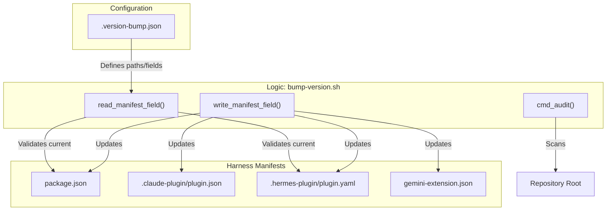
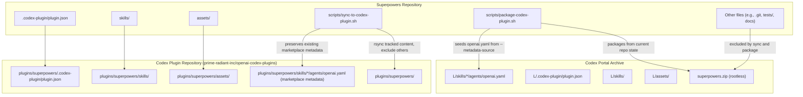
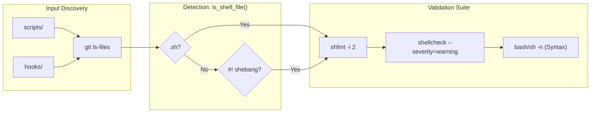

<!-- source: DeepWiki mcp.deepwiki.com · repo obra/superpowers · page 10.6 Maintainer Scripts · fetched 2026-10-26 -->

# Maintainer Scripts

Relevant source files

The following files were used as context for generating this wiki page:

- [.version-bump.json](.version-bump.json)
- [scripts/bump-version.sh](scripts/bump-version.sh)
- [scripts/lint-shell.sh](scripts/lint-shell.sh)
- [scripts/package-codex-plugin.sh](scripts/package-codex-plugin.sh)
- [scripts/sync-to-codex-plugin.sh](scripts/sync-to-codex-plugin.sh)
- [tests/codex-plugin-sync/test-sync-to-codex-plugin.sh](tests/codex-plugin-sync/test-sync-to-codex-plugin.sh)
- [tests/codex/test-package-codex-plugin.sh](tests/codex/test-package-codex-plugin.sh)
- [tests/shell-lint/test-lint-shell.sh](tests/shell-lint/test-lint-shell.sh)

Maintainer scripts facilitate the lifecycle management of the Superpowers repository, ensuring version consistency across multiple AI harnesses, validating shell script integrity, and managing the distribution of Codex-specific artifacts. These tools are designed to be deterministic and portable, primarily residing in the `scripts/` directory.

## Version Management (`bump-version.sh`)

Superpowers supports a wide array of AI harnesses, each requiring its own manifest file (e.g., `plugin.json`, `plugin.yaml`, `gemini-extension.json`). `scripts/bump-version.sh` provides a centralized mechanism to update these versions simultaneously while performing drift detection and repository-wide audits.

### Implementation and Configuration
The script is driven by a configuration file, `.version-bump.json`, which defines the target files and the specific JSON/YAML fields containing the version string [scripts/bump-version.sh:15-20]().

| Feature | Description |
| :--- | :--- |
| **JSON Support** | Uses `jq` to read and write fields, supporting nested paths like `plugins.0.version` [scripts/bump-version.sh:26-41](). |
| **YAML Support** | Uses `yq` to handle manifest formats like Hermes' `plugin.yaml` [scripts/bump-version.sh:50-60](). |
| **Drift Detection** | The `--check` command identifies if different manifests have fallen out of sync [scripts/bump-version.sh:116-152](). |
| **Audit Scanning** | The `--audit` command greps the entire repository for the current version string to find undeclared files that may need updating [scripts/bump-version.sh:154-224]().

### Version Bump Data Flow
The following diagram illustrates how `bump-version.sh` interacts with various manifest formats based on the central configuration.

**Version Synchronization Flow**

Sources: [.version-bump.json:1-12](), [scripts/bump-version.sh:62-86](), [scripts/bump-version.sh:226-250]()

---

## Codex Plugin Distribution

Codex requires specific metadata and packaging formats that differ from the standard Superpowers repository structure. Two scripts manage this lifecycle: `sync-to-codex-plugin.sh` for repository-to-repository synchronization and `package-codex-plugin.sh` for generating portal-ready archives.

### Syncing to Codex (`sync-to-codex-plugin.sh`)
This script synchronizes the local Superpowers checkout with the `prime-radiant-inc/openai-codex-plugins` repository. It is designed to be deterministic; running it twice against the same upstream SHA produces identical PRs [scripts/sync-to-codex-plugin.sh:12-13]().

*   **Exclusion Logic:** It anchors patterns with a leading `/` to ensure top-level infrastructure (like `.github/` or `tests/`) is not leaked into the embedded plugin directory, while allowing legitimate nested files in `skills/` to remain [scripts/sync-to-codex-plugin.sh:41-82]().
*   **Metadata Preservation:** It preserves OpenAI-owned marketplace metadata that exists in the destination repository but not in the source [scripts/sync-to-codex-plugin.sh:7-9]().

### Packaging for Portal (`package-codex-plugin.sh`)
For manual uploads to the Codex portal, this script creates a "rootless" archive. Unlike the standard repo, the archive root contains `.codex-plugin/`, `skills/`, and `assets/` directly [scripts/package-codex-plugin.sh:42-44]().

*   **Deterministic Builds:** The script normalizes ZIP entry timestamps to `1980-01-01` and pins `tar.umask` to ensure that archives generated from the same source have identical hashes regardless of the environment [scripts/package-codex-plugin.sh:235-236](), [tests/codex/test-package-codex-plugin.sh:188-197]().
*   **Metadata Seeding:** Since the standalone archive needs `openai.yaml` metadata for each skill, the script requires a `--metadata-source` (a prior package or checkout) to seed these files [scripts/package-codex-plugin.sh:7-9](), [scripts/package-codex-plugin.sh:156-166]().

**Codex Plugin Distribution Workflow**

Sources: [scripts/sync-to-codex-plugin.sh:35-82](), [scripts/package-codex-plugin.sh:22-45](), [tests/codex/test-package-codex-plugin.sh:165-173]()

---

## Shell Script Integrity (`lint-shell.sh`)

`scripts/lint-shell.sh` ensures that all shell scripts in the repository adhere to safety standards and consistent formatting.

### Core Functions
1.  **File Discovery:** It automatically identifies shell scripts by `.sh` extension or by inspecting the shebang (`#!`) of extensionless files like `hooks/session-start` [scripts/lint-shell.sh:26-40]().
2.  **Formatting:** Uses `shfmt` with a 2-space indent to enforce a unified style across the codebase [scripts/lint-shell.sh:197-201]().
3.  **Static Analysis:** Executes `shellcheck` with a baseline severity of `warning` [scripts/lint-shell.sh:205]().
4.  **Syntax Validation:** Runs `bash -n` or `sh -n` depending on the detected shell type to catch syntax errors that linters might miss [scripts/lint-shell.sh:123-141]().

**Shell Linting Architecture**

Sources: [scripts/lint-shell.sh:26-40](), [scripts/lint-shell.sh:183-190](), [tests/shell-lint/test-lint-shell.sh:147-156]()

### Linting Modes
*   **Default:** Lints only changed files (staged or unstaged) to keep developer loops fast [scripts/lint-shell.sh:77-97]().
*   **`--all`:** Scans all tracked files in the repository [scripts/lint-shell.sh:67-75]().
*   **`--strict`:** Enables additional ShellCheck rules, including `quote-safe-variables` and `check-set-e-suppressed` [scripts/lint-shell.sh:206-208]().

Sources: [scripts/lint-shell.sh:143-158](), [scripts/lint-shell.sh:205-211]()

---

