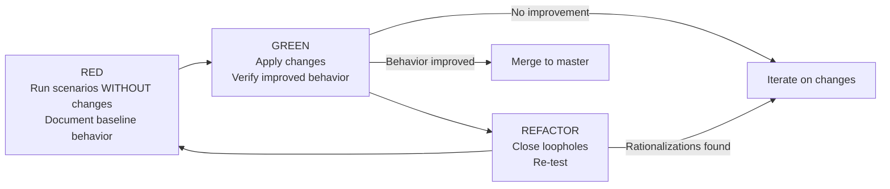
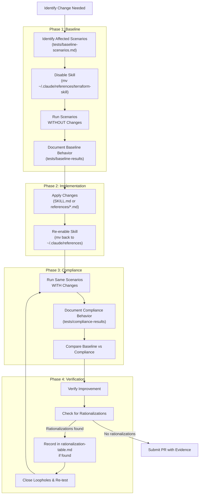
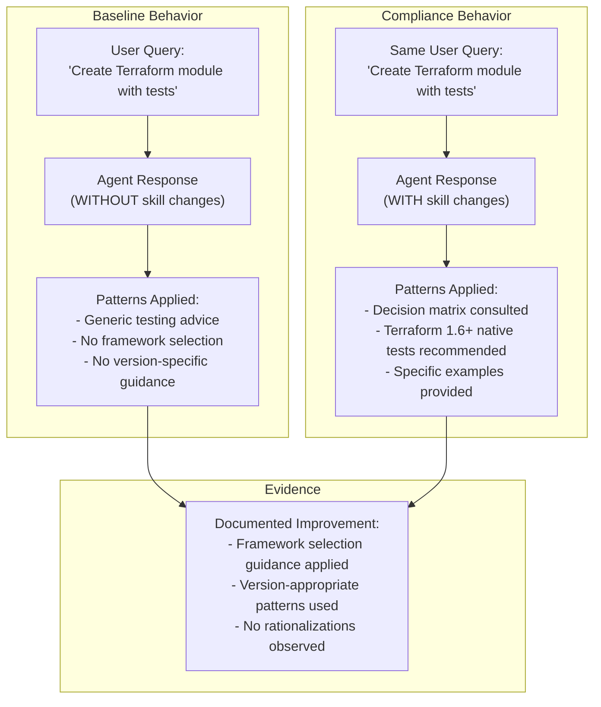
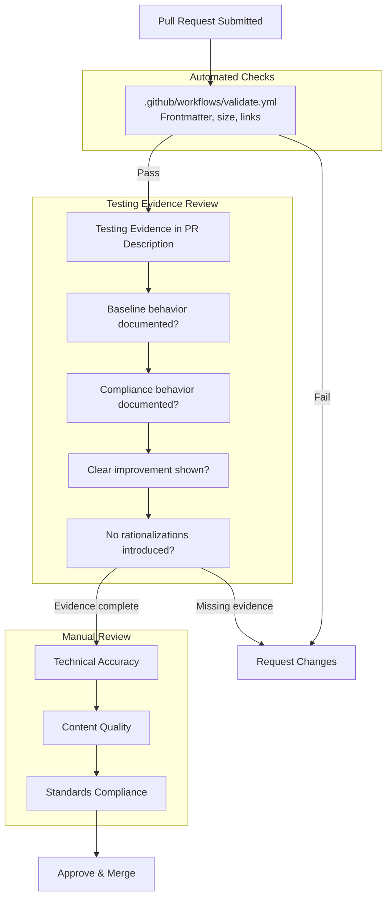

<!-- source: DeepWiki mcp.deepwiki.com · repo antonbabenko/terraform-skill · page 5.3 Testing Methodology · fetched 2026-10-26 -->

# Testing Methodology

<details>
<summary>Relevant source files</summary>

The following files were used as context for generating this wiki page:

- [CLAUDE.md](CLAUDE.md)
- [CONTRIBUTING.md](CONTRIBUTING.md)

</details>


## Purpose and Scope

This document describes the testing methodology for validating changes to terraform-skill content. The testing approach treats skill development as Test-Driven Development (TDD) for documentation, requiring empirical evidence that changes improve Claude's behavior before merging.

For information about content structure and organization, see [Content Standards](#5.2). For the complete contribution process including pull requests, see [Contribution Workflow](#5.4). For automation that validates file structure and metadata, see [Validation Workflow](#6.1).

---

## The Iron Law

**NO CHANGES WITHOUT TESTING FIRST**

This absolute requirement applies to all content modifications:

| Change Type | Testing Required |
|-------------|------------------|
| New content additions | ✅ Yes |
| Edits to existing content | ✅ Yes |
| Reorganization or refactoring | ✅ Yes |
| Documentation updates | ✅ Yes |
| Grammar/typo fixes | ✅ Yes |

**No exceptions.**

The rationale: Without testing, there is no empirical evidence that changes actually improve Claude's behavior. Changes that seem logical may introduce rationalizations, conflicts with existing guidance, or fail to activate in relevant scenarios.

Sources: [CONTRIBUTING.md:112-124]()

---

## TDD for Documentation

### Conceptual Framework

Traditional software follows the RED/GREEN/REFACTOR cycle for code. Skill development applies the same principle to documentation:



**Diagram: TDD Cycle for Skill Development**

Sources: [CONTRIBUTING.md:127-133]()

### Why This Approach Matters

Skills are executable documentation that shape AI agent behavior. Unlike traditional documentation where "working" means "readable," skills must demonstrably improve agent outputs. The TDD approach ensures:

1. **Baseline measurement** - Understanding current behavior before changes
2. **Empirical validation** - Verifying improvements actually occur
3. **Regression detection** - Catching unintended behavior changes
4. **Rationalization prevention** - Identifying when agents circumvent guidance

Sources: [CONTRIBUTING.md:127-133]()

---

## Testing Workflow

### Overview



**Diagram: Complete Testing Workflow**

Sources: [CONTRIBUTING.md:134-191]()

### Step-by-Step Process

#### 1. Identify Affected Scenarios

Review `tests/baseline-scenarios.md` to determine which test scenarios your change affects.

**Example mapping:**

| Change Type | Affected Scenarios |
|-------------|-------------------|
| Adding security scanning guidance | Scenario 3: Security implementation |
| Updating testing framework recommendations | Scenario 1: Test framework selection |
| Modifying module structure patterns | Scenario 2: Module creation |

Sources: [CONTRIBUTING.md:136-140]()

#### 2. Run Baseline (WITHOUT Changes)

Temporarily disable the skill to measure current behavior:

```bash
# Disable skill
mv ~/.claude/references/terraform-skill \
   ~/.claude/references/terraform-skill.disabled
```

Execute affected scenarios and document agent responses in `tests/baseline-results/`.

Sources: [CONTRIBUTING.md:142-150](), [CLAUDE.md:176-189]()

#### 3. Apply Changes

Make edits to `SKILL.md` or files in `references/`:

- `references/module-patterns.md` - Module development patterns
- `references/code-patterns.md` - Code structure and modern features
- `references/quick-reference.md` - Command cheat sheets
- `references/ci-cd-workflows.md` - Pipeline integration
- `references/security-compliance.md` - Security scanning

Sources: [CONTRIBUTING.md:152-154](), [CLAUDE.md:17-32]()

#### 4. Run Compliance Test (WITH Changes)

Re-enable the skill with your modifications:

```bash
# Re-enable skill
mv ~/.claude/references/terraform-skill.disabled \
   ~/.claude/references/terraform-skill
```

Execute the same scenarios and document improved behavior in `tests/compliance-results/`.

Sources: [CONTRIBUTING.md:156-165]()

#### 5. Verify Improvement

Compare baseline vs compliance behaviors:

| Verification Criteria | What to Check |
|----------------------|---------------|
| **Pattern Application** | Does agent now follow your guidance? |
| **Proactive Usage** | Are patterns applied without prompting? |
| **Consistency** | Is guidance applied consistently across scenarios? |
| **No Regressions** | Existing patterns still work correctly? |
| **No Rationalizations** | Agent doesn't circumvent new guidance? |

Sources: [CONTRIBUTING.md:167-172]()

---

## Baseline vs Compliance Testing

### Test Scenarios Location

Test scenarios are defined in `tests/baseline-scenarios.md`. Each scenario represents a common Terraform/OpenTofu task where skill guidance should activate.

**File structure:**

```
tests/
├── baseline-scenarios.md           # Standard test scenarios
├── baseline-results/               # Agent behavior WITHOUT changes
├── compliance-results/             # Agent behavior WITH changes
└── rationalization-table.md        # Known workarounds/evasions
```

Sources: [CONTRIBUTING.md:93-109]()

### Comparison Framework



**Diagram: Baseline vs Compliance Comparison**

Sources: [CONTRIBUTING.md:167-172]()

### Documentation Requirements

For each tested scenario, document:

**Baseline (without changes):**
- Query text used
- Agent's complete response
- Patterns agent applied (or failed to apply)
- Issues or gaps identified

**Compliance (with changes):**
- Same query text
- Agent's improved response
- New patterns agent applied
- Evidence of guidance activation

**Comparison:**
- Specific improvements observed
- Behavior changes (positive and negative)
- Rationalizations discovered (if any)

Sources: [CONTRIBUTING.md:174-180]()

---

## Rationalization Tracking

### What Are Rationalizations?

Rationalizations occur when Claude circumvents or creatively reinterprets skill guidance. Common patterns:

| Rationalization Type | Example |
|---------------------|---------|
| **Rule avoidance** | "While the skill suggests X, in this specific case Y is better because..." |
| **Selective application** | Applying guidance to some scenarios but not others without justification |
| **Creative interpretation** | Redefining terms to justify different behavior |
| **Prioritization conflict** | "The skill says X but best practices dictate Y" (when skill IS best practices) |

### Recording Rationalizations

When rationalizations are discovered during testing, record them in `tests/rationalization-table.md`:

```markdown
| Scenario | Rationalization Observed | Root Cause | Mitigation |
|----------|-------------------------|------------|------------|
| Module testing | "Terratest is better for this complex module despite skill recommending native tests" | Ambiguous decision matrix criteria | Add complexity threshold to decision matrix |
```

### Closing Loopholes

When a rationalization is discovered:

1. **Record it** in `tests/rationalization-table.md`
2. **Identify root cause** - Why did agent rationalize?
3. **Refine guidance** - Make criteria more explicit
4. **Re-test** - Verify rationalization eliminated
5. **Repeat** until compliance behavior is consistent

This is the "REFACTOR" phase of the TDD cycle.

Sources: [CONTRIBUTING.md:187-191]()

---

## Evidence Documentation

### PR Requirements

Every pull request must include testing evidence in the description:

```markdown
## Testing Evidence

### Scenarios Tested
- Scenario 1: Test framework selection
- Scenario 3: Security scanning implementation

### Baseline Behavior (WITHOUT changes)
Query: "Create a Terraform module with tests"
Response: Agent suggested generic testing approach without 
framework selection guidance or version considerations.

### Compliance Behavior (WITH changes)
Query: "Create a Terraform module with tests"
Response: Agent consulted decision matrix, recommended 
native tests for Terraform 1.6+, provided specific examples 
with mock providers.

### Improvement Verified
✅ Decision matrix activated
✅ Version-specific patterns applied
✅ No rationalizations observed
✅ Existing patterns still work
```

Sources: [CONTRIBUTING.md:174-180]()

### Testing Checklist

Use this checklist in every PR:

```markdown
- [ ] Identified affected scenarios from tests/baseline-scenarios.md
- [ ] Ran baseline WITHOUT changes (documented)
- [ ] Applied changes
- [ ] Ran compliance WITH changes (documented)
- [ ] Verified behavior improvement
- [ ] No new rationalizations discovered
- [ ] If rationalizations found, documented in rationalization-table.md
- [ ] Re-tested after closing loopholes
```

Sources: [CONTRIBUTING.md:181-191]()

---

## Testing Checklist Reference

### Pre-Submission Verification

| Criterion | Verification Method |
|-----------|-------------------|
| **Scenarios identified** | Listed specific scenarios from `tests/baseline-scenarios.md` |
| **Baseline documented** | Responses saved in `tests/baseline-results/` |
| **Changes applied** | Edited `SKILL.md` or `references/*.md` |
| **Compliance documented** | Improved responses saved in `tests/compliance-results/` |
| **Improvement verified** | Side-by-side comparison shows better behavior |
| **No rationalizations** | Agent follows guidance without creative reinterpretation |
| **Loopholes closed** | If rationalizations found, guidance refined and re-tested |
| **Evidence included** | PR description contains baseline/compliance comparison |

### Local Testing Environment

Testing requires Claude Code with skill loading capability:

```bash
# Skill location
~/.claude/references/terraform-skill/

# Testing workflow
~/.claude/references/terraform-skill/       # Active skill
~/.claude/references/terraform-skill.disabled/  # Disabled for baseline

# Test artifacts
tests/baseline-scenarios.md                 # Standard scenarios
tests/baseline-results/                     # Baseline behavior logs
tests/compliance-results/                   # Compliance behavior logs
tests/rationalization-table.md              # Known issues tracker
```

Sources: [CLAUDE.md:176-198](), [CONTRIBUTING.md:142-165]()

---

## Integration with Quality Systems

### Relationship to Automated Validation

Testing methodology complements but does not replace automated validation:

| System | Purpose | Scope |
|--------|---------|-------|
| **Testing Methodology** (this document) | Validate behavior improvements | Agent response quality |
| **Validation Workflow** ([6.1](#6.1)) | Validate file structure | Frontmatter, links, size |
| **Content Standards** ([5.2](#5.2)) | Define writing requirements | Token efficiency, formatting |

Testing methodology provides empirical evidence that automated systems cannot: whether changes actually improve Claude's Terraform guidance.

Sources: [CONTRIBUTING.md:112-191](), High-Level System Architecture Diagram 4

### Maintainer Review Process

Testing evidence informs maintainer review criteria:



**Diagram: Testing Evidence in Review Process**

Sources: [CONTRIBUTING.md:338-346](), High-Level System Architecture Diagram 4

---

## Practical Testing Examples

### Example 1: Adding Security Scanning Guidance

**Change:** Add trivy and checkov recommendations to `references/security-compliance.md`

**Affected scenarios:** Scenario 3 (Security implementation)

**Baseline behavior:**
- Query: "Add security scanning to my Terraform pipeline"
- Response: Generic recommendation to "use security tools" without specifics

**Compliance behavior:**
- Query: "Add security scanning to my Terraform pipeline"  
- Response: Recommends trivy for IaC scanning, checkov for compliance, provides integration examples

**Evidence:** Agent now provides actionable, specific tool recommendations with configuration examples

### Example 2: Updating Testing Framework Decision Matrix

**Change:** Refine criteria in `SKILL.md` decision matrix for test framework selection

**Affected scenarios:** Scenario 1 (Test framework selection)

**Baseline behavior:**
- Query: "What testing framework should I use for Terraform?"
- Response: Suggests "it depends" without clear decision criteria

**Compliance behavior:**
- Query: "What testing framework should I use for Terraform?"
- Response: Asks about Terraform version, then recommends native tests for 1.6+, provides decision matrix rationale

**Rationalization discovered:** Agent said "native tests work but Terratest is more mature" (undermining guidance)

**Refinement:** Added explicit "RECOMMENDED" label to decision matrix cells, re-tested, rationalization eliminated

**Evidence:** Agent now confidently recommends appropriate framework based on clear criteria

Sources: [CONTRIBUTING.md:134-191]()

---

## Summary

Testing methodology for terraform-skill enforces TDD principles for documentation:

1. **Iron Law:** All changes require testing before merge
2. **RED phase:** Document baseline behavior without changes
3. **GREEN phase:** Verify improved behavior with changes  
4. **REFACTOR phase:** Close rationalization loopholes and re-test
5. **Evidence:** PR must include baseline/compliance comparison
6. **Quality:** Testing evidence reviewed by maintainers

This methodology ensures every change demonstrably improves Claude's Terraform expertise rather than relying on assumptions about what "should" work.

Sources: [CONTRIBUTING.md:112-191](), [CLAUDE.md:160-198]()

---

