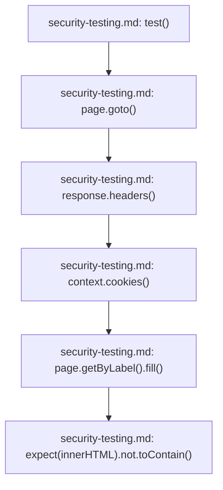
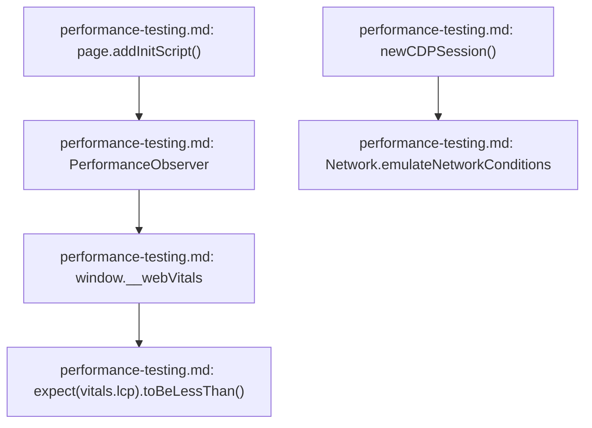
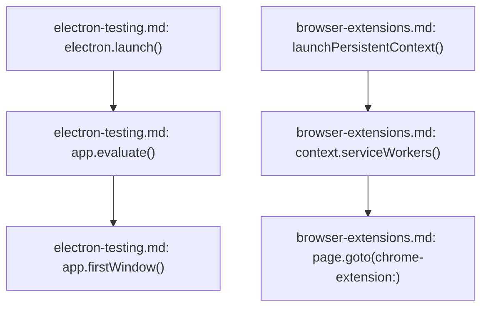

<!-- source: DeepWiki mcp.deepwiki.com · repo testdino-hq/playwright-skill · page 3.4 Security, Performance and Localization · fetched 2026-10-26 -->

# Security, Performance and Localization

Relevant source files

The following files were used as context for generating this wiki page:

- [core/angular.md](core/angular.md)
- [core/browser-extensions.md](core/browser-extensions.md)
- [core/canvas-and-webgl.md](core/canvas-and-webgl.md)
- [core/clock-and-time-mocking.md](core/clock-and-time-mocking.md)
- [core/common-pitfalls.md](core/common-pitfalls.md)
- [core/electron-testing.md](core/electron-testing.md)
- [core/i18n-and-localization.md](core/i18n-and-localization.md)
- [core/performance-testing.md](core/performance-testing.md)
- [core/security-testing.md](core/security-testing.md)

## Purpose and Scope
This document details advanced specialized testing domains within the `playwright-skill` core guide pack: security validation patterns, runtime performance auditing (Core Web Vitals and resource budgets), internationalization (i18n) and localization (RTL/locales), and desktop/browser extension runtimes (Electron and Chrome extensions). 

Sources: `core/security-testing.md:1-21`, `core/performance-testing.md:1-26`, `core/i18n-and-localization.md:1-21`, `core/electron-testing.md:1-24`, `core/browser-extensions.md:1-17`

---

## 1. Security Testing Patterns and Trust Boundaries

Security testing in Playwright validates server headers, input sanitization against Cross-Site Scripting (XSS), and Cross-Site Request Forgery (CSRF) defenses. Playwright inspects network responses, manipulates DOM inputs, and verifies cookie security flags (`HttpOnly`, `Secure`, `SameSite`).

### Key Security Verification Vectors
* **Security Headers**: Verifying `Content-Security-Policy`, `X-Frame-Options`, and strict transport policies upon navigation (`core/security-testing.md:9-13`).
* **XSS Protection**: Injecting malicious payloads (`<script>`, `onerror`, SVG attributes) into form inputs to ensure values are sanitized or rendered literally as text rather than executable markup (`core/security-testing.md:33-66`).
* **CSRF Defenses**: Inspecting hidden input tokens (`_csrf`, `csrf_token`) and asserting that state-changing API requests lacking tokens are rejected with a `403 Forbidden` status code (`core/security-testing.md:120-150`).

*Figure 1: Security Testing Execution Flow, mapping test execution to header inspection, cookie retrieval, and payload sanitization.*

Sources: `core/security-testing.md:1-188`

---

## 2. Performance Metrics and Resource Budgeting

Performance testing leverages browser native APIs and Chrome DevTools Protocol (CDP) sessions to measure Web Vitals, navigation timings, and JavaScript bundle sizes directly within automated test flows.

### Performance Measurement Subsystems
* **Core Web Vitals**: Injects a `PerformanceObserver` script via `page.addInitScript()` to capture Largest Contentful Paint (LCP), Cumulative Layout Shift (CLS), and First Input Delay (FID) (`core/performance-testing.md:40-81`).
* **Navigation & Resource Timings**: Evaluates `performance.getEntriesByType('navigation')` and `resource` entries to assert Time to First Byte (TTFB) and network durations (`core/performance-testing.md:114-152`).
* **Network Throttling**: Utilizes `page.context().newCDPSession(page)` to emulate constrained network profiles (e.g., Fast 3G conditions) (`core/performance-testing.md:20-26`).

*Figure 2: Performance Monitoring Architecture, mapping initialization scripts to observer metrics and CDP network emulation.*

Sources: `core/performance-testing.md:1-197`

---

## 3. Internationalization (i18n) and Localization

Localization testing ensures correct date/number formatting, currency display, and Right-to-Left (RTL) layout rendering by configuring browser execution contexts.

### Localization Testing Strategies
* **Locale Contexts**: Configuring `locale` and `timezoneId` parameters when instantiating `browser.newContext()` or defining multi-locale test projects in `playwright.config.ts` (`core/i18n-and-localization.md:9-20`).
* **RTL Layout Verification**: Validating that the document root contains `dir="rtl"`, checking horizontal scrolling bounds to prevent overflow, and ensuring directional icons/transforms are correctly applied (`core/i18n-and-localization.md:149-201`).

| Locale Parameter | Target Format Verified | Example Assertion Pattern |
| :--- | :--- | :--- |
| `en-US` | MM/DD/YYYY Dates | `expect(...).toHaveText(/\d{1,2}\/\d{1,2}\/\d{4})` (`core/i18n-and-localization.md:41`) |
| `de-DE` | DD.MM.YYYY Dates | `expect(...).toHaveText(/\d{1,2}\.\d{1,2}\.\d{4})` (`core/i18n-and-localization.md:50`) |
| `ja-JP` | Comma-separated currency | `expect(...).toHaveText(/[\d,]+円)` (`core/i18n-and-localization.md:60`) |
| `ar-SA` | RTL Document Direction | `expect(dir).toBe('rtl')` (`core/i18n-and-localization.md:156`) |

Sources: `core/i18n-and-localization.md:1-201`

---

## 4. Electron and Browser Extension Testing

Specialized execution runtimes extend Playwright beyond standard web pages into desktop applications and Chromium browser extensions.

### Specialized Runtimes
* **Electron Apps**: Uses `_electron.launch()` to spawn the application process, manages the renderer process via `app.firstWindow()`, and executes scripts in the main process via `app.evaluate()` (`core/electron-testing.md:9-20`).
* **Browser Extensions**: Requires Chromium with a persistent browser context (`chromium.launchPersistentContext`) loaded via `--load-extension` flags, extracting extension IDs from service worker registrations (`core/browser-extensions.md:9-19`).

*Figure 3: Extension and Electron Context Lifecycle, linking launcher interfaces to main/renderer processes and extension worker contexts.*

Sources: `core/electron-testing.md:1-236`, `core/browser-extensions.md:1-190`

---

