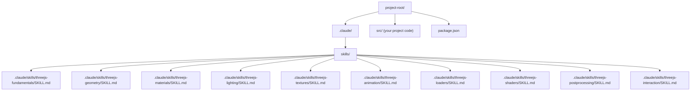
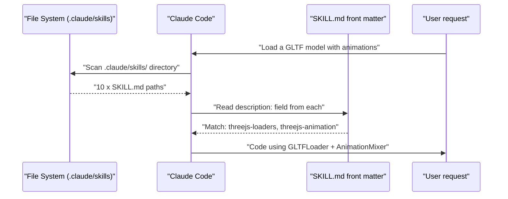

<!-- source: DeepWiki mcp.deepwiki.com · repo CloudAI-X/threejs-skills · page 1.1 Getting Started · fetched 2026-10-26 -->

# Getting Started

Relevant source files

The following files were used as context for generating this wiki page:

- [README.md](README.md)

This page covers the steps required to add `threejs-skills` to a project: installation methods, directory placement, and prerequisites. It does not explain how Claude Code selects skill files at runtime — for that, see [Skill Activation System](#1.2). For the internal structure of each `.md` file, see [Skill File Format](#1.3).

---

## Prerequisites

| Requirement | Details |
|---|---|
| **Claude Code** | The AI coding assistant that reads `.claude/skills/` automatically |
| **Three.js** | r160 or later (skills are audited against this baseline) |
| **Git** | Required for both installation methods below |
| **Node.js project** | Any project that imports Three.js as a dependency |

The skill files themselves are plain Markdown. They have no runtime dependencies and do not ship any JavaScript. They exist solely to be read by Claude Code during a session.

---

## Installation

There are two supported ways to bring the skill files into a project. Both result in the `.claude/skills/` directory being present at the root of the repository that Claude Code is operating in.

**Directory placement is mandatory.** Claude Code scans for skill files at `.claude/skills/` relative to the working repository root. If the directory is placed elsewhere, the activation mechanism described in [Skill Activation System](#1.2) will not function.

### Option 1: Direct Clone

Clone the repository directly into the project root:

[README.md:18-20]()

This places the `.claude/skills/` directory (along with `README.md`) at the top level of the checked-out path. The clone target directory should be the project root, or the `.claude/skills/` subdirectory must be manually moved into the project root afterwards.

### Option 2: Git Submodule

Add the repository as a submodule:

[README.md:22-25]()

Using a submodule keeps the skill files versioned independently from the host project and allows updates via `git submodule update --remote`. The same directory placement requirement applies.

---

## Resulting Directory Structure

After installation, the relevant paths in the host project look like this:

**Figure: File system layout after installation**

Sources: [README.md:16-25]()

---

## Skill Files Installed

The following ten skill files are included. Each covers a distinct domain of the Three.js API.

| Skill file directory | Primary API coverage |
|---|---|
| `threejs-fundamentals/SKILL.md` | `Scene`, `Camera`, `WebGLRenderer`, `Object3D` |
| `threejs-geometry/SKILL.md` | `BufferGeometry`, `InstancedMesh`, built-in shapes |
| `threejs-materials/SKILL.md` | PBR materials, `ShaderMaterial`, `RawShaderMaterial` |
| `threejs-lighting/SKILL.md` | Light types, shadow maps, IBL |
| `threejs-textures/SKILL.md` | Texture loading, UV config, `WebGLRenderTarget` |
| `threejs-animation/SKILL.md` | `AnimationClip`, `AnimationMixer`, `AnimationAction` |
| `threejs-loaders/SKILL.md` | `GLTFLoader`, `DRACOLoader`, `LoadingManager` |
| `threejs-shaders/SKILL.md` | GLSL, uniforms, `onBeforeCompile` |
| `threejs-postprocessing/SKILL.md` | `EffectComposer`, passes, bloom |
| `threejs-interaction/SKILL.md` | `Raycaster`, `OrbitControls`, `DragControls` |

Sources: [README.md:30-41]()

---

## How Claude Code Finds the Skills

Once `.claude/skills/` is in place, no further configuration is needed. Claude Code reads the `description` field from the YAML front matter of each `SKILL.md` file. That field is the routing key: Claude Code matches it against the context of each user request and loads whichever skill files are relevant.

**Figure: From installation path to activated skill at request time**

Sources: [README.md:44-68]()

The activation logic is covered in detail in [Skill Activation System](#1.2). The format of the `description` field and the rest of the front matter is covered in [Skill File Format](#1.3).

---

## Verification Baseline

The skill files in this repository have been audited against Three.js **r160+** for:

- Correct class names and constructor signatures
- Valid property and method names
- Accurate import paths using the `three/addons/` format
- Working code examples
- Current best practices

[README.md:113-119]()

If you are using a Three.js version older than r160, some API details (particularly around `ColorManagement`, `colorSpace` properties, and `three/addons/` import paths) may differ from what the skill files document.

---

## Next Steps

| Goal | Page |
|---|---|
| Understand which skill files load for which requests | [Skill Activation System](#1.2) |
| Read or write the internal format of a `SKILL.md` file | [Skill File Format](#1.3) |
| Add a new skill file or fix an error in an existing one | [Contributing](#1.4) |
| Browse all ten skill files and their scopes | [Skills Reference](#2) |

---

