# Page: Overview

# Overview

<details>
<summary>Relevant source files</summary>

The following files were used as context for generating this wiki page:

- [README.md](README.md)

</details>


This page describes the `threejs-skills` repository: its purpose, the problem it solves, the collection of skill files it contains, and how those files interact with Claude Code at runtime. For setup instructions, see [Getting Started](#1.1). For the routing mechanism that determines which files load, see [Skill Activation System](#1.2). For the internal structure each file must follow, see [Skill File Format](#1.3).

---

## What This Repository Is

`threejs-skills` is a collection of structured Markdown documents called *skill files*. Each file packages Three.js API references, constructor signatures, working code examples, and performance guidance into a format that Claude Code can load on demand.

Claude Code's general programming knowledge does not include the specifics of the Three.js API — accurate constructor signatures, valid property names, correct import paths from `three/addons/`, or current best practices as of r160+. Skill files fill that gap.

The repository contains:

- One entry point: `README.md`, which defines the integration contract and the index of skills.
- One directory: `.claude/skills/`, containing ten `SKILL.md` files, one per Three.js topic domain.

Sources: [README.md:1-12]()

---

## Repository Layout

**Diagram: Repository structure mapped to file paths**

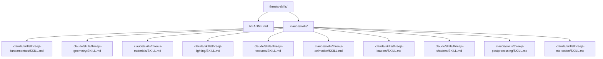

Sources: [README.md:29-41]()

---

## The Ten Skill Files

Each skill file covers one topic domain of the Three.js library. The table below lists each file, the skill `name` field it declares in its front matter, and the scope of its content.

| File path | `name` field | Scope |
|---|---|---|
| `.claude/skills/threejs-fundamentals/SKILL.md` | `threejs-fundamentals` | `Scene`, `PerspectiveCamera`, `WebGLRenderer`, `Object3D`, `Group`, `Mesh`, `Vector3`, `Clock` |
| `.claude/skills/threejs-geometry/SKILL.md` | `threejs-geometry` | Built-in geometries, `BufferGeometry`, `BufferAttribute`, `InstancedMesh` |
| `.claude/skills/threejs-materials/SKILL.md` | `threejs-materials` | PBR materials, `ShaderMaterial`, `RawShaderMaterial`, blending, depth |
| `.claude/skills/threejs-lighting/SKILL.md` | `threejs-lighting` | Light types, shadow maps, IBL, `PMREMGenerator` |
| `.claude/skills/threejs-textures/SKILL.md` | `threejs-textures` | `TextureLoader`, `WebGLRenderTarget`, `CubeCamera`, UV config |
| `.claude/skills/threejs-animation/SKILL.md` | `threejs-animation` | `AnimationClip`, `AnimationMixer`, `AnimationAction`, `KeyframeTrack` |
| `.claude/skills/threejs-loaders/SKILL.md` | `threejs-loaders` | `GLTFLoader`, `DRACOLoader`, `KTX2Loader`, `LoadingManager`, `THREE.Cache` |
| `.claude/skills/threejs-shaders/SKILL.md` | `threejs-shaders` | GLSL, uniforms, `onBeforeCompile`, `ShaderChunk` |
| `.claude/skills/threejs-postprocessing/SKILL.md` | `threejs-postprocessing` | `EffectComposer`, `RenderPass`, `UnrealBloomPass`, `ShaderPass` |
| `.claude/skills/threejs-interaction/SKILL.md` | `threejs-interaction` | `Raycaster`, `OrbitControls`, `TransformControls`, `DragControls` |

Sources: [README.md:29-41]()

---

## How Skill Files Fit Into a Development Workflow

When a user makes a natural language request in Claude Code, Claude Code reads the `description` field from each skill file's YAML front matter and loads the files whose descriptions match the request context. Multiple files can be co-loaded in a single request.

**Diagram: Natural language request mapped to loaded SKILL.md files**

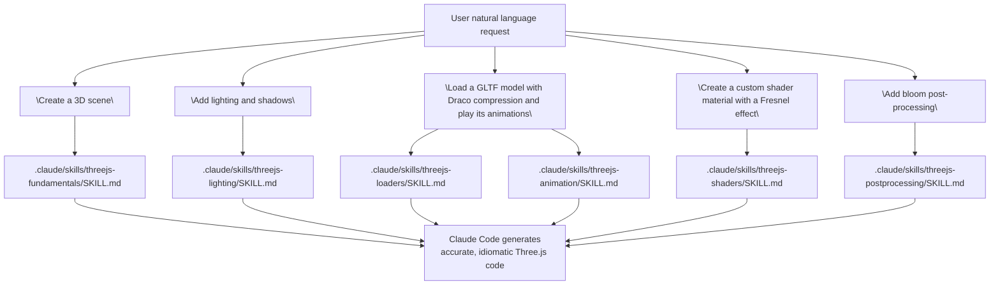

Sources: [README.md:44-68]()

---

## Skill Dependency Structure

The ten skill domains are not independent — they reflect natural layering within the Three.js runtime. The `threejs-fundamentals` skill is the foundation every other skill builds on. The diagram below shows how skills depend on each other, using the `name` field values from each file's front matter as node identifiers.

**Diagram: Dependency relationships between skill `name` identifiers**

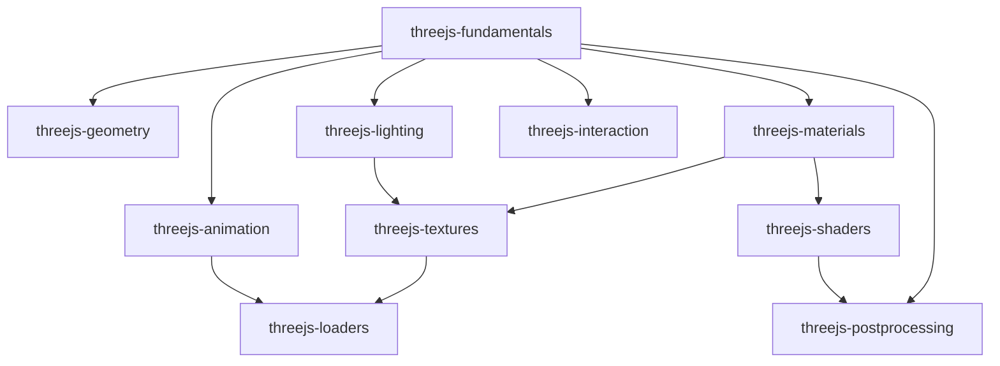

A request that involves loading an animated GLTF model will cause Claude Code to co-load `threejs-loaders` and `threejs-animation`. A request for custom visual effects will co-load `threejs-shaders` and `threejs-postprocessing`. See [Skill Activation System](#1.2) for the full routing mechanics.

Sources: [README.md:44-50]()

---

## Quality Baseline

All skill files in this repository have been audited against the official Three.js documentation at version **r160+**. The verification checklist covers:

- Correct class names and constructor signatures
- Valid property and method names
- Accurate import paths using the `three/addons/` format
- Working code examples
- Current best practices

See [Contributing](#1.4) for the full requirements when adding or updating a skill file.

Sources: [README.md:112-119]()

---

# Page: Getting Started

# Getting Started

<details>
<summary>Relevant source files</summary>

The following files were used as context for generating this wiki page:

- [README.md](README.md)

</details>


This page covers the steps required to add `threejs-skills` to a project: installation methods, directory placement, and prerequisites. It does not explain how Claude Code selects skill files at runtime — for that, see [Skill Activation System](#1.2). For the internal structure of each `.md` file, see [Skill File Format](#1.3).

---

## Prerequisites

| Requirement | Details |
|---|---|
| **Claude Code** | The AI coding assistant that reads `.claude/skills/` automatically |
| **Three.js** | r160 or later (skills are audited against this baseline) |
| **Git** | Required for both installation methods below |
| **Node.js project** | Any project that imports Three.js as a dependency |

The skill files themselves are plain Markdown. They have no runtime dependencies and do not ship any JavaScript. They exist solely to be read by Claude Code during a session.

---

## Installation

There are two supported ways to bring the skill files into a project. Both result in the `.claude/skills/` directory being present at the root of the repository that Claude Code is operating in.

**Directory placement is mandatory.** Claude Code scans for skill files at `.claude/skills/` relative to the working repository root. If the directory is placed elsewhere, the activation mechanism described in [Skill Activation System](#1.2) will not function.

### Option 1: Direct Clone

Clone the repository directly into the project root:

[README.md:18-20]()

This places the `.claude/skills/` directory (along with `README.md`) at the top level of the checked-out path. The clone target directory should be the project root, or the `.claude/skills/` subdirectory must be manually moved into the project root afterwards.

### Option 2: Git Submodule

Add the repository as a submodule:

[README.md:22-25]()

Using a submodule keeps the skill files versioned independently from the host project and allows updates via `git submodule update --remote`. The same directory placement requirement applies.

---

## Resulting Directory Structure

After installation, the relevant paths in the host project look like this:

**Figure: File system layout after installation**

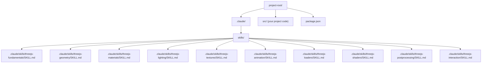

Sources: [README.md:16-25]()

---

## Skill Files Installed

The following ten skill files are included. Each covers a distinct domain of the Three.js API.

| Skill file directory | Primary API coverage |
|---|---|
| `threejs-fundamentals/SKILL.md` | `Scene`, `Camera`, `WebGLRenderer`, `Object3D` |
| `threejs-geometry/SKILL.md` | `BufferGeometry`, `InstancedMesh`, built-in shapes |
| `threejs-materials/SKILL.md` | PBR materials, `ShaderMaterial`, `RawShaderMaterial` |
| `threejs-lighting/SKILL.md` | Light types, shadow maps, IBL |
| `threejs-textures/SKILL.md` | Texture loading, UV config, `WebGLRenderTarget` |
| `threejs-animation/SKILL.md` | `AnimationClip`, `AnimationMixer`, `AnimationAction` |
| `threejs-loaders/SKILL.md` | `GLTFLoader`, `DRACOLoader`, `LoadingManager` |
| `threejs-shaders/SKILL.md` | GLSL, uniforms, `onBeforeCompile` |
| `threejs-postprocessing/SKILL.md` | `EffectComposer`, passes, bloom |
| `threejs-interaction/SKILL.md` | `Raycaster`, `OrbitControls`, `DragControls` |

Sources: [README.md:30-41]()

---

## How Claude Code Finds the Skills

Once `.claude/skills/` is in place, no further configuration is needed. Claude Code reads the `description` field from the YAML front matter of each `SKILL.md` file. That field is the routing key: Claude Code matches it against the context of each user request and loads whichever skill files are relevant.

**Figure: From installation path to activated skill at request time**

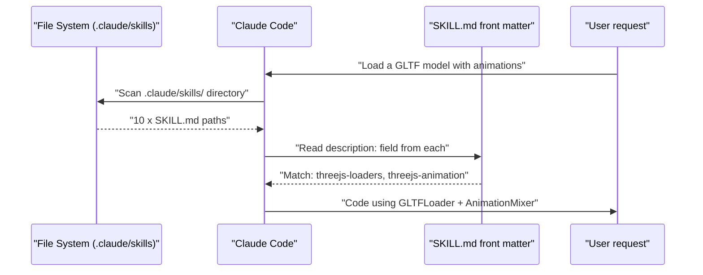

Sources: [README.md:44-68]()

The activation logic is covered in detail in [Skill Activation System](#1.2). The format of the `description` field and the rest of the front matter is covered in [Skill File Format](#1.3).

---

## Verification Baseline

The skill files in this repository have been audited against Three.js **r160+** for:

- Correct class names and constructor signatures
- Valid property and method names
- Accurate import paths using the `three/addons/` format
- Working code examples
- Current best practices

[README.md:113-119]()

If you are using a Three.js version older than r160, some API details (particularly around `ColorManagement`, `colorSpace` properties, and `three/addons/` import paths) may differ from what the skill files document.

---

## Next Steps

| Goal | Page |
|---|---|
| Understand which skill files load for which requests | [Skill Activation System](#1.2) |
| Read or write the internal format of a `SKILL.md` file | [Skill File Format](#1.3) |
| Add a new skill file or fix an error in an existing one | [Contributing](#1.4) |
| Browse all ten skill files and their scopes | [Skills Reference](#2) |

---

# Page: Skill Activation System

# Skill Activation System

<details>
<summary>Relevant source files</summary>

The following files were used as context for generating this wiki page:

- [README.md](README.md)

</details>


This page describes the mechanism by which Claude Code selects and loads skill files from `.claude/skills/` in response to user requests. It covers the `description` front matter field (the routing key), how multiple skills can be co-loaded for a single request, and concrete request-to-skill mappings.

For details on the internal structure of each skill file (sections, YAML fields, content requirements), see [Skill File Format](#1.3). For setup and installation of the `.claude/skills/` directory, see [Getting Started](#1.1).

---

## How Routing Works

Claude Code does not require explicit configuration to select a skill. Instead, it reads the `description` field from the YAML front matter of every skill file in `.claude/skills/`, then matches that text against the semantic context of the user's natural language request.

The `description` field acts as a declarative trigger: it describes *when* the skill should be loaded, not *what* it contains. Claude Code performs this match automatically at request time.

**The routing front matter block** ([README.md:82-86]()):

```markdown
---
name: skill-name
description: When this skill should be activated
---
```

- `name` — unique identifier for the skill (e.g. `threejs-fundamentals`)
- `description` — the natural language trigger phrase that Claude Code evaluates against incoming requests

Sources: [README.md:43-51](), [README.md:82-86]()

---

## Activation Sequence

**Diagram: Skill Activation Sequence**

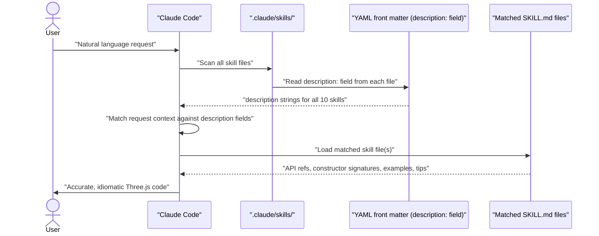

Sources: [README.md:43-51]()

---

## Request-to-Skill Mappings

The following table documents the example mappings defined in the README. These are illustrative — any phrasing that semantically matches a skill's `description` will trigger it.

| Example User Request | Skill(s) Activated | Skill File Path |
|---|---|---|
| "Create a 3D scene" | `threejs-fundamentals` | `.claude/skills/threejs-fundamentals/SKILL.md` |
| "Add lighting and shadows" | `threejs-lighting` | `.claude/skills/threejs-lighting/SKILL.md` |
| "Load a GLTF model" | `threejs-loaders` | `.claude/skills/threejs-loaders/SKILL.md` |
| "Load a GLTF model with Draco compression and play its animations" | `threejs-loaders` + `threejs-animation` | `.claude/skills/threejs-loaders/SKILL.md`, `.claude/skills/threejs-animation/SKILL.md` |
| "Create custom visual effects" | `threejs-shaders` + `threejs-postprocessing` | `.claude/skills/threejs-shaders/SKILL.md`, `.claude/skills/threejs-postprocessing/SKILL.md` |
| "Create a custom shader material with a fresnel effect" | `threejs-shaders` | `.claude/skills/threejs-shaders/SKILL.md` |

Sources: [README.md:46-50](), [README.md:53-76]()

---

## Multi-Skill Co-Loading

A single request can activate more than one skill simultaneously. Claude Code loads all skills whose `description` fields match the request context. The loaded skill files are treated as a combined reference corpus for that response.

**Diagram: Multi-Skill Co-Loading for a GLTF + Animation Request**

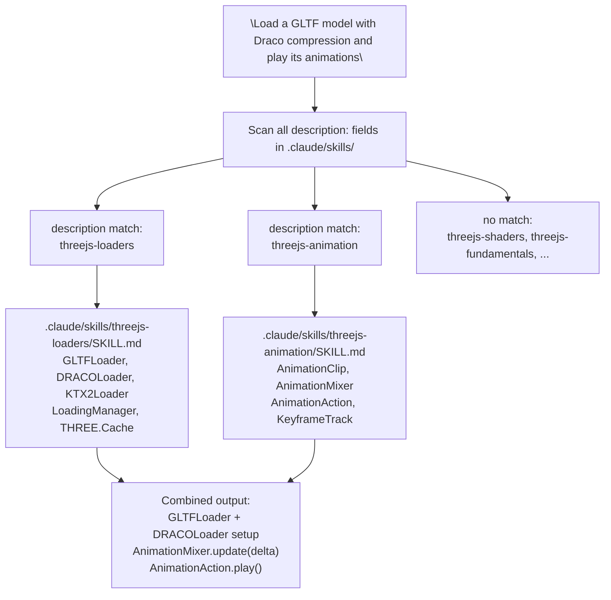

Sources: [README.md:63-68]()

---

## The `description` Field as a Routing Key

The `description` field is the sole routing mechanism. It is not a human-readable summary of the skill's content — it is a specification of *when to load* the skill. Writing effective `description` values is therefore important for correct activation behavior.

**Diagram: description Field Location and Its Role**

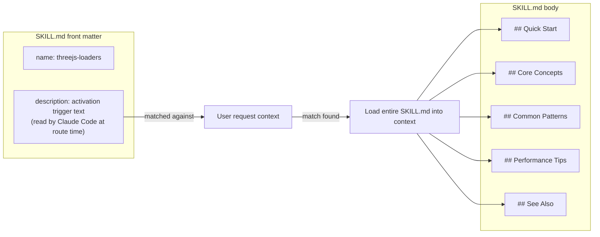

The body sections (`Quick Start`, `Core Concepts`, etc.) are only consumed *after* the `description` field has matched and triggered loading. The `description` field itself is never surfaced to the user — it is internal routing metadata.

For a full breakdown of each body section and what content belongs in it, see [Skill File Format](#1.3).

Sources: [README.md:80-109]()

---

## All Skills and Their Activation Scope

The following table lists all ten skill files in the repository, their `name` identifier, and the domain of requests expected to activate them.

| `name` | File | Activation Domain |
|---|---|---|
| `threejs-fundamentals` | `.claude/skills/threejs-fundamentals/SKILL.md` | Scene setup, cameras, renderer, Object3D hierarchy |
| `threejs-geometry` | `.claude/skills/threejs-geometry/SKILL.md` | Built-in shapes, BufferGeometry, instancing |
| `threejs-materials` | `.claude/skills/threejs-materials/SKILL.md` | PBR materials, ShaderMaterial, material properties |
| `threejs-lighting` | `.claude/skills/threejs-lighting/SKILL.md` | Light types, shadows, environment lighting |
| `threejs-textures` | `.claude/skills/threejs-textures/SKILL.md` | Texture loading, UV mapping, render targets |
| `threejs-animation` | `.claude/skills/threejs-animation/SKILL.md` | Keyframe animation, AnimationMixer, skeletal animation |
| `threejs-loaders` | `.claude/skills/threejs-loaders/SKILL.md` | GLTFLoader, DRACOLoader, async loading patterns |
| `threejs-shaders` | `.claude/skills/threejs-shaders/SKILL.md` | GLSL, uniforms, onBeforeCompile, custom effects |
| `threejs-postprocessing` | `.claude/skills/threejs-postprocessing/SKILL.md` | EffectComposer, bloom, DOF, custom passes |
| `threejs-interaction` | `.claude/skills/threejs-interaction/SKILL.md` | Raycasting, OrbitControls, mouse/touch input |

Sources: [README.md:30-42]()

---

# Page: Skill File Format

# Skill File Format

<details>
<summary>Relevant source files</summary>

The following files were used as context for generating this wiki page:

- [README.md](README.md)

</details>


This page documents the required internal structure of every skill file in the `.claude/skills/` directory. It covers the YAML front matter fields and the five mandatory sections that every `SKILL.md` must contain, along with what content belongs in each. For information on how Claude Code uses these files to answer requests, see [Skill Activation System](#1.2). For requirements when adding or updating files, see [Contributing](#1.4).

---

## Overview

Every skill is a single Markdown file named `SKILL.md`, stored in its own subdirectory under `.claude/skills/`. The file has two structural layers: a YAML front matter block at the top, followed by a fixed sequence of Markdown sections.

The front matter is machine-readable and drives skill selection. The sections are human- and LLM-readable and provide the actual Three.js knowledge payload.

Sources: [README.md:78-109]()

---

## File Location and Naming

Each skill occupies its own named subdirectory:

```
.claude/skills/
├── threejs-fundamentals/SKILL.md
├── threejs-geometry/SKILL.md
├── threejs-materials/SKILL.md
├── threejs-lighting/SKILL.md
├── threejs-textures/SKILL.md
├── threejs-animation/SKILL.md
├── threejs-loaders/SKILL.md
├── threejs-shaders/SKILL.md
├── threejs-postprocessing/SKILL.md
└── threejs-interaction/SKILL.md
```

The subdirectory name matches the `name` field in the front matter of the file it contains.

Sources: [README.md:30-41]()

---

## Complete File Structure

**Diagram: SKILL.md Top-Level Structure**

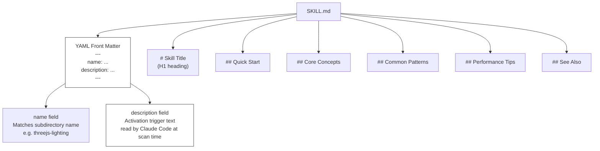

Sources: [README.md:82-109]()

---

## Front Matter

The front matter is a YAML block delimited by `---` at the very top of the file. It contains exactly two fields.

| Field | Type | Purpose |
|---|---|---|
| `name` | string | Unique identifier for the skill. Must match the subdirectory name (e.g. `threejs-lighting`). |
| `description` | string | Plain-language text that Claude Code reads to decide whether to load this file. Acts as the routing key. |

**Example front matter:**

```
---
name: threejs-lighting
description: When to activate this skill (matched against user request context)
---
```

The `description` field is the most consequential field in the entire file. It is the only part of the file that Claude Code reads during the initial scan phase, before deciding whether to load the rest. See [Skill Activation System](#1.2) for details on how `description` values are matched.

Sources: [README.md:82-86]()

**Diagram: Front Matter Fields Mapped to Runtime Behavior**

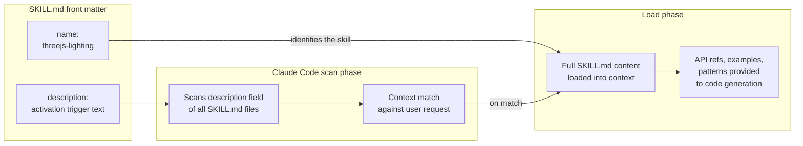

Sources: [README.md:43-51](), [README.md:82-86]()

---

## Section Reference

Each skill file must contain the following five sections in this order, as H2 headings.

### `## Quick Start`

**Purpose:** Provide a minimal, self-contained, copy-paste-ready code example. This is the first section a reader sees after the front matter. It should work with zero modification.

**What to include:**
- A single, complete working snippet
- All necessary imports
- The smallest amount of code that demonstrates the skill's primary use case
- No explanatory prose — just working code with inline comments if needed

---

### `## Core Concepts`

**Purpose:** Provide detailed API documentation covering the classes, constructors, properties, and methods central to this skill.

**What to include:**
- Constructor signatures with parameter types and default values
- Key property listings with types and descriptions
- Method signatures with return types
- Inline code examples for non-obvious usage
- Notes about deprecations or version-specific behavior (r160+ baseline)

This section is the primary reference layer — it should be authoritative enough that code generated from it does not require cross-referencing the official Three.js docs.

---

### `## Common Patterns`

**Purpose:** Document real-world usage patterns that go beyond the minimal Quick Start example.

**What to include:**
- Multi-step workflows (e.g., loader → mixer → action for animation)
- Typical combinations of classes from this skill
- Decision guidance (e.g., when to use `ShaderMaterial` vs `RawShaderMaterial`)
- Error-prone areas and how to avoid them
- Integration with other skills where relevant (reference the other skill by name)

---

### `## Performance Tips`

**Purpose:** Document optimization guidance specific to the systems covered by this skill.

**What to include:**
- Memory management and disposal patterns (`.dispose()` calls)
- Draw call reduction techniques
- GPU considerations (texture compression, buffer usage flags)
- Patterns to avoid with their reasoning
- Quantitative guidance where available (e.g., recommended texture size limits, shadow map sizes)

---

### `## See Also`

**Purpose:** Cross-reference related skill files to help Claude Code and human readers navigate to adjacent knowledge.

**What to include:**
- Names of related skills (using the `name` field format, e.g. `threejs-textures`)
- A one-line note on why the related skill is relevant
- Skills that are frequently co-loaded with this one (see [Skill Activation System](#1.2) for co-loading behavior)

---

## Section Summary Table

| Section | H-level | Primary Consumer | Key Constraint |
|---|---|---|---|
| Front matter | — | Claude Code (scan phase) | `description` must be accurate; it is the sole routing signal |
| `## Quick Start` | H2 | LLM / developer | Must be copy-paste ready with no edits |
| `## Core Concepts` | H2 | LLM code generation | Must use correct class names and signatures per r160+ |
| `## Common Patterns` | H2 | LLM code generation | Should reflect idiomatic Three.js, not workarounds |
| `## Performance Tips` | H2 | LLM code generation | Should be specific and actionable, not generic advice |
| `## See Also` | H2 | LLM / developer | Use `name` field values, not free-form references |

Sources: [README.md:78-136]()

---

## Format Constraints

The following constraints apply to all content within skill files:

- **Import paths** must use the `three/addons/` format (not the legacy `three/examples/jsm/` path).
- **Class names, property names, and method signatures** must be verified against Three.js r160 or later.
- **Code examples** must be complete enough to run — no ellipsis (`...`) standing in for required setup.
- **The `name` field** must match the subdirectory name exactly.
- **Section order** must be: Quick Start → Core Concepts → Common Patterns → Performance Tips → See Also.

Sources: [README.md:112-120](), [README.md:130-136]()

---

## Diagram: Section Content Types

**Diagram: What Belongs in Each Section**

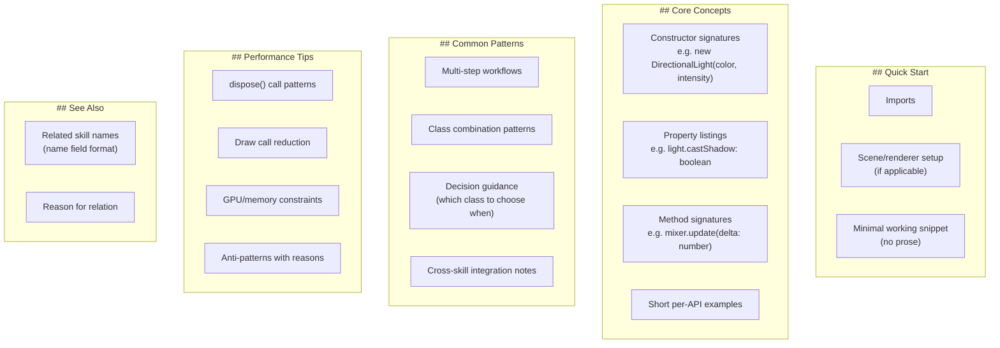

Sources: [README.md:88-109](), [README.md:130-136]()

---

# Page: Contributing

# Contributing

<details>
<summary>Relevant source files</summary>

The following files were used as context for generating this wiki page:

- [README.md](README.md)

</details>


This page describes the requirements and process for adding new skill files or modifying existing ones in the `threejs-skills` repository. It covers the quality verification checklist, Three.js version baseline, content guidelines, and the pull request workflow.

For documentation of the required internal format each skill file must follow, see [Skill File Format](#1.3). For an overview of how skills are activated and used, see [Skill Activation System](#1.2).

---

## Overview

The purpose of every skill file is to give Claude Code accurate, version-specific Three.js knowledge. A skill file with incorrect class names, wrong import paths, or broken code examples is worse than no skill file — it causes Claude Code to generate invalid output. All contributions must pass the verification checklist before being merged.

Sources: [README.md:111-136]()

---

## Contribution Workflow

**Contribution Process: Fork → Edit → Verify → Pull Request**

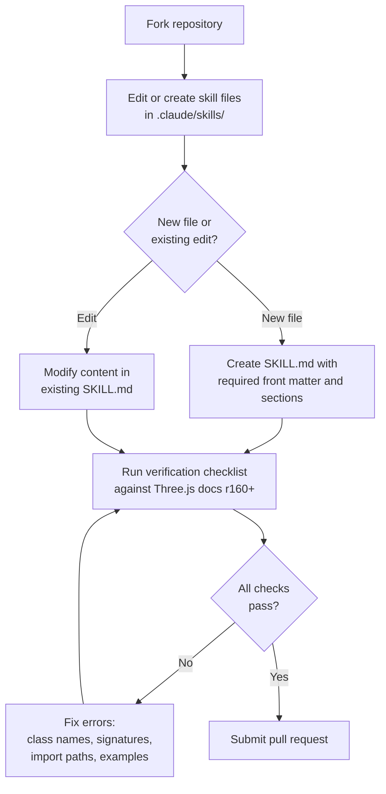

Sources: [README.md:121-128]()

The `.claude/skills/` directory is where all skill files live. Each file is named `SKILL.md` and placed inside a subdirectory named after the skill (e.g., `.claude/skills/threejs-lighting/SKILL.md`).

---

## Verification Checklist

All skill files — whether new or edited — must be audited against the official Three.js documentation at version **r160 or later**. The five verification areas are:

| # | Check | What to Verify |
|---|-------|----------------|
| 1 | **Class names** | Every class referenced (e.g., `WebGLRenderer`, `BufferGeometry`, `AnimationMixer`) must exist in Three.js r160+. |
| 2 | **Constructor signatures** | Parameter names, types, and order must match the current Three.js source. Deprecated overloads must not be used. |
| 3 | **Property and method signatures** | Property names (e.g., `.colorSpace` not `.encoding`) and method names must be current. Renamed or removed members fail this check. |
| 4 | **Import paths** | All addon imports must use the `three/addons/` format (e.g., `import { OrbitControls } from 'three/addons/controls/OrbitControls.js'`). The old `three/examples/jsm/` path is not acceptable. |
| 5 | **Working code examples** | Every code block must be syntactically valid and produce the described result. Examples must not rely on deprecated patterns. |

Sources: [README.md:112-119]()

---

## Import Path Format

The `three/addons/` import format is a hard requirement. The following diagram maps the two formats to the codebase structure so contributors can verify their paths:

**Import Path Mapping: Rejected vs. Required Format**

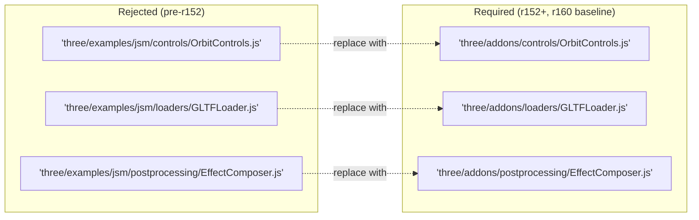

Sources: [README.md:117]()

---

## Content Guidelines

These guidelines apply to every section of a skill file. They complement the structural requirements defined in [Skill File Format](#1.3).

| Guideline | Detail |
|-----------|--------|
| **Accurate, tested examples** | Code must be copy-paste runnable. Do not include pseudocode in example blocks. |
| **Both simple and advanced patterns** | The Quick Start section targets minimal working code; Common Patterns covers real-world complexity. |
| **Performance implications documented** | Any pattern with a known cost (draw calls, texture memory, shader compilation) must have a note in Performance Tips. |
| **Cross-reference related skills** | The See Also section must link to other skills in `.claude/skills/` that a user would reasonably need together. |
| **Concise but complete** | Examples should not include unrelated boilerplate, but they must include all code required to make the shown feature work. |

Sources: [README.md:131-136]()

---

## Three.js Version Baseline

The repository targets **Three.js r160 and later**. This has concrete implications for what content is allowed:

**Version Baseline Constraints**

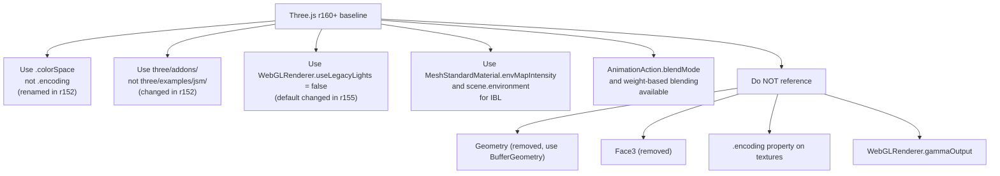

Sources: [README.md:113]()

---

## Skill File Location and Naming

The directory layout that a contribution must follow:

**Repository Layout for New Skill Files**

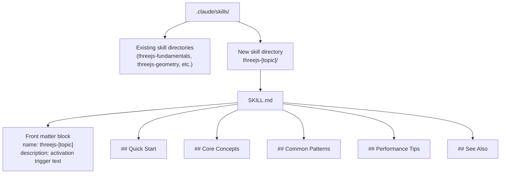

The `name` field in the front matter must match the directory name exactly. The `description` field is what Claude Code reads to decide whether to load the skill — it must accurately describe the Three.js topic covered so it activates for the right user requests. See [Skill Activation System](#1.2) for detail on how this field is used.

Sources: [README.md:79-109]()

---

## Summary: Pre-submission Checklist

Before opening a pull request, confirm all of the following:

- [ ] All class names verified against Three.js r160+ docs
- [ ] All constructor signatures match the current API
- [ ] All property and method names are current (not renamed/removed)
- [ ] All addon imports use `three/addons/` format
- [ ] All code examples are syntactically valid and runnable
- [ ] The `description` front matter field accurately reflects when the skill should activate
- [ ] The `name` field matches the containing directory name
- [ ] All five required sections are present (`Quick Start`, `Core Concepts`, `Common Patterns`, `Performance Tips`, `See Also`)
- [ ] Performance implications of documented patterns are noted
- [ ] Related skills are cross-referenced in `See Also`

Sources: [README.md:112-136]()

---

# Page: Skills Reference

# Skills Reference

<details>
<summary>Relevant source files</summary>

The following files were used as context for generating this wiki page:

- [README.md](README.md)
- [skills/threejs-animation/SKILL.md](skills/threejs-animation/SKILL.md)
- [skills/threejs-fundamentals/SKILL.md](skills/threejs-fundamentals/SKILL.md)
- [skills/threejs-geometry/SKILL.md](skills/threejs-geometry/SKILL.md)
- [skills/threejs-interaction/SKILL.md](skills/threejs-interaction/SKILL.md)
- [skills/threejs-lighting/SKILL.md](skills/threejs-lighting/SKILL.md)
- [skills/threejs-loaders/SKILL.md](skills/threejs-loaders/SKILL.md)
- [skills/threejs-materials/SKILL.md](skills/threejs-materials/SKILL.md)
- [skills/threejs-postprocessing/SKILL.md](skills/threejs-postprocessing/SKILL.md)
- [skills/threejs-shaders/SKILL.md](skills/threejs-shaders/SKILL.md)
- [skills/threejs-textures/SKILL.md](skills/threejs-textures/SKILL.md)

</details>


This page is an index of all ten skill files in the `.claude/skills/` directory. Each entry lists the skill's `name` field (used as its identifier), the scope of Three.js APIs it covers, and the types of user requests that cause Claude Code to load it.

For background on how the skill activation system works, see [Skill Activation System](#1.2). For the internal structure every skill file follows, see [Skill File Format](#1.3). For setup instructions, see [Getting Started](#1.1).

---

## Skill Inventory

The table below maps each skill file to its activation trigger (from the `description` front matter field), the primary Three.js classes it documents, and the subdirectory it lives in.

| Skill Name | File Path | Activation Trigger Keywords | Primary API Coverage |
|---|---|---|---|
| `threejs-fundamentals` | `.claude/skills/threejs-fundamentals/SKILL.md` | scene setup, cameras, renderer, Object3D hierarchy, transforms | `Scene`, `PerspectiveCamera`, `OrthographicCamera`, `WebGLRenderer`, `Object3D`, `Group`, `Mesh`, `Clock`, `LoadingManager`, math utilities |
| `threejs-geometry` | `.claude/skills/threejs-geometry/SKILL.md` | 3D shapes, vertices, custom meshes, instanced rendering | `BoxGeometry`, `SphereGeometry`, `BufferGeometry`, `BufferAttribute`, `InstancedMesh`, `InstancedBufferGeometry`, `Points`, `Line` |
| `threejs-materials` | `.claude/skills/threejs-materials/SKILL.md` | styling meshes, textures, custom shaders, material performance | `MeshBasicMaterial`, `MeshStandardMaterial`, `MeshPhysicalMaterial`, `ShaderMaterial`, `RawShaderMaterial`, `PointsMaterial` |
| `threejs-lighting` | `.claude/skills/threejs-lighting/SKILL.md` | lights, shadows, IBL, environment lighting | `AmbientLight`, `DirectionalLight`, `PointLight`, `SpotLight`, `RectAreaLight`, `HemisphereLight`, `PMREMGenerator`, `LightProbe` |
| `threejs-textures` | `.claude/skills/threejs-textures/SKILL.md` | images, UV coordinates, cubemaps, HDR environments, texture optimization | `TextureLoader`, `DataTexture`, `CanvasTexture`, `VideoTexture`, `CubeTextureLoader`, `WebGLRenderTarget`, `CubeCamera`, `KTX2Loader` |
| `threejs-animation` | `.claude/skills/threejs-animation/SKILL.md` | animating objects, GLTF animations, procedural motion, blending | `AnimationClip`, `AnimationMixer`, `AnimationAction`, `KeyframeTrack` subtypes, `AnimationUtils`, `SkeletonHelper` |
| `threejs-loaders` | `.claude/skills/threejs-loaders/SKILL.md` | 3D models, loading progress, HDR environments, asset management | `GLTFLoader`, `DRACOLoader`, `KTX2Loader`, `RGBELoader`, `EXRLoader`, `OBJLoader`, `FBXLoader`, `STLLoader`, `PLYLoader`, `THREE.Cache` |
| `threejs-shaders` | `.claude/skills/threejs-shaders/SKILL.md` | custom visual effects, vertex modification, fragment shaders, extending materials | `ShaderMaterial`, `RawShaderMaterial`, GLSL uniforms/varyings/attributes, `onBeforeCompile`, `ShaderChunk` |
| `threejs-postprocessing` | `.claude/skills/threejs-postprocessing/SKILL.md` | visual effects, color grading, blur, glow, screen-space shaders | `EffectComposer`, `RenderPass`, `UnrealBloomPass`, `ShaderPass`, `SSAOPass`, `BokehPass`, `SMAAPass`, `OutlinePass` |
| `threejs-interaction` | `.claude/skills/threejs-interaction/SKILL.md` | user input, click detection, camera controls, interactive 3D | `Raycaster`, `OrbitControls`, `TransformControls`, `DragControls`, `PointerLockControls`, `SelectionBox` |

Sources: [README.md:30-41](), [skills/threejs-fundamentals/SKILL.md:1-4](), [skills/threejs-geometry/SKILL.md:1-4](), [skills/threejs-materials/SKILL.md:1-4](), [skills/threejs-lighting/SKILL.md:1-4](), [skills/threejs-textures/SKILL.md:1-4](), [skills/threejs-animation/SKILL.md:1-4](), [skills/threejs-loaders/SKILL.md:1-4](), [skills/threejs-shaders/SKILL.md:1-4](), [skills/threejs-postprocessing/SKILL.md:1-4](), [skills/threejs-interaction/SKILL.md:1-4]()

---

## Skill Groups

Skills are organized into three functional groups based on which layer of a Three.js application they address.

**Skill Group Map**

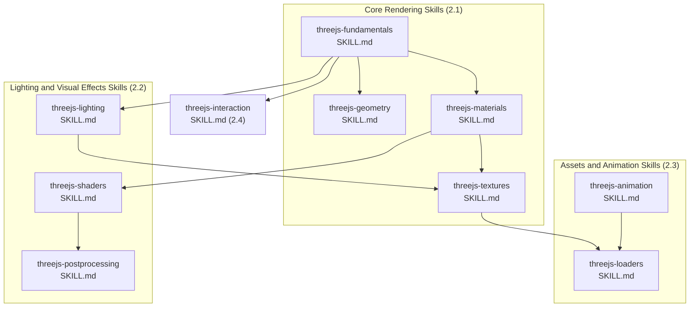

Sources: [README.md:43-51]()

---

## Activation Trigger Map

The `description` field of each skill's YAML front matter determines when Claude Code loads the skill. The diagram below maps natural language request phrases to the specific `name` and file that gets loaded.

**Request Phrase to Skill File Routing**

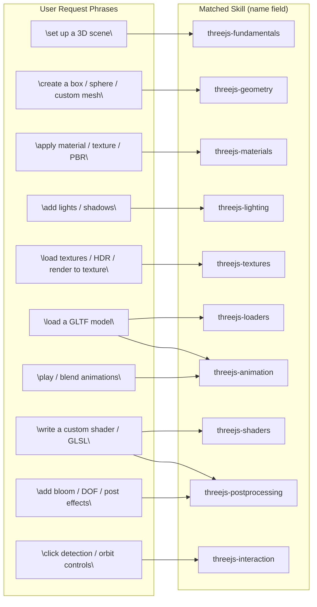

Sources: [README.md:43-51](), [skills/threejs-loaders/SKILL.md:1-4](), [skills/threejs-animation/SKILL.md:1-4](), [skills/threejs-shaders/SKILL.md:1-4](), [skills/threejs-postprocessing/SKILL.md:1-4]()

---

## Multi-Skill Co-Loading

Some requests activate more than one skill simultaneously. Claude Code reads all matching `description` fields and loads every relevant file.

| Request Example | Skills Loaded |
|---|---|
| `"Load a GLTF model with Draco compression and play its animations"` | `threejs-loaders` + `threejs-animation` |
| `"Create a custom shader material with a fresnel effect"` | `threejs-shaders` |
| `"Add bloom and custom screen-space effects"` | `threejs-shaders` + `threejs-postprocessing` |
| `"Click on a 3D object and animate it"` | `threejs-interaction` + `threejs-animation` |
| `"Set up PBR materials with an HDR environment"` | `threejs-materials` + `threejs-textures` + `threejs-lighting` |

Sources: [README.md:43-77]()

---

## Key Class-to-Skill Index

The table below maps commonly used Three.js classes to the skill file that documents them, for quick lookup.

| Class / Symbol | Skill File |
|---|---|
| `THREE.Scene`, `PerspectiveCamera`, `WebGLRenderer`, `Object3D`, `Clock` | `threejs-fundamentals` |
| `BoxGeometry`, `SphereGeometry`, `BufferGeometry`, `BufferAttribute`, `InstancedMesh` | `threejs-geometry` |
| `MeshStandardMaterial`, `MeshPhysicalMaterial`, `ShaderMaterial`, `RawShaderMaterial` | `threejs-materials` |
| `DirectionalLight`, `SpotLight`, `PointLight`, `RectAreaLight`, `PMREMGenerator` | `threejs-lighting` |
| `TextureLoader`, `DataTexture`, `CanvasTexture`, `WebGLRenderTarget`, `CubeCamera` | `threejs-textures` |
| `AnimationClip`, `AnimationMixer`, `AnimationAction`, `KeyframeTrack` | `threejs-animation` |
| `GLTFLoader`, `DRACOLoader`, `KTX2Loader`, `RGBELoader`, `THREE.Cache` | `threejs-loaders` |
| `onBeforeCompile`, `ShaderChunk`, GLSL uniforms/varyings | `threejs-shaders` |
| `EffectComposer`, `RenderPass`, `UnrealBloomPass`, `ShaderPass`, `SSAOPass` | `threejs-postprocessing` |
| `Raycaster`, `OrbitControls`, `TransformControls`, `DragControls`, `SelectionBox` | `threejs-interaction` |

Sources: [skills/threejs-fundamentals/SKILL.md:58-213](), [skills/threejs-geometry/SKILL.md:24-455](), [skills/threejs-materials/SKILL.md:25-421](), [skills/threejs-lighting/SKILL.md:22-297](), [skills/threejs-textures/SKILL.md:22-622](), [skills/threejs-animation/SKILL.md:29-435](), [skills/threejs-loaders/SKILL.md:26-617](), [skills/threejs-shaders/SKILL.md:36-638](), [skills/threejs-postprocessing/SKILL.md:39-596](), [skills/threejs-interaction/SKILL.md:37-634]()

---

## Skill Dependency Graph

This diagram shows the import relationships between skills as they manifest in actual Three.js code — following how classes from one skill are consumed as inputs to classes in another.

**Runtime Object Dependencies Across Skills**

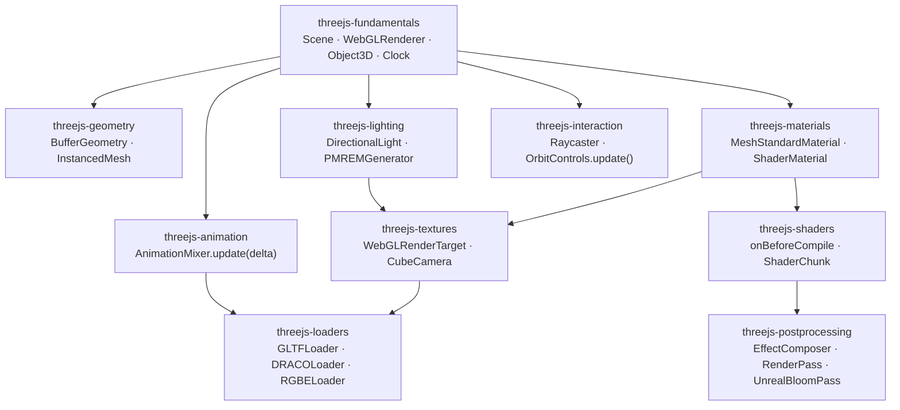

Sources: [skills/threejs-fundamentals/SKILL.md:484-488](), [skills/threejs-geometry/SKILL.md:544-547](), [skills/threejs-materials/SKILL.md:515-519](), [skills/threejs-lighting/SKILL.md:476-481](), [skills/threejs-textures/SKILL.md:623-628](), [skills/threejs-animation/SKILL.md:548-552](), [skills/threejs-loaders/SKILL.md:619-623](), [skills/threejs-shaders/SKILL.md:639-642](), [skills/threejs-postprocessing/SKILL.md:599-602](), [skills/threejs-interaction/SKILL.md:657-660]()

---

## Per-Skill Summaries

### threejs-fundamentals

**Scope:** The entry point for any Three.js application. Documents the scene graph root (`THREE.Scene`), both camera types (`PerspectiveCamera`, `OrthographicCamera`), renderer configuration (`WebGLRenderer`), the `Object3D` base class and its transform/hierarchy API, `Group`, `Mesh`, mathematical types (`Vector3`, `Matrix4`, `Quaternion`, `Euler`, `Color`, `MathUtils`), `Clock`, and `LoadingManager`.

**Detailed documentation:** see [threejs-fundamentals](#2.1.1).

Sources: [skills/threejs-fundamentals/SKILL.md:1-488]()

---

### threejs-geometry

**Scope:** All built-in geometry constructors (`BoxGeometry`, `SphereGeometry`, `CylinderGeometry`, `TorusGeometry`, etc.), path-based geometries (`LatheGeometry`, `ExtrudeGeometry`, `TubeGeometry`), `TextGeometry`, the `BufferGeometry` + `BufferAttribute` API for custom meshes, `InstancedMesh` and `InstancedBufferGeometry` for batched rendering, line/point primitives, and `BufferGeometryUtils`.

**Detailed documentation:** see [threejs-geometry](#2.1.2).

Sources: [skills/threejs-geometry/SKILL.md:1-543]()

---

### threejs-materials

**Scope:** All material types from `MeshBasicMaterial` through `MeshPhysicalMaterial`, `ShaderMaterial` and `RawShaderMaterial`, base material properties (transparency, blending, depth, stencil, side), PBR concepts (roughness, metalness, emissive), environment map integration, and the `needsUpdate` flag.

**Detailed documentation:** see [threejs-materials](#2.1.3).

Sources: [skills/threejs-materials/SKILL.md:1-519]()

---

### threejs-lighting

**Scope:** All light types with constructors and properties, shadow map configuration (`shadowMap.type`, `mapSize`, camera frustum, bias), `castShadow`/`receiveShadow` on meshes and renderer, IBL via `RGBELoader` + `PMREMGenerator`, `CubeTextureLoader` for cube map environments, light helpers, and `LightProbe`.

**Detailed documentation:** see [threejs-lighting](#2.2.1).

Sources: [skills/threejs-lighting/SKILL.md:1-481]()

---

### threejs-textures

**Scope:** `TextureLoader`, `DataTexture`, `CanvasTexture`, `VideoTexture`, KTX2 compressed textures, `CubeTextureLoader`, `RGBELoader`, `EXRLoader`, all texture configuration properties (`colorSpace`, `wrapS`/`wrapT`, `repeat`, `offset`, `rotation`, filtering, anisotropy, mipmaps), `WebGLRenderTarget` and depth textures, `CubeCamera` for dynamic reflections, PBR texture map slots, and texture disposal patterns.

**Detailed documentation:** see [threejs-textures](#2.1.4).

Sources: [skills/threejs-textures/SKILL.md:1-628]()

---

### threejs-animation

**Scope:** `AnimationClip` as a container for `KeyframeTrack` arrays, all `KeyframeTrack` subtypes (`NumberKeyframeTrack`, `VectorKeyframeTrack`, `QuaternionKeyframeTrack`, `ColorKeyframeTrack`, `BooleanKeyframeTrack`, `StringKeyframeTrack`) and their property path syntax, interpolation modes, `AnimationMixer` and its `update(delta)` requirement, `AnimationAction` playback controls, loop modes, weight-based blending, `fadeIn`/`fadeOut`/`crossFadeTo`, mixer events, and `AnimationUtils`.

**Detailed documentation:** see [threejs-animation](#2.3.2).

Sources: [skills/threejs-animation/SKILL.md:1-552]()

---

### threejs-loaders

**Scope:** `GLTFLoader` with its full output object (`scene`, `animations`, `cameras`, `asset`), `DRACOLoader` and `KTX2Loader` as `GLTFLoader` plugins, `TextureLoader`, `CubeTextureLoader`, `RGBELoader`, `EXRLoader`, `OBJLoader` + `MTLLoader`, `FBXLoader`, `STLLoader`, `PLYLoader`, `LoadingManager` callback lifecycle, `PMREMGenerator` for HDR environment maps, Promise-based async loading patterns, `THREE.Cache`, and a custom `AssetManager` pattern.

**Detailed documentation:** see [threejs-loaders](#2.3.1).

Sources: [skills/threejs-loaders/SKILL.md:1-623]()

---

### threejs-shaders

**Scope:** `ShaderMaterial` vs `RawShaderMaterial`, defining and updating uniforms, attribute and varying declarations, vertex and fragment shader structure, the `onBeforeCompile` callback for extending built-in materials, `ShaderChunk` reuse, instanced shader attributes, and common GLSL patterns (texture sampling, vertex displacement, Fresnel, noise, rim lighting, dissolve).

**Detailed documentation:** see [threejs-shaders](#2.2.2).

Sources: [skills/threejs-shaders/SKILL.md:1-642]()

---

### threejs-postprocessing

**Scope:** `EffectComposer` setup and the `addPass`/`render`/`setSize` API, `RenderPass` as the required first pass, all built-in pass types (`UnrealBloomPass`, `ShaderPass`, `SMAAPass`, `SSAOPass`, `BokehPass`, `FilmPass`, `OutlinePass`, `GlitchPass`, `HalftonePass`, `RenderPixelatedPass`), selective bloom technique, custom `ShaderPass` definition, multi-pass rendering with `WebGLRenderTarget`, and the WebGPU node-based post-processing path.

**Detailed documentation:** see [threejs-postprocessing](#2.2.3).

Sources: [skills/threejs-postprocessing/SKILL.md:1-596]()

---

### threejs-interaction

**Scope:** `Raycaster` setup and `setFromCamera`/`intersectObjects` API, mouse and touch coordinate normalization, raycaster configuration (`near`, `far`, `params` thresholds, layers), `OrbitControls` with all configuration properties, `FlyControls`, `FirstPersonControls`, `PointerLockControls`, `TrackballControls`, `MapControls`, `TransformControls` `attach`/`detach` and mode/space/size settings, `DragControls` with its drag lifecycle events, and the `SelectionBox`/`SelectionHelper` box-selection system.

**Detailed documentation:** see [threejs-interaction](#2.4).

Sources: [skills/threejs-interaction/SKILL.md:1-660]()

---

# Page: Core Rendering Skills

# Core Rendering Skills

<details>
<summary>Relevant source files</summary>

The following files were used as context for generating this wiki page:

- [skills/threejs-fundamentals/SKILL.md](skills/threejs-fundamentals/SKILL.md)
- [skills/threejs-geometry/SKILL.md](skills/threejs-geometry/SKILL.md)
- [skills/threejs-materials/SKILL.md](skills/threejs-materials/SKILL.md)
- [skills/threejs-textures/SKILL.md](skills/threejs-textures/SKILL.md)

</details>


This page introduces the four skill files that form the foundational layer of any Three.js application: scene setup (`threejs-fundamentals`), geometry construction (`threejs-geometry`), material definition (`threejs-materials`), and texture management (`threejs-textures`). Together, these skills cover everything needed to put a visible, correctly-shaded, textured mesh on screen.

This page describes the scope and inter-relationships of these four skills. For lighting, shaders, and post-processing built on top of this layer, see [Lighting and Visual Effects Skills](#2.2). For asset loading and animation, see [Assets and Animation Skills](#2.3).

---

## The Four Core Skills

| Skill File | Skill Name | Primary Responsibility |
|---|---|---|
| [skills/threejs-fundamentals/SKILL.md]() | `threejs-fundamentals` | Scene graph, cameras, renderer, `Object3D` hierarchy, math utilities |
| [skills/threejs-geometry/SKILL.md]() | `threejs-geometry` | Geometry constructors, `BufferGeometry`, instancing, points and lines |
| [skills/threejs-materials/SKILL.md]() | `threejs-materials` | Material types from `MeshBasicMaterial` to `MeshPhysicalMaterial`, `ShaderMaterial` |
| [skills/threejs-textures/SKILL.md]() | `threejs-textures` | Texture loading, UV configuration, render targets, HDR environments |

Sources: [skills/threejs-fundamentals/SKILL.md:1-4](), [skills/threejs-geometry/SKILL.md:1-4](), [skills/threejs-materials/SKILL.md:1-4](), [skills/threejs-textures/SKILL.md:1-4]()

---

## Dependency Relationships

`threejs-fundamentals` is the root skill. The other three each build directly on it, and `threejs-textures` is consumed by `threejs-materials` to complete the PBR texture pipeline.

**Diagram: Core Rendering Skill Dependencies**

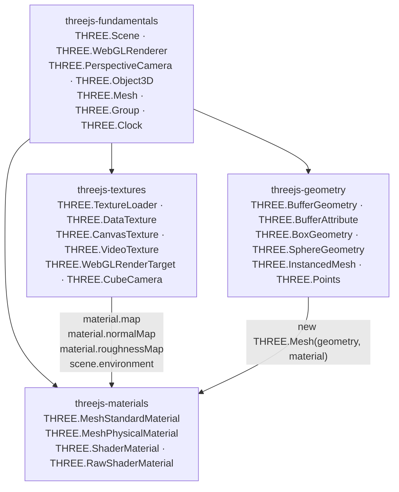

Sources: [skills/threejs-fundamentals/SKILL.md:484-488](), [skills/threejs-geometry/SKILL.md:544-548](), [skills/threejs-materials/SKILL.md:516-520](), [skills/threejs-textures/SKILL.md:624-628]()

---

## Skill Activation Triggers

Each skill file's `description` front matter field determines when Claude Code loads it. The following maps common request phrases to the skill(s) they activate.

| User Request Phrase | Activated Skill(s) |
|---|---|
| "set up a 3D scene", "create a camera", "configure the renderer" | `threejs-fundamentals` |
| "create a box / sphere / custom mesh", "use instanced rendering" | `threejs-geometry` |
| "make it look metallic / glassy", "use PBR material", "add transparency" | `threejs-materials` |
| "apply a texture", "use an HDR environment", "render to texture" | `threejs-textures` |
| "create a realistic 3D scene with textures" | all four skills |

Sources: [skills/threejs-fundamentals/SKILL.md:2-3](), [skills/threejs-geometry/SKILL.md:2-3](), [skills/threejs-materials/SKILL.md:2-3](), [skills/threejs-textures/SKILL.md:2-3]()

---

## Runtime Object Graph

The following diagram shows how the primary classes from all four skills combine at runtime to produce a renderable mesh.

**Diagram: Core Rendering Runtime Object Assembly**

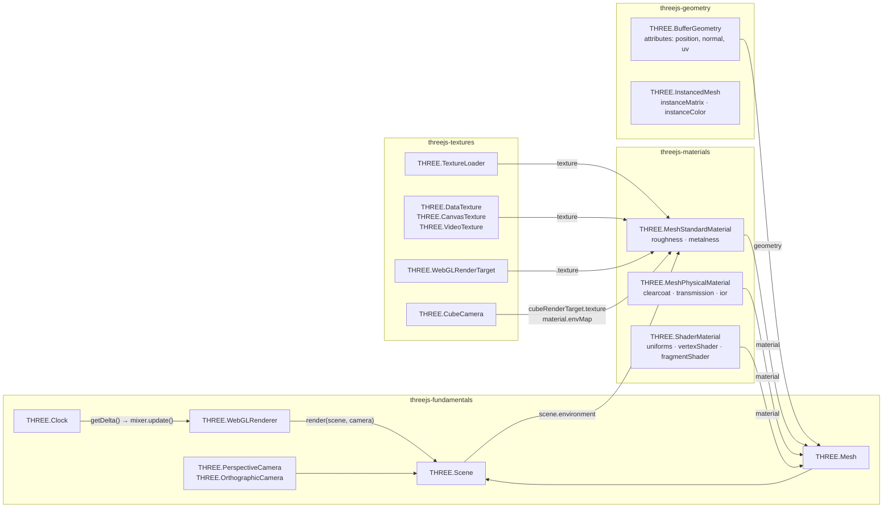

Sources: [skills/threejs-fundamentals/SKILL.md:231-251](), [skills/threejs-geometry/SKILL.md:153-215](), [skills/threejs-materials/SKILL.md:99-134](), [skills/threejs-textures/SKILL.md:292-357]()

---

## How the Skills Compose

In practice the four skills are used together when building any non-trivial scene. The following describes the typical assembly order.

### 1. Scene and Renderer (`threejs-fundamentals`)

Every Three.js application starts with a `THREE.Scene`, a camera (`THREE.PerspectiveCamera` or `THREE.OrthographicCamera`), and a `THREE.WebGLRenderer`. The renderer's `outputColorSpace`, `toneMapping`, and `shadowMap` settings affect how all downstream materials and textures appear.

See [threejs-fundamentals](#2.1.1) for the full API.

### 2. Geometry (`threejs-geometry`)

Geometry provides the vertex data (`position`, `normal`, `uv`, optional `color`) consumed by the material. Built-in constructors like `THREE.BoxGeometry` or `THREE.SphereGeometry` are the fastest starting point. `THREE.BufferGeometry` with manual `THREE.BufferAttribute` arrays is used for custom shapes. `THREE.InstancedMesh` replaces many individual meshes with a single draw call when the same geometry is repeated.

The geometry is connected to a material via `new THREE.Mesh(geometry, material)`, which is then added to the scene.

See [threejs-geometry](#2.1.2) for the full API.

### 3. Materials (`threejs-materials`)

Materials control how the renderer shades each fragment. The hierarchy from least to most expensive is:

```
MeshBasicMaterial → MeshLambertMaterial → MeshPhongMaterial
  → MeshStandardMaterial → MeshPhysicalMaterial
```

`MeshStandardMaterial` is the recommended default for realistic results, using `roughness` and `metalness` to model PBR surfaces. `MeshPhysicalMaterial` extends it with clearcoat, transmission (glass), sheen (fabric), and iridescence. `ShaderMaterial` and `RawShaderMaterial` accept arbitrary GLSL.

After the material type is chosen, texture slots on the material (e.g., `material.map`, `material.normalMap`, `material.roughnessMap`) are filled by the textures skill.

See [threejs-materials](#2.1.3) for the full API.

### 4. Textures (`threejs-textures`)

Textures are loaded via `THREE.TextureLoader` and assigned to material slots. Correct configuration of `colorSpace`, `wrapS`/`wrapT`, `repeat`, and `anisotropy` is necessary for accurate rendering. HDR environment maps loaded via `RGBELoader` and processed through `THREE.PMREMGenerator` are assigned to `scene.environment` to drive PBR reflections across all materials. `THREE.WebGLRenderTarget` enables render-to-texture for mirrors, previews, and post-processing inputs.

See [threejs-textures](#2.1.4) for the full API.

---

## Shared Conventions Across All Four Skills

**Diagram: Cross-Skill Conventions**

```mermaid
flowchart TD
    subgraph imports ["Import Convention"]
        IMP["import * as THREE from 'three'\nimport addons from 'three/examples/jsm/...'"]
    end

    subgraph colorspace ["Color Space Convention"]
        CS1["Color / albedo textures\ntexture.colorSpace = THREE.SRGBColorSpace"]
        CS2["Data textures (normal, roughness, AO)\nleave at default NoColorSpace"]
        CS3["Renderer output\nrenderer.outputColorSpace = THREE.SRGBColorSpace"]
    end

    subgraph disposal ["Disposal Pattern"]
        D1["geometry.dispose()"]
        D2["material.dispose()"]
        D3["texture.dispose()"]
        D4["renderTarget.dispose()"]
        D5["renderer.dispose()"]
    end

    subgraph needsUpdate ["needsUpdate Flags"]
        NU1["bufferAttribute.needsUpdate = true\n(after modifying vertex data)"]
        NU2["texture.needsUpdate = true\n(after manual data change)"]
        NU3["material.needsUpdate = true\n(after structural property change)"]
        NU4["instancedMesh.instanceMatrix.needsUpdate = true"]
    end
```

Sources: [skills/threejs-fundamentals/SKILL.md:392-415](), [skills/threejs-geometry/SKILL.md:240-258](), [skills/threejs-materials/SKILL.md:476-491](), [skills/threejs-textures/SKILL.md:62-70]()

The three most important shared conventions are:

- **Imports**: All core classes come from the `three` package; addon loaders and utilities (e.g., `KTX2Loader`, `FontLoader`, `BufferGeometryUtils`) come from `three/examples/jsm/`.
- **Color space**: Color/albedo textures must have `colorSpace = THREE.SRGBColorSpace` set after loading; data textures (normal maps, roughness maps, AO maps) must not. The renderer itself should have `outputColorSpace = THREE.SRGBColorSpace`.
- **Disposal**: GPU resources (`BufferGeometry`, `Material`, `Texture`, `WebGLRenderTarget`, `WebGLRenderer`) all expose a `.dispose()` method that must be called when an object is removed to free VRAM.

---

## Skill Detail Pages

| Page | Skill | Key Classes |
|---|---|---|
| [threejs-fundamentals](#2.1.1) | `threejs-fundamentals` | `Scene`, `PerspectiveCamera`, `OrthographicCamera`, `WebGLRenderer`, `Object3D`, `Group`, `Mesh`, `Vector3`, `Matrix4`, `Quaternion`, `Euler`, `Color`, `MathUtils`, `Clock`, `LoadingManager` |
| [threejs-geometry](#2.1.2) | `threejs-geometry` | `BufferGeometry`, `BufferAttribute`, `BoxGeometry`, `SphereGeometry`, `PlaneGeometry`, `InstancedMesh`, `InstancedBufferGeometry`, `Points`, `Line`, `EdgesGeometry` |
| [threejs-materials](#2.1.3) | `threejs-materials` | `MeshBasicMaterial`, `MeshLambertMaterial`, `MeshPhongMaterial`, `MeshStandardMaterial`, `MeshPhysicalMaterial`, `MeshToonMaterial`, `ShaderMaterial`, `RawShaderMaterial` |
| [threejs-textures](#2.1.4) | `threejs-textures` | `TextureLoader`, `DataTexture`, `CanvasTexture`, `VideoTexture`, `KTX2Loader`, `CubeTextureLoader`, `RGBELoader`, `EXRLoader`, `WebGLRenderTarget`, `CubeCamera`, `PMREMGenerator` |

---

# Page: threejs-fundamentals

# threejs-fundamentals

<details>
<summary>Relevant source files</summary>

The following files were used as context for generating this wiki page:

- [skills/threejs-fundamentals/SKILL.md](skills/threejs-fundamentals/SKILL.md)

</details>


This page documents the `threejs-fundamentals` skill file ([skills/threejs-fundamentals/SKILL.md]()). It covers the foundational classes required to construct and render any Three.js scene: the `Scene` graph, camera types, `WebGLRenderer` configuration, the `Object3D` transform/hierarchy API, `Mesh`, `Group`, mathematical utility classes (`Vector3`, `Matrix4`, `Quaternion`, `Euler`, `Color`, `MathUtils`), `Clock`, and `LoadingManager`.

This skill file does **not** cover geometry construction (see [2.1.2](#2.1.2)), material configuration (see [2.1.3](#2.1.3)), textures (see [2.1.4](#2.1.4)), or lighting (see [2.2.1](#2.2.1)), though the Quick Start example in the skill file uses basic instances of those classes for completeness.

---

## Skill Activation

The `description` front matter field in [skills/threejs-fundamentals/SKILL.md:2-4]() reads:

> Three.js scene setup, cameras, renderer, Object3D hierarchy, coordinate systems. Use when setting up 3D scenes, creating cameras, configuring renderers, managing object hierarchies, or working with transforms.

Claude Code loads this skill when a request involves phrases like *"set up a 3D scene"*, *"configure a renderer"*, *"manage object hierarchies"*, or *"work with transforms"*. See [1.2](#1.2) for how the activation system works.

---

## Scene Graph Architecture

**Diagram: Three.js Scene Graph — class hierarchy and ownership**

```mermaid
flowchart TD
    O3D["Object3D\n(base class)"]
    SC["THREE.Scene\nextends Object3D"]
    CAM["Camera\nextends Object3D"]
    PCAM["PerspectiveCamera\nextends Camera"]
    OCAM["OrthographicCamera\nextends Camera"]
    ACAM["ArrayCamera\nextends PerspectiveCamera"]
    CCAM["CubeCamera\nextends Object3D"]
    GRP["THREE.Group\nextends Object3D"]
    MESH["THREE.Mesh\nextends Object3D"]
    LIGHT["THREE.Light\nextends Object3D"]
    WR["THREE.WebGLRenderer\n(not Object3D)"]

    O3D --> SC
    O3D --> CAM
    O3D --> GRP
    O3D --> MESH
    O3D --> LIGHT
    O3D --> CCAM
    CAM --> PCAM
    CAM --> OCAM
    PCAM --> ACAM

    SC -->|"scene.add()"| GRP
    SC -->|"scene.add()"| MESH
    SC -->|"scene.add()"| LIGHT
    GRP -->|"group.add()"| MESH
    WR -->|"renderer.render(scene, camera)"| SC
```

Sources: [skills/threejs-fundamentals/SKILL.md:60-251]()

---

## THREE.Scene

`THREE.Scene` is the root container for all renderable objects. It extends `Object3D`.

| Property | Type | Description |
|---|---|---|
| `scene.background` | `Color \| Texture \| CubeTexture` | Rendered behind all objects. Set to `null` to clear. |
| `scene.environment` | `Texture` | Applied as environment map to PBR materials that have `envMap = null`. |
| `scene.fog` | `Fog \| FogExp2` | Applies distance-based fog to all materials. |
| `scene.overrideMaterial` | `Material` | Forces all meshes in the scene to use a single material. |

**Fog constructors:**

| Class | Constructor | Behaviour |
|---|---|---|
| `THREE.Fog` | `new THREE.Fog(color, near, far)` | Linear falloff between `near` and `far` distances. |
| `THREE.FogExp2` | `new THREE.FogExp2(color, density)` | Exponential falloff. `density` ≈ `0.02` is a typical value. |

Sources: [skills/threejs-fundamentals/SKILL.md:60-72]()

---

## Cameras

**Diagram: Camera types and key constructor parameters**

```mermaid
flowchart LR
    subgraph "PerspectiveCamera"
        PC["new THREE.PerspectiveCamera\n(fov, aspect, near, far)"]
        PCN["fov: 75 degrees\naspect: width/height\nnear: 0.1\nfar: 1000"]
        PC --- PCN
    end
    subgraph "OrthographicCamera"
        OC["new THREE.OrthographicCamera\n(left, right, top, bottom, near, far)"]
        OCN["left/right/top/bottom\nderived from frustumSize * aspect\nnear: 0.1, far: 1000"]
        OC --- OCN
    end
    subgraph "ArrayCamera"
        AC["new THREE.ArrayCamera\n(cameras[])"]
        ACN["Array of PerspectiveCamera\neach with .viewport: Vector4"]
        AC --- ACN
    end
    subgraph "CubeCamera"
        CC["new THREE.CubeCamera\n(near, far, renderTarget)"]
        CCN["renderTarget: WebGLCubeRenderTarget\ncubeCamera.update(renderer, scene)"]
        CC --- CCN
    end
```

Sources: [skills/threejs-fundamentals/SKILL.md:74-138]()

### PerspectiveCamera

Defined at [skills/threejs-fundamentals/SKILL.md:76-90]().

- Constructor: `new THREE.PerspectiveCamera(fov, aspect, near, far)`
- `fov`: Vertical field of view in **degrees**.
- `aspect`: Typically `window.innerWidth / window.innerHeight`.
- `near` / `far`: Clipping planes. Objects outside this range are not rendered.
- After modifying `fov`, `aspect`, `near`, or `far`, call `camera.updateProjectionMatrix()`.

### OrthographicCamera

Defined at [skills/threejs-fundamentals/SKILL.md:92-106]().

- Constructor: `new THREE.OrthographicCamera(left, right, top, bottom, near, far)`
- The six frustum planes are specified directly. The standard pattern computes them from a `frustumSize` and `aspect` ratio to keep the viewport proportional.
- No depth distortion — parallel lines remain parallel. Useful for 2D, isometric, and technical views.

### ArrayCamera

Defined at [skills/threejs-fundamentals/SKILL.md:108-123]().

- Constructor: `new THREE.ArrayCamera(cameras: PerspectiveCamera[])`
- Each sub-camera requires a `.viewport` property of type `THREE.Vector4` specifying normalized viewport coordinates `(x, y, width, height)`.

### CubeCamera

Defined at [skills/threejs-fundamentals/SKILL.md:125-138]().

- Constructor: `new THREE.CubeCamera(near, far, renderTarget: WebGLCubeRenderTarget)`
- Renders the scene from six directions to populate a `WebGLCubeRenderTarget`.
- The resulting `renderTarget.texture` can be assigned to `material.envMap` for real-time reflections.
- Call `cubeCamera.update(renderer, scene)` each frame. This is expensive; avoid for static scenes.

---

## WebGLRenderer

The renderer is constructed with an options object and attached to the DOM via `renderer.domElement`.

### Constructor Options

| Option | Type | Default | Notes |
|---|---|---|---|
| `canvas` | `HTMLCanvasElement` | (new element) | Attach to an existing `<canvas>` element. |
| `antialias` | `boolean` | `false` | MSAA. Has GPU cost; use SMAA post-pass as alternative. |
| `alpha` | `boolean` | `false` | Transparent background. |
| `powerPreference` | `string` | `"default"` | `"high-performance"` or `"low-power"`. |
| `preserveDrawingBuffer` | `boolean` | `false` | Required to use `renderer.domElement.toDataURL()`. |

### Key Configuration Properties

| Property | Typical Value | Notes |
|---|---|---|
| `renderer.setSize(w, h)` | viewport dimensions | Must be called on init and resize. |
| `renderer.setPixelRatio(ratio)` | `Math.min(devicePixelRatio, 2)` | Cap at 2 to avoid GPU overload on high-DPI displays. |
| `renderer.toneMapping` | `THREE.ACESFilmicToneMapping` | Controls HDR → LDR mapping. |
| `renderer.toneMappingExposure` | `1.0` | Multiplier applied before tone mapping. |
| `renderer.outputColorSpace` | `THREE.SRGBColorSpace` | Required since r152 for correct gamma output. |
| `renderer.shadowMap.enabled` | `true` | Must be enabled before shadows appear. |
| `renderer.shadowMap.type` | `THREE.PCFSoftShadowMap` | Also: `BasicShadowMap`, `PCFShadowMap`, `VSMShadowMap`. |
| `renderer.setClearColor(color, alpha)` | `0x000000, 1` | Background color when `scene.background` is `null`. |

Sources: [skills/threejs-fundamentals/SKILL.md:140-170]()

---

## Object3D — Transform and Hierarchy API

`Object3D` is the base class for all scene graph nodes. Its properties and methods are available on `Mesh`, `Group`, `Light`, `Camera`, and all other scene objects.

**Diagram: Object3D API grouped by responsibility**

```mermaid
mindmap
  root(("Object3D"))
    Transform
      position["position: Vector3\n.set(x,y,z)"]
      rotation["rotation: Euler\n.set(x,y,z)"]
      quaternion["quaternion: Quaternion\n.set(x,y,z,w)"]
      scale["scale: Vector3\n.set(x,y,z)"]
    WorldTransform
      getWorldPosition["getWorldPosition(target)"]
      getWorldQuaternion["getWorldQuaternion(target)"]
      getWorldDirection["getWorldDirection(target)"]
    Hierarchy
      add["add(child)"]
      remove["remove(child)"]
      parent["parent"]
      children["children[]"]
      traverse["traverse(callback)"]
    Visibility
      visible["visible: boolean"]
      layers["layers.set/enable/disable"]
      frustumCulled["frustumCulled: boolean"]
    Matrix
      matrixAutoUpdate["matrixAutoUpdate: boolean"]
      updateMatrix["updateMatrix()"]
      updateMatrixWorld["updateMatrixWorld(force)"]
```

Sources: [skills/threejs-fundamentals/SKILL.md:172-213]()

### Transform Properties

- `position`, `rotation`, `scale` are updated independently. Three.js reconciles them into `matrix` each frame when `matrixAutoUpdate = true`.
- `rotation` is a `THREE.Euler`; `quaternion` is a `THREE.Quaternion`. They are kept in sync — setting one updates the other.
- Call `obj.lookAt(x, y, z)` to orient an object toward a world-space target.

### World-Space Queries

- `getWorldPosition(targetVector)`, `getWorldQuaternion(targetQuaternion)`, `getWorldDirection(targetVector)` — write into a provided target object (avoid allocation).
- **Avoid calling these inside tight loops** — they trigger `updateMatrixWorld` up the hierarchy chain.

### Hierarchy

| Method | Description |
|---|---|
| `obj.add(child)` | Attaches `child` to `obj`. Child's transform becomes relative to parent. |
| `obj.remove(child)` | Detaches `child`. Does not dispose geometry/material. |
| `obj.traverse(fn)` | Depth-first walk of `obj` and all descendants. |
| `obj.traverseVisible(fn)` | Like `traverse`, but skips invisible branches. |
| `obj.getObjectByName(name)` | Returns first descendant with matching `.name`. |
| `obj.getObjectById(id)` | Returns first descendant with matching `.id`. |

### Layers

`obj.layers` controls which cameras render the object and which `Raycaster` calls hit it. Each object and camera maintains a bitmask of 32 layers (0–31).

- `obj.layers.set(n)` — enable only layer `n`.
- `obj.layers.enable(n)` — enable layer `n` in addition to existing.
- `obj.layers.disable(n)` — remove layer `n`.
- Camera and object must share at least one layer bit for the object to be rendered.

Sources: [skills/threejs-fundamentals/SKILL.md:196-212]()

---

## Group

`THREE.Group` is a lightweight `Object3D` with no additional properties. It serves as a logical container.

- Transforms applied to the `Group` propagate to all children.
- Removing a `Group` from the scene removes all its children from rendering.
- Useful for articulated objects, scene sections, and instanced logical units.

Sources: [skills/threejs-fundamentals/SKILL.md:215-228]()

---

## Mesh

`THREE.Mesh` pairs a `BufferGeometry` with a `Material`. It extends `Object3D`.

| Property | Type | Notes |
|---|---|---|
| `mesh.geometry` | `BufferGeometry` | See [2.1.2](#2.1.2) for geometry API. |
| `mesh.material` | `Material \| Material[]` | Array form applies one material per geometry group. See [2.1.3](#2.1.3). |
| `mesh.castShadow` | `boolean` | Must be `true` for the mesh to cast a shadow. |
| `mesh.receiveShadow` | `boolean` | Must be `true` for the mesh to receive shadow. |
| `mesh.frustumCulled` | `boolean` | Default `true`. Set `false` if bounding box is stale or the mesh is always in view. |
| `mesh.renderOrder` | `number` | Higher values render later. Useful for transparent object ordering. |

Sources: [skills/threejs-fundamentals/SKILL.md:231-251]()

---

## Coordinate System

Three.js uses a **right-handed coordinate system**:

| Axis | Direction |
|---|---|
| `+X` | Right |
| `+Y` | Up |
| `+Z` | Toward viewer (out of screen) |

Use `new THREE.AxesHelper(size)` and add it to the scene to visualize axes during development. Red = X, Green = Y, Blue = Z.

Sources: [skills/threejs-fundamentals/SKILL.md:253-265]()

---

## Math Utilities

### Vector3

The most commonly used math type. All arithmetic methods mutate the instance in place and return `this` for chaining.

**Diagram: Vector3 method categories**

```mermaid
flowchart LR
    V3["THREE.Vector3"]

    V3 --> MUTATE["In-place arithmetic\n.add(v) .sub(v)\n.multiply(v) .multiplyScalar(s)\n.divideScalar(s) .normalize()\n.negate() .clamp(min,max)\n.lerp(target, alpha)"]

    V3 --> QUERY["Scalar queries\n.length() .lengthSq()\n.distanceTo(v) .dot(v)\n.angleTo(v)"]

    V3 --> CROSS["Cross product\n.cross(v)\nmodifies receiver"]

    V3 --> XFORM["Transforms\n.applyMatrix4(m)\n.applyQuaternion(q)\n.project(camera)\n.unproject(camera)"]

    V3 --> COPY["Copy / clone\n.set(x,y,z)\n.copy(v) .clone()"]
```

- `.lengthSq()` avoids a `Math.sqrt` call — use it when only comparing magnitudes.
- `.project(camera)` converts world coordinates to Normalized Device Coordinates (NDC). `.unproject(camera)` is the inverse.

Sources: [skills/threejs-fundamentals/SKILL.md:269-301]()

### Matrix4

A 4×4 column-major matrix. Underpins all `Object3D` world transforms.

| Method | Description |
|---|---|
| `m.identity()` | Reset to identity matrix. |
| `m.makeTranslation(x,y,z)` | Build a pure translation matrix. |
| `m.makeRotationX/Y/Z(theta)` | Build a rotation around a single axis. |
| `m.makeRotationFromQuaternion(q)` | Build rotation from a `Quaternion`. |
| `m.makeScale(x,y,z)` | Build a scale matrix. |
| `m.compose(pos, quat, scale)` | Combine TRS into one matrix (same as `Object3D` does internally). |
| `m.decompose(pos, quat, scale)` | Extract TRS components from a matrix. |
| `m.multiply(m2)` | `m = m * m2` (post-multiply). |
| `m.premultiply(m2)` | `m = m2 * m` (pre-multiply). |
| `m.invert()` | In-place inversion. |
| `m.lookAt(eye, target, up)` | Build a view matrix. |

Sources: [skills/threejs-fundamentals/SKILL.md:303-333]()

### Quaternion

Used for rotation to avoid gimbal lock. Prefer quaternions over Euler when interpolating rotations.

| Method | Description |
|---|---|
| `q.setFromEuler(euler)` | Convert from `Euler` angles. |
| `q.setFromAxisAngle(axis, angle)` | Axis must be a normalized `Vector3`. |
| `q.setFromRotationMatrix(m)` | Extract rotation from a `Matrix4`. |
| `q.multiply(q2)` | Combine two rotations (`q = q * q2`). |
| `q.slerp(target, t)` | Spherical linear interpolation. `t` in `[0,1]`. |
| `q.invert()` | In-place inversion (conjugate for unit quaternions). |
| `q.normalize()` | Normalize to unit length. |

Sources: [skills/threejs-fundamentals/SKILL.md:336-347]()

### Euler

Represents rotation as three successive angles around cardinal axes. The rotation order matters and must be specified.

- Constructor: `new THREE.Euler(x, y, z, order)`
- Valid orders: `'XYZ'`, `'YXZ'`, `'ZXY'`, `'XZY'`, `'YZX'`, `'ZYX'`. Default is `'XYZ'`.
- `euler.setFromQuaternion(q)` and `euler.setFromRotationMatrix(m)` convert from other representations.

Sources: [skills/threejs-fundamentals/SKILL.md:350-357]()

### Color

| Constructor form | Example |
|---|---|
| Hex integer | `new THREE.Color(0xff0000)` |
| CSS name | `new THREE.Color("red")` |
| CSS rgb string | `new THREE.Color("rgb(255,0,0)")` |
| Hex string | `new THREE.Color("#ff0000")` |

Mutation methods: `.setHex()`, `.setRGB(r,g,b)` (0–1 range), `.setHSL(h,s,l)` (0–1 range), `.lerp(other, alpha)`, `.multiply(other)`, `.multiplyScalar(s)`.

Sources: [skills/threejs-fundamentals/SKILL.md:359-374]()

### MathUtils

Static utility namespace at `THREE.MathUtils`.

| Function | Description |
|---|---|
| `clamp(value, min, max)` | Constrain value to range. |
| `lerp(start, end, alpha)` | Linear interpolation. |
| `mapLinear(v, inMin, inMax, outMin, outMax)` | Remap a value between ranges. |
| `degToRad(degrees)` | Convert degrees to radians. |
| `radToDeg(radians)` | Convert radians to degrees. |
| `randFloat(min, max)` | Random float in range. |
| `randInt(min, max)` | Random integer in range. |
| `smoothstep(x, min, max)` | Hermite smoothstep. Returns 0–1. |
| `smootherstep(x, min, max)` | Ken Perlin's smoother variant. |

Sources: [skills/threejs-fundamentals/SKILL.md:377-388]()

---

## Clock

`THREE.Clock` provides frame-delta timing for frame-rate-independent animation.

| Method | Returns | Description |
|---|---|---|
| `clock.getDelta()` | `number` (seconds) | Time elapsed since last `getDelta()` call. |
| `clock.getElapsedTime()` | `number` (seconds) | Total running time since `Clock` was created (or last `start()`). |
| `clock.start()` | — | Manually start the clock. |
| `clock.stop()` | — | Stop the clock; `getDelta()` returns 0 while stopped. |

`getDelta()` and `getElapsedTime()` should not both be called in the same frame — `getDelta()` resets the internal baseline used by `getElapsedTime()`. Use one or the other per frame.

Sources: [skills/threejs-fundamentals/SKILL.md:417-431]()

---

## LoadingManager

`THREE.LoadingManager` coordinates multiple concurrent loaders and provides a unified lifecycle callback surface.

| Callback | Signature | Trigger |
|---|---|---|
| `onStart` | `(url, loaded, total)` | First item begins loading. |
| `onLoad` | `()` | All items have finished loading. |
| `onProgress` | `(url, loaded, total)` | Each item completes. |
| `onError` | `(url)` | An item fails to load. |

Pass the `LoadingManager` instance to loader constructors:

```
new THREE.TextureLoader(manager)
new GLTFLoader(manager)
```

See [2.3.1](#2.3.1) for more detail on loader-specific patterns and the `THREE.Cache` mechanism.

Sources: [skills/threejs-fundamentals/SKILL.md:448-461]()

---

## Common Patterns

### Responsive Canvas

The resize handler at [skills/threejs-fundamentals/SKILL.md:433-447]() is the canonical pattern for keeping the renderer and camera synchronized with the viewport:

1. Update `camera.aspect`.
2. Call `camera.updateProjectionMatrix()`.
3. Call `renderer.setSize(width, height)`.
4. Optionally re-clamp `renderer.setPixelRatio(Math.min(devicePixelRatio, 2))`.

### Proper Disposal

Three.js does not automatically reclaim GPU memory. Unused objects must be disposed explicitly. See [skills/threejs-fundamentals/SKILL.md:392-414]() for the dispose pattern covering geometry, material, textures, and the renderer itself. The pattern is:

- `mesh.geometry.dispose()`
- `mesh.material.dispose()` (or iterate array)
- `texture.dispose()`
- `renderer.dispose()`
- `scene.remove(mesh)`

Failing to dispose textures and geometries is the most common source of GPU memory leaks.

---

## Performance Tips

| Tip | Mechanism |
|---|---|
| Merge static geometries | `mergeGeometries()` from `three/examples/jsm/utils/BufferGeometryUtils.js` |
| Use `THREE.LOD` | Swap meshes based on camera distance. `.addLevel(mesh, distance)` |
| Object pooling | Reuse `Mesh` instances; update geometry/material instead of creating new objects |
| Avoid `getWorldPosition` in loops | Cache the result; it rebuilds world matrices |
| Frustum culling | Enabled by default. Ensure `geometry.boundingBox` is accurate if modified manually |
| Pixel ratio cap | `renderer.setPixelRatio(Math.min(devicePixelRatio, 2))` — prevents 3–4× overdraw on high-DPI |

`THREE.LOD` usage: construct with `new THREE.LOD()`, add detail levels with `lod.addLevel(mesh, distanceThreshold)` in ascending distance order, then add to the scene. Three.js automatically switches meshes during rendering.

Sources: [skills/threejs-fundamentals/SKILL.md:463-482]()

---

## See Also

- [2.1.2](#2.1.2) — `threejs-geometry`: `BufferGeometry`, built-in geometry constructors, `InstancedMesh`
- [2.1.3](#2.1.3) — `threejs-materials`: `MeshStandardMaterial`, `ShaderMaterial`, PBR properties
- [2.1.4](#2.1.4) — `threejs-textures`: `TextureLoader`, `WebGLRenderTarget`, texture configuration
- [2.2.1](#2.2.1) — `threejs-lighting`: light types, shadow maps, IBL
- [2.3.1](#2.3.1) — `threejs-loaders`: `GLTFLoader`, `LoadingManager` advanced usage, `THREE.Cache`
- [2.4](#2.4) — `threejs-interaction`: `Raycaster`, `OrbitControls`, `TransformControls`

---

# Page: threejs-geometry

# threejs-geometry

<details>
<summary>Relevant source files</summary>

The following files were used as context for generating this wiki page:

- [skills/threejs-geometry/SKILL.md](skills/threejs-geometry/SKILL.md)

</details>


This page documents the geometry layer of Three.js as captured in [skills/threejs-geometry/SKILL.md](). It covers every built-in geometry constructor, the `BufferGeometry` / `BufferAttribute` API for custom meshes, instancing via `InstancedMesh` and `InstancedBufferGeometry`, line and point primitives, and the `BufferGeometryUtils` helper module.

This page does not cover materials, lighting, or how meshes are placed in a scene — see [2.1.1](#2.1.1) for `Mesh`, `Object3D`, and scene graph basics, and [2.1.3](#2.1.3) for material types.

---

## Role in the Rendering Pipeline

Every visible object in a Three.js scene is a `Mesh` composed of a **geometry** and a **material**. The geometry layer is responsible for defining the raw vertex data that flows to the GPU.

**Diagram: Geometry within the Mesh Component**

```mermaid
flowchart LR
    subgraph "Scene Graph"
        S["THREE.Scene"]
        M["THREE.Mesh"]
        S --> M
    end
    subgraph "Mesh Components"
        G["BufferGeometry\n(vertex data)"]
        MAT["Material\n(rendering params)"]
        M --> G
        M --> MAT
    end
    subgraph "BufferGeometry Internals"
        PA["BufferAttribute\nposition"]
        NA["BufferAttribute\nnormal"]
        UA["BufferAttribute\nuv"]
        CA["BufferAttribute\ncolor"]
        IDX["BufferAttribute\nindex"]
        G --> PA
        G --> NA
        G --> UA
        G --> CA
        G --> IDX
    end
```

Sources: [skills/threejs-geometry/SKILL.md:153-215]()

---

## Built-in Geometry Constructors

Three.js ships with a complete set of procedural geometry factories. All of them extend `BufferGeometry` and return indexed, attributed meshes ready for rendering.

### Basic Shapes

**Diagram: Built-in Geometry Class Hierarchy**

```mermaid
flowchart TD
    BG["BufferGeometry"]
    BG --> Box["BoxGeometry\n(w, h, d, wSeg, hSeg, dSeg)"]
    BG --> Sphere["SphereGeometry\n(r, wSeg, hSeg, phiStart, phiLen, thetaStart, thetaLen)"]
    BG --> Plane["PlaneGeometry\n(w, h, wSeg, hSeg)"]
    BG --> Circle["CircleGeometry\n(r, seg, thetaStart, thetaLen)"]
    BG --> Cylinder["CylinderGeometry\n(rTop, rBot, h, rSeg, hSeg, open)"]
    BG --> Cone["ConeGeometry\n(r, h, rSeg, hSeg, open)"]
    BG --> Torus["TorusGeometry\n(r, tube, rSeg, tSeg, arc)"]
    BG --> TorusKnot["TorusKnotGeometry\n(r, tube, tSeg, rSeg, p, q)"]
    BG --> Ring["RingGeometry\n(inner, outer, thetaSeg, phiSeg)"]
    BG --> Capsule["CapsuleGeometry\n(r, len, capSeg, rSeg)"]
    BG --> Poly["PolyhedronGeometry\n(verts, indices, r, detail)"]
    Poly --> Dodeca["DodecahedronGeometry"]
    Poly --> Icosa["IcosahedronGeometry"]
    Poly --> Octa["OctahedronGeometry"]
    Poly --> Tetra["TetrahedronGeometry"]
```

Sources: [skills/threejs-geometry/SKILL.md:28-84]()

The table below documents constructor parameters for every basic shape. All classes are imported directly from the `three` package.

| Class | Required Parameters | Notable Optional Parameters |
|---|---|---|
| `BoxGeometry` | `width, height, depth` | `widthSegments, heightSegments, depthSegments` |
| `SphereGeometry` | `radius, widthSegments, heightSegments` | `phiStart, phiLength, thetaStart, thetaLength` |
| `PlaneGeometry` | `width, height` | `widthSegments, heightSegments` |
| `CircleGeometry` | `radius, segments` | `thetaStart, thetaLength` |
| `CylinderGeometry` | `radiusTop, radiusBottom, height, radialSegments` | `heightSegments, openEnded` |
| `ConeGeometry` | `radius, height, radialSegments` | `heightSegments, openEnded` |
| `TorusGeometry` | `radius, tube, radialSegments, tubularSegments` | `arc` |
| `TorusKnotGeometry` | `radius, tube, tubularSegments, radialSegments` | `p, q` |
| `RingGeometry` | `innerRadius, outerRadius, thetaSegments` | `phiSegments` |
| `CapsuleGeometry` | `radius, length, capSegments, radialSegments` | — |
| `DodecahedronGeometry` | `radius` | `detail` |
| `IcosahedronGeometry` | `radius` | `detail` (0 = 20 faces) |
| `OctahedronGeometry` | `radius` | `detail` |
| `TetrahedronGeometry` | `radius` | `detail` |
| `PolyhedronGeometry` | `vertices, indices, radius` | `detail` |

Sources: [skills/threejs-geometry/SKILL.md:28-84]()

**Practical notes:**
- `CylinderGeometry(0, 1, 2, 32)` produces a cone (zero top radius).
- `CylinderGeometry(1, 1, 2, 6)` produces a hexagonal prism.
- `SphereGeometry(1, 32, 32, 0, Math.PI)` produces a hemisphere by limiting `phiLength`.
- `detail` on the polyhedra subdivides each face, increasing vertex count quadratically.

Sources: [skills/threejs-geometry/SKILL.md:44-48]()

---

### Path-Based Shapes

Three geometries construct surfaces from explicit paths or curves.

**Diagram: Path-Based Geometry Construction**

```mermaid
flowchart LR
    subgraph "Input"
        V2["Vector2[]\n(profile points)"]
        Shape["THREE.Shape\n(2D outline)"]
        Curve["THREE.Curve\n(e.g. CatmullRomCurve3)"]
    end
    subgraph "Geometry"
        LG["LatheGeometry\n(revolves profile around Y)"]
        EG["ExtrudeGeometry\n(extrudes shape along Z)"]
        TG["TubeGeometry\n(tube along 3D curve)"]
    end
    V2 --> LG
    Shape --> EG
    Curve --> TG
```

Sources: [skills/threejs-geometry/SKILL.md:88-123]()

| Class | First Argument | Key Options |
|---|---|---|
| `LatheGeometry` | `Vector2[]` (profile) | `segments, phiStart, phiLength` |
| `ExtrudeGeometry` | `THREE.Shape` | `steps, depth, bevelEnabled, bevelThickness, bevelSize, bevelSegments` |
| `TubeGeometry` | `THREE.Curve` (path) | `tubularSegments, radius, radialSegments, closed` |

`ExtrudeGeometry` accepts a `THREE.Shape` built with the 2D path API: `moveTo`, `lineTo`, `quadraticCurveTo`, `bezierCurveTo`, `absarc`. See [skills/threejs-geometry/SKILL.md:99-114]().

`TubeGeometry` accepts any subclass of `THREE.Curve` — most commonly `CatmullRomCurve3`. See [skills/threejs-geometry/SKILL.md:117-122]().

---

### TextGeometry

`TextGeometry` is an addon, not part of the core `three` package.

```
import { FontLoader }    from "three/examples/jsm/loaders/FontLoader.js"
import { TextGeometry }  from "three/examples/jsm/geometries/TextGeometry.js"
```

It extends `ExtrudeGeometry` and requires a loaded font JSON. Key parameters:

| Parameter | Type | Notes |
|---|---|---|
| `font` | `Font` | Result of `FontLoader.load()` |
| `size` | `number` | Em height |
| `depth` | `number` | Extrusion depth (was `height` in r<160) |
| `curveSegments` | `number` | Smoothness of curves |
| `bevelEnabled` | `boolean` | |
| `bevelThickness` | `number` | |
| `bevelSize` | `number` | |
| `bevelSegments` | `number` | |

After construction, call `geometry.computeBoundingBox()` then `geometry.center()` to center the text at the origin. See [skills/threejs-geometry/SKILL.md:126-151]().

---

## BufferGeometry

`BufferGeometry` is the base class for all geometries. It stores all vertex data as typed arrays packed into `BufferAttribute` objects, which map directly to GPU buffer objects.

**Diagram: BufferGeometry Attribute Layout**

```mermaid
flowchart TD
    BG["new THREE.BufferGeometry()"]
    BG -->|"setAttribute('position', ...)"| POS["BufferAttribute\nFloat32Array\nitemSize=3\n(x,y,z per vertex)"]
    BG -->|"setAttribute('normal', ...)"| NRM["BufferAttribute\nFloat32Array\nitemSize=3\n(nx,ny,nz per vertex)"]
    BG -->|"setAttribute('uv', ...)"| UV["BufferAttribute\nFloat32Array\nitemSize=2\n(u,v per vertex)"]
    BG -->|"setAttribute('color', ...)"| COL["BufferAttribute\nFloat32Array\nitemSize=3\n(r,g,b per vertex)"]
    BG -->|"setIndex(...)"| IDX["BufferAttribute\nUint16Array or Uint32Array\nitemSize=1\n(triangle indices)"]
```

Sources: [skills/threejs-geometry/SKILL.md:153-215]()

### BufferAttribute Typed Arrays

| Attribute | Array Type | `itemSize` | Notes |
|---|---|---|---|
| `position` | `Float32Array` | 3 | Required for any visible mesh |
| `normal` | `Float32Array` | 3 | Required for lighting calculations |
| `uv` | `Float32Array` | 2 | Required for texture mapping |
| `color` | `Float32Array` | 3 | Enable with `material.vertexColors = true` |
| `index` | `Uint16Array` | 1 | Up to 65 535 vertices; use `Uint32Array` for larger meshes |

Sources: [skills/threejs-geometry/SKILL.md:219-235]()

### Modifying Geometry at Runtime

After initial upload to the GPU, geometry can be updated in-place:

- `positions.setXYZ(index, x, y, z)` — write a single vertex
- `positions.getX(index)` / `getY` / `getZ` — read a component
- `positions.needsUpdate = true` — flag the buffer for re-upload on the next render
- `geometry.computeVertexNormals()` — recalculate smooth normals after position changes
- `geometry.computeBoundingBox()` / `computeBoundingSphere()` — update spatial metadata

Sources: [skills/threejs-geometry/SKILL.md:239-259]()

### InterleavedBuffer

For large meshes, packing multiple attributes into a single contiguous array can reduce CPU-to-GPU transfers. Use `THREE.InterleavedBuffer` with `stride` (floats per vertex) and `THREE.InterleavedBufferAttribute` with an `offset` into that stride.

See [skills/threejs-geometry/SKILL.md:263-281]() for the pattern.

---

## Edge and Wireframe Overlays

Two wrapper geometries convert any `BufferGeometry` into line-based representations:

| Class | Behavior | Rendered with |
|---|---|---|
| `EdgesGeometry(geo, thresholdAngle)` | Only edges where adjacent face angle exceeds threshold (default 1°) | `THREE.LineSegments` |
| `WireframeGeometry(geo)` | All triangle edges | `THREE.LineSegments` |

Both are rendered using `THREE.LineSegments` with a `LineBasicMaterial`. See [skills/threejs-geometry/SKILL.md:283-299]().

---

## Point Clouds

`THREE.Points` renders each vertex as a billboard sprite:

- Geometry: a `BufferGeometry` with a `position` attribute only
- Material: `THREE.PointsMaterial` — key properties are `size` and `sizeAttenuation` (perspective scaling)

See [skills/threejs-geometry/SKILL.md:301-324]().

---

## Line Primitives

Three distinct line classes share the same `BufferGeometry` input format:

| Class | Behavior |
|---|---|
| `THREE.Line` | Draws a polyline connecting all vertices in order |
| `THREE.LineLoop` | Same as `Line`, but closes the last vertex back to the first |
| `THREE.LineSegments` | Pairs of vertices; vertex 0→1 is segment 1, vertex 2→3 is segment 2, etc. |

`BufferGeometry.setFromPoints(Vector3[])` is a convenience method for constructing the `position` attribute from an array of `THREE.Vector3` values. See [skills/threejs-geometry/SKILL.md:326-367]().

---

## InstancedMesh

`InstancedMesh` renders `count` copies of one geometry/material pair in a single draw call, with per-instance transform and optional color.

**Diagram: InstancedMesh Data Flow**

```mermaid
flowchart TD
    subgraph "CPU Setup"
        IM["new THREE.InstancedMesh\n(geometry, material, count)"]
        D["dummy = new THREE.Object3D()"]
        D -->|"dummy.updateMatrix()"| M4["dummy.matrix : Matrix4"]
        M4 -->|"setMatrixAt(i, matrix)"| IMX["instancedMesh.instanceMatrix\n: InstancedBufferAttribute"]
        C["new THREE.Color(r,g,b)"] -->|"setColorAt(i, color)"| ICC["instancedMesh.instanceColor\n: InstancedBufferAttribute"]
    end
    subgraph "GPU Upload"
        IMX -->|"instanceMatrix.needsUpdate = true"| GPU["GPU Draw Call"]
        ICC -->|"instanceColor.needsUpdate = true"| GPU
    end
```

Sources: [skills/threejs-geometry/SKILL.md:369-431]()

Key API:

| Method / Property | Description |
|---|---|
| `setMatrixAt(index, matrix)` | Write a `Matrix4` transform for instance `index` |
| `getMatrixAt(index, matrix)` | Read the `Matrix4` for instance `index` into `matrix` |
| `setColorAt(index, color)` | Write per-instance color |
| `instanceMatrix.needsUpdate = true` | Required after any `setMatrixAt` calls |
| `instanceColor.needsUpdate = true` | Required after any `setColorAt` calls |

When raycasting against an `InstancedMesh`, the hit result includes `intersects[0].instanceId` identifying which instance was struck. See [skills/threejs-geometry/SKILL.md:419-431]().

---

## InstancedBufferGeometry

`InstancedBufferGeometry` provides lower-level instancing for custom per-instance attributes that go beyond transform and color — for use with `ShaderMaterial` or `RawShaderMaterial`.

- Copy base geometry data with `geometry.copy(sourceGeometry)`.
- Add per-instance attributes via `geometry.setAttribute('name', new THREE.InstancedBufferAttribute(array, itemSize))`.
- In GLSL, declare the attribute as `attribute vec3 offset;` — the driver advances this attribute once per instance rather than once per vertex.

See [skills/threejs-geometry/SKILL.md:433-453](). For the shader side of this pattern, see [2.2.2](#2.2.2).

---

## BufferGeometryUtils

`BufferGeometryUtils` is an addon module:

```
import * as BufferGeometryUtils from "three/examples/jsm/utils/BufferGeometryUtils.js"
```

| Function | Description |
|---|---|
| `mergeGeometries(geometries[])` | Combines multiple geometries into one, reducing draw calls |
| `mergeGeometries(geometries[], useGroups)` | `useGroups=true` adds material groups, enabling multi-material on merged mesh |
| `computeTangents(geometry)` | Required when using normal maps in `MeshStandardMaterial` |
| `interleaveAttributes(attributes[])` | Combines separate attribute arrays into a single `InterleavedBuffer` |

Sources: [skills/threejs-geometry/SKILL.md:455-475]()

---

## Common Patterns

### Center Geometry at Origin

Call `geometry.computeBoundingBox()` then `geometry.center()`. This repositions all vertices so the bounding box center is at `(0, 0, 0)`. See [skills/threejs-geometry/SKILL.md:479-484]().

### Normalize to Unit Scale

Compute bounding box size with `boundingBox.getSize(vector)`, find the maximum dimension, then call `geometry.scale(1/max, 1/max, 1/max)`. See [skills/threejs-geometry/SKILL.md:486-494]().

### Clone and Transform

`geometry.clone()` produces a deep copy. The resulting geometry exposes `rotateX`, `rotateY`, `rotateZ`, `translate`, and `scale` as chainable bake-in-place methods. These permanently modify vertex positions, unlike `Object3D` transforms. See [skills/threejs-geometry/SKILL.md:496-503]().

### Morph Targets

Morph targets allow smooth blending between vertex positions:

1. Create a second `Float32Array` of positions matching the base geometry vertex count.
2. Assign it to `geometry.morphAttributes.position = [new THREE.BufferAttribute(...)]`.
3. Control blend weight per target via `mesh.morphTargetInfluences[index]` (0–1).

See [skills/threejs-geometry/SKILL.md:505-524](). Morph target animation is driven through `AnimationMixer`; see [2.3.2](#2.3.2).

---

## Performance Tips

| Tip | Mechanism |
|---|---|
| Use indexed geometry | `setIndex(...)` lets vertices be shared between triangles, reducing memory and vertex shader invocations |
| Merge static meshes | `BufferGeometryUtils.mergeGeometries()` reduces draw calls to one per material group |
| Use `InstancedMesh` for repeated objects | One draw call regardless of instance count |
| Match segment counts to display needs | `SphereGeometry(1, 16, 16)` vs `(1, 64, 64)` is a 16× vertex count difference |
| Dispose unused geometry | `geometry.dispose()` releases GPU buffer memory |

Recommended sphere segment counts: 16 for performance, 32 for standard quality, 64 for high quality. See [skills/threejs-geometry/SKILL.md:526-542]().

---

## See Also

- [2.1.1](#2.1.1) — `Mesh`, `Object3D`, `Group`, and scene graph (required context for placing geometry)
- [2.1.3](#2.1.3) — Material types: choosing the right material for a given geometry
- [2.2.2](#2.2.2) — Custom GLSL shaders and `InstancedBufferGeometry` per-instance attributes
- [2.3.1](#2.3.1) — `GLTFLoader` for importing geometry from external files

---

# Page: threejs-materials

# threejs-materials

<details>
<summary>Relevant source files</summary>

The following files were used as context for generating this wiki page:

- [skills/threejs-materials/SKILL.md](skills/threejs-materials/SKILL.md)

</details>


This page documents the `threejs-materials` skill file ([skills/threejs-materials/SKILL.md]()) and covers all Three.js material types, their constructors, PBR properties, common base properties, environment map integration, and the `needsUpdate` flag.

For texture loading and configuration (UV wrapping, filtering, render targets), see [threejs-textures (2.1.4)](#2.1.4). For custom GLSL shader authoring via `ShaderMaterial` and `onBeforeCompile`, see [threejs-shaders (2.2.2)](#2.2.2). For lighting configuration that interacts with PBR materials, see [threejs-lighting (2.2.1)](#2.2.1).

---

## Material Type Reference

All material classes extend `THREE.Material`. The choice of material determines whether lighting calculations are performed and at what complexity.

| Class | Lighting Model | Key Use Case | Relative Cost |
|---|---|---|---|
| `MeshBasicMaterial` | None | Flat colors, wireframes, UI elements | Lowest |
| `MeshLambertMaterial` | Diffuse only | Matte surfaces, foliage, terrain | Low |
| `MeshPhongMaterial` | Diffuse + specular | Plastic, shiny non-PBR surfaces | Medium |
| `MeshStandardMaterial` | PBR (GGX BRDF) | General realistic materials | High |
| `MeshPhysicalMaterial` | PBR + extensions | Glass, car paint, fabric, iridescence | Highest |
| `MeshToonMaterial` | Cel-shaded | Cartoon / stylized rendering | Medium |
| `MeshNormalMaterial` | None | Normal debugging | Low |
| `MeshDepthMaterial` | None | Depth visualization, shadow passes | Low |
| `PointsMaterial` | None | Particle systems, point clouds | Low |
| `LineBasicMaterial` | None | Wireframe overlays, debug lines | Low |
| `LineDashedMaterial` | None | Dashed line decorations | Low |
| `ShaderMaterial` | Custom | Any custom GLSL effect | Varies |
| `RawShaderMaterial` | Custom | Full GLSL control, no built-ins | Varies |

Sources: [skills/threejs-materials/SKILL.md:25-36]()

---

## Material Hierarchy and Relationships

**Diagram: Material class hierarchy and shader path**

```mermaid
flowchart TD
    M["THREE.Material\n(base class)"]
    M --> MB["MeshBasicMaterial"]
    M --> ML["MeshLambertMaterial"]
    M --> MP["MeshPhongMaterial"]
    M --> MS["MeshStandardMaterial"]
    M --> MN["MeshNormalMaterial"]
    M --> MD["MeshDepthMaterial"]
    M --> MT["MeshToonMaterial"]
    M --> PM["PointsMaterial"]
    M --> LB["LineBasicMaterial"]
    M --> SM["ShaderMaterial"]
    MS --> MPH["MeshPhysicalMaterial"]
    LB --> LD["LineDashedMaterial"]
    SM --> RS["RawShaderMaterial"]

    SM -->|"auto-injects built-in uniforms"| GLSL["GLSL shader program"]
    RS -->|"no injection, full control"| GLSL
```

Sources: [skills/threejs-materials/SKILL.md:25-36](), [skills/threejs-materials/SKILL.md:298-384]()

---

## Base Material Properties

These properties exist on every `THREE.Material` instance regardless of type.

**Visibility and transparency**

| Property | Type | Default | Notes |
|---|---|---|---|
| `visible` | `boolean` | `true` | When `false`, mesh is not rendered |
| `transparent` | `boolean` | `false` | Must be `true` for `opacity` < 1 to take effect |
| `opacity` | `float` | `1.0` | Range `0.0`–`1.0` |
| `alphaTest` | `float` | `0` | Pixels with alpha below this value are discarded |

**Depth and rendering**

| Property | Type | Default | Notes |
|---|---|---|---|
| `depthTest` | `boolean` | `true` | Disabling allows drawing on top of everything |
| `depthWrite` | `boolean` | `true` | Set to `false` for translucent objects in some cases |
| `colorWrite` | `boolean` | `true` | Set to `false` to write only to depth/stencil |
| `side` | `THREE.Side` | `THREE.FrontSide` | `FrontSide`, `BackSide`, or `DoubleSide` |
| `dithering` | `boolean` | `false` | Reduces banding on gradients |
| `toneMapped` | `boolean` | `true` | Applies renderer tone mapping |

**Blending modes**

`material.blending` accepts: `THREE.NormalBlending`, `THREE.AdditiveBlending`, `THREE.SubtractiveBlending`, `THREE.MultiplyBlending`, `THREE.CustomBlending`.

**Stencil operations**

| Property | Default |
|---|---|
| `stencilWrite` | `false` |
| `stencilFunc` | `THREE.AlwaysStencilFunc` |
| `stencilRef` | `0` |
| `stencilMask` | `0xff` |

**Polygon offset** (z-fighting mitigation)

| Property | Default |
|---|---|
| `polygonOffset` | `false` |
| `polygonOffsetFactor` | `0` |
| `polygonOffsetUnits` | `0` |

Sources: [skills/threejs-materials/SKILL.md:386-421]()

---

## Non-PBR Materials

### `MeshBasicMaterial`

No lighting calculations. Always rendered at full color regardless of scene lights.

Key properties: `color`, `map`, `alphaMap`, `envMap`, `reflectivity`, `wireframe`, `transparent`, `opacity`, `side`, `fog`.

See [skills/threejs-materials/SKILL.md:38-55]().

### `MeshLambertMaterial`

Diffuse lighting only. No specular highlights. Faster than Phong/Standard.

Adds over Basic: `emissive`, `emissiveIntensity`, `emissiveMap`, `envMap`, `reflectivity`.

See [skills/threejs-materials/SKILL.md:57-71]().

### `MeshPhongMaterial`

Diffuse + specular (Blinn-Phong model). Not physically based but widely used for legacy/stylized content.

Additional properties beyond Lambert:

| Property | Type | Notes |
|---|---|---|
| `specular` | `THREE.Color` | Specular highlight color |
| `shininess` | `float` | Range `0`–`1000`; higher = tighter highlight |
| `flatShading` | `boolean` | Per-face vs. per-vertex normals |
| `specularMap` | `Texture` | Per-pixel shininess mask |
| `normalMap` | `Texture` | Surface detail via normal perturbation |
| `normalScale` | `THREE.Vector2` | Normal map strength, default `(1,1)` |
| `bumpMap` | `Texture` | Grayscale height → normal |
| `bumpScale` | `float` | Bump map strength |
| `displacementMap` | `Texture` | Actual vertex displacement |
| `displacementScale` | `float` | Vertex displacement multiplier |

See [skills/threejs-materials/SKILL.md:73-93]().

---

## PBR Materials

### `MeshStandardMaterial`

The recommended material for realistic rendering. Uses the GGX BRDF model with the `roughness`/`metalness` workflow.

**Diagram: PBR texture slots for `MeshStandardMaterial`**

```mermaid
flowchart LR
    subgraph "MeshStandardMaterial inputs"
        C["map\n(albedo/base color)"]
        R["roughnessMap\n(per-pixel roughness)"]
        Me["metalnessMap\n(per-pixel metalness)"]
        N["normalMap\n(surface detail)"]
        AO["aoMap\n(ambient occlusion, uses uv2)"]
        D["displacementMap\n(vertex displacement)"]
        E["emissiveMap\n(self-illumination)"]
        EV["envMap\n(reflection, or scene.environment)"]
    end

    subgraph "Scalar controls"
        RV["roughness\n0=mirror, 1=diffuse"]
        MV["metalness\n0=dielectric, 1=metal"]
        AV["aoMapIntensity"]
        DS["displacementScale\ndisplacementBias"]
        EI["emissiveIntensity"]
        EVI["envMapIntensity"]
    end

    C --> MAT["MeshStandardMaterial"]
    R --> MAT
    Me --> MAT
    N --> MAT
    AO --> MAT
    D --> MAT
    E --> MAT
    EV --> MAT
    RV --> MAT
    MV --> MAT
    AV --> MAT
    DS --> MAT
    EI --> MAT
    EVI --> MAT
```

> **Note:** `aoMap` requires a second UV channel. Set it with `geometry.setAttribute('uv2', geometry.attributes.uv)` before rendering.

See [skills/threejs-materials/SKILL.md:95-134]().

### `MeshPhysicalMaterial`

Extends `MeshStandardMaterial` with additional lobes and effects for advanced material models.

**Diagram: `MeshPhysicalMaterial` feature groups**

```mermaid
flowchart TD
    BASE["MeshStandardMaterial\n(all properties inherited)"]
    BASE --> PH["MeshPhysicalMaterial"]

    PH --> CC["Clearcoat\nclearcoat, clearcoatRoughness\nclearcoatMap, clearcoatRoughnessMap\nclearcoatNormalMap"]
    PH --> TR["Transmission\ntransmission, transmissionMap\nthickness, thicknessMap\nior, attenuationDistance, attenuationColor"]
    PH --> SH["Sheen\nsheen, sheenRoughness\nsheenColor, sheenColorMap\nsheenRoughnessMap"]
    PH --> IR["Iridescence\niridescence, iridescenceIOR\niridescenceThicknessRange\niridescenceMap, iridescenceThicknessMap"]
    PH --> AN["Anisotropy\nanisotropy, anisotropyRotation\nanisotropyMap"]
    PH --> SP["Specular\nspecularIntensity, specularColor\nspecularIntensityMap, specularColorMap"]
```

**Feature → material preset mapping**

| Effect | Key Properties | Example Values |
|---|---|---|
| Glass / water | `transmission: 1`, `ior: 1.5`, `thickness: 0.5`, `roughness: 0` | See [skills/threejs-materials/SKILL.md:192-202]() |
| Car paint / lacquer | `clearcoat: 1`, `clearcoatRoughness: 0.1`, `metalness: 0.9` | See [skills/threejs-materials/SKILL.md:204-214]() |
| Fabric / velvet | `sheen: 1.0`, `sheenRoughness: 0.5`, `sheenColor` | |
| Brushed metal | `anisotropy: 1.0`, `anisotropyRotation` | |
| Soap bubble / oil slick | `iridescence: 1.0`, `iridescenceIOR: 1.3`, `iridescenceThicknessRange: [100, 400]` | |

Sources: [skills/threejs-materials/SKILL.md:136-214]()

---

## Specialized Materials

### `MeshToonMaterial`

Cel-shading via a `gradientMap` texture. Uses `THREE.NearestFilter` to produce discrete shading steps.

Key property: `gradientMap` — a `THREE.DataTexture` where each texel defines a shading band.

See [skills/threejs-materials/SKILL.md:216-232]().

### `MeshNormalMaterial`

Visualizes world-space normals as RGB color. Used for debugging geometry normal orientation.

Properties: `flatShading`, `wireframe`. See [skills/threejs-materials/SKILL.md:234-243]().

### `MeshDepthMaterial`

Encodes linear depth into the output color. Used internally by shadow maps and externally for depth-of-field passes.

Key property: `depthPacking` — `THREE.RGBADepthPacking` packs depth into four channels for higher precision.

See [skills/threejs-materials/SKILL.md:245-253]().

### `PointsMaterial`

Used with `THREE.Points` primitives. Key properties:

| Property | Notes |
|---|---|
| `size` | World-space point size |
| `sizeAttenuation` | Scale point size with distance from camera |
| `map` | Sprite texture per point |
| `alphaMap` | Transparency mask per point |
| `vertexColors` | Per-vertex color from `BufferAttribute` |
| `alphaTest` | Discard sub-threshold fragments |

See [skills/threejs-materials/SKILL.md:255-272]().

### `LineBasicMaterial` / `LineDashedMaterial`

Used with `THREE.Line` and `THREE.LineSegments`.

> **Note:** `linewidth > 1` only works on some WebGL implementations (mainly non-WebGL2 or certain GPU drivers). Typically only `1` is reliable cross-platform.

`LineDashedMaterial` requires calling `line.computeLineDistances()` after geometry is set to populate the distance attribute used for dash rendering.

See [skills/threejs-materials/SKILL.md:274-296]().

---

## Shader Materials

### `ShaderMaterial`

Provides custom GLSL shaders while Three.js automatically injects a set of built-in uniforms and attributes into the shader source.

**Built-in uniforms and attributes injected by Three.js into `ShaderMaterial`:**

| Uniform | Type | Description |
|---|---|---|
| `modelMatrix` | `mat4` | Object → world space |
| `modelViewMatrix` | `mat4` | Object → camera space |
| `projectionMatrix` | `mat4` | Camera projection |
| `viewMatrix` | `mat4` | World → camera space |
| `normalMatrix` | `mat3` | Transforms normals (inverse transpose of modelView) |
| `cameraPosition` | `vec3` | Camera world position |

| Attribute | Type | Description |
|---|---|---|
| `position` | `vec3` | Vertex position |
| `normal` | `vec3` | Vertex normal |
| `uv` | `vec2` | UV coordinate |

User-defined uniforms are set via the `uniforms` object, e.g. `material.uniforms.time.value = clock.getElapsedTime()`. No `needsUpdate` is required to update uniform values.

See [skills/threejs-materials/SKILL.md:298-337]().

### `RawShaderMaterial`

Identical API to `ShaderMaterial` but Three.js injects **nothing** into the shader source. The developer must declare all uniforms, attributes, and precision qualifiers manually.

Key differences from `ShaderMaterial`:
- No automatic injection of `projectionMatrix`, `modelViewMatrix`, etc.
- Must declare `precision highp float;` manually.
- All matrices must be passed as explicit `uniforms`.

See [skills/threejs-materials/SKILL.md:356-384]().

---

## Environment Maps

Environment maps can be applied per-material via `material.envMap`, or globally for all PBR materials by assigning to `scene.environment`.

**Diagram: Environment map data flow**

```mermaid
flowchart TD
    CL["THREE.CubeTextureLoader\n.load([px,nx,py,ny,pz,nz])"]
    RL["RGBELoader\n(three/examples/jsm/loaders/RGBELoader.js)\n.load('env.hdr')"]

    CL -->|"CubeTexture"| ENV["scene.environment\nOR material.envMap"]
    RL -->|"set texture.mapping =\nEquirectangularReflectionMapping"| ENV

    ENV --> SM2["MeshStandardMaterial\n.envMapIntensity"]
    ENV --> MP2["MeshPhysicalMaterial\n.envMapIntensity"]
    ENV --> MB2["MeshBasicMaterial\n.reflectivity"]
```

- Assigning to `scene.environment` automatically affects all `MeshStandardMaterial` and `MeshPhysicalMaterial` instances in the scene without setting `envMap` per material.
- `envMapIntensity` controls the contribution strength on a per-material basis.
- For HDR environments loaded with `RGBELoader`, set `texture.mapping = THREE.EquirectangularReflectionMapping` before assigning.

See [skills/threejs-materials/SKILL.md:444-473]().

---

## Multiple Materials on One Mesh

A `THREE.Mesh` can accept an array of materials. Material index assignment is controlled by `geometry.addGroup()`.

```
geometry.clearGroups();
geometry.addGroup(startIndex, count, materialIndex);
```

- `startIndex`: starting face index in the index buffer
- `count`: number of indices in the group
- `materialIndex`: index into the materials array passed to `new THREE.Mesh(geometry, materials)`

See [skills/threejs-materials/SKILL.md:423-442]().

---

## `needsUpdate` Flag

Most property changes on a material take effect immediately. However, some changes require setting `material.needsUpdate = true` to force a shader recompile:

| Change requiring `needsUpdate` | Reason |
|---|---|
| `flatShading` toggle | Changes vertex shader variant |
| Adding/removing a texture from a slot that was previously `null` | Changes shader `#define` for texture sampling |
| Toggling `transparent` | Changes depth sort and blend state pipeline |
| Modifying custom shader source strings | Triggers GLSL recompile |

Updating `material.color`, `material.roughness`, uniform values, and most numeric properties do **not** require `needsUpdate`.

Calling `material.clone()` produces an independent copy; modifying the clone does not affect the source.

See [skills/threejs-materials/SKILL.md:475-491]().

---

## Performance Tips

| Tip | Rationale |
|---|---|
| Reuse material instances across meshes | Same `THREE.Material` instance → shared draw call batch |
| Prefer `alphaTest` over `transparent: true` | Transparent meshes are sorted per-frame; `alphaTest` uses depth test |
| Use the cheapest material that meets visual requirements | `Basic < Lambert < Phong < Standard < Physical` in shader cost |
| Minimize light count in scenes using `MeshStandardMaterial` | Each light adds a shader evaluation pass |
| Use a material cache (keyed by parameters) | Prevents redundant material object creation |
| Call `material.dispose()` when removing from scene | Frees GPU shader program and associated WebGL state |

See [skills/threejs-materials/SKILL.md:493-514]().

---

## See Also

- [threejs-textures (2.1.4)](#2.1.4) — Texture loading, UV configuration, `colorSpace`, filtering, and `WebGLRenderTarget`
- [threejs-shaders (2.2.2)](#2.2.2) — `ShaderMaterial` deep-dive, `onBeforeCompile`, `ShaderChunk` reuse
- [threejs-lighting (2.2.1)](#2.2.1) — Light types and how they interact with PBR materials
- [threejs-fundamentals (2.1.1)](#2.1.1) — `Mesh`, `Scene`, and the scene graph that materials attach to

---

# Page: threejs-textures

# threejs-textures

<details>
<summary>Relevant source files</summary>

The following files were used as context for generating this wiki page:

- [skills/threejs-textures/SKILL.md](skills/threejs-textures/SKILL.md)

</details>


This page documents the `threejs-textures` skill file ([skills/threejs-textures/SKILL.md]()) and covers all texture-related APIs in Three.js: loading textures from files and programmatic sources, configuring their behavior, working with cube and HDR environment textures, rendering to textures via `WebGLRenderTarget`, and managing GPU memory through proper disposal.

This page is focused on texture objects themselves. For applying textures to specific material slots, see [threejs-materials](#2.1.3). For the loaders that produce textures as part of larger asset files (e.g. `GLTFLoader`), see [threejs-loaders](#2.3.1). For using textures inside GLSL shaders as `sampler2D` uniforms, see [threejs-shaders](#2.2.2).

---

## Skill Activation

The skill is loaded by Claude Code when a request description matches:

> *"Three.js textures – texture types, UV mapping, environment maps, texture settings. Use when working with images, UV coordinates, cubemaps, HDR environments, or texture optimization."*

[skills/threejs-textures/SKILL.md:1-4]()

---

## Texture Class Hierarchy

**Diagram: Texture type hierarchy and associated loaders**

```mermaid
flowchart TD
    T["THREE.Texture\n(base class)"]

    T --> DT["THREE.DataTexture\n(raw typed array)"]
    T --> CT["THREE.CanvasTexture\n(HTMLCanvasElement)"]
    T --> VT["THREE.VideoTexture\n(HTMLVideoElement)"]
    T --> DPT["THREE.DepthTexture\n(render target depth)"]
    T --> CUT["THREE.CubeTexture\n(6-face cube)"]

    TL["THREE.TextureLoader"] -->|"loads URL"| T
    KTX["KTX2Loader\n(three/addons)"] -->|"loads .ktx2"| T
    CTL["THREE.CubeTextureLoader"] -->|"loads 6 URLs"| CUT
    RGL["RGBELoader\n(three/addons)"] -->|"loads .hdr"| T
    EXL["EXRLoader\n(three/addons)"] -->|"loads .exr"| T

    RT["THREE.WebGLRenderTarget"] -->|".texture"| T
    RT -->|".depthTexture"| DPT
    WCRT["THREE.WebGLCubeRenderTarget"] -->|".texture"| CUT
```

Sources: [skills/threejs-textures/SKILL.md:129-209]()

---

## Loading Textures

### `TextureLoader`

The primary loader for standard image formats (JPG, PNG, WebP, etc.).

[skills/threejs-textures/SKILL.md:27-58]()

`TextureLoader.load(url, onLoad, onProgress, onError)` returns a `THREE.Texture` immediately — the underlying image loads asynchronously, and the texture is ready when `onLoad` fires.

For concurrent loading of multiple textures, wrap in a `Promise` and use `Promise.all`:

[skills/threejs-textures/SKILL.md:44-58]()

### `KTX2Loader` (Compressed Textures)

GPU-compressed KTX2/Basis textures significantly reduce VRAM and bandwidth. Requires the Basis Universal transcoder WASM binary.

[skills/threejs-textures/SKILL.md:199-209]()

Key setup steps:
1. `ktx2Loader.setTranscoderPath(path)` — path to the Basis WASM files
2. `ktx2Loader.detectSupport(renderer)` — selects the best compression format for the GPU

### HDR Loaders

| Class | Import path | Format | Use case |
|---|---|---|---|
| `RGBELoader` | `three/addons/loaders/RGBELoader.js` | `.hdr` (Radiance RGBE) | IBL environments |
| `EXRLoader` | `three/addons/loaders/EXRLoader.js` | `.exr` (OpenEXR) | VFX-quality HDR |

Both produce a `THREE.Texture` with `mapping` set to `THREE.EquirectangularReflectionMapping` for direct use as `scene.environment`.

[skills/threejs-textures/SKILL.md:255-279]()

---

## Texture Configuration Properties

### Color Space

Incorrectly set color spaces are a common source of washed-out or over-saturated renders.

| Texture type | `colorSpace` value | Notes |
|---|---|---|
| Color / albedo | `THREE.SRGBColorSpace` | Must be set explicitly |
| Normal map | (default, `NoColorSpace`) | Do **not** set |
| Roughness map | (default) | Do **not** set |
| Metalness map | (default) | Do **not** set |
| AO map | (default) | Do **not** set |
| `VideoTexture` | `THREE.SRGBColorSpace` | Set explicitly |

[skills/threejs-textures/SKILL.md:63-73]()

### Wrapping Modes

Controlled per-axis via `texture.wrapS` (horizontal) and `texture.wrapT` (vertical).

| Constant | Behavior |
|---|---|
| `THREE.ClampToEdgeWrapping` | Stretches edge pixels (default) |
| `THREE.RepeatWrapping` | Tiles the texture |
| `THREE.MirroredRepeatWrapping` | Tiles with mirror flip on each repeat |

`wrapS`/`wrapT` must be set to `RepeatWrapping` before `texture.repeat` has any effect.

[skills/threejs-textures/SKILL.md:76-84]()

### Repeat, Offset, Rotation

| Property | Type | Description |
|---|---|---|
| `texture.repeat` | `Vector2` | Tile count per axis |
| `texture.offset` | `Vector2` | UV origin shift (0–1 range) |
| `texture.rotation` | `number` | Rotation in radians |
| `texture.center` | `Vector2` | Pivot point for rotation (default `0,0`) |

[skills/threejs-textures/SKILL.md:87-100]()

### Filtering

| Property | Constant | Description |
|---|---|---|
| `minFilter` | `THREE.LinearMipmapLinearFilter` | Default; smooth with mipmaps |
| `minFilter` | `THREE.NearestFilter` | Pixelated |
| `minFilter` | `THREE.LinearFilter` | Smooth; disables mipmaps |
| `magFilter` | `THREE.LinearFilter` | Default; smooth |
| `magFilter` | `THREE.NearestFilter` | Pixelated (retro style) |

`texture.anisotropy = renderer.capabilities.getMaxAnisotropy()` sharpens textures on surfaces viewed at oblique angles. This is one of the highest-impact single-line quality improvements available.

[skills/threejs-textures/SKILL.md:103-127]()

### Mipmaps

`texture.generateMipmaps` is `true` by default. Disable it for:
- Non-power-of-2 textures
- Raw data textures (normals, LUTs, etc.)
- Render target textures used as input

When disabling mipmaps, also set `minFilter` to `THREE.LinearFilter` or `THREE.NearestFilter` to avoid WebGL warnings.

[skills/threejs-textures/SKILL.md:119-127]()

---

## Programmatic Texture Types

**Diagram: Programmatic texture construction and update flow**

```mermaid
flowchart LR
    subgraph "DataTexture"
        UA["Uint8Array / Float32Array"] --> DTX["new THREE.DataTexture(data, width, height)"]
        DTX -->|"needsUpdate = true"| GPU1["GPU upload"]
    end

    subgraph "CanvasTexture"
        CANV["HTMLCanvasElement\n(draw with 2D Context)"] --> CTX["new THREE.CanvasTexture(canvas)"]
        CTX -->|"needsUpdate = true\n(after each draw)"| GPU2["GPU upload"]
    end

    subgraph "VideoTexture"
        VID["HTMLVideoElement\n(video.play())"] --> VTX["new THREE.VideoTexture(video)"]
        VTX -->|"auto-updates each frame"| GPU3["GPU upload"]
    end
```

Sources: [skills/threejs-textures/SKILL.md:138-195]()

- `DataTexture` — construct from a typed array; call `needsUpdate = true` after every data write
- `CanvasTexture` — wraps an `HTMLCanvasElement`; call `needsUpdate = true` after drawing
- `VideoTexture` — wraps an `HTMLVideoElement`; updates automatically each animation frame — **do not** set `needsUpdate` manually

---

## Cube Textures and Environment Maps

### `CubeTextureLoader`

Loads 6 separate images into a `THREE.CubeTexture` in the order: `+X, -X, +Y, -Y, +Z, -Z`.

[skills/threejs-textures/SKILL.md:216-234]()

Assign to `scene.background`, `scene.environment`, or `material.envMap`.

### HDR → PMREM Pipeline

Raw HDR/EXR equirectangular textures must be pre-filtered using `THREE.PMREMGenerator` before they can be used as a PBR environment map. The PMREM (Pre-filtered Mipmapped Radiance Environment Map) encodes roughness-level reflections into mip levels.

[skills/threejs-textures/SKILL.md:237-252]()

**Diagram: HDR environment map preparation pipeline**

```mermaid
flowchart LR
    HDR[".hdr / .exr file"] --> RL["RGBELoader\nor EXRLoader"]
    RL -->|"equirectangular Texture"| PG["THREE.PMREMGenerator\n(renderer)"]
    PG -->|"fromEquirectangular(texture)"| ENV["envMap Texture\n(PMREM-filtered)"]
    ENV --> SE["scene.environment"]
    ENV --> SB["scene.background"]
    RL -->|"dispose() source"| X1["freed"]
    PG -->|"dispose()"| X2["freed"]
```

Sources: [skills/threejs-textures/SKILL.md:237-252]()

Dispose both the source texture and the `PMREMGenerator` after the env map is produced — they are no longer needed.

### Scene Background Options

| Property | Type | Description |
|---|---|---|
| `scene.background` | `Texture \| CubeTexture \| Color` | Rendered behind the scene |
| `scene.backgroundBlurriness` | `number` (0–1) | Blur amount on background |
| `scene.backgroundIntensity` | `number` | Brightness multiplier |
| `scene.backgroundRotation.y` | `number` | Rotate background (radians) |

[skills/threejs-textures/SKILL.md:282-288]()

---

## Render Targets

`WebGLRenderTarget` redirects render output to a texture instead of the screen canvas. The result texture is available at `renderTarget.texture`.

**Diagram: WebGLRenderTarget render-to-texture pipeline**

```mermaid
flowchart TD
    subgraph "Off-screen pass"
        RT["THREE.WebGLRenderTarget\n(width, height, options)"]
        RST["renderer.setRenderTarget(renderTarget)"]
        RND["renderer.render(scene, camera)"]
        RSN["renderer.setRenderTarget(null)"]
        RST --> RND --> RSN
    end

    RT -->|".texture"| RTEX["Texture (color)"]
    RT -->|".depthTexture"| DTEX["THREE.DepthTexture"]

    RTEX -->|"material.map = ..."| MESH["Mesh in main scene"]
    RTEX -->|"ShaderPass uniform"| POST["EffectComposer pass"]
```

Sources: [skills/threejs-textures/SKILL.md:291-332]()

### `WebGLRenderTarget` Options

| Option | Type | Description |
|---|---|---|
| `minFilter` | `TextureFilter` | Filtering for the output texture |
| `magFilter` | `TextureFilter` | Magnification filtering |
| `format` | `PixelFormat` | e.g. `THREE.RGBAFormat` |
| `samples` | `number` | MSAA sample count (default 0 = disabled) |

### Depth Texture

Attach a `THREE.DepthTexture` to a render target to make the depth buffer readable as a texture (e.g. for SSAO, soft particles):

[skills/threejs-textures/SKILL.md:313-323]()

Constructor: `new THREE.DepthTexture(width, height, type)` where `type` is typically `THREE.UnsignedShortType`.

---

## CubeCamera (Dynamic Reflections)

`THREE.CubeCamera` renders the scene from 6 directions into a `WebGLCubeRenderTarget`, producing a live environment map. This is expensive — update only when the scene changes.

[skills/threejs-textures/SKILL.md:335-357]()

Pattern:
1. Create `WebGLCubeRenderTarget` and `CubeCamera`
2. Set `reflectiveMaterial.envMap = cubeRenderTarget.texture`
3. In the animation loop: hide the reflective object, call `cubeCamera.update(renderer, scene)`, show it again

---

## UV Mapping

### Accessing and Modifying UVs

UV coordinates are stored in `geometry.attributes.uv` as a `BufferAttribute`. Read and write via `getX`, `getY`, `setXY`. Set `uvs.needsUpdate = true` after any writes.

[skills/threejs-textures/SKILL.md:361-374]()

### Second UV Channel (`uv2`)

Required for `aoMap` (ambient occlusion) and `lightMap`. Most built-in geometries do not include `uv2` — copy or create it manually:

[skills/threejs-textures/SKILL.md:376-385]()

### Texture Atlas

Use `texture.offset` and `texture.repeat` to select a sub-region of a sprite atlas texture, reducing texture bind calls.

[skills/threejs-textures/SKILL.md:418-435]()

---

## PBR Texture Map Slots

The following table covers all texture map slots on `MeshStandardMaterial` and `MeshPhysicalMaterial`:

| Slot | Property | Color space | Notes |
|---|---|---|---|
| Base color | `map` | `SRGBColorSpace` | Multiplied by `color` |
| Normal | `normalMap` | Linear (default) | Scale via `normalScale: Vector2` |
| Roughness | `roughnessMap` | Linear (default) | Multiplied by `roughness` |
| Metalness | `metalnessMap` | Linear (default) | Multiplied by `metalness` |
| Ambient occlusion | `aoMap` | Linear (default) | Requires `uv2`; intensity via `aoMapIntensity` |
| Emissive | `emissiveMap` | `SRGBColorSpace` | Multiplied by `emissive` color + `emissiveIntensity` |
| Displacement | `displacementMap` | Linear (default) | Moves vertices; scale via `displacementScale` |
| Alpha | `alphaMap` | Linear (default) | Requires `transparent: true` |
| Environment | `envMap` | — | Overrides `scene.environment` for this material |
| Light map | `lightMap` | Linear (default) | Requires `uv2` |
| Bump | `bumpMap` | Linear (default) | Alternative to normal map; scale via `bumpScale` |

[skills/threejs-textures/SKILL.md:437-479]()

### Normal Map Types

| Constant | Description |
|---|---|
| `THREE.TangentSpaceNormalMap` | Default; baked from high-poly mesh |
| `THREE.ObjectSpaceNormalMap` | Object-space normals; unique colors per face direction |

[skills/threejs-textures/SKILL.md:483-489]()

---

## Texture Memory Management

GPU texture memory is not garbage-collected. Textures must be explicitly disposed when no longer needed.

### `texture.dispose()`

Frees the GPU-side texture object. The JavaScript object becomes unusable after disposal.

[skills/threejs-textures/SKILL.md:535-566]()

The `disposeMaterial` helper pattern iterates over all known texture slots on a material and calls `.dispose()` on each before disposing the material itself.

### `TexturePool` Pattern

The `TexturePool` class ([skills/threejs-textures/SKILL.md:570-603]()) caches loaded textures by URL, preventing duplicate GPU uploads. It exposes `get(url)` (async, returns cached or newly loaded `Texture`), `dispose(url)`, and `disposeAll()`.

### Monitor Texture Count

```
renderer.info.memory.textures
```

[skills/threejs-textures/SKILL.md:616]()

---

## Performance Tips

| Tip | Rationale |
|---|---|
| Use power-of-2 dimensions (256, 512, 1024, 2048) | Required for mipmap generation; avoids resizing overhead |
| Use KTX2/Basis compression for web delivery | Stays compressed in VRAM; GPU decodes natively |
| Use texture atlases | Reduces texture bind/switch calls per draw |
| Enable mipmaps for distant objects | Prevents aliasing; improves cache efficiency |
| Cap texture size at 2048 for web | 4096+ textures may be clamped on mobile GPUs |
| Reuse the same texture instance across materials | GPU uploads once; better batching |
| Check `renderer.capabilities.maxTextureSize` | Clamp requested size to device limit |

[skills/threejs-textures/SKILL.md:605-622]()

---

## See Also

- [threejs-materials](#2.1.3) — applying textures to material slots, PBR workflow
- [threejs-loaders](#2.3.1) — `GLTFLoader`, `RGBELoader`, `KTX2Loader` as part of full asset pipelines
- [threejs-shaders](#2.2.2) — custom `sampler2D` uniforms, UV transforms in GLSL
- [threejs-postprocessing](#2.2.3) — `WebGLRenderTarget` as input to `EffectComposer` passes
- [threejs-lighting](#2.2.1) — IBL via `PMREMGenerator`, `RGBELoader` for environment lighting

---

# Page: Lighting and Visual Effects Skills

# Lighting and Visual Effects Skills

<details>
<summary>Relevant source files</summary>

The following files were used as context for generating this wiki page:

- [skills/threejs-lighting/SKILL.md](skills/threejs-lighting/SKILL.md)
- [skills/threejs-postprocessing/SKILL.md](skills/threejs-postprocessing/SKILL.md)
- [skills/threejs-shaders/SKILL.md](skills/threejs-shaders/SKILL.md)

</details>


This page introduces the three skill files that handle scene illumination and GPU-level visual effects: **threejs-lighting**, **threejs-shaders**, and **threejs-postprocessing**. Together they form the visual effects layer of a Three.js application, sitting above the core rendering primitives (geometry, materials, textures) and operating directly on the GPU pipeline.

For documentation of the foundational rendering layer these skills build on, see [Core Rendering Skills](#2.1). For asset loading and animation, see [Assets and Animation Skills](#2.3).

---

## How These Three Skills Layer

The lighting, shaders, and postprocessing skills each operate at a distinct stage of the render pipeline. Lighting affects how materials are shaded during the scene render. Shaders allow direct GLSL control of vertex and fragment stages. Postprocessing applies screen-space effects after the scene render is complete.

**Diagram: Visual Effects Layer in the Render Pipeline**

```mermaid
flowchart TD
    subgraph "Core Layer (see 2.1)"
        GEO["BufferGeometry"]
        MAT["MeshStandardMaterial / ShaderMaterial"]
        MESH["Mesh"]
        GEO --> MESH
        MAT --> MESH
    end

    subgraph "Lighting Layer (threejs-lighting)"
        AL["AmbientLight"]
        HL["HemisphereLight"]
        DL["DirectionalLight"]
        PL["PointLight"]
        SL["SpotLight"]
        RL["RectAreaLight"]
        ENV["scene.environment\n(PMREMGenerator / RGBELoader)"]
    end

    subgraph "Shader Layer (threejs-shaders)"
        SM["ShaderMaterial"]
        RSM["RawShaderMaterial"]
        OBC["onBeforeCompile"]
        CHUNK["ShaderChunk"]
        OBC --> CHUNK
    end

    subgraph "Postprocessing Layer (threejs-postprocessing)"
        EC["EffectComposer"]
        RP["RenderPass"]
        UBP["UnrealBloomPass"]
        SP["ShaderPass"]
        SSAO["SSAOPass"]
        BP["BokehPass"]
        RP --> EC
        UBP --> EC
        SP --> EC
        SSAO --> EC
        BP --> EC
    end

    MESH --> DL
    MESH --> SM
    MESH --> OBC
    DL --> RP
    SM --> RP
    RP --> UBP
    UBP --> SP
```

Sources: [skills/threejs-lighting/SKILL.md:1-482](), [skills/threejs-shaders/SKILL.md:1-643](), [skills/threejs-postprocessing/SKILL.md:1-603]()

---

## Skill File Summary

| Skill File | Activation Trigger | Key Classes / APIs |
|---|---|---|
| `threejs-lighting` | "add lights", "configure shadows", "set up IBL", "optimize lighting" | `AmbientLight`, `DirectionalLight`, `PointLight`, `SpotLight`, `RectAreaLight`, `HemisphereLight`, `PMREMGenerator`, `LightProbe` |
| `threejs-shaders` | "custom visual effects", "modify vertices", "write fragment shaders", "extend built-in materials" | `ShaderMaterial`, `RawShaderMaterial`, `onBeforeCompile`, `ShaderChunk`, `InstancedBufferAttribute` |
| `threejs-postprocessing` | "visual effects", "color grading", "blur", "glow", "screen-space shaders" | `EffectComposer`, `RenderPass`, `UnrealBloomPass`, `ShaderPass`, `SSAOPass`, `BokehPass`, `OutlinePass` |

Sources: [skills/threejs-lighting/SKILL.md:1-4](), [skills/threejs-shaders/SKILL.md:1-4](), [skills/threejs-postprocessing/SKILL.md:1-4]()

---

## Skill Co-Loading Behavior

These three skills are frequently activated together because the effects they enable are compositional. A request like *"add glowing lights to my scene"* would activate both `threejs-lighting` and `threejs-postprocessing`. A request like *"create a dissolve shader with edge glow"* would activate both `threejs-shaders` and `threejs-postprocessing`.

**Diagram: Skill Co-Loading by Request Context**

```mermaid
flowchart LR
    R1["\"add a sun and shadows\""]
    R2["\"make objects glow\""]
    R3["\"custom dissolve effect\""]
    R4["\"create visual effects with HDR environment\""]
    R5["\"post-process with SSAO and bloom\""]

    LIT["threejs-lighting\nSKILL.md"]
    SHA["threejs-shaders\nSKILL.md"]
    POST["threejs-postprocessing\nSKILL.md"]

    R1 --> LIT
    R2 --> LIT
    R2 --> POST
    R3 --> SHA
    R3 --> POST
    R4 --> LIT
    R4 --> SHA
    R5 --> POST
    R5 --> LIT
```

Sources: [skills/threejs-lighting/SKILL.md:477-481](), [skills/threejs-shaders/SKILL.md:638-642](), [skills/threejs-postprocessing/SKILL.md:598-602]()

---

## threejs-lighting Overview

Covers all light types, shadow map configuration, and Image-Based Lighting (IBL). See the full reference at [threejs-lighting](#2.2.1).

### Light Type Quick Reference

| Class | Shadow | Unique Properties | Typical Use |
|---|---|---|---|
| `AmbientLight` | No | `intensity` | Global fill light |
| `HemisphereLight` | No | `color` (sky), `groundColor` | Outdoor ambient |
| `DirectionalLight` | Yes (orthographic) | `target`, `shadow.camera` bounds | Sun / distant source |
| `PointLight` | Yes (cube map) | `distance`, `decay` | Bulb / lamp |
| `SpotLight` | Yes (perspective) | `angle`, `penumbra`, `target` | Flashlight / stage |
| `RectAreaLight` | No† | `width`, `height` | Window / softbox |

†`RectAreaLight` requires `RectAreaLightUniformsLib.init()` and only works with `MeshStandardMaterial` / `MeshPhysicalMaterial`. Shadow support requires custom solutions.

Sources: [skills/threejs-lighting/SKILL.md:22-33](), [skills/threejs-lighting/SKILL.md:179-202]()

### Shadow Pipeline

Enabling shadows requires configuration at three levels simultaneously: the renderer, the casting light, and each mesh.

**Diagram: Shadow Enablement Chain**

```mermaid
flowchart LR
    WR["WebGLRenderer\n.shadowMap.enabled = true\n.shadowMap.type = PCFSoftShadowMap"]
    DL["DirectionalLight\n.castShadow = true\n.shadow.mapSize.width\n.shadow.mapSize.height\n.shadow.bias\n.shadow.normalBias"]
    CAM["DirectionalLightShadow\n.shadow.camera\n(OrthographicCamera)\n.left .right .top .bottom\n.near .far"]
    CM["Mesh (caster)\n.castShadow = true"]
    RM["Mesh (receiver)\n.receiveShadow = true"]

    WR --> DL
    DL --> CAM
    DL --> CM
    DL --> RM
```

Sources: [skills/threejs-lighting/SKILL.md:206-229](), [skills/threejs-lighting/SKILL.md:81-108]()

### IBL (Image-Based Lighting)

IBL is set up by loading an HDR file with `RGBELoader`, processing it through `PMREMGenerator`, and assigning the result to `scene.environment`. This affects all `MeshStandardMaterial` and `MeshPhysicalMaterial` objects automatically.

[skills/threejs-lighting/SKILL.md:299-329]()

---

## threejs-shaders Overview

Covers `ShaderMaterial`, `RawShaderMaterial`, uniform management, varyings, the `onBeforeCompile` extension hook, and `ShaderChunk` reuse. See the full reference at [threejs-shaders](#2.2.2).

### ShaderMaterial vs RawShaderMaterial

| Feature | `ShaderMaterial` | `RawShaderMaterial` |
|---|---|---|
| Built-in uniforms | Provided automatically (`modelMatrix`, `projectionMatrix`, etc.) | Must be declared and bound manually |
| Built-in attributes | Provided (`position`, `normal`, `uv`) | Must be declared manually |
| Precision declarations | Injected automatically | Must be written explicitly |
| Use case | Extending Three.js materials | Full GPU control, minimal overhead |

Sources: [skills/threejs-shaders/SKILL.md:38-99]()

### Uniform Value Types

`ShaderMaterial.uniforms` accepts JavaScript objects with a `value` key. The mapping from JS types to GLSL types:

| JS Value | GLSL Type |
|---|---|
| `Number` | `float` / `int` |
| `THREE.Vector2` | `vec2` |
| `THREE.Vector3` | `vec3` |
| `THREE.Color` | `vec3` |
| `THREE.Vector4` | `vec4` |
| `THREE.Matrix3` | `mat3` |
| `THREE.Matrix4` | `mat4` |
| `THREE.Texture` | `sampler2D` |
| `THREE.CubeTexture` | `samplerCube` |
| `Array` of numbers | `float[n]` |

Sources: [skills/threejs-shaders/SKILL.md:105-153]()

### onBeforeCompile Extension Pattern

`onBeforeCompile` allows injecting GLSL code into an existing `MeshStandardMaterial` or similar without replacing it entirely. The callback receives the compiled `shader` object, whose `vertexShader` and `fragmentShader` strings can be modified via `String.replace`. Custom uniforms are added directly to `shader.uniforms`. A reference is stored in `material.userData.shader` for runtime updates.

[skills/threejs-shaders/SKILL.md:391-421]()

**Diagram: onBeforeCompile Data Flow**

```mermaid
flowchart TD
    MSM["MeshStandardMaterial\n.onBeforeCompile = callback"]
    CB["callback(shader)"]
    SU["shader.uniforms\n(add custom keys)"]
    VS["shader.vertexShader\n(String.replace on #include chunks)"]
    FS["shader.fragmentShader\n(String.replace on #include chunks)"]
    UD["material.userData.shader\n(stored reference for runtime updates)"]
    CHUNK["ShaderChunk\n#include <begin_vertex>\n#include <output_fragment>"]
    LOOP["animate()\nmaterial.userData.shader.uniforms.time.value = ..."]

    MSM --> CB
    CB --> SU
    CB --> VS
    CB --> FS
    CB --> UD
    CHUNK -->|"injection target"| VS
    UD --> LOOP
```

Sources: [skills/threejs-shaders/SKILL.md:391-436]()

---

## threejs-postprocessing Overview

Covers the `EffectComposer` pass chain, all built-in pass types, the selective bloom technique, custom `ShaderPass` definition, and resize handling. See the full reference at [threejs-postprocessing](#2.2.3).

### EffectComposer Pass Chain

`EffectComposer` replaces the direct `renderer.render()` call in the animation loop. Passes are executed in order. `RenderPass` must always be first. The last pass renders to screen by default.

**Diagram: EffectComposer Pass Execution Order**

```mermaid
flowchart LR
    RL["animate()\ncomposer.render()"]
    RP["RenderPass\n(scene, camera)\nrequired first pass"]
    P1["UnrealBloomPass\n(strength, radius, threshold)"]
    P2["SSAOPass\n(scene, camera, w, h)"]
    P3["ShaderPass\n(FXAAShader)\nor custom shader"]
    OUT["Screen Output"]

    RL --> RP
    RP --> P1
    P1 --> P2
    P2 --> P3
    P3 --> OUT
```

Sources: [skills/threejs-postprocessing/SKILL.md:39-67]()

### Built-in Pass Types

| Pass Class | Import Path | Primary Use |
|---|---|---|
| `RenderPass` | `three/addons/postprocessing/RenderPass.js` | Renders scene — always first |
| `UnrealBloomPass` | `three/addons/postprocessing/UnrealBloomPass.js` | Glow / bloom |
| `SSAOPass` | `three/addons/postprocessing/SSAOPass.js` | Screen-space ambient occlusion |
| `BokehPass` | `three/addons/postprocessing/BokehPass.js` | Depth of field |
| `OutlinePass` | `three/addons/postprocessing/OutlinePass.js` | Object outlines / selection highlight |
| `SMAAPass` | `three/addons/postprocessing/SMAAPass.js` | High-quality anti-aliasing |
| `ShaderPass` | `three/addons/postprocessing/ShaderPass.js` | Wraps any custom GLSL shader |
| `FilmPass` | `three/addons/postprocessing/FilmPass.js` | Film grain + scanlines |
| `GlitchPass` | `three/addons/postprocessing/GlitchPass.js` | Digital glitch effect |
| `HalftonePass` | `three/addons/postprocessing/HalftonePass.js` | Halftone dot pattern |
| `RenderPixelatedPass` | `three/addons/postprocessing/RenderPixelatedPass.js` | Pixel art style |

Sources: [skills/threejs-postprocessing/SKILL.md:72-306]()

### Custom ShaderPass Structure

A custom `ShaderPass` is a plain JavaScript object with three required keys: `uniforms`, `vertexShader`, and `fragmentShader`. The `tDiffuse` uniform is mandatory — it receives the previous pass's output texture. The object is passed directly to the `ShaderPass` constructor.

[skills/threejs-postprocessing/SKILL.md:336-376]()

### Resize Handling

Both `renderer.setSize()` and `composer.setSize()` must be called on resize. Some passes (e.g., `ShaderPass` wrapping `FXAAShader`) also require their own resolution uniforms to be updated manually.

[skills/threejs-postprocessing/SKILL.md:570-595]()

---

## Dependency Relationships

**Diagram: Skill Dependencies and Cross-References**

```mermaid
flowchart TD
    FUND["threejs-fundamentals\n(WebGLRenderer, Scene, Camera)"]
    MAT["threejs-materials\n(MeshStandardMaterial, ShaderMaterial)"]
    TEX["threejs-textures\n(WebGLRenderTarget, RGBELoader)"]
    LIT["threejs-lighting\n(Light types, PMREMGenerator, IBL)"]
    SHA["threejs-shaders\n(ShaderMaterial, onBeforeCompile)"]
    POST["threejs-postprocessing\n(EffectComposer, passes)"]

    FUND --> LIT
    FUND --> POST
    MAT --> LIT
    MAT --> SHA
    TEX --> LIT
    TEX --> POST
    SHA --> POST
    LIT -->|"bloom amplifies lights"| POST
    SHA -->|"ShaderPass uses same GLSL"| POST
```

Sources: [skills/threejs-lighting/SKILL.md:477-481](), [skills/threejs-shaders/SKILL.md:638-642](), [skills/threejs-postprocessing/SKILL.md:598-602]()

---

# Page: threejs-lighting

# threejs-lighting

<details>
<summary>Relevant source files</summary>

The following files were used as context for generating this wiki page:

- [skills/threejs-lighting/SKILL.md](skills/threejs-lighting/SKILL.md)

</details>


This page documents the `threejs-lighting` skill file located at [skills/threejs-lighting/SKILL.md](). It covers all light types available in Three.js, shadow map configuration, image-based lighting (IBL) via `RGBELoader` and `PMREMGenerator`, cube texture environments, light helpers, `LightProbe`, and lighting performance strategies.

For material light response properties (roughness, metalness, emissive), see [threejs-materials](#2.1.3). For texture resources used with lighting (lightmaps, environment maps), see [threejs-textures](#2.1.4). For post-processing effects that interact with lighting (bloom), see [threejs-postprocessing](#2.2.3).

---

## Light Types

Three.js provides six light classes. They differ in directionality, shadow support, and GPU cost.

| Class | Shape | Shadow | GPU Cost | Key Parameters |
|---|---|---|---|---|
| `AmbientLight` | Uniform everywhere | No | Very Low | `color`, `intensity` |
| `HemisphereLight` | Sky/ground gradient | No | Very Low | `color`, `groundColor`, `intensity` |
| `DirectionalLight` | Parallel rays (sun) | Yes | Low | `color`, `intensity`, `target` |
| `PointLight` | Omnidirectional (bulb) | Yes | Medium | `color`, `intensity`, `distance`, `decay` |
| `SpotLight` | Cone-shaped | Yes | Medium | `color`, `intensity`, `distance`, `angle`, `penumbra`, `decay` |
| `RectAreaLight` | Rectangular area | No* | High | `color`, `intensity`, `width`, `height` |

\* `RectAreaLight` shadows require custom solutions. It also requires `RectAreaLightUniformsLib.init()` before use, and only affects `MeshStandardMaterial` and `MeshPhysicalMaterial`.

Sources: [skills/threejs-lighting/SKILL.md:24-33]()

---

**Diagram: Light Class Hierarchy and Shadow Camera Types**

```mermaid
flowchart TD
    L["THREE.Light"]
    L --> AL["THREE.AmbientLight\n(no shadow)"]
    L --> HL["THREE.HemisphereLight\n(no shadow)"]
    L --> DL["THREE.DirectionalLight\n(shadow: OrthographicCamera)"]
    L --> PL["THREE.PointLight\n(shadow: PerspectiveCamera x6)"]
    L --> SL["THREE.SpotLight\n(shadow: PerspectiveCamera)"]
    L --> RL["THREE.RectAreaLight\n(no shadow natively)"]

    DL --> DSC["shadow.camera\nOrthographicCamera\nleft/right/top/bottom/near/far"]
    PL --> PSC["shadow.camera\nPerspectiveCamera\nnear/far (cube map)"]
    SL --> SSC["shadow.camera\nPerspectiveCamera\nnear/far/fov"]
```

Sources: [skills/threejs-lighting/SKILL.md:81-177]()

---

### AmbientLight

Illuminates all objects equally regardless of position or normal. No direction, no shadows.

Constructor: `new THREE.AmbientLight(color, intensity)`

Key properties: `color`, `intensity`

[skills/threejs-lighting/SKILL.md:35-47]()

---

### HemisphereLight

Simulates sky/ground ambient gradient. Good for outdoor scenes to distinguish top-lit from ground-reflected surfaces.

Constructor: `new THREE.HemisphereLight(skyColor, groundColor, intensity)`

Key properties: `color` (sky), `groundColor`, `intensity`

[skills/threejs-lighting/SKILL.md:49-63]()

---

### DirectionalLight

Parallel rays simulating a distant light source (sun). Uses an `OrthographicCamera` for its shadow frustum. The light direction is determined by `light.position` relative to `light.target.position`. The `target` object must be added to the scene separately.

Constructor: `new THREE.DirectionalLight(color, intensity)`

Key properties: `color`, `intensity`, `position`, `target`, `castShadow`, `shadow`

[skills/threejs-lighting/SKILL.md:65-108]()

---

### PointLight

Emits light in all directions from a single point. Uses a cube-map shadow (six `PerspectiveCamera` renders), making it more expensive than `DirectionalLight`.

Constructor: `new THREE.PointLight(color, intensity, distance, decay)`

| Parameter | Default | Notes |
|---|---|---|
| `distance` | `0` | Maximum range; `0` = infinite |
| `decay` | `2` | Physically correct falloff = `2` |

[skills/threejs-lighting/SKILL.md:111-137]()

---

### SpotLight

Cone-shaped light. Direction is determined by `position` relative to `target.position`, same pattern as `DirectionalLight`. The `target` must also be added to the scene.

Constructor: `new THREE.SpotLight(color, intensity, distance, angle, penumbra, decay)`

| Parameter | Notes |
|---|---|
| `angle` | Cone half-angle in radians, max `Math.PI / 2` |
| `penumbra` | Soft edge fraction (0–1) |
| `decay` | Falloff (physically correct = `2`) |
| `shadow.focus` | Controls shadow map projection |

[skills/threejs-lighting/SKILL.md:139-177]()

---

### RectAreaLight

Rectangular area light that simulates windows or fluorescent panels. Requires calling `RectAreaLightUniformsLib.init()` once before use. Only works with `MeshStandardMaterial` and `MeshPhysicalMaterial`. Does not cast shadows natively.

Import path: `three/examples/jsm/lights/RectAreaLightUniformsLib.js`

Constructor: `new THREE.RectAreaLight(color, intensity, width, height)`

[skills/threejs-lighting/SKILL.md:179-202]()

---

## Shadow Maps

### Enabling Shadows

Shadow rendering requires three opt-ins: the renderer, the light, and each mesh.

**Diagram: Shadow Enablement Chain**

```mermaid
flowchart LR
    R["renderer.shadowMap.enabled = true\nrenderer.shadowMap.type = ..."] --> LI["light.castShadow = true"]
    LI --> MC["mesh.castShadow = true"]
    LI --> MR["mesh.receiveShadow = true"]
    MC --> SH["Shadow rendered"]
    MR --> SH
```

Sources: [skills/threejs-lighting/SKILL.md:204-229]()

### Shadow Map Types

| Constant | Quality | Notes |
|---|---|---|
| `THREE.BasicShadowMap` | Lowest | Fastest |
| `THREE.PCFShadowMap` | Medium | Default, percentage-closer filtering |
| `THREE.PCFSoftShadowMap` | Soft edges | Enables `shadow.radius` blur |
| `THREE.VSMShadowMap` | Smooth | Variance shadow maps, bleed artifacts possible |

Set via `renderer.shadowMap.type`.

Sources: [skills/threejs-lighting/SKILL.md:210-213]()

### Shadow Camera Frustum

For `DirectionalLight`, the shadow camera is an `OrthographicCamera`. Its frustum must be sized to tightly enclose only the shadow-casting region. Oversized frustums waste shadow map resolution.

Key properties on `dirLight.shadow.camera`: `left`, `right`, `top`, `bottom`, `near`, `far`

For `SpotLight`, the shadow camera is a `PerspectiveCamera` with `near`, `far`, and `fov`.

For `PointLight`, the shadow camera is a `PerspectiveCamera` with `near` and `far` only (six-face cube map is automatic).

Sources: [skills/threejs-lighting/SKILL.md:86-97](), [skills/threejs-lighting/SKILL.md:163-177](), [skills/threejs-lighting/SKILL.md:128-137]()

### Shadow Bias

Shadow acne is fixed by adjusting two bias values:

| Property | Purpose |
|---|---|
| `shadow.bias` | Depth offset (typically a small negative value like `-0.0001`) |
| `shadow.normalBias` | Offset along surface normal (typically `0.02`) |
| `shadow.radius` | Blur radius for `PCFSoftShadowMap` |

Sources: [skills/threejs-lighting/SKILL.md:98-103](), [skills/threejs-lighting/SKILL.md:244-246]()

### Shadow Map Resolution

`shadow.mapSize.width` and `shadow.mapSize.height` control resolution. Values must be powers of two.

| Size | Quality |
|---|---|
| `512` | Low |
| `1024` | Medium (often sufficient) |
| `2048` | High |
| `4096` | Very high (expensive) |

Sources: [skills/threejs-lighting/SKILL.md:247-252]()

### Contact Shadows

For a cheaper fake shadow solution, `ContactShadows` can be imported from `three/examples/jsm/objects/ContactShadows.js`. It renders a blur beneath objects without requiring shadow maps on any light.

Constructor options: `resolution`, `blur`, `opacity`, `scale`, `position`

[skills/threejs-lighting/SKILL.md:254-267]()

---

## Light Helpers

Helpers visualize light position, direction, and shadow camera frustum. All are added directly to the scene, except `RectAreaLightHelper` which is added as a child of the light itself.

**Diagram: Helper Classes and Their Light Types**

```mermaid
flowchart LR
    DL2["THREE.DirectionalLight"] --> DH["THREE.DirectionalLightHelper\nnew DirectionalLightHelper(light, size)"]
    PL2["THREE.PointLight"] --> PH["THREE.PointLightHelper\nnew PointLightHelper(light, size)"]
    SL2["THREE.SpotLight"] --> SLH["THREE.SpotLightHelper\nnew SpotLightHelper(light)"]
    HML["THREE.HemisphereLight"] --> HH["THREE.HemisphereLightHelper\nnew HemisphereLightHelper(light, size)"]
    RL2["THREE.RectAreaLight"] --> RH["RectAreaLightHelper\n(three/examples/jsm/helpers)\nrectLight.add(helper)"]
    DL2 --> CH["THREE.CameraHelper\nnew CameraHelper(light.shadow.camera)\nvisualizes shadow frustum"]
```

Sources: [skills/threejs-lighting/SKILL.md:269-297]()

Helpers with a `.update()` method (e.g., `DirectionalLightHelper`, `SpotLightHelper`) must be called each frame when the light moves.

---

## Environment Lighting (IBL)

Image-Based Lighting (IBL) uses a pre-captured environment map to drive ambient and specular reflections on PBR materials. It is set via `scene.environment`.

### RGBELoader + PMREMGenerator

For high-quality reflections, process the HDR texture through `PMREMGenerator` before assigning it to `scene.environment`.

Import paths:
- `RGBELoader`: `three/examples/jsm/loaders/RGBELoader.js`
- `PMREMGenerator`: `THREE.PMREMGenerator` (built-in)

Key steps:
1. Load `.hdr` file with `RGBELoader`
2. Call `pmremGenerator.fromEquirectangular(texture)` to produce the env map
3. Assign result to `scene.environment`
4. Dispose the original texture and the generator

Setting `texture.mapping = THREE.EquirectangularReflectionMapping` is sufficient for a background, but `PMREMGenerator` is preferred for accurate reflections on materials.

Optional scene properties:
- `scene.background` — use the same texture as background
- `scene.backgroundBlurriness` — 0–1 blur on background
- `scene.backgroundIntensity` — scale the background brightness

Sources: [skills/threejs-lighting/SKILL.md:299-329]()

### CubeTextureLoader

Load six face images as a cube environment map.

```
CubeTextureLoader.load([px, nx, py, ny, pz, nz])
```

The resulting `CubeTexture` can be assigned to both `scene.environment` and `scene.background`.

Sources: [skills/threejs-lighting/SKILL.md:331-346]()

---

**Diagram: IBL Setup Flow**

```mermaid
flowchart TD
    HDR["environment.hdr file"] --> RGBE["RGBELoader.load()"]
    RGBE --> RAW["raw equirectangular Texture"]
    RAW --> PMREM["PMREMGenerator.fromEquirectangular(texture)"]
    PMREM --> ENV["envMap.texture\n(pre-filtered mip chain)"]
    ENV --> SE["scene.environment\n(drives all MeshStandardMaterial / MeshPhysicalMaterial)"]
    RAW -->|"optional"| SB["scene.background"]
    SB --> BLR["scene.backgroundBlurriness"]
    SB --> BINT["scene.backgroundIntensity"]

    CUBE["CubeTextureLoader.load([px,nx,py,ny,pz,nz])"] --> CE["CubeTexture"] --> SE2["scene.environment"]
    CE --> SB2["scene.background"]
```

Sources: [skills/threejs-lighting/SKILL.md:299-346]()

---

## LightProbe

`THREE.LightProbe` captures spherical harmonics from a point in space to represent ambient lighting. More accurate than `AmbientLight` for capturing directional ambient variation.

Import path: `LightProbeGenerator` from `three/examples/jsm/lights/LightProbeGenerator.js`

Two generation paths:
- `LightProbeGenerator.fromCubeTexture(cubeTexture)` — from a static `CubeTexture`
- `LightProbeGenerator.fromCubeRenderTarget(renderer, cubeCamera.renderTarget)` — from a live `CubeCamera` render

[skills/threejs-lighting/SKILL.md:349-371]()

---

## Common Lighting Setups

### Three-Point Lighting

Classic studio lighting with three `DirectionalLight` instances: key (full intensity, one side), fill (half intensity, opposite side), back (rim/backlight). Supplemented by a low-intensity `AmbientLight`.

[skills/threejs-lighting/SKILL.md:375-396]()

### Outdoor Daylight

`DirectionalLight` for the sun with `castShadow = true`, combined with `HemisphereLight` for sky (blue) and ground (brown) ambient fill.

[skills/threejs-lighting/SKILL.md:398-410]()

### Indoor Studio

Multiple `RectAreaLight` instances simulating soft panel lights. Requires `RectAreaLightUniformsLib.init()`. Supplemented by low-intensity `AmbientLight`.

[skills/threejs-lighting/SKILL.md:412-431]()

---

## Light Animation

Lights can be animated each frame by mutating `position`, `intensity`, and `color`. Use `THREE.Clock.getElapsedTime()` for time-based motion. When helpers are present, call `helper.update()` each frame.

[skills/threejs-lighting/SKILL.md:433-453]()

---

## Performance Tips

| Strategy | Detail |
|---|---|
| Limit light count | Each light adds shader complexity proportional to number of lights in scene |
| Bake static lighting | Pre-bake to lightmap textures; use `AmbientLight` + lightmaps instead of many dynamic lights |
| Smaller shadow maps | `512`–`1024` is often sufficient; only use `2048`+  when detail is clearly needed |
| Tight shadow frustums | Size `shadow.camera` bounds to the minimum area that covers shadow receivers |
| Disable unneeded shadows | Set `castShadow = false` on small/decorative meshes |
| Use light layers | `light.layers.set(n)` and `mesh.layers.enable(n)` restrict which meshes a light affects, reducing shader work |

Sources: [skills/threejs-lighting/SKILL.md:456-475]()

### Light Layers Example

`light.layers.set(1)` limits the light to layer 1. `mesh.layers.enable(1)` puts a mesh on layer 1. Meshes not on the light's layer are unaffected, reducing overdraw.

[skills/threejs-lighting/SKILL.md:465-474]()

---

## See Also

- [threejs-materials](#2.1.3) — Material properties that respond to lights (`roughness`, `metalness`, `emissive`, `envMapIntensity`)
- [threejs-textures](#2.1.4) — Lightmaps, environment map textures, `CubeCamera` for dynamic reflections
- [threejs-postprocessing](#2.2.3) — Bloom and other light-dependent post-processing effects
- [threejs-fundamentals](#2.1.1) — `WebGLRenderer` configuration and scene setup required before adding lights

---

# Page: threejs-shaders

# threejs-shaders

<details>
<summary>Relevant source files</summary>

The following files were used as context for generating this wiki page:

- [skills/threejs-shaders/SKILL.md](skills/threejs-shaders/SKILL.md)

</details>


This page documents the `threejs-shaders` skill file, covering custom GLSL shader authoring in Three.js via `ShaderMaterial` and `RawShaderMaterial`, uniform management, vertex/fragment shader structure, the `onBeforeCompile` callback for extending built-in materials, `ShaderChunk` reuse, instanced shader attributes, and common GLSL patterns.

For built-in material types that do not require custom GLSL, see [threejs-materials](#2.1.3). For full-screen post-processing effects that use `ShaderPass`, see [threejs-postprocessing](#2.2.3). For texture loading and configuration used within shaders, see [threejs-textures](#2.1.4).

---

## Skill Activation

The `threejs-shaders` skill is activated by Claude Code when a user request involves custom visual effects, vertex manipulation, fragment shaders, or modifying built-in materials. It is frequently co-loaded with `threejs-postprocessing`.

**Activation description** (from front matter):

> Three.js shaders - GLSL, ShaderMaterial, uniforms, custom effects. Use when creating custom visual effects, modifying vertices, writing fragment shaders, or extending built-in materials.

Sources: [skills/threejs-shaders/SKILL.md:1-4]()

---

## ShaderMaterial vs RawShaderMaterial

Two classes provide custom GLSL shader support. The primary distinction is what Three.js automatically injects into the shader source.

**Diagram: ShaderMaterial vs RawShaderMaterial injection model**

```mermaid
flowchart TD
    subgraph SM["THREE.ShaderMaterial"]
        SMinject["Auto-injected by Three.js"]
        SMuniforms["uniform mat4 modelMatrix\nuniform mat4 modelViewMatrix\nuniform mat4 projectionMatrix\nuniform mat4 viewMatrix\nuniform mat3 normalMatrix\nuniform vec3 cameraPosition"]
        SMattribs["attribute vec3 position\nattribute vec3 normal\nattribute vec2 uv"]
        SMinject --> SMuniforms
        SMinject --> SMattribs
    end

    subgraph RSM["THREE.RawShaderMaterial"]
        RSMmanual["Everything declared manually"]
        RSMprec["precision highp float; required"]
        RSMmanual --> RSMprec
    end

    USER["User-supplied vertexShader\n+ fragmentShader strings"]
    SM --> USER
    RSM --> USER
```

Sources: [skills/threejs-shaders/SKILL.md:36-99]()

| Feature | `ShaderMaterial` | `RawShaderMaterial` |
|---|---|---|
| Built-in uniforms (matrices, camera) | Auto-injected | Must declare manually |
| Built-in attributes (`position`, `normal`, `uv`) | Auto-injected | Must declare manually |
| `precision` directive | Auto-added | Must add manually |
| Use case | Standard custom shaders | Full GPU-level control |

Sources: [skills/threejs-shaders/SKILL.md:36-99]()

---

## Uniforms

Uniforms are per-draw-call values passed from JavaScript to the GPU. They are defined in the `uniforms` object and must have a matching `uniform` declaration in the GLSL source.

### Uniform Type Mapping

| JavaScript value | GLSL type |
|---|---|
| `Number` (float) | `float` |
| `Number` (int) | `int` |
| `THREE.Vector2` | `vec2` |
| `THREE.Vector3` | `vec3` |
| `THREE.Color` | `vec3` |
| `THREE.Vector4` | `vec4` |
| `THREE.Matrix3` | `mat3` |
| `THREE.Matrix4` | `mat4` |
| `THREE.Texture` | `sampler2D` |
| `THREE.CubeTexture` | `samplerCube` |
| `Array` of `Number` | `float[n]` |
| `Array` of `THREE.Vector3` | `vec3[n]` |

Sources: [skills/threejs-shaders/SKILL.md:101-153]()

### Updating Uniforms at Runtime

Uniforms are updated by writing to `.value` on the uniform object:

- Scalar: direct assignment — [skills/threejs-shaders/SKILL.md:158-159]()
- Vector/Color: mutate in-place via `.set()` / `.setHSL()` — [skills/threejs-shaders/SKILL.md:162-163]()
- Matrix: copy from scene object via `.copy()` — [skills/threejs-shaders/SKILL.md:165-166]()

When using `onBeforeCompile`, store the shader reference in `material.userData.shader` to access its `uniforms` object in the animation loop — [skills/threejs-shaders/SKILL.md:400-421]()

---

## Varyings

Varyings carry interpolated data from the vertex shader to the fragment shader. They must be declared with identical names and types in both shader stages.

**Diagram: Data flow through the shader pipeline**

```mermaid
flowchart LR
    JS["JavaScript\nmaterial.uniforms"]
    VS["Vertex Shader\nvoid main()"]
    FS["Fragment Shader\nvoid main()"]
    FB["Framebuffer\ngl_FragColor"]

    JS -->|"uniform float time\nuniform vec3 color\nuniform sampler2D map"| VS
    JS -->|"same uniforms available"| FS
    VS -->|"varying vec2 vUv\nvarying vec3 vNormal\nvarying vec3 vPosition\n(interpolated per fragment)"| FS
    VS -->|"gl_Position"| FB
    FS -->|"gl_FragColor"| FB
```

Sources: [skills/threejs-shaders/SKILL.md:169-199]()

Common varying conventions used in the skill file:

| Varying name | Type | Computed from |
|---|---|---|
| `vUv` | `vec2` | built-in `uv` attribute |
| `vNormal` | `vec3` | `normalMatrix * normal` |
| `vPosition` | `vec3` | `(modelViewMatrix * vec4(position, 1.0)).xyz` |
| `vWorldPosition` | `vec3` | `(modelMatrix * vec4(position, 1.0)).xyz` |
| `vViewPosition` | `vec3` | `(modelViewMatrix * vec4(position, 1.0)).xyz` |

Sources: [skills/threejs-shaders/SKILL.md:173-199](), [skills/threejs-shaders/SKILL.md:263-289](), [skills/threejs-shaders/SKILL.md:337-365]()

---

## Common Shader Patterns

**Diagram: Pattern → GLSL construct mapping**

```mermaid
flowchart TD
    P1["Texture Sampling"]
    P2["Vertex Displacement"]
    P3["Fresnel Effect"]
    P4["Rim Lighting"]
    P5["Dissolve Effect"]
    P6["Noise / Value Noise"]
    P7["Gradient"]

    P1 -->|"texture2D(map, vUv)"| G1["sampler2D map\ntexture2D()"]
    P2 -->|"modify pos before gl_Position"| G2["uniform float time\nsin() on position"]
    P3 -->|"dot(viewDir, normal)"| G3["cameraPosition auto-uniform\npow(1-dot, 3.0)"]
    P4 -->|"dot(normalize(-vViewPosition), vNormal)"| G4["vViewPosition varying\npow(rim, 4.0)"]
    P5 -->|"discard if noise < progress"| G5["uniform float progress\nuniform sampler2D noiseMap"]
    P6 -->|"fract(sin(dot()))"| G6["random(vec2)\nnoise(vec2)"]
    P7 -->|"mix(colorA, colorB, vUv.y)"| G7["mix()\nsmoothstep()"]
```

Sources: [skills/threejs-shaders/SKILL.md:201-387]()

### Pattern Summary

| Pattern | Key construct | Shader stage |
|---|---|---|
| Texture sampling | `texture2D(map, vUv)` | Fragment |
| Vertex displacement | modify `pos` before `gl_Position` | Vertex |
| Fresnel | `pow(1.0 - dot(viewDir, vNormal), 3.0)` | Fragment |
| Rim lighting | `1.0 - max(0.0, dot(viewDir, vNormal))` | Fragment |
| Dissolve | `discard` when `noise < progress` | Fragment |
| Gradient | `mix(colorA, colorB, t)` | Fragment |
| Value noise | `fract(sin(dot(st, vec2(12.9898, 78.233))) * 43758.5453)` | Fragment |

Sources: [skills/threejs-shaders/SKILL.md:201-387]()

---

## Extending Built-in Materials with `onBeforeCompile`

`onBeforeCompile` is a callback on any Three.js material that fires before the shader program is compiled. It receives the internal shader object and allows string-replace injection into the GLSL source.

**Diagram: onBeforeCompile execution flow**

```mermaid
sequenceDiagram
    participant App as "Application"
    participant Mat as "MeshStandardMaterial"
    participant Renderer as "WebGLRenderer"
    participant GPU as "GPU Shader Program"

    App->>Mat: "assign onBeforeCompile callback"
    App->>Renderer: "renderer.render(scene, camera)"
    Renderer->>Mat: "onBeforeCompile(shader)"
    Mat->>Mat: "shader.uniforms.time = { value: 0 }"
    Mat->>Mat: "material.userData.shader = shader"
    Mat->>Mat: "shader.vertexShader.replace('#include <begin_vertex>', ...)"
    Mat->>GPU: "compile modified GLSL"
    App->>Mat: "animation loop: material.userData.shader.uniforms.time.value = ..."
```

Sources: [skills/threejs-shaders/SKILL.md:389-422]()

### Common Injection Points

Injection works by replacing `#include` directives in Three.js's compiled shader source:

| Injection point | Location in shader |
|---|---|
| `#include <begin_vertex>` | After local position is established (vertex) |
| `#include <project_vertex>` | After `gl_Position` is set (vertex) |
| `#include <beginnormal_vertex>` | Normal calculation start (vertex) |
| `#include <color_fragment>` | After diffuse color assignment (fragment) |
| `#include <output_fragment>` | Final output before write (fragment) |
| `#include <fog_fragment>` | After fog blending (fragment) |

Sources: [skills/threejs-shaders/SKILL.md:424-436]()

---

## ShaderChunk Reuse

`THREE.ShaderChunk` (imported as `ShaderChunk` from `"three"`) provides reusable GLSL utility blocks that can be interpolated into custom shader strings.

Commonly used chunks:

| Chunk key | Contents |
|---|---|
| `ShaderChunk.common` | Basic math utilities, PI constants |
| `ShaderChunk.packing` | Depth/normal packing helpers (e.g. `perspectiveDepthToViewZ`) |

Usage: interpolate the chunk string directly into the shader source template literal — [skills/threejs-shaders/SKILL.md:532-551]()

---

## Instanced Shader Attributes

Per-instance data is supplied via `THREE.InstancedBufferAttribute` set on the geometry. The attribute is declared in the vertex shader the same way as a regular `attribute`.

**Diagram: InstancedBufferAttribute data flow**

```mermaid
flowchart LR
    JS["Float32Array offsets\n(instanceCount * 3)"]
    IBA["THREE.InstancedBufferAttribute\n(offsets, 3)"]
    GEO["BufferGeometry\n.setAttribute('offset', ...)"]
    VS["vertex shader\nattribute vec3 offset\nvec3 pos = position + offset"]
    GPU["GPU: one draw call\nN instances"]

    JS --> IBA --> GEO --> VS --> GPU
```

Sources: [skills/threejs-shaders/SKILL.md:566-589]()

---

## Material Properties for ShaderMaterial

Key constructor properties beyond `uniforms`, `vertexShader`, `fragmentShader`:

| Property | Type | Notes |
|---|---|---|
| `transparent` | `boolean` | Required for alpha blending |
| `side` | `THREE.Side` | `FrontSide`, `BackSide`, `DoubleSide` |
| `depthTest` | `boolean` | Default `true` |
| `depthWrite` | `boolean` | Disable for transparent overlays |
| `blending` | `THREE.Blending` | `NormalBlending`, `AdditiveBlending`, `SubtractiveBlending`, `MultiplyBlending` |
| `wireframe` | `boolean` | Debug use |
| `glslVersion` | `THREE.GLSLVersion` | `THREE.GLSL3` enables WebGL2 `texture()` syntax and `out vec4 fragColor` |
| `extensions.derivatives` | `boolean` | Enables `fwidth`, `dFdx`, `dFdy` |
| `extensions.fragDepth` | `boolean` | Enables `gl_FragDepth` |
| `extensions.drawBuffers` | `boolean` | Multiple render targets |
| `extensions.shaderTextureLOD` | `boolean` | Enables `texture2DLod` |

Sources: [skills/threejs-shaders/SKILL.md:493-529]()

---

## GLSL Built-in Functions Reference

### Math

| Function | Description |
|---|---|
| `abs`, `sign`, `floor`, `ceil`, `fract` | Component-wise scalar ops |
| `mod(x, y)`, `min`, `max`, `clamp(x, min, max)` | Range operations |
| `mix(a, b, t)` | Linear interpolation |
| `step(edge, x)` | Returns 0.0 or 1.0 |
| `smoothstep(e0, e1, x)` | Hermite interpolation |
| `pow`, `exp`, `log`, `sqrt` | Exponential |
| `sin`, `cos`, `tan`, `atan(y, x)` | Trigonometry |

### Vector

| Function | Description |
|---|---|
| `length(v)`, `distance(p0, p1)` | Magnitude / distance |
| `dot(x, y)`, `cross(x, y)` | Dot and cross product |
| `normalize(v)` | Unit vector |
| `reflect(I, N)`, `refract(I, N, eta)` | Optics |

### Texture

| GLSL 1.0 (default) | GLSL 3.0 (`THREE.GLSL3`) |
|---|---|
| `texture2D(sampler, coord)` | `texture(sampler, coord)` |
| `textureCube(sampler, coord)` | `texture(sampler, coord)` |
| `gl_FragColor` | `out vec4 fragColor` |

Sources: [skills/threejs-shaders/SKILL.md:438-491]()

---

## Debugging Shaders

| Technique | How |
|---|---|
| Log compiled GLSL source | Use `onBeforeCompile` to `console.log(shader.vertexShader)` |
| Visualize UVs | Output `vec4(vUv, 0.0, 1.0)` as `gl_FragColor` |
| Visualize normals | Output `vec4(vNormal * 0.5 + 0.5, 1.0)` |
| Visualize position | Output `vec4(vPosition * 0.1 + 0.5, 1.0)` |
| WebGL error checking | Set `renderer.debug.checkShaderErrors = true` |

Sources: [skills/threejs-shaders/SKILL.md:591-616]()

---

## Performance Tips

Sources: [skills/threejs-shaders/SKILL.md:618-636]()

1. **Minimize uniforms** — Pack related values into vectors (e.g., `vec4` instead of four `float`s).
2. **Avoid branching** — Replace `if/else` with `mix()` + `step()`. Branch divergence in GLSL is costly on GPU.
3. **Precalculate on CPU** — Move any computation that doesn't vary per-vertex/fragment into JavaScript.
4. **Use lookup textures** — For complex functions (e.g., noise, color ramps), bake them into a `DataTexture` and sample it.
5. **Limit overdraw** — Transparent `ShaderMaterial` objects are drawn after opaque and sorted; minimize layering.

---

## See Also

- [threejs-materials](#2.1.3) — Built-in material types; use `onBeforeCompile` to extend them.
- [threejs-postprocessing](#2.2.3) — Full-screen `ShaderPass` effects using `EffectComposer`.
- [threejs-textures](#2.1.4) — Texture loading and configuration for `sampler2D` uniforms.
- [threejs-geometry](#2.1.2) — `InstancedBufferAttribute` for per-instance shader data.

---

# Page: threejs-postprocessing

# threejs-postprocessing

<details>
<summary>Relevant source files</summary>

The following files were used as context for generating this wiki page:

- [skills/threejs-postprocessing/SKILL.md](skills/threejs-postprocessing/SKILL.md)

</details>


This page documents the `threejs-postprocessing` skill file, which covers Three.js screen-space post-processing: `EffectComposer`, built-in pass types, custom `ShaderPass` definitions, multi-pass rendering with `WebGLRenderTarget`, the selective bloom technique, and the WebGPU node-based post-processing path.

This skill is distinct from raw shader authoring (see [threejs-shaders](#2.2.2)) and from render target setup for reflections or off-screen rendering (see [threejs-textures](#2.1.4)). It is also layered on top of the basic renderer setup covered in [threejs-fundamentals](#2.1.1).

---

## How Post-Processing Fits into the Render Pipeline

Post-processing inserts between the scene render and the final screen output. The `EffectComposer` owns a chain of passes, each reading from and writing to internal render buffers.

**Diagram: Post-Processing Pipeline**

```mermaid
flowchart LR
    SC["THREE.Scene"]
    CAM["Camera"]
    WR["WebGLRenderer"]

    EC["EffectComposer"]
    RP["RenderPass\n(required first pass)"]
    P1["Pass 2\n(e.g. UnrealBloomPass)"]
    P2["Pass 3\n(e.g. ShaderPass)"]
    PN["Pass N\n(last pass → screen)"]
    SCREEN["Canvas / Screen"]

    SC --> RP
    CAM --> RP
    WR --> EC
    EC --> RP
    RP --> P1
    P1 --> P2
    P2 --> PN
    PN --> SCREEN
```

In the animation loop, `composer.render()` replaces `renderer.render(scene, camera)`. Every pass performs a full-screen quad draw.

Sources: [skills/threejs-postprocessing/SKILL.md:33-36]()

---

## EffectComposer Setup

`EffectComposer` is the central orchestrator. It holds an ordered list of passes and iterates through them on each call to `composer.render()`.

| API | Description |
|---|---|
| `new EffectComposer(renderer)` | Wrap an existing `WebGLRenderer` |
| `composer.addPass(pass)` | Append a pass to the chain |
| `composer.render()` | Execute all passes; replaces `renderer.render()` |
| `composer.setSize(w, h)` | Resize internal buffers; call alongside `renderer.setSize()` |
| `pass.enabled` | Boolean toggle to skip a pass without removing it |
| `pass.renderToScreen` | Force a pass to output to the canvas (automatic for last pass) |

Import paths:
- `EffectComposer` → `three/addons/postprocessing/EffectComposer.js`
- `RenderPass` → `three/addons/postprocessing/RenderPass.js`

`RenderPass` must always be the first pass. It renders `scene` and `camera` into the composer's internal buffer.

On window resize, both `renderer.setSize()` and `composer.setSize()` must be called. Some passes also require manual resolution updates (see [Handle Resize](#handle-resize)).

Sources: [skills/threejs-postprocessing/SKILL.md:39-68]()

---

## Built-In Pass Reference

**Diagram: Pass Classes and Their Import Paths**

```mermaid
flowchart TD
    EC["EffectComposer"]

    EC --> RP["RenderPass\nthree/addons/postprocessing/RenderPass.js"]
    EC --> UBP["UnrealBloomPass\nthree/addons/postprocessing/UnrealBloomPass.js"]
    EC --> SSAO["SSAOPass\nthree/addons/postprocessing/SSAOPass.js"]
    EC --> BOK["BokehPass\nthree/addons/postprocessing/BokehPass.js"]
    EC --> FILM["FilmPass\nthree/addons/postprocessing/FilmPass.js"]
    EC --> OUT["OutlinePass\nthree/addons/postprocessing/OutlinePass.js"]
    EC --> GLITCH["GlitchPass\nthree/addons/postprocessing/GlitchPass.js"]
    EC --> HALF["HalftonePass\nthree/addons/postprocessing/HalftonePass.js"]
    EC --> PIX["RenderPixelatedPass\nthree/addons/postprocessing/RenderPixelatedPass.js"]
    EC --> SMAA["SMAAPass\nthree/addons/postprocessing/SMAAPass.js"]
    EC --> SP["ShaderPass\nthree/addons/postprocessing/ShaderPass.js"]

    SP --> FXAA["FXAAShader\nthree/addons/shaders/FXAAShader.js"]
    SP --> VIG["VignetteShader\nthree/addons/shaders/VignetteShader.js"]
    SP --> CC["ColorCorrectionShader\nthree/addons/shaders/ColorCorrectionShader.js"]
    SP --> GC["GammaCorrectionShader\nthree/addons/shaders/GammaCorrectionShader.js"]
    SP --> CUSTOM["Custom shader object\n{ uniforms, vertexShader, fragmentShader }"]
```

Sources: [skills/threejs-postprocessing/SKILL.md:70-330]()

### Pass Parameters and Key Properties

| Pass Class | Constructor Arguments | Key Runtime Properties |
|---|---|---|
| `RenderPass` | `(scene, camera)` | — |
| `UnrealBloomPass` | `(resolution: Vector2, strength, radius, threshold)` | `.strength`, `.radius`, `.threshold`, `.resolution` |
| `SSAOPass` | `(scene, camera, width, height)` | `.kernelRadius`, `.minDistance`, `.maxDistance`, `.output` |
| `BokehPass` | `(scene, camera, { focus, aperture, maxblur })` | `.uniforms["focus"].value` |
| `FilmPass` | `(noiseIntensity, scanlineIntensity, scanlineCount, grayscale)` | — |
| `OutlinePass` | `(resolution: Vector2, scene, camera)` | `.selectedObjects`, `.edgeStrength`, `.edgeGlow`, `.edgeThickness`, `.pulsePeriod`, `.visibleEdgeColor`, `.hiddenEdgeColor` |
| `GlitchPass` | `()` | `.goWild` |
| `HalftonePass` | `(width, height, params)` | `params.shape`, `params.radius`, `params.scatter` |
| `RenderPixelatedPass` | `(pixelSize, scene, camera)` | — |
| `SMAAPass` | `(width * pixelRatio, height * pixelRatio)` | — |
| `ShaderPass` | `(shaderDefinition)` | `.material.uniforms`, `.uniforms` |

`SSAOPass.OUTPUT` enum values: `Default`, `SSAO`, `Blur`, `Depth`, `Normal`.

Sources: [skills/threejs-postprocessing/SKILL.md:72-330]()

---

## ShaderPass and Custom Effects

`ShaderPass` wraps any GLSL shader object into a composable pass. The shader object must follow a specific structure.

**Diagram: ShaderPass Data Flow**

```mermaid
flowchart LR
    PREV["Previous pass\nrender buffer"]
    TD["tDiffuse uniform\n(auto-set by ShaderPass)"]
    VS["vertexShader\npasses vUv varying"]
    FS["fragmentShader\nsamples tDiffuse\napplies effect"]
    NEXT["Next pass\nrender buffer"]

    PREV --> TD
    TD --> FS
    VS --> FS
    FS --> NEXT
```

The shader object has three required fields:

| Field | Type | Notes |
|---|---|---|
| `uniforms` | `object` | Must include `tDiffuse: { value: null }` |
| `vertexShader` | `string` | GLSL; must output `vUv` varying |
| `fragmentShader` | `string` | GLSL; must sample `tDiffuse` and write `gl_FragColor` |

The `tDiffuse` uniform is automatically populated by `ShaderPass` with the previous pass's output texture. Additional uniforms (e.g., `time`, `intensity`) can be updated each frame via `customPass.uniforms.time.value`.

Built-in shader objects usable with `ShaderPass`: `FXAAShader`, `VignetteShader`, `ColorCorrectionShader`, `GammaCorrectionShader`.

Sources: [skills/threejs-postprocessing/SKILL.md:332-436]()

---

## Selective Bloom

Selective bloom applies `UnrealBloomPass` only to objects on a specific layer, leaving other objects unaffected.

**Diagram: Selective Bloom Render Order**

```mermaid
sequenceDiagram
    participant Loop as "animate()"
    participant Scene as "THREE.Scene"
    participant Composer as "EffectComposer\n(bloom composer)"
    participant Renderer as "WebGLRenderer"

    Loop->>Scene: "traverse(darkenNonBloomed)"
    note over Scene: "Objects NOT on BLOOM_LAYER\nget darkMaterial assigned"
    Loop->>Composer: "composer.render()"
    note over Composer: "Bloom pass sees only\nglowig objects"
    Loop->>Scene: "traverse(restoreMaterial)"
    note over Scene: "Original materials restored\nfrom materials[obj.uuid]"
    Loop->>Renderer: "renderer.render(scene, camera)"
    note over Renderer: "Full scene rendered\nover bloom output"
```

Key implementation details from [skills/threejs-postprocessing/SKILL.md:96-136]():

- `THREE.Layers` with `bloomLayer.set(BLOOM_LAYER)` marks which layer receives bloom
- `glowingMesh.layers.enable(BLOOM_LAYER)` opts a mesh into bloom
- A `darkMaterial` (`MeshBasicMaterial({ color: 0x000000 })`) is swapped in for non-blooming meshes during the bloom render
- Original materials are stored in a `materials` map keyed by `obj.uuid` and restored after `composer.render()`

Sources: [skills/threejs-postprocessing/SKILL.md:93-136]()

---

## Multi-Pass Rendering with Multiple Composers

For scenes with separate layers (e.g., background and foreground with different effects), multiple `EffectComposer` instances can be combined in one loop.

| Step | Call | Purpose |
|---|---|---|
| 1 | `renderer.autoClear = false` | Prevent automatic clear between composers |
| 2 | `renderer.clear()` | Manually clear at loop start |
| 3 | `bgComposer.render()` | Render background with its pass chain |
| 4 | `renderer.clearDepth()` | Clear depth only, preserve color |
| 5 | `fgComposer.render()` | Render foreground over background |

For off-screen rendering without a pass chain, `WebGLRenderTarget` can be used directly via `renderer.setRenderTarget(renderTarget)` / `renderer.setRenderTarget(null)`. The resulting `renderTarget.texture` can be assigned to any material map slot.

Sources: [skills/threejs-postprocessing/SKILL.md:481-520](), [skills/threejs-postprocessing/SKILL.md:482-495]()

---

## Recommended Pass Ordering

When combining multiple effects, ordering matters. The following sequence is a typical production pipeline:

```mermaid
flowchart TD
    A["1. RenderPass\n(always first)"]
    B["2. UnrealBloomPass\n(before color correction)"]
    C["3. SSAOPass or BokehPass\n(depth-dependent effects)"]
    D["4. VignetteShader via ShaderPass\n(frame-level darkening)"]
    E["5. GammaCorrectionShader via ShaderPass\n(linear → sRGB)"]
    F["6. FXAAShader or SMAAPass\n(always last before screen)"]

    A --> B --> C --> D --> E --> F
```

Anti-aliasing passes (FXAA, SMAA) must come last because they operate on the final pixel output. Gamma correction should precede anti-aliasing.

Sources: [skills/threejs-postprocessing/SKILL.md:438-479]()

---

## Handle Resize

`composer.setSize()` alone is insufficient. Passes that store their own resolution must also be updated.

| Pass | Additional resize step |
|---|---|
| `EffectComposer` | `composer.setSize(width, height)` |
| `ShaderPass(FXAAShader)` | `uniforms["resolution"].value.set(1 / (width * pixelRatio), 1 / (height * pixelRatio))` |
| `UnrealBloomPass` | `bloomPass.resolution.set(width, height)` |
| `SMAAPass` | Reconstruct with updated dimensions |

Sources: [skills/threejs-postprocessing/SKILL.md:568-596]()

---

## WebGPU Node-Based Post-Processing

Three.js r150+ includes a node-based post-processing system for the WebGPU renderer. It uses functional composition instead of an imperative pass list.

| Concept | WebGL (`EffectComposer`) | WebGPU (node-based) |
|---|---|---|
| Scene render | `new RenderPass(scene, camera)` | `pass(scene, camera)` |
| Bloom | `new UnrealBloomPass(...)` | `bloom(scenePass, strength, radius, threshold)` |
| Execution | `composer.render()` | `postProcessing.render()` |
| Entry point | `new EffectComposer(renderer)` | `new THREE.PostProcessing(renderer)` |

The output node is assigned to `postProcessing.outputNode` before calling `postProcessing.render()` in the animation loop.

Import sources: `three/addons/nodes/Nodes.js` for `pass`, `bloom`, and `dof` functions.

Sources: [skills/threejs-postprocessing/SKILL.md:522-539]()

---

## Performance Tips

| Tip | Detail |
|---|---|
| Limit pass count | Each pass is a full-screen render call |
| Reduce bloom resolution | Pass half-size `Vector2` to `UnrealBloomPass` constructor |
| Toggle passes at runtime | `pass.enabled = false` skips without reordering the chain |
| Prefer FXAA over MSAA | `ShaderPass(FXAAShader)` is cheaper than renderer-level MSAA |
| Skip on mobile | Check `navigator.userAgent` before adding expensive passes |
| Profile GPU | Use browser DevTools GPU timeline to identify pass cost |

Sources: [skills/threejs-postprocessing/SKILL.md:541-566]()

---

## See Also

- [threejs-shaders](#2.2.2) — Authoring GLSL uniforms, `ShaderMaterial`, `onBeforeCompile`; the foundation for custom `ShaderPass` definitions
- [threejs-textures](#2.1.4) — `WebGLRenderTarget`, depth textures, and off-screen render target patterns
- [threejs-fundamentals](#2.1.1) — `WebGLRenderer` constructor and configuration required before `EffectComposer` can be instantiated
- [threejs-lighting](#2.2.1) — Shadow maps and IBL, which interact with `SSAOPass` and bloom thresholds

---

# Page: Assets and Animation Skills

# Assets and Animation Skills

<details>
<summary>Relevant source files</summary>

The following files were used as context for generating this wiki page:

- [skills/threejs-animation/SKILL.md](skills/threejs-animation/SKILL.md)
- [skills/threejs-loaders/SKILL.md](skills/threejs-loaders/SKILL.md)

</details>


This section covers two skill files that work together to bring external 3D content into a running Three.js scene: **threejs-loaders** for reading asset files from disk or network, and **threejs-animation** for driving object transforms and skeletal rigs over time. Both skills operate downstream of the core rendering pipeline — they produce and animate the objects that the renderer displays.

For configuration of textures loaded from files, see [threejs-textures (2.1.4)](#2.1.4). For how materials on loaded models behave, see [threejs-materials (2.1.3)](#2.1.3). For the scene graph fundamentals that loaded models are added to, see [threejs-fundamentals (2.1.1)](#2.1.1).

---

## Skill Overview

| Skill file | Activation triggers | Primary classes |
|---|---|---|
| `skills/threejs-loaders/SKILL.md` | "load a GLTF model", "load textures", "HDR environment", "manage loading progress" | `GLTFLoader`, `DRACOLoader`, `KTX2Loader`, `LoadingManager`, `PMREMGenerator` |
| `skills/threejs-animation/SKILL.md` | "animate objects", "play GLTF animations", "blend animations", "skeletal animation", "morph targets" | `AnimationMixer`, `AnimationAction`, `AnimationClip`, `KeyframeTrack` |

Both skills are **co-loaded** whenever a request involves loading and playing a GLTF model with embedded animations. This is the most common real-world workflow: `GLTFLoader` returns the `gltf.animations` array of `AnimationClip` objects, which are then fed directly into `AnimationMixer`.

Sources: [skills/threejs-loaders/SKILL.md:1-23](), [skills/threejs-animation/SKILL.md:1-35]()

---

## How the Two Skills Relate

**Diagram: Co-loading workflow for an animated GLTF model**

```mermaid
flowchart TD
    REQ["User request:\n\"Load a GLTF model with animations\""]
    REQ --> LOAD["threejs-loaders skill activated"]
    REQ --> ANIM["threejs-animation skill activated"]

    LOAD --> GL["GLTFLoader.load()"]
    GL --> GLTF_OUT["gltf output object"]

    GLTF_OUT --> SCENE["gltf.scene\nTHREE.Group / scene graph"]
    GLTF_OUT --> CLIPS["gltf.animations\nAnimationClip[]"]
    GLTF_OUT --> CAMS["gltf.cameras"]
    GLTF_OUT --> ASSET["gltf.asset\n(version, generator)"]

    ANIM --> MIX["AnimationMixer(model)"]
    CLIPS --> MIX
    SCENE --> MIX

    MIX --> ACTION["AnimationAction\nmixer.clipAction(clip)"]
    ACTION --> PLAY["action.play()"]
    MIX --> LOOP["mixer.update(delta)\nin animation loop"]
```

Sources: [skills/threejs-loaders/SKILL.md:194-258](), [skills/threejs-animation/SKILL.md:212-258]()

---

## threejs-loaders

### Scope

The loaders skill covers every mechanism for reading assets into Three.js: 3D model formats, image textures, HDR environments, and binary buffers. It also covers `LoadingManager` for coordinating progress across multiple concurrent loads, `THREE.Cache` for deduplication, and `PMREMGenerator` for converting equirectangular HDR textures into PBR-ready environment maps.

### Loader Class Map

**Diagram: Loader classes and what they produce**

```mermaid
flowchart LR
    subgraph "three/addons/loaders"
        GL["GLTFLoader"]
        DL["DRACOLoader\n(plugin for GLTFLoader)"]
        KL["KTX2Loader\n(plugin for GLTFLoader)"]
        OBJ["OBJLoader"]
        MTL["MTLLoader\n(plugin for OBJLoader)"]
        FBX["FBXLoader"]
        STL["STLLoader"]
        PLY["PLYLoader"]
        RGBE["RGBELoader"]
        EXR["EXRLoader"]
    end

    subgraph "THREE core"
        TL["THREE.TextureLoader"]
        CTL["THREE.CubeTextureLoader"]
        LM["THREE.LoadingManager"]
        CACHE["THREE.Cache"]
        PMREM["THREE.PMREMGenerator"]
    end

    GL -->|"gltf.scene"| SCENE["THREE.Group"]
    GL -->|"gltf.animations"| CLIPS["AnimationClip[]"]
    DL -->|"setDRACOLoader()"| GL
    KL -->|"setKTX2Loader()"| GL
    OBJ --> OBJECT3D["THREE.Object3D"]
    MTL -->|"setMaterials()"| OBJ
    FBX --> OBJECT3D2["THREE.Object3D\n+ .animations[]"]
    STL --> GEO["THREE.BufferGeometry"]
    PLY --> GEO2["THREE.BufferGeometry"]
    TL --> TEX["THREE.Texture"]
    CTL --> CUBE["THREE.CubeTexture"]
    RGBE --> EQUI["Texture\nEquirectangularReflection"]
    EXR --> EQUI2["Texture\nEquirectangularReflection"]
    EQUI --> PMREM
    PMREM -->|"fromEquirectangular().texture"| ENVMAP["envMap\nfor scene.environment"]
    LM -->|"coordinates"| GL
    LM -->|"coordinates"| TL
```

Sources: [skills/threejs-loaders/SKILL.md:130-192](), [skills/threejs-loaders/SKILL.md:229-266](), [skills/threejs-loaders/SKILL.md:305-370]()

### LoadingManager Lifecycle

`LoadingManager` fires four callbacks in a defined sequence. All loaders that share the same `manager` instance contribute to the same progress counter.

| Callback | Fires when | Arguments |
|---|---|---|
| `onStart` | First item begins loading | `url, loaded, total` |
| `onProgress` | Each item finishes | `url, loaded, total` |
| `onLoad` | All tracked items complete | — |
| `onError` | Any item fails | `url` |

Sources: [skills/threejs-loaders/SKILL.md:27-61]()

### GLTFLoader Output Object

When `GLTFLoader.load()` succeeds, the callback receives a single `gltf` object:

| Property | Type | Description |
|---|---|---|
| `gltf.scene` | `THREE.Group` | Root of the loaded scene graph |
| `gltf.animations` | `AnimationClip[]` | All embedded animation clips |
| `gltf.cameras` | `THREE.Camera[]` | Cameras defined in the file |
| `gltf.asset` | `object` | File metadata (version, generator) |
| `gltf.userData` | `object` | Custom data from authoring tool |

Sources: [skills/threejs-loaders/SKILL.md:194-226]()

### GLTF Compression Plugins

Both `DRACOLoader` and `KTX2Loader` are plugins that must be attached to a `GLTFLoader` instance before calling `.load()`. They are not standalone loaders.

```
DRACOLoader  →  dracoLoader.setDecoderPath(...)  →  gltfLoader.setDRACOLoader(dracoLoader)
KTX2Loader   →  ktx2Loader.detectSupport(renderer) →  gltfLoader.setKTX2Loader(ktx2Loader)
```

Sources: [skills/threejs-loaders/SKILL.md:229-266]()

### Async Loading Patterns

The skill file documents two async strategies:

- **Promise wrapper**: Wrapping `loader.load()` in a `new Promise` so it can be `await`-ed. See [skills/threejs-loaders/SKILL.md:376-434]().
- **`Promise.all` parallelism**: Loading multiple assets concurrently. See [skills/threejs-loaders/SKILL.md:397-408]().

`THREE.Cache.enabled = true` enables the built-in file cache keyed by URL, preventing duplicate network requests for the same asset. See [skills/threejs-loaders/SKILL.md:442-452]().

The skill also documents a `AssetManager` pattern (class at [skills/threejs-loaders/SKILL.md:457-502]()) that wraps both loaders, deduplicates by key, and exposes a `dispose()` method for cleanup.

---

## threejs-animation

### Scope

The animation skill covers the three-class system (`AnimationClip`, `AnimationMixer`, `AnimationAction`) that drives all keyframe and skeletal animation in Three.js. It also covers morph target animation, procedural motion patterns, and animation blending. For loading animated models that supply the `AnimationClip` data, see the loaders skill above.

### The Three-Class System

**Diagram: AnimationClip, AnimationMixer, and AnimationAction relationships**

```mermaid
flowchart TD
    subgraph "Data (static)"
        CLIP["AnimationClip\nname, duration, tracks[]"]
        NKT["NumberKeyframeTrack\n'.material.opacity'"]
        VKT["VectorKeyframeTrack\n'.position'"]
        QKT["QuaternionKeyframeTrack\n'.quaternion'"]
        CKT["ColorKeyframeTrack\n'.material.color'"]
        BKT["BooleanKeyframeTrack\n'.visible'"]
        CLIP --> NKT
        CLIP --> VKT
        CLIP --> QKT
        CLIP --> CKT
        CLIP --> BKT
    end

    subgraph "Playback (runtime)"
        MIX["AnimationMixer\nroot: Object3D"]
        ACTION["AnimationAction\nmixer.clipAction(clip)"]
        MIX --> ACTION
        ACTION --> CLIP
    end

    subgraph "Loop update"
        DELTA["clock.getDelta()"]
        UPDATE["mixer.update(delta)"]
        DELTA --> UPDATE
        UPDATE --> MIX
    end

    ACTION -->|"drives properties on"| ROOT["root Object3D\nand descendants"]
```

Sources: [skills/threejs-animation/SKILL.md:29-53](), [skills/threejs-animation/SKILL.md:119-150]()

### KeyframeTrack Property Path Syntax

Each `KeyframeTrack` targets a specific property via a dot-notation path string. The root of the path is resolved relative to the `AnimationMixer`'s root object.

| Track class | Example path | Value format |
|---|---|---|
| `NumberKeyframeTrack` | `".material.opacity"` | Single float per keyframe |
| `VectorKeyframeTrack` | `".position"`, `".scale"` | 3 floats (x, y, z) per keyframe |
| `QuaternionKeyframeTrack` | `".quaternion"` | 4 floats (x, y, z, w) per keyframe |
| `ColorKeyframeTrack` | `".material.color"` | 3 floats (r, g, b) per keyframe |
| `BooleanKeyframeTrack` | `".visible"` | `true`/`false` per keyframe |
| `StringKeyframeTrack` | `".morphTargetInfluences[smile]"` | String value per keyframe |

Sources: [skills/threejs-animation/SKILL.md:55-106]()

### Interpolation Modes

Three constants control how values are computed between keyframes. Set via `track.setInterpolation(mode)`.

| Constant | Behavior |
|---|---|
| `THREE.InterpolateLinear` | Straight-line interpolation (default) |
| `THREE.InterpolateSmooth` | Cubic spline — smooth curves |
| `THREE.InterpolateDiscrete` | Instant step at each keyframe |

Sources: [skills/threejs-animation/SKILL.md:109-117]()

### AnimationAction Control Surface

`AnimationAction` is the main interface for runtime playback control. It is obtained via `mixer.clipAction(clip)` — never constructed directly.

| Property / Method | Effect |
|---|---|
| `action.play()` | Start playback |
| `action.stop()` | Stop and reset |
| `action.reset()` | Reset to time 0 |
| `action.halt(fadeDuration)` | Decelerate to a stop |
| `action.time` | Current playback time in seconds |
| `action.timeScale` | Speed multiplier; negative = reverse |
| `action.paused` | Freeze without stopping |
| `action.weight` | Blend contribution (0–1) |
| `action.setEffectiveWeight(n)` | Set weight with interpolation |
| `action.loop` | `LoopRepeat` / `LoopOnce` / `LoopPingPong` |
| `action.repetitions` | How many loops before stopping |
| `action.clampWhenFinished` | Hold final frame after `LoopOnce` |
| `action.blendMode` | `NormalAnimationBlendMode` or `AdditiveAnimationBlendMode` |
| `action.fadeIn(dur)` | Ramp weight from 0 to 1 |
| `action.fadeOut(dur)` | Ramp weight from 1 to 0 |
| `action.crossFadeTo(other, dur, warp)` | Fade out this, fade in other |

Sources: [skills/threejs-animation/SKILL.md:154-210]()

### Mixer Events

`AnimationMixer` emits two events via `addEventListener`:

| Event | Fires when | `event.action` |
|---|---|---|
| `"finished"` | A `LoopOnce` action reaches end | The completed action |
| `"loop"` | Any action completes one cycle | The looping action |

Sources: [skills/threejs-animation/SKILL.md:140-150]()

### AnimationUtils

`THREE.AnimationUtils` provides clip manipulation helpers:

| Method | Description |
|---|---|
| `AnimationClip.findByName(clips, name)` | Search an array by clip name |
| `AnimationUtils.subclip(clip, name, start, end, fps)` | Extract a time range as a new clip |
| `AnimationUtils.makeClipAdditive(clip)` | Convert clip for additive blending |
| `clip.optimize()` | Remove redundant keyframes |
| `clip.clone()` | Deep copy a clip |
| `clip.duration` | Total duration in seconds |

Sources: [skills/threejs-animation/SKILL.md:409-435]()

---

## Combined GLTF Animation Workflow

The standard pattern that co-activates both skills:

**Diagram: Full runtime flow from file to animated frame**

```mermaid
sequenceDiagram
    participant App
    participant "GLTFLoader" as GL
    participant "THREE.AnimationMixer" as MIX
    participant "AnimationAction" as ACT
    participant "WebGLRenderer" as REN

    App->>GL: "loader.load('model.glb', cb)"
    GL-->>App: "gltf.scene, gltf.animations[]"
    App->>App: "scene.add(gltf.scene)"
    App->>MIX: "new AnimationMixer(gltf.scene)"
    App->>MIX: "mixer.clipAction(gltf.animations[0])"
    MIX-->>ACT: "returns AnimationAction"
    App->>ACT: "action.play()"

    loop "requestAnimationFrame"
        App->>MIX: "mixer.update(clock.getDelta())"
        App->>REN: "renderer.render(scene, camera)"
    end
```

Sources: [skills/threejs-animation/SKILL.md:212-258](), [skills/threejs-loaders/SKILL.md:194-226]()

---

## Performance Considerations

### Loaders

| Tip | Mechanism |
|---|---|
| Compress geometry | Use `DRACOLoader` plugin with `GLTFLoader` |
| Compress textures | Use `KTX2Loader` plugin with `GLTFLoader` |
| Avoid duplicate fetches | `THREE.Cache.enabled = true` |
| Parallel loading | `Promise.all([...])` |
| Custom deduplication | `AssetManager` pattern with `Map` cache |

Sources: [skills/threejs-loaders/SKILL.md:597-617]()

### Animation

| Tip | Mechanism |
|---|---|
| Share clips across instances | One `AnimationClip` → multiple `AnimationMixer`s |
| Remove redundant keyframes | `clip.optimize()` |
| Pause off-screen animations | `action.paused = true` when outside frustum |
| Limit active mixers | Each `mixer.update()` traverses the object graph |
| Simpler rigs at distance | LOD combined with lighter `SkinnedMesh` rigs |

Sources: [skills/threejs-animation/SKILL.md:517-546]()

---

## See Also

- [threejs-fundamentals (2.1.1)](#2.1.1) — `Clock`, `requestAnimationFrame` loop, `Object3D` hierarchy that `AnimationMixer` operates on
- [threejs-textures (2.1.4)](#2.1.4) — Texture configuration applied after loading
- [threejs-materials (2.1.3)](#2.1.3) — Material properties visible on loaded model meshes
- [threejs-lighting (2.2.1)](#2.2.1) — IBL setup using `RGBELoader` + `PMREMGenerator` (also documented in the loaders skill)
- [threejs-interaction (2.4)](#2.4) — `Raycaster` picking against loaded model meshes

---

# Page: threejs-loaders

# threejs-loaders

<details>
<summary>Relevant source files</summary>

The following files were used as context for generating this wiki page:

- [skills/threejs-loaders/SKILL.md](skills/threejs-loaders/SKILL.md)

</details>


This page documents the `threejs-loaders` skill file ([skills/threejs-loaders/SKILL.md]()). It covers the full asset loading pipeline for Three.js: supported file formats, loader configuration, plugin setup, loading lifecycle management, async patterns, caching, and error handling.

For texture configuration properties (color space, filtering, wrapping, mipmaps) that apply *after* a texture is loaded, see [threejs-textures](#2.1.4). For playing animations retrieved from a loaded GLTF file, see [threejs-animation](#2.3.2).

---

## Skill Activation

The front matter description field ([skills/threejs-loaders/SKILL.md:2-4]()) tells Claude Code when to load this skill:

```
description: Three.js asset loading - GLTF, textures, images, models, async patterns.
             Use when loading 3D models, textures, HDR environments, or managing loading progress.
```

This skill is frequently co-loaded with `threejs-animation` when the request involves GLTF models that carry embedded animation clips.

---

## Loader Map

The following diagram shows all loaders covered in this skill, grouped by what they produce and where they are imported from.

**Diagram: Loader classes, import paths, and output types**

```mermaid
flowchart TD
    subgraph "three (core)"
        TL["TextureLoader\n→ Texture"]
        CTL["CubeTextureLoader\n→ CubeTexture"]
        LM["LoadingManager\n(coordinates all loaders)"]
        CACHE["THREE.Cache\n(global request cache)"]
        PMREM["PMREMGenerator\n→ prefiltered envMap"]
    end

    subgraph "three/addons/loaders/"
        GLTF["GLTFLoader\n→ gltf object"]
        DRACO["DRACOLoader\n(plugin for GLTFLoader)"]
        KTX2["KTX2Loader\n(plugin for GLTFLoader)"]
        RGBE["RGBELoader\n→ DataTexture (HDR)"]
        EXR["EXRLoader\n→ DataTexture (EXR)"]
        OBJ["OBJLoader\n→ Group"]
        MTL["MTLLoader\n→ MaterialCreator"]
        FBX["FBXLoader\n→ Group"]
        STL["STLLoader\n→ BufferGeometry"]
        PLY["PLYLoader\n→ BufferGeometry"]
    end

    DRACO -->|"setDRACOLoader()"| GLTF
    KTX2 -->|"setKTX2Loader()"| GLTF
    MTL -->|"setMaterials()"| OBJ
    LM -.->|"passed to constructor"| GLTF
    LM -.->|"passed to constructor"| TL
    RGBE --> PMREM
    EXR --> PMREM
```

Sources: [skills/threejs-loaders/SKILL.md:1-23](), [skills/threejs-loaders/SKILL.md:153-192](), [skills/threejs-loaders/SKILL.md:307-370]()

---

## GLTFLoader

`GLTFLoader` is the standard loader for `.gltf` and `.glb` files. Import path: `three/addons/loaders/GLTFLoader.js`.

### The `gltf` Output Object

The callback receives a `gltf` object with these fields:

| Field | Type | Description |
|---|---|---|
| `gltf.scene` | `THREE.Group` | The root scene graph of the model |
| `gltf.animations` | `AnimationClip[]` | All embedded animation clips |
| `gltf.cameras` | `THREE.Camera[]` | Cameras defined in the file |
| `gltf.asset` | `object` | Metadata: version, generator, copyright |
| `gltf.userData` | `object` | Custom extras from the authoring tool |

Sources: [skills/threejs-loaders/SKILL.md:199-226]()

### Plugin Setup: DRACOLoader and KTX2Loader

Plugins must be configured on the `GLTFLoader` instance before calling `.load()`. They extend format support without changing the output API.

**Diagram: GLTFLoader plugin wiring**

```mermaid
flowchart LR
    DR["DRACOLoader\n.setDecoderPath(url)\n.preload()"]
    KX["KTX2Loader\n.setTranscoderPath(url)\n.detectSupport(renderer)"]
    GL["GLTFLoader\n.setDRACOLoader(dracoLoader)\n.setKTX2Loader(ktx2Loader)\n.load(url, onLoad)"]
    DR -->|"enables Draco-compressed\ngeometry decoding"| GL
    KX -->|"enables KTX2/Basis\ntexture transcoding"| GL
```

- `DRACOLoader.setDecoderPath()` — points to the Draco WASM decoder files ([skills/threejs-loaders/SKILL.md:234-241]())
- `KTX2Loader.setTranscoderPath()` — points to the Basis transcoder ([skills/threejs-loaders/SKILL.md:255-261]())
- `KTX2Loader.detectSupport(renderer)` — queries GPU compressed format support at runtime

Sources: [skills/threejs-loaders/SKILL.md:229-266]()

### Post-Load Traversal

After loading, `gltf.scene.traverse()` is the standard way to configure shadows, find named meshes, or adjust materials on all children.

Common operations inside a `traverse` callback ([skills/threejs-loaders/SKILL.md:271-303]()):

- `child.castShadow = true` / `child.receiveShadow = true`
- `model.getObjectByName("Head")` — find a specific node by name
- `child.material.envMapIntensity = 0.5` — adjust material properties
- Centering with `THREE.Box3().setFromObject(model)` and `model.position.sub(center)`

---

## Texture Loaders

### TextureLoader

`THREE.TextureLoader` is a core class, no add-on import required.

| Method signature | Notes |
|---|---|
| `loader.load(url, onLoad, onProgress, onError)` | `onProgress` is not supported for image loading |
| `loader.load(url)` | Returns a `Texture` immediately; loads async, renders once ready |

After the texture is received in `onLoad`, configure its properties before assigning to a material — see [threejs-textures](#2.1.4) for the full property reference.

Sources: [skills/threejs-loaders/SKILL.md:65-124]()

### CubeTextureLoader

Loads six separate image files as faces of a cube map. The array order is: `[px, nx, py, ny, pz, nz]`.

Typical uses after loading ([skills/threejs-loaders/SKILL.md:126-149]()):
- `scene.background = cubeTexture` — skybox
- `scene.environment = cubeTexture` — image-based lighting
- `material.envMap = cubeTexture` — per-material reflection

### RGBELoader and EXRLoader

Both produce a `DataTexture` from HDR image formats. After loading, set `texture.mapping = THREE.EquirectangularReflectionMapping` before assigning to `scene.environment`.

| Loader | Format | Import |
|---|---|---|
| `RGBELoader` | `.hdr` (Radiance RGBE) | `three/addons/loaders/RGBELoader.js` |
| `EXRLoader` | `.exr` (OpenEXR) | `three/addons/loaders/EXRLoader.js` |

Sources: [skills/threejs-loaders/SKILL.md:153-171]()

### PMREMGenerator

`THREE.PMREMGenerator` converts an equirectangular `Texture` into a prefiltered mipmapped environment map suitable for PBR materials. It is a core Three.js class (not an add-on).

Steps ([skills/threejs-loaders/SKILL.md:177-192]()):
1. `new THREE.PMREMGenerator(renderer)` — pass the active `WebGLRenderer`
2. `.compileEquirectangularShader()` — compile the conversion shader ahead of time
3. `.fromEquirectangular(texture).texture` — convert and extract the result
4. Dispose both the source texture and the generator after use

---

## Other Format Loaders

| Loader | Import path | Output | Notes |
|---|---|---|---|
| `OBJLoader` | `three/addons/loaders/OBJLoader.js` | `Group` | Pair with `MTLLoader` for materials |
| `MTLLoader` | `three/addons/loaders/MTLLoader.js` | `MaterialCreator` | Call `materials.preload()` before passing to `OBJLoader` |
| `FBXLoader` | `three/addons/loaders/FBXLoader.js` | `Group` | FBX models often arrive at 100× scale; apply `object.scale.setScalar(0.01)` |
| `STLLoader` | `three/addons/loaders/STLLoader.js` | `BufferGeometry` | Wrap in a `Mesh` manually |
| `PLYLoader` | `three/addons/loaders/PLYLoader.js` | `BufferGeometry` | Call `geometry.computeVertexNormals()` after load if missing |

The OBJ/MTL workflow requires loading MTL first, then wiring `materials` into `OBJLoader` via `.setMaterials()` ([skills/threejs-loaders/SKILL.md:307-323]()). FBX files may embed `object.animations`, usable with `AnimationMixer` the same way as GLTF ([skills/threejs-loaders/SKILL.md:325-343]()).

Sources: [skills/threejs-loaders/SKILL.md:305-370]()

---

## LoadingManager

`THREE.LoadingManager` coordinates multiple loaders so you can track aggregate progress and respond when everything finishes.

**Diagram: LoadingManager callback lifecycle**

```mermaid
sequenceDiagram
    participant App
    participant LM as "LoadingManager"
    participant L1 as "TextureLoader(manager)"
    participant L2 as "GLTFLoader(manager)"

    App->>LM: "new THREE.LoadingManager()"
    App->>L1: ".load(url1)"
    App->>L1: ".load(url2)"
    App->>L2: ".load(url3)"

    LM-->>App: "onStart(url, loaded, total)"
    note over LM: "tracks in-flight requests"
    LM-->>App: "onProgress(url, loaded, total)"
    LM-->>App: "onProgress(url, loaded, total)"
    LM-->>App: "onProgress(url, loaded, total)"
    LM-->>App: "onLoad() — all complete"
```

| Callback | Signature | Fires |
|---|---|---|
| `onStart` | `(url, loaded, total)` | When first request begins |
| `onProgress` | `(url, loaded, total)` | After each item completes |
| `onLoad` | `()` | When all tracked requests finish |
| `onError` | `(url)` | When any request fails |

Pass the manager instance to each loader's constructor: `new THREE.TextureLoader(manager)`, `new GLTFLoader(manager)`.

Additional utility on `LoadingManager`:
- `manager.setURLModifier(fn)` — rewrite every URL (e.g., prepend a CDN base)
- `loader.setPath("assets/")` — prefix applied to all paths on that loader
- `loader.setResourcePath("assets/textures/")` — prefix for resources referenced inside a model

Sources: [skills/threejs-loaders/SKILL.md:27-61](), [skills/threejs-loaders/SKILL.md:538-553]()

---

## Async / Promise Patterns

The standard loader `.load()` API is callback-based. Wrapping it in a `Promise` allows `async/await` usage and parallel loading with `Promise.all`.

**Diagram: Async loading flow**

```mermaid
flowchart TD
    A["loadGLTF(url)\nnew GLTFLoader().load(url, resolve, undefined, reject)"]
    B["loadRGBE(url)\nnew RGBELoader().load(url, ...)"]
    C["loadTexture(url)\nnew THREE.TextureLoader().load(url, resolve, undefined, reject)"]
    PA["Promise.all([loadGLTF, loadRGBE, loadTexture])"]
    R["destructure results\n[modelGltf, envTexture, colorTexture]"]
    S["scene.add / scene.environment / material.map"]

    A --> PA
    B --> PA
    C --> PA
    PA --> R
    R --> S
```

The helper functions `loadGLTF`, `loadRGBE`, and `loadTexture` are thin wrappers that pass `resolve` as `onLoad` and `reject` as `onError` ([skills/threejs-loaders/SKILL.md:409-435]()).

For in-memory sources, loaders also accept:
- **Data URL / Base64** — pass directly as the URL string
- **Blob URL** — `URL.createObjectURL(blob)`, revoke after load
- **ArrayBuffer** — use `GLTFLoader.parse(buffer, resourcePath, onLoad)` instead of `.load()`

Sources: [skills/threejs-loaders/SKILL.md:372-435](), [skills/threejs-loaders/SKILL.md:504-536]()

---

## Caching

### `THREE.Cache`

A global in-memory store keyed by URL. All loaders check it automatically when enabled.

```
THREE.Cache.enabled = true   // enable before any loads
THREE.Cache.add(key, data)
THREE.Cache.get(key)
THREE.Cache.remove(key)
THREE.Cache.clear()
```

Sources: [skills/threejs-loaders/SKILL.md:439-452]()

### `AssetManager` Pattern

For application-level deduplication and lifecycle management, the `AssetManager` class ([skills/threejs-loaders/SKILL.md:456-502]()) wraps loaders with `Map`-based caching:

| Method | Behavior |
|---|---|
| `loadTexture(key, url)` | Returns cached `Texture` on repeat calls |
| `loadModel(key, url)` | Stores root `Group`; returns `.clone()` on repeat calls |
| `dispose()` | Calls `.dispose()` on all textures and clears both maps |

The clone-on-read pattern for models ensures that each scene instance can have independent transforms and material overrides without re-fetching the asset.

---

## Error Handling Patterns

Three patterns are provided in the skill file for production robustness:

| Pattern | Function | Mechanism |
|---|---|---|
| Fallback URL | `loadWithFallback(primaryUrl, fallbackUrl)` | `catch` → retry with alternate URL |
| Retry with backoff | `loadWithRetry(url, maxRetries)` | Loop with `setTimeout(r, 1000 * (i + 1))` delay |
| Timeout | `loadWithTimeout(url, timeout)` | `AbortController` + `fetch` signal |

Sources: [skills/threejs-loaders/SKILL.md:554-595]()

---

## Performance Tips

| Tip | Detail |
|---|---|
| Compress geometry | Use Draco encoding; set up `DRACOLoader` as a plugin |
| Compress textures | Use KTX2/Basis; set up `KTX2Loader` as a plugin |
| Enable `THREE.Cache` | Prevents duplicate HTTP requests across loader instances |
| Progressive loading | Show a placeholder mesh while the real model loads, then swap |
| Lazy loading | Defer loads until the asset is needed in view |
| CDN delivery | Reduces latency for large binary files |
| Dispose promptly | After `PMREMGenerator.fromEquirectangular()`, dispose both source texture and the generator |

Sources: [skills/threejs-loaders/SKILL.md:597-617]()

---

## See Also

- [threejs-textures](#2.1.4) — Texture property configuration (color space, filtering, wrapping, UV transforms)
- [threejs-animation](#2.3.2) — Using `AnimationClip` arrays from `gltf.animations` with `AnimationMixer`
- [threejs-materials](#2.1.3) — Adjusting materials on meshes retrieved from loaded models
- [threejs-fundamentals](#2.1.1) — `LoadingManager` and scene graph basics

---

# Page: threejs-animation

# threejs-animation

<details>
<summary>Relevant source files</summary>

The following files were used as context for generating this wiki page:

- [skills/threejs-animation/SKILL.md](skills/threejs-animation/SKILL.md)

</details>


This page documents the `threejs-animation` skill file located at [skills/threejs-animation/SKILL.md](), which covers Three.js's keyframe animation system: `AnimationClip`, `AnimationMixer`, `AnimationAction`, `KeyframeTrack` subtypes, blending, skeletal animation, morph targets, and procedural motion utilities.

For loading animated GLTF models that produce `AnimationClip` arrays, see the loaders skill ([2.3.1](#2.3.1)). For the `Clock` and render loop that drives `mixer.update()`, see fundamentals ([2.1.1](#2.1.1)).

---

## System Overview

The Three.js animation system has three cooperating runtime objects:

**Animation System Object Graph**

```mermaid
flowchart TD
    CLOCK["THREE.Clock"]
    MIXER["AnimationMixer\n(root: Object3D)"]
    ACTION["AnimationAction"]
    CLIP["AnimationClip\n(name, duration, tracks[])"]
    TRACK["KeyframeTrack\n(name, times[], values[])"]
    OBJECT["Object3D / Mesh / Bone"]

    CLOCK -->|"getDelta() -> delta"| MIXER
    MIXER -->|"clipAction(clip)"| ACTION
    ACTION -->|"references"| CLIP
    CLIP -->|"contains"| TRACK
    TRACK -->|"property path targets"| OBJECT
    MIXER -->|"root object"| OBJECT
```

Sources: [skills/threejs-animation/SKILL.md:31-53]()

| Object | Class | Role |
|---|---|---|
| Clip container | `AnimationClip` | Holds an array of `KeyframeTrack` objects and a total duration |
| Playback engine | `AnimationMixer` | Advances time, blends multiple actions, dispatches events |
| Playback handle | `AnimationAction` | Controls one clip's play state, weight, loop mode, and fade |
| Keyframe data | `KeyframeTrack` subclasses | Stores `times[]` and `values[]` arrays for a single property path |

---

## AnimationClip

`AnimationClip` is a named container. Constructor: `new THREE.AnimationClip(name, duration, tracks)`.

- `name` — string identifier; used by `AnimationClip.findByName()`
- `duration` — total length in seconds; `-1` auto-computes from tracks
- `tracks` — array of `KeyframeTrack` instances

Reference: [skills/threejs-animation/SKILL.md:38-53]()

### KeyframeTrack Types

Each track targets a single property via a dot-notation path string and stores flat arrays of keyframe times and values.

**KeyframeTrack Type Map**

```mermaid
flowchart LR
    KFT["KeyframeTrack\n(base class)"]
    NUM["NumberKeyframeTrack\n1 value per keyframe"]
    VEC["VectorKeyframeTrack\n3 values per keyframe (x,y,z)"]
    QUAT["QuaternionKeyframeTrack\n4 values per keyframe (x,y,z,w)"]
    COL["ColorKeyframeTrack\n3 values per keyframe (r,g,b)"]
    BOOL["BooleanKeyframeTrack\n1 boolean per keyframe"]
    STR["StringKeyframeTrack\n1 string per keyframe"]

    KFT --> NUM
    KFT --> VEC
    KFT --> QUAT
    KFT --> COL
    KFT --> BOOL
    KFT --> STR
```

Sources: [skills/threejs-animation/SKILL.md:55-106]()

| Track Class | Values per keyframe | Typical property path |
|---|---|---|
| `NumberKeyframeTrack` | 1 | `.opacity`, `.material.opacity`, `.morphTargetInfluences[smile]` |
| `VectorKeyframeTrack` | 3 (x, y, z) | `.position`, `.scale` |
| `QuaternionKeyframeTrack` | 4 (x, y, z, w) | `.quaternion` |
| `ColorKeyframeTrack` | 3 (r, g, b) | `.material.color` |
| `BooleanKeyframeTrack` | 1 | `.visible` |
| `StringKeyframeTrack` | 1 | `.morphTargetInfluences[name]` |

### Property Path Syntax

The first argument to any `KeyframeTrack` constructor is a path string resolved relative to the mixer's root object:

- `.position` — the root object's position
- `.material.opacity` — a child property
- `.morphTargetInfluences[smile]` — indexed by morph target name
- `BoneName.rotation` — targets a named descendant bone

### Interpolation Modes

Set on a track instance via `track.setInterpolation(mode)`.

| Constant | Behavior |
|---|---|
| `THREE.InterpolateLinear` | Default; linear interpolation between keyframes |
| `THREE.InterpolateSmooth` | Cubic spline; smoother curves |
| `THREE.InterpolateDiscrete` | Step function; snaps at each keyframe |

Reference: [skills/threejs-animation/SKILL.md:108-117]()

---

## AnimationMixer

`AnimationMixer` is constructed with a root `Object3D`: `new THREE.AnimationMixer(rootObject)`.

It must be advanced every frame via `mixer.update(delta)` where `delta` is the seconds elapsed since the last frame — typically from `clock.getDelta()`.

Reference: [skills/threejs-animation/SKILL.md:119-138]()

### Mixer Events

Listen via `mixer.addEventListener(type, callback)`.

| Event type | `event` payload properties |
|---|---|
| `'finished'` | `action` — the `AnimationAction` that finished |
| `'loop'` | `action` — the action that looped; `loopDelta` |

Reference: [skills/threejs-animation/SKILL.md:140-150]()

---

## AnimationAction

Obtained by calling `mixer.clipAction(clip)`. The mixer caches actions; calling `clipAction` twice with the same clip returns the same object.

### Playback Control Methods

| Method | Description |
|---|---|
| `action.play()` | Start or resume playback |
| `action.stop()` | Stop and reset to beginning |
| `action.reset()` | Reset time and weight; chainable |
| `action.halt(duration)` | Fade `timeScale` to zero over `duration` seconds |
| `action.isRunning()` | Returns `true` if currently advancing |
| `action.isScheduled()` | Returns `true` if activated on mixer |

### Playback State Properties

| Property | Type | Description |
|---|---|---|
| `action.time` | `number` | Current playback position in seconds |
| `action.timeScale` | `number` | Playback speed multiplier; negative reverses |
| `action.paused` | `boolean` | Suspends time advance when `true` |
| `action.weight` | `number` | Raw blend weight (0–1) |
| `action.clampWhenFinished` | `boolean` | Hold final frame instead of resetting |

### Loop Modes

| Constant | Behavior |
|---|---|
| `THREE.LoopRepeat` | Default; repeats indefinitely |
| `THREE.LoopOnce` | Plays once; fires `'finished'` event |
| `THREE.LoopPingPong` | Alternates forward and backward |

Set `action.repetitions` to an integer to limit loop count (default `Infinity`).

### Blend Modes

| Constant | Behavior |
|---|---|
| `THREE.NormalAnimationBlendMode` | Default; weights are normalized |
| `THREE.AdditiveAnimationBlendMode` | Adds on top of other active actions |

Reference: [skills/threejs-animation/SKILL.md:154-210]()

### Fade and Crossfade

```
action.reset().fadeIn(duration).play()   — fade weight from 0 to 1
action.fadeOut(duration)                 — fade weight to 0
action1.crossFadeTo(action2, duration, warp)  — combined fade out/in
```

The `warp` boolean argument to `crossFadeTo` additionally warps `timeScale` to synchronize clip durations.

Reference: [skills/threejs-animation/SKILL.md:193-210]()

---

## Loading GLTF Animations

The most common workflow. `GLTFLoader` produces a `gltf.animations` array of `AnimationClip` objects.

**GLTF Animation Loading Workflow**

```mermaid
sequenceDiagram
    participant App
    participant GLTFLoader
    participant AnimationMixer
    participant AnimationAction

    App->>GLTFLoader: "loader.load('model.glb', callback)"
    GLTFLoader-->>App: "gltf.scene, gltf.animations[]"
    App->>AnimationMixer: "new THREE.AnimationMixer(gltf.scene)"
    App->>AnimationMixer: "AnimationClip.findByName(gltf.animations, 'Walk')"
    AnimationMixer-->>App: "clip"
    App->>AnimationMixer: "mixer.clipAction(clip)"
    AnimationMixer-->>App: "action"
    App->>AnimationAction: "action.play()"
    loop "Every frame"
        App->>AnimationMixer: "mixer.update(clock.getDelta())"
    end
```

Sources: [skills/threejs-animation/SKILL.md:212-258]()

Key helper: `THREE.AnimationClip.findByName(clips, name)` searches the clip array by name string.

---

## Skeletal Animation

### Accessing Bones

- `skinnedMesh.skeleton` — the `Skeleton` instance on a `SkinnedMesh`
- `skeleton.bones` — flat array of `Bone` objects
- `skeleton.bones.find(b => b.name === 'Head')` — find a named bone

Use `new THREE.SkeletonHelper(model)` and add it to the scene to visualize the skeleton during development.

Reference: [skills/threejs-animation/SKILL.md:262-281]()

### Bone Attachments

Any `Object3D` can be parented to a bone via `bone.add(object)`. The attached object follows the bone's world transform. Apply `object.position` and `object.rotation` to offset the attachment.

Reference: [skills/threejs-animation/SKILL.md:300-311]()

### Mixing Keyframe Clips with Procedural Bone Changes

`AnimationMixer` and direct bone `rotation` writes can coexist. Call `mixer.update(delta)` first, then overwrite individual bone properties — the manual values apply on top of what the clip set.

Reference: [skills/threejs-animation/SKILL.md:283-297]()

---

## Morph Targets

Morph targets blend between baked mesh shapes stored in `geometry.morphAttributes`.

| Property | Type | Description |
|---|---|---|
| `mesh.morphTargetInfluences` | `Float32Array` | Weight per morph target (0–1) |
| `mesh.morphTargetDictionary` | `{ [name]: index }` | Name-to-index lookup |

Access by name: `mesh.morphTargetInfluences[mesh.morphTargetDictionary['smile']] = 1`.

Morph targets can also be driven by a `NumberKeyframeTrack` targeting `.morphTargetInfluences[smile]` on the mesh.

Reference: [skills/threejs-animation/SKILL.md:313-351]()

---

## Animation Blending

Multiple `AnimationAction` objects can play simultaneously on the same mixer. Their contributions are summed according to each action's `weight`.

**Weight-Based Blending: Idle / Walk / Run**

```mermaid
flowchart LR
    SPD["speed value"]
    IDLE["idleAction\n.setEffectiveWeight()"]
    WALK["walkAction\n.setEffectiveWeight()"]
    RUN["runAction\n.setEffectiveWeight()"]
    MIX["AnimationMixer\nfinal pose"]

    SPD -->|"speed < 0.1"| IDLE
    SPD -->|"0.1 <= speed < 5"| WALK
    SPD -->|"speed >= 5"| RUN
    IDLE --> MIX
    WALK --> MIX
    RUN --> MIX
```

Sources: [skills/threejs-animation/SKILL.md:353-407]()

All three actions are started with `play()`. The `updateAnimations(speed)` function shown in [skills/threejs-animation/SKILL.md:374-391]() adjusts the weights linearly based on a speed value.

### Additive Blending

Set `action.blendMode = THREE.AdditiveAnimationBlendMode` before calling `play()`. The additive clip's pose is added on top of the base pose rather than blended with a normalized weight. Use `THREE.AnimationUtils.makeClipAdditive(clip)` to convert an absolute clip into an additive reference-frame clip.

Reference: [skills/threejs-animation/SKILL.md:393-407]()

---

## AnimationUtils

`THREE.AnimationUtils` is a static utility namespace.

| Method | Description |
|---|---|
| `AnimationClip.findByName(clips, name)` | Search clip array by name |
| `AnimationUtils.subclip(clip, name, start, end, fps)` | Extract a time range as a new clip |
| `AnimationUtils.makeClipAdditive(clip, referenceFrame?, referenceClip?)` | Convert to additive |

`AnimationClip` instance methods:

| Method / Property | Description |
|---|---|
| `clip.clone()` | Deep copy of clip and tracks |
| `clip.optimize()` | Remove redundant keyframes |
| `clip.resetDuration()` | Recompute duration from tracks |
| `clip.duration` | Total clip length in seconds |

Reference: [skills/threejs-animation/SKILL.md:409-435]()

---

## Procedural Animation Patterns

These patterns do not use the keyframe system; they compute values directly in the render loop using `clock.getElapsedTime()` or `clock.getDelta()`.

| Pattern | Key formula / class |
|---|---|
| Sine oscillation | `Math.sin(t * freq) * amplitude` |
| Bounce | `Math.abs(Math.sin(t * freq)) * amplitude` |
| Circular orbit | `x = Math.cos(t) * r`, `z = Math.sin(t) * r` |
| Smooth damp | Custom `smoothDamp` function ([skills/threejs-animation/SKILL.md:447-463]()) |
| Spring physics | `Spring` class with `stiffness`, `damping`, `velocity` ([skills/threejs-animation/SKILL.md:469-493]()) |

The `Spring` class integrates a spring-damper system each frame inside its `update(dt)` method. Set `spring.target` to drive it toward a new value.

Reference: [skills/threejs-animation/SKILL.md:437-515]()

---

## Performance Tips

| Tip | Detail |
|---|---|
| Share clips | One `AnimationClip` can be referenced by many mixers without duplication |
| Optimize clips | Call `clip.optimize()` to strip redundant keyframes before use |
| Pause off-screen mixers | Set `action.paused = true` when the mesh leaves the frustum |
| Limit active mixers | `mixer.update()` has per-mixer CPU cost; stop unused mixers |
| LOD rigs | Use simpler skeletal rigs for distant characters |
| Cache clips | Use a `Map<string, AnimationClip>` to avoid redundant loads ([skills/threejs-animation/SKILL.md:539-545]()) |

Reference: [skills/threejs-animation/SKILL.md:517-546]()

---

## See Also

- [2.3.1](#2.3.1) — `threejs-loaders`: `GLTFLoader` output format, `gltf.animations`, async loading patterns
- [2.1.1](#2.1.1) — `threejs-fundamentals`: `THREE.Clock`, render loop, `Object3D` transform hierarchy
- [2.2.2](#2.2.2) — `threejs-shaders`: vertex displacement and animation in GLSL

---

# Page: threejs-interaction

# threejs-interaction

<details>
<summary>Relevant source files</summary>

The following files were used as context for generating this wiki page:

- [skills/threejs-interaction/SKILL.md](skills/threejs-interaction/SKILL.md)

</details>


This page documents the `threejs-interaction` skill file, which covers all user-input and interaction systems in Three.js: raycasting for object picking, camera control add-ons, object manipulation gizmos, drag interaction, and box selection. For scene setup and the underlying `Object3D` hierarchy these systems operate on, see [threejs-fundamentals](#2.1.1). For animating objects after they have been selected or transformed, see [threejs-animation](#2.3.2).

**Skill file:** [skills/threejs-interaction/SKILL.md]()

---

## Activation

The skill is loaded by Claude Code when the request description matches interaction-related vocabulary. The front-matter trigger is:

> *"Three.js interaction – raycasting, controls, mouse/touch input, object selection. Use when handling user input, implementing click detection, adding camera controls, or creating interactive 3D experiences."*

[skills/threejs-interaction/SKILL.md:1-4]()

---

## System Overview

**Diagram: Interaction subsystems and their primary classes**

```mermaid
flowchart TD
    subgraph "Input Layer"
        MI["mouse/touch events\n(DOM)"]
        KB["keyboard events\n(DOM)"]
    end

    subgraph "Raycasting"
        RC["THREE.Raycaster"]
        V2["THREE.Vector2\n(normalized device coords)"]
        INT["intersects[]\n{distance,point,face,object,uv,instanceId}"]
        MI --> V2
        V2 -->|"setFromCamera()"| RC
        RC -->|"intersectObjects()"| INT
    end

    subgraph "Camera Controls"
        OC["OrbitControls"]
        FC["FlyControls"]
        FPC["FirstPersonControls"]
        PLC["PointerLockControls"]
        TC["TrackballControls"]
        MC["MapControls"]
    end

    subgraph "Object Manipulation"
        TRC["TransformControls\n(translate/rotate/scale gizmo)"]
        DC["DragControls"]
    end

    subgraph "Selection"
        SB["SelectionBox"]
        SH["SelectionHelper"]
    end

    MI --> OC
    MI --> FC
    MI --> FPC
    MI --> PLC
    MI --> TC
    MI --> MC
    MI --> TRC
    MI --> DC
    MI --> SB
    SH -->|"visual overlay"| SB
    KB --> PLC
    KB --> TRC
```

Sources: [skills/threejs-interaction/SKILL.md:37-146]()

---

## Raycaster

`THREE.Raycaster` casts a ray from a point in a given direction and returns a sorted list of all `Object3D` instances it intersects. The most common use is mouse picking: converting a 2D screen position to a 3D ray through `setFromCamera()`.

### Coordinate Normalization

Before calling `setFromCamera()`, the raw pixel event coordinates must be converted to **Normalized Device Coordinates (NDC)**, where `(-1, -1)` is the bottom-left and `(1, 1)` is the top-right of the viewport.

| Coordinate | NDC formula |
|---|---|
| `mouse.x` | `(event.clientX / window.innerWidth) * 2 - 1` |
| `mouse.y` | `-(event.clientY / window.innerHeight) * 2 + 1` |

For a canvas that does not fill the full window, subtract the canvas bounding box offset first:

[skills/threejs-interaction/SKILL.md:79-83]()

Touch input follows the same pattern using `event.touches[0].clientX` and `.clientY`:

[skills/threejs-interaction/SKILL.md:89-107]()

### Raycaster API

[skills/threejs-interaction/SKILL.md:42-65]()

| Member | Type | Description |
|---|---|---|
| `raycaster.near` | `number` | Minimum intersection distance (default `0`) |
| `raycaster.far` | `number` | Maximum intersection distance (default `Infinity`) |
| `raycaster.params.Line.threshold` | `number` | Hit tolerance for `Line` objects |
| `raycaster.params.Points.threshold` | `number` | Hit tolerance for `Points` objects |
| `raycaster.layers` | `THREE.Layers` | Filters which objects are tested |
| `raycaster.setFromCamera(coords, camera)` | method | Builds ray from NDC `Vector2` + camera |
| `raycaster.set(origin, direction)` | method | Builds ray from arbitrary world-space vectors |
| `raycaster.intersectObjects(objects, recursive)` | method | Returns sorted `intersects[]` array |

Each element of `intersects[]` contains:

| Field | Type | Notes |
|---|---|---|
| `distance` | `number` | Distance from ray origin |
| `point` | `Vector3` | World-space intersection point |
| `face` | `Face3` | Intersected triangle |
| `faceIndex` | `number` | Index into geometry face array |
| `object` | `Object3D` | The intersected mesh/line/etc. |
| `uv` | `Vector2` | UV at intersection |
| `instanceId` | `number` | Set when intersecting `InstancedMesh` |

[skills/threejs-interaction/SKILL.md:52-65]()

### Efficiency

- Pass a targeted array of objects rather than `scene.children` to limit work.
- Use `raycaster.layers` to partition the scene and filter raycast targets declaratively.
- Throttle `mousemove` handlers (e.g. 20 fps cap) so hover raycasts don't run every frame.
- For complex models, add an invisible `BoxGeometry` proxy mesh and raycast against that instead.

[skills/threejs-interaction/SKILL.md:126-146](), [skills/threejs-interaction/SKILL.md:646-654]()

---

## Camera Controls

All camera control classes are add-ons imported from `three/addons/controls/`. Each requires the target `camera` and `renderer.domElement` as constructor arguments (except `PointerLockControls`, which accepts any DOM element). Most must be called with `.update()` inside the animation loop.

**Diagram: Camera control classes, import paths, and key properties**

```mermaid
flowchart LR
    subgraph "three/addons/controls/"
        OC["OrbitControls.js\nOrbitControls"]
        FC["FlyControls.js\nFlyControls"]
        FPC["FirstPersonControls.js\nFirstPersonControls"]
        PLC["PointerLockControls.js\nPointerLockControls"]
        TC["TrackballControls.js\nTrackballControls"]
        MC["MapControls.js\nMapControls"]
    end

    OC -->|"enableDamping\ndampingFactor\nminDistance/maxDistance\nminPolarAngle/maxPolarAngle\nautoRotate\ntarget"| P1["Orbit around target"]
    FC -->|"movementSpeed\nrollSpeed\ndragToLook"| P2["Free-fly (6DOF)"]
    FPC -->|"movementSpeed\nlookSpeed\nconstrainVertical"| P3["First-person walk"]
    PLC -->|"lock() / unlock()\nmoveForward()\nmoveRight()"| P4["Pointer-locked FPS"]
    TC -->|"rotateSpeed\nzoomSpeed\nstaticMoving"| P5["Unconstrained trackball"]
    MC -->|"screenSpacePanning\nmaxPolarAngle"| P6["Map / top-down pan"]
```

Sources: [skills/threejs-interaction/SKILL.md:148-301]()

### OrbitControls

`OrbitControls` is the most commonly used control. Key properties:

| Property | Default | Purpose |
|---|---|---|
| `enableDamping` | `false` | Smooth deceleration (requires `controls.update()` in loop) |
| `dampingFactor` | `0.05` | Deceleration rate |
| `minDistance` / `maxDistance` | `0` / `Infinity` | Zoom clamp |
| `minPolarAngle` / `maxPolarAngle` | `0` / `Math.PI` | Vertical rotation clamp |
| `minAzimuthAngle` / `maxAzimuthAngle` | `-Infinity` / `Infinity` | Horizontal rotation clamp |
| `enableRotate` / `enableZoom` / `enablePan` | `true` | Feature toggles |
| `autoRotate` | `false` | Continuous spin |
| `autoRotateSpeed` | `2.0` | Degrees per second |
| `target` | `Vector3(0,0,0)` | Orbit focal point |

`controls.update()` **must** be called every frame when `enableDamping` or `autoRotate` is enabled.

[skills/threejs-interaction/SKILL.md:152-188]()

### FlyControls / FirstPersonControls

Both accept a `clock.getDelta()` argument to their `update()` call. `FlyControls` allows free 6-DOF movement including roll; `FirstPersonControls` constrains to horizontal movement with optional vertical look limits.

[skills/threejs-interaction/SKILL.md:190-222]()

### PointerLockControls

Uses the browser Pointer Lock API. Call `controls.lock()` to acquire lock (typically from a user gesture). Movement requires explicit keyboard handling and calls to `controls.moveForward()` / `controls.moveRight()` inside the animation loop. Check `controls.isLocked` before applying movement.

[skills/threejs-interaction/SKILL.md:225-272]()

### TrackballControls

Similar to `OrbitControls` but without pole constraints — allows full tumbling. Set `staticMoving = true` to disable inertia.

[skills/threejs-interaction/SKILL.md:275-289]()

### MapControls

Imported from the same `OrbitControls.js` module. Designed for top-down map navigation. Set `screenSpacePanning = false` to pan parallel to the ground plane.

[skills/threejs-interaction/SKILL.md:292-301]()

---

## TransformControls

`TransformControls` renders an interactive gizmo attached to a selected object, allowing translate, rotate, and scale operations in the viewport.

**Diagram: TransformControls lifecycle and event flow**

```mermaid
sequenceDiagram
    participant "App" as App
    participant "TransformControls" as TC
    participant "OrbitControls" as OC
    participant "scene" as SC

    App->>SC: "scene.add(transformControls)"
    App->>TC: "attach(selectedMesh)"
    TC-->>App: "gizmo rendered over mesh"
    App->>TC: "setMode('translate' | 'rotate' | 'scale')"
    App->>TC: "setSpace('local' | 'world')"
    App->>TC: "setSize(1)"

    Note over TC: "User drags gizmo handle"
    TC->>App: "event: dragging-changed {value: true}"
    App->>OC: "orbitControls.enabled = false"
    TC->>App: "event: change"
    App->>App: "renderer.render(scene, camera)"
    TC->>App: "event: dragging-changed {value: false}"
    App->>OC: "orbitControls.enabled = true"

    App->>TC: "detach()"
```

Import path: `three/addons/controls/TransformControls.js`

| Method / Property | Description |
|---|---|
| `attach(object)` | Bind gizmo to an `Object3D` |
| `detach()` | Remove binding |
| `setMode(mode)` | `'translate'`, `'rotate'`, or `'scale'` |
| `setSpace(space)` | `'local'` or `'world'` |
| `setSize(size)` | Gizmo scale (default `1`) |
| Event: `dragging-changed` | Fires when drag starts/ends; `event.value` is `boolean` |
| Event: `change` | Fires every frame while dragging |

**Important:** `TransformControls` itself must be added to the scene with `scene.add(transformControls)`. Disable `OrbitControls` during drag to prevent conflicts.

[skills/threejs-interaction/SKILL.md:303-352]()

---

## DragControls

`DragControls` enables direct click-and-drag repositioning of objects. It manages its own raycaster internally.

Constructor: `new DragControls(objects[], camera, domElement)`

| Event | Payload | Typical use |
|---|---|---|
| `dragstart` | `{object}` | Disable `OrbitControls`, highlight object |
| `drag` | `{object}` | Constrain position (e.g. clamp Y to ground) |
| `dragend` | `{object}` | Re-enable `OrbitControls`, clear highlight |

[skills/threejs-interaction/SKILL.md:354-382]()

---

## Selection Systems

### Click-to-Select

The standard pattern: on `mousedown`, cast a ray, compare the first hit against a list of selectable objects, and track the current selection in a variable. Visual feedback is typically applied through `material.emissive`.

[skills/threejs-interaction/SKILL.md:386-413]()

### Hover Effects

On `mousemove`, cast and compare results to a tracked `hoveredObject`. Store the original color in `mesh.userData.originalColor` before overwriting, and restore it when the mouse leaves. Change `document.body.style.cursor` to `'pointer'` for UX feedback.

[skills/threejs-interaction/SKILL.md:456-489]()

### Box Selection — SelectionBox / SelectionHelper

`SelectionBox` performs a frustum-based volume selection over a rectangular screen region. `SelectionHelper` draws the visual rubber-band rectangle using a CSS class.

Import paths:
- `three/addons/interactive/SelectionBox.js`
- `three/addons/interactive/SelectionHelper.js`

**Diagram: Box selection pointer event flow**

```mermaid
sequenceDiagram
    participant "DOM" as DOM
    participant "SelectionHelper" as SH
    participant "SelectionBox" as SB

    DOM->>SB: "pointerdown → selectionBox.startPoint.set(ndcX, ndcY, 0.5)"
    DOM->>SH: "isDown = true (internal)"
    Note over SH: "renders CSS rubber-band rect"
    DOM->>SB: "pointermove → selectionBox.endPoint.set(ndcX, ndcY, 0.5)"
    DOM->>SB: "pointerup → selectionBox.endPoint.set(ndcX, ndcY, 0.5)"
    SB-->>DOM: "selectionBox.select() → Object3D[]"
```

`selectionBox.startPoint` and `selectionBox.endPoint` are `THREE.Vector3` instances set with Z fixed at `0.5`. `selectionBox.select()` returns all objects whose bounding volumes fall within the frustum slice defined by the two corner points.

[skills/threejs-interaction/SKILL.md:415-452]()

---

## Keyboard Input

The canonical pattern is a `keys` object (keyed by `event.code`) updated by `keydown`/`keyup` listeners. Read the state inside `update()` each frame rather than acting inside the event handler, which avoids missed inputs during frame drops.

[skills/threejs-interaction/SKILL.md:492-513]()

---

## Coordinate Conversion Utilities

| Function pattern | Method used | Description |
|---|---|---|
| World → Screen | `Vector3.project(camera)` | Map 3D world position to 2D pixel coords |
| Screen → World | `Vector3.unproject(camera)` + ray-plane math | Map pixel coords to a world-space point at a given depth |
| Ray → Plane | `raycaster.ray.intersectPlane(plane, target)` | Find where the camera ray meets a `THREE.Plane` |

[skills/threejs-interaction/SKILL.md:517-572]()

---

## InteractionManager Pattern

For production use, the skill file recommends encapsulating raycasting and event binding in a dedicated class. The `InteractionManager` class shown at [skills/threejs-interaction/SKILL.md:577-635]() demonstrates:

- Attaching all DOM listeners to `renderer.domElement` (not `window`) so coordinates are always canvas-relative.
- A `clickables[]` array as the raycast target list.
- Per-object callback storage via `object.userData.onClick`.
- A `dispose()` hook for cleanup.

---

## Performance Tips

| Tip | Mechanism |
|---|---|
| Throttle `mousemove` raycasts | Timestamp check — skip if < 50 ms since last cast |
| Use `raycaster.layers` | Assign clickable objects to a layer; raycaster ignores others |
| Invisible collision proxies | Simple `BoxGeometry` mesh with `visible: false` in front of complex geometry |
| Disable controls when unused | `controls.enabled = false` stops all DOM event processing |
| Limit `intersectObjects` list | Pass a curated array instead of `scene.children` |

[skills/threejs-interaction/SKILL.md:637-654]()

---

## See Also

| Topic | Page |
|---|---|
| Scene, Camera, WebGLRenderer, Object3D hierarchy | [threejs-fundamentals](#2.1.1) |
| AnimationMixer, AnimationAction for responding to selections | [threejs-animation](#2.3.2) |
| ShaderMaterial for visual feedback effects | [threejs-shaders](#2.2.2) |
| Post-processing highlight passes (OutlinePass) | [threejs-postprocessing](#2.2.3) |