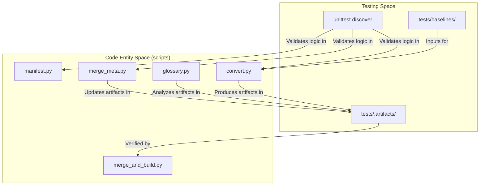
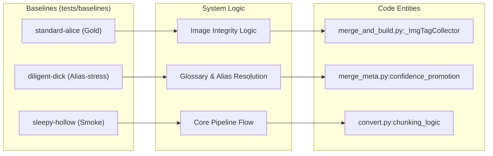

<!-- source: DeepWiki mcp.deepwiki.com · repo deusyu/translate-book · page 4 Testing · fetched 2026-10-26 -->

# Testing

Relevant source files

The following files were used as context for generating this wiki page:

- [.github/workflows/ci.yml](.github/workflows/ci.yml)
- [tests/baselines/README.md](tests/baselines/README.md)

The `translate-book` test suite is designed to ensure the integrity of the translation pipeline, from initial ingestion to final format export. It combines traditional unit testing of individual Python scripts with a multi-tiered baseline system that validates end-to-end integration and regression stability.

### Test Suite Structure

The testing infrastructure is located primarily in the `tests/` directory. It is divided into two main categories:

1.  **Unit Tests**: Located directly in `tests/`, these scripts target specific logic within the `scripts/` directory, such as manifest validation, glossary frequency counting, and meta-data merging.
2.  **Baseline and Integration Tests**: Located in `tests/baselines/`, these represent full-book scenarios used to verify the pipeline's behavior across multiple chunks and complex entity relationships.

For a detailed breakdown of individual test files, see [Unit Tests](#4.1).

### Execution and CI

Tests are executed using the standard Python `unittest` discovery module. The project's Continuous Integration (CI) environment is configured to run these checks on every push to `main` and for all pull requests.

*   **Manual Execution**: `python -m unittest discover -s tests -p 'test_*.py' -v` [.github/workflows/ci.yml:32-32]()
*   **Syntax Validation**: The CI also performs a `compileall` check to ensure all Python sources in `scripts/` and `tests/` are syntactically valid [.github/workflows/ci.yml:29-29]().
*   **Environment**: CI runs on `ubuntu-latest` using Python 3.11 [.github/workflows/ci.yml:15-26]().

### The Three-Tier Baseline System

To handle the complexity of LLM-driven translations and multi-stage processing, the project uses three specific baselines. These are checked-in input files (EPUB, PDF, or DOCX) used to exercise the pipeline [tests/baselines/README.md:3-7]().

| Tier | Baseline | Purpose | Chunks |
| :--- | :--- | :--- | :--- |
| **Smoke** | `sleepy-hollow` | Default CI / Quick iteration; covers basic flow without inline images. | ~21 |
| **Gold** | `standard-alice` | Release-gate; provides heavy coverage for inline image paths and complex formatting. | ~38 |
| **Alias-stress** | `diligent-dick` | Opt-in; validates `merge_meta` and `glossary` logic under contested-variant scenarios. | ~57 |

**Sources:** [tests/baselines/README.md:14-20]()

### Outcome Assertions

Because the pipeline involves non-deterministic LLM outputs, the `SOURCE.md` file for each baseline categorizes expected outcomes into three tiers to distinguish between hard regressions and acceptable "drift":

*   **Measured**: Direct observations from the `tests/.artifacts/` directory. These are strict pass/fail assertions [tests/baselines/README.md:26-26]().
*   **Expected target (unverified)**: Structurally deterministic goals that have not yet been recorded in a run. These are promoted to "Measured" once validated [tests/baselines/README.md:27-27]().
*   **Drift indicator**: LLM-dependent content (like specific phrasing) used for spot-checking but never causing a test failure [tests/baselines/README.md:28-28]().

For more information on managing these baselines and interpreting results, see [Baseline and Integration Tests](#4.2).

### Testing Architecture Overview

The following diagram illustrates how the test suite interacts with the core system components.

**Test Suite Interaction Map**

**Sources:** [tests/baselines/README.md:3-10](), [.github/workflows/ci.yml:29-32](), [tests/baselines/README.md:26-28]()

### Relationship between Baselines and Code Entities

This diagram shows how specific baseline tiers are mapped to the validation of particular code entities and logic chains.

**Baseline to Logic Mapping**

**Sources:** [tests/baselines/README.md:14-20](), [tests/baselines/README.md:34-34]()

---
**Child Pages:**
*   [Unit Tests](#4.1)
*   [Baseline and Integration Tests](#4.2)

---

