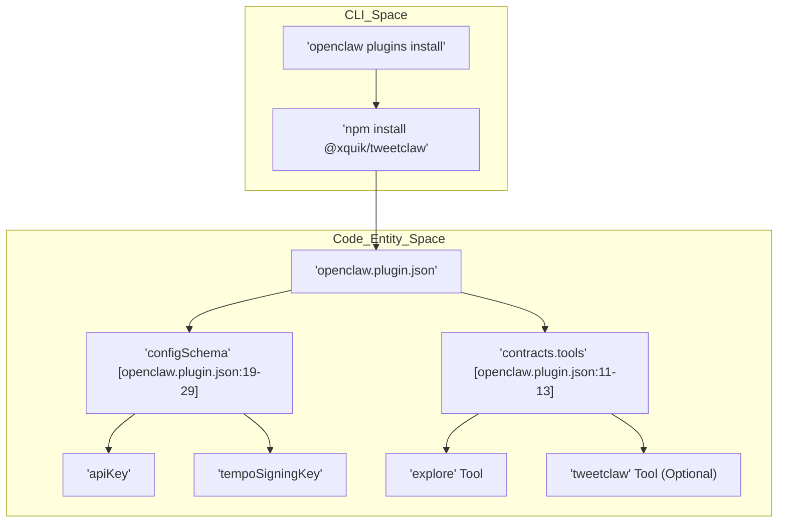
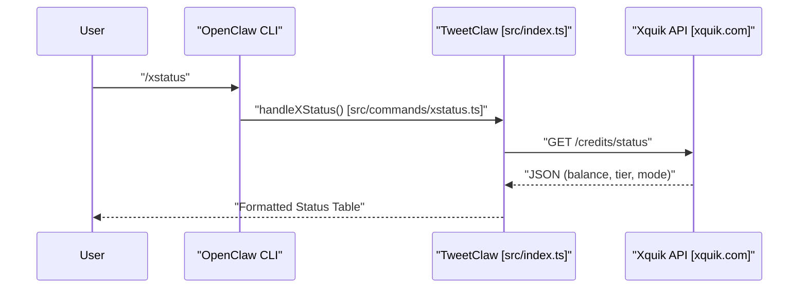

<!-- source: DeepWiki mcp.deepwiki.com · repo Xquik-dev/tweetclaw · page 1.1 Getting Started & Installation · fetched 2026-10-26 -->

# Getting Started & Installation

<details>
<summary>Relevant source files</summary>

The following files were used as context for generating this wiki page:

- [README.md](README.md)
- [openclaw.plugin.json](openclaw.plugin.json)
- [server.json](server.json)
- [smithery.yaml](smithery.yaml)

</details>


This page provides a technical guide for installing and configuring TweetClaw. TweetClaw functions as an OpenClaw plugin and an MCP server, providing 99 agent-callable endpoints for X (Twitter) automation [openclaw.plugin.json:1-13]().

## Installation Methods

TweetClaw can be deployed in two primary ways: as a native plugin for the OpenClaw ecosystem or as a Model Context Protocol (MCP) server for compatible LLM clients.

### 1. OpenClaw Plugin Installation
The primary distribution method is via the OpenClaw CLI. This registers the plugin and its associated tools (`explore` and `tweetclaw`) into the local environment [openclaw.plugin.json:11-13]().

```bash
# Install the official package
openclaw plugins install @xquik/tweetclaw
```

### 2. MCP Server Configuration
TweetClaw is compatible with the Model Context Protocol. It uses a `streamable-http` transport layer pointing to the Xquik production environment [server.json:10-20]().

*   **Endpoint**: `https://xquik.com/mcp`
*   **Authentication**: `X-API-Key` header [server.json:16-17]().

### Installation Data Flow
The following diagram illustrates how the installation process populates the internal plugin registry and prepares the configuration schema.

**Installation and Registry Flow**

Sources: [openclaw.plugin.json:1-29](), [README.md:63-71]()

---

## Configuration & Credential Modes

TweetClaw supports three distinct operational modes based on the provided credentials. Configuration is managed via the `configSchema` defined in the plugin manifest [openclaw.plugin.json:19-29]().

### Option A: API Key (Account-Backed)
This mode allows full access to all 99 endpoints, including write actions and private reads.
*   **Source**: [dashboard.xquik.com](https://dashboard.xquik.com)
*   **Setup**:
    ```bash
    openclaw config set plugins.entries.tweetclaw.config.apiKey "$XQUIK_API_KEY"
    ```

### Option B: MPP Signing Key (Accountless Pay-Per-Use)
The Machine Payments Protocol (MPP) allows agents to pay per call using on-chain signatures. This mode is restricted to 32 read-only endpoints [README.md:89-100]().
*   **Setup**:
    ```bash
    openclaw config set plugins.entries.tweetclaw.config.tempoSigningKey "$MPP_SIGNING_KEY"
    ```

### Option C: Unconfigured (Explore Only)
If no keys are provided, the plugin remains active but limits the agent to the `explore` tool and free status checks [README.md:69-70]().

### Configuration Mapping
| Property | Type | Default | Description |
| :--- | :--- | :--- | :--- |
| `apiKey` | `string` | `null` | Xquik API key for full automation [openclaw.plugin.json:23](). |
| `tempoSigningKey` | `string` | `null` | MPP key for accountless read-only access [openclaw.plugin.json:24](). |
| `baseUrl` | `string` | `https://xquik.com` | Target API root [openclaw.plugin.json:25](). |
| `pollingEnabled` | `boolean` | `true` | Enables background event monitoring [openclaw.plugin.json:27](). |
| `pollingInterval`| `number` | `60` | Seconds between poll cycles [openclaw.plugin.json:26](). |

Sources: [openclaw.plugin.json:19-37](), [README.md:73-100](), [smithery.yaml:3-16]()

---

## Enabling Tools & Verification

By default, OpenClaw may restrict third-party tools. The `tweetclaw` tool is explicitly marked as `optional` because it can perform paid or destructive actions [openclaw.plugin.json:14-18]().

### 1. Enable Tools
To allow the agent to use TweetClaw, update the `tools.alsoAllow` configuration:
```bash
openclaw config set tools.alsoAllow '["explore", "tweetclaw"]'
```

### 2. Verify Setup with /xstatus
The `/xstatus` command is a built-in slash command that bypasses the LLM reasoning loop to provide immediate diagnostic information [README.md:112-117]().

**Verification Sequence**


### Verification Commands
| Command | Purpose |
| :--- | :--- |
| `openclaw plugins inspect tweetclaw --runtime` | Check if the plugin is loaded and configuration is resolved [README.md:115](). |
| `openclaw skills info tweetclaw` | View the documentation provided to the agent [README.md:116](). |
| `/xstatus` | Verify API connectivity and credential validity [README.md:112](). |

Sources: [openclaw.plugin.json:11-18](), [README.md:102-118]()

---

