# Page: TweetClaw Overview

# TweetClaw Overview

<details>
<summary>Relevant source files</summary>

The following files were used as context for generating this wiki page:

- [README.md](README.md)
- [package.json](package.json)
- [server.json](server.json)

</details>


TweetClaw is a high-performance automation plugin and [MCP Server Interface](#5) server designed for the [OpenClaw](https://github.com/openclaw/openclaw) ecosystem. It provides AI agents with a structured interface to the [Xquik API](https://xquik.com), enabling them to perform complex X (formerly Twitter) operations—including reading timelines, posting tweets, managing DMs, and extracting bulk data—at a fraction of the cost of the official X API.

### System Integration

TweetClaw acts as the bridge between an OpenClaw agent and the Xquik infrastructure. It abstracts the underlying HTTP complexity into two primary tools: `explore` (for discovery) and `tweetclaw` (for execution).

**High-Level Architecture & Entity Mapping**

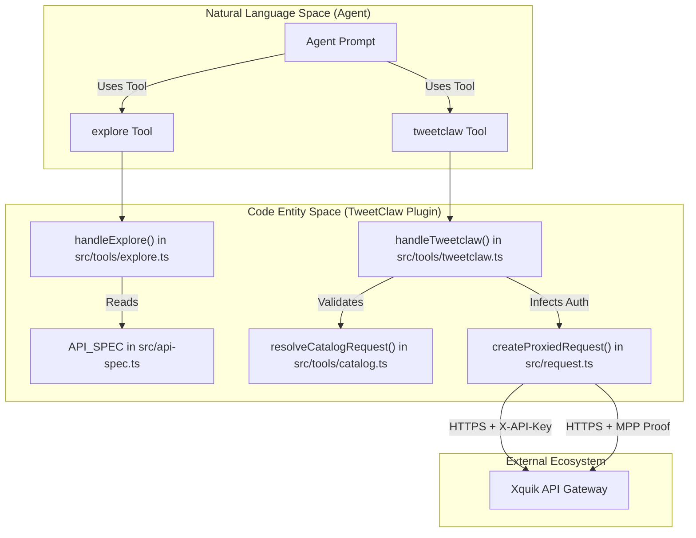
**Sources:** [src/tools/explore.ts:1-20](), [src/tools/tweetclaw.ts:1-30](), [src/api-spec.ts:1-50](), [src/request.ts:1-40]()

### Key Capabilities

*   **Cost Efficiency**: Read operations start at **$0.00015** per call, approximately 33x cheaper than official X API equivalents [README.md:15-30]().
*   **Comprehensive API Surface**: Exposes 99 agent-callable endpoints across 9 categories, including Account, Composition, Extraction, and Radar [server.json:4]().
*   **Flexible Authentication**: Supports traditional API keys, credit-based top-ups, and anonymous on-chain payments via the **Machine Payments Protocol (MPP)** [README.md:73-96]().
*   **Safety & Governance**: Implements a write-action approval gate and prohibits access to sensitive account/billing endpoints [src/request.ts:10-30]().

### Plugin Entry Point

The plugin is registered via `definePluginEntry` in `src/index.ts`. During initialization, it resolves the credential state to determine if the agent has access to live data or should operate in a restricted "catalog-only" mode.

**Registration Lifecycle**

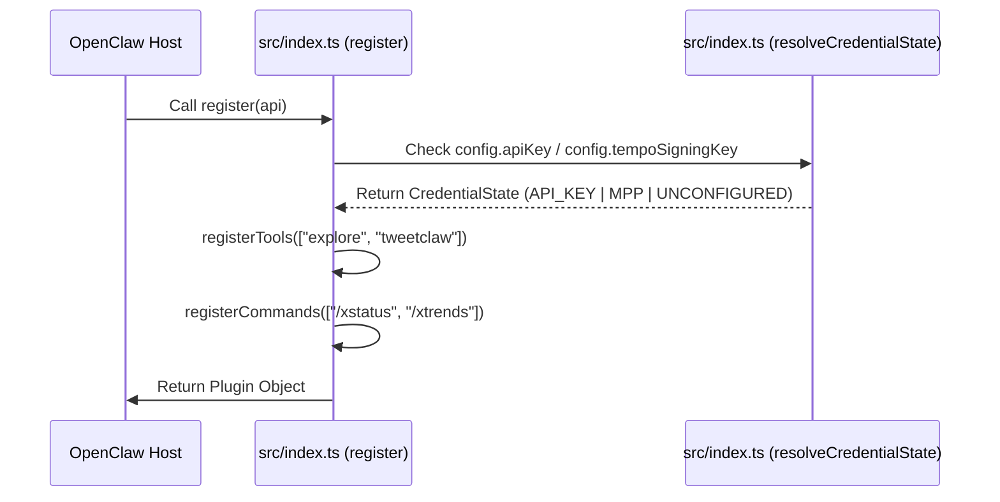
**Sources:** [src/index.ts:10-100](), [package.json:18-28]()

---

### Detailed Documentation

For deeper technical dives into specific subsystems, refer to the following child pages:

#### [Getting Started & Installation](#1.1)
Covers the prerequisites, installation via `openclaw plugins install`, and initial configuration. It details how to verify the installation using the `/xstatus` command.

#### [Authentication & Credential Modes](#1.2)
Deep dive into the `CredentialState` enum and how TweetClaw handles three distinct modes:
1.  **API-Key**: Full access backed by an Xquik account.
2.  **MPP/Tempo**: Pay-per-use anonymous access for 32 read-only endpoints using `mppx` and `viem`.
3.  **Unconfigured**: Safety mode allowing only the `explore` tool and setup guidance.

---
**Sources:** [README.md:1-120](), [package.json:1-44](), [server.json:1-21]()

---

# Page: Getting Started & Installation

# Getting Started & Installation

<details>
<summary>Relevant source files</summary>

The following files were used as context for generating this wiki page:

- [README.md](README.md)
- [openclaw.plugin.json](openclaw.plugin.json)
- [server.json](server.json)
- [smithery.yaml](smithery.yaml)

</details>


This page provides a technical guide for installing and configuring TweetClaw. TweetClaw functions as an OpenClaw plugin and an MCP server, providing 99 agent-callable endpoints for X (Twitter) automation [openclaw.plugin.json:1-13]().

## Installation Methods

TweetClaw can be deployed in two primary ways: as a native plugin for the OpenClaw ecosystem or as a Model Context Protocol (MCP) server for compatible LLM clients.

### 1. OpenClaw Plugin Installation
The primary distribution method is via the OpenClaw CLI. This registers the plugin and its associated tools (`explore` and `tweetclaw`) into the local environment [openclaw.plugin.json:11-13]().

```bash
# Install the official package
openclaw plugins install @xquik/tweetclaw
```

### 2. MCP Server Configuration
TweetClaw is compatible with the Model Context Protocol. It uses a `streamable-http` transport layer pointing to the Xquik production environment [server.json:10-20]().

*   **Endpoint**: `https://xquik.com/mcp`
*   **Authentication**: `X-API-Key` header [server.json:16-17]().

### Installation Data Flow
The following diagram illustrates how the installation process populates the internal plugin registry and prepares the configuration schema.

**Installation and Registry Flow**
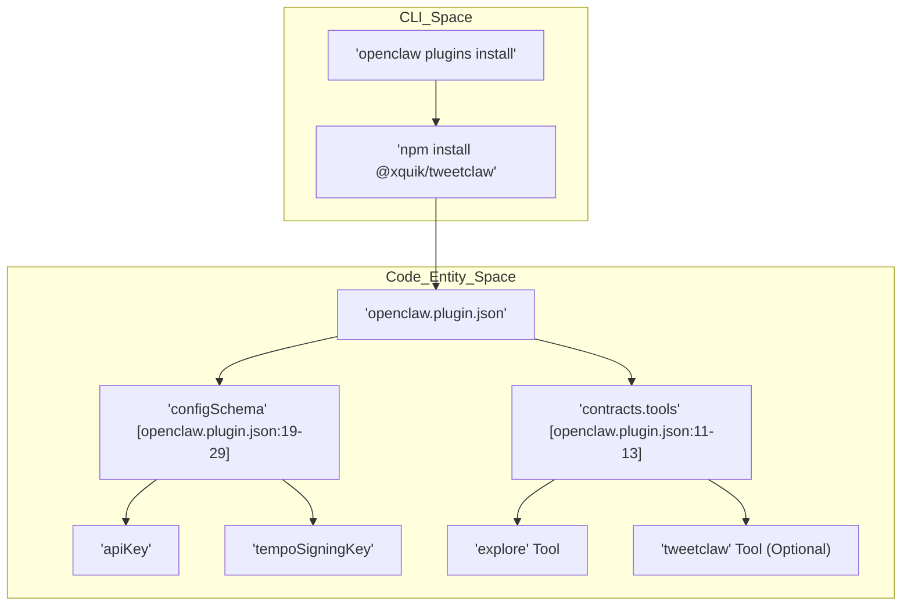
Sources: [openclaw.plugin.json:1-29](), [README.md:63-71]()

---

## Configuration & Credential Modes

TweetClaw supports three distinct operational modes based on the provided credentials. Configuration is managed via the `configSchema` defined in the plugin manifest [openclaw.plugin.json:19-29]().

### Option A: API Key (Account-Backed)
This mode allows full access to all 99 endpoints, including write actions and private reads.
*   **Source**: [dashboard.xquik.com](https://dashboard.xquik.com)
*   **Setup**:
    ```bash
    openclaw config set plugins.entries.tweetclaw.config.apiKey "$XQUIK_API_KEY"
    ```

### Option B: MPP Signing Key (Accountless Pay-Per-Use)
The Machine Payments Protocol (MPP) allows agents to pay per call using on-chain signatures. This mode is restricted to 32 read-only endpoints [README.md:89-100]().
*   **Setup**:
    ```bash
    openclaw config set plugins.entries.tweetclaw.config.tempoSigningKey "$MPP_SIGNING_KEY"
    ```

### Option C: Unconfigured (Explore Only)
If no keys are provided, the plugin remains active but limits the agent to the `explore` tool and free status checks [README.md:69-70]().

### Configuration Mapping
| Property | Type | Default | Description |
| :--- | :--- | :--- | :--- |
| `apiKey` | `string` | `null` | Xquik API key for full automation [openclaw.plugin.json:23](). |
| `tempoSigningKey` | `string` | `null` | MPP key for accountless read-only access [openclaw.plugin.json:24](). |
| `baseUrl` | `string` | `https://xquik.com` | Target API root [openclaw.plugin.json:25](). |
| `pollingEnabled` | `boolean` | `true` | Enables background event monitoring [openclaw.plugin.json:27](). |
| `pollingInterval`| `number` | `60` | Seconds between poll cycles [openclaw.plugin.json:26](). |

Sources: [openclaw.plugin.json:19-37](), [README.md:73-100](), [smithery.yaml:3-16]()

---

## Enabling Tools & Verification

By default, OpenClaw may restrict third-party tools. The `tweetclaw` tool is explicitly marked as `optional` because it can perform paid or destructive actions [openclaw.plugin.json:14-18]().

### 1. Enable Tools
To allow the agent to use TweetClaw, update the `tools.alsoAllow` configuration:
```bash
openclaw config set tools.alsoAllow '["explore", "tweetclaw"]'
```

### 2. Verify Setup with /xstatus
The `/xstatus` command is a built-in slash command that bypasses the LLM reasoning loop to provide immediate diagnostic information [README.md:112-117]().

**Verification Sequence**
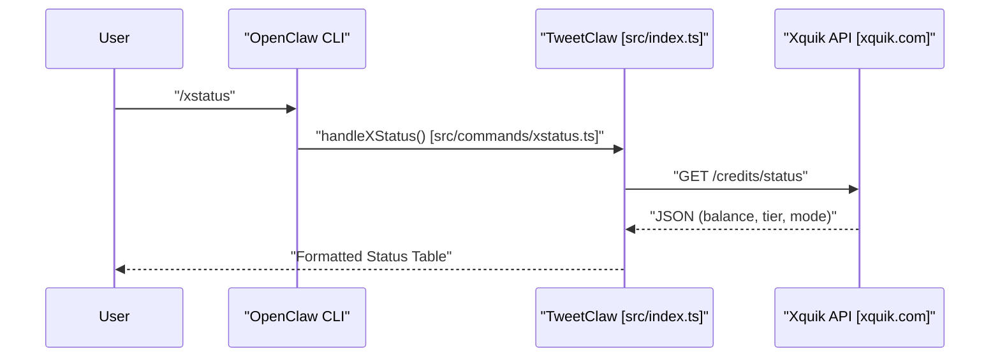

### Verification Commands
| Command | Purpose |
| :--- | :--- |
| `openclaw plugins inspect tweetclaw --runtime` | Check if the plugin is loaded and configuration is resolved [README.md:115](). |
| `openclaw skills info tweetclaw` | View the documentation provided to the agent [README.md:116](). |
| `/xstatus` | Verify API connectivity and credential validity [README.md:112](). |

Sources: [openclaw.plugin.json:11-18](), [README.md:102-118]()

---

# Page: Authentication & Credential Modes

# Authentication & Credential Modes

<details>
<summary>Relevant source files</summary>

The following files were used as context for generating this wiki page:

- [src/index.ts](src/index.ts)
- [src/mpp.ts](src/mpp.ts)
- [src/request.ts](src/request.ts)
- [src/types.ts](src/types.ts)
- [tests/index.test.ts](tests/index.test.ts)
- [tests/mpp.test.ts](tests/mpp.test.ts)
- [tests/request.test.ts](tests/request.test.ts)

</details>


TweetClaw supports multiple authentication strategies to accommodate different use cases, ranging from full account automation to pay-per-use read-only access. The system resolves these modes during plugin registration and enforces security boundaries during request execution.

## Credential Modes Overview

TweetClaw operates in one of three mutually exclusive `CredentialMode` states [src/index.ts:84-84](). These modes are determined by the configuration provided in the `openclaw.plugin.json` manifest or via the OpenClaw environment [src/index.ts:27-49]().

| Mode | Configuration Key | Description | Capabilities |
| :--- | :--- | :--- | :--- |
| **API Key** | `apiKey` | Standard Xquik API key (starts with `xq_`). [src/request.ts:8-8]() | Full access to all authorized Read/Write endpoints. |
| **MPP** | `tempoSigningKey` | Ethereum private key for Tempo/MPP signing. [src/index.ts:42-46]() | Accountless, pay-per-use access to ~32 read-only endpoints. |
| **None** | N/A | Neither key is provided. | Tool execution fails with configuration guidance. [src/index.ts:24-26]() |

### Credential Resolution Flow
The `resolveCredentialState` function in `src/index.ts` determines the active mode based on the priority of provided configuration values.

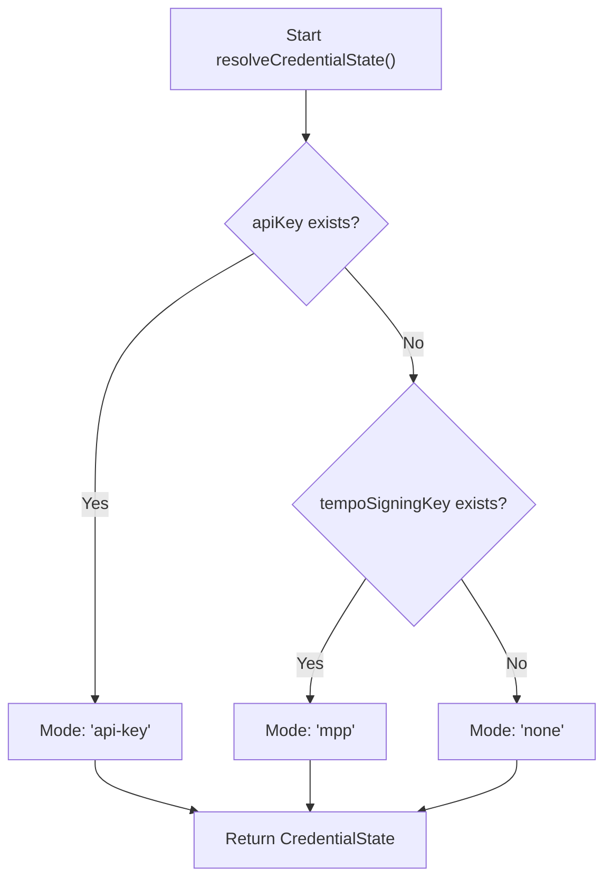
Sources: [src/index.ts:94-98](), [src/index.ts:244-256]()

## Auth Header Injection

The `src/request.ts` module is responsible for transforming raw credentials into valid HTTP headers. The logic differentiates between Xquik-native API keys and external bearer tokens (such as those used in MPP proxying).

### Key Functions
- `buildAuthHeader(credential)`: Determines if the credential is an Xquik key (prefix `xq_`) or a standard Bearer token [src/request.ts:12-17]().
- `buildFetchHeaders(credential, hasBody)`: Combines authentication headers with `content-type: application/json` if a request body is present [src/request.ts:19-25]().

### Header Mapping
| Credential Prefix | Header Key | Header Value Format |
| :--- | :--- | :--- |
| `xq_` | `x-api-key` | `xq_...` |
| (Other) | `authorization` | `Bearer ...` |

Sources: [src/request.ts:5-8](), [src/request.ts:12-17](), [tests/request.test.ts:4-14]()

## MPP (Multi-Party Payment) Initialization

MPP mode allows for "accountless" access by signing requests with an Ethereum private key. This flow is managed in `src/mpp.ts` and requires dynamic loading of the `mppx` and `viem` libraries.

### Initialization Flow
When `tempoSigningKey` is detected, `src/index.ts` calls `initMpp` [src/index.ts:274-274]().

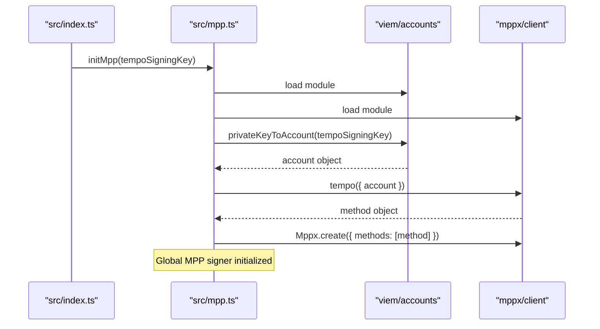

### Implementation Details
- **Dynamic Loading**: Modules are loaded at runtime via `loadDynamicModule` to avoid forcing heavy dependencies on users who only use API-key mode [src/mpp.ts:11-17]().
- **Validation**: The system checks for the existence of `privateKeyToAccount` in `viem` and `tempo`/`Mppx` in `mppx` before proceeding [src/mpp.ts:31-35]().

Sources: [src/mpp.ts:23-39](), [tests/mpp.test.ts:79-92]()

## Security Boundaries & Prohibited Endpoints

Regardless of the authentication mode, certain endpoints are hard-blocked within the `createProxiedRequest` factory to prevent agents from performing sensitive account management or billing operations.

### Prohibited Patterns
The `validateRequestPath` function checks every request against `PROHIBITED_PATHS` and `PROHIBITED_PATH_PATTERNS` [src/request.ts:76-85]().

- **Static Blocks**: `/api/v1/api-keys`, `/api/v1/credits/topup`, `/api/v1/subscribe` [src/request.ts:37-49]().
- **Pattern Blocks**: Deleting X accounts or re-authenticating identities via regex [src/request.ts:51-56]().
- **Support Tickets**: All support ticket operations are blocked for agents [src/request.ts:58-63]().

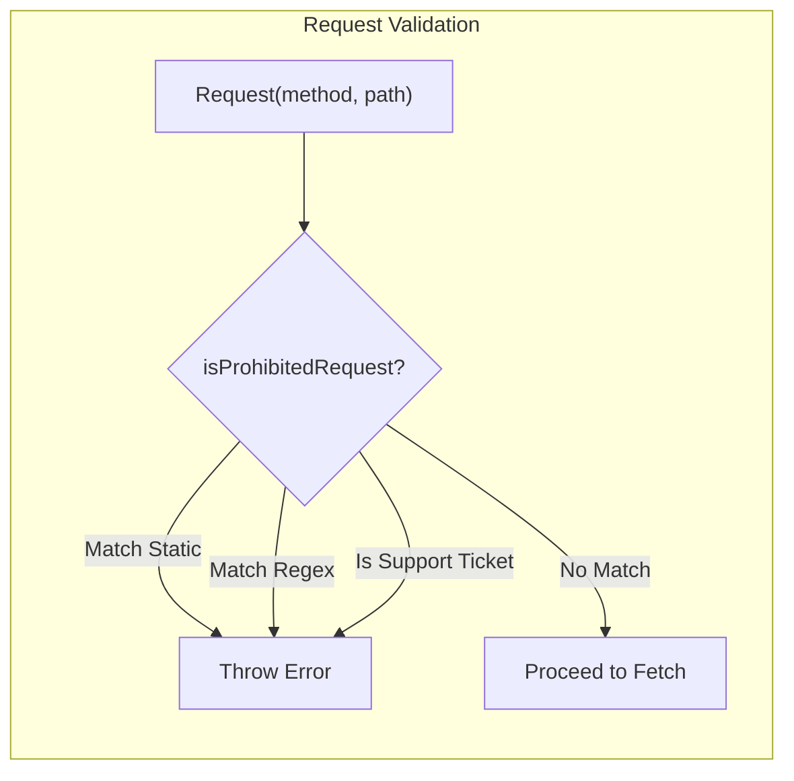

Sources: [src/request.ts:65-74](), [src/request.ts:87-110](), [tests/request.test.ts:121-170]()

---

# Page: Plugin Architecture

# Plugin Architecture

<details>
<summary>Relevant source files</summary>

The following files were used as context for generating this wiki page:

- [openclaw.plugin.json](openclaw.plugin.json)
- [package.json](package.json)
- [src/index.ts](src/index.ts)
- [types/openclaw-plugin-sdk.d.ts](types/openclaw-plugin-sdk.d.ts)

</details>


TweetClaw is architected as an **OpenClaw plugin**, leveraging the OpenClaw Plugin SDK to extend the host application with specialized X/Twitter capabilities. It operates as a bridge between the OpenClaw agent environment and the Xquik API, providing structured tools for tweet interaction, account monitoring, and data extraction.

The architecture is defined by a declarative manifest (`openclaw.plugin.json`) and a functional entry point (`src/index.ts`) that manages the lifecycle of tools, commands, and background services.

### Core Architecture Components

The following diagram illustrates the relationship between the OpenClaw host, the TweetClaw plugin entry point, and the underlying services.

**TweetClaw System Overview**
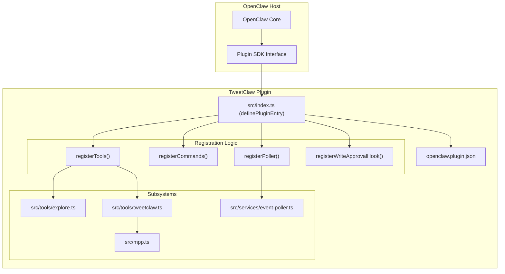
Sources: [src/index.ts:1-138](), [openclaw.plugin.json:1-37](), [package.json:18-38]()

---

### Plugin Manifest & Configuration

The plugin's identity and requirements are defined in `openclaw.plugin.json`. This file acts as the contract with OpenClaw, specifying:
*   **Activation Rules**: When the plugin should be loaded (e.g., when "tool" capabilities are requested) [openclaw.plugin.json:6-9]().
*   **Capabilities**: The tools (`explore`, `tweetclaw`) and skills it provides to the agent [openclaw.plugin.json:10-13]().
*   **Configuration Schema**: The settings available to the user, including `apiKey` for account-backed access and `tempoSigningKey` for Machine Payments Protocol (MPP) mode [openclaw.plugin.json:19-29]().

For details, see [Plugin Manifest & Configuration Schema](#2.1).

### Registration & Lifecycle

The entry point of the plugin is `src/index.ts`, which uses the `definePluginEntry` function from the OpenClaw SDK [src/index.ts:1](). During the `register` phase, the plugin performs several critical setup tasks:

1.  **Credential Resolution**: It evaluates the `PluginConfig` to determine if the user is using an API Key, an MPP/Tempo key, or is unconfigured [src/index.ts:245-280]().
2.  **Tool Registration**: It registers the `explore` and `tweetclaw` tools, which allow agents to search the API catalog and execute requests respectively [src/index.ts:119-127]().
3.  **Command Registration**: It exposes slash commands like `/xstatus` and `/xtrends` for direct user interaction [src/index.ts:108-113]().
4.  **Safety Hooks**: It registers a `before_tool_call` hook to intercept write actions (like posting a tweet) and request explicit user approval [src/index.ts:133-137]().

For details, see [Plugin Entry Point & Registration Flow](#2.2).

### Service Architecture: Event Polling

TweetClaw includes a background service for asynchronous event monitoring. If `pollingEnabled` is set to `true` in the configuration, the plugin registers a poller service [src/index.ts:36-41]().

This service periodically queries the Xquik API for new events (such as monitor alerts or extraction completions) and pushes them into the OpenClaw conversation context. It uses a cursor-based pagination strategy and exponential backoff to handle rate limits or transient network issues.

For details, see [Event Polling Service](#2.3).

---

### Code Entity Mapping

The following diagram maps high-level architectural concepts to their specific implementations in the codebase.

**Component to Code Entity Mapping**
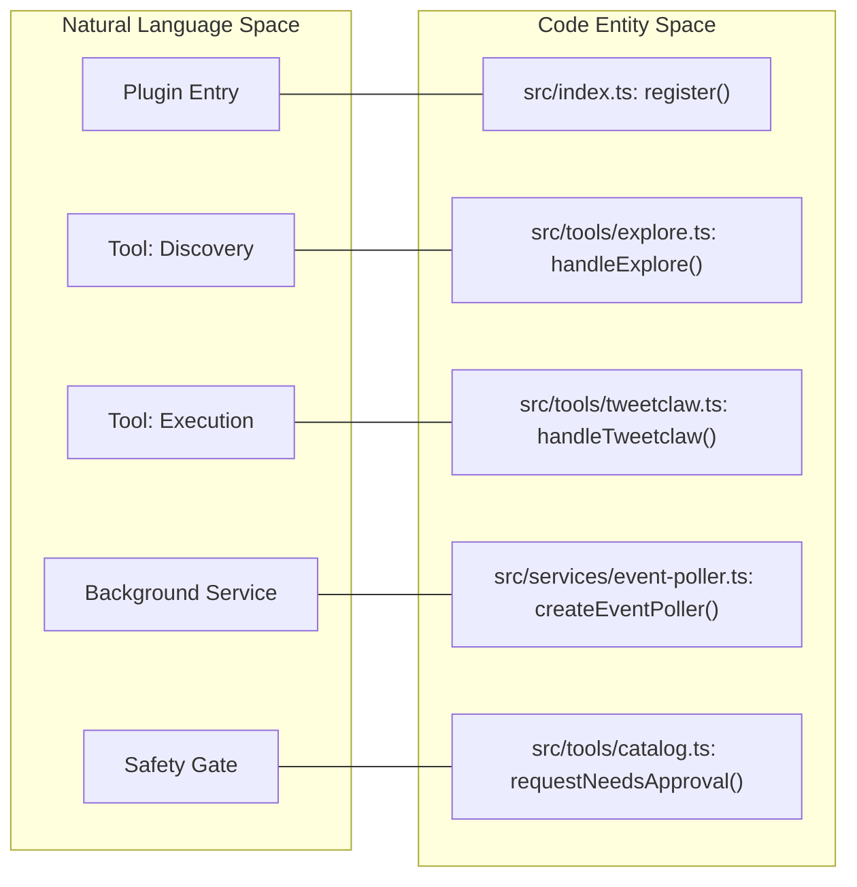
Sources: [src/index.ts:212-320](), [src/tools/explore.ts:8](), [src/tools/tweetclaw.ts:10](), [src/services/event-poller.ts:6](), [src/tools/catalog.ts:7]()

### Technical Constraints & Interfaces

| Feature | Implementation | Description |
| :--- | :--- | :--- |
| **SDK Version** | `2026.5.4` | Minimum required OpenClaw Plugin API version [package.json:26-32](). |
| **Runtime** | Node.js >= 22 | Required for modern ESM and fetch support [package.json:15-17](). |
| **Transport** | Proxied Fetch | All requests are routed through `createProxiedRequest` in `src/request.ts` [src/index.ts:5](). |
| **Approval** | `before_tool_call` | Hook used to gate `POST`, `PUT`, `DELETE`, and `PATCH` methods [src/index.ts:133-137](). |

Sources: [package.json:1-131](), [src/index.ts:1-138]()

---

# Page: Plugin Manifest & Configuration Schema

# Plugin Manifest & Configuration Schema

<details>
<summary>Relevant source files</summary>

The following files were used as context for generating this wiki page:

- [openclaw.plugin.json](openclaw.plugin.json)
- [package.json](package.json)

</details>


The `openclaw.plugin.json` file serves as the foundational metadata layer for the TweetClaw plugin. It defines how the plugin is identified, when it is activated by the OpenClaw host, the configuration interface presented to the user, and the functional contracts (tools and skills) it fulfills.

## Manifest Overview

The manifest provides essential metadata such as the plugin `id` (`tweetclaw`), `version`, and `description` [openclaw.plugin.json:2-5](). It acts as the bridge between the static code and the OpenClaw runtime environment.

### Activation Rules
TweetClaw uses capability-based activation. It does not load immediately on startup (`onStartup: false`) but triggers when the host environment requires "tool" capabilities [openclaw.plugin.json:6-9]().

### Contracts and Skills
The manifest explicitly declares the functional interfaces it provides:
*   **Contracts**: Registers two primary tools: `explore` and `tweetclaw` [openclaw.plugin.json:11-13]().
*   **Skills**: Points to the `skills/tweetclaw` directory, which contains the `SKILL.md` file used by agents to understand how to utilize the plugin effectively [openclaw.plugin.json:10-10]().

### Tool Metadata
The `toolMetadata` section marks the `tweetclaw` tool as `optional` [openclaw.plugin.json:14-18](). This allows the plugin to remain functional (e.g., for exploration or status checks) even if the primary execution tool is restricted by host policy.

## Configuration Schema

The `configSchema` defines the structured data required to initialize the plugin. It uses JSON Schema to validate user input and environment variables.

### Key Properties
| Property | Type | Default | Description |
| :--- | :--- | :--- | :--- |
| `apiKey` | `string` | N/A | Xquik API key for account-backed automation [openclaw.plugin.json:23-23](). |
| `tempoSigningKey` | `string` | N/A | MPP signing key for pay-per-use, accountless read access [openclaw.plugin.json:24-24](). |
| `baseUrl` | `string` | `https://xquik.com` | The target API endpoint [openclaw.plugin.json:25-25](). |
| `pollingEnabled` | `boolean` | `true` | Toggles the background event poller [openclaw.plugin.json:27-27](). |
| `pollingInterval` | `number` | `60` | Frequency (in seconds) for checking monitor events [openclaw.plugin.json:26-26](). |

### UI Hints
The `uiHints` object provides metadata for the OpenClaw graphical interface to render configuration forms. It marks sensitive fields like `apiKey` and `tempoSigningKey` as `sensitive: true` to ensure they are masked in the UI [openclaw.plugin.json:30-36]().

## Data Flow: Manifest to Runtime

The following diagram illustrates how the `openclaw.plugin.json` manifest informs the plugin registration process and influences the behavior of the `PluginContext`.

**Manifest Integration Flow**
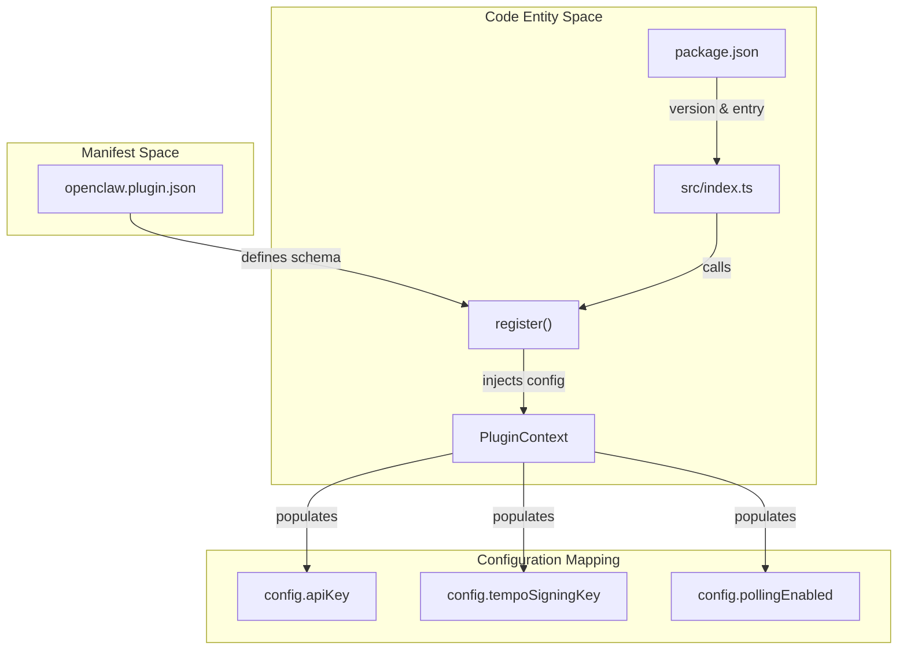
**Sources:** [openclaw.plugin.json:1-37](), [package.json:18-38]()

## Configuration Dependency Graph

The plugin's operational mode is determined by which configuration keys are provided in the manifest-defined schema. This logic is implemented during the registration flow to determine the "Credential State."

**Credential Resolution Logic**
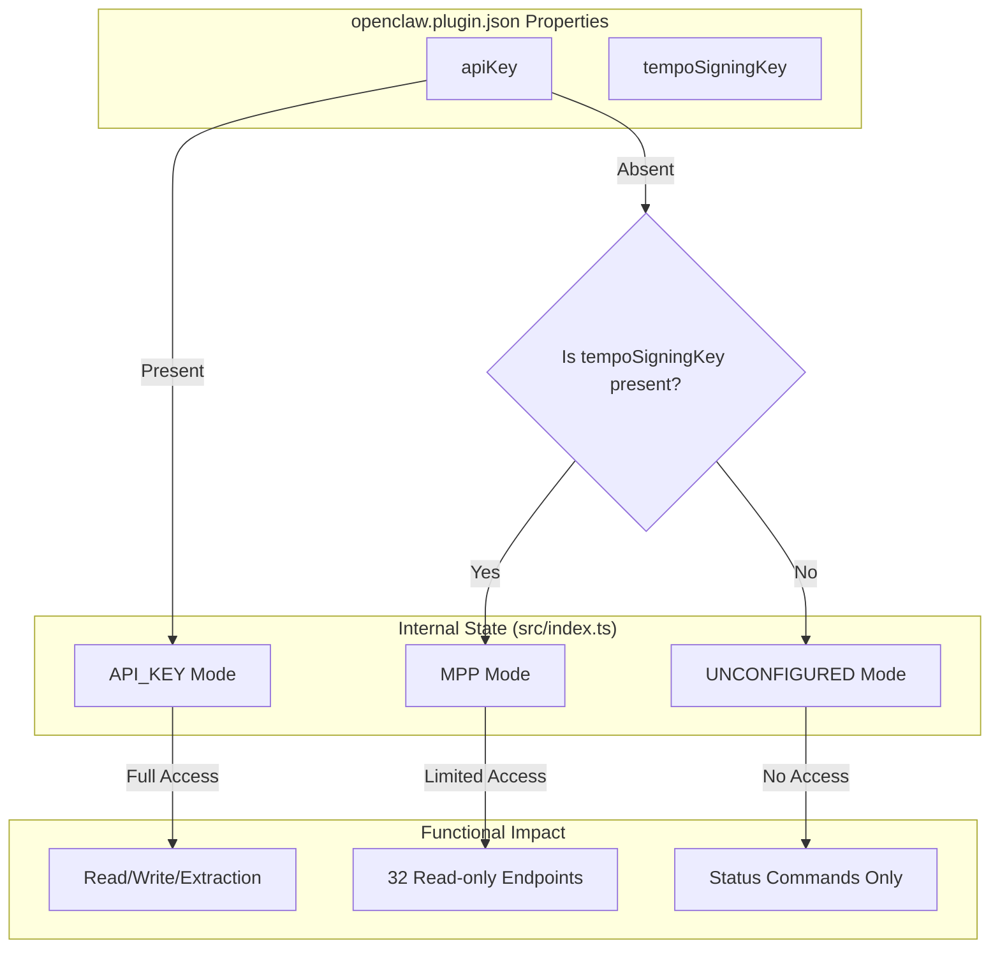
**Sources:** [openclaw.plugin.json:19-29](), [package.json:87-91]()

## Compatibility and Build Metadata

The `package.json` file complements the manifest by defining the compatibility requirements for the OpenClaw host.

*   **Plugin API Compatibility**: Requires `pluginApi` version `>=2026.5.4` [package.json:25-28]().
*   **Runtime Extensions**: Specifies `./dist/index.js` as the compiled entry point for the plugin [package.json:22-24]().
*   **Peer Dependencies**: Declares `mppx` and `viem` as optional dependencies, which are only required if the user configures a `tempoSigningKey` for Machine Payments Protocol (MPP) mode [package.json:87-99]().

**Sources:** [package.json:18-38](), [package.json:87-99]()

---

# Page: Plugin Entry Point & Registration Flow

# Plugin Entry Point & Registration Flow

<details>
<summary>Relevant source files</summary>

The following files were used as context for generating this wiki page:

- [src/index.ts](src/index.ts)
- [src/mpp.ts](src/mpp.ts)
- [src/types.ts](src/types.ts)
- [tests/index.test.ts](tests/index.test.ts)
- [tests/openclaw-plugin-entry.ts](tests/openclaw-plugin-entry.ts)

</details>


This page provides a technical walkthrough of the initialization and registration lifecycle of the TweetClaw plugin within the OpenClaw ecosystem. The entry point, located in `src/index.ts`, manages configuration parsing, credential resolution, and the registration of tools, commands, and background services.

## Overview of `src/index.ts`

The `src/index.ts` file serves as the bridge between the TweetClaw logic and the OpenClaw Plugin SDK. It exports a `register` function that is called by the OpenClaw host during the plugin activation phase.

### Key Registration Components

| Component | Function | Responsibility |
| :--- | :--- | :--- |
| **Credentials** | `resolveCredentialState` | Determines if the plugin operates in `api-key`, `mpp`, or `none` mode. |
| **Tools** | `registerTools` | Registers the `explore` and `tweetclaw` agentic tools. |
| **Commands** | `registerCommands` | Registers `/xstatus` and `/xtrends` slash commands. |
| **Services** | `registerPoller` | Initializes the background `EventPoller` for monitoring X events. |
| **Hooks** | `registerWriteApprovalHook` | Injects a middleware to intercept and approve write-actions. |

**Sources:** [src/index.ts:1-11](), [src/index.ts:100-138]()

---

## Registration Lifecycle Diagram

The following diagram illustrates the sequence of operations when `register()` is invoked by the OpenClaw host.

### Registration Sequence
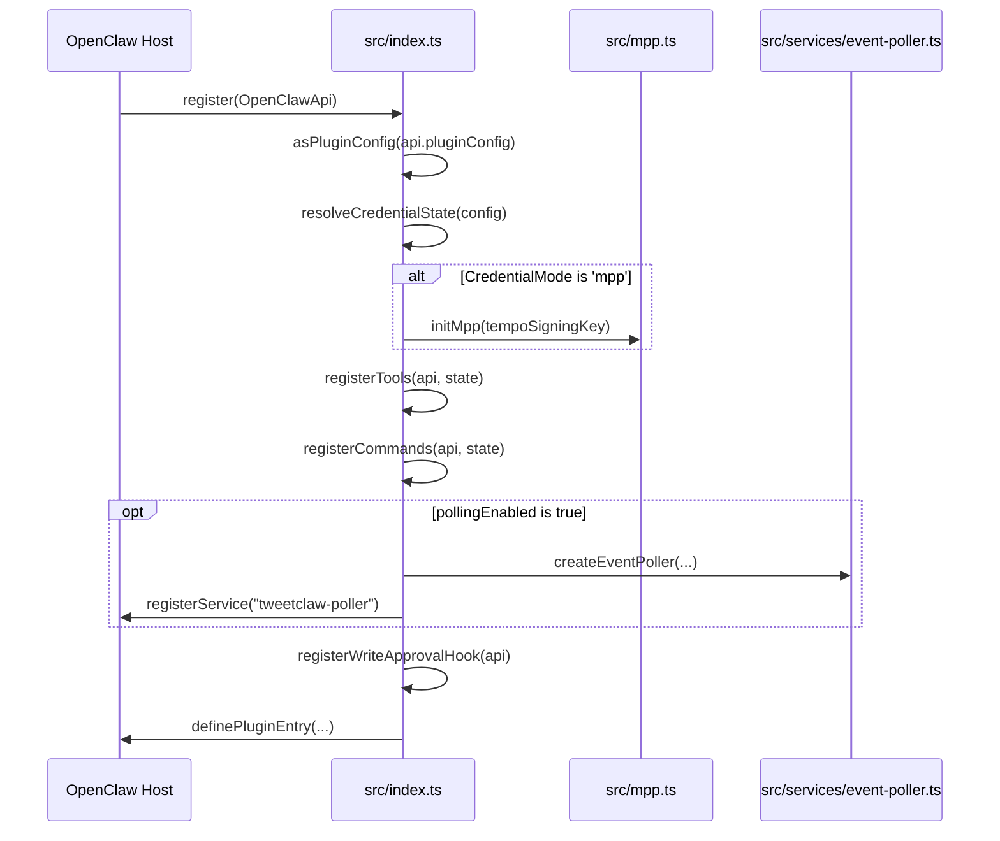
**Sources:** [src/index.ts:257-295](), [src/index.ts:316-333](), [src/index.ts:404-419]()

---

## Credential Resolution

The function `resolveCredentialState` determines the operational mode based on the `PluginConfig`. TweetClaw supports three distinct modes that dictate which endpoints can be accessed.

| Mode | Required Config | Capabilities |
| :--- | :--- | :--- |
| `api-key` | `apiKey` | Full access to all 99+ endpoints (Read/Write/Extraction). |
| `mpp` | `tempoSigningKey` | Access to 32 read-only endpoints via MPP (Pay-per-use). |
| `none` | None | Only the `explore` tool and `/xstatus` command are functional. |

### Implementation Details
*   **Validation**: `asPluginConfig` filters and validates the raw configuration object from OpenClaw [src/index.ts:180-192]().
*   **State Object**: Returns a `CredentialState` object containing the `mode`, `accountValue` (API Key), and `signingValue` (Tempo Key) [src/index.ts:94-98]().
*   **MPP Initialization**: If `mpp` mode is selected, `initMpp` is called to dynamically load `mppx` and `viem` for signing requests [src/mpp.ts:23-39]().

**Sources:** [src/index.ts:219-236](), [src/index.ts:241-255](), [src/mpp.ts:23-39]()

---

## Tool & Command Registration

### Tool Registration (`registerTools`)
The plugin registers two primary tools using `api.registerTool`. 

1.  **`explore`**: Used by agents to search the Xquik API catalog. It uses `EXPLORE_PARAMETERS` for schema validation [src/index.ts:140-151]().
2.  **`tweetclaw`**: The execution tool for making concrete API requests. It uses `TWEETCLAW_PARAMETERS` [src/index.ts:153-171]().

If no credentials are provided, `tweetclaw` is still registered but will return a `MISSING_CREDENTIALS_MESSAGE` upon execution to guide the user [src/index.ts:24-25](), [src/index.ts:303-311]().

### Command Registration (`registerCommands`)
Slash commands are registered via `api.registerCommand`. These bypass the LLM reasoning loop and provide direct utility:
*   **`/xstatus`**: Displays the current connection state and credit balance [src/commands/xstatus.ts:10-18]().
*   **`/xtrends`**: Fetches current X/Twitter trends [src/commands/xtrends.ts:7-12]().

**Sources:** [src/index.ts:297-314](), [src/index.ts:316-333](), [tests/index.test.ts:152-177]()

---

## Write Approval Hook

To ensure safety, TweetClaw registers a `before_tool_call` hook. This middleware inspects every call to the `tweetclaw` tool.

### Logic Flow
1.  **Detection**: The hook calls `requestNeedsApproval(path, method)` from `src/tools/catalog.ts` [src/index.ts:342-343]().
2.  **Identification**: It checks if the requested endpoint is a "Write" action (e.g., `POST /api/v1/x/tweets`) [src/tools/catalog.ts:58-64]().
3.  **Intervention**: If a write-action is detected, it returns a `requireApproval` object to OpenClaw, triggering a UI prompt for the user [src/index.ts:347-352]().

### Code-to-System Mapping
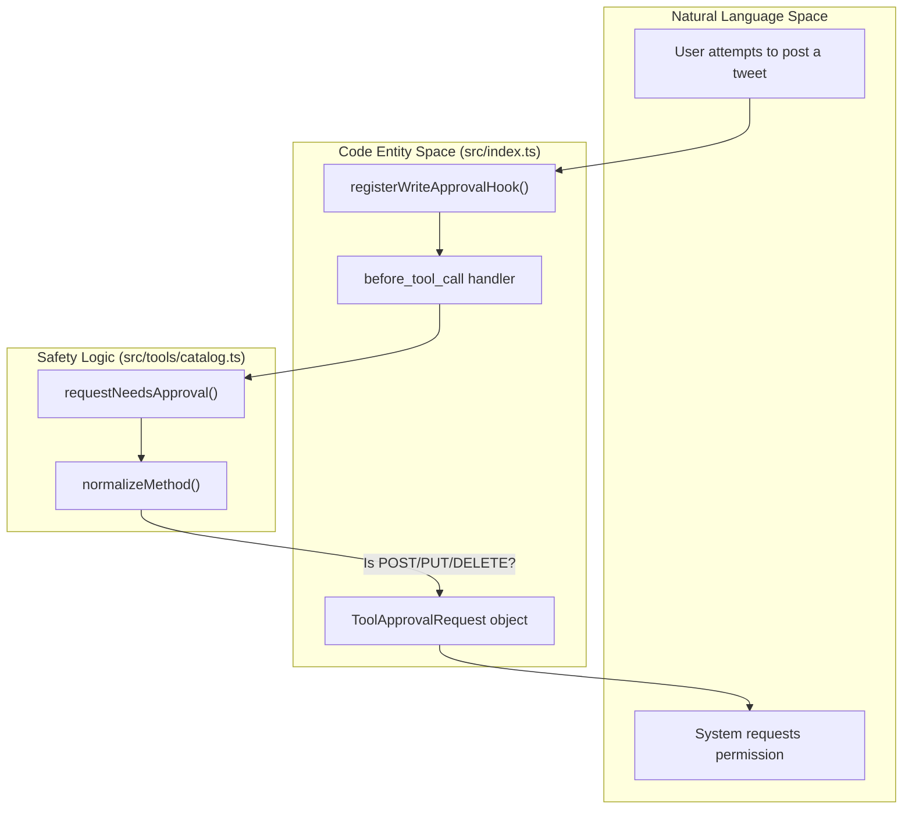
**Sources:** [src/index.ts:335-361](), [src/tools/catalog.ts:58-64]()

---

## Background Service: Event Poller

If `pollingEnabled` is set to `true` (default), the plugin registers a background service named `tweetclaw-poller`.

*   **Registration**: Uses `api.registerService` [src/index.ts:413-417]().
*   **Lifecycle**: The `start()` method initializes the `EventPoller` which begins fetching notifications and mentions from Xquik [src/index.ts:384-402]().
*   **Data Flow**: Polled events are passed back to the OpenClaw host via a callback, where they can trigger agent workflows [src/index.ts:387-393]().

### Poller Configuration Mapping
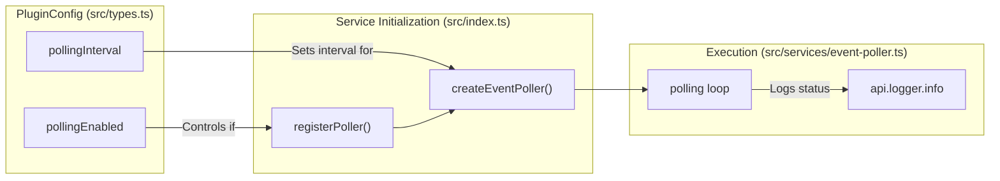
**Sources:** [src/index.ts:363-419](), [src/services/event-poller.ts:25-40]()

---

## Plugin Entry Definition

The final step in `src/index.ts` is the call to `definePluginEntry`. This function (imported from the SDK) wraps the plugin object, ensuring it adheres to the expected interface for OpenClaw's dynamic loading mechanism.

```typescript
export default definePluginEntry({
  configSchema: CONFIG_SCHEMA,
  register,
});
```
**Sources:** [src/index.ts:421-424](), [tests/openclaw-plugin-entry.ts:1-5]()

---

# Page: Event Polling Service

# Event Polling Service

<details>
<summary>Relevant source files</summary>

The following files were used as context for generating this wiki page:

- [src/commands/xtrends.ts](src/commands/xtrends.ts)
- [src/services/event-poller.ts](src/services/event-poller.ts)
- [tests/event-poller.test.ts](tests/event-poller.test.ts)
- [tsconfig.eslint.json](tsconfig.eslint.json)
- [tsconfig.json](tsconfig.json)

</details>


The Event Polling Service is responsible for monitoring the Xquik API for new events (such as new tweets or radar updates) and delivering them to the OpenClaw host. It implements a robust polling loop with cursor-based pagination and exponential backoff to ensure reliable event delivery even during network instability or API downtime.

### Implementation: createEventPoller

The core logic resides in the `createEventPoller()` function, which returns a handle to control the lifecycle of the polling process.

| Entity | Role |
| :--- | :--- |
| `createEventPoller` | Factory function that initializes the poller state and returns `start`/`stop` methods [src/services/event-poller.ts:27-95](). |
| `poll` | An internal asynchronous function that performs the HTTP request to `/api/v1/events` [src/services/event-poller.ts:33-61](). |
| `loop` | The recursive execution wrapper that schedules the next `poll` using `setTimeout` [src/services/event-poller.ts:74-80](). |
| `EventPollerHandle` | Interface defining the `start` and `stop` controls for the service [src/services/event-poller.ts:17-20](). |

**Sources:** [src/services/event-poller.ts:1-98]()

### Polling Logic and Data Flow

The poller maintains an internal `cursor` to track the last processed event. This cursor is sent as the `after` query parameter in subsequent requests to fetch only new data.

#### Sequence Diagram: Polling Cycle
The following diagram illustrates the interaction between the `EventPollerHandle`, the internal `poll` logic, and the Xquik API.

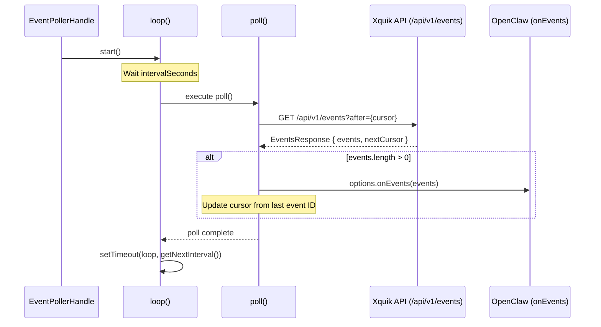
**Sources:** [src/services/event-poller.ts:33-80](), [src/services/event-poller.ts:22-25]()

### Cursor-Based Pagination
The poller uses the `id` field of the final event in a batch to update its cursor. The `extractCursor` function safely retrieves this identifier to ensure the next poll starts exactly where the previous one ended [src/services/event-poller.ts:22-25]().

### Error Handling and Exponential Backoff

To prevent overwhelming the API during failures, the service tracks `consecutiveErrors` [src/services/event-poller.ts:30](). 

- **Success:** `consecutiveErrors` is reset to `0`, and the interval returns to the configured `options.intervalSeconds` [src/services/event-poller.ts:57]().
- **Failure:** The interval increases exponentially using the formula: 
  `min(2^consecutiveErrors * intervalSeconds, 300)` [src/services/event-poller.ts:67-71]().

| Constant | Value | Description |
| :--- | :--- | :--- |
| `BACKOFF_BASE` | `2` | The multiplier for exponential growth [src/services/event-poller.ts:4](). |
| `MAX_BACKOFF_SECONDS` | `300` | The maximum delay (5 minutes) between polls [src/services/event-poller.ts:3](). |

**Sources:** [src/services/event-poller.ts:3-5](), [src/services/event-poller.ts:63-72]()

### Integration with OpenClaw

The poller is registered as a background service during the plugin initialization. It bridges the "Code Entity Space" of the polling logic with the "Natural Language Space" of the plugin's capabilities.

#### Mapping: Service Logic to Plugin Entities

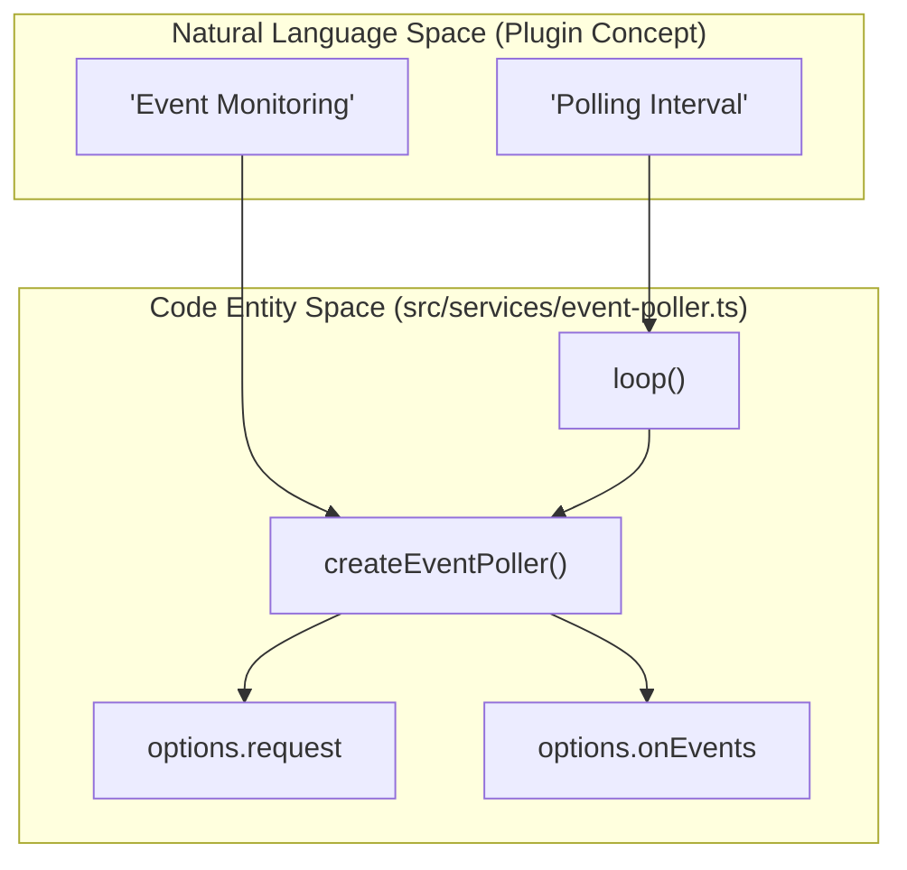

**Sources:** [src/services/event-poller.ts:27-32](), [src/services/event-poller.ts:74-80]()

### Lifecycle Management

The `EventPollerHandle` provides explicit control over the polling state:
- **`start()`**: Sets `stopped` to `false` and schedules the first execution [src/services/event-poller.ts:83-86]().
- **`stop()`**: Sets `stopped` to `true` and clears any pending `setTimeout` using `clearTimeout(timer)` [src/services/event-poller.ts:87-93]().

The `loop` function checks the `stopped` flag before scheduling the next iteration, ensuring that an in-progress poll does not trigger a subsequent one if the service was halted [src/services/event-poller.ts:76-78]().

**Sources:** [src/services/event-poller.ts:82-94](), [tests/event-poller.test.ts:141-161]()

---

# Page: Tools: explore & tweetclaw

# Tools: explore & tweetclaw

<details>
<summary>Relevant source files</summary>

The following files were used as context for generating this wiki page:

- [eslint.config.ts](eslint.config.ts)
- [skills/tweetclaw/SKILL.md](skills/tweetclaw/SKILL.md)
- [src/tools/explore.ts](src/tools/explore.ts)
- [src/tools/tweetclaw.ts](src/tools/tweetclaw.ts)
- [tests/tweetclaw.test.ts](tests/tweetclaw.test.ts)

</details>


TweetClaw exposes two primary tools to the AI agent to facilitate interaction with the Xquik API: `explore` and `tweetclaw`. These tools follow a "Discovery-then-Execution" pattern, where the agent first searches for capabilities and then executes them within a secure, governed environment.

## Overview of Agent Tools

The toolset is designed to abstract the complexity of the X (Twitter) API while maintaining strict safety boundaries and credential isolation.

| Tool | Purpose | Primary Function | File |
| :--- | :--- | :--- | :--- |
| `explore` | Catalog discovery and documentation retrieval. | `handleExplore()` | [src/tools/explore.ts:22-29]() |
| `tweetclaw` | API request execution and result handling. | `handleTweetclaw()` | [src/tools/tweetclaw.ts:51-81]() |

### Interaction Flow
The following diagram illustrates how the agent moves from a natural language request to a concrete code execution via these tools.

**Agent Reasoning & Tool Execution Flow**
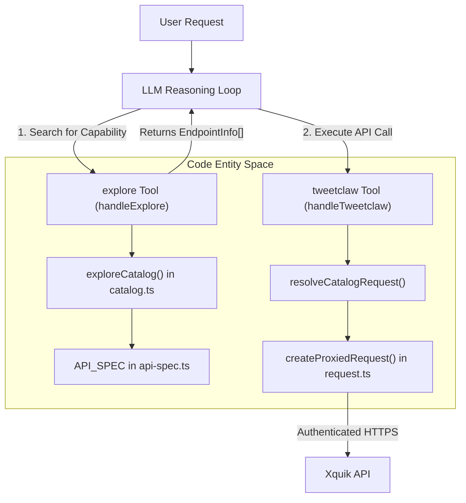
Sources: [src/tools/explore.ts:22-29](), [src/tools/tweetclaw.ts:51-81](), [src/tools/catalog.ts:2-2](), [src/request.ts:1-1]()

---

## 3.1 explore Tool
The `explore` tool serves as the agent's documentation layer. It allows the agent to search through the `API_SPEC` to find the correct `path`, `method`, and `parameters` required for a specific task without making any network requests.

*   **Discovery Logic**: It utilizes `exploreCatalog()` to filter endpoints based on categories, cost (free vs. paid), or MPP eligibility.
*   **Categories**: The tool provides access to 9 categories including `Account`, `Composition`, `Extraction`, and `Twitter/Read`.
*   **Safety**: It never returns "agent-prohibited" endpoints like those used for API key management or billing.

For details, see [explore Tool](#3.1).

Sources: [src/tools/explore.ts:5-20](), [src/tools/explore.ts:22-29](), [src/tools/catalog.ts:1-2]()

---

## 3.2 tweetclaw Tool & Request Execution
The `tweetclaw` tool is the execution engine. It accepts a structured `TweetclawParams` object (containing `path`, `method`, `query`, and `body`) and proxies the request to the Xquik API.

*   **Validation**: Every request is validated against the `specEndpoints` catalog via `resolveCatalogRequest()`. Unknown or prohibited paths are rejected before any network call is made.
*   **Timeout Management**: Execution is wrapped in a `Promise.race` with an `EXECUTION_TIMEOUT_MS` (default 30s) to prevent hanging agent sessions.
*   **Credential Injection**: Auth headers (API Key or MPP signature) are injected automatically by `createProxiedRequest()`; the agent never sees or handles raw credentials.
*   **Safety Gates**: Write actions (POST/PATCH/DELETE) and paid actions trigger an OpenClaw approval hook, requiring explicit user confirmation.

For details, see [tweetclaw Tool & Request Execution](#3.2).

Sources: [src/tools/tweetclaw.ts:6-37](), [src/tools/tweetclaw.ts:51-81](), [src/tools/tweetclaw.ts:64-75](), [src/request.ts:1-1]()

---

## 3.3 Slash Commands: /xstatus & /xtrends
In addition to the LLM-facing tools, TweetClaw provides direct "Slash Commands" that bypass the reasoning loop for common administrative and informational tasks.

*   **`/xstatus`**: Displays the current credential state (API Key vs. MPP), credit balance, and connected X account information.
*   **`/xtrends`**: A shortcut to retrieve curated global or regional trends via the `/api/v1/radar` endpoint.

These commands provide a predictable, formatted output that is more efficient for users than prompting an agent to call a tool.

For details, see [Slash Commands: /xstatus & /xtrends](#3.3).

Sources: [src/commands/xstatus.ts:1-1](), [src/commands/xtrends.ts:1-1](), [skills/tweetclaw/SKILL.md:18-18]()

---

## Technical Mapping: Language to Code

This diagram maps natural language concepts used in the tool descriptions to their specific implementations in the codebase.

**System Concept Mapping**
```mermaid
classDiagram
    class "Natural Language Space" {
        "Search the catalog"
        "Send a tweet"
        "Check credits"
        "MPP Mode"
    }
    class "Code Entity Space" {
        handleExplore()
        handleTweetclaw()
        handleXStatus()
        resolveCatalogRequest()
    }
    "Search the catalog" ..> handleExplore : triggers
    "Send a tweet" ..> handleTweetclaw : triggers
    "Check credits" ..> handleXStatus : triggers
    "MPP Mode" ..> resolveCatalogRequest : restricts via mppMode flag
```
Sources: [src/tools/explore.ts:9-20](), [src/tools/tweetclaw.ts:6-37](), [src/commands/xstatus.ts:1-1](), [src/tools/catalog.ts:62-62]()

---

# Page: explore Tool

# explore Tool

<details>
<summary>Relevant source files</summary>

The following files were used as context for generating this wiki page:

- [eslint.config.ts](eslint.config.ts)
- [src/tools/catalog.ts](src/tools/catalog.ts)
- [src/tools/explore.ts](src/tools/explore.ts)
- [tests/catalog.test.ts](tests/catalog.test.ts)
- [tests/explore.test.ts](tests/explore.test.ts)
- [tests/tweetclaw.test.ts](tests/tweetclaw.test.ts)

</details>


The `explore` tool is a non-executing utility designed to allow AI agents to discover and inspect the Xquik API capabilities within the TweetClaw environment. It provides a searchable catalog of available endpoints, their parameters, costs, and response shapes without performing any network requests.

## Overview and Purpose

The primary goal of `handleExplore()` is to bridge the gap between an agent's natural language intent and the specific technical requirements of the `tweetclaw` execution tool. By searching the catalog, agents can identify the correct `path`, `method`, and `query` parameters needed to perform tasks such as searching tweets, extracting data, or managing account status.

### Key Characteristics
- **Zero Network Latency**: All data is derived from the local `API_SPEC` constant [src/tools/catalog.ts:8-8]().
- **Safety Filtering**: Automatically excludes `agentProhibited` endpoints (e.g., billing, API key management) to prevent the agent from discovering restricted administrative paths [src/tools/catalog.ts:8-8]().
- **Structured Search**: Supports filtering by category, cost (free/paid), and MPP eligibility [src/tools/explore.ts:11-18]().

---

## Data Flow: From Spec to Search

The tool transforms the static `API_SPEC` into a searchable interface through several layers of normalization and filtering.

### Data Derivation
The `specEndpoints` constant serves as the ground truth for the tool. It is derived by filtering the master `API_SPEC` to remove any endpoints flagged as `agentProhibited` [src/tools/catalog.ts:8-8]().

### Logic Flow
The following diagram illustrates how a user's `ExploreParams` are processed by `handleExplore` and `exploreCatalog`.

**Logic Flow: exploreCatalog**
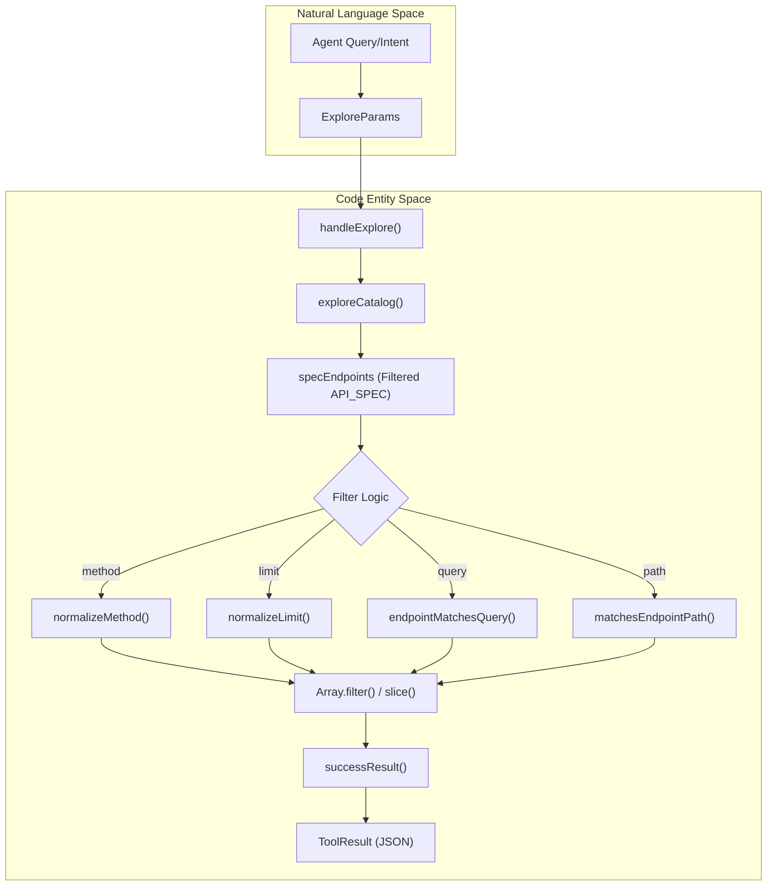
**Sources:** [src/tools/explore.ts:22-29](), [src/tools/catalog.ts:120-135]()

---

## Implementation Details

### ExploreParams Interface
The `ExploreParams` interface defines the structured filters available to the agent:

| Parameter | Type | Description |
| :--- | :--- | :--- |
| `query` | `string` | Keyword search across summaries, paths, response shapes, and parameters. |
| `category` | `string` | Filters by functional group (e.g., `twitter`, `extraction`, `composition`). |
| `method` | `string` | HTTP method (GET, POST, etc.). |
| `path` | `string` | Exact or partial API path match. |
| `free` | `boolean` | Filter for free vs. paid endpoints. |
| `mpp` | `boolean` | Filter for endpoints eligible for Multi-Party Protocol (MPP) signing. |
| `limit` | `number` | Result cap (1-100, default 25). |

**Sources:** [src/tools/explore.ts:9-20](), [src/tools/catalog.ts:120-125]()

### Filtering Logic
The core filtering occurs in `exploreCatalog()` [src/tools/catalog.ts:120-135](). 

1. **Keyword Search**: `endpointMatchesQuery()` creates a "haystack" string by joining the endpoint's category, method, path, response shape, summary, and all parameter metadata (names, descriptions, types) [src/tools/catalog.ts:101-118]().
2. **Path Matching**: `matchesEndpointPath()` handles template variables (e.g., matching `/api/v1/x/tweets/123` against `/api/v1/x/tweets/:id`) by splitting paths into segments and treating segments starting with `:` as wildcards [src/tools/catalog.ts:26-36]().
3. **Limit Enforcement**: `normalizeLimit()` ensures the agent cannot request more than 100 descriptors at once, protecting the context window from overflow [src/tools/catalog.ts:14-19]().

### SEARCH_DESCRIPTION
The tool exports a `SEARCH_DESCRIPTION` constant [src/tools/explore.ts:9-20](). This string is used during tool registration to provide the LLM with instructions on how to use the filters effectively. It dynamically lists available categories by extracting unique values from `specEndpoints` [src/tools/explore.ts:5-7]().

---

## Relationship with API Specification

The `explore` tool acts as the "Read-Only" view of the `API_SPEC`. While the `tweetclaw` tool uses `resolveCatalogRequest()` to validate and execute calls, `explore` uses the same catalog to facilitate discovery.

**Entity Association: Spec to Tool**
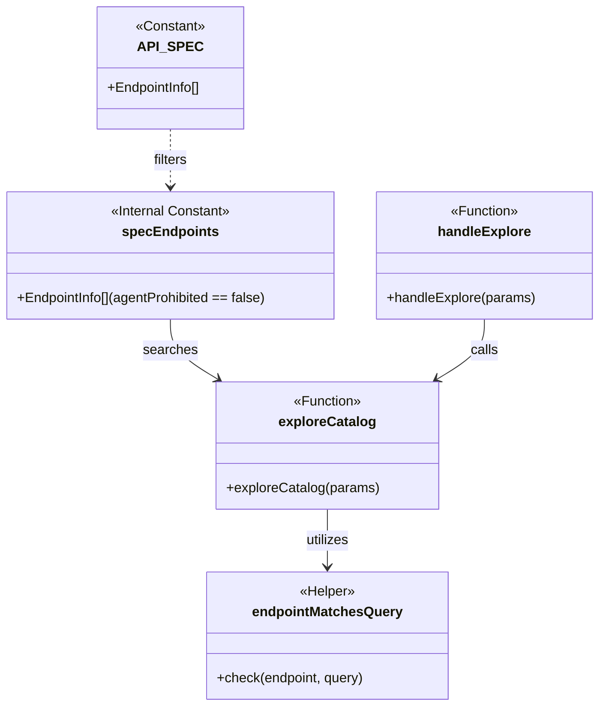
**Sources:** [src/tools/catalog.ts:1-8](), [src/tools/explore.ts:1-25]()

## Error Handling
The tool is designed to be resilient. If `exploreCatalog` throws an error (e.g., due to invalid parameter types), `handleExplore` catches the exception and returns a `ToolResult` with `isError: true` using the `errorResult` helper [src/tools/explore.ts:26-28]().

**Sources:** [src/tools/explore.ts:22-29](), [src/tools/result.ts:109-115]()

---

# Page: tweetclaw Tool & Request Execution

# tweetclaw Tool & Request Execution

<details>
<summary>Relevant source files</summary>

The following files were used as context for generating this wiki page:

- [src/request.ts](src/request.ts)
- [src/tools/result.ts](src/tools/result.ts)
- [src/tools/tweetclaw.ts](src/tools/tweetclaw.ts)
- [src/truncate.ts](src/truncate.ts)
- [tests/request.test.ts](tests/request.test.ts)

</details>


This page details the implementation of the core execution engine for the `tweetclaw` tool. It covers the flow from tool invocation to HTTP request dispatching, including safety enforcement, timeout handling, and credential injection.

## Tool Entry Point: `handleTweetclaw`

The `handleTweetclaw` function is the primary entry point for the `tweetclaw` tool [src/tools/tweetclaw.ts:51-51](). It orchestrates the translation of agent-provided parameters into a concrete API request and handles the lifecycle of that request.

### Execution Flow
1.  **Resolution**: The function calls `resolveCatalogRequest` to validate the requested path and method against the bundled API specification [src/tools/tweetclaw.ts:62-62]().
2.  **Request Creation**: It initializes a `RequestFunction` via `createProxiedRequest`, which encapsulates base URL, credentials, and fetch logic [src/tools/tweetclaw.ts:63-63]().
3.  **Timeout Race**: To prevent hanging tool calls, the execution is wrapped in a `Promise.race` between the actual network request and a 30-second timer [src/tools/tweetclaw.ts:64-75]().
4.  **Result Processing**: On success, the JSON response is passed to `successResult` for truncation and formatting [src/tools/tweetclaw.ts:77-77](). Errors are caught and returned as `errorResult` [src/tools/tweetclaw.ts:79-79]().

### Diagram: Tool Execution Pipeline
The following diagram maps the logical execution steps to the specific code entities involved.

```mermaid
graph TD
    subgraph "Natural Language Space"
        UserAction["Agent: 'Search for AI news'"]
    end

    subgraph "Code Entity Space (src/tools/tweetclaw.ts)"
        Params["TweetclawParams"]
        Handle["handleTweetclaw()"]
        Race["Promise.race()"]
        Timeout["EXECUTION_TIMEOUT_MS (30s)"]
    end

    subgraph "Execution & Safety (src/request.ts)"
        Resolve["resolveCatalogRequest()"]
        ProxiedReq["createProxiedRequest()"]
        Validate["validateRequestPath()"]
        Prohibited["isProhibitedRequest()"]
    end

    UserAction --> Params
    Params --> Handle
    Handle --> Resolve
    Resolve --> ProxiedReq
    ProxiedReq --> Validate
    Validate --> Prohibited
    Handle --> Race
    Race --> Timeout
    Race --> ProxiedReq
```
Sources: [src/tools/tweetclaw.ts:39-75](), [src/request.ts:76-110]()

## Request Proxying & Safety Enforcement

The `createProxiedRequest` function in `src/request.ts` returns an asynchronous function that handles the low-level HTTP mechanics [src/request.ts:87-91](). It acts as a gatekeeper, ensuring no prohibited actions are taken by the agent.

### Prohibited Endpoint Enforcement
Before any request is dispatched, `validateRequestPath` is called [src/request.ts:94-94](). This function enforces two critical rules:
1.  **Prefix Check**: All paths must start with `/api/v1/` [src/request.ts:77-79]().
2.  **Prohibited List**: It checks the `isProhibitedRequest` helper against static lists and regex patterns [src/request.ts:80-85]().

#### Blocked Operations
The system explicitly blocks endpoints related to account security and billing to prevent prompt injection from compromising user accounts:
*   **Account Management**: `PATCH /api/v1/account`, `PUT /api/v1/account/x-identity`, and account deletion [src/request.ts:38-39, 53-54]().
*   **Authentication**: Account connection (`POST /api/v1/x/accounts`) and re-authentication [src/request.ts:46-47, 55-55]().
*   **Billing**: Credit top-ups, subscription checkouts, and billing status reads [src/request.ts:42-45, 173-174]().
*   **Support**: All support ticket interactions are prohibited for agents [src/request.ts:58-63]().

### Credential Injection
The proxy automatically determines the correct authentication header based on the credential format:
*   **X-API-Key**: Used if the credential starts with `xq_` [src/request.ts:13-15]().
*   **Bearer Token**: Used for all other credentials (MPP/Tempo tokens) [src/request.ts:16-16]().
*   **MPP Mode**: If no credential is provided, auth headers are omitted [src/request.ts:20-20]().

### Diagram: Request Validation & Dispatch
This diagram illustrates the internal logic of the request proxying system.

```mermaid
flowchart TD
    subgraph "src/request.ts"
        Entry["createProxiedRequest() Call"]
        CheckPrefix{"Path starts with /api/v1/?"}
        CheckProhibited{"isProhibitedRequest()?"}
        BuildHeaders["buildFetchHeaders()"]
        BuildUrl["buildFetchUrl()"]
        Fetch["fetch() with AbortSignal"]
        
        ErrorPrefix["Error: Path must start with..."]
        ErrorProhibited["Error: Agent-prohibited endpoint"]
    end

    Entry --> CheckPrefix
    CheckPrefix -- "No" --> ErrorPrefix
    CheckPrefix -- "Yes" --> CheckProhibited
    CheckProhibited -- "Yes" --> ErrorProhibited
    CheckProhibited -- "No" --> BuildHeaders
    BuildHeaders --> BuildUrl
    BuildUrl --> Fetch
```
Sources: [src/request.ts:12-35](), [src/request.ts:65-110]()

## Response Truncation

To stay within LLM context window limits, all successful tool results are processed by `truncateResponse` [src/truncate.ts:24-26]().

| Constant | Value | Description |
| :--- | :--- | :--- |
| `MAX_RESPONSE_CHARS` | 24,000 | The maximum string length allowed before truncation [src/truncate.ts:1-1](). |
| `MAX_TOKENS` | 6,000 | The approximate token limit reported in the truncation message [src/truncate.ts:3-3](). |
| `CHARS_PER_TOKEN` | 4 | The heuristic used to estimate token counts [src/truncate.ts:2-2](). |

If a response exceeds the limit, it is sliced, and a message is appended advising the agent to use more specific queries or filters [src/truncate.ts:5-12]().

Sources: [src/truncate.ts:1-29](), [src/tools/result.ts:11-13]()

## Summary of Constraints

| Feature | Implementation Detail |
| :--- | :--- |
| **Timeout** | 30 seconds enforced via `Promise.race` [src/tools/tweetclaw.ts:39-75](). |
| **MPP Mode** | Enforced in `resolveCatalogRequest`; limits available endpoints to MPP-eligible ones [src/tools/tweetclaw.ts:62-62](). |
| **Write Gates** | Handled via the OpenClaw `write-action` approval hook (configured during plugin registration). |
| **Method Safety** | Validated against the `API_SPEC` to ensure the agent uses the correct HTTP verb for the target path [src/tools/tweetclaw.ts:62-62](). |

Sources: [src/tools/tweetclaw.ts:39-83](), [src/request.ts:76-85]()

---

# Page: Slash Commands: /xstatus & /xtrends

# Slash Commands: /xstatus & /xtrends

<details>
<summary>Relevant source files</summary>

The following files were used as context for generating this wiki page:

- [src/commands/xstatus.ts](src/commands/xstatus.ts)
- [src/commands/xtrends.ts](src/commands/xtrends.ts)
- [src/services/event-poller.ts](src/services/event-poller.ts)
- [tests/xstatus.test.ts](tests/xstatus.test.ts)
- [tests/xtrends.test.ts](tests/xtrends.test.ts)
- [tsconfig.eslint.json](tsconfig.eslint.json)
- [tsconfig.json](tsconfig.json)

</details>


This page documents the implementation of the two primary slash commands provided by TweetClaw: `/xstatus` and `/xtrends`. Unlike agentic tools (e.g., `explore` or `tweetclaw`), these commands are designed for direct user interaction. They bypass the LLM reasoning loop to provide immediate, formatted feedback regarding account health and real-time trending data.

## Command Architecture and Data Flow

Slash commands in TweetClaw are implemented as standalone handler functions that consume a `RequestFunction`. This abstraction allows the commands to execute authenticated requests against the Xquik API regardless of whether the plugin is running in API-key or MPP mode.

### Execution Loop Bypass
While tools require the LLM to decide on parameters and parse results, slash commands return pre-formatted strings directly to the user interface. This ensures low latency and consistent presentation of system information.

### Command Implementation Overview

| Command | Entry Point | API Endpoint | Purpose |
| :--- | :--- | :--- | :--- |
| `/xstatus` | `handleXStatus()` | `/api/v1/account` | Displays subscription status, usage percentages, and X account linkage. |
| `/xtrends` | `handleXTrends()` | `/api/v1/radar` | Fetches and formats the top trending topics, optionally filtered by category. |

**Sources:** [src/commands/xstatus.ts:68-74](), [src/commands/xtrends.ts:43-57]()

---

## /xstatus: Account and Usage Monitoring

The `/xstatus` command provides a snapshot of the user's Xquik environment. It is primarily used to verify authentication and monitor credit consumption.

### Implementation: handleXStatus
The `handleXStatus` function invokes the `/api/v1/account` endpoint. The response is validated against the `AccountResponse` interface and passed to a formatter.

**Key Components:**
- **`AccountResponse`**: Interface defining the structure of the Xquik account data, including `subscription` details and `usage` metrics [src/commands/xstatus.ts:3-15]().
- **`formatAccountStatus`**: Orchestrates the assembly of the status string, calling sub-formatters for subscription and usage blocks [src/commands/xstatus.ts:44-66]().

### Account Status Logic Flow

The following diagram maps the natural language command to the code entities responsible for processing the account status.

**Diagram: /xstatus Execution Path**
```mermaid
graph TD
    User["User Input: /xstatus"] --> HC["handleXStatus() [src/commands/xstatus.ts]"]
    HC --> RF["RequestFunction [src/types.ts]"]
    RF --> API["GET /api/v1/account"]
    API --> VAL{"isAccountResponse()"}
    VAL -- "Invalid" --> ERR["Return Header Only"]
    VAL -- "Valid" --> FAS["formatAccountStatus()"]
    FAS --> FSL["formatSubscriptionLine()"]
    FAS --> FUL["formatUsageLines()"]
    FSL --> OUT["Formatted String Output"]
    FUL --> OUT
```
**Sources:** [src/commands/xstatus.ts:17-42](), [src/commands/xstatus.ts:68-76]()

---

## /xtrends: Real-time Radar Data

The `/xtrends` command allows users to query the Xquik "Radar" system for trending topics. It supports an optional category filter (e.g., `tech`, `news`).

### Implementation: handleXTrends
The `handleXTrends` function constructs an optional query object if a `categoryFilter` is provided. It targets the `/api/v1/radar` endpoint.

**Key Components:**
- **`TrendItem`**: Represents a single trending topic, including its `score`, `source`, and `url` [src/commands/xtrends.ts:3-10]().
- **`RadarResponse`**: A wrapper for a list of `TrendItem` objects and a `total` count [src/commands/xtrends.ts:12-15]().
- **`formatTrends`**: Iterates through the items to build a numbered list with metadata annotations [src/commands/xtrends.ts:21-41]().

### Parameter Handling
The command logic ensures that empty or whitespace-only category filters are ignored to prevent malformed API queries [src/commands/xtrends.ts:44-51]().

**Diagram: /xtrends Parameter and Formatting Flow**
```mermaid
graph TD
    Input["/xtrends [category]"] --> HXT["handleXTrends() [src/commands/xtrends.ts]"]
    HXT --> Filter{"Has Category?"}
    Filter -- "Yes" --> Q["Add 'category' to Query Params"]
    Filter -- "No" --> P["Execute Request without Query"]
    Q --> REQ["request('/api/v1/radar')"]
    P --> REQ
    REQ --> FT["formatTrends() [src/commands/xtrends.ts]"]
    FT --> Loop["For each TrendItem..."]
    Loop --> Line["Build: index. title [source] (score)"]
    Line --> Join["Join with Newlines"]
    Join --> Result["Final Output String"]
```
**Sources:** [src/commands/xtrends.ts:21-57]()

---

## Error Handling and Fallbacks

Both commands implement defensive programming patterns to ensure the UI remains stable even if the API returns unexpected data or the network fails.

### Validation Guards
The functions `isAccountResponse` [src/commands/xstatus.ts:17-19]() and `isRadarResponse` [src/commands/xtrends.ts:17-19]() act as type guards. If the API response does not match the expected schema, the commands return a "header-only" fallback string rather than throwing an unhandled exception or returning `undefined`.

### Request Failures
If the underlying `RequestFunction` throws an error (e.g., 401 Unauthorized or 500 Internal Server Error), the error is propagated up to the OpenClaw plugin host. This allows the host to display a standardized error message to the user.

| Scenario | Behavior | Code Reference |
| :--- | :--- | :--- |
| API returns non-object | Returns "--- [Title] (0 items) ---" | [src/commands/xtrends.ts:53-56]() |
| Missing optional fields | Formatter skips specific lines (e.g., missing score) | [src/commands/xstatus.ts:30-33]() |
| Network/Auth Error | Error is re-thrown to Plugin Host | [tests/xstatus.test.ts:48-54]() |

**Sources:** [src/commands/xstatus.ts:70-73](), [src/commands/xtrends.ts:53-56](), [tests/xstatus.test.ts:48-62]()

---

# Page: Xquik API Specification

# Xquik API Specification

<details>
<summary>Relevant source files</summary>

The following files were used as context for generating this wiki page:

- [skills/tweetclaw/SKILL.md](skills/tweetclaw/SKILL.md)
- [src/api-spec.ts](src/api-spec.ts)

</details>


The Xquik API Specification defines the surface area of the Xquik platform accessible via the TweetClaw plugin. This specification serves as the source of truth for the `explore` tool to provide discovery and for the `tweetclaw` tool to execute requests against Xquik's high-performance X/Twitter infrastructure.

The specification is codified in `src/api-spec.ts` as the `API_SPEC` constant, which includes metadata for 99 endpoints, including their HTTP methods, paths, parameter schemas, and pricing information.

## System Overview

The API is structured to bridge the gap between high-level agent intents and low-level RESTful operations. It categorizes functionality into distinct domains such as Extraction (bulk data), Radar (keyword monitoring), and Twitter/Read (direct X data access).

### Code Entity Mapping
The following diagram maps the logical API concepts to their specific implementations within the codebase.

**Diagram: API Specification to Code Entity Mapping**
```mermaid
graph TD
    subgraph "Natural Language Space"
        A["API Endpoint"]
        B["Parameter Schema"]
        C["Pricing Tier"]
    end

    subgraph "Code Entity Space (src/api-spec.ts)"
        A --> D["EndpointInfo Interface"]
        B --> E["PAGINATION_PARAMS"]
        B --> F["EXTRACTION_SEARCH_PARAMS"]
        C --> G["MPP_PRICE_TWEET"]
        C --> H["MPP_PRICE_USER"]
        
        D --> I["API_SPEC (Array)"]
    end

    subgraph "Tool Integration"
        I --> J["exploreCatalog() in src/tools/catalog.ts"]
        I --> K["resolveCatalogRequest() in src/tools/tweetclaw.ts"]
    end
```
**Sources:** [src/api-spec.ts:1-119](), [src/tools/catalog.ts:1-15](), [src/tools/tweetclaw.ts:1-25]()

---

## Endpoint Categories

The API surface is organized into nine functional categories. Each category defines a specific set of capabilities, from account management to advanced data extraction.

| Category | Purpose | Example Endpoint |
| :--- | :--- | :--- |
| `x-accounts` | Manage connected X accounts | `POST /x/accounts/connect` |
| `composition` | AI-assisted tweet and style generation | `POST /compose/tweet` |
| `extraction` | Bulk data harvesting jobs | `POST /extract/tweet-search` |
| `monitoring` | Track specific users for new events | `POST /monitors` |
| `radar` | Global keyword and phrase tracking | `POST /radar` |
| `twitter-read` | Real-time X data retrieval | `GET /x/tweets/:id` |
| `x-write` | State-changing actions on X | `POST /x/tweets` |
| `webhooks` | Real-time data delivery to external URLs | `POST /webhooks` |
| `credits` | Billing and usage management | `GET /credits/balance` |

For a full list of endpoints and their parameters, see [Endpoint Catalog & Categories](#4.1).

**Sources:** [src/api-spec.ts:7-14](), [src/api-spec.ts:121-150]()

---

## Billing and Credit Model

Xquik operates on a credit-based billing system where 1 credit equals $0.00015. The `API_SPEC` defines the cost for each operation, allowing the plugin to calculate and warn users about costs before execution.

### Operation Tiers
The system differentiates between standard credit-based billing (for authenticated accounts) and the Machine Payments Protocol (MPP) for anonymous, read-only access.

*   **Read Actions:** Generally cost 1 credit (e.g., tweet lookup).
*   **Write Actions:** Cost 10 credits (e.g., posting a tweet).
*   **Extraction:** Charged per result returned (typically 1 credit/result).
*   **Free:** Management endpoints (monitoring, webhooks) are often 0 credits.

For detailed pricing tables and MPP flow, see [Credit Billing & MPP Pricing](#4.2).

**Sources:** [skills/tweetclaw/SKILL.md:36-52](), [src/api-spec.ts:8-14]()

---

## Safety and Security Boundaries

The API specification includes an `agentProhibited` flag on specific endpoints to prevent autonomous agents from performing sensitive administrative tasks without direct user intervention via a UI.

**Diagram: Request Filtering Flow**
```mermaid
graph TD
    subgraph "Request Initiation"
        A["Agent calls tweetclaw tool"]
    end

    subgraph "src/request.ts Enforcement"
        A --> B{"Is Path in PROHIBITED_PATHS?"}
        B -- "Yes" --> C["Return 403 Forbidden"]
        B -- "No" --> D{"Does it match PROHIBITED_PATH_PATTERNS?"}
        D -- "Yes" --> C
        D -- "No" --> E["Check API_SPEC agentProhibited flag"]
    end

    subgraph "Execution"
        E -- "Allowed" --> F["Execute createProxiedRequest()"]
        E -- "Prohibited" --> C
    end
```

Key security features include:
*   **Prohibited Paths:** Hardcoded list in `src/request.ts` (e.g., `/credits/topup`, `/x/accounts/connect`).
*   **Write Approval:** All state-changing actions require an explicit user confirmation hook.
*   **Credential Isolation:** API keys are managed by the plugin and never exposed to the LLM context.

For more information on the security model, see [Safety Boundaries & Agent-Prohibited Endpoints](#4.3).

**Sources:** [src/request.ts:10-35](), [src/tools/tweetclaw.ts:40-60](), [skills/tweetclaw/SKILL.md:20-33]()

---

# Page: Endpoint Catalog & Categories

# Endpoint Catalog & Categories

<details>
<summary>Relevant source files</summary>

The following files were used as context for generating this wiki page:

- [registry/agentregistry-steps.md](registry/agentregistry-steps.md)
- [src/api-spec.ts](src/api-spec.ts)
- [src/tools/catalog.ts](src/tools/catalog.ts)
- [tests/api-spec.test.ts](tests/api-spec.test.ts)
- [tests/catalog.test.ts](tests/catalog.test.ts)

</details>


TweetClaw exposes a comprehensive catalog of 118 endpoints defined in the Xquik API specification [src/api-spec.ts:40](). While the full API is defined, only 99 endpoints are made available to AI agents via the `explore` and `tweetclaw` tools [registry/agentregistry-steps.md:41-42](). This section details the categorization, parameter patterns, and security constraints governing this catalog.

## Catalog Architecture

The catalog is defined as a central constant, `API_SPEC`, which serves as the single source of truth for tool discovery and request validation [src/api-spec.ts:1]().

### Data Flow: From Spec to Tool
The system filters the raw `API_SPEC` into `specEndpoints` by excluding any routes marked with the `agentProhibited` flag [src/tools/catalog.ts:8-9]().

1.  **Discovery**: The `explore` tool queries `specEndpoints` to help the agent find the correct path and method [src/tools/catalog.ts:120-135]().
2.  **Validation**: When the `tweetclaw` tool is called, `resolveCatalogRequest` verifies the requested path and method against `specEndpoints` [src/tools/catalog.ts:86-89]().
3.  **Normalization**: Parameters are converted to the expected types (e.g., converting numeric query params to strings for URL construction) [src/tools/catalog.ts:53-56]().

### Mapping Code Entities to API Concepts

The following diagram illustrates how the static specification in `src/api-spec.ts` is transformed into executable tool logic.

**API Specification to Tool Execution Map**
```mermaid
graph TD
    subgraph "Code Entity Space (src/api-spec.ts)"
        A["API_SPEC (Array)"] --> B["EndpointInfo (Interface)"]
        B --> C["agentProhibited (Flag)"]
        B --> D["mpp (Price Metadata)"]
    end

    subgraph "Filtering Logic (src/tools/catalog.ts)"
        E["specEndpoints"] -- "Filters agentProhibited: true" --> A
        F["exploreCatalog()"] -- "Searches" --> E
        G["resolveCatalogRequest()"] -- "Validates" --> E
    end

    subgraph "Natural Language Space (Agent Interaction)"
        H["explore tool"] --> F
        I["tweetclaw tool"] --> G
        J["Agent Request"] -- "method/path" --> I
    end
```
Sources: [src/api-spec.ts:1-50](), [src/tools/catalog.ts:8-135]()

## Endpoint Categories

Endpoints are organized into 9 primary categories. Each category represents a specific functional domain within the X/Twitter ecosystem.

| Category | Description | Key Endpoints |
| :--- | :--- | :--- |
| **Account** | Management of X credentials and session status. | `/api/v1/x/accounts`, `/api/v1/xstatus` |
| **Composition** | AI-assisted tweet drafting and style management. | `/api/v1/composition/draft`, `/api/v1/composition/styles` |
| **Extraction** | High-volume data scraping and search exports. | `/api/v1/extractions/search`, `/api/v1/extractions/:id` |
| **Monitoring** | Real-time tracking of keywords and users. | `/api/v1/monitors/keywords`, `/api/v1/monitors/users` |
| **Radar** | Discovery of trending topics and signals. | `/api/v1/x/trends`, `/api/v1/radar/signals` |
| **Twitter/Read** | Standard data retrieval from X (Timelines, Profiles). | `/api/v1/x/tweets/:id`, `/api/v1/x/users/:id` |
| **X Write** | State-changing actions on X. | `/api/v1/x/tweets` (POST), `/api/v1/x/users/:id/follow` |
| **Webhooks** | Configuration for push notifications. | `/api/v1/webhooks` |
| **Credits** | Billing and usage information. | `/api/v1/credits/balance` |

Sources: [src/api-spec.ts:7-15](), [tests/api-spec.test.ts:43-61]()

## Parameter Reuse Patterns

To ensure consistency across 99 endpoints, TweetClaw utilizes standardized parameter sets.

### Pagination (PAGINATION_PARAMS)
Most `GET` requests involving lists (followers, timelines, search results) utilize `PAGINATION_PARAMS` [src/api-spec.ts:16-19]():
*   `limit`: Max items per page (number).
*   `after`: Pagination cursor for the next page (string).

### Extraction Search (EXTRACTION_SEARCH_PARAMS)
The Extraction engine uses a robust set of filters for deep-history searches [src/api-spec.ts:21-38]():
*   **Temporal**: `sinceDate`, `untilDate`.
*   **Engagement**: `minFaves`, `minRetweets`, `minReplies`.
*   **Filters**: `mediaType`, `verifiedOnly`, `language`.
*   **Query**: `exactPhrase`, `excludeWords`, `advancedQuery`.

Sources: [src/api-spec.ts:16-38]()

## Security Boundaries: agentProhibited

The `agentProhibited` flag is a critical security control. It prevents the LLM from accessing endpoints that could compromise the user's account or financial security [src/tools/catalog.ts:8-9]().

### Prohibited Actions
Endpoints marked `agentProhibited: true` are stripped from the `specEndpoints` list and cannot be called via the `tweetclaw` tool [src/tools/catalog.ts:74-85](). These include:
*   **Credential Management**: Re-authenticating accounts or adding new X accounts [tests/catalog.test.ts:77-78]().
*   **API Key Management**: Creating or deleting Xquik API keys [tests/catalog.test.ts:80]().
*   **Billing**: Initiating credit top-ups or viewing payment status [tests/catalog.test.ts:82-83]().
*   **Support**: Creating support tickets [tests/catalog.test.ts:84]().

### Request Validation Logic
The `resolveCatalogRequest` function enforces these boundaries at runtime.

**Request Validation Flow**
```mermaid
graph TD
    subgraph "Validation Pipeline (src/tools/catalog.ts)"
        Start["Agent Call"] --> PathCheck{"Path starts with /api/v1/?"}
        PathCheck -- "No" --> Err1["Throw Error"]
        PathCheck -- "Yes" --> FindEP["findEndpoint(method, path)"]
        
        FindEP -- "Not Found" --> Err2["Throw 'Not in Catalog'"]
        FindEP -- "Found" --> MPPCheck{"mppMode Active?"}
        
        MPPCheck -- "Yes" --> IsMPP{"Endpoint.mpp defined?"}
        IsMPP -- "No" --> Err3["Throw 'Not available in MPP'"]
        IsMPP -- "Yes" --> Success
        MPPCheck -- "No" --> Success["Return Normalized Request"]
    end
```
Sources: [src/tools/catalog.ts:38-51](), [src/tools/catalog.ts:73-99]()

## Catalog Integrity and Testing

The catalog is strictly validated to ensure it remains a reliable interface for agents.
*   **Uniqueness**: Tests verify there are no duplicate `method + path` combinations [tests/api-spec.test.ts:5-10]().
*   **Structure**: Every entry must contain a `category`, `free` status, `method`, `path`, and `summary` [tests/api-spec.test.ts:12-23]().
*   **Parameter Safety**: Tests ensure no sensitive parameter names like `password` or `totp_secret` are exposed in the catalog [tests/catalog.test.ts:87-97]().

Sources: [tests/api-spec.test.ts:1-96](), [tests/catalog.test.ts:1-122]()

---

# Page: Credit Billing & MPP Pricing

# Credit Billing & MPP Pricing

<details>
<summary>Relevant source files</summary>

The following files were used as context for generating this wiki page:

- [skills/tweetclaw/SKILL.md](skills/tweetclaw/SKILL.md)
- [src/api-spec.ts](src/api-spec.ts)
- [src/mpp.ts](src/mpp.ts)
- [src/types.ts](src/types.ts)
- [tests/index.test.ts](tests/index.test.ts)

</details>


TweetClaw operates on a credit-based billing model provided by Xquik, where operations are charged based on their resource intensity and type. It supports two primary payment flows: account-backed credits (via API Key) and Machine Payments Protocol (MPP) for anonymous, on-chain, pay-per-use access.

## Credit Model Overview

The fundamental unit of currency in the ecosystem is the credit.
*   **Exchange Rate**: 1 credit = $0.00015 [skills/tweetclaw/SKILL.md:36-36]().
*   **Balance Management**: Users top up credits via the Xquik dashboard, and the plugin can query the current balance via the `/api/v1/credits` endpoint [skills/tweetclaw/SKILL.md:68-68]().

### Operation Cost Tiers

Costs are categorized by the nature of the interaction with the X platform.

| Operation Category | Credits | Cost (USD) | Examples |
|:---|:---|:---|:---|
| **Free** | 0 | $0.00000 | Monitors, Webhooks, Radar, Compose [skills/tweetclaw/SKILL.md:51-51]() |
| **Read (Standard)** | 1 | $0.00015 | Tweet lookup, Search, Timelines, User Profiles [skills/tweetclaw/SKILL.md:42-43]() |
| **Read (Trends)** | 3 | $0.00045 | Global or specific trends [skills/tweetclaw/SKILL.md:44-44]() |
| **Specialized Read** | 5 | $0.00075 | Follow checks, Article lookups [skills/tweetclaw/SKILL.md:45-45]() |
| **Write** | 10 | $0.00150 | Posting, Liking, Retweeting, Following, DMs [skills/tweetclaw/SKILL.md:46-46]() |
| **Extraction** | 1 / result | $0.00015 / result | Bulk replies, followers, or likes [skills/tweetclaw/SKILL.md:47-48]() |

**Sources:** [skills/tweetclaw/SKILL.md:36-52]()

---

## Machine Payments Protocol (MPP)

MPP allows for anonymous, read-only access to a subset of the Xquik API without requiring a traditional account or subscription [skills/tweetclaw/SKILL.md:69-69]().

### MPP Price Constants
The codebase defines specific price strings used for the `mpp` metadata in the API specification. These constants reflect the per-unit cost in USD.

*   `MPP_PRICE_CALL`: $0.00015/call [src/api-spec.ts:8-8]()
*   `MPP_PRICE_TWEET`: $0.00015/tweet [src/api-spec.ts:13-13]()
*   `MPP_PRICE_USER`: $0.00015/user [src/api-spec.ts:14-14]()
*   `MPP_PRICE_TREND`: $0.00045/call [src/api-spec.ts:12-12]()
*   `MPP_PRICE_FOLLOW_CHECK`: $0.00105/call [src/api-spec.ts:10-10]()

### MPP Implementation and Initialization
MPP is initialized using the `tempoSigningKey` provided in the plugin configuration [src/types.ts:59-59](). The initialization process dynamically loads the required blockchain libraries to keep the core plugin lightweight.

**MPP Initialization Flow**
The `initMpp` function handles the setup of the `mppx` client.

1.  **Dependency Check**: It attempts to load `mppx/client` and `viem/accounts` [src/mpp.ts:25-30]().
2.  **Account Creation**: It converts the `tempoSigningKey` into a blockchain account using `privateKeyToAccount` [src/mpp.ts:36-36]().
3.  **Method Registration**: It creates a `tempo` payment method and registers it with the `Mppx` global instance [src/mpp.ts:37-38]().

**Sources:** [src/mpp.ts:23-39](), [src/api-spec.ts:8-14](), [skills/tweetclaw/SKILL.md:69-72]()

---

## Technical Data Flow: Pricing & Billing

The following diagram bridges the natural language pricing concepts to the code entities that define and enforce them.

**Pricing Logic to Code Entity Mapping**
```mermaid
graph TD
    subgraph "Natural Language Space"
        A["1 Credit = $0.00015"]
        B["Read/Write Tiers"]
        C["Pay-per-use (MPP)"]
    end

    subgraph "Code Entity Space (src/api-spec.ts)"
        D["EndpointInfo.free (boolean)"]
        E["EndpointInfo.mpp (object)"]
        F["MPP_PRICE_TWEET (string)"]
    end

    subgraph "Execution Logic (src/mpp.ts)"
        G["initMpp()"]
        H["tempoSigningKey"]
    end

    A --- D
    B --- D
    C --- E
    E --- F
    H --- G
```
**Sources:** [src/api-spec.ts:8-14](), [src/types.ts:9-20](), [src/mpp.ts:23-39]()

---

## HTTP 402 Challenge Flow

When an operation requires payment (either because the API key balance is exhausted or an MPP payment is required), the Xquik API issues an **HTTP 402 Payment Required** challenge.

1.  **Request Initiation**: The `tweetclaw` tool or a service calls `fetch`.
2.  **Challenge**: The server responds with `402`.
3.  **Interception**: The `mppx` client (if initialized via `initMpp`) intercepts the 402 response.
4.  **Signing**: The client uses the `tempoSigningKey` to sign a micropayment "intent".
5.  **Retry**: The request is automatically retried with the payment headers attached.

### Payment Safety Gates
Before any paid action is executed, the agent is instructed to follow safety rules:
*   **Summarize Costs**: The agent must state the estimated credits/cost to the user [skills/tweetclaw/SKILL.md:24-24]().
*   **Explicit Approval**: For writes (10 credits) or extractions (1/result), the agent must wait for user confirmation [skills/tweetclaw/SKILL.md:24-24]().
*   **MPP Restriction**: MPP mode is strictly read-only. The system must never attempt writes or account-backed actions when only a `tempoSigningKey` is present [skills/tweetclaw/SKILL.md:32-32]().

**Billing Challenge and Approval Flow**
```mermaid
sequenceDiagram
    participant U["User / Agent"]
    participant T["tweetclaw Tool"]
    participant M["MPP Client (src/mpp.ts)"]
    participant X["Xquik API"]

    U->>T: handleTweetclaw(params)
    T->>X: fetch(path, options)
    X-->>T: 402 Payment Required (Challenge)
    Note over T,M: MPP Interceptor catches 402
    M->>M: signIntent(tempoSigningKey)
    M->>X: fetch(path, signedHeaders)
    X-->>T: 200 OK (Data)
    T-->>U: ToolResult
```
**Sources:** [src/mpp.ts:23-39](), [skills/tweetclaw/SKILL.md:24-32](), [tests/index.test.ts:187-211]()

---

## Credits & Topup Endpoints

The system provides specific endpoints within the `Credits` category to manage and monitor billing state.

| Path | Method | Summary |
|:---|:---|:---|
| `/api/v1/credits` | GET | Check current credit balance and usage statistics. |
| `/api/v1/credits/topup` | POST | Generate a top-up session for adding credits to an account. |

These endpoints are marked as `agentProhibited: true` in the `API_SPEC` to prevent autonomous agents from managing financial resources without direct user interaction [src/api-spec.ts:1176-1193]().

**Sources:** [src/api-spec.ts:1176-1193](), [skills/tweetclaw/SKILL.md:68-68]()

---

# Page: Safety Boundaries & Agent-Prohibited Endpoints

# Safety Boundaries & Agent-Prohibited Endpoints

<details>
<summary>Relevant source files</summary>

The following files were used as context for generating this wiki page:

- [skills/tweetclaw/SKILL.md](skills/tweetclaw/SKILL.md)
- [src/request.ts](src/request.ts)
- [src/tools/tweetclaw.ts](src/tools/tweetclaw.ts)
- [tests/request.test.ts](tests/request.test.ts)

</details>


This page documents the security model of TweetClaw, focusing on the multi-layered defense strategy used to protect user credentials, prevent unauthorized financial transactions, and isolate the agent from sensitive account management functions.

## Overview of Security Layers

TweetClaw implements a "Defense in Depth" strategy to ensure that while an agent can perform useful work, it cannot compromise the underlying Xquik account or perform high-risk actions without oversight.

1.  **Path-Based Blocking**: Hard-coded lists of prohibited API endpoints in `src/request.ts` [src/request.ts:37-56]().
2.  **Write-Action Approval**: A mandatory hook that intercepts state-changing requests for user confirmation [src/tools/tweetclaw.ts:21-21]().
3.  **Credential Isolation**: Automatic injection of authentication headers, preventing the agent from ever seeing or managing API keys [src/request.ts:12-25]().
4.  **MPP Mode Restrictions**: Strict enforcement of read-only access when using Machine Payments Protocol [src/tools/tweetclaw.ts:22-22]().

## Agent-Prohibited Endpoints

The system identifies specific endpoints that are critical to account security and financial integrity. These are blocked at the request level, regardless of the agent's intent or prompt.

### Prohibited Path Lists

The validation logic uses two primary lists to identify forbidden requests:

| List Name | Implementation | Purpose |
| :--- | :--- | :--- |
| `PROHIBITED_PATHS` | Static `[Method, Path]` tuples | Blocks specific account, billing, and API key management routes [src/request.ts:37-49](). |
| `PROHIBITED_PATH_PATTERNS` | `[Method, RegExp]` tuples | Blocks parameterized routes like specific API key deletion or account re-authentication [src/request.ts:51-56](). |

### Support Ticket Protection
In addition to the lists above, any request starting with `/api/v1/support/tickets` using `GET`, `PATCH`, or `POST` is automatically blocked via `isSupportTicketPath` [src/request.ts:58-63](). This prevents agents from impersonating users in support contexts.

### Logic Flow: `validateRequestPath`

The following diagram illustrates how every request generated by the `tweetclaw` tool is validated before transmission.

**Request Validation Logic**
```mermaid
graph TD
    A["handleTweetclaw()"] --> B["createProxiedRequest()"]
    B --> C["validateRequestPath(method, path)"]
    C --> D{"Starts with /api/v1/?"}
    D -- "No" --> E["Throw Error: Invalid Prefix"]
    D -- "Yes" --> F{"isProhibitedRequest?"}
    F -- "Yes" --> G["Throw Error: Agent-prohibited"]
    F -- "No" --> H["Execute fetch()"]
    
    subgraph "Prohibited Check"
    F --> F1["Check PROHIBITED_PATHS"]
    F --> F2["Check PROHIBITED_PATH_PATTERNS"]
    F --> F3["Check isSupportTicketPath"]
    end
```
**Sources:** [src/request.ts:65-85](), [src/request.ts:87-110](), [src/tools/tweetclaw.ts:51-81]()

## Write-Action Approval Hook

TweetClaw adheres to a "Human-in-the-Loop" model for all state-changing or paid actions. This is enforced through the `SKILL.md` safety rules and the `tweetclaw` tool's execution logic.

### Protected Action Categories
Before the following actions are executed, the agent must summarize the target and cost, then wait for explicit confirmation [skills/tweetclaw/SKILL.md:24-25]():
*   **X Interactions**: Posting, replying, liking, following, or sending DMs.
*   **Management**: Creating webhooks, monitors, or starting extraction jobs.
*   **Financials**: Any action that consumes credits (Draws, Extractions).

### Implementation in `handleTweetclaw`
The `handleTweetclaw` function utilizes `resolveCatalogRequest` to determine the nature of the request. If the endpoint is identified as a write action in the `API_SPEC`, the OpenClaw environment triggers an approval prompt [src/tools/tweetclaw.ts:21-21](), [src/tools/tweetclaw.ts:62-63]().

## Content Isolation & Prompt Injection

To protect against prompt injection and data exfiltration, TweetClaw implements several data flow boundaries.

### Credential Redaction
The `buildAuthHeader` function ensures that the `xq_` API key or Bearer token is injected only at the final transport layer [src/request.ts:12-17](). The agent interacts with the `tweetclaw` tool using high-level parameters (`path`, `method`, `query`, `body`), never handling the raw `Authorization` header [src/tools/tweetclaw.ts:14-14]().

### MPP Read-Only Boundary
When the plugin is configured in MPP (Machine Payments Protocol) mode (`mppMode: true`), it enters a restricted state. 

**MPP Boundary Enforcement**
```mermaid
graph LR
    subgraph "Agent Space"
    Agent["LLM Agent"] -- "Calls Tool" --> TC["tweetclaw Tool"]
    end

    subgraph "Code Boundary (tweetclaw.ts)"
    TC -- "Params" --> RCR["resolveCatalogRequest"]
    RCR -- "mppMode=true" --> Check{"Is Read-Only?"}
    Check -- "No (Write)" --> Err["Reject Request"]
    Check -- "Yes (Read)" --> PR["createProxiedRequest"]
    end

    subgraph "Network Space"
    PR -- "Signed Header" --> XAPI["Xquik API"]
    end
```
**Sources:** [src/tools/tweetclaw.ts:56-62](), [skills/tweetclaw/SKILL.md:32-32]()

### Sensitive Data Redaction
Safety rules in `SKILL.md` explicitly instruct the agent to:
*   Confirm ownership before showing account-scoped data (bookmarks, notifications) [skills/tweetclaw/SKILL.md:26-26]().
*   Redact credentials and sensitive personal data from tool outputs [skills/tweetclaw/SKILL.md:26-26]().
*   Keep bulk extraction limits narrow by default to prevent unintentional credit depletion [skills/tweetclaw/SKILL.md:28-28]().

## Security Configuration Summary

| Feature | Implementation | File Reference |
| :--- | :--- | :--- |
| **Auth Header Injection** | `buildAuthHeader` | [src/request.ts:12-17]() |
| **Path Validation** | `validateRequestPath` | [src/request.ts:76-85]() |
| **Timeout Protection** | `EXECUTION_TIMEOUT_MS` (30s) | [src/tools/tweetclaw.ts:39-39]() |
| **Forbidden Methods** | `isProhibitedRequest` | [src/request.ts:65-74]() |
| **Safety Guidelines** | `SKILL.md` | [skills/tweetclaw/SKILL.md:20-33]() |

**Sources:** [src/request.ts:1-113](), [src/tools/tweetclaw.ts:1-83](), [skills/tweetclaw/SKILL.md:1-83]()

---

# Page: MCP Server Interface

# MCP Server Interface

<details>
<summary>Relevant source files</summary>

The following files were used as context for generating this wiki page:

- [glama.json](glama.json)
- [registry/agentregistry-steps.md](registry/agentregistry-steps.md)
- [server.json](server.json)
- [smithery.yaml](smithery.yaml)
- [tests/api-spec.test.ts](tests/api-spec.test.ts)

</details>


TweetClaw implements the **Model Context Protocol (MCP)**, allowing it to function as a standardized server for AI agents. By exposing its 99 agent-callable endpoints via the MCP standard, TweetClaw enables LLMs to perform complex X (Twitter) operations—ranging from simple searches to automated posting and follower extraction—across any MCP-compliant client (e.g., Claude Desktop, Cursor, or OpenClaw).

The implementation focuses on a **Remote Streamable-HTTP** transport, offloading the heavy lifting of API execution to the Xquik infrastructure while maintaining local configuration and security controls.

### MCP System Overview

The following diagram illustrates how the MCP interface bridges the local configuration (Natural Language/User Space) to the remote execution environment (Code Entity Space).

**Diagram: MCP Transport and Authentication Flow**
```mermaid
graph TD
    subgraph "Local Client (Claude/OpenClaw)"
        A["server.json"] -- "Configures" --> B["MCP Client"]
        C["X-API-Key"] -- "Auth Header" --> B
    end

    subgraph "Xquik Remote Infrastructure"
        B -- "Streamable-HTTP" --> D["xquik.com/mcp"]
        D -- "Validates" --> E["API_SPEC"]
        E -- "Executes" --> F["Xquik API Gateway"]
    end

    style A stroke-dasharray: 5 5
    style E stroke-dasharray: 5 5
```
Sources: [server.json:1-21](), [src/api-spec.ts:1-40]()

### Core Integration Details

TweetClaw's MCP identity is defined by its manifest and transport layer:

*   **Manifest Identification**: The server is identified as `io.github.Xquik-dev/tweetclaw` [server.json:3-3]().
*   **Transport Layer**: It utilizes `streamable-http` targeting `https://xquik.com/mcp` [server.json:12-13](). This allows for real-time streaming of tool outputs and efficient handling of long-running extraction tasks.
*   **Authentication**: Security is handled via the `X-API-Key` header [server.json:16-16](). Users must provide a key with the `xq_` prefix obtained from the Xquik dashboard [server.json:17-17]().
*   **Capabilities**: The server exposes 2 primary tools (`explore` and `tweetclaw`) which wrap the underlying `API_SPEC` [server.json:4-4]().

### Distribution & Registries

To ensure high discoverability and ease of installation, TweetClaw is distributed across multiple MCP ecosystems.

| Registry | Entry Type | Key Files |
| :--- | :--- | :--- |
| **Smithery** | HTTP Config | `smithery.yaml` |
| **Glama** | MCP Server | `glama.json` |
| **AgentRegistry** | Remote/NPM | `registry/agentregistry-steps.md` |

**Diagram: Registry Mapping to Code Entities**
```mermaid
graph LR
    subgraph "Registry Space"
        S["Smithery"]
        G["Glama"]
        AR["AgentRegistry"]
    end

    subgraph "Code Entity Space"
        S --> CFG["smithery.yaml:configSchema"]
        G --> MAINT["glama.json:maintainers"]
        AR --> ARCTL["registry/agentregistry-steps.md:arctl"]
    end
```
Sources: [smithery.yaml:3-10](), [glama.json:1-8](), [registry/agentregistry-steps.md:21-43]()

---

### [MCP Configuration Files](#5.1)
This section details the specific schema requirements for different MCP environments. It covers the `anyOf` credential requirement in `smithery.yaml` (allowing either `apiKey` or `tempoSigningKey`) and the authentication instructions provided to the Glama registry.

For details, see [MCP Configuration Files](#5.1).

### [Registry & Discoverability](#5.2)
Covers the ecosystem-wide strategy for making TweetClaw discoverable. This includes the `arctl` CLI submission steps for `aregistry.ai`, registration as an NPM-based entry (`@xquik/tweetclaw`), and maintenance of the remote HTTP endpoint metadata.

For details, see [Registry & Discoverability](#5.2).

---

# Page: MCP Configuration Files

# MCP Configuration Files

<details>
<summary>Relevant source files</summary>

The following files were used as context for generating this wiki page:

- [glama.json](glama.json)
- [server.json](server.json)
- [smithery.yaml](smithery.yaml)

</details>


The TweetClaw MCP (Model Context Protocol) server is defined through several metadata and configuration files that enable its discoverability and integration across various MCP clients and registries. These files define the server's capabilities, its transport layer (Streamable HTTP), and the specific authentication requirements for both standard API-key and MPP (Massively Parallel Processing) modes.

## server.json: MCP Manifest

The `server.json` file serves as the primary manifest for the TweetClaw MCP server, adhering to the standard MCP server schema. It defines the remote connection parameters and the authentication mechanism required for clients to interact with the Xquik API.

### Configuration Structure
TweetClaw utilizes a `streamable-http` transport type, pointing to the centralized Xquik MCP gateway.

| Field | Value / Description |
| :--- | :--- |
| `$schema` | `https://static.modelcontextprotocol.io/schemas/2025-12-11/server.schema.json` [server.json:2-2]() |
| `name` | `io.github.Xquik-dev/tweetclaw` [server.json:3-3]() |
| `remotes.type` | `streamable-http` [server.json:12-12]() |
| `remotes.url` | `https://xquik.com/mcp` [server.json:13-13]() |
| `authentication.type` | `api-key` [server.json:15-15]() |
| `authentication.header` | `X-API-Key` [server.json:16-16]() |

### Connection Flow
The following diagram illustrates how an MCP Client uses `server.json` to establish a connection to the Xquik infrastructure.

**MCP Connection Initialization**
```mermaid
graph TD
    subgraph "Client Space"
        [MCP_Client] --> |"Reads"| [server.json]
        [server.json] --> |"Extracts URL"| [Remote_URL]
        [server.json] --> |"Extracts Auth"| [Auth_Header]
    end

    subgraph "Xquik Infrastructure"
        [Remote_URL] --> |"HTTP POST /mcp"| [Xquik_MCP_Gateway]
        [Auth_Header] --> |"X-API-Key: xq_..."| [Xquik_MCP_Gateway]
    end

    [Xquik_MCP_Gateway] --> |"Routes to"| [TweetClaw_Logic]
```
**Sources:** [server.json:1-21]()

---

## smithery.yaml: Smithery Integration

`smithery.yaml` configures how TweetClaw is deployed and configured within the [Smithery](https://smithery.ai) ecosystem. It defines a strict configuration schema that enforces the presence of at least one valid credential type.

### Credential Enforcement
The configuration uses an `anyOf` constraint to ensure the user provides either a standard API key or an MPP signing key.

*   **`apiKey`**: Used for account-backed X automation. These keys must start with the `xq_` prefix [smithery.yaml:11-13]().
*   **`tempoSigningKey`**: Used for the "Tempo" pay-per-use mode. This mode is restricted to 32 read-only endpoints and does not require a traditional Xquik account [smithery.yaml:14-16]().

### Configuration Schema
```yaml
configSchema:
  type: object
  anyOf:
    - required: [apiKey]
    - required: [tempoSigningKey]
```
**Sources:** [smithery.yaml:3-16]()

---

## glama.json: Glama Marketplace Metadata

The `glama.json` file provides the necessary metadata for the [Glama.ai](https://glama.ai) MCP directory. It focuses on maintainer information and user-facing authentication instructions.

### Metadata Properties
*   **Maintainers**: The project is maintained by `kriptoburak` [glama.json:3-3]().
*   **Auth Instructions**: Directs users to `dashboard.xquik.com` to retrieve their `xq_` prefixed keys [glama.json:4-7]().

**Sources:** [glama.json:1-8]()

---

## Data Flow: Config to Authentication

The configuration files define the requirements that are eventually enforced by the codebase during request execution. The following diagram maps the configuration fields defined in these JSON/YAML files to the internal logic that handles the credentials.

**Configuration Mapping to Internal Logic**
```mermaid
graph LR
    subgraph "Config Files (NL Space)"
        [server.json_header] -- "X-API-Key" --> [Auth_Requirement]
        [smithery.yaml_apiKey] -- "apiKey" --> [Auth_Requirement]
        [smithery.yaml_tempo] -- "tempoSigningKey" --> [Auth_Requirement]
    end

    subgraph "Code Entities (Logic Space)"
        [Auth_Requirement] --> [resolveCredentialState]
        [resolveCredentialState] --> |"If apiKey"| [API_KEY_MODE]
        [resolveCredentialState] --> |"If tempoSigningKey"| [MPP_MODE]
        
        [API_KEY_MODE] --> [createProxiedRequest]
        [MPP_MODE] --> [mppSignRequest]
    end
```

**Sources:** [server.json:14-18](), [smithery.yaml:5-16](), [glama.json:4-7]()

---

# Page: Registry & Discoverability

# Registry & Discoverability

<details>
<summary>Relevant source files</summary>

The following files were used as context for generating this wiki page:

- [context7.json](context7.json)
- [docs/discoverability-audit.md](docs/discoverability-audit.md)
- [registry/agentregistry-steps.md](registry/agentregistry-steps.md)
- [tests/api-spec.test.ts](tests/api-spec.test.ts)

</details>


This page details the ecosystem registry strategy for TweetClaw, as tracked in the discoverability audit. It covers the various directories, marketplaces, and submission workflows used to ensure the plugin and MCP server are discoverable across the OpenClaw and Model Context Protocol (MCP) landscapes.

## Ecosystem Strategy Overview

The TweetClaw discoverability strategy focuses on high-value, relevant repositories and registries. The goal is to provide visibility for both the OpenClaw plugin (via `openclaw.plugin.json`) and the standalone MCP server interface.

### Discoverability Flow

The following diagram illustrates how TweetClaw metadata flows from the codebase to external registries and marketplaces.

**Registry Data Flow**
```mermaid
graph TD
    subgraph "Codebase_Source"
        [package.json] --> "Metadata_Sync"
        [openclaw.plugin.json] --> "Metadata_Sync"
        [server.json] --> "Metadata_Sync"
    end

    subgraph "Distribution_Channels"
        "Metadata_Sync" --> [NPM_Registry]
        "Metadata_Sync" --> [ClawHub_Marketplace]
        "Metadata_Sync" --> [Xquik_Hosted_MCP]
    end

    subgraph "External_Registries"
        [NPM_Registry] --> [Smithery_ai]
        [NPM_Registry] --> [AgentRegistry_arctl]
        [Xquik_Hosted_MCP] --> [PulseMCP]
        [Xquik_Hosted_MCP] --> [MCP_Directory]
        [ClawHub_Marketplace] --> [Awesome_Lists]
    end
```
**Sources:** [docs/discoverability-audit.md:1-16](), [registry/agentregistry-steps.md:1-6](), [context7.json:1-6]()

---

## Audited Registries & Awesome Lists

TweetClaw maintains a persistent audit of external repositories to avoid duplicate submissions and ensure high-quality listings.

| Registry / List | Status | Repository Path |
| :--- | :--- | :--- |
| **Awesome OpenClaw** | PR Open | `jensrot/awesome-openclaw` |
| **Awesome OpenClaw Plugins** | PR Open | `composio-community/awesome-openclaw-plugins` |
| **Awesome OpenClaw Plugins (Utility)** | **Listed** | `ThisIsJeron/awesome-openclaw-plugins` |
| **Awesome OpenClaw Tips** | PR Open | `alvinreal/awesome-openclaw-tips` |
| **AgentRegistry** | Active | `aregistry.ai` |

### Submission Rules
To maintain ecosystem health, the following rules are enforced for all external submissions:
1. **No Duplicates:** Check open/closed PRs for `tweetclaw`, `xquik`, or `x-twitter-scraper` before proposing [docs/discoverability-audit.md:8-10]().
2. **Contextual Value:** Only contribute if the target repo is relevant. For tip repos, provide tested artifacts like the `tools.alsoAllow` pattern [docs/discoverability-audit.md:135-141]().
3. **Style Adherence:** Entries must match the target repository's established style (e.g., alphabetical order, specific Markdown formatting) [docs/discoverability-audit.md:28-32]().

**Sources:** [docs/discoverability-audit.md:5-17](), [docs/discoverability-audit.md:64-83]()

---

## AgentRegistry (aregistry.ai) Submission

TweetClaw is registered on `aregistry.ai` using two primary vectors: the hosted StreamableHTTP endpoint and the `@xquik/tweetclaw` npm package.

### Submission Methods

The `arctl` CLI is used to manage these registrations.

**Code to Registry Mapping**
```mermaid
graph LR
    subgraph "Local_Code_Entities"
        A["@xquik/tweetclaw (npm)"]
        B["https://xquik.com/mcp (Remote)"]
    end

    subgraph "arctl_Commands"
        C["arctl mcp publish --type npm"]
        D["arctl mcp publish --type remote"]
    end

    subgraph "AgentRegistry_Space"
        E["aregistry.ai/xquik-tweetclaw"]
        F["aregistry.ai/xquik"]
    end

    A --> C
    C --> E
    B --> D
    D --> F
```

#### Option A: Remote MCP Server
The hosted endpoint provides immediate access without local installation.
*   **Command:** `arctl mcp publish xquik --type remote --url https://xquik.com/mcp --transport streamable-http` [registry/agentregistry-steps.md:21-31]().

#### Option B: NPM Package
Registering the npm package allows users to run the server locally via `npx`.
*   **Command:** `arctl mcp publish xquik-tweetclaw --type npm --package @xquik/tweetclaw` [registry/agentregistry-steps.md:33-43]().

**Sources:** [registry/agentregistry-steps.md:1-50]()

---

## ClawHub & Marketplace Strategy

As an OpenClaw plugin, TweetClaw utilizes the `ClawPack` workflow for distribution on the ClawHub marketplace.

### Discovery Metadata
The `openclaw.plugin.json` and `context7.json` files serve as the source of truth for marketplace crawlers:
*   **Capabilities:** The plugin defines 99 agent-callable endpoints across 9 categories [tests/api-spec.test.ts:38-41]().
*   **Safety Boundaries:** Explicit mentions of MPP (Multi-Party Protocol) read-only mode and write-approval gates are included in the metadata to build user trust [context7.json:6-28]().
*   **Tool Configuration:** The registry strategy promotes the use of `tools.alsoAllow` in OpenClaw configurations to ensure `explore` and `tweetclaw` tools can be added to existing personas without overriding default toolsets [docs/discoverability-audit.md:135-141]().

**Sources:** [context7.json:1-30](), [docs/discoverability-audit.md:135-144](), [tests/api-spec.test.ts:38-41]()

---

# Page: Build, Release & CI/CD

# Build, Release & CI/CD

<details>
<summary>Relevant source files</summary>

The following files were used as context for generating this wiki page:

- [.github/workflows/publish.yml](.github/workflows/publish.yml)
- [docs/clawpack-release.md](docs/clawpack-release.md)
- [package.json](package.json)
- [scripts/clawpack.mjs](scripts/clawpack.mjs)

</details>


This page provides an overview of the TweetClaw build pipeline, the multi-stage release workflow involving npm and ClawHub, and the automated CI/CD processes hosted on GitHub Actions. The system is designed to ensure version consistency across multiple manifests and provide cryptographically verifiable artifacts for the OpenClaw ecosystem.

## Pipeline Overview

The TweetClaw release lifecycle moves from local development and validation to artifact generation, followed by publication to both the npm registry and the ClawHub marketplace.

### Build & Release Flow

```mermaid
graph TD
    subgraph "Validation [scripts/]"
        V1["check-versions.mjs"]
        V2["check-skill-frontmatter.mjs"]
        V3["check-package-artifact.mjs"]
    end

    subgraph "Build [npm scripts]"
        B1["tsc -p tsconfig.json"]
    end

    subgraph "Packaging [clawpack.mjs]"
        P1["npm pack (dry-run)"]
        P2["clawhub package pack"]
    end

    subgraph "Distribution"
        D1["npm publish"]
        D2["ClawHub (ClawPack)"]
        D3["GitHub Release"]
    end

    V1 & V2 --> B1
    B1 --> V3
    V3 --> P1
    P1 --> P2
    P2 --> D1
    D1 --> D2
    D2 --> D3
```

**Sources:** [package.json:70-86](), [scripts/clawpack.mjs:1-90]()

## ClawPack Release Pipeline

TweetClaw is distributed as a **ClawPack**, a specialized `npm-pack` artifact format preferred by the OpenClaw gateway [docs/clawpack-release.md:3-4](). Unlike legacy ZIP distributions, ClawPacks include extensive metadata such as npm integrity strings, SHA256 digests, and source-commit references [docs/clawpack-release.md:43-45]().

The release is managed via `scripts/clawpack.mjs`, which orchestrates:
- **Dry-runs**: Validates the generated tarball and metadata without uploading [scripts/clawpack.mjs:85-87]().
- **ClawHub Integration**: Uses the `clawhub` CLI to package the repository as a `code-plugin` family artifact [scripts/clawpack.mjs:68-69]().
- **Security Scanning**: Triggers a fresh static analysis scan on ClawHub after publication to ensure the artifact is "clean" [docs/clawpack-release.md:32-33]().

For details, see [ClawPack Release Pipeline](#6.1).

**Sources:** [scripts/clawpack.mjs:64-83](), [docs/clawpack-release.md:1-9]()

## Pre-publish Validation Scripts

To prevent "version drift" and metadata errors, the codebase employs several strict validation scripts that run during the `prepack` and `prepublishOnly` lifecycle hooks [package.json:83-84]().

| Script | Purpose |
| :--- | :--- |
| `check-versions.mjs` | Ensures version strings match across `package.json`, `server.json`, `openclaw.plugin.json`, and `tsconfig.json`. |
| `check-skill-frontmatter.mjs` | Validates that the `SKILL.md` file contains the required metadata headers for the OpenClaw Skill system. |
| `check-package-artifact.mjs` | Performs a dry-run of `npm pack` and inspects the resulting tarball for missing files or incorrect structure. |

For details, see [Pre-publish Validation Scripts](#6.2).

**Sources:** [package.json:80-82](), [docs/clawpack-release.md:57-57]()

## GitHub Actions Workflows

Automated CI/CD is handled through GitHub Actions to ensure consistent environments for testing and distribution.

### Release Automation (`publish.yml`)
Triggered by version tags (e.g., `v1.6.16`), this workflow:
1. Verifies that the git tag matches the version in `package.json` [ .github/workflows/publish.yml:43-46]().
2. Checks if the version is already published to npm to prevent redundant attempts [ .github/workflows/publish.yml:58-63]().
3. Publishes to the npm registry with **provenance** [ .github/workflows/publish.yml:66-66]().
4. Automatically generates a GitHub Release with release notes [ .github/workflows/publish.yml:69-74]().

### Documentation Indexing (`context7-refresh.yml`)
A secondary workflow manages the automated indexing of documentation for Context7, ensuring that the AI-readable documentation remains in sync with source code changes.

For details, see [GitHub Actions Workflows](#6.3).

**Sources:** [ .github/workflows/publish.yml:1-74]()

## Release History & Auditing

The `docs/clawpack-release.md` file serves as a manual audit log for every production release. It tracks:
- **Release IDs**: Unique identifiers from ClawHub (e.g., `rd7dy2n8...`) [docs/clawpack-release.md:59-59]().
- **Integrity Hashes**: SHA256 and npm integrity strings for every published tarball [docs/clawpack-release.md:51-51]().
- **Scan Status**: Results of the static analysis scans (e.g., resolving false positives like `exposed_secret_literal`) [docs/clawpack-release.md:53-55]().

**Sources:** [docs/clawpack-release.md:47-60]()

---

# Page: ClawPack Release Pipeline

# ClawPack Release Pipeline

<details>
<summary>Relevant source files</summary>

The following files were used as context for generating this wiki page:

- [docs/clawpack-release.md](docs/clawpack-release.md)
- [scripts/check-package-artifact.mjs](scripts/check-package-artifact.mjs)
- [scripts/clawpack.mjs](scripts/clawpack.mjs)

</details>


The ClawPack Release Pipeline manages the lifecycle of TweetClaw as a native OpenClaw code plugin. It automates the creation of `npm-pack` artifacts, validates package contents, and facilitates publication to the ClawHub marketplace while ensuring strict metadata integrity and security scanning [docs/clawpack-release.md:1-9]().

## Pipeline Overview

TweetClaw is distributed as a **ClawPack**, which is a specialized `npm-pack` tarball artifact rather than a legacy ZIP folder [docs/clawpack-release.md:3-3](). This format allows OpenClaw to verify the package using npm integrity hashes and SHA256 digests [docs/clawpack-release.md:3-3]().

The pipeline is primarily driven by `scripts/clawpack.mjs`, which orchestrates the `clawhub` CLI to pack and publish the plugin [scripts/clawpack.mjs:1-12]().

### Release Lifecycle Flow

The following diagram illustrates the transition from source code to a verified ClawHub release.

**ClawPack Release Process**
```mermaid
graph TD
    subgraph "Local Development"
        A["Source Code"] --> B["npm run check:all"]
        B --> C["node scripts/clawpack.mjs dry-run"]
    end

    subgraph "Packaging (scripts/clawpack.mjs)"
        C --> D["runClawHub('package', 'pack')"]
        D --> E["Generated .tgz Artifact"]
        E --> F["Validation: Name/Version Match"]
    end

    subgraph "Publication (ClawHub)"
        F --> G["clawhub package publish"]
        G --> H["ClawHub Registry"]
        H --> I["npx clawhub package rescan"]
        I --> J["scanStatus: 'clean'"]
    end
```
Sources: [docs/clawpack-release.md:11-33](), [scripts/clawpack.mjs:31-52](), [scripts/clawpack.mjs:64-83]()

## Implementation Detail: scripts/clawpack.mjs

The `clawpack.mjs` script acts as a wrapper around the `clawhub` CLI (version `0.12.2`) [scripts/clawpack.mjs:9-9](). It manages environment-specific variables like the source repository, git commit hash, and owner handle [scripts/clawpack.mjs:15-21]().

### Key Functions

*   **`runClawHub(args, options)`**: A utility that executes `npx clawhub@0.12.2` with the provided arguments [scripts/clawpack.mjs:23-29]().
*   **`packClawPack()`**: Executes the `package pack` command. It validates that the resulting JSON metadata matches the local `package.json` name and version [scripts/clawpack.mjs:31-52]().
*   **Command Handling**: Supports three modes: `dry-run`, `pack`, and `publish` [scripts/clawpack.mjs:54-57]().

### Metadata Injection

During the `publish` phase, the script injects critical provenance metadata into the ClawHub release:
*   `--family code-plugin`: Identifies TweetClaw as a native code plugin [scripts/clawpack.mjs:68-69]().
*   `--source-commit`: The current Git HEAD SHA [scripts/clawpack.mjs:74-75]().
*   `--source-repo`: Defaults to `Xquik-dev/tweetclaw` [scripts/clawpack.mjs:72-73]().

Sources: [scripts/clawpack.mjs:9-21](), [scripts/clawpack.mjs:31-52](), [scripts/clawpack.mjs:64-83]()

## Artifact Validation

Before publication, the pipeline performs rigorous checks on the artifact contents via `scripts/check-package-artifact.mjs` [scripts/check-package-artifact.mjs:1-11](). This ensures that the generated tarball contains all necessary runtime files while excluding sensitive or unnecessary data.

### Validation Logic

| Check Type | Code Entity / Criteria | File Reference |
| :--- | :--- | :--- |
| **Required Files** | `LICENSE`, `README.md`, `openclaw.plugin.json`, `package.json` | [scripts/check-package-artifact.mjs:68-72]() |
| **Extensions** | Must match `openclaw.extensions` and `openclaw.runtimeExtensions` | [scripts/check-package-artifact.mjs:65-66]() |
| **Skills** | Must include all `SKILL.md` files listed in the manifest | [scripts/check-package-artifact.mjs:57-60]() |
| **Forbidden Files** | `.env`, `.github/`, `tests/`, `node_modules/`, `src/tools/executor.ts` | [scripts/check-package-artifact.mjs:77-89]() |

**Artifact Check Data Flow**
```mermaid
graph LR
    subgraph "scripts/check-package-artifact.mjs"
        A["readPackageDryRun()"] -- "npm pack --dry-run" --> B["packageRow"]
        B --> C["readPackedFiles()"]
        C --> D["normalizePackagePath()"]
        D --> E["Validation Loop"]
        E -- "Errors Found?" --> F["process.exit(1)"]
        E -- "Success" --> G["process.stdout.write('OK')"]
    end
```
Sources: [scripts/check-package-artifact.mjs:16-31](), [scripts/check-package-artifact.mjs:62-90](), [scripts/check-package-artifact.mjs:112-132]()

## Release History and Security Scanning

TweetClaw maintains a detailed release history in `docs/clawpack-release.md`. This log tracks the transition from legacy ZIP formats to modern ClawPacks and records the results of ClawHub's automated security scans [docs/clawpack-release.md:47-59]().

### Scan Status Lifecycle

ClawHub performs static analysis on every published artifact. The pipeline uses the following commands to monitor and request rescans:
1.  **Inspect**: `npx clawhub package inspect @xquik/tweetclaw --json` [docs/clawpack-release.md:31-31]().
2.  **Rescan**: `npx clawhub package rescan @xquik/tweetclaw --yes --json` [docs/clawpack-release.md:32-32]().

### Recent Release Metadata Example

The following table summarizes the metadata recorded for a typical release (`1.6.16`):

| Metadata Field | Value (Example: 1.6.16) |
| :--- | :--- |
| **Artifact Kind** | `npm-pack` |
| **SHA256** | `19951648c36bae7b9b1a0dc1f8092f46ffb7867d1809b87ed84aa8b6cc72dd25` |
| **NPM Integrity** | `sha512-ihMPIiAx2p9r1g0E1XVKRtsY69i2oBIssCxM1ny5pPnAFx7vn3LN71f280QbpI797r6Gi0lrPiwEcSXvIYpj5g==` |
| **Scan Status** | `clean` (Engine v2.4.22) |
| **Source Commit** | `44102cab7efde1ef6dd82d8386742d75d4087057` |

Sources: [docs/clawpack-release.md:7-7](), [docs/clawpack-release.md:59-59]()

## Usage Instructions

To execute a full release, the following sequence is followed:

1.  **Validate**: Run `npm run check:all` and `node scripts/clawpack.mjs dry-run` [docs/clawpack-release.md:16-17]().
2.  **Authenticate**: Log in to ClawHub using a token (stored in `CLAWHUB_TOKEN`) [docs/clawpack-release.md:23-23]().
3.  **Publish**: Run `node scripts/clawpack.mjs publish` [docs/clawpack-release.md:30-30]().
4.  **Verify**: Inspect the package on ClawHub and trigger a manual rescan to ensure `scanStatus: "clean"` [docs/clawpack-release.md:31-32]().

Sources: [docs/clawpack-release.md:11-33]()

---

# Page: Pre-publish Validation Scripts

# Pre-publish Validation Scripts

<details>
<summary>Relevant source files</summary>

The following files were used as context for generating this wiki page:

- [scripts/check-package-artifact.mjs](scripts/check-package-artifact.mjs)
- [scripts/check-skill-frontmatter.mjs](scripts/check-skill-frontmatter.mjs)
- [scripts/check-versions.mjs](scripts/check-versions.mjs)

</details>


The TweetClaw repository utilizes a suite of Node.js validation scripts to ensure consistency across multiple configuration files, validate skill metadata for the OpenClaw ecosystem, and verify the integrity of the npm package artifact before release. These scripts act as a quality gate in the `prepack` and `prepublishOnly` lifecycle hooks.

### Purpose and Scope
These scripts prevent "version drift" (where `package.json` versioning disagrees with plugin manifests), ensure that the `SKILL.md` files required by OpenClaw contain valid frontmatter, and perform dry-runs of the npm packaging process to ensure no sensitive files (like `.env` or tests) are accidentally included in the published artifact.

---

## 1. Version Drift Detection (`check-versions.mjs`)

The `scripts/check-versions.mjs` script is a pre-publish guard designed to ensure that the version string defined in `package.json` is synchronized across all public-facing manifests and that the TypeScript configuration adheres to strict project standards.

### Implementation Details
The script reads the `package.json` version as the "source of truth" [scripts/check-versions.mjs:11-12]() and compares it against:
*   **Manifests**: `server.json` and `openclaw.plugin.json` [scripts/check-versions.mjs:14-17]().
*   **OpenClaw Metadata**: Validates `peerDependencies.openclaw`, `openclaw.compat.pluginApi`, and `openclaw.install.npmSpec` to ensure they match the current version and build requirements [scripts/check-versions.mjs:28-63]().
*   **TypeScript Strictness**: Enforces a specific set of `compilerOptions` (e.g., `strict: true`, `verbatimModuleSyntax: true`, `noUncheckedIndexedAccess: true`) across both `tsconfig.json` and `tsconfig.eslint.json` [scripts/check-versions.mjs:91-114]().
*   **Content Consistency**: Performs string-level checks on `README.md` and `SKILL.md` to ensure documentation regarding endpoint counts (99) and credit pricing ($0.00015/credit) is not stale [scripts/check-versions.mjs:116-167]().

### Version Validation Logic
| Entity | Logic / Expected Value |
| :--- | :--- |
| `server.json` | Must match `package.json` version [scripts/check-versions.mjs:15](). |
| `openclaw.plugin.json` | Must match `package.json` version [scripts/check-versions.mjs:16](). |
| `peerDependencies.openclaw` | Must be `>=` the build version [scripts/check-versions.mjs:33-37](). |
| `npmSpec` | Must be `${name}@${version}` [scripts/check-versions.mjs:53-58](). |
| `runtimeExtensions` | Must contain exactly `["./dist/index.js"]` [scripts/check-versions.mjs:64-68](). |

**Sources:** [scripts/check-versions.mjs:1-177]()

---

## 2. Skill Frontmatter Validation (`check-skill-frontmatter.mjs`)

OpenClaw skills require a `SKILL.md` file with specific YAML-like frontmatter. This script validates that all skills listed in the `openclaw.plugin.json` manifest exist and contain the required metadata fields in a valid format.

### Key Functions
*   **`resolveSkillFile(skillEntry)`**: Converts a skill path from the manifest into an absolute path to a `SKILL.md` file [scripts/check-skill-frontmatter.mjs:23-36]().
*   **`parseFrontmatter(filePath)`**: Extracts the content between `---` delimiters and parses `key: value` pairs [scripts/check-skill-frontmatter.mjs:38-85]().
*   **`validateMetadata(filePath, fields)`**: Specifically validates the `metadata` key, which must be a valid, single-line JSON object [scripts/check-skill-frontmatter.mjs:98-114]().

### Required Frontmatter Fields
The script enforces the presence of the following keys for every skill:
1.  `name` [scripts/check-skill-frontmatter.mjs:134]()
2.  `description` [scripts/check-skill-frontmatter.mjs:134]()
3.  `homepage` [scripts/check-skill-frontmatter.mjs:134]()
4.  `license` [scripts/check-skill-frontmatter.mjs:134]()
5.  `metadata` (JSON) [scripts/check-skill-frontmatter.mjs:137]()

**Sources:** [scripts/check-skill-frontmatter.mjs:1-146]()

---

## 3. Package Artifact Verification (`check-package-artifact.mjs`)

This script performs a dry-run of the `npm pack` command to inspect the actual file list that would be uploaded to the registry. It ensures that required files are present and forbidden files (tests, source maps, secrets) are excluded.

### Data Flow: npm pack to Validation
The script executes `npm pack --dry-run --json` to get a structured list of files [scripts/check-package-artifact.mjs:17-31]().

**Artifact Content Validation**
"Code Entity Space" mapping to "Package Artifact Space":

```mermaid
graph TD
  subgraph "Code Entity Space"
    A["package.json"]
    B["openclaw.plugin.json"]
    C["dist/index.js"]
    D["skills/tweetclaw/SKILL.md"]
    E["tests/"]
    F[".env"]
  end

  subgraph "Validation Logic (check-package-artifact.mjs)"
    V1["readPackageDryRun()"]
    V2["requiredFiles list"]
    V3["forbiddenPrefixes list"]
  end

  subgraph "Package Artifact Space (npm pack)"
    P1["Included in .tgz"]
    P2["Excluded from .tgz"]
  end

  A --> V1
  V1 --> P1
  B --> V2
  V2 --> P1
  C --> V2
  V2 --> P1
  D --> V2
  V2 --> P1
  
  E --> V3
  V3 --> P2
  F --> V3
  V3 --> P2
```
*Sources: [scripts/check-package-artifact.mjs:62-89]()*

### Implementation Constraints
*   **Strict Matching**: The number of `openclaw.extensions` (source) must match the number of `openclaw.runtimeExtensions` (built) [scripts/check-package-artifact.mjs:101-103]().
*   **Path Normalization**: Uses `normalizePackagePath` to handle cross-platform slash differences and the `package/` prefix added by npm [scripts/check-package-artifact.mjs:12-14]().
*   **Forbidden Patterns**: Explicitly blocks `.github/`, `tests/`, `node_modules/`, and specific sensitive files like `src/tools/executor.ts` [scripts/check-package-artifact.mjs:77-89]().

**Sources:** [scripts/check-package-artifact.mjs:1-139]()

---

## 4. Integration in Build Lifecycle

The validation scripts are integrated into the standard `npm` lifecycle via `package.json` scripts. This ensures that no developer can publish or pack the plugin without passing all checks.

### Validation Sequence
The following diagram illustrates the execution order during a `prepublishOnly` event:

```mermaid
sequenceDiagram
    participant NPM as "npm publish"
    participant CV as "check-versions.mjs"
    participant CSF as "check-skill-frontmatter.mjs"
    participant CPA as "check-package-artifact.mjs"
    
    NPM->>CSF: npm run check-skill-frontmatter
    Note over CSF: Validates SKILL.md YAML & JSON
    CSF-->>NPM: Success
    
    NPM->>CV: npm run check-versions
    Note over CV: Verifies package.json vs manifests
    CV-->>NPM: Success
    
    NPM->>NPM: npm run build
    
    NPM->>CPA: npm run check-package-artifact
    Note over CPA: Runs npm pack --dry-run
    CPA-->>NPM: Success
    
    Note over NPM: Proceed to Registry Upload
```

### Script Definitions
The `check-versions.mjs` script itself enforces that these lifecycle hooks are correctly defined in `package.json` [scripts/check-versions.mjs:72-89]():
*   `prepack`: `npm run build && npm run check-skill-frontmatter && npm run check-versions` [scripts/check-versions.mjs:75-77]().
*   `prepublishOnly`: `npm run check-skill-frontmatter && npm run check-versions && npm run build && npm run check-package-artifact` [scripts/check-versions.mjs:81-83]().

**Sources:** [scripts/check-versions.mjs:72-89](), [scripts/check-package-artifact.mjs:1-139]()

---

# Page: GitHub Actions Workflows

# GitHub Actions Workflows

<details>
<summary>Relevant source files</summary>

The following files were used as context for generating this wiki page:

- [.github/workflows/context7-refresh.yml](.github/workflows/context7-refresh.yml)
- [.github/workflows/publish.yml](.github/workflows/publish.yml)
- [context7.json](context7.json)

</details>


This page details the automation infrastructure for TweetClaw using GitHub Actions. The codebase utilizes two primary workflows to manage the lifecycle of the project: one for distributing the package to the npm registry and creating GitHub Releases, and another for maintaining up-to-date AI-readable documentation via the Context7 service.

## npm Publish & GitHub Release

The `publish.yml` workflow automates the distribution of TweetClaw. It is triggered primarily by the creation of version tags (e.g., `v1.6.2`) or manually via `workflow_dispatch` [.github/workflows/publish.yml:3-13]().

### Release Logic and Validation

The workflow performs several safety checks before pushing artifacts:
1.  **Metadata Verification**: It extracts the `name` and `version` from `package.json` and ensures the git tag matches the version string (prefixed with `v`) [.github/workflows/publish.yml:33-46]().
2.  **Registry Idempotency**: It queries the npm registry to check if the specific version is already published. If it exists, the npm publish step is skipped to prevent workflow failure [.github/workflows/publish.yml:56-63]().
3.  **Secure Publication**: If the version is new, it executes `npm publish --provenance`, which links the npm package to the specific GitHub Actions run for enhanced supply chain security [.github/workflows/publish.yml:64-68]().
4.  **GitHub Release**: Finally, it creates a formal GitHub Release, automatically generating release notes based on commit history [.github/workflows/publish.yml:69-74]().

### Release Data Flow

The following diagram illustrates the flow from a git tag push to the final distribution points.

**Title: Release Automation Flow**
```mermaid
graph TD
    subgraph "GitHub Environment"
        Tag["Git Tag (v*)"] --> Workflow["publish.yml"]
        Dispatch["workflow_dispatch"] --> Workflow
        Secret["NPM_TOKEN"] --> Workflow
    end

    subgraph "Validation Logic"
        Workflow --> ReadPkg["Read package.json"]
        ReadPkg --> MatchTag{"Tag == vVersion?"}
        MatchTag -- "No" --> Fail["Exit 1"]
        MatchTag -- "Yes" --> CheckReg["npm view"]
    end

    subgraph "Distribution"
        CheckReg -- "Not Found" --> NPMPub["npm publish --provenance"]
        NPMPub --> NPM["npm Registry"]
        CheckReg -- "Found" --> GHRel["softprops/action-gh-release"]
        NPMPub --> GHRel
        GHRel --> GHR["GitHub Releases"]
    end
```
**Sources:** [.github/workflows/publish.yml:1-74]()

## Context7 Documentation Refresh

The `context7-refresh.yml` workflow ensures that the AI-optimized documentation index provided by Context7 remains synchronized with the source code. It targets the library `/xquik-dev/tweetclaw` [.github/workflows/context7-refresh.yml:39]().

### Trigger Conditions
The refresh is triggered on every push to the `master` branch, but only when changes occur in specific paths that affect the plugin's behavior or documentation [.github/workflows/context7-refresh.yml:3-15]():
*   `src/**`: Core logic changes.
*   `docs/**` & `skills/**`: Documentation and AI skill definition updates.
*   `README.md` & `context7.json`: Project metadata and indexing rules.
*   `package.json` & `openclaw.plugin.json`: Versioning and plugin manifest updates.

### Implementation Details
The workflow interacts with the Context7 API via a `POST` request to `https://context7.com/api/v1/refresh` [.github/workflows/context7-refresh.yml:36](). It handles various HTTP response codes to provide meaningful feedback in the GitHub Actions log:

| Status Code | Action / Meaning |
| :--- | :--- |
| `200` / `202` | **Success**: The refresh task has been accepted or completed [.github/workflows/context7-refresh.yml:42-44](). |
| `400` | **Warning**: Usually indicates a task is already in progress or the update frequency limit has been reached [.github/workflows/context7-refresh.yml:45-57](). |
| `404` | **Warning**: The library is not yet known to Context7 [.github/workflows/context7-refresh.yml:58-61](). |
| `401` / `403` | **Error**: Authentication failure using the `CONTEXT7_API_KEY` secret [.github/workflows/context7-refresh.yml:62-65](). |

### Context7 Configuration Mapping

The indexing behavior is governed by `context7.json`, which defines the scope of the documentation library.

**Title: Documentation Indexing Scope**
```mermaid
graph LR
    subgraph "Context7 Configuration (context7.json)"
        Rules["Indexing Rules"]
        Folders["Included Folders"]
        Excludes["Excluded Paths"]
    end

    subgraph "Codebase Entities"
        Folders --> D["docs/"]
        Folders --> S["skills/"]
        Folders --> SRC["src/"]
        
        Excludes --> NM["node_modules/"]
        Excludes --> DIST["dist/"]
        Excludes --> CLAW[".clawhub/"]
    end

    subgraph "API Integration"
        Workflow["context7-refresh.yml"] -- "POST /api/v1/refresh" --> API["Context7 API"]
        API -- "Reads" --> Rules
    end
```
**Sources:** [.github/workflows/context7-refresh.yml:1-72](), [context7.json:1-37]()

## Workflow Secrets and Permissions

The workflows require specific permissions and secrets to interact with external registries and APIs.

| Workflow | Permission / Secret | Purpose |
| :--- | :--- | :--- |
| `publish.yml` | `contents: write` | To create GitHub Releases and upload artifacts [.github/workflows/publish.yml:18](). |
| `publish.yml` | `id-token: write` | Required for npm provenance (OIDC) [.github/workflows/publish.yml:19](). |
| `publish.yml` | `NPM_TOKEN` | Authentication for the npm registry [.github/workflows/publish.yml:68](). |
| `context7-refresh.yml` | `CONTEXT7_API_KEY` | Authentication for the Context7 refresh endpoint [.github/workflows/context7-refresh.yml:25](). |

**Sources:** [.github/workflows/publish.yml:17-20](), [.github/workflows/context7-refresh.yml:24-25]()

---

# Page: Testing

# Testing

<details>
<summary>Relevant source files</summary>

The following files were used as context for generating this wiki page:

- [src/mpp.ts](src/mpp.ts)
- [src/types.ts](src/types.ts)
- [tests/index.test.ts](tests/index.test.ts)
- [vitest.config.ts](vitest.config.ts)

</details>


TweetClaw employs a rigorous testing strategy powered by **Vitest** to ensure the reliability of its Xquik API integrations and OpenClaw plugin lifecycle. The test suite is designed with a "100% coverage" philosophy for core logic, utilizing extensive mocking to simulate both the Xquik backend and the OpenClaw host environment.

## Testing Infrastructure

The testing environment is configured to enforce high code quality standards through strict coverage thresholds and strategic aliasing.

### Tooling & Configuration
TweetClaw uses **Vitest** as its primary test runner and coverage provider. The configuration in `vitest.config.ts` sets a 100% threshold for branches, functions, lines, and statements [vitest.config.ts:13-18](). To facilitate testing of the plugin entry point without a live OpenClaw environment, the configuration uses a resolve alias to redirect the SDK entry point to a local mock [vitest.config.ts:4-8]().

### Mocking Strategy
The test suite relies on several mocking patterns:
*   **API Mocking**: Functions like `createMockApi` simulate the OpenClaw plugin registry, capturing registered tools, commands, and hooks for assertion [tests/index.test.ts:64-113]().
*   **Module Mocking**: Dynamic module loading for optional dependencies (like `mppx` and `viem`) is tested using custom `ModuleLoader` mocks to verify error handling when packages are missing [src/mpp.ts:23-39]().
*   **Timer Mocking**: `vi.useFakeTimers()` is used to test time-sensitive logic like the event poller and request timeouts [tests/index.test.ts:115-121]().

**Sources:** [vitest.config.ts:1-22](), [tests/index.test.ts:1-121](), [src/mpp.ts:1-41]()

## Test Hierarchy

The test suite is divided into two primary categories: Unit Tests for isolated logic and Integration Tests for system-wide plugin behavior.

### System Mapping: Logic to Tests

The following diagram illustrates how core system components are mapped to their corresponding test files.

**Code Entity to Test Suite Mapping**
```mermaid
graph TD
    subgraph "Code Entity Space"
        A["src/index.ts (Plugin Entry)"]
        B["src/tools/explore.ts"]
        C["src/tools/tweetclaw.ts"]
        D["src/services/event-poller.ts"]
        E["src/request.ts"]
        F["src/mpp.ts"]
    end

    subgraph "Test Suite Space"
        T1["tests/index.test.ts"]
        T2["tests/explore.test.ts"]
        T3["tests/tweetclaw.test.ts"]
        T4["tests/event-poller.test.ts"]
        T5["tests/request.test.ts"]
        T6["tests/mpp.test.ts"]
    end

    A --> T1
    B --> T2
    C --> T3
    D --> T4
    E --> T5
    F --> T6
```
**Sources:** [tests/index.test.ts:3-7](), [src/mpp.ts:41](), [vitest.config.ts:10-12]()

### Unit Tests: Tools & Core Logic
These tests focus on the internal mechanics of individual tools and utility functions. They verify that the `explore` tool correctly filters the API catalog and that the `tweetclaw` tool properly formats requests and handles response timeouts.

*   **Key Areas**: Catalog filtering logic, request parameter validation, and MPP (Massively Parallel Processing) initialization checks.
*   **Details**: For a deep dive into tool-specific assertions and mock patterns, see [Unit Tests: Tools & Core Logic](#7.1).

### Integration Tests: Plugin Registration & Commands
Integration tests verify the "handshake" between TweetClaw and the OpenClaw host. This includes verifying that all tools and slash commands are correctly registered during the `register()` lifecycle [tests/index.test.ts:123-185]().

*   **Key Areas**: Manifest consistency, write-action approval hooks [tests/index.test.ts:187-212](), and command execution (e.g., `/xstatus`).
*   **Details**: For details on how the full plugin lifecycle is validated, see [Integration Tests: Plugin Registration & Commands](#7.2).

**Sources:** [tests/index.test.ts:123-212](), [src/types.ts:49-52]()

## Coverage Areas

The test suite is structured to ensure that every critical path in the plugin is exercised.

| Coverage Area | Code Entities Involved | Primary Test File |
| :--- | :--- | :--- |
| **Plugin Lifecycle** | `register()`, `configSchema` | `tests/index.test.ts` |
| **Tool Execution** | `handleExplore()`, `handleTweetclaw()` | `tests/explore.test.ts`, `tests/tweetclaw.test.ts` |
| **Security/Safety** | `PROHIBITED_PATHS`, `ApprovalHook` | `tests/request.test.ts`, `tests/index.test.ts` |
| **Background Services** | `createEventPoller()` | `tests/event-poller.test.ts` |
| **MPP Auth** | `initMpp()`, `tempo()` | `tests/mpp.test.ts` |

**Plugin Registration Flow**
```mermaid
sequenceDiagram
    participant OC as OpenClaw Host
    participant TC as TweetClaw (src/index.ts)
    participant M as Mock API (tests/index.test.ts)

    OC->>TC: register(api)
    TC->>M: registerTool("explore")
    TC->>M: registerTool("tweetclaw")
    TC->>M: registerCommand("xstatus")
    TC->>M: registerService("tweetclaw-poller")
    TC->>M: on("before_tool_call")
    M-->>TC: Registration Confirmed
    TC-->>OC: Plugin Ready
```
**Sources:** [tests/index.test.ts:138-185](), [src/types.ts:54-60]()

---

# Page: Unit Tests: Tools & Core Logic

# Unit Tests: Tools & Core Logic

<details>
<summary>Relevant source files</summary>

The following files were used as context for generating this wiki page:

- [src/mpp.ts](src/mpp.ts)
- [src/request.ts](src/request.ts)
- [src/tools/catalog.ts](src/tools/catalog.ts)
- [src/types.ts](src/types.ts)
- [tests/catalog.test.ts](tests/catalog.test.ts)
- [tests/explore.test.ts](tests/explore.test.ts)
- [tests/index.test.ts](tests/index.test.ts)
- [tests/mpp.test.ts](tests/mpp.test.ts)
- [tests/request.test.ts](tests/request.test.ts)
- [tests/truncate.test.ts](tests/truncate.test.ts)

</details>


This page details the unit testing strategy for TweetClaw's core logic, including request handling, catalog management, MPP initialization, and tool execution. The test suite is built using **Vitest** and focuses on isolating business logic from external dependencies through comprehensive mocking.

## Overview of Unit Test Coverage

The unit tests ensure that the foundational components of TweetClaw behave correctly across various credential states and input scenarios.

| Test File | Target Component | Key Focus Areas |
| :--- | :--- | :--- |
| `tests/request.test.ts` | `src/request.ts` | Auth header construction, URL building, and prohibited path enforcement. |
| `tests/catalog.test.ts` | `src/tools/catalog.ts` | Path matching logic, catalog filtering, and request normalization. |
| `tests/mpp.test.ts` | `src/mpp.ts` | Dynamic module loading and MPP/Tempo initialization. |
| `tests/explore.test.ts` | `src/tools/explore.ts` | Search and discovery logic for the `explore` tool. |
| `tests/truncate.test.ts` | `src/truncate.ts` | Response size management and token estimation logic. |

Sources: [tests/request.test.ts:1-174](), [tests/catalog.test.ts:1-121](), [tests/mpp.test.ts:1-134](), [tests/explore.test.ts:1-53](), [tests/truncate.test.ts:1-59]()

## Request & Security Logic (`request.test.ts`)

The request tests verify the `createProxiedRequest` factory and its helper functions. These tests ensure that credentials are correctly mapped to HTTP headers and that security boundaries are enforced at the request level.

### Authentication Mapping
The `buildAuthHeader` function is tested to ensure it distinguishes between Xquik API keys (prefix `xq_`) and other bearer tokens.
*   **Xquik Keys**: Mapped to the `x-api-key` header [tests/request.test.ts:5-8]().
*   **Standard Tokens**: Mapped to the `Authorization: Bearer` header [tests/request.test.ts:10-13]().

### Prohibited Path Enforcement
A critical security feature is the blocking of "Agent-Prohibited" endpoints. The tests confirm that `createProxiedRequest` throws an error if an agent attempts to access sensitive account management or billing routes [tests/request.test.ts:121-174]().

**Request Execution Flow**
"This diagram illustrates how `createProxiedRequest` processes a call and enforces security."

```mermaid
graph TD
    subgraph "Request Execution Flow"
        A["RequestFunction Call"] --> B["validateRequestPath()"]
        B --> C{"isProhibitedRequest()?"}
        C -- "Yes" --> D["Throw Security Error"]
        C -- "No" --> E["buildFetchUrl()"]
        E --> F["buildFetchHeaders()"]
        F --> G["fetchFunction()"]
        G --> H{"response.ok?"}
        H -- "No" --> I["Throw API Error"]
        H -- "Yes" --> J["Return JSON"]
    end
```
Sources: [src/request.ts:87-110](), [tests/request.test.ts:97-109](), [tests/request.test.ts:121-127]()

## Catalog & Matching Logic (`catalog.test.ts`)

The catalog tests verify how TweetClaw identifies API endpoints from concrete URLs and how it filters the 99+ available endpoints for the agent.

### Path Matching
The `matchesEndpointPath` function uses segment-based matching to correlate dynamic paths (e.g., `/api/v1/x/tweets/:id`) with actual requests [tests/catalog.test.ts:13-18]().

### Request Normalization
`resolveCatalogRequest` is tested for its ability to:
1.  Reject paths not in the `API_SPEC` [tests/catalog.test.ts:38-41]().
2.  Block non-MPP endpoints when the plugin is in `mppMode` [tests/catalog.test.ts:48-51]().
3.  Normalize query parameters (e.g., converting booleans/numbers to strings) [tests/catalog.test.ts:53-60]().

**Catalog Entity Mapping**
"Associating catalog logic with the underlying specification entities."

```mermaid
graph LR
    subgraph "Catalog Logic"
        RE["resolveCatalogRequest"] --> FE["findEndpoint"]
        FE --> ME["matchesEndpointPath"]
        EC["exploreCatalog"] --> EMQ["endpointMatchesQuery"]
    end

    subgraph "Data Entities"
        AS["API_SPEC"] --> SE["specEndpoints"]
        SE --> EI["EndpointInfo"]
    end

    FE -- "references" --> SE
    EC -- "filters" --> SE
```
Sources: [src/tools/catalog.ts:8-51](), [src/tools/catalog.ts:120-135](), [tests/catalog.test.ts:2-9]()

## MPP Initialization & Mocking (`mpp.test.ts`)

Since `mppx` and `viem` are optional peer dependencies, `initMpp` uses dynamic imports. The tests use a custom `ModuleLoader` mock to simulate the presence or absence of these packages.

*   **Dependency Checks**: Tests verify that `initMpp` throws specific errors if `mppx` or `viem` are missing [tests/mpp.test.ts:65-77]().
*   **Initialization Flow**: Verifies that `viem`'s `privateKeyToAccount` is called before `mppx`'s `tempo` and `Mppx.create` [tests/mpp.test.ts:79-92]().

Sources: [src/mpp.ts:23-39](), [tests/mpp.test.ts:56-62]()

## Response Truncation (`truncate.test.ts`)

To prevent context window overflow in LLMs, `truncateResponse` manages the size of API outputs.
*   **Thresholds**: The logic targets a limit of approximately 6,000 tokens (roughly 24,000 characters) [tests/truncate.test.ts:11-15]().
*   **Notice Injection**: When truncation occurs, the system injects a visible `--- TRUNCATED ---` warning into the text so the agent is aware of the missing data [tests/truncate.test.ts:17-24]().

Sources: [src/truncate.ts:2-25](), [tests/truncate.test.ts:4-32]()

## Core Logic Integration (`index.test.ts`)

While categorized as a unit test, `index.test.ts` serves as a "logic integration" test. It uses `createMockApi` to simulate the OpenClaw environment and verifies the `register()` lifecycle.

### Key Assertions
*   **Credential Resolution**: Ensures that the plugin provides configuration guidance if no keys are present [tests/index.test.ts:136-150]().
*   **Write Approval Hook**: Verifies that the `before_tool_call` hook correctly identifies write actions (like `POST /api/v1/x/tweets`) and requests manual approval from the user [tests/index.test.ts:187-211]().
*   **Tool Registration**: Confirms that both `explore` and `tweetclaw` tools are registered with the host [tests/index.test.ts:152-159]().

Sources: [src/index.ts:106-163](), [tests/index.test.ts:64-113](), [tests/index.test.ts:187-211]()

---

# Page: Integration Tests: Plugin Registration & Commands

# Integration Tests: Plugin Registration & Commands

<details>
<summary>Relevant source files</summary>

The following files were used as context for generating this wiki page:

- [registry/agentregistry-steps.md](registry/agentregistry-steps.md)
- [src/mpp.ts](src/mpp.ts)
- [src/types.ts](src/types.ts)
- [tests/api-spec.test.ts](tests/api-spec.test.ts)
- [tests/event-poller.test.ts](tests/event-poller.test.ts)
- [tests/index.test.ts](tests/index.test.ts)
- [tests/openclaw-plugin-entry.ts](tests/openclaw-plugin-entry.ts)
- [tests/xstatus.test.ts](tests/xstatus.test.ts)
- [tests/xtrends.test.ts](tests/xtrends.test.ts)

</details>


This page details the integration testing suite for TweetClaw, focusing on the plugin lifecycle, command execution, service management, and API specification integrity. These tests verify the interaction between TweetClaw and the OpenClaw SDK, ensuring that tools and services are registered correctly and behave as expected under various configurations.

## Plugin Registration & Lifecycle

The core of the integration suite is `tests/index.test.ts`, which validates the `register` function exported by the plugin entry point. It uses a mock OpenClaw API to capture registered tools, commands, and services.

### Mocking the OpenClaw API
To simulate the OpenClaw environment, the test suite implements `createMockApi`, which provides a structure matching the `OpenClawApi` interface expected by `register()` [tests/index.test.ts:64-113]().

### Registration Scenarios
The suite covers several critical configuration states:
*   **Missing Credentials**: Verifies that the plugin still loads but issues a warning and returns an error message when tools are executed without an API key or signing key [tests/index.test.ts:136-150]().
*   **Valid API Key**: Confirms that both `explore` and `tweetclaw` tools are registered when an `apiKey` is provided [tests/index.test.ts:152-159]().
*   **Command Registration**: Ensures `/xstatus` and `/xtrends` slash commands are registered with the host [tests/index.test.ts:170-177]().
*   **Service Registration**: Validates that the `tweetclaw-poller` service is initialized by default [tests/index.test.ts:179-185]().

### Write-Action Approval Hook
A key security feature tested is the `before_tool_call` hook. The test verifies that:
1.  The hook is registered during plugin initialization [tests/index.test.ts:213]().
2.  `POST` requests to write-sensitive paths (e.g., `/api/v1/x/tweets`) trigger a `requireApproval` response [tests/index.test.ts:192-199]().
3.  Read-only requests (e.g., `/api/v1/account`) do not trigger approval gates [tests/index.test.ts:200-203]().

**Sources:** [tests/index.test.ts:7-213](), [src/index.ts:1-255]()

---

## Slash Commands: /xstatus & /xtrends

The slash commands provide direct user access to Xquik data without LLM intervention. Integration tests for these commands focus on data fetching and string formatting.

### Account Status (/xstatus)
The `handleXStatus` test ensures the command:
1.  Calls the correct endpoint: `/api/v1/account` [tests/xstatus.test.ts:40-42]().
2.  Formats complex objects, including subscription status and usage percentages, into a human-readable string [tests/xstatus.test.ts:5-20]().
3.  Handles missing fields or inactive subscriptions gracefully [tests/xstatus.test.ts:22-35]().

### Trending Topics (/xtrends)
The `handleXTrends` test validates:
1.  Target endpoint: `/api/v1/radar` [tests/xtrends.test.ts:30-32]().
2.  Parameter passing: Ensures the optional `category` argument is correctly sent as a query parameter [tests/xtrends.test.ts:38-46]().
3.  Output formatting: Verifies that trend titles, scores, and URLs are correctly indexed and displayed [tests/xtrends.test.ts:6-18]().

**Sources:** [tests/xstatus.test.ts:1-62](), [tests/xtrends.test.ts:1-72]()

---

## Event Poller Service

The `tests/event-poller.test.ts` file tests the background service responsible for monitoring X events.

### Polling Logic & Backoff
*   **Interval Execution**: Verifies that the poller triggers requests at the specified `intervalSeconds` [tests/event-poller.test.ts:27-45]().
*   **Cursor Management**: Confirms that the poller extracts the `id` from the last received event and uses it as the `after` query parameter in subsequent requests to prevent duplicate processing [tests/event-poller.test.ts:47-64]().
*   **Resilience**: Validates that the poller continues to function after network errors by implementing a retry loop [tests/event-poller.test.ts:66-85]().

### Clean Shutdown
The suite ensures that calling `stop()` on the poller prevents further network requests and handles cases where a stop is requested during an active HTTP call [tests/event-poller.test.ts:141-181]().

**Sources:** [tests/event-poller.test.ts:1-182](), [src/services/event-poller.ts:1-100]()

---

## API Specification Integrity

The `tests/api-spec.test.ts` file acts as a linting and validation layer for the `API_SPEC` constant, ensuring it remains compatible with the Xquik backend.

### Structural Validation
*   **Uniqueness**: Ensures no two entries share the same method and path [tests/api-spec.test.ts:5-10]().
*   **Pathing**: Validates that every path follows the `/api/v1/` prefix convention [tests/api-spec.test.ts:25-29]().
*   **MPP Alignment**: Checks that exactly 32 endpoints are marked for MPP (Micropayment) support, matching the pay-per-use route list [tests/api-spec.test.ts:63-75]().

### Parameter Schema
The tests iterate through all parameters in the spec to ensure they define `name`, `description`, `required`, `type`, and a valid `in` location (`body`, `path`, or `query`) [tests/api-spec.test.ts:83-95]().

**Sources:** [tests/api-spec.test.ts:1-96](), [src/api-spec.ts:1-1500]()

---

## Data Flow: Command Execution

The following diagram illustrates the flow from a user-initiated slash command through the integration test components to the mock API.

**Command Integration Flow**
```mermaid
graph TD
    subgraph "Test Space"
        T1["tests/xstatus.test.ts"]
        T2["tests/xtrends.test.ts"]
        MOCK["mockRequest (RequestFunction)"]
    end

    subgraph "Code Entity Space"
        CMD1["handleXStatus()"]
        CMD2["handleXTrends()"]
        F1["formatAccountStatus()"]
        F2["formatTrends()"]
    end

    T1 --> CMD1
    T2 --> CMD2
    CMD1 --> MOCK
    CMD2 --> MOCK
    MOCK -- "JSON Response" --> CMD1
    MOCK -- "JSON Response" --> CMD2
    CMD1 --> F1
    CMD2 --> F2
    F1 -- "Formatted String" --> T1
    F2 -- "Formatted String" --> T2
```
**Sources:** [tests/xstatus.test.ts:37-62](), [tests/xtrends.test.ts:27-72](), [src/commands/xstatus.ts:1-50](), [src/commands/xtrends.ts:1-60]()

---

## System Mapping: Plugin Registration

This diagram maps the natural language concepts of "Plugin Setup" to the specific code entities validated in `tests/index.test.ts`.

**Plugin Registration Mapping**
```mermaid
graph LR
    subgraph "Natural Language Space"
        CONFIG["Configuration Schema"]
        TOOLS["Tool Registration"]
        CMDS["Slash Commands"]
        SVC["Background Services"]
        HOOK["Safety Hooks"]
    end

    subgraph "Code Entity Space"
        P1["plugin.configSchema"]
        P2["registerTool()"]
        P3["registerCommand()"]
        P4["registerService()"]
        P5["before_tool_call hook"]
    end

    CONFIG --- P1
    TOOLS --- P2
    CMDS --- P3
    SVC --- P4
    HOOK --- P5

    subgraph "Integration Verification"
        V1["tests/index.test.ts"]
    end

    P1 -.-> V1
    P2 -.-> V1
    P3 -.-> V1
    P4 -.-> V1
    P5 -.-> V1
```
**Sources:** [tests/index.test.ts:123-213](), [src/index.ts:40-150](), [openclaw.plugin.json:1-100]()

---

# Page: Code Quality & Tooling

# Code Quality & Tooling

<details>
<summary>Relevant source files</summary>

The following files were used as context for generating this wiki page:

- [.jscpd.json](.jscpd.json)
- [check-common.ts](check-common.ts)
- [check-em-dash.ts](check-em-dash.ts)
- [check-suppressions.ts](check-suppressions.ts)
- [eslint-plugins.d.ts](eslint-plugins.d.ts)
- [eslint.config.ts](eslint.config.ts)
- [knip.config.ts](knip.config.ts)
- [src/commands/xtrends.ts](src/commands/xtrends.ts)
- [src/services/event-poller.ts](src/services/event-poller.ts)
- [src/tools/explore.ts](src/tools/explore.ts)
- [tests/tweetclaw.test.ts](tests/tweetclaw.test.ts)
- [tsconfig.eslint.json](tsconfig.eslint.json)
- [tsconfig.json](tsconfig.json)

</details>


TweetClaw maintains high engineering standards through a multi-layered static analysis and quality enforcement infrastructure. This system ensures type safety, security compliance, and architectural consistency across the plugin and MCP server components.

### Quality Infrastructure Overview

The quality stack is composed of industry-standard tools and custom scripts designed to catch errors before they reach production.

| Tool | Responsibility | Configuration |
| :--- | :--- | :--- |
| **TypeScript** | Strict type safety and module resolution | `tsconfig.json` [tsconfig.json:1-25](), `tsconfig.eslint.json` [tsconfig.eslint.json:1-23]() |
| **ESLint** | Security, logic, and style auditing | `eslint.config.ts` [eslint.config.ts:1-168]() |
| **jscpd** | Copy-paste and code duplication detection | `.jscpd.json` [jscpd.json:1-16]() |
| **Knip** | Unused dependencies and export detection | `knip.config.ts` |
| **Custom Scripts** | Domain-specific checks (em-dashes, suppressions) | `check-em-dash.ts` [check-em-dash.ts:1-48](), `check-suppressions.ts` [check-suppressions.ts:1-78]() |

### Static Analysis Flow

The following diagram illustrates how various tools interact with the source code to ensure quality.

**Quality Verification Pipeline**
```mermaid
graph TD
    subgraph "Source Code"
        [src/*.ts]
        [tests/*.ts]
    end

    subgraph "Type Safety"
        TS["TypeScript (tsc)"]
        TS_CFG["tsconfig.json"]
        TS --> TS_CFG
    end

    subgraph "Linting & Security"
        ESL["ESLint"]
        ESL_CFG["eslint.config.ts"]
        SEC["eslint-plugin-security"]
        SONAR["eslint-plugin-sonarjs"]
        ESL --> ESL_CFG
        ESL_CFG --> SEC
        ESL_CFG --> SONAR
    end

    subgraph "Custom Validation"
        C_COM["check-common.ts"]
        C_DASH["check-em-dash.ts"]
        C_SUPP["check-suppressions.ts"]
        C_DASH --> C_COM
        C_SUPP --> C_COM
    end

    [src/*.ts] --> TS
    [src/*.ts] --> ESL
    [src/*.ts] --> C_DASH
    [src/*.ts] --> C_SUPP
    [tests/*.ts] --> ESL
```
Sources: [tsconfig.json:1-25](), [eslint.config.ts:1-46](), [check-common.ts:1-97](), [check-em-dash.ts:1-15](), [check-suppressions.ts:1-11]()

### TypeScript Configuration

TweetClaw utilizes extremely strict TypeScript settings to prevent runtime errors. Key enforcements include:
*   `noUncheckedIndexedAccess`: Ensures array/object access is checked for `undefined` [tsconfig.json:15]().
*   `exactOptionalPropertyTypes`: Prevents setting optional properties to `undefined` [tsconfig.json:10]().
*   `verbatimModuleSyntax`: Enforces explicit type imports/exports for better tree-shaking and runtime predictability [tsconfig.json:16]().

For details, see [TypeScript Configuration](#8.1).

### ESLint & Security Plugins

The ESLint configuration [eslint.config.ts:16-46]() extends beyond style to include deep logic and security analysis. It integrates:
*   `eslint-plugin-security`: Identifies potential vulnerabilities like `unsafe-regex` or `non-literal-fs-filename` [eslint.config.ts:11]().
*   `eslint-plugin-sonarjs`: Detects "code smells" and complex logic bugs [eslint.config.ts:12]().
*   `no-secrets`: Prevents hardcoded API keys or credentials from entering the codebase [eslint.config.ts:8]().

For details, see [ESLint & Custom Lint Rules](#8.2).

### Custom Check Scripts

The codebase includes specialized scripts that leverage `check-common.ts` [check-common.ts:39-64]() to perform scans that generic tools cannot.

#### Duplicate Detection & Unused Code
*   **jscpd**: Configured with a strict 0% threshold [jscpd.json:2](), it scans for duplicated blocks of at least 5 lines or 50 tokens [jscpd.json:12-13]().
*   **knip**: Identifies unused files, dependencies, and exports to keep the bundle size minimal.

#### Domain-Specific Validation
*   **`check-em-dash.ts`**: Enforces the use of standard hyphens over em-dashes in agent-facing strings to ensure maximum compatibility with LLM tokenizers [check-em-dash.ts:24-26]().
*   **`check-suppressions.ts`**: Audits the codebase for any `eslint-disable` or `@ts-ignore` comments. TweetClaw policy strictly prohibits these suppressions; underlying issues must be fixed rather than ignored [check-suppressions.ts:6-9]().

**Validation Logic Association**
```mermaid
classDiagram
    class BaseViolation {
        +string content
        +string file
        +number line
    }
    class ScanOptions {
        +string[] extensions
        +ReadonlySet ignoredFiles
        +Function scanLine
    }
    class CheckCommon {
        +walkSourceFiles(dir, options, buildViolation)
        +reportViolations(violations, header, footer)
    }
    class CheckEmDash {
        +hasBannedDash(line)
    }
    class CheckSuppressions {
        +findFirstMatchingPattern(line)
    }

    CheckCommon ..> BaseViolation : produces
    CheckCommon ..> ScanOptions : uses
    CheckEmDash --|> CheckCommon : implements via
    CheckSuppressions --|> CheckCommon : implements via
```
Sources: [check-common.ts:6-16](), [check-common.ts:39-43](), [check-em-dash.ts:24-26](), [check-suppressions.ts:41-48]()

### Child Pages
*   [TypeScript Configuration](#8.1)
*   [ESLint & Custom Lint Rules](#8.2)

---

# Page: TypeScript Configuration

# TypeScript Configuration

<details>
<summary>Relevant source files</summary>

The following files were used as context for generating this wiki page:

- [scripts/check-skill-frontmatter.mjs](scripts/check-skill-frontmatter.mjs)
- [scripts/check-versions.mjs](scripts/check-versions.mjs)
- [src/commands/xtrends.ts](src/commands/xtrends.ts)
- [src/services/event-poller.ts](src/services/event-poller.ts)
- [tsconfig.eslint.json](tsconfig.eslint.json)
- [tsconfig.json](tsconfig.json)

</details>


TweetClaw utilizes a strict TypeScript configuration to ensure type safety, runtime reliability, and consistent module behavior across its primary build and linting processes. The project maintains two primary configuration files: `tsconfig.json` for the production build and `tsconfig.eslint.json` for static analysis.

## Core Compiler Options

The codebase enforces a "Strict Plus" configuration. Beyond the standard `strict: true` setting, several advanced flags are enabled to catch edge cases in property access and module interop.

### Strict Property and Index Handling
TweetClaw enables specific flags to prevent common runtime errors associated with optional properties and array access:
*   **`exactOptionalPropertyTypes`**: Ensures that optional properties cannot be explicitly assigned `undefined`. They must either be present with the correct type or omitted entirely [tsconfig.json:10-10]().
*   **`noUncheckedIndexedAccess`**: Forces the compiler to include `undefined` in the type of any value accessed via an index signature or array index, such as `events.at(-1)` in the event poller [src/services/event-poller.ts:23-24]() [tsconfig.json:15-15]().
*   **`noPropertyAccessFromIndexSignature`**: Requires using bracket notation (e.g., `obj['key']`) for properties not explicitly declared in the type, preventing accidental access to undeclared fields [tsconfig.json:13-13]().

### Module System and Resolution
The project targets modern environments (`ES2023`) and utilizes a bundler-friendly module resolution strategy:
*   **`moduleResolution: "bundler"`**: Optimized for modern build tools that resolve modules similarly to Node.js but support newer ESM features [tsconfig.json:6-6]().
*   **`verbatimModuleSyntax`**: Simplifies the relationship between input and output imports/exports, ensuring that type-only imports are dropped and actual imports are preserved exactly as written [tsconfig.json:16-16]().

### Configuration Summary

| Option | Value | Purpose |
| :--- | :--- | :--- |
| `target` | `ES2023` | Modern JavaScript output [tsconfig.json:3-3]() |
| `module` | `ES2022` | ESM module support [tsconfig.json:4-4]() |
| `strict` | `true` | Enables all strict type-checking options [tsconfig.json:7-7]() |
| `noImplicitReturns` | `true` | Ensures all code paths in a function return a value [tsconfig.json:12-12]() |
| `outDir` | `dist` | Destination for compiled assets [tsconfig.json:18-18]() |
| `declaration` | `true` | Generates `.d.ts` files for plugin consumption [tsconfig.json:19-19]() |

**Sources:** [tsconfig.json:1-24](), [tsconfig.eslint.json:1-22]()

---

## Configuration Hierarchy

The project uses a split configuration strategy to handle the differing needs of the build process and the development/linting environment.

### TSConfig Mapping
"Code Entity Space" to "Configuration Scope" mapping:

```mermaid
graph TD
    subgraph "TSConfig Hierarchy"
        ROOT["Project Root"]
        TS_PROD["tsconfig.json"]
        TS_LINT["tsconfig.eslint.json"]
    end

    subgraph "Entity Space"
        SRC["src/ (Production Code)"]
        TESTS["tests/ (Vitest Suites)"]
        SCRIPTS["scripts/ (MJS Utilities)"]
        TYPES["types/ (Global Declarations)"]
    end

    TS_PROD -- "includes" --> SRC
    TS_PROD -- "includes" --> TYPES
    TS_PROD -- "excludes" --> TESTS

    TS_LINT -- "includes" --> SRC
    TS_LINT -- "includes" --> TESTS
    TS_LINT -- "includes" --> SCRIPTS
    TS_LINT -- "includes" --> TYPES
```

**Sources:** [tsconfig.json:22-23](), [tsconfig.eslint.json:20-21]()

---

## Version and Compliance Enforcement

To prevent configuration drift and ensure that all distribution surfaces (npm, MCP, OpenClaw) are synchronized, the project uses a custom validation script: `scripts/check-versions.mjs`.

### Automated Validation Flow
The script `check-versions.mjs` acts as a guard during the `prepack` and `prepublishOnly` lifecycles [scripts/check-versions.mjs:75-83](). It performs a deep comparison between `package.json` and the TypeScript configurations to ensure strictness is never accidentally downgraded.

```mermaid
graph LR
    subgraph "check-versions.mjs Enforcement"
        REQ["requiredCompilerOptions"]
        JSON_PROD["tsconfig.json"]
        JSON_LINT["tsconfig.eslint.json"]
    end

    REQ -- "validates" --> JSON_PROD
    REQ -- "validates" --> JSON_LINT

    subgraph "Mandatory Flags"
        F1["strict: true"]
        F2["verbatimModuleSyntax: true"]
        F3["noUncheckedIndexedAccess: true"]
        F4["exactOptionalPropertyTypes: true"]
    end

    REQ --> F1
    REQ --> F2
    REQ --> F3
    REQ --> F4
```

### Required Options List
The `requiredCompilerOptions` constant in the check script defines the non-negotiable settings for any configuration file in the repository:
*   `allowUnreachableCode: false` [scripts/check-versions.mjs:92-92]()
*   `noFallthroughCasesInSwitch: true` [scripts/check-versions.mjs:95-95]()
*   `noUncheckedSideEffectImports: true` [scripts/check-versions.mjs:99-99]()

If any file in the `surfaces` array (including `tsconfig.json` and `tsconfig.eslint.json`) deviates from these values, the script exits with a non-zero status and reports the "drift" [scripts/check-versions.mjs:104-114]().

**Sources:** [scripts/check-versions.mjs:91-114](), [scripts/check-versions.mjs:169-174]()

---

## Skill Metadata Integration

TypeScript definitions are also validated against the `SKILL.md` frontmatter via `scripts/check-skill-frontmatter.mjs`. This ensures that the plugin manifest `openclaw.plugin.json` correctly points to valid Markdown files containing the required metadata (name, description, license) and a single-line JSON `metadata` field [scripts/check-skill-frontmatter.mjs:134-138]().

**Sources:** [scripts/check-skill-frontmatter.mjs:1-146]()

---

# Page: ESLint & Custom Lint Rules

# ESLint & Custom Lint Rules

<details>
<summary>Relevant source files</summary>

The following files were used as context for generating this wiki page:

- [check-common.ts](check-common.ts)
- [check-em-dash.ts](check-em-dash.ts)
- [check-suppressions.ts](check-suppressions.ts)
- [eslint-plugins.d.ts](eslint-plugins.d.ts)
- [eslint.config.ts](eslint.config.ts)
- [src/tools/explore.ts](src/tools/explore.ts)
- [tests/tweetclaw.test.ts](tests/tweetclaw.test.ts)

</details>


TweetClaw employs a multi-layered static analysis strategy to ensure high code quality, security, and consistent documentation formatting. This system combines standard ESLint plugins with specialized custom scanners to enforce constraints that go beyond traditional linting, such as banning error suppressions and specific typography patterns.

## ESLint Configuration

The primary linting logic is defined in `eslint.config.ts`, utilizing the ESLint "Flat Config" format [eslint.config.ts:16-17](). It targets all TypeScript files in the project [eslint.config.ts:24-24]() using `@typescript-eslint/parser` [eslint.config.ts:26-26]() and a dedicated ESLint-specific TypeScript configuration `tsconfig.eslint.json` [eslint.config.ts:30-30]().

### Security and Quality Plugins

TweetClaw integrates several specialized plugins to catch logical and security flaws:

| Plugin | Purpose | Key Rule Examples |
| :--- | :--- | :--- |
| `eslint-plugin-security` | Detects vulnerable patterns | [eslint.config.ts:41-41]() |
| `eslint-plugin-sonarjs` | Bug detection and code smell analysis | [eslint.config.ts:42-42]() |
| `eslint-plugin-no-secrets` | Prevents hardcoded credentials/API keys | [eslint.config.ts:44-44]() |
| `eslint-plugin-unicorn` | Enforces modern JavaScript/TypeScript best practices | [eslint.config.ts:39-39]() |
| `eslint-plugin-promise` | Ensures correct Promise handling and avoids "floating" promises | [eslint.config.ts:40-40]() |

### Strict Type Safety Rules

The configuration enforces extreme type safety by enabling nearly all "Strict" and "Type-Checked" rules from the `@typescript-eslint` suite:

*   **Prohibited `any`**: The use of `any` is strictly forbidden [eslint.config.ts:99-99]().
*   **Unsafe Operations**: Direct member access or assignments from unsafe types are blocked [eslint.config.ts:100-103]().
*   **Magic Numbers**: Numbers other than -1, 0, 1, and 2 must be defined as constants [eslint.config.ts:119-126]().
*   **Exhaustiveness**: Switch statements must handle all possible enum or union members [eslint.config.ts:110-110]().

**Sources:** [eslint.config.ts:1-168](), [eslint-plugins.d.ts:1-10]()

---

## Custom Scan Infrastructure

To enforce project-specific constraints that are difficult to model in standard ESLint rules, TweetClaw uses a custom scanning framework based on `check-common.ts`.

### Scanning Architecture

The custom scanners follow a "Walk-and-Scan" pattern where source files are recursively traversed and evaluated line-by-line against specific predicates.

Title: Custom Scan Logic Flow
```mermaid
graph TD
    ["CLI Entry"] --> ["walkSourceFiles()"]
    subgraph "check-common.ts"
        ["walkSourceFiles()"] --> ["readdirSync()"]
        ["readdirSync()"] --> ["scanFile()"]
        ["scanFile()"] --> ["scanLine() Predicate"]
        ["scanLine() Predicate"] -- "Violation Found" --> ["buildViolation()"]
    end
    ["buildViolation()"] --> ["reportViolations()"]
    ["reportViolations()"] -- "count > 0" --> ["process.exit(1)"]
```

**Sources:** [check-common.ts:39-64](), [check-common.ts:66-93]()

---

## Suppression Auditing

The `check-suppressions.ts` script enforces a zero-tolerance policy for error suppressions. Unlike many codebases that allow `eslint-disable` or `@ts-ignore` in edge cases, TweetClaw mandates fixing the underlying issue.

### Monitored Patterns
The script searches for the following banned strings in all source extensions (`.ts`, `.tsx`, `.js`, `.mjs`, etc.) [check-suppressions.ts:32-32]():

*   **ESLint**: `eslint-disable`, `eslint-disable-next-line`, `eslint-disable-line` [check-suppressions.ts:14-16]().
*   **TypeScript**: `@ts-ignore`, `@ts-expect-error`, `@ts-nocheck` [check-suppressions.ts:17-19]().
*   **Coverage/Duplicates**: `v8 ignore`, `istanbul ignore`, `jscpd:ignore` [check-suppressions.ts:20-23]().

The scanner ignores itself and the ESLint configuration file to prevent false positives during the audit [check-suppressions.ts:26-30]().

**Sources:** [check-suppressions.ts:1-78]()

---

## Typography & Em-Dash Detection

The `check-em-dash.ts` script ensures documentation and string constants remain consistent for AI consumption and terminal rendering by banning specific dash characters.

### Prohibited Characters
*   **Raw Em-Dash**: `\u2014` (—) [check-em-dash.ts:25-25]().
*   **Escaped Em-Dash**: The literal string `\u2014` in JSON [check-em-dash.ts:25-25]().
*   **Double-Dash**: The pattern ` -- ` (space-hyphen-hyphen-space) [check-em-dash.ts:25-25]().

The system enforces the use of a single space-hyphen-space ` - ` instead [check-em-dash.ts:42-42]().

**Sources:** [check-em-dash.ts:1-48]()

---

## Data Flow: Linting to CI

Static analysis is integrated into the build and release pipeline. Any violation in the custom scanners or ESLint will cause the CI process to fail.

Title: Static Analysis Entity Mapping
```mermaid
graph LR
    subgraph "Natural Language Rules"
        R1["'No Magic Numbers'"]
        R2["'No Error Suppressions'"]
        R3["'No Em-Dashes'"]
    end

    subgraph "Code Entity Space"
        E1["eslint.config.ts"]
        E2["check-suppressions.ts"]
        E3["check-em-dash.ts"]
        E4["check-common.ts"]
    end

    R1 -.-> E1
    R2 -.-> E2
    R3 -.-> E3
    E2 --> E4
    E3 --> E4
```

**Sources:** [eslint.config.ts:119-126](), [check-suppressions.ts:13-24](), [check-em-dash.ts:24-26](), [check-common.ts:18-37]()

---

# Page: Community & Contributing

# Community & Contributing

<details>
<summary>Relevant source files</summary>

The following files were used as context for generating this wiki page:

- [.github/CONTRIBUTING.md](.github/CONTRIBUTING.md)
- [.github/FUNDING.yml](.github/FUNDING.yml)
- [.github/ISSUE_TEMPLATE/bug_report.md](.github/ISSUE_TEMPLATE/bug_report.md)
- [.github/ISSUE_TEMPLATE/feature_request.md](.github/ISSUE_TEMPLATE/feature_request.md)
- [.github/PULL_REQUEST_TEMPLATE.md](.github/PULL_REQUEST_TEMPLATE.md)
- [.github/SECURITY.md](.github/SECURITY.md)
- [CODE_OF_CONDUCT.md](CODE_OF_CONDUCT.md)
- [LICENSE](LICENSE)

</details>


This page details the community health infrastructure, contribution workflows, and security policies governing the TweetClaw repository. It defines the standards for professional conduct, the process for reporting bugs or proposing features, and the security protocols for handling credentials and vulnerabilities.

## Contribution Scope and Workflow

The TweetClaw repository focuses on the packaging of the Xquik skill for AI coding agents and Model Context Protocol (MCP) clients. Contributions are expected to align with specific domains within the codebase.

### Contribution Domains
As defined in the contribution guidelines, changes should be restricted to the following areas:
*   **Skill Instructions**: Clarity and efficacy of agent instructions in `skills/` and `commands/` [ .github/CONTRIBUTING.md:9-9]().
*   **MCP Metadata**: Configuration files such as `server.json` and `smithery.yaml` [ .github/CONTRIBUTING.md:10-10]().
*   **Compatibility**: Adherence to the `SKILL.md` specification for cross-agent compatibility [ .github/CONTRIBUTING.md:11-11]().
*   **Documentation**: Updates to `README.md` or the `docs/` directory [ .github/CONTRIBUTING.md:12-12]().

Upstream changes to the Xquik API itself are considered out of scope for this repository [ .github/CONTRIBUTING.md:14-14]().

### Development Lifecycle
The standard workflow for contributors involves a fork-and-pull model:
1.  Fork the repository and create a feature/fix branch [ .github/CONTRIBUTING.md:18-19]().
2.  Implement changes following the project guidelines (e.g., keeping instructions agent-friendly) [ .github/CONTRIBUTING.md:25-25]().
3.  Update documentation (`SKILL.md` or `README.md`) if user-facing behavior or the API surface changes [ .github/CONTRIBUTING.md:26-27]().
4.  Submit a Pull Request using the provided template [ .github/CONTRIBUTING.md:21-21]().

**Sources:**
*   [.github/CONTRIBUTING.md:1-33]()

---

## Issue and Pull Request Infrastructure

The repository utilizes standardized templates to ensure high-quality reports and consistent PR reviews.

### Issue Templates
Two primary issue templates are provided to categorize community feedback:
*   **Bug Report**: Captures environment details (Agent, Version, OS), reproduction steps, and actual vs. expected behavior [ .github/ISSUE_TEMPLATE/bug_report.md:1-27]().
*   **Feature Request**: Focuses on the problem being solved, the proposed solution, and alternatives considered [ .github/ISSUE_TEMPLATE/feature_request.md:1-18]().

### Pull Request Template
The PR template enforces a checklist to prevent regressions in documentation and versioning. Contributors must verify:
*   `SKILL.md` updates for behavioral changes [ .github/PULL_REQUEST_TEMPLATE.md:11-11]().
*   `README.md` updates for API surface changes [ .github/PULL_REQUEST_TEMPLATE.md:12-12]().
*   Version bumps in `package.json` [ .github/PULL_REQUEST_TEMPLATE.md:13-13]().

### Information Flow: Issue to PR
The following diagram illustrates the data flow from a community report to a code contribution.

**Community Feedback Data Flow**
```mermaid
graph TD
    subgraph "Natural Language Space"
        A["User Feedback"] -- "Bug Report Template" --> B["Issue: [Bug]"]
        A -- "Feature Request Template" --> C["Issue: [Feature]"]
    end

    subgraph "Code Entity Space"
        B -- "Developer Fix" --> D["Pull Request"]
        C -- "Developer Implementation" --> D
        D -- "Validates" --> E["package.json (version)"]
        D -- "Updates" --> F["SKILL.md"]
        D -- "Updates" --> G["README.md"]
    end

    B -- "Label: bug" --> B
    C -- "Label: enhancement" --> C
```

**Sources:**
*   [.github/ISSUE_TEMPLATE/bug_report.md:1-27]()
*   [.github/ISSUE_TEMPLATE/feature_request.md:1-18]()
*   [.github/PULL_REQUEST_TEMPLATE.md:1-14]()

---

## Security Policy

The security policy defines the boundaries for vulnerability reporting and the protocols for credential management.

### Vulnerability Reporting
Security vulnerabilities must **not** be reported via public issues. Instead, they should be emailed to `security@xquik.com` with a description, reproduction steps, and impact assessment [ .github/SECURITY.md:5-11](). The maintainers commit to a 72-hour response window [ .github/SECURITY.md:12-12]().

### Credential Handling
Since TweetClaw interacts with the Xquik API, strict key management is required:
*   **Storage**: Keys should be stored in environment variables (e.g., `XQUIK_API_KEY`) or agent-specific secret stores [ .github/SECURITY.md:19-19]().
*   **Prevention**: API keys must never be committed to the repository [ .github/SECURITY.md:18-18]().
*   **Isolation**: Users are encouraged to use per-agent or per-environment keys to limit the blast radius of a potential compromise [ .github/SECURITY.md:21-21]().

### Security Scope
The policy covers the skill files, MCP configuration, and the `x-developer` npm package [ .github/SECURITY.md:25-29](). Upstream API security remains the responsibility of the main Xquik platform [ .github/SECURITY.md:31-31]().

**Sources:**
*   [.github/SECURITY.md:1-33]()

---

## Community Standards and Governance

TweetClaw adopts the Contributor Covenant (version 2.1) to ensure a healthy and inclusive environment.

### Code of Conduct
The project pledges to provide a harassment-free experience regardless of background or identity [ CODE_OF_CONDUCT.md:6-6](). Acceptable behavior includes demonstrating empathy, being respectful of differing viewpoints, and accepting constructive feedback [ CODE_OF_CONDUCT.md:14-17]().

### Enforcement
Community leaders (reachable at `support@xquik.com`) are responsible for enforcing these standards [ CODE_OF_CONDUCT.md:40-40](). Enforcement follows a multi-tiered ladder:
1.  **Correction**: Private warning for unprofessional behavior [ CODE_OF_CONDUCT.md:48-52]().
2.  **Warning**: Formal warning with potential consequences for continued violation [ CODE_OF_CONDUCT.md:54-58]().
3.  **Temporary Ban**: Suspension from community interaction for a specified period [ CODE_OF_CONDUCT.md:60-64]().
4.  **Permanent Ban**: Permanent removal for patterns of harassment or serious violations [ CODE_OF_CONDUCT.md:66-70]().

### Financial Support
The project accepts custom funding via the Xquik platform [ .github/FUNDING.yml:1-1]().

### Licensing
The codebase is distributed under the **MIT License**, permitting free use, modification, and distribution, provided the original copyright notice and permission notice are included [ LICENSE:1-21]().

**Governance Entity Mapping**
```mermaid
graph TD
    subgraph "Natural Language Space"
        A["Contributor Covenant 2.1"] --> B["Community Standards"]
        C["MIT License"] --> D["Usage Rights"]
    end

    subgraph "Code Entity Space"
        B -- "Enforced by" --> E["CODE_OF_CONDUCT.md"]
        D -- "Defined in" --> F["LICENSE"]
        G["Funding"] -- "Linked in" --> H["FUNDING.yml"]
    end
```

**Sources:**
*   [CODE_OF_CONDUCT.md:1-84]()
*   [.github/FUNDING.yml:1-1]()
*   [LICENSE:1-21]()

---

# Page: Glossary

# Glossary

<details>
<summary>Relevant source files</summary>

The following files were used as context for generating this wiki page:

- [README.md](README.md)
- [docs/clawpack-release.md](docs/clawpack-release.md)
- [docs/discoverability-audit.md](docs/discoverability-audit.md)
- [openclaw.plugin.json](openclaw.plugin.json)
- [package.json](package.json)
- [scripts/clawpack.mjs](scripts/clawpack.mjs)
- [server.json](server.json)
- [skills/tweetclaw/SKILL.md](skills/tweetclaw/SKILL.md)
- [src/api-spec.ts](src/api-spec.ts)
- [src/tools/tweetclaw.ts](src/tools/tweetclaw.ts)

</details>


This page provides definitions for codebase-specific terms, abbreviations, and domain concepts used throughout TweetClaw and the wider Xquik/OpenClaw ecosystem.

## Core Concepts

### OpenClaw Plugin
A modular extension for the OpenClaw agent framework. TweetClaw is a "code-plugin" that provides X/Twitter automation capabilities [package.json:18-38](). It registers tools, commands, and services via an entry point defined in `src/index.ts` [package.json:20-21]().

### ClawPack
The distribution format for OpenClaw plugins. It is an npm-pack artifact containing the plugin's code, manifest, and metadata [docs/clawpack-release.md:1-4](). The release process uses `scripts/clawpack.mjs` to package the project with specific family metadata (`code-plugin`) and source-commit hashes [scripts/clawpack.mjs:64-83]().

### Xquik API
The backend service that TweetClaw interfaces with. It provides structured access to X/Twitter data and actions, abstracting the complexity of the underlying platform [README.md:11-15]().

### MPP (Machine Payments Protocol)
A decentralized payment protocol allowing agents to pay for API calls on a per-use basis using on-chain signatures [README.md:89-92](). In the codebase, this is referred to as "Tempo" or "MPP mode" [openclaw.plugin.json:24]().
- **MPP Mode**: A restricted state where only 32 read-only endpoints are accessible using a `tempoSigningKey` instead of a standard API key [SKILL.md:32-33](), [SKILL.md:71-72]().

## Code Entities & Systems

### API_SPEC
A comprehensive constant in `src/api-spec.ts` that defines the schema for all 99 agent-callable endpoints [src/api-spec.ts:1-116](). It includes metadata such as HTTP methods, parameter types, and billing categories.

### explore Tool
A safe, read-only tool used by agents to discover available endpoints within the `API_SPEC` without making live network calls [src/tools/tweetclaw.ts:6-10](). It uses `exploreCatalog` to filter and describe endpoints [src/tools/tweetclaw.ts:83]().

### tweetclaw Tool
The primary execution tool that performs live API requests to Xquik [src/tools/tweetclaw.ts:51-81](). It enforces security boundaries, such as rejecting prohibited paths and requiring user approval for write actions [src/tools/tweetclaw.ts:16-22]().

### Event Poller
A background service registered with OpenClaw that periodically checks for new monitor events or extraction completions [openclaw.plugin.json:26-28](). It is configured via `pollingInterval` and `pollingEnabled` [openclaw.plugin.json:34-36]().

## Technical Terms & Abbreviations

| Term | Definition | Code Reference |
| :--- | :--- | :--- |
| **Agent-Prohibited** | Endpoints that an AI agent is strictly forbidden from calling (e.g., billing, account deletion). | `src/api-spec.ts` (implied by exclusion) |
| **Extraction** | Long-running jobs for bulk data (e.g., followers, search results) billed per-result. | [SKILL.md:46-49]() |
| **Radar** | A curated feed of trends and real-time events provided by Xquik. | [src/tools/tweetclaw.ts:23]() |
| **Write Action** | Any operation that modifies state on X (Post, Like, Follow). Requires explicit user approval. | [SKILL.md:24-25]() |
| **Credits** | The internal currency for Xquik. 1 credit = $0.00015. | [SKILL.md:36-38]() |

## System Mapping: Natural Language to Code

The following diagrams bridge high-level user concepts to specific code entities and implementation logic.

### Request Lifecycle Mapping
This diagram shows how a user's natural language request (e.g., "Post a tweet") maps to the internal code execution flow.

```mermaid
graph TD
    subgraph "Natural Language Space"
        UserReq["'Post a tweet'"]
        SafetyRule["'Must ask for approval'"]
    end

    subgraph "Code Entity Space"
        TC_Tool["handleTweetclaw (src/tools/tweetclaw.ts)"]
        Catalog["resolveCatalogRequest (src/tools/catalog.ts)"]
        Proxy["createProxiedRequest (src/request.ts)"]
        Spec["API_SPEC (src/api-spec.ts)"]
    end

    UserReq --> TC_Tool
    TC_Tool --> Catalog
    Catalog --> Spec
    SafetyRule -.-> TC_Tool
    TC_Tool --> Proxy
    Proxy --> Outbound["HTTPS to xquik.com/api/v1"]
```
Sources: [src/tools/tweetclaw.ts:51-81](), [src/tools/catalog.ts:2-3](), [src/request.ts:1-2](), [src/api-spec.ts:1-116]()

### Credential & Mode Resolution
This diagram illustrates how the system determines the operating mode (API Key vs. MPP) based on the provided configuration.

```mermaid
graph TD
    subgraph "Configuration Space"
        API_KEY["apiKey (openclaw.plugin.json)"]
        SIGN_KEY["tempoSigningKey (openclaw.plugin.json)"]
    end

    subgraph "Code Logic Space"
        Resolve["resolveCredentialState (src/index.ts)"]
        AuthInj["injectAuthHeader (src/request.ts)"]
        MPP_Flow["MPP Initialization (src/mpp.ts)"]
    end

    API_KEY --> Resolve
    SIGN_KEY --> Resolve
    Resolve -- "Has API Key" --> AuthInj
    Resolve -- "Only Signing Key" --> MPP_Flow
    MPP_Flow --> AuthInj
```
Sources: [openclaw.plugin.json:19-29](), [src/index.ts:20-22](), [src/request.ts:1-10](), [src/mpp.ts:1-15]()

## Release & Discoverability Terms

### Smithery / Glama
External registries where the TweetClaw MCP server is listed for discovery by users of Claude Desktop and other MCP clients [README.md:7-8]().

### Smithery.yaml / Server.json
Configuration files that define the MCP interface, including the `streamable-http` transport and the `X-API-Key` authentication header [server.json:1-21]().

### Discoverability Audit
A persistent log (`docs/discoverability-audit.md`) used to track submissions to "Awesome OpenClaw" lists and other ecosystem catalogs to prevent duplicate PRs [docs/discoverability-audit.md:1-15]().

Sources: [docs/discoverability-audit.md:1-15](), [server.json:1-21](), [README.md:7-8]()