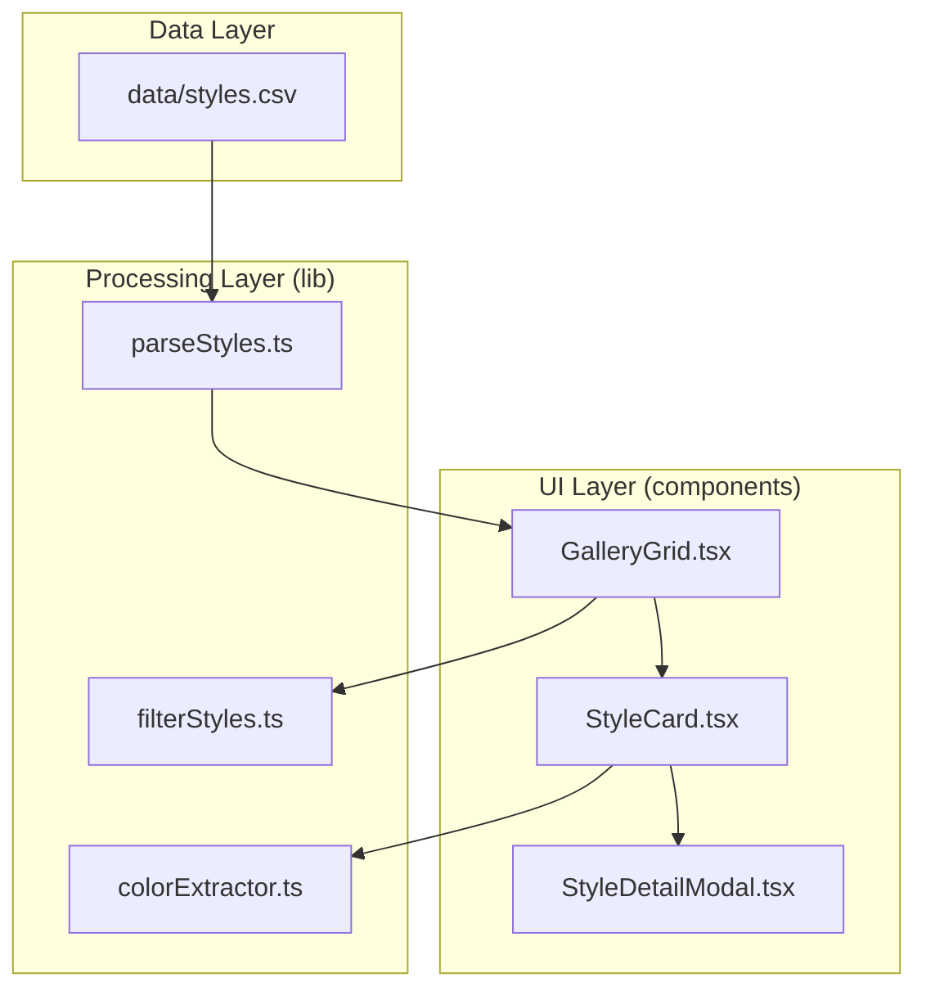

<!-- source: DeepWiki mcp.deepwiki.com · repo nextlevelbuilder/ui-ux-pro-max-skill · page 8.3 Style Gallery · fetched 2026-10-26 -->

# Style Gallery

<details>
<summary>Relevant source files</summary>

The following files were used as context for generating this wiki page:

- [gallery/.gitignore](gallery/.gitignore)
- [gallery/app/globals.css](gallery/app/globals.css)
- [gallery/app/layout.tsx](gallery/app/layout.tsx)
- [gallery/app/page.tsx](gallery/app/page.tsx)
- [gallery/app/providers.tsx](gallery/app/providers.tsx)
- [gallery/components/CodeSnippet.tsx](gallery/components/CodeSnippet.tsx)
- [gallery/components/ColorPalette.tsx](gallery/components/ColorPalette.tsx)
- [gallery/components/DarkModeToggle.tsx](gallery/components/DarkModeToggle.tsx)
- [gallery/components/ExpandableSection.tsx](gallery/components/ExpandableSection.tsx)
- [gallery/components/FilterBar.tsx](gallery/components/FilterBar.tsx)
- [gallery/components/GalleryGrid.tsx](gallery/components/GalleryGrid.tsx)
- [gallery/lib/colorExtractor.ts](gallery/lib/colorExtractor.ts)
- [gallery/lib/filterStyles.ts](gallery/lib/filterStyles.ts)
- [gallery/lib/parseStyles.ts](gallery/lib/parseStyles.ts)

</details>


The Style Gallery is a Next.js-based web application located in the `gallery/` directory. It serves as a visual exploration tool for the 84+ UI styles defined in the system's design database. The application parses the core CSV data, extracts design tokens (such as colors), and provides a high-performance interface for filtering and inspecting style implementations.

### System Data Flow

The gallery operates as a static-site-generated (SSG) or server-side rendered application that reads directly from the project's source of truth CSV files.

**Style Gallery Architecture**


Sources: [gallery/app/page.tsx:1-16](), [gallery/lib/parseStyles.ts:1-10]()

---

### Data Parsing and Color Extraction

The application consumes raw CSV data and transforms it into typed TypeScript objects. A key feature is the automated extraction of color palettes from style descriptions and implementation notes.

#### CSV Parsing
The `parseStylesCSV` function in `gallery/lib/parseStyles.ts` reads the `styles.csv` file. It maps CSV columns to the `StyleData` interface, ensuring that complex fields (like status and complexity) are correctly typed for the UI.

#### Color Extraction Engine
The `extractColors` function uses regular expressions to identify design tokens within the text descriptions of styles.

| Feature | Implementation |
| :--- | :--- |
| **Hex Support** | Identifies 3 and 6 digit hex codes using `HEX_RE` [gallery/lib/colorExtractor.ts:1-1]() |
| **RGBA Support** | Identifies functional color notation using `RGBA_RE` [gallery/lib/colorExtractor.ts:2-2]() |
| **Normalization** | Converts 3-digit hex to 6-digit hex for UI consistency [gallery/lib/colorExtractor.ts:4-10]() |
| **De-duplication** | Uses a `Set` to ensure the palette contains unique colors only [gallery/lib/colorExtractor.ts:14-22]() |

Sources: [gallery/lib/colorExtractor.ts:1-34](), [gallery/app/page.tsx:7-9]()

---

### Component Architecture

The gallery is built using a modular component structure, leveraging Tailwind CSS for styling and `next-themes` for dark mode support.

#### Core Components

*   **`GalleryGrid`**: The orchestrator component. It manages the state for `filters` and `selectedStyle`. It uses `useMemo` to optimize filtering operations and calculates unique values for filter dropdowns (Type, Complexity, Era). [gallery/components/GalleryGrid.tsx:21-52]()
*   **`StyleCard`**: Displays a high-level summary of a style, including its status badge and a preview of its color palette via the `ColorPalette` component. [gallery/components/StyleCard.tsx:1-50]()
*   **`StyleDetailModal`**: Provides a full-screen view of the style, including implementation details and code snippets. [gallery/components/StyleDetailModal.tsx:1-60]()
*   **`FilterBar`**: A multi-group filtering interface that allows users to drill down by `status`, `type`, `complexity`, and `era`. [gallery/components/FilterBar.tsx:68-131]()

**Component Relationship Map**
```mermaid
classDiagram
    class "Home" {
        +parseStylesCSV()
    }
    class "GalleryGrid" {
        +filters: Filters
        +selectedStyle: StyleData
        +filterStyles()
    }
    class "FilterBar" {
        +types: string[]
        +complexities: string[]
    }
    class "StyleCard" {
        +style: StyleData
        +onSelect()
    }
    class "ColorPalette" {
        +colors: string[]
        +copyColor()
    }
    class "CodeSnippet" {
        +code: string
        +handleCopy()
    }

    "Home" --> "GalleryGrid"
    "GalleryGrid" --> "FilterBar"
    "GalleryGrid" --> "StyleCard"
    "StyleCard" --> "ColorPalette"
    "GalleryGrid" --> "StyleDetailModal"
    "StyleDetailModal" --> "CodeSnippet"
    "StyleDetailModal" --> "ExpandableSection"
```

Sources: [gallery/components/GalleryGrid.tsx:1-124](), [gallery/components/FilterBar.tsx:1-131](), [gallery/components/ColorPalette.tsx:1-47]()

---

### Filtering Logic

The filtering engine supports full-text search and faceted filtering. The `filterStyles` function in `lib/filterStyles.ts` processes the `StyleData` array based on the `Filters` state object.

| Filter Type | Logic |
| :--- | :--- |
| **Search** | Case-insensitive match against `name`, `description`, and `tags`. |
| **Status** | Strict equality check against `active`, `supplemental`, or `deprecated`. |
| **Faceted** | Strict equality check against `type`, `complexity`, and `eraOrigin`. |

The UI provides a `DEFAULT_FILTERS` constant to reset the view, typically defaulting to showing only `active` styles.

Sources: [gallery/lib/filterStyles.ts:1-50](), [gallery/components/GalleryGrid.tsx:22-31]()

---

### Implementation Details

#### Dark Mode Support
The application uses `ThemeProvider` from `next-themes` wrapped in a `Providers` component [gallery/app/providers.tsx:5-11](). The `DarkModeToggle` component allows users to switch between `light` and `dark` themes, which updates the `html` class for Tailwind's `dark:` utility variants [gallery/components/DarkModeToggle.tsx:19-34]().

#### Code Snippets and Clipboard
Implementation details are presented using the `CodeSnippet` component. It includes a "Copy to Clipboard" feature using the `navigator.clipboard` API with a visual feedback state (`copied`) that resets after 2000ms.

Sources: [gallery/components/CodeSnippet.tsx:13-21](), [gallery/components/ColorPalette.tsx:14-22]()

---

