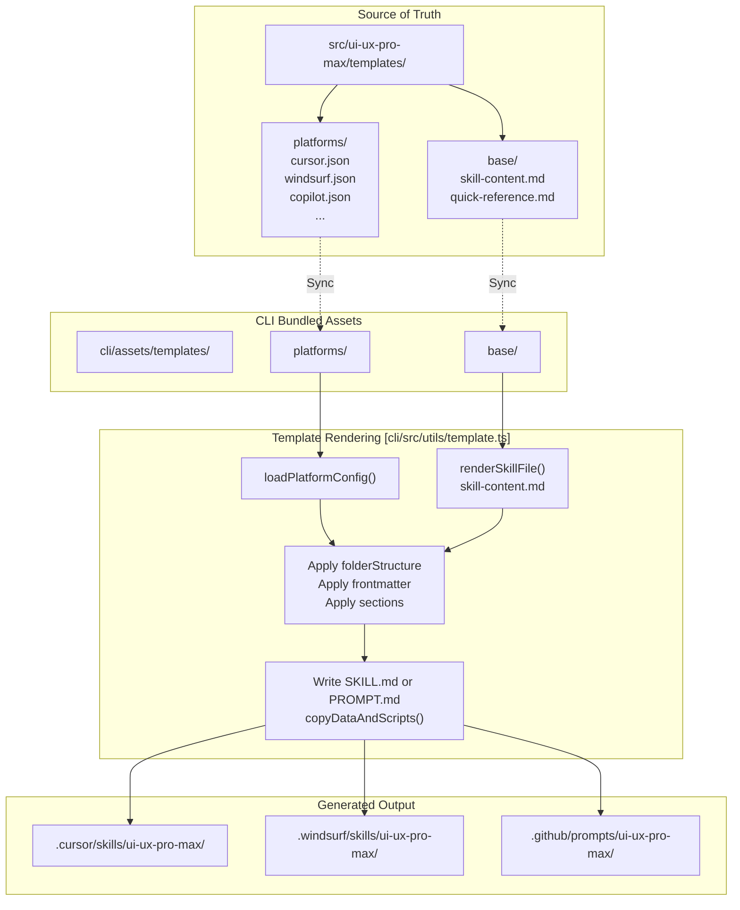
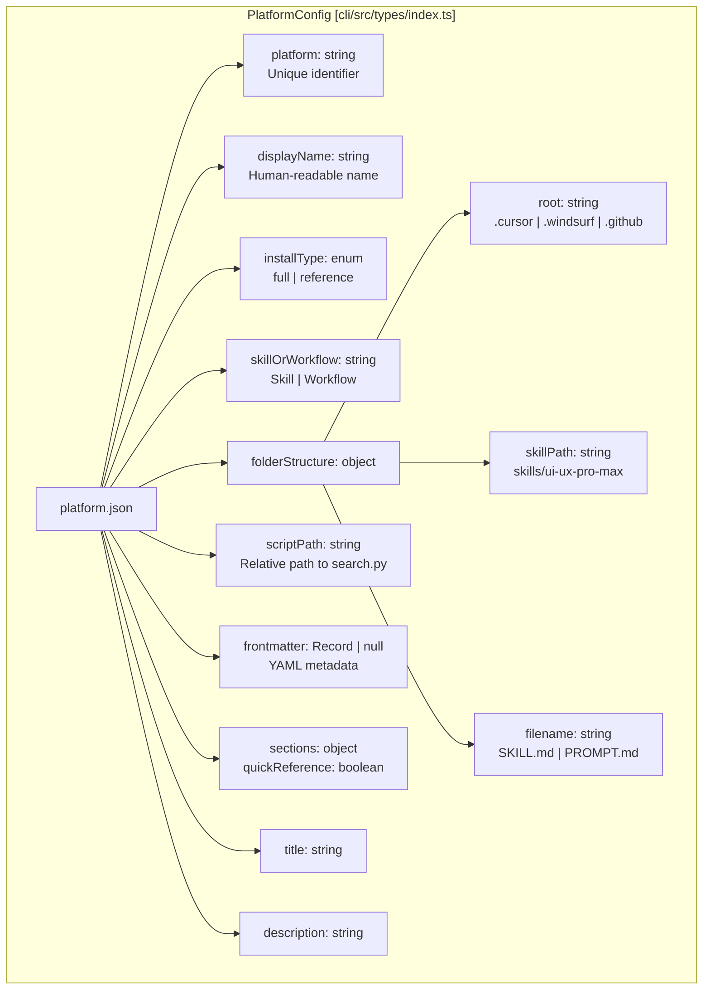
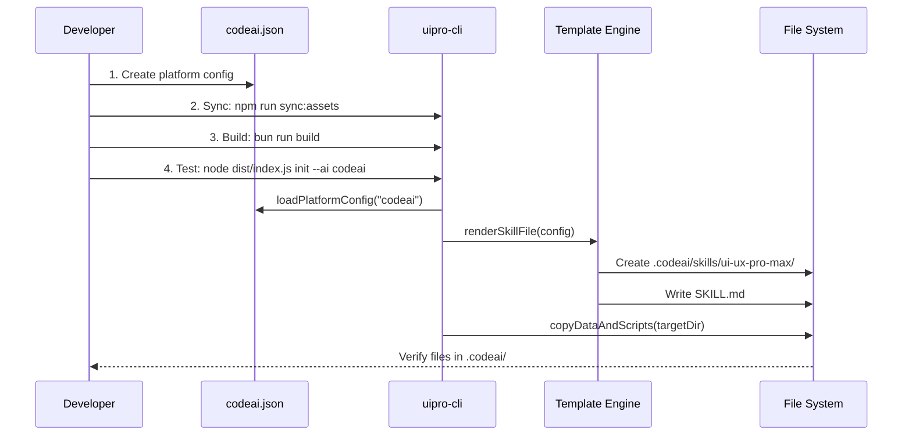

<!-- source: DeepWiki mcp.deepwiki.com · repo nextlevelbuilder/ui-ux-pro-max-skill · page 9.2 Adding New Platforms · fetched 2026-10-26 -->

# Adding New Platforms

<details>
<summary>Relevant source files</summary>

The following files were used as context for generating this wiki page:

- [CONTRIBUTING.md](CONTRIBUTING.md)
- [cli/assets/data/app-interface.csv](cli/assets/data/app-interface.csv)
- [cli/assets/templates/platforms/codex.json](cli/assets/templates/platforms/codex.json)
- [cli/src/types/index.ts](cli/src/types/index.ts)
- [cli/src/utils/detect.ts](cli/src/utils/detect.ts)
- [cli/src/utils/template.ts](cli/src/utils/template.ts)
- [src/ui-ux-pro-max/templates/platforms/claude.json](src/ui-ux-pro-max/templates/platforms/claude.json)
- [src/ui-ux-pro-max/templates/platforms/codebuddy.json](src/ui-ux-pro-max/templates/platforms/codebuddy.json)
- [src/ui-ux-pro-max/templates/platforms/codex.json](src/ui-ux-pro-max/templates/platforms/codex.json)
- [src/ui-ux-pro-max/templates/platforms/continue.json](src/ui-ux-pro-max/templates/platforms/continue.json)
- [src/ui-ux-pro-max/templates/platforms/gemini.json](src/ui-ux-pro-max/templates/platforms/gemini.json)
- [src/ui-ux-pro-max/templates/platforms/opencode.json](src/ui-ux-pro-max/templates/platforms/opencode.json)

</details>


This document provides step-by-step instructions for adding support for new AI coding assistant platforms to the UI/UX Pro Max system. The template-based configuration system allows adding platforms by creating a single JSON configuration file that defines the platform's folder structure, file naming conventions, and integration mode.

For information about the platform integration architecture and Skill vs Workflow modes, see [Platform Configuration System](#7.1). For details on the CLI template generation system, see [Template Generation](#2.4).

---

## Platform Configuration System

The system uses a template-based approach where each AI platform is defined by a JSON configuration file. The CLI tool reads these configurations during installation to generate platform-specific folder structures and content files.

### Configuration Architecture

**Template System Architecture**



Sources: [cli/src/utils/template.ts:72-81](), [cli/src/utils/template.ts:132-164](), [cli/src/utils/template.ts:186-206](), [CONTRIBUTING.md:49-59]()

### Platform Configuration Locations

| Location | Purpose | Sync Required |
|----------|---------|---------------|
| `src/ui-ux-pro-max/templates/platforms/` | Source of truth for platform configs | Manual sync to CLI |
| `cli/assets/templates/platforms/` | Bundled configs for offline installation | Yes (from src) |
| Platform folders (`.cursor/`, `.windsurf/`, etc.) | Generated output during `uipro init` | Auto-generated |

Sources: [CONTRIBUTING.md:61-61](), [cli/src/utils/template.ts:7-14](), [cli/src/utils/template.ts:78-79]()

---

## Platform JSON Schema

Each platform configuration file defines how the CLI generates the platform-specific integration. The JSON schema includes folder paths, file naming, metadata requirements, and content sections.

### Complete Schema Reference

**Platform Configuration JSON Schema**



Sources: [cli/src/types/index.ts:26-44](), [cli/src/utils/template.ts:16-34]()

### Field Specifications

| Field | Type | Required | Purpose | Examples |
|-------|------|----------|---------|----------|
| `platform` | string | Yes | Unique identifier for CLI detection | `"cursor"`, `"windsurf"`, `"copilot"` |
| `displayName` | string | Yes | Human-readable platform name | `"Cursor"`, `"GitHub Copilot"` |
| `installType` | enum | Yes | Content mode: `"full"` or `"reference"` | `"full"` for complete knowledge base |
| `folderStructure.root` | string | Yes | Top-level directory | `".cursor"`, `".github"`, `".windsurf"` |
| `folderStructure.skillPath` | string | Yes | Skill subdirectory path | `"skills/ui-ux-pro-max"`, `"prompts/ui-ux-pro-max"` |
| `folderStructure.filename` | string | Yes | Primary content file name | `"SKILL.md"`, `"PROMPT.md"` |
| `scriptPath` | string | Yes | Relative path to `search.py` | `"skills/ui-ux-pro-max/scripts/search.py"` |
| `frontmatter` | object \| null | No | YAML metadata for file header | `{"name": "ui-ux-pro-max"}` or `null` |
| `sections.quickReference` | boolean | Yes | Include Claude-specific quick reference | `false` (only `true` for Claude) |
| `title` | string | Yes | Skill/workflow title | `"ui-ux-pro-max"` |
| `description` | string | Yes | Brief description for AI platform | 1-2 sentence summary |
| `skillOrWorkflow` | enum | Yes | Integration mode: `"Skill"` or `"Workflow"` | `"Skill"` for auto-activate |

Sources: [cli/src/types/index.ts:26-44](), [src/ui-ux-pro-max/templates/platforms/codex.json:1-21](), [src/ui-ux-pro-max/templates/platforms/claude.json:1-21]()

---

## Step-by-Step: Adding a New Platform

This section walks through creating a new platform configuration for a hypothetical AI coding assistant called "CodeAI".

### Step 1: Create Platform JSON Configuration

Create a new file in the templates directory with the platform identifier as the filename.

**File:** `src/ui-ux-pro-max/templates/platforms/codeai.json`

```json
{
  "platform": "codeai",
  "displayName": "CodeAI",
  "installType": "full",
  "folderStructure": {
    "root": ".codeai",
    "skillPath": "skills/ui-ux-pro-max",
    "filename": "SKILL.md"
  },
  "scriptPath": "skills/ui-ux-pro-max/scripts/search.py",
  "frontmatter": null,
  "sections": {
    "quickReference": false
  },
  "title": "ui-ux-pro-max",
  "description": "Comprehensive design guide for web and mobile applications.",
  "skillOrWorkflow": "Skill"
}
```

**Key decisions:**

| Decision | Value | Rationale |
|----------|-------|-----------|
| `platform` | `"codeai"` | Must match directory detection identifier in `detectAIType` |
| `folderStructure.root` | `".codeai"` | Platform's configuration directory |
| `folderStructure.skillPath` | `"skills/ui-ux-pro-max"` | Platform's skill subdirectory convention |
| `folderStructure.filename` | `"SKILL.md"` | Primary markdown file name |
| `installType` | `"full"` | Include complete knowledge base |
| `skillOrWorkflow` | `"Skill"` | Use `"Workflow"` if requires explicit invocation |

Sources: [cli/src/utils/detect.ts:10-74](), [cli/src/utils/template.ts:37-58](), [src/ui-ux-pro-max/templates/platforms/continue.json:1-21]()

### Step 2: Update Detection Logic

You must register the new platform in the CLI detection utility so it can be automatically suggested to users.

1. Add the new type to `AIType` and `AI_TYPES` in `cli/src/types/index.ts`.
2. Add the folder mapping to `AI_FOLDERS` in `cli/src/types/index.ts`.
3. Add the detection logic in `detectAIType()` within `cli/src/utils/detect.ts`.
4. Add the description in `getAITypeDescription()` within `cli/src/utils/detect.ts`.

Sources: [cli/src/types/index.ts:1-2](), [cli/src/types/index.ts:46-72](), [cli/src/utils/detect.ts:10-74](), [cli/src/utils/detect.ts:93-138]()

### Step 3: Configure Filename and Frontmatter

Different platforms expect different file naming conventions and metadata formats.

**Filename Conventions**

| Platform Type | Filename | Frontmatter Required |
|---------------|----------|---------------------|
| Skills (Claude, Cursor, Windsurf) | `SKILL.md` | No |
| GitHub Copilot Prompts | `PROMPT.md` | No |
| Codex / Antigravity | `SKILL.md` | Yes (`name`, `description`) |

Sources: [src/ui-ux-pro-max/templates/platforms/claude.json:8](), [src/ui-ux-pro-max/templates/platforms/codex.json:8-14](), [cli/src/utils/template.ts:112-126]()

### Step 4: Set scriptPath Correctly

The `scriptPath` field defines the relative path from the platform root to `search.py`. The CLI uses this to anchor the command generated in the skill file.

**Path Construction Pattern:**
The CLI will automatically prepend the root or `~/` depending on the installation mode (local vs global).

Sources: [cli/src/utils/template.ts:145-147]()

---

## Testing the New Platform

After creating the platform configuration, test the CLI generation process and verify the output structure.

### Local Testing Workflow

**CLI Testing Flow**



Sources: [CONTRIBUTING.md:96-108](), [cli/src/utils/template.ts:72-81](), [cli/src/utils/template.ts:186-206]()

### Step 1: Sync Configuration to CLI Assets

Before testing, synchronize the new platform configuration to the CLI bundled assets:

```bash
cd cli && npm run sync:assets && cd ..
```

Sources: [CONTRIBUTING.md:103-103]()

### Step 2: Test CLI Installation

Run the CLI tool locally to verify the installation:

```bash
cd cli && bun run build
node dist/index.js init --ai codeai --offline
```

Sources: [CONTRIBUTING.md:106-108]()

---

## Synchronization Requirements

When adding a new platform configuration, you must synchronize the JSON file from the source of truth to the CLI bundled assets.

### Sync Checklist

| File Type | Source Location | Destination | Frequency |
|-----------|----------------|-------------|-----------|
| Platform JSON | `src/ui-ux-pro-max/templates/platforms/*.json` | `cli/assets/templates/platforms/` | When added/modified |
| Base templates | `src/ui-ux-pro-max/templates/base/*.md` | `cli/assets/templates/base/` | When modified |
| Data CSVs | `src/ui-ux-pro-max/data/` | `cli/assets/data/` | When data updated |
| Python scripts | `src/ui-ux-pro-max/scripts/` | `cli/assets/scripts/` | When logic updated |

Sources: [CONTRIBUTING.md:61-61](), [CONTRIBUTING.md:103-103](), [cli/src/utils/template.ts:7-14]()

---

