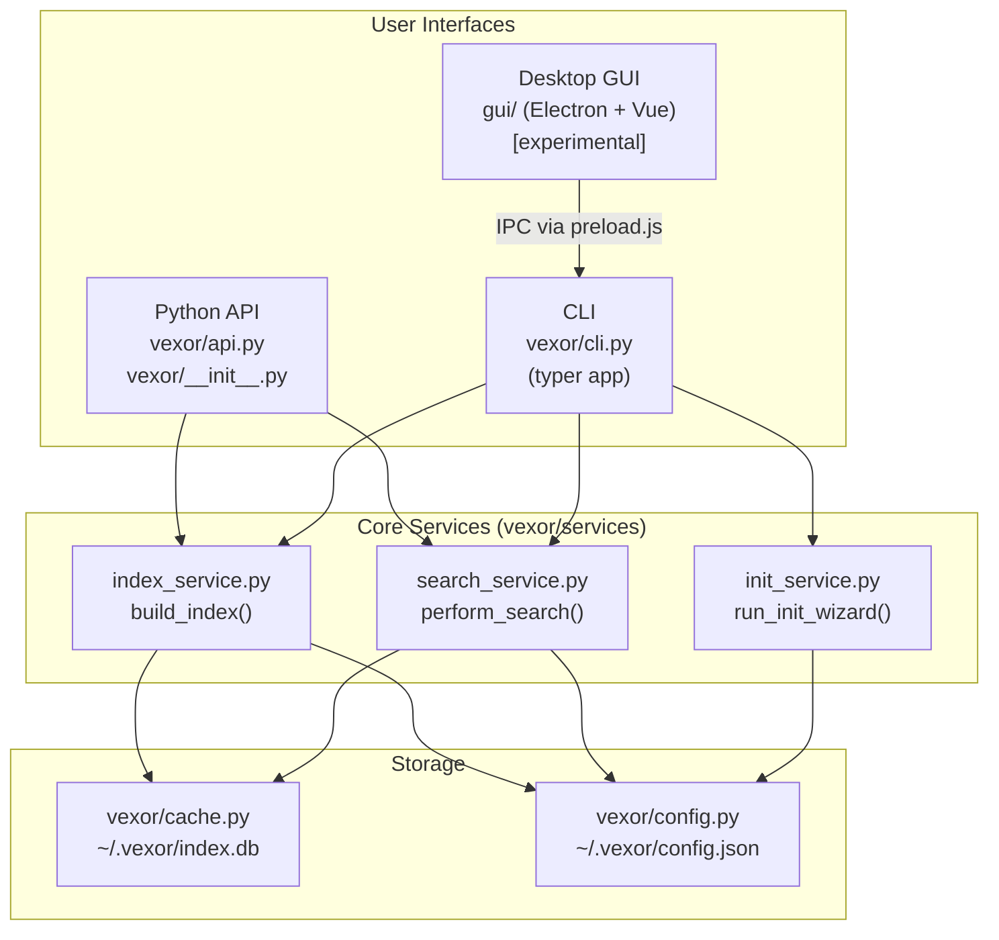
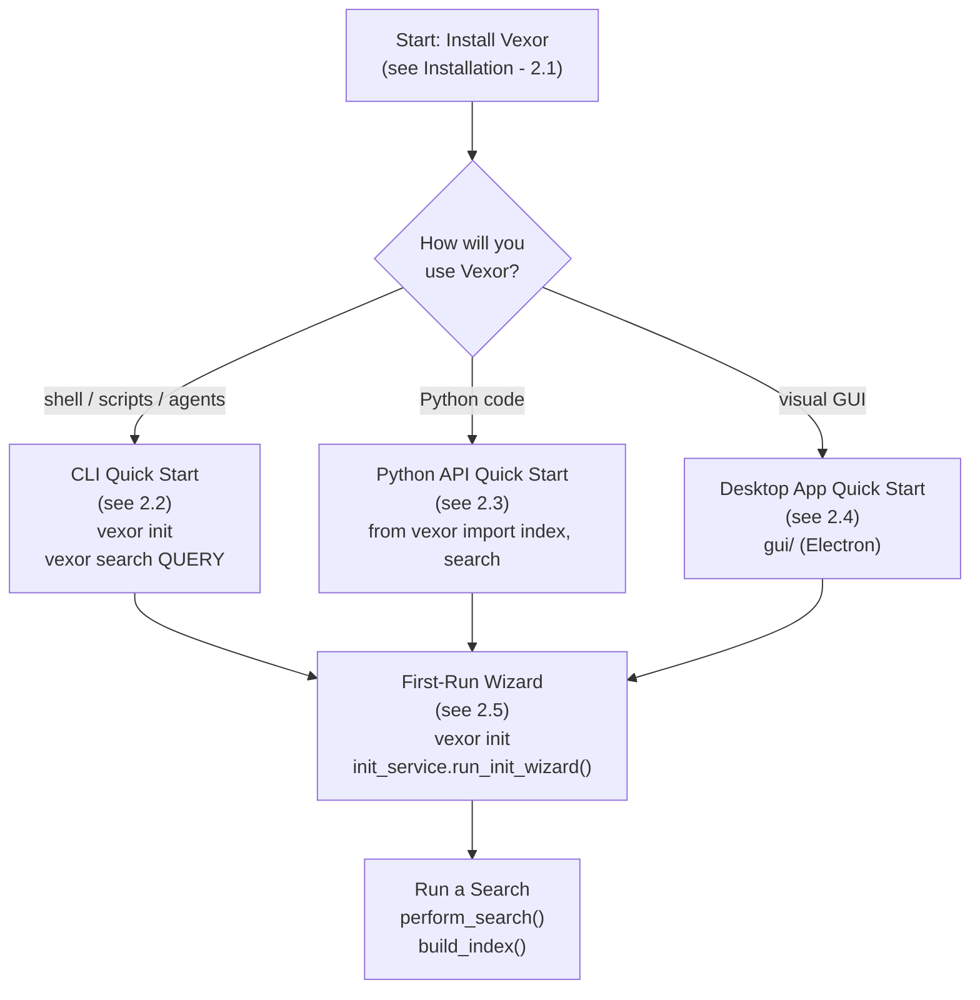

<!-- source: DeepWiki mcp.deepwiki.com · repo scarletkc/vexor · page 2 Getting Started · fetched 2026-10-26 -->

# Getting Started

<details>
<summary>Relevant source files</summary>

The following files were used as context for generating this wiki page:

- [README.md](README.md)
- [vexor/cli.py](vexor/cli.py)

</details>


This section covers everything needed to install Vexor and run your first search. It is organized into focused sub-pages:

- **[Installation](#2.1)** — pip, pipx, standalone binary, and optional extras
- **[Quick Start: CLI](#2.2)** — `vexor init`, `vexor search`, `vexor index`
- **[Quick Start: Python API](#2.3)** — `index()` and `search()` from Python code
- **[Quick Start: Desktop App](#2.4)** — the experimental Electron GUI
- **[First-Run Setup](#2.5)** — the `vexor init` interactive wizard in detail

For a conceptual explanation of how Vexor works internally, see [Core Concepts](#3). For complete command and API references, see [CLI Reference](#4) and [Python API Reference](#5).

---

## What You Need Before You Start

| Requirement | Details |
|---|---|
| Python | 3.9 or later |
| API key | Required for remote providers (`openai`, `gemini`, `voyageai`). Not needed for the `local` provider. |
| Network access | Required for remote embedding providers and installation via pip. |
| Optional extras | `vexor[local]`, `vexor[flashrank]`, `vexor[local-cuda]` — see [Installation](#2.1). |

Configuration is stored in `~/.vexor/config.json` and the index cache in `~/.vexor/index.db`. These are created automatically on first use.

Sources: [README.md:38-44]()

---

## Three Ways to Use Vexor

Vexor exposes the same core search and indexing engine through three interfaces. Choose the one that fits your workflow.

**Diagram: Vexor interfaces and their entry points**



Sources: [README.md:18-101]()

| Interface | Entry point | Best for |
|---|---|---|
| CLI | `vexor/cli.py` | Interactive use, shell scripts, AI agent integration |
| Python API | `vexor/api.py`, `vexor/__init__.py` | Programmatic access, build tooling, notebooks |
| Desktop GUI | `gui/` | Visual exploration (experimental) |

---

## Choosing a Path

**Diagram: Getting started decision flow**



Sources: [README.md:45-101]()

---

## Installation at a Glance

Full details are in [Installation](#2.1). The shortest path:

```
pip install vexor
```

For offline/local embedding (no API key required):

```
pip install "vexor[local]"
```

For stronger local reranking:

```
pip install "vexor[flashrank]"
```

Standalone binaries (no Python required) are available on the GitHub releases page.

Sources: [README.md:38-44]()

---

## First Search in 60 Seconds

After installation, from your project directory:

```
vexor init          # configure provider and API key (also runs automatically on first use)
vexor "database connection timeout"   # search current directory
```

`vexor init` runs the interactive wizard implemented in `init_service.run_init_wizard()` ([vexor/services/init_service.py]()). It configures your embedding provider, API key, and optional reranking, writing the result to `~/.vexor/config.json`.

On the first search, Vexor calls `build_index()` ([vexor/services/index_service.py]()) automatically before calling `perform_search()` ([vexor/services/search_service.py]()), so no explicit index step is required.

Example output:

```
Vexor semantic file search results
──────────────────────────────────
#   Similarity   File path                       Lines   Preview
1   0.923        ./src/config_loader.py          -       config loader entrypoint
2   0.871        ./src/utils/config_parse.py     -       parse config helpers
3   0.809        ./tests/test_config_loader.py   -       tests for config loader
```

Sources: [README.md:45-78]()

---

## Key Configuration Points

Before searching, Vexor needs at minimum a provider and an API key (unless using the `local` provider). These are set once and persist in `~/.vexor/config.json` via `vexor/config.py`.

| Setting | CLI flag | Environment variable |
|---|---|---|
| Provider | `vexor config --set-provider openai` | — |
| API key | `vexor config --set-api-key KEY` | `VEXOR_API_KEY`, `OPENAI_API_KEY`, `GOOGLE_GENAI_API_KEY`, `VOYAGE_API_KEY` |
| Reranker | `vexor config --rerank bm25` | — |

The `vexor init` wizard sets all of these interactively. See [First-Run Setup](#2.5) for the full walkthrough, or [CLI Reference: vexor config](#4.4) for the complete flag list.

Sources: [README.md:117-155]()

---

