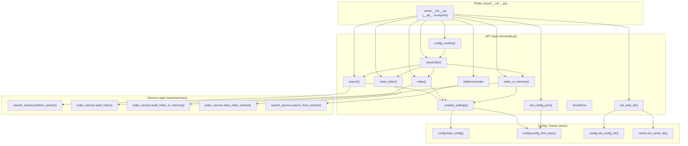
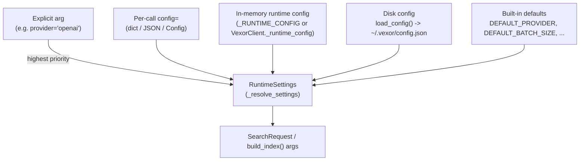

<!-- source: DeepWiki mcp.deepwiki.com · repo scarletkc/vexor · page 5 Python API Reference · fetched 2026-10-26 -->

# Python API Reference

<details>
<summary>Relevant source files</summary>

The following files were used as context for generating this wiki page:

- [docs/api/python.md](docs/api/python.md)
- [plugins/vexor/.claude-plugin/plugin.json](plugins/vexor/.claude-plugin/plugin.json)
- [tests/unit/test_api.py](tests/unit/test_api.py)
- [vexor/__init__.py](vexor/__init__.py)
- [vexor/api.py](vexor/api.py)

</details>


This page is the top-level reference for Vexor's Python API. It covers the public surface exported from `vexor/__init__.py` and `vexor/api.py`: the free functions (`search`, `index`, `index_in_memory`, `clear_index`), the session class (`VexorClient`), the scoped helper (`config_context`), and the configuration utilities (`set_config_json`, `set_data_dir`).

For installation and a first usage example, see the Quick Start guide at [#2.3](). For detailed explanations of indexing modes, embedding providers, and reranking strategies that feed into these API parameters, see [#3](). For internal architecture of the service layer these functions call into, see [#7.3]().

---

## Public Surface

Everything below is importable directly from the `vexor` package. The `__all__` list in [vexor/__init__.py:18-31]() defines the contract.

| Symbol | Kind | Purpose |
|---|---|---|
| `search` | function | Run a semantic search, return `SearchResponse` |
| `index` | function | Build or refresh a disk-backed index |
| `index_in_memory` | function | Build an ephemeral in-memory index |
| `clear_index` | function | Remove cached index entries for a directory |
| `VexorClient` | class | Session-style wrapper; shares config/dir state across calls |
| `InMemoryIndex` | class | Returned by `index_in_memory()`; holds vectors and exposes `.search()` |
| `VexorError` | exception | Raised for invalid API inputs |
| `config_context` | context manager | Yield a configured `VexorClient` for a scoped block |
| `set_config_json` | function | Set a module-level in-memory config from a dict or JSON string |
| `set_data_dir` | function | Redirect config and cache storage to a custom directory |
| `get_version` | function | Return the package version string |
| `__version__` | str | Package version, e.g. `"0.23.1rc1"` |

Sources: [vexor/__init__.py:1-39]()

---

## Module Dependency Map

**How the public API calls into the service layer**



Sources: [vexor/__init__.py:1-39](), [vexor/api.py:1-50]()

---

## Configuration Precedence

When any API function resolves its runtime settings, the order is highest to lowest priority:

1. **Explicit function arguments** — `provider=`, `model=`, `api_key=`, etc.
2. **Per-call `config=` override** — a dict, JSON string, or `Config` object passed inline
3. **In-memory runtime config** — set via `set_config_json()` or `VexorClient.set_config_json()`
4. **Disk config** — `~/.vexor/config.json` (skipped when `use_config=False`)
5. **Built-in defaults** — defined as constants in `vexor/config.py`

Environment variables (`VEXOR_API_KEY`, `OPENAI_API_KEY`, `GOOGLE_GENAI_API_KEY`, `VOYAGE_API_KEY`, `VEXOR_REMOTE_RERANK_API_KEY`) supply API keys only and are resolved inside the config layer, not the API layer.

The resolution logic lives in `_resolve_settings()` at [vexor/api.py:1029-1105]().

**Config precedence flow**



Sources: [vexor/api.py:1029-1105](), [docs/api/python.md:42-48]()

---

## Free Functions

All free functions are thin wrappers over internal `_*_with_settings` helpers that handle directory scoping via `_data_dir_context`. They forward to the same code paths as `VexorClient` methods.

### `search()`

[vexor/api.py:511-571]()

Run a semantic search over the indexed files in a directory.

**Signature parameters:**

| Parameter | Type | Default | Description |
|---|---|---|---|
| `query` | `str` | required | Search query text. Whitespace-only strings raise `VexorError`. |
| `path` | `Path \| str` | `Path.cwd()` | Root directory to search. |
| `top` | `int` | `5` | Number of results to return. |
| `mode` | `str` | `"auto"` | Indexing/extraction mode. Valid values: `auto`, `name`, `head`, `brief`, `code`, `outline`, `full`. |
| `include_hidden` | `bool` | `False` | Include dot-files and dot-directories. |
| `respect_gitignore` | `bool` | `True` | Skip files matched by `.gitignore`. |
| `recursive` | `bool` | `True` | Descend into subdirectories. |
| `extensions` | `Sequence[str] \| str \| None` | `None` | Filter to specific file extensions, e.g. `[".py", ".md"]` or `".py,.md"`. |
| `exclude_patterns` | `Sequence[str] \| str \| None` | `None` | Glob patterns for paths to exclude. |
| `provider` | `str \| None` | from config | Embedding provider: `openai`, `gemini`, `voyageai`, `custom`, `local`. |
| `model` | `str \| None` | from config | Embedding model name. |
| `batch_size` | `int \| None` | from config | Embedding batch size. |
| `embed_concurrency` | `int \| None` | from config | Max concurrent embedding requests. |
| `extract_concurrency` | `int \| None` | from config | Max concurrent file extraction workers. |
| `extract_backend` | `str \| None` | from config | Extraction executor: `auto`, `thread`, or `process`. |
| `base_url` | `str \| None` | from config | API base URL for `openai`, `voyageai`, or `custom` provider. |
| `api_key` | `str \| None` | from config / env | API key. |
| `local_cuda` | `bool \| None` | from config | Use GPU for the `local` provider. |
| `embedding_dimensions` | `int \| None` | from config | Output dimension override for supported models. |
| `auto_index` | `bool \| None` | from config | Auto-build the index if stale or absent before searching. |
| `use_config` | `bool` | `True` | If `False`, disk config is ignored and only defaults and explicit args apply. |
| `config` | `Config \| Mapping \| str \| None` | `None` | Per-call config override merged on top of the resolved config. |
| `temporary_index` | `bool` | `False` | Build index in memory; skip index cache read and write. |
| `no_cache` | `bool` | `False` | Disable all disk caches (index, embedding, query). |
| `data_dir` | `Path \| str \| None` | `None` | Override the base directory for config and cache for this call. |
| `config_dir` | `Path \| str \| None` | `None` | Override only the config directory for this call. |
| `cache_dir` | `Path \| str \| None` | `None` | Override only the cache directory for this call. |

**Returns:** `SearchResponse` (from `vexor.services.search_service`)

`SearchResponse` fields:

| Field | Type | Description |
|---|---|---|
| `results` | `list[SearchResult]` | Ranked results. |
| `backend` | `str \| None` | Description of the embedding backend used. |
| `is_stale` | `bool` | Index was present but may be outdated. |
| `index_empty` | `bool` | No files were indexed. |
| `reranker` | `str \| None` | Name of the reranker applied, if any. |

Each `SearchResult` has: `path`, `score`, `preview`, `chunk_index`, `start_line`, `end_line`.

**Raises:** `VexorError` for empty query, invalid mode, invalid `embedding_dimensions`, or malformed `config`.

Sources: [vexor/api.py:511-571](), [vexor/api.py:710-801](), [docs/api/python.md:55-84]()

---

### `index()`

[vexor/api.py:574-624]()

Build or refresh the on-disk index for a directory. Accepts the same file-selection and embedding parameters as `search()`, minus the query-specific ones (`query`, `top`, `auto_index`, `temporary_index`, `no_cache`, reranking flags).

**Returns:** `IndexResult` (from `vexor.services.index_service`)

`IndexResult` fields:

| Field | Type | Description |
|---|---|---|
| `status` | `IndexStatus` | Enum: `OK`, `EMPTY`, `FAILED`, etc. |
| `cache_path` | `Path \| None` | Path to the SQLite `index.db` that was written. |
| `files_indexed` | `int \| None` | Number of files processed. |

Sources: [vexor/api.py:574-624](), [docs/api/python.md:86-91]()

---

### `index_in_memory()`

[vexor/api.py:627-679]()

Build a vector index without writing to disk. `no_cache` defaults to `True`.

**Returns:** `InMemoryIndex` — see [#5.6]() for full documentation.

Sources: [vexor/api.py:627-679](), [docs/api/python.md:93-96]()

---

### `clear_index()`

[vexor/api.py:682-707]()

Remove cached index entries from the SQLite database for the given directory, matching the specified file-selection options.

**Parameters:** Same file-selection subset as `index()` (`path`, `include_hidden`, `respect_gitignore`, `mode`, `recursive`, `extensions`, `exclude_patterns`, `data_dir`, `config_dir`, `cache_dir`). No embedding parameters.

**Returns:** `int` — the number of cache entries removed.

Sources: [vexor/api.py:682-707](), [docs/api/python.md:98-100]()

---

## `VexorClient` Class

[vexor/api.py:209-484]()

A session-style wrapper that stores `data_dir`, `config_dir`, `cache_dir`, and a per-instance `_runtime_config`. Useful when making multiple API calls that should share the same directories or configuration without mutating module-level state.

### Constructor

```
VexorClient(
    *,
    data_dir: Path | str | None = None,
    config_dir: Path | str | None = None,
    cache_dir: Path | str | None = None,
    use_config: bool = True,
)
```

| Parameter | Description |
|---|---|
| `data_dir` | Base directory for both config and cache. Applied to all calls unless overridden per-call. |
| `config_dir` | Override config directory only. Takes precedence over `data_dir` for config. |
| `cache_dir` | Override cache directory only. Takes precedence over `data_dir` for cache. |
| `use_config` | Default `use_config` value for all methods on this instance. |

### Methods

`VexorClient` exposes the same four operations as the free functions. Per-call `data_dir`/`config_dir`/`cache_dir` arguments are merged with the instance-level values via `_resolve_dir_overrides()` at [vexor/api.py:257-266]().

| Method | Returns | Notes |
|---|---|---|
| `.search(query, *, ...)` | `SearchResponse` | Same parameters as free `search()`. |
| `.index(path, *, ...)` | `IndexResult` | Same parameters as free `index()`. |
| `.index_in_memory(path, *, ...)` | `InMemoryIndex` | Same parameters as free `index_in_memory()`. |
| `.clear_index(path, *, ...)` | `int` | Same parameters as free `clear_index()`. |
| `.set_config_json(payload, *, replace=False)` | `None` | Set in-memory config on this instance only. |
| `.config_context(payload, *, replace=False)` | context manager | Temporarily override this client's config, restore on exit. |

### `VexorClient.set_config_json()`

[vexor/api.py:226-240]()

Merges `payload` (dict or JSON string) into the instance's `_runtime_config`. If `replace=True`, starts from default values instead of merging with current state. Pass `None` to clear.

### `VexorClient.config_context()`

[vexor/api.py:242-255]()

Context manager. Saves the current `_runtime_config`, applies `payload` for the duration of the `with` block, then restores the previous config on exit.

```python
client = VexorClient()
with client.config_context({"provider": "gemini", "api_key": "KEY"}):
    response = client.search("query", path=".")
# config is restored here
```

Sources: [vexor/api.py:209-484](), [tests/unit/test_api.py:360-386]()

---

## `InMemoryIndex` Class

[vexor/api.py:74-162]()

A frozen result object returned by `index_in_memory()`. Holds the indexed file paths, their embedding vectors as a NumPy array, and metadata from the indexing run. Not written to disk.

### Fields

| Field | Type | Description |
|---|---|---|
| `base_path` | `Path` | Resolved root directory. |
| `paths` | `Sequence[Path]` | One entry per indexed chunk. |
| `vectors` | `np.ndarray` | Shape `(N, D)`, `float32`. |
| `metadata` | `dict[str, object]` | Mode, extensions, patterns, chunks list, etc. |
| `model_name` | `str` | Embedding model used. |
| `batch_size` | `int` | Batch size used during indexing. |
| `embed_concurrency` | `int` | Concurrency used during indexing. |
| `provider` | `str` | Embedding provider name. |
| `base_url` | `str \| None` | Provider base URL. |
| `api_key` | `str \| None` | API key used. |
| `local_cuda` | `bool` | Whether GPU was used. |
| `embedding_dimensions` | `int \| None` | Dimension override, if set. |
| `rerank` | `str` | Reranking strategy, default `"off"`. |
| `flashrank_model` | `str \| None` | FlashRank model name if `rerank="flashrank"`. |
| `remote_rerank` | `RemoteRerankConfig \| None` | Remote reranker config if `rerank="remote"`. |

### `.search()` Method

[vexor/api.py:92-162]()

Search the held vectors without touching disk. Calls `search_from_vectors()` from `vexor.services.search_service`.

| Parameter | Type | Default | Description |
|---|---|---|---|
| `query` | `str` | required | Query text. |
| `top` | `int` | `5` | Number of results. |
| `rerank` | `str \| None` | `None` | Override the reranker. Falls back to `self.rerank`. |
| `flashrank_model` | `str \| None` | `None` | Override FlashRank model. |
| `remote_rerank` | `RemoteRerankConfig \| None` | `None` | Override remote reranker config. |
| `no_cache` | `bool` | `True` | Always `True` by default; in-memory searches skip disk caches. |

**Returns:** `SearchResponse`

Sources: [vexor/api.py:74-162](), [tests/unit/test_api.py:389-462]()

---

## Configuration Utilities

### `set_config_json(payload, *, replace=False)`

[vexor/api.py:194-206]()

Sets a module-level `_RUNTIME_CONFIG` used by all free functions. Does not write to `config.json`. Pass `None` to clear.

- `payload`: dict, JSON string, or `None`.
- `replace=False` (default): merges over the current runtime config or loads disk config as base.
- `replace=True`: applies payload to default `Config()` values only; does not read disk.

Raises `VexorError` if the payload is not a JSON object (e.g. a JSON array).

### `set_data_dir(path)`

[vexor/api.py:188-191]()

Permanently redirects (for the process lifetime, or until called again) where Vexor reads/writes config and cache. Calls `set_config_dir()` and `set_cache_dir()` in the config and cache modules respectively. Pass `None` to reset to `~/.vexor`.

For scoped, non-global overrides, prefer per-call `data_dir=` arguments or `VexorClient(data_dir=...)`.

### `config_context(payload, *, replace=False, data_dir=None, config_dir=None, cache_dir=None, use_config=True)`

[vexor/api.py:487-508]()

Module-level context manager. Creates a `VexorClient`, applies `payload` to its `_runtime_config`, yields the client, and clears the config on exit. Use when you want a short scoped block without creating a named client.

```python
with config_context({"provider": "openai", "api_key": "KEY"}) as client:
    response = client.search("error handling", path="./src")
```

Sources: [vexor/api.py:188-206](), [vexor/api.py:487-508](), [docs/api/python.md:103-119](), [tests/unit/test_api.py:500-520]()

---

## `VexorError` Exception

[vexor/api.py:52-53]()

Subclasses `ValueError`. Raised by all public API functions when inputs are invalid:

- Empty or whitespace-only query
- Unrecognized `mode` value
- Negative or boolean `embedding_dimensions`
- A model that does not support custom dimensions
- A dimension value not supported by the specified model
- A `config` payload that is not a JSON object

---

## Config Payload Schema

The `config=` argument and `set_config_json()` both accept a dict or JSON string with these fields. Unknown keys are silently ignored.

| Key | Type | Description |
|---|---|---|
| `provider` | `str` | `openai`, `gemini`, `voyageai`, `custom`, or `local` |
| `model` | `str` | Embedding model name |
| `api_key` | `str \| null` | API key |
| `base_url` | `str \| null` | Base URL for `openai`/`voyageai`/`custom` |
| `batch_size` | `int` | Embedding batch size |
| `embed_concurrency` | `int` | Max concurrent embedding calls |
| `extract_concurrency` | `int` | Max concurrent extract workers |
| `extract_backend` | `str` | `auto`, `thread`, or `process` |
| `embedding_dimensions` | `int \| null` | Dimension override for supported models |
| `auto_index` | `bool` | Auto-rebuild stale index before searching |
| `local_cuda` | `bool` | Use GPU with `local` provider |
| `rerank` | `str` | `off`, `bm25`, `flashrank`, or `remote` |
| `flashrank_model` | `str \| null` | FlashRank model name |
| `remote_rerank` | `object` | `{ base_url, api_key, model }` — `base_url` is normalized to end with `/rerank` |

Sources: [docs/api/python.md:121-148](), [vexor/api.py:1029-1105]()

---

## Cache Behavior Summary

| Mode | Index cache | Embedding cache | Query cache |
|---|---|---|---|
| Default | Read + write | Read + write | Read + write |
| `temporary_index=True` | Skipped | Read + write | Read + write |
| `no_cache=True` | Skipped | Skipped | Skipped |
| `InMemoryIndex.search()` | Not applicable | Determined by caller's `no_cache` | Determined by caller's `no_cache` |

Sources: [docs/api/python.md:149-154](), [vexor/api.py:92-162]()

---

