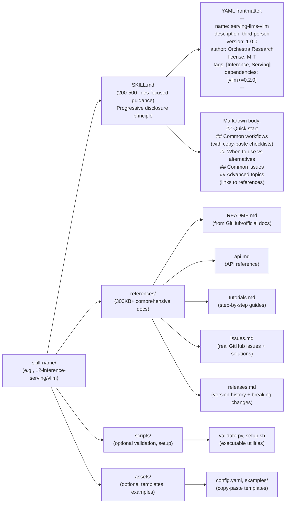
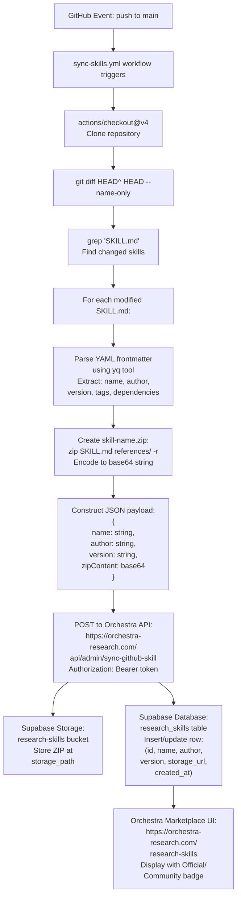
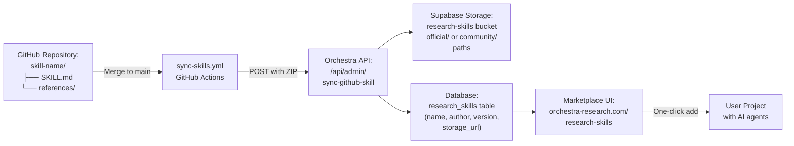

<!-- source: DeepWiki mcp.deepwiki.com · repo zechenzhangAGI/AI-research-SKILLs · page 1 Overview · fetched 2026-10-26 -->

# Overview

<details>
<summary>Relevant source files</summary>

The following files were used as context for generating this wiki page:

- [.claude-plugin/marketplace.json](.claude-plugin/marketplace.json)
- [CONTRIBUTING.md](CONTRIBUTING.md)
- [README.md](README.md)
- [demos/README.md](demos/README.md)
- [docs/ROADMAP.md](docs/ROADMAP.md)
- [docs/SKILL_CREATION_GUIDE.md](docs/SKILL_CREATION_GUIDE.md)
- [docs/SKILL_TEMPLATE.md](docs/SKILL_TEMPLATE.md)
- [docs/christmas-tree.svg](docs/christmas-tree.svg)
- [docs/tech-tree.svg](docs/tech-tree.svg)

</details>


This page documents the AI Research Skills Library, an open-source repository containing 77 expert-level engineering skills for AI research agents organized into 20 thematic categories. The library provides comprehensive documentation (300KB+ per skill) covering the complete AI research lifecycle: model architecture, tokenization, fine-tuning, mechanistic interpretability, data processing, post-training, safety, distributed training, infrastructure, optimization, evaluation, inference, MLOps, agents, RAG, prompt engineering, observability, multimodal, emerging techniques, and ML paper writing.

For information about individual skill categories and their contents, see page 2 (Skill Categories Reference). For details on contributing new skills or improving existing ones, see page 5 (Contributing to the Library). For the Orchestra Research platform integration and automated sync pipeline, see page 6 (Orchestra Marketplace Integration).

## Repository Purpose

The AI Research Skills Library serves as an "Engineering Ability" layer that enables AI coding agents to autonomously conduct AI research experiments. Each skill packages expert-level guidance on a specific framework or technique into a standardized format (`SKILL.md` + `references/` directory) that can be consumed by Claude Code CLI, AI agents, IDEs, or custom RAG systems.

The repository addresses a critical gap: modern AI research requires mastering dozens of specialized tools (TorchTitan, vLLM, DeepSpeed, TRL, NeMo Curator, SAELens, etc.), but this knowledge is scattered across disparate documentation, GitHub issues, and production workflows. By consolidating this knowledge into structured skills with progressive disclosure (200-500 line SKILL.md files that link to comprehensive references), the library allows AI agents to write code, provision resources, and execute experiments without overwhelming context windows.

**Sources:** [README.md:1-51](), [README.md:66-108]()

## System Architecture

### Repository Organization

The repository organizes 77 skills into 20 thematic categories, each represented by a numbered directory (01-20). Skills are grouped by their role in the AI research lifecycle:

**Directory Structure Overview:**

```mermaid
graph TB
    Root["AI-research-SKILLs/"]
    
    Root --> Foundation["Foundation Layer"]
    Root --> Training["Training & Data Layer"]
    Root --> Optimization["Optimization & Eval Layer"]
    Root --> Deployment["Deployment Layer"]
    Root --> Application["Application Layer"]
    Root --> Publication["Publication Layer"]
    Root --> Meta["Configuration"]
    
    Foundation --> Cat01["01-model-architecture/<br/>(5 skills: Megatron, LitGPT,<br/>Mamba, RWKV, NanoGPT)"]
    Foundation --> Cat02["02-tokenization/<br/>(2 skills: HuggingFace<br/>Tokenizers, SentencePiece)"]
    Foundation --> Cat04["04-mechanistic-interpretability/<br/>(4 skills: TransformerLens,<br/>SAELens, pyvene, nnsight)"]
    
    Training --> Cat03["03-fine-tuning/<br/>(4 skills: Axolotl, LLaMA-Factory,<br/>PEFT, Unsloth)"]
    Training --> Cat05["05-data-processing/<br/>(2 skills: NeMo Curator,<br/>Ray Data)"]
    Training --> Cat06["06-post-training/<br/>(4 skills: TRL, GRPO,<br/>OpenRLHF, SimPO)"]
    Training --> Cat08["08-distributed-training/<br/>(5 skills: DeepSpeed, FSDP,<br/>Accelerate, Lightning, Ray Train)"]
    
    Optimization --> Cat07["07-safety-alignment/<br/>(3 skills: Constitutional AI,<br/>LlamaGuard, NeMo Guardrails)"]
    Optimization --> Cat10["10-optimization/<br/>(6 skills: Flash Attention,<br/>bitsandbytes, GPTQ, AWQ, HQQ, GGUF)"]
    Optimization --> Cat11["11-evaluation/<br/>(3 skills: lm-eval-harness,<br/>BigCode, NeMo Evaluator)"]
    
    Deployment --> Cat09["09-infrastructure/<br/>(3 skills: Modal, SkyPilot,<br/>Lambda Labs)"]
    Deployment --> Cat12["12-inference-serving/<br/>(4 skills: vLLM, TensorRT-LLM,<br/>llama.cpp, SGLang)"]
    
    Application --> Cat13["13-mlops/<br/>(3 skills: W&B, MLflow,<br/>TensorBoard)"]
    Application --> Cat14["14-agents/<br/>(4 skills: LangChain, LlamaIndex,<br/>CrewAI, AutoGPT)"]
    Application --> Cat15["15-rag/<br/>(5 skills: Chroma, FAISS,<br/>Pinecone, Qdrant, Sentence Transformers)"]
    Application --> Cat16["16-prompt-engineering/<br/>(4 skills: DSPy, Instructor,<br/>Guidance, Outlines)"]
    Application --> Cat17["17-observability/<br/>(2 skills: LangSmith, Phoenix)"]
    Application --> Cat18["18-multimodal/<br/>(7 skills: CLIP, Whisper, LLaVA,<br/>Stable Diffusion, SAM, BLIP-2, AudioCraft)"]
    Application --> Cat19["19-emerging-techniques/<br/>(6 skills: MoE, Model Merging,<br/>Long Context, Speculative Decoding,<br/>Distillation, Pruning)"]
    
    Publication --> Cat20["20-ml-paper-writing/<br/>(1 skill: ML Paper Writing<br/>with LaTeX templates, citation<br/>verification, conference guides)"]
    
    Meta --> Marketplace[".claude-plugin/marketplace.json<br/>(plugin manifest)"]
    Meta --> Actions[".github/workflows/sync-skills.yml<br/>(auto-sync to Orchestra)"]
    Meta --> README["README.md"]
    Meta --> CONTRIB["CONTRIBUTING.md"]
```



**Repository Structure Mapping to Research Lifecycle:**

| Lifecycle Stage | Categories | Skill Count | Key Technologies |
|----------------|-----------|-------------|------------------|
| **Foundation** | 01, 02, 04 | 11 | Model architectures (Megatron, LitGPT, Mamba), tokenization (HF Tokenizers, SentencePiece), mechanistic interpretability (TransformerLens, SAELens, pyvene, nnsight) |
| **Training & Data** | 03, 05, 06, 08 | 15 | Fine-tuning (Axolotl, PEFT, Unsloth), data processing (NeMo Curator, Ray Data), post-training (TRL, GRPO, OpenRLHF, SimPO), distributed training (DeepSpeed, FSDP, TorchTitan) |
| **Optimization & Eval** | 07, 10, 11 | 12 | Safety (Constitutional AI, LlamaGuard, NeMo Guardrails), optimization (Flash Attention, bitsandbytes, GPTQ, AWQ, HQQ, GGUF), evaluation (lm-eval-harness, BigCode, NeMo Evaluator) |
| **Deployment** | 09, 12 | 7 | Infrastructure (Modal, SkyPilot, Lambda Labs), inference (vLLM, TensorRT-LLM, llama.cpp, SGLang) |
| **Application** | 13, 14, 15, 16, 17, 18, 19 | 31 | MLOps (W&B, MLflow, TensorBoard), agents (LangChain, LlamaIndex, CrewAI, AutoGPT), RAG (Chroma, FAISS, Pinecone, Qdrant), prompt engineering (DSPy, Instructor, Guidance, Outlines), observability (LangSmith, Phoenix), multimodal (CLIP, Whisper, LLaVA, Stable Diffusion, SAM, BLIP-2, AudioCraft), emerging techniques (MoE, model merging, long context, speculative decoding, distillation, pruning) |
| **Publication** | 20 | 1 | ML Paper Writing (LaTeX templates, citation verification, writing guides for NeurIPS, ICML, ICLR, ACL, AAAI, COLM) |

**Sources:** [README.md:341-369](), [.claude-plugin/marketplace.json:11-249]()

### Skill Structure Format

Each skill follows a standardized directory structure that packages documentation, references, and optional assets:

**Skill Directory Structure:**



**YAML Frontmatter Structure:**

All SKILL.md files must include YAML frontmatter with the following fields:

```yaml
---
name: skill-name-here
description: Third-person description of what this does and when to use it
version: 1.0.0
author: Orchestra Research
license: MIT
tags: [Tag One, Tag Two, Key Concept]
dependencies: [package1>=1.0.0, package2>=2.0.0]
---
```

**Field Requirements:**

| Field | Required | Format | Notes |
|-------|----------|--------|-------|
| `name` | ✅ | kebab-case | Gerund form preferred (e.g., "serving-llms" not "llm-server") |
| `description` | ✅ | Plain text | Third person, includes what AND when to use, max 1024 chars |
| `version` | ✅ | Semantic version | Format: MAJOR.MINOR.PATCH |
| `author` | ✅ | Plain text | "Orchestra Research" for official skills |
| `license` | ✅ | License identifier | Typically MIT |
| `tags` | ✅ | Array | Title Case, 5-10 tags, no quotes |
| `dependencies` | Optional | Array | Version constraints using >= |

The `author` field determines skill classification in Orchestra marketplace: `author: "Orchestra Research"` yields "Official" badge, all others get "Community" badge. This classification is applied during the sync pipeline at [.github/workflows/sync-skills.yml:42-60]().

**Sources:** [README.md:280-313](), [CONTRIBUTING.md:126-188](), [docs/SKILL_TEMPLATE.md:1-107]()

## Automated Sync Pipeline

### GitHub Actions Integration

The repository uses GitHub Actions to automatically sync skills from this open-source repository to the Orchestra Research marketplace. When changes are merged to the main branch, the sync workflow detects modified skills, packages them, and publishes them to Orchestra's Supabase backend.

**Sync Pipeline Architecture:**



**Key Implementation Details:**

The sync workflow is defined in `.github/workflows/sync-skills.yml`. Here are the critical code paths:

**Change Detection:**
- Uses `git diff HEAD^..HEAD --name-only | grep SKILL.md` to identify which skills were modified in the push

**Metadata Extraction:**
- Parses YAML frontmatter from SKILL.md files using the `yq` command-line tool
- Extracts: `name`, `author`, `version`, `tags`, `dependencies` fields
- Skill classification logic: If `author` field equals "Orchestra Research", skill receives "Official" badge; otherwise "Community" badge

**ZIP Packaging:**
- Creates a ZIP archive containing `SKILL.md` and the entire `references/` directory
- Encodes the ZIP to base64 string for JSON transport
- ZIP filename format: `{skill-name}.zip`

**API Integration:**
- POST endpoint: `https://orchestra-research.com/api/admin/sync-github-skill`
- Authentication: Bearer token from `ORCHESTRA_API_KEY` GitHub secret
- Payload format:
```json
{
  "name": "skill-name",
  "author": "Orchestra Research",
  "version": "1.0.0",
  "zipContent": "base64-encoded-zip-string"
}
```

**Storage Architecture:**
- Supabase Storage bucket: `research-skills`
- Storage path: Determined by skill classification (official vs community)
- Database table: `research_skills` with columns for id, name, author, version, storage_url, created_at

**Timeline:** Skills are published to the marketplace within seconds of merging to main branch. Zero manual intervention required.

**Sources:** [.github/workflows/sync-skills.yml:1-174](), [README.md:229-243](), [README.md:268-278]()

## Consumption Pathways

The repository supports multiple consumption methods, each optimized for different use cases:

**Primary Consumption Methods:**

| Pathway | Setup Method | Target Audience | Key Features |
|---------|--------------|-----------------|--------------|
| **Claude Code CLI** | `/plugin marketplace add zechenzhangAGI/AI-research-SKILLs`<br/>`/plugin install category@ai-research-skills` | Claude Code users (primary) | Category-based installation via marketplace.json, 20 categories available, optimized for Claude's context window |
| **Orchestra Research** | One-click skill addition from marketplace | AI researchers using Orchestra platform | Natural language interface, autonomous execution, GPU provisioning, automatic sync from GitHub |
| **Alternative IDEs** | Add skill folder to workspace/knowledge base | Gemini CLI, Cursor, Windsurf, Grok Code users | Directory-based context, skill folder as reference material |
| **Custom RAG Systems** | Ingest `SKILL.md` + `references/` into knowledge base | Enterprise teams, custom AI infrastructure | Full control, domain-specific agent customization, structured documentation format |
| **Direct Git Clone** | `git clone https://github.com/zechenzhangAGI/AI-research-SKILLs` | Students, educators, offline environments | Zero dependencies, offline access, learning reference, all 77 skills locally |

**Claude Code CLI Integration:**

The repository provides `marketplace.json` at `.claude-plugin/marketplace.json` which defines 20 plugin categories for Claude Code CLI installation:

```mermaid
graph TB
    Repo["GitHub Repository:<br/>zechenzhangAGI/AI-research-SKILLs"]
    
    Repo --> Marketplace["marketplace.json:<br/>20 plugin definitions"]
    
    Marketplace --> Cat01["model-architecture<br/>5 skills"]
    Marketplace --> Cat02["tokenization<br/>2 skills"]
    Marketplace --> Cat03["fine-tuning<br/>4 skills"]
    Marketplace --> Cat04["mechanistic-interpretability<br/>4 skills"]
    Marketplace --> Cat05["data-processing<br/>2 skills"]
    Marketplace --> Cat06["post-training<br/>4 skills"]
    Marketplace --> Cat07["safety-alignment<br/>3 skills"]
    Marketplace --> Cat08["distributed-training<br/>5 skills"]
    Marketplace --> Cat09["infrastructure<br/>3 skills"]
    Marketplace --> Cat10["optimization<br/>6 skills"]
    Marketplace --> Cat11["evaluation<br/>3 skills"]
    Marketplace --> Cat12["inference-serving<br/>4 skills"]
    Marketplace --> Cat13["mlops<br/>3 skills"]
    Marketplace --> Cat14["agents<br/>4 skills"]
    Marketplace --> Cat15["rag<br/>5 skills"]
    Marketplace --> Cat16["prompt-engineering<br/>4 skills"]
    Marketplace --> Cat17["observability<br/>2 skills"]
    Marketplace --> Cat18["multimodal<br/>7 skills"]
    Marketplace --> Cat19["emerging-techniques<br/>6 skills"]
    Marketplace --> Cat20["ml-paper-writing<br/>1 skill"]
    
    Cat03 --> ClaudeCode["Claude Code CLI<br/>Installation commands:<br/>/plugin install fine-tuning@ai-research-skills<br/>/plugin install post-training@ai-research-skills"]
```



**marketplace.json Structure:**

Each plugin entry in `.claude-plugin/marketplace.json` contains:
- `name`: Category identifier (e.g., "fine-tuning", "inference-serving")
- `description`: What the category covers and when to use it
- `source`: Repository root directory (`./`)
- `strict`: false (allows flexible skill loading)
- `skills`: Array of skill directory paths (e.g., `./03-fine-tuning/axolotl`)

**Orchestra Research Integration:**



**Sources:** [README.md:70-108](), [.claude-plugin/marketplace.json:1-250](), [README.md:229-243](), [README.md:244-265]()

## Quality Standards

The repository enforces comprehensive quality criteria based on Anthropic's official best practices for Claude skills. All skills must meet both quantitative and content requirements before merging.

### Core Quality Requirements

**Quantitative Standards:**

1. **SKILL.md Length:** 200-500 lines (optimized for context window, progressive disclosure)
2. **Documentation Size:** Minimum 300KB total across `SKILL.md` and `references/` directory
3. **Reference Files:** Minimum 1 reference file, typically 3-5 for gold standard skills
4. **Code Examples:** All code snippets must have language detection markers (` ```python`, ` ```yaml`, ` ```bash`)

**Content Standards:**

5. **YAML Frontmatter:** All required fields (name, description, version, author, license, tags, optional dependencies)
6. **Progressive Disclosure:** SKILL.md is overview with workflows; details in separate reference files (one level deep, no nested references)
7. **Workflows with Checklists:** Copy-paste checklists for complex multi-step tasks
8. **When to Use Guidance:** Clear guidance on when to use this skill vs alternatives
9. **Common Issues Section:** Troubleshooting guide with solutions to frequent problems
10. **Real GitHub Issues:** `issues.md` with actual bug reports and solutions from upstream repository (when available)
11. **Version History:** `releases.md` documenting breaking changes across versions
12. **Official Documentation Links:** All claims link to official docs, not secondary sources

**Quality Philosophy:**

- **Concise is Key:** Assume Claude is smart; don't over-explain basics
- **Third Person Descriptions:** No "I can help you..." phrasing
- **Gerund Naming:** Use "serving-llms" not "llm-server"
- **Consistent Terminology:** One term per concept throughout skill
- **Feedback Loops:** Validate → fix → repeat patterns for quality-critical operations
- **No Time-Sensitive Info:** Use "old patterns" collapsible sections instead of dates

### Validation Process

**Local Validation:**

Contributors can validate skills locally before PR submission using `scripts/validate_skill.py`:

```bash
python scripts/validate_skill.py 12-inference-serving/vllm/
```

The validation script checks:
- YAML frontmatter structure and required fields
- SKILL.md line count (warns if >500 lines)
- Minimum documentation size (300KB target)
- Code block language tagging
- Reference file structure
- Markdown syntax validity

**Automated Validation:**

Planned GitHub Actions checks (not yet implemented):
- File structure validation
- Documentation size verification
- marketplace.json syntax validation
- YAML frontmatter parsing

**Manual Review:**

All PRs receive maintainer review within 48-72 hours. Review criteria:
- Content quality and accuracy
- Code example validity
- Proper categorization
- Progressive disclosure principles
- License compliance

**Current Statistics:**

| Metric | Current Value | Target | Status |
|--------|---------------|--------|--------|
| Total Skills | 77 | 80 | ✅ 96% |
| Avg Lines/Skill | 420 lines | 200-500 lines | ✅ |
| Total Documentation | ~120,000 lines | 100,000+ lines | ✅ |
| Gold Standard Skills | 62 | 50+ | ✅ |
| Categories | 20 | 20 | ✅ Complete |
| Contributors | 1 | 100+ | 🚧 In Progress |

**Sources:** [README.md:280-313](), [README.md:322-336](), [CONTRIBUTING.md:82-112](), [docs/SKILL_CREATION_GUIDE.md:1-90](), [ROADMAP.md:10-18]()

## Development Workflow

### Contribution Pipeline

Contributors can add new skills using automated scrapers or manual creation. The workflow emphasizes quality through validation checkpoints and progressive disclosure principles.

**End-to-End Contribution Flow:**

```mermaid
graph TB
    Start["Contributor identifies<br/>needed skill from ROADMAP.md"]
    
    Start --> Scrape["Run skill scrapers:<br/>- doc_scraper.py (docs)<br/>- github_scraper.py (repo)<br/>- unified_scraper.py (comprehensive)"]
    
    Scrape --> Template["Use SKILL_TEMPLATE.md<br/>to structure content"]
    
    Template --> Write["Write SKILL.md:<br/>- YAML frontmatter<br/>- Quick start<br/>- Common workflows with checklists<br/>- When to use vs alternatives<br/>- Common issues<br/>- Links to reference files"]
    
    Write --> References["Create references/ directory:<br/>- README.md (official docs)<br/>- api.md (API reference)<br/>- tutorials.md (guides)<br/>- issues.md (GitHub issues)<br/>- releases.md (version history)"]
    
    References --> LocalVal["python scripts/validate_skill.py<br/>XX-category/skill-name/"]
    
    LocalVal --> UpdateMarket["Update marketplace.json:<br/>Add skill to appropriate<br/>category plugin"]
    
    UpdateMarket --> Test["Test locally:<br/>Verify SKILL.md < 500 lines<br/>Check references/ > 300KB<br/>Validate YAML frontmatter"]
    
    Test --> Fork["Fork repository<br/>Create feature branch"]
    
    Fork --> Commit["Commit changes:<br/>- Skill directory<br/>- Updated marketplace.json"]
    
    Commit --> PR["Submit Pull Request:<br/>Title: 'Add [Skill Name] skill'<br/>Description: source, size, features"]
    
    PR --> Review["Maintainer review<br/>(48-72 hour SLA):<br/>- Content quality<br/>- Progressive disclosure<br/>- Code example validity<br/>- License compliance"]
    
    Review --> Merge["Merge to main branch"]
    
    Merge --> Sync["sync-skills.yml<br/>GitHub Actions workflow<br/>triggers automatically"]
    
    Sync --> Extract["Extract metadata:<br/>Parse YAML frontmatter<br/>Get name, author, version"]
    
    Extract --> Package["Package skill:<br/>ZIP SKILL.md + references/<br/>Base64 encode"]
    
    Package --> POST["POST to Orchestra API:<br/>/api/admin/sync-github-skill<br/>with ZIP payload"]
    
    POST --> Storage["Store in Supabase:<br/>research-skills bucket<br/>official/ or community/ path"]
    
    Storage --> Marketplace["Publish to marketplace:<br/>orchestra-research.com/<br/>research-skills<br/>with Official/Community badge"]
    
    Marketplace --> Available["Available instantly:<br/>- Claude Code CLI installation<br/>- Orchestra one-click add<br/>- Direct Git clone"]
```



**Skill Creation Options:**

The repository provides three automated scrapers to bootstrap skill creation:

1. **doc_scraper.py:** Scrapes official documentation sites
   - Input: Documentation URL
   - Output: SKILL.md + references/ with scraped content
   - Use case: Well-documented frameworks (e.g., HuggingFace, PyTorch)

2. **github_scraper.py:** Scrapes GitHub repositories
   - Input: GitHub repo URL, optional GITHUB_TOKEN
   - Output: SKILL.md + references/ including README, issues, releases
   - Use case: Open-source projects with rich GitHub history

3. **unified_scraper.py:** Combines documentation + GitHub + PDF sources
   - Input: Config JSON with multiple sources
   - Output: Comprehensive skill package with all reference materials
   - Use case: Gold standard skills requiring multiple data sources

**Timeline:**

| Stage | Duration | Notes |
|-------|----------|-------|
| Skill Creation | 1-4 hours | Depends on complexity and scraper usage |
| Local Validation | <1 minute | Automated via validate_skill.py |
| PR Review | 48-72 hours | Committed SLA by maintainers |
| Merge → Publication | <1 minute | Automated via GitHub Actions |
| User Access | Immediate | Marketplace updates in real-time |

**Sources:** [README.md:268-278](), [CONTRIBUTING.md:30-91](), [CONTRIBUTING.md:407-426]()

## Repository Statistics

**Progress Toward 80-Skill Target:**

```
Current: 77 skills (96% complete)
Target: 80 skills
Remaining: 3 skills (4%)
```

**Category Completion Status:**

| Category | Skills | Status | Key Skills |
|----------|--------|--------|------------|
| Model Architecture | 5/5 | ✅ Complete | Megatron-Core, LitGPT, Mamba, RWKV, NanoGPT |
| Tokenization | 2/2 | ✅ Complete | HuggingFace Tokenizers, SentencePiece |
| Fine-Tuning | 4/4 | ✅ Complete | Axolotl, LLaMA-Factory, PEFT, Unsloth |
| Mechanistic Interpretability | 4/4 | ✅ Complete | TransformerLens, SAELens, pyvene, nnsight |
| Data Processing | 2/2 | ✅ Complete | NeMo Curator, Ray Data |
| Post-Training | 4/4 | ✅ Complete | TRL, GRPO, OpenRLHF, SimPO |
| Safety & Alignment | 3/3 | ✅ Complete | Constitutional AI, LlamaGuard, NeMo Guardrails |
| Distributed Training | 5/5 | ✅ Complete | DeepSpeed, FSDP, Accelerate, Lightning, Ray Train |
| Infrastructure | 3/3 | ✅ Complete | Modal, SkyPilot, Lambda Labs |
| Optimization | 6/6 | ✅ Complete | Flash Attention, bitsandbytes, GPTQ, AWQ, HQQ, GGUF |
| Evaluation | 3/3 | ✅ Complete | lm-eval-harness, BigCode, NeMo Evaluator |
| Inference & Serving | 4/4 | ✅ Complete | vLLM, TensorRT-LLM, llama.cpp, SGLang |
| MLOps | 3/3 | ✅ Complete | Weights & Biases, MLflow, TensorBoard |
| Agents | 4/4 | ✅ Complete | LangChain, LlamaIndex, CrewAI, AutoGPT |
| RAG | 5/5 | ✅ Complete | Chroma, FAISS, Pinecone, Qdrant, Sentence Transformers |
| Prompt Engineering | 4/4 | ✅ Complete | DSPy, Instructor, Guidance, Outlines |
| Observability | 2/2 | ✅ Complete | LangSmith, Phoenix |
| Multimodal | 7/7 | ✅ Complete | CLIP, Whisper, LLaVA, Stable Diffusion, SAM, BLIP-2, AudioCraft |
| Emerging Techniques | 6/6 | ✅ Complete | MoE Training, Model Merging, Long Context, Speculative Decoding, Distillation, Pruning |
| ML Paper Writing | 1/1 | ✅ Complete | ML Paper Writing (LaTeX templates, citation verification, conference guides) |

**Roadmap Status:**

The 70-skill roadmap has been exceeded. All 20 planned categories are complete with 77 skills total. The library now provides comprehensive coverage of the full AI research lifecycle from hypothesis to publication.

**Recent Additions:**
- **January 2026:** ML Paper Writing category (1 skill) - 77th skill added
- **January 2026:** NeMo Evaluator SDK (evaluation) - 76th skill added
- **December 2025:** Mechanistic Interpretability category (4 skills) - TransformerLens, SAELens, pyvene, nnsight
- **November 2025:** Infrastructure category (3 skills) - Modal, SkyPilot, Lambda Labs
- **November 2025:** Extended multimodal (Stable Diffusion, SAM, BLIP-2, AudioCraft)
- **November 2025:** Advanced optimization (AWQ, HQQ, GGUF)

**Future Development:**

While the core roadmap is complete, the library continues to evolve with:
- **Updates:** Keeping existing skills current with latest framework versions
- **Community Contributions:** Additional skills from open-source contributors
- **Emerging Tools:** New frameworks as they mature (e.g., TorchTitan, new RLHF methods)

**Sources:** [README.md:11-13](), [README.md:87-109](), [README.md:322-336](), [ROADMAP.md:10-18](), [README.md:419-473]()

## File System Layout

The repository root contains the following key files and directories:

```
claude-ai-research-skills/
├── README.md                     # Main documentation (395 lines)
├── CONTRIBUTING.md               # Contribution guidelines
├── SKILL_TEMPLATE.md             # Template for new skills
├── ROADMAP.md                    # Development roadmap (203 lines)
├── LICENSE                       # MIT License
├── CONTRIBUTORS.md               # Hall of Fame
│
├── .github/
│   └── workflows/
│       └── sync-skills.yml       # Automated sync to Orchestra (174 lines)
│
├── scripts/
│   └── validate_skill.py         # Local skill validation
│
├── docs/
│   └── skills.png                # System diagram
│
└── [01-19]-*/                    # 16 category directories
    └── skill-name/               # Individual skill directories
        ├── SKILL.md              # Main skill documentation
        ├── references/           # Supporting documentation
        ├── scripts/              # Helper scripts (optional)
        └── assets/               # Templates & examples (optional)
```

**Sources:** [README.md:260-286]()

---

