<!-- source: DeepWiki mcp.deepwiki.com · repo zechenzhangAGI/AI-research-SKILLs · page 3.4 NeMo Evaluator: Enterprise LLM Evaluation · fetched 2026-10-26 -->

# NeMo Evaluator: Enterprise LLM Evaluation

<details>
<summary>Relevant source files</summary>

The following files were used as context for generating this wiki page:

- [11-evaluation/nemo-evaluator/SKILL.md](11-evaluation/nemo-evaluator/SKILL.md)
- [11-evaluation/nemo-evaluator/references/adapter-system.md](11-evaluation/nemo-evaluator/references/adapter-system.md)
- [11-evaluation/nemo-evaluator/references/configuration.md](11-evaluation/nemo-evaluator/references/configuration.md)
- [11-evaluation/nemo-evaluator/references/custom-benchmarks.md](11-evaluation/nemo-evaluator/references/custom-benchmarks.md)
- [11-evaluation/nemo-evaluator/references/execution-backends.md](11-evaluation/nemo-evaluator/references/execution-backends.md)

</details>


## Purpose and Scope

This document covers NVIDIA's NeMo Evaluator SDK, an enterprise-grade platform for evaluating LLMs across 100+ benchmarks from 18+ evaluation harnesses. NeMo Evaluator provides containerized, reproducible evaluation with multi-backend execution supporting local Docker, Slurm HPC clusters, and Lepton cloud platforms.

This page focuses on NeMo Evaluator's architecture, execution backends, adapter system, and custom benchmark integration. For general LLM evaluation methodologies and other harnesses, see [2.7](#2.7). For production observability of deployed models, see [4.3](#4.3).

**Sources:** [11-evaluation/nemo-evaluator/SKILL.md:1-495]()

---

## System Architecture

NeMo Evaluator uses a three-layer architecture: (1) launcher CLI for orchestration, (2) pluggable execution backends, and (3) containerized evaluation harnesses.

### High-Level Architecture

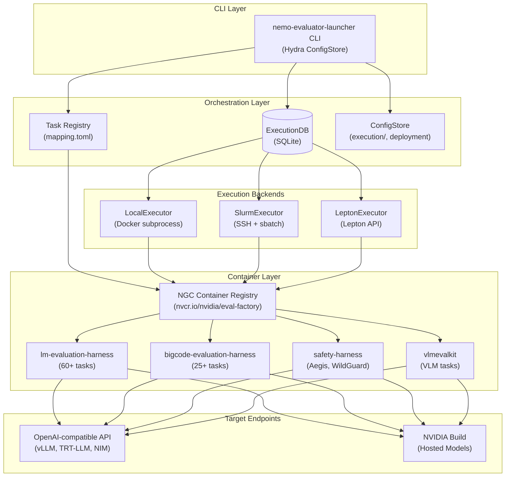

**Key Components:**

| Component | Type | Purpose |
|-----------|------|---------|
| `nemo-evaluator-launcher` | CLI | Hydra-based orchestration tool |
| `ExecutionDB` | SQLite | Tracks invocation state and job IDs |
| `mapping.toml` | Registry | Maps task names to container images |
| `LocalExecutor` | Backend | Executes via `docker run` subprocess |
| `SlurmExecutor` | Backend | Submits jobs via SSH + `sbatch` |
| `LeptonExecutor` | Backend | Submits jobs via Lepton API |

**Sources:** [11-evaluation/nemo-evaluator/SKILL.md:11-54](), [11-evaluation/nemo-evaluator/references/execution-backends.md:1-24]()

---

## CLI Command Mapping

The launcher exposes a command-based interface for managing evaluation jobs.

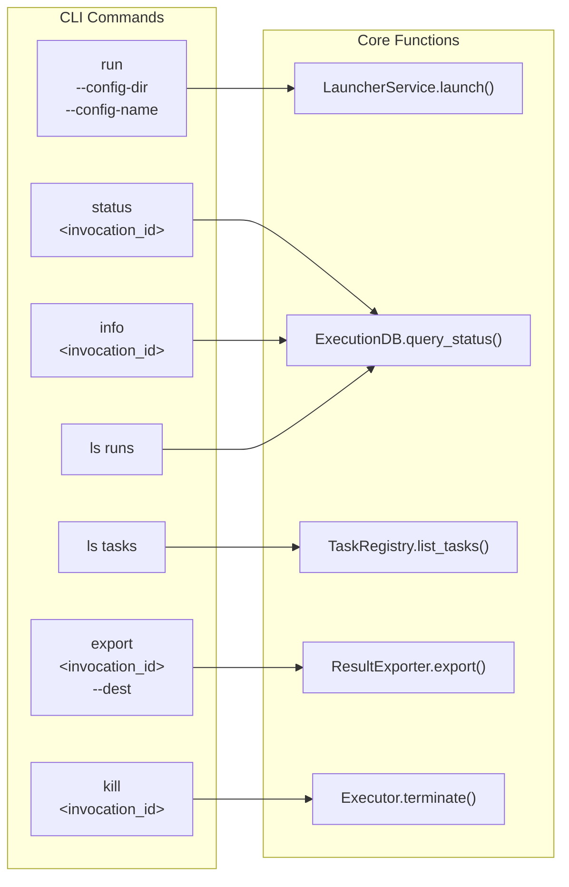

**Command Details:**

| CLI Command | Backend Function | Database Operation |
|-------------|-----------------|-------------------|
| `run` | `LauncherService.launch()` | INSERT into invocations |
| `status <id>` | `ExecutionDB.query_status()` | SELECT state by invocation_id |
| `info <id>` | `ExecutionDB.get_invocation_info()` | SELECT * by invocation_id |
| `ls tasks` | `TaskRegistry.list_tasks()` | Parse mapping.toml |
| `ls runs` | `ExecutionDB.list_invocations()` | SELECT all invocations |
| `export <id>` | `ResultExporter.export()` | Read artifacts/ directory |
| `kill <id>` | `Executor.terminate()` | UPDATE state to cancelled |

**Sources:** [11-evaluation/nemo-evaluator/SKILL.md:404-413](), [11-evaluation/nemo-evaluator/references/execution-backends.md:286-310]()

---

## Execution Backend Architecture

Each backend implements a common interface but uses different execution mechanisms.

### Execution Flow Comparison

```mermaid
graph TB
    subgraph "LocalExecutor Flow"
        L1["Read config.yaml"]
        L2["Query mapping.toml<br/>for container"]
        L3["docker run<br/>--mount output_dir"]
        L4["Poll stage.running<br/>file marker"]
        L5["Read results.yml<br/>from output_dir"]
        L1 --> L2 --> L3 --> L4 --> L5
    end
    
    subgraph "SlurmExecutor Flow"
        S1["SSH to head node"]
        S2["Generate sbatch<br/>script"]
        S3["sbatch submit<br/>(returns job_id)"]
        S4["sacct -j job_id<br/>poll status"]
        S5["Read from<br/>/shared/nfs/results"]
        S1 --> S2 --> S3 --> S4 --> S5
    end
    
    subgraph "LeptonExecutor Flow"
        LP1["Create job spec"]
        LP2["POST to<br/>Lepton API"]
        LP3["Poll job status<br/>via API"]
        LP4["GET artifacts<br/>from Lepton"]
        LP1 --> LP2 --> LP3 --> LP4
    end
```

**Backend Selection Criteria:**

| Use Case | Backend | Rationale |
|----------|---------|-----------|
| Quick local testing | Local | No cluster setup needed |
| Large batch evaluation (1000+ samples) | Slurm | Parallel job scheduling |
| CI/CD pipeline | Local or Lepton | Reproducible containers |
| Multi-model comparison | Slurm | Submit parallel jobs |
| Cloud-native workflow | Lepton | No infrastructure management |

**Sources:** [11-evaluation/nemo-evaluator/references/execution-backends.md:1-362]()

---

## LocalExecutor Implementation

The `LocalExecutor` runs evaluations via Docker on the local machine.

### Docker Execution Flow

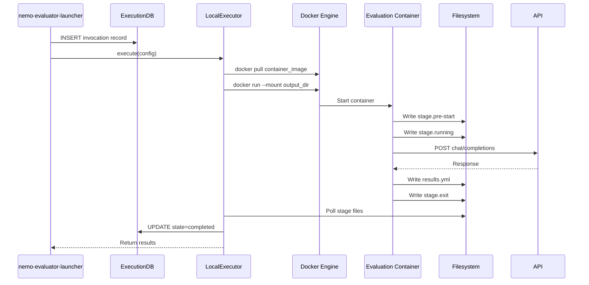

**Stage File Tracking:**

| File | Written By | Purpose |
|------|-----------|---------|
| `stage.pre-start` | Container entrypoint | Container initialized |
| `stage.running` | Evaluation harness | Evaluation started |
| `stage.exit` | Container exit handler | Evaluation complete |

**Docker Arguments:**

```yaml
execution:
  docker_args:
    - "--gpus=all"              # GPU access
    - "--shm-size=16g"          # Shared memory for multiprocessing
    - "--network=host"          # Host networking for API access
  memory_limit: "64g"           # Container memory limit
  cpus: 8                       # CPU allocation
```

**Sources:** [11-evaluation/nemo-evaluator/references/execution-backends.md:26-90]()

---

## SlurmExecutor Implementation

The `SlurmExecutor` submits jobs to HPC clusters via SSH and `sbatch`.

### Slurm Job Submission Flow

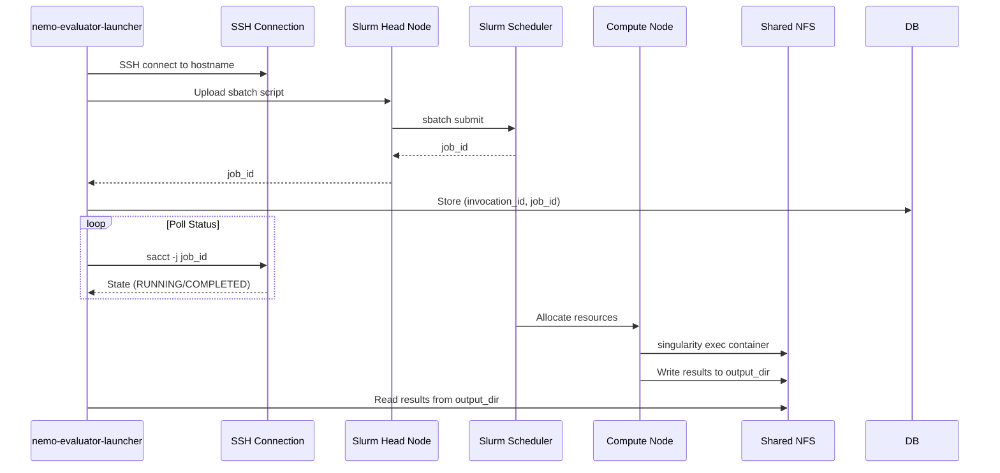

**Slurm Configuration Options:**

| Field | Purpose | Example |
|-------|---------|---------|
| `account` | Slurm account name | `research_account` |
| `partition` | Queue partition | `gpu`, `cpu` |
| `qos` | Quality of service | `normal`, `high` |
| `nodes` | Node count | `1`, `2` |
| `gpus_per_node` | GPUs per node | `8` (for A100 nodes) |
| `walltime` | Max runtime | `04:00:00` |
| `container_mounts` | Volume mounts | `/shared/data:/data:ro` |

**Job State Mapping:**

```python
# Slurm states mapped to ExecutionState
SLURM_STATE_MAP = {
    "PENDING": ExecutionState.PENDING,
    "RUNNING": ExecutionState.RUNNING,
    "COMPLETED": ExecutionState.COMPLETED,
    "FAILED": ExecutionState.FAILED,
    "CANCELLED": ExecutionState.CANCELLED,
    "TIMEOUT": ExecutionState.FAILED,
}
```

**Sources:** [11-evaluation/nemo-evaluator/references/execution-backends.md:91-226]()

---

## Configuration System

NeMo Evaluator uses Hydra's structured configs with a hierarchical override system.

### Configuration Hierarchy

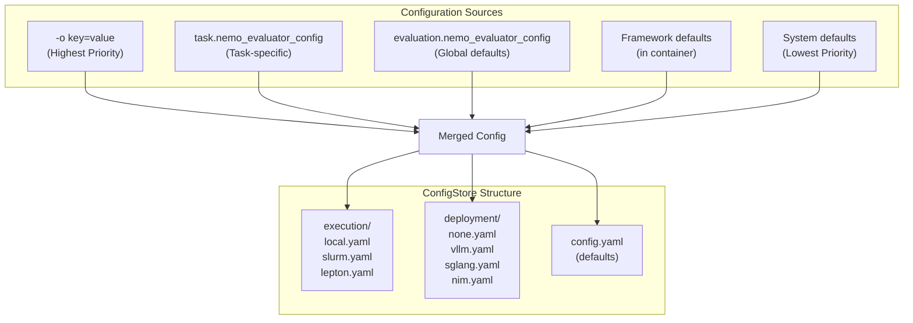

**Override Precedence (Highest to Lowest):**

1. CLI overrides: `-o key=value`
2. Task-specific: `tasks[].nemo_evaluator_config`
3. Global: `evaluation.nemo_evaluator_config`
4. Framework defaults (in container)
5. System defaults

**Configuration Sections:**

| Section | Purpose | Key Fields |
|---------|---------|-----------|
| `defaults` | Select base configs | `execution`, `deployment` |
| `execution` | Backend settings | `output_dir`, `mode`, backend-specific |
| `target` | Model endpoint | `api_endpoint.model_id`, `url`, `api_key_name` |
| `evaluation` | Tasks and parameters | `tasks[]`, `nemo_evaluator_config` |

**Sources:** [11-evaluation/nemo-evaluator/references/configuration.md:1-448]()

---

## Adapter and Interceptor Pipeline

The adapter system processes requests and responses through a chain of interceptors.

### Interceptor Chain Architecture

```mermaid
graph LR
    subgraph "Request Path"
        REQ["Raw Request<br/>(messages, params)"]
        SYS_MSG["SystemMessageInterceptor"]
        REQ_LOG["RequestLoggingInterceptor"]
        CACHE_R["CachingInterceptor<br/>(lookup)"]
    end
    
    subgraph "Endpoint"
        ENDPOINT["EndpointInterceptor<br/>(HTTP POST)"]
    end
    
    subgraph "Response Path"
        CACHE_W["CachingInterceptor<br/>(store)"]
        REASON["ReasoningInterceptor<br/>(strip &lt;think&gt; tags)"]
        RESP_LOG["ResponseLoggingInterceptor"]
        RESP["Parsed Response"]
    end
    
    REQ --> SYS_MSG --> REQ_LOG --> CACHE_R --> ENDPOINT
    ENDPOINT --> CACHE_W --> REASON --> RESP_LOG --> RESP
```

**Available Interceptors:**

| Interceptor Name | Purpose | Config Fields |
|-----------------|---------|---------------|
| `system_message` | Inject system prompt | `system_message` |
| `request_logging` | Log outbound requests | `max_requests` |
| `caching` | Cache responses | `cache_dir`, `reuse_cached_responses` |
| `endpoint` | HTTP call to API | (auto-configured) |
| `reasoning` | Strip reasoning tokens | `start_reasoning_token`, `end_reasoning_token` |
| `response_logging` | Log API responses | `max_responses` |
| `progress_tracking` | Report progress | `progress_tracking_url` |

**Adapter Configuration:**

```yaml
target:
  api_endpoint:
    adapter_config:
      interceptors:
        - name: system_message
          config:
            system_message: "You are a helpful assistant."
        - name: caching
          config:
            cache_dir: "./cache"
            reuse_cached_responses: true
        - name: endpoint
        - name: reasoning
          config:
            start_reasoning_token: ""
```

**Python API:**

```python
from nemo_evaluator.adapters.adapter_config import AdapterConfig, InterceptorConfig

adapter_config = AdapterConfig(
    interceptors=[
        InterceptorConfig(
            name="system_message",
            config={"system_message": "Think step by step."}
        ),
        InterceptorConfig(name="endpoint"),
        InterceptorConfig(
            name="reasoning",
            config={
                "start_reasoning_token": ""
            }
        )
    ]
)
```

**Sources:** [11-evaluation/nemo-evaluator/references/adapter-system.md:1-341]()

---

## Task Registry System

Tasks are registered in `mapping.toml` which maps task names to container images and metadata.

### Task Registry Structure

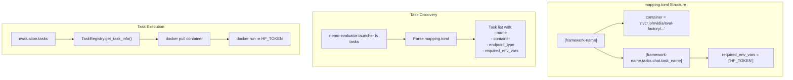

**Mapping.toml Example:**

```toml
[lm-evaluation-harness]
container = "nvcr.io/nvidia/eval-factory/lm-evaluation-harness:24.11"

[lm-evaluation-harness.tasks.chat.mmlu_pro]
required_env_vars = ["HF_TOKEN"]

[lm-evaluation-harness.tasks.chat.ifeval]
required_env_vars = []

[bigcode-evaluation-harness]
container = "nvcr.io/nvidia/eval-factory/bigcode-evaluation-harness:24.11"

[bigcode-evaluation-harness.tasks.chat.humaneval]
required_env_vars = []
```

**Environment Variable Mapping:**

```yaml
evaluation:
  tasks:
    - name: gpqa_diamond
      env_vars:
        HF_TOKEN: HF_TOKEN  # Maps to $HF_TOKEN from host
    - name: math_test_500_nemo
      env_vars:
        JUDGE_API_KEY: NGC_API_KEY  # Maps to $NGC_API_KEY
```

**Sources:** [11-evaluation/nemo-evaluator/references/custom-benchmarks.md:116-130](), [11-evaluation/nemo-evaluator/SKILL.md:362-371]()

---

## Custom Benchmark Integration

Custom benchmarks are added via Framework Definition Files (FDFs) and custom containers.

### Framework Definition File Structure

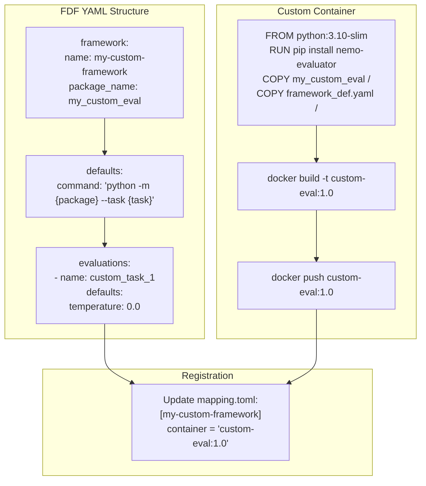

**FDF Components:**

| Section | Purpose | Example |
|---------|---------|---------|
| `framework.name` | Human-readable name | `my-custom-framework` |
| `framework.package_name` | Python package | `my_custom_eval` |
| `defaults.command` | Execution template | `python -m {package} --task {task}` |
| `evaluations[]` | Task definitions | `- name: custom_task_1` |
| `evaluations[].defaults` | Task parameters | `temperature: 0.0` |

**Output Parser:**

```python
# my_custom_eval/parser.py
def parse_output(output_dir: str) -> dict:
    """
    Parse evaluation results from output_dir.
    Returns dict with metrics in NeMo Evaluator format.
    """
    results_file = Path(output_dir) / "results.json"
    with open(results_file) as f:
        raw_results = json.load(f)
    
    return {
        "metrics": {
            "accuracy": raw_results["score"],
            "total_samples": raw_results["num_samples"]
        }
    }
```

**Custom Dataset Mounting:**

```yaml
evaluation:
  tasks:
    - name: custom_task_1
      dataset_dir: /path/to/local/data
      dataset_mount_path: /data  # Optional, defaults to /datasets
```

The launcher mounts `dataset_dir` to `dataset_mount_path` and sets `NEMO_EVALUATOR_DATASET_DIR` environment variable.

**Sources:** [11-evaluation/nemo-evaluator/references/custom-benchmarks.md:1-316]()

---

## EvaluationConfig Data Classes

The Python API uses dataclasses for type-safe configuration.

### Core Data Classes

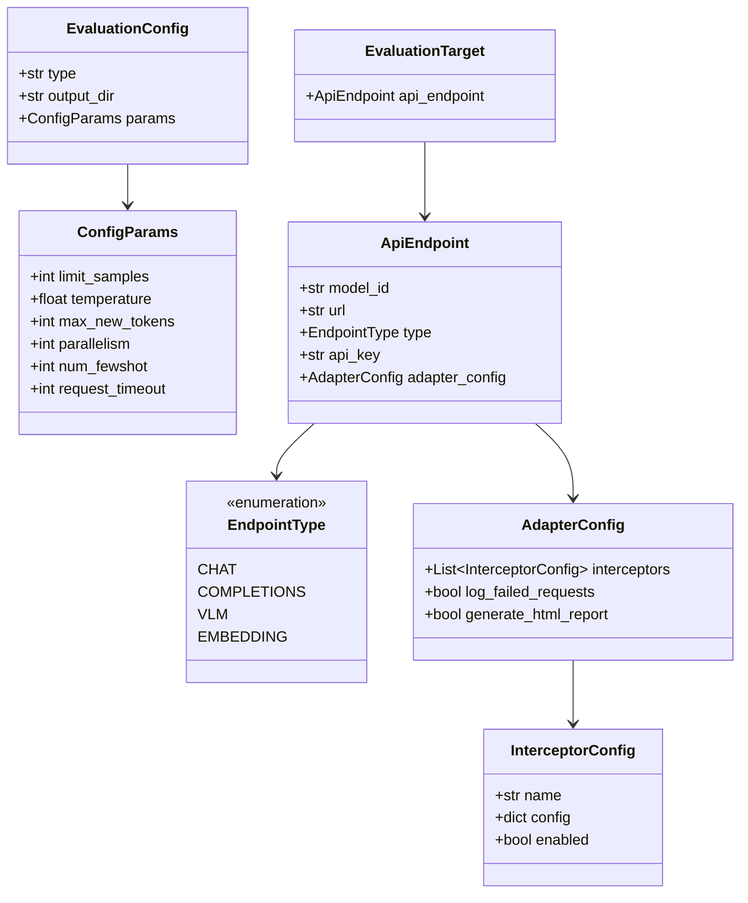

**Python API Usage:**

```python
from nemo_evaluator.core.evaluate import evaluate
from nemo_evaluator.api.api_dataclasses import (
    EvaluationConfig,
    EvaluationTarget,
    ApiEndpoint,
    EndpointType,
    ConfigParams
)

# Configure evaluation
eval_config = EvaluationConfig(
    type="mmlu_pro",
    output_dir="./results",
    params=ConfigParams(
        limit_samples=10,
        temperature=0.0,
        max_new_tokens=1024,
        parallelism=4
    )
)

# Configure target endpoint
target_config = EvaluationTarget(
    api_endpoint=ApiEndpoint(
        model_id="meta/llama-3.1-8b-instruct",
        url="https://integrate.api.nvidia.com/v1/chat/completions",
        type=EndpointType.CHAT,
        api_key="nvapi-your-key-here"
    )
)

# Run evaluation
result = evaluate(eval_cfg=eval_config, target_cfg=target_config)
```

**Sources:** [11-evaluation/nemo-evaluator/SKILL.md:436-474]()

---

## Complete Evaluation Workflow

End-to-end workflow from configuration to results.

### Full Execution Trace

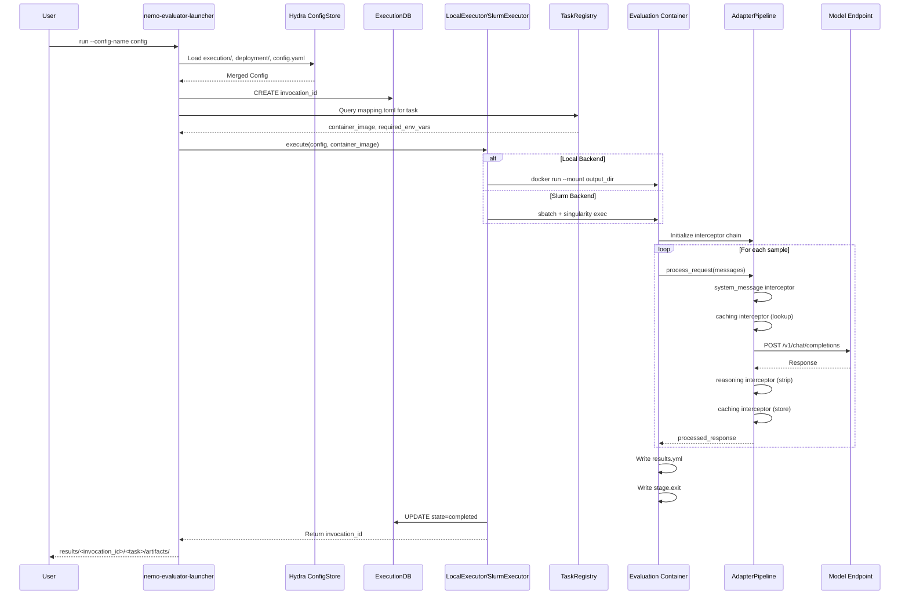

**Output Directory Structure:**

```
results/
└── <invocation_id>/
    └── <task_name>/
        ├── artifacts/
        │   ├── results.yml        # Metrics
        │   ├── results.json       # Detailed results
        │   └── logs/
        │       └── eval.log       # Execution logs
        ├── stage.pre-start
        ├── stage.running
        └── stage.exit
```

**Sources:** [11-evaluation/nemo-evaluator/SKILL.md:59-145](), [11-evaluation/nemo-evaluator/references/execution-backends.md:59-90]()

---

## Supported Harnesses and Task Coverage

NeMo Evaluator aggregates 100+ benchmarks from 18+ evaluation harnesses.

### Harness Ecosystem

| Harness | Task Count | Categories | Container |
|---------|-----------|------------|-----------|
| `lm-evaluation-harness` | 60+ | MMLU, GSM8K, HellaSwag, ARC, WinoGrande | `lm-evaluation-harness:24.11` |
| `simple-evals` | 20+ | GPQA, MATH, AIME | `simple-evals:24.11` |
| `bigcode-evaluation-harness` | 25+ | HumanEval, MBPP, MultiPL-E | `bigcode-evaluation-harness:24.11` |
| `safety-harness` | 3 | Aegis, WildGuard | `safety-harness:24.11` |
| `garak` | 1 | Security probing | `garak:24.11` |
| `vlmevalkit` | 6+ | OCRBench, ChartQA, MMMU | `vlmevalkit:24.11` |
| `bfcl` | 6 | Function calling v2/v3 | `bfcl:24.11` |
| `mtbench` | 2 | Multi-turn conversation | `mtbench:24.11` |
| `livecodebench` | 10+ | Live coding evaluation | `livecodebench:24.11` |
| `helm` | 15 | Medical domain | `helm:24.11` |
| `nemo-skills` | 8 | Math, science, agentic | `nemo-skills:24.11` |

**Task Examples by Category:**

| Category | Tasks | Purpose |
|----------|-------|---------|
| Instruction Following | `ifeval`, `mtbench` | Measure adherence to instructions |
| Graduate QA | `gpqa_diamond` | PhD-level science questions |
| Math Reasoning | `gsm8k_cot_instruct`, `math_test_500_nemo` | Multi-step math problems |
| Code Generation | `humaneval`, `mbpp`, `livecodebench` | Programming benchmarks |
| Safety | `aegis`, `wildguard`, `garak` | Jailbreak and harmful content |
| Vision-Language | `ocrbench`, `chartqa`, `mmmu` | Multimodal understanding |
| Function Calling | `bfcl` | API/tool use evaluation |

**Sources:** [11-evaluation/nemo-evaluator/SKILL.md:337-351]()

---

## Multi-Model Comparison Workflow

NeMo Evaluator's configuration override system enables systematic model comparison.

### Comparison Strategy

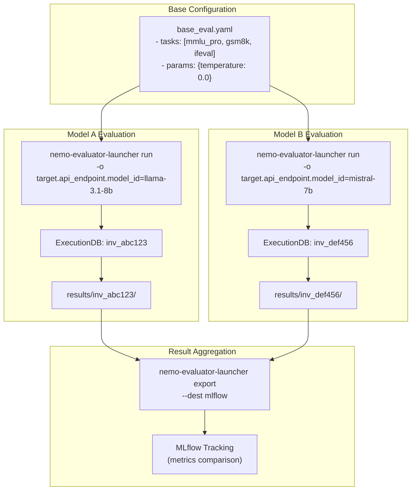

**Export Destinations:**

| Destination | Command | Purpose |
|------------|---------|---------|
| MLflow | `export <id> --dest mlflow` | Track experiments and compare metrics |
| Weights & Biases | `export <id> --dest wandb` | Cloud-based experiment tracking |
| Local JSON | `export <id> --dest local --format json` | Offline analysis |

**CLI Override Pattern:**

```bash
# Base evaluation config
cat base_eval.yaml
# defaults: [execution: local, deployment: none]
# evaluation:
#   tasks: [mmlu_pro, gsm8k_cot_instruct, ifeval]

# Run for multiple models
for model in llama-3.1-8b mistral-7b phi-3-medium; do
  nemo-evaluator-launcher run \
    --config-name base_eval \
    -o target.api_endpoint.model_id=$model \
    -o target.api_endpoint.url=https://integrate.api.nvidia.com/v1/chat/completions
done

# Export all results
nemo-evaluator-launcher ls runs | \
  xargs -I {} nemo-evaluator-launcher export {} --dest mlflow
```

**Sources:** [11-evaluation/nemo-evaluator/SKILL.md:215-281]()

---

## When to Use NeMo Evaluator

### Decision Matrix

| Scenario | NeMo Evaluator | Alternative |
|----------|---------------|-------------|
| Evaluate on 100+ benchmarks from multiple harnesses | ✓ Use NeMo Evaluator | Use individual harnesses |
| Run evaluation on Slurm HPC cluster | ✓ Use NeMo Evaluator | Use lm-evaluation-harness |
| Reproducible containerized evaluation | ✓ Use NeMo Evaluator | Use HELM |
| Evaluate OpenAI-compatible endpoints (vLLM, TRT-LLM) | ✓ Use NeMo Evaluator | Use lm-evaluation-harness |
| Export results to MLflow/W&B | ✓ Use NeMo Evaluator | Custom scripts |
| Quick local evaluation on 1-2 benchmarks | Use lm-evaluation-harness | NeMo Evaluator (overkill) |
| Code-only benchmarks (HumanEval, MBPP) | Use bigcode-evaluation-harness | NeMo Evaluator (extra overhead) |
| Fairness/efficiency evaluation | Use HELM | NeMo Evaluator (lacks fairness metrics) |
| Highly specialized domain evaluation | Custom framework | NeMo Evaluator (via FDFs) |

**Comparison with Alternatives:**

For general LLM evaluation using lm-evaluation-harness, see [2.7](#2.7). For code-specific evaluation with bigcode-evaluation-harness, see [2.7](#2.7). For production monitoring of deployed models with Phoenix, see [4.3](#4.3).

**Key Differentiators:**

1. **Multi-Backend Execution**: Seamlessly switch between local Docker, Slurm HPC, and Lepton cloud
2. **Container-First Architecture**: All harnesses packaged as NGC containers for reproducibility
3. **Unified Interface**: Single configuration format for 100+ benchmarks from 18+ harnesses
4. **Adapter System**: Built-in interceptors for caching, reasoning token extraction, progress tracking
5. **Enterprise Features**: Result export to MLflow/W&B, job tracking with ExecutionDB, Hydra-based configuration

**Sources:** [11-evaluation/nemo-evaluator/SKILL.md:322-336]()

---

## Common Configuration Patterns

### Pattern 1: Cached Evaluation for Development

```yaml
target:
  api_endpoint:
    adapter_config:
      interceptors:
        - name: caching
          config:
            cache_dir: "./evaluation_cache"
            reuse_cached_responses: true
            save_requests: true
            save_responses: true
        - name: endpoint

evaluation:
  nemo_evaluator_config:
    config:
      params:
        limit_samples: 50  # Test on subset first
```

**Use Case:** Iterating on evaluation code without re-running expensive API calls.

### Pattern 2: Production Evaluation with Observability

```yaml
target:
  api_endpoint:
    adapter_config:
      interceptors:
        - name: request_logging
          config:
            max_requests: 1000
        - name: endpoint
        - name: response_logging
          config:
            max_responses: 1000
        - name: progress_tracking
          config:
            progress_tracking_url: "http://monitor.internal/progress"
            progress_tracking_interval: 10
      log_failed_requests: true

evaluation:
  nemo_evaluator_config:
    config:
      params:
        parallelism: 8
        request_timeout: 300
```

**Use Case:** Production evaluation with full request/response logging and progress monitoring.

### Pattern 3: Reasoning Model Evaluation

```yaml
target:
  api_endpoint:
    adapter_config:
      interceptors:
        - name: system_message
          config:
            system_message: "Think step by step."
        - name: endpoint
        - name: reasoning
          config:
            start_reasoning_token: ""
            enable_reasoning_tracking: true

evaluation:
  tasks:
    - name: gsm8k_cot_instruct
      nemo_evaluator_config:
        config:
          params:
            temperature: 0.0
            max_new_tokens: 2048  # Longer for reasoning
```

**Use Case:** Evaluating models with explicit reasoning traces (e.g., o1-style models).

**Sources:** [11-evaluation/nemo-evaluator/references/adapter-system.md:142-172](), [11-evaluation/nemo-evaluator/references/configuration.md:329-418]()

---

## Requirements and Resources

### Prerequisites

| Component | Requirement | Purpose |
|-----------|------------|---------|
| Python | 3.10-3.13 | Runtime |
| Docker | Latest | Local execution backend |
| NGC API Key | `NGC_API_KEY` env var | Container pulls and NVIDIA Build access |
| HuggingFace Token | `HF_TOKEN` env var | Required for GPQA, MMLU tasks |

### Installation

```bash
# Install launcher
pip install nemo-evaluator-launcher

# Configure NGC credentials
export NGC_API_KEY=nvapi-your-key-here
docker login nvcr.io -u '$oauthtoken' -p $NGC_API_KEY

# Optional: Configure HuggingFace token
export HF_TOKEN=hf_your-token-here
```

### Resource Links

| Resource | URL | Purpose |
|----------|-----|---------|
| GitHub Repository | https://github.com/NVIDIA-NeMo/Evaluator | Source code |
| NGC Container Registry | nvcr.io/nvidia/eval-factory/ | Pre-built harness containers |
| NVIDIA Build | https://build.nvidia.com | Free hosted models for evaluation |
| Documentation | https://github.com/NVIDIA-NeMo/Evaluator/tree/main/docs | Official docs |

**Sources:** [11-evaluation/nemo-evaluator/SKILL.md:482-494]()

---

