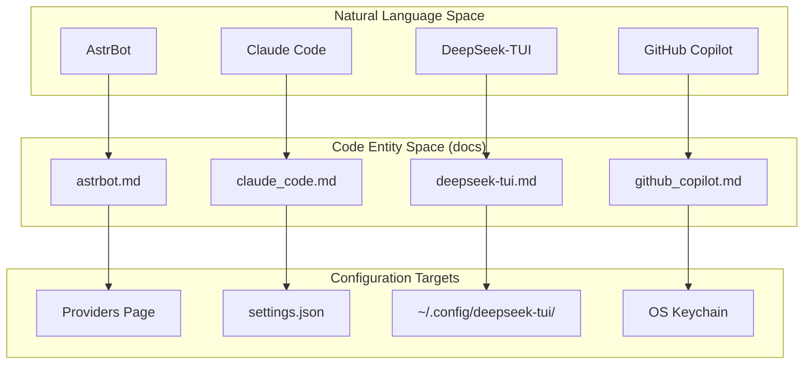
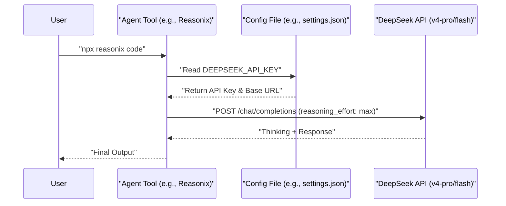

<!-- source: DeepWiki mcp.deepwiki.com · repo deepseek-ai/awesome-deepseek-agent · page 1 Overview · fetched 2026-10-30 -->

# Overview

Relevant source files

The following files were used as context for generating this wiki page:

- [README.md](README.md)
- [README.zh-CN.md](README.zh-CN.md)

The **Awesome DeepSeek Agent** repository is a curated collection of technical integration guides designed to help developers and AI enthusiasts connect **DeepSeek-V4** models to a wide array of AI agents, terminal assistants, and IDE extensions. 

The project focuses on the latest generation of DeepSeek models, specifically `deepseek-v4-pro` and `deepseek-v4-flash`, providing step-by-step instructions for configuring 1M context windows, reasoning effort levels, and specialized API endpoints.

### Project Mission and Scope
The repository serves as a bridge between the [DeepSeek Platform](https://platform.deepseek.com) and the rapidly evolving ecosystem of "agentic" tools. Each guide is structured to move from installation to first-run in minutes, ensuring that complex configurations (like Anthropic-compatible headers or MCP server setups) are standardized across different tools.

For a detailed look at the underlying models and their technical specifications, see [DeepSeek Models Reference](#1.2).

### Repository Organization
The repository is organized to be accessible to both English and Chinese-speaking audiences. It follows a flat file structure for documentation, using a strict naming convention to keep translations and assets synchronized.

- **Master Index**: The [README.md:16-37]() and [README.zh-CN.md:16-37]() serve as the central entry points, categorizing tools alphabetically.
- **Bilingual Documentation**: Every integration guide exists as a pair of files in the `docs/` directory (e.g., `tool.md` and `tool.zh-CN.md`).
- **Assets**: Screenshots and diagrams are centralized in the `docs/assets/` directory to ensure visual consistency across guides.

For more details on the file layout and how to find specific tool documentation, see [Repository Structure and Navigation](#1.1).

### Core Categories
The integrations are broadly categorized based on their execution environment and primary use case:

| Category | Description | Key Examples |
| :--- | :--- | :--- |
| **Terminal & CLI Agents** | Native command-line assistants focused on coding and system tasks. | `Claude Code`, `DeepSeek-TUI`, `Reasonix` |
| **IDE & Editor Extensions** | Integrations directly within development environments. | `GitHub Copilot`, `Kilo Code`, `WorkBuddy` |
| **Desktop & Web Platforms** | GUI-based orchestration layers for managing multiple agents. | `Cherry Studio`, `LobeHub` |
| **Messaging & Multi-Channel** | Bridges to platforms like WeChat, Feishu, or Telegram. | `AstrBot`, `OpenClaw` |
| **Proxy & Protocol Bridges** | Translation layers for cross-provider compatibility. | `Moon Bridge`, `Factory AI Droid` |

### System Relationship Diagram
This diagram illustrates how the documentation maps "Natural Language Space" (the tool names) to "Code Entity Space" (the documentation files and configuration targets).

**Documentation Mapping**

**Sources:** [README.md:18-25](), [README.zh-CN.md:18-25]()

### Integration Flow
The following diagram demonstrates the typical lifecycle of an integration as described in the repository's guides, showing the flow from the user's environment to the DeepSeek API.

**DeepSeek Integration Lifecycle**

**Sources:** [README.md:36](), [README.zh-CN.md:36]()

### Contribution and Evolution
This repository is community-driven. Developers are encouraged to submit new guides following the technical checklist and bilingual requirements.

- To contribute a new tool, see [Contributing a New Integration Guide](#8).
- For a deep dive into specific terminology like "Reasoning Effort" or "MCP," see the [Glossary](#9).

**Sources:** [README.md:44-46](), [README.zh-CN.md:44-46]()

---

