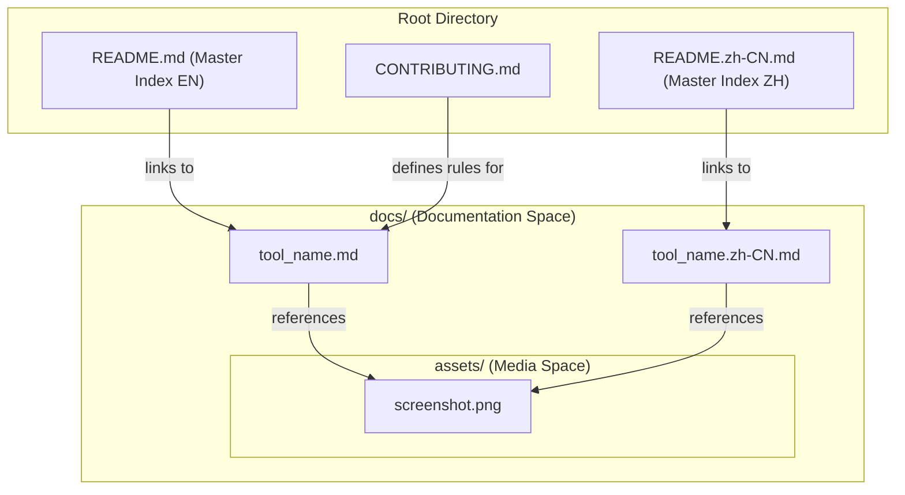
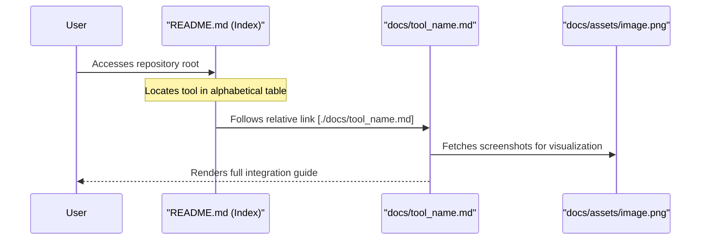
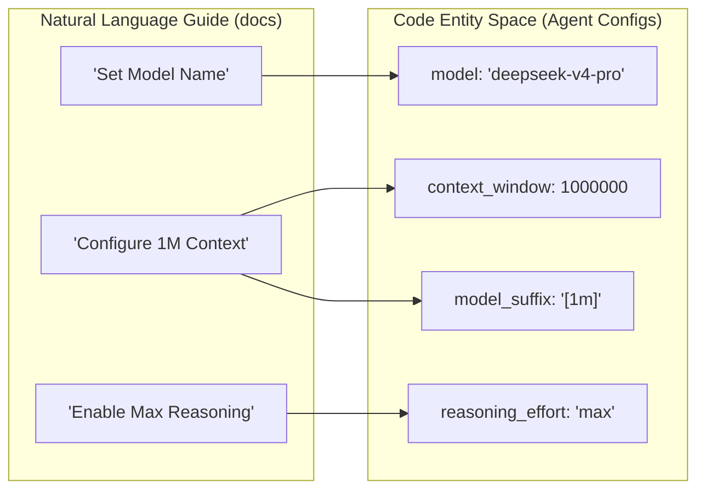

<!-- source: DeepWiki mcp.deepwiki.com · repo deepseek-ai/awesome-deepseek-agent · page 1.1 Repository Structure and Navigation · fetched 2026-10-30 -->

# Repository Structure and Navigation

Relevant source files

The following files were used as context for generating this wiki page:

- [.github/PULL_REQUEST_TEMPLATE.md](.github/PULL_REQUEST_TEMPLATE.md)
- [CONTRIBUTING.md](CONTRIBUTING.md)
- [README.md](README.md)
- [README.zh-CN.md](README.zh-CN.md)

This page provides a technical overview of the `awesome-deepseek-agent` repository's organization. It details how the documentation is structured, the bilingual file conventions, and the mechanism by which the master index links disparate integration guides into a cohesive knowledge base.

## Directory Layout and File Conventions

The repository utilizes a flat directory structure for documentation to minimize nesting and simplify path referencing. The core logic of the repository is contained within the `docs/` directory and the root `README` files.

### The `docs/` Directory
All integration guides are stored in the `docs/` folder. The repository enforces a strict naming and pairing convention for these files to ensure accessibility for both English and Simplified Chinese speakers [CONTRIBUTING.md:15-17]().

*   **Bilingual Pairing**: Every tool documented must have two corresponding files:
    *   `docs/<tool_name>.md`: The English version of the guide.
    *   `docs/<tool_name>.zh-CN.md`: The Simplified Chinese version of the guide.
*   **Assets**: Visual aids, such as screenshots or diagrams, are stored in `docs/assets/` [CONTRIBUTING.md:79-81](). Guides reference these assets using relative paths to ensure they render correctly on GitHub and other Markdown viewers.

### Root Index Files
The repository's entry points are the two README files in the root directory:
*   `README.md`: The primary English landing page [README.md:1-11]().
*   `README.zh-CN.md`: The primary Simplified Chinese landing page [README.zh-CN.md:1-11]().

### Repository Structure Diagram
The following diagram illustrates the relationship between the root index, the bilingual documentation files, and the shared assets.

**Documentation Hierarchy and Asset Mapping**

**Sources:** [README.md:16-37](), [README.zh-CN.md:16-37](), [CONTRIBUTING.md:15-21](), [CONTRIBUTING.md:79-82]()

---

## The Master Index Mechanism

The README files serve as more than just a welcome page; they act as a functional "Master Index" for the repository. This index is implemented as a Markdown table that categorizes tools and provides direct links to their respective guides.

### Table Structure
The table contains three primary columns:
1.  **Tool**: The name of the AI agent or coding assistant.
2.  **Description**: A brief technical summary of the tool's capabilities.
3.  **Guide**: A relative link to the specific `.md` or `.zh-CN.md` file in the `docs/` directory.

### Alphabetical Enforcement
To maintain order and prevent merge conflicts during concurrent pull requests, all entries in the `Contents` table must be inserted in **alphabetical order** [CONTRIBUTING.md:19-21]().

**Data Flow: From README to Specific Integration Guide**

**Sources:** [README.md:14-37](), [CONTRIBUTING.md:19-21](), [CONTRIBUTING.md:79-82]()

---

## Technical Standards for Guides

Every file within the `docs/` directory must adhere to specific technical requirements defined in the contribution guidelines. These standards ensure that "Natural Language" instructions correctly map to "Code Entity" configurations required by the agents.

### Key Configuration Requirements
| Requirement | Implementation Detail | Source |
| :--- | :--- | :--- |
| **Model Naming** | Must use `deepseek-v4-pro` or `deepseek-v4-flash`. | [CONTRIBUTING.md:27-32]() |
| **Context Window** | Configured for 1,000,000 tokens (e.g., `[1m]` suffix). | [CONTRIBUTING.md:36-44]() |
| **Reasoning Effort** | Must target `max` effort levels in config files. | [CONTRIBUTING.md:46-54]() |

### Integration Mapping Diagram
This diagram shows how a guide in `docs/` maps abstract concepts to specific code entities found in agent configuration files.

**Conceptual to Code Entity Mapping**

**Sources:** [CONTRIBUTING.md:23-54](), [.github/PULL_REQUEST_TEMPLATE.md:5-12]()

---

## Navigation Summary

To navigate the codebase effectively:
1.  **Start at the Root**: Use `README.md` (EN) or `README.zh-CN.md` (ZH) to find the tool of interest.
2.  **Locate the Guide**: Follow the link to the `docs/` folder.
3.  **Verify Configuration**: Ensure the guide mentions the mandatory V4 model identifiers and 1M context settings as required by the `CONTRIBUTING.md` specification [CONTRIBUTING.md:23-54]().
4.  **Check Assets**: If images are broken, verify their existence in `docs/assets/` [CONTRIBUTING.md:79-82]().

**Sources:** [README.md:1-47](), [README.zh-CN.md:1-47](), [CONTRIBUTING.md:1-104]()

---

