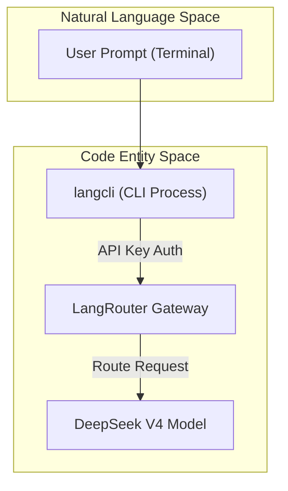
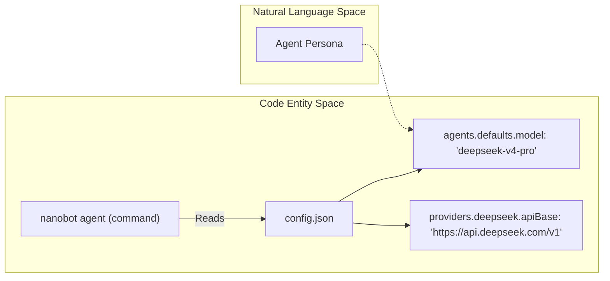

<!-- source: DeepWiki mcp.deepwiki.com · repo deepseek-ai/awesome-deepseek-agent · page 2.7 Other Terminal Agents · fetched 2026-10-30 -->

# Other Terminal Agents

<details>
<summary>Relevant source files</summary>

The following files were used as context for generating this wiki page:

- [docs/langcli.md](docs/langcli.md)
- [docs/langcli.zh-CN.md](docs/langcli.zh-CN.md)
- [docs/nanobot.md](docs/nanobot.md)
- [docs/nanobot.zh-CN.md](docs/nanobot.zh-CN.md)
- [docs/opencode.md](docs/opencode.md)
- [docs/opencode.zh-CN.md](docs/opencode.zh-CN.md)

</details>


This section provides concise integration guides for additional terminal-based AI agents supported by the Awesome DeepSeek Agent repository. These tools include **Langcli**, **nanobot**, and **OpenCode**, each offering unique terminal-native workflows for interacting with DeepSeek V4 models.

## 1. Langcli

Langcli is an AI coding assistant that supports both a Command Line Interface (CLI) and integration as a Zed ACP Agent [docs/langcli.md:5-5](). It utilizes **LangRouter** as its primary gateway for model access.

### Installation and Setup
Langcli can be installed via automated scripts or manually using Node.js (version 20+) [docs/langcli.md:9-29]().

| Method | Command | Platform |
| :--- | :--- | :--- |
| **Quick Install** | `bash -c "$(curl -fsSL https://assets.langcli.com/installation/install-langcli.sh)"` | macOS, Linux, WSL |
| **Quick Install** | `cmd /c "curl -fsSL -o %TEMP%\install-langcli.bat ..."` | Windows (Admin) |
| **Manual** | `npm i -g langcli-com` | All (Requires Node 20+) |

### Configuration Flow
To use Langcli with DeepSeek, users must obtain an API key from the [LangRouter](https://langrouter.ai) platform [docs/langcli.md:34-34](). Once the key is prepared, the agent is launched using the `langcli` command [docs/langcli.md:39-39]().

**Data Flow: Langcli to LangRouter**

**Sources:** [docs/langcli.md:5-43](), [docs/langcli.zh-CN.md:5-43]()

---

## 2. nanobot

nanobot is a lightweight AI agent designed for terminal use and integration with chat platforms [docs/nanobot.md:5-5](). It is managed via the `uv` tool and utilizes a centralized `config.json` for provider settings.

### Installation
The tool is installed using the `uv` tool manager [docs/nanobot.md:9-14](). On Windows, users must ensure the `.local/bin` directory is added to the system `PATH` [docs/nanobot.md:16-20]().

```bash
uv tool install nanobot-ai
nanobot --version
```

### Configuration
Initialization is performed via the `onboard` command, which generates a platform-specific configuration file [docs/nanobot.md:36-45]():
*   **Windows**: `$env:USERPROFILE\.nanobot\config.json`
*   **Linux/macOS**: `~/.nanobot/config.json`

The `config.json` must be modified to define the `deepseek` provider and set the default agent model to `deepseek-v4-pro` [docs/nanobot.md:49-64]().

**Entity Mapping: nanobot Configuration**


**Sources:** [docs/nanobot.md:7-73](), [docs/nanobot.zh-CN.md:7-73]()

---

## 3. OpenCode

OpenCode is an open-source assistant providing both terminal and web interfaces [docs/opencode.md:5-5](). It requires version **v1.14.24** or higher for optimal compatibility with DeepSeek V4 [docs/opencode.md:11-11]().

### Integration Steps
Integration is handled through interactive terminal commands rather than manual file editing [docs/opencode.md:15-18]():

1.  **Launch**: Execute `opencode` in the terminal.
2.  **Connect**: Type `/connect` in the interface input.
3.  **Provider**: Search and select `deepseek`.
4.  **Credentials**: Input the API Key from the DeepSeek Platform.
5.  **Model**: Select `DeepSeek-V4-Pro`.

**Sources:** [docs/opencode.md:5-19](), [docs/opencode.zh-CN.md:5-19]()

---

