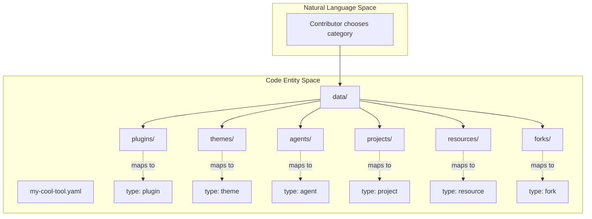
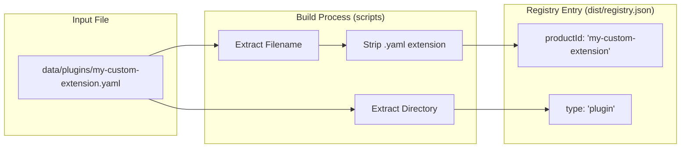

<!-- source: DeepWiki mcp.deepwiki.com · repo awesome-opencode/awesome-opencode · page 6.4 File Naming Conventions · fetched 2026-10-30 -->

# File Naming Conventions

<details>
<summary>Relevant source files</summary>

The following files were used as context for generating this wiki page:

- [.github/PULL_REQUEST_TEMPLATE.md](.github/PULL_REQUEST_TEMPLATE.md)
- [contributing.md](contributing.md)
- [data/schema.json](data/schema.json)
- [docs/schema-design.md](docs/schema-design.md)

</details>


This document specifies the file naming requirements for YAML entries in the `awesome-opencode` repository. It covers the kebab-case naming requirement, directory structure conventions, and the one-file-per-entry approach that ensures a maintainable data layer.

---

## Overview

The `awesome-opencode` repository uses a file-based data system where each extension or tool is represented by a single YAML file. All entry files in the `data/` directory must follow strict naming conventions because the filename directly determines the `productId` field in the generated machine-readable `dist/registry.json`. This architecture ensures that the repository serves as a single source of truth for both human-readable documentation and machine-consumable registries.

**Sources:** [docs/schema-design.md:9-17](), [contributing.md:3-5](), [contributing.md:23]()

---

## Kebab-Case Requirement

All YAML filenames must use **kebab-case** (lowercase letters with hyphens separating words). This convention is enforced to ensure compatibility across different operating systems and to provide clean, URL-safe identifiers for downstream consumers.

### Kebab-Case Format

```text
[lowercase-words-separated-by-hyphens].yaml
```

**Valid examples:**
- `my-plugin.yaml` [contributing.md:23]()
- `ayu-dark.yaml`
- `universal-llm-proxy.yaml`

**Invalid examples:**
- `MyPlugin.yaml` (PascalCase)
- `my_plugin.yaml` (snake_case)
- `my.plugin.yaml` (dot-separated)
- `my-plugin.yml` (incorrect extension; must be `.yaml`) [.github/PULL_REQUEST_TEMPLATE.md:22]()

**Sources:** [contributing.md:23](), [.github/PULL_REQUEST_TEMPLATE.md:22]()

---

## Directory Structure and Type Derivation

The repository follows a strict directory structure where the folder location of a file determines its metadata type. A key design principle is that the `type` of an entry is **derived from its directory** rather than being stored as a field within the YAML content itself. This reduces data redundancy and prevents categorization errors within the YAML files.

### Directory Mapping Diagram



### Directory Roles

| Directory Path | Purpose | Entry Type |
| :--- | :--- | :--- |
| `data/plugins/` | JavaScript/TypeScript modules extending functionality | `plugin` |
| `data/themes/` | JSON color schemes and visual themes | `theme` |
| `data/agents/` | AI agent configurations and `SKILL.md` files | `agent` |
| `data/projects/` | Standalone applications and utilities | `project` |
| `data/resources/` | Guides, MCP servers, and configurations | `resource` |
| `data/forks/` | Modified builds of OpenCode | `fork` |

**Sources:** [docs/schema-design.md:19-35](), [docs/schema-design.md:44-123](), [contributing.md:16-21]()

---

## Filename to ProductId Transformation

The filename (excluding the `.yaml` extension) is transformed into a unique identifier called the `productId`. This identifier is used by the OpenCode ecosystem to track installations, manage dependencies, and resolve configuration precedence.

### Transformation Logic Diagram



### Examples of Transformation

| Source File Path | Resulting ProductId | Resulting Type |
| :--- | :--- | :--- |
| `data/plugins/envsitter-guard.yaml` | `envsitter-guard` | `plugin` |
| `data/themes/lavi.yaml` | `lavi` | `theme` |
| `data/projects/hcom.yaml` | `hcom` | `project` |

**Sources:** [docs/schema-design.md:17](), [contributing.md:23]()

---

## One-File-Per-Entry Approach

The repository enforces a "one-file-per-entry" rule. This modular approach ensures that:
1. **Pull Requests are isolated**: Adding a new tool only involves creating one new file, reducing merge conflicts [.github/PULL_REQUEST_TEMPLATE.md:26]().
2. **Validation is granular**: The automated validation pipeline can check individual files for schema compliance using `data/schema.json` [contributing.md:55]().
3. **No manual README edits**: The `README.md` is automatically regenerated from these individual files, preventing formatting errors [contributing.md:58-60]().

### Required Fields for Every File

Regardless of the filename, every YAML file must contain these core fields as defined in the JSON schema:
- `name`: The human-readable display name [data/schema.json:8-12]().
- `repo`: The full repository URL in URI format [data/schema.json:13-17]().
- `tagline`: A short summary (max 120 characters) [data/schema.json:18-23]().
- `description`: A detailed explanation of the entry [data/schema.json:24-28]().

**Sources:** [data/schema.json:61](), [contributing.md:27-32](), [.github/PULL_REQUEST_TEMPLATE.md:28-33]()

---

## Validation and Enforcement

The naming conventions are enforced through a multi-stage process:

1. **Pull Request Checklist**: Contributors are required to verify that their filename is kebab-case before submission [.github/PULL_REQUEST_TEMPLATE.md:22]().
2. **Automated Validation**: The CI pipeline runs validation scripts that verify the YAML syntax against `data/schema.json` and ensure the file is in the correct category folder [contributing.md:55]().
3. **Maintainer Review**: During the PR process, maintainers verify that the entry is relevant, unique, and follows the organizational standards [contributing.md:45-51]().

**Sources:** [contributing.md:53-58](), [.github/PULL_REQUEST_TEMPLATE.md:21-22]()

---

