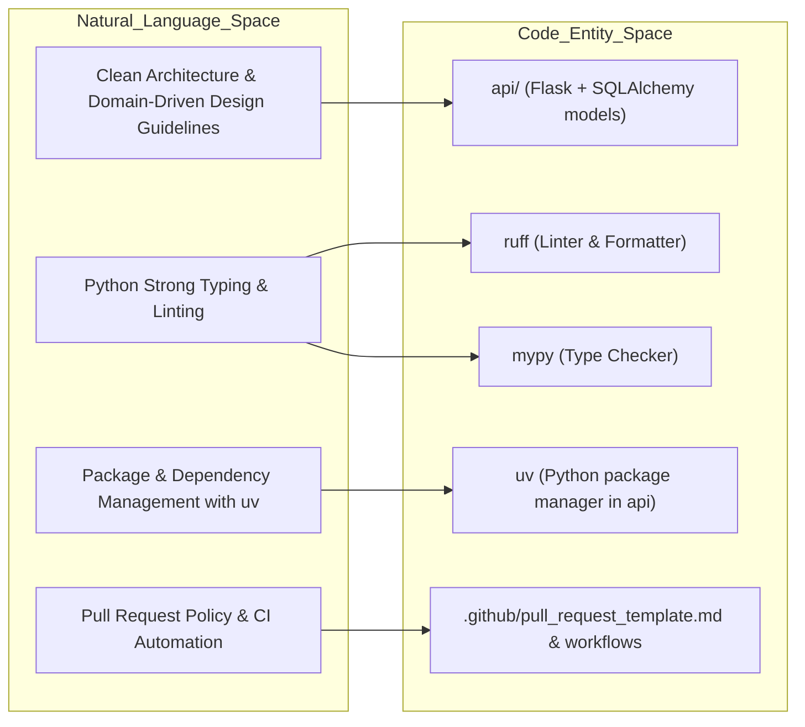
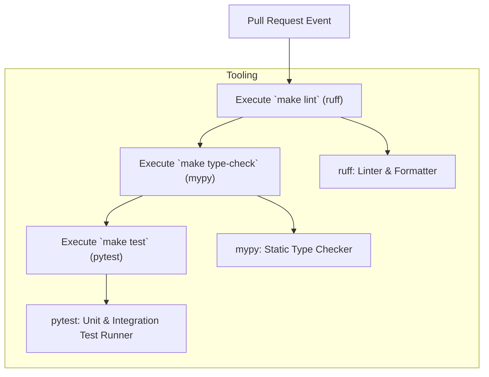
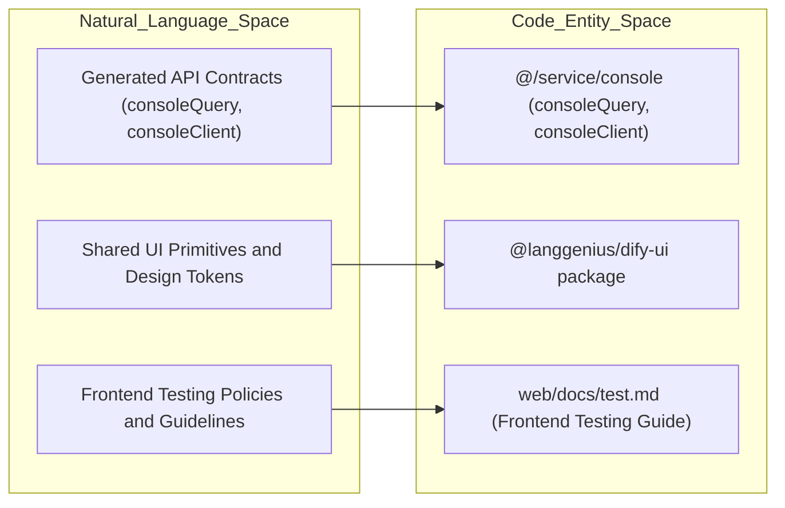
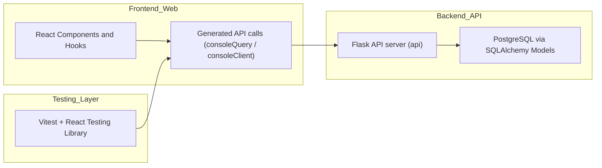

<!-- source: DeepWiki mcp.deepwiki.com · repo langgenius/dify · page 11.6 AI Coding Agent Skills · fetched 2026-10-26 -->

# AI Coding Agent Skills

Relevant source files

The following files were used as context for generating this wiki page:

- [.agents/skills/frontend-code-review/SKILL.md](.agents/skills/frontend-code-review/SKILL.md)
- [.agents/skills/frontend-code-review/references/accessibility-ui.md](.agents/skills/frontend-code-review/references/accessibility-ui.md)
- [.agents/skills/frontend-code-review/references/code-quality.md](.agents/skills/frontend-code-review/references/code-quality.md)
- [.agents/skills/frontend-code-review/references/component-architecture.md](.agents/skills/frontend-code-review/references/component-architecture.md)
- [.agents/skills/frontend-code-review/references/data-query-contracts.md](.agents/skills/frontend-code-review/references/data-query-contracts.md)
- [.agents/skills/frontend-code-review/references/dify-invariants.md](.agents/skills/frontend-code-review/references/dify-invariants.md)
- [.agents/skills/frontend-code-review/references/dify-ui.md](.agents/skills/frontend-code-review/references/dify-ui.md)
- [.agents/skills/frontend-code-review/references/performance.md](.agents/skills/frontend-code-review/references/performance.md)
- [.agents/skills/frontend-code-review/references/testing.md](.agents/skills/frontend-code-review/references/testing.md)
- [.agents/skills/frontend-testing/SKILL.md](.agents/skills/frontend-testing/SKILL.md)
- [.agents/skills/how-to-write-component/SKILL.md](.agents/skills/how-to-write-component/SKILL.md)
- [.agents/skills/how-to-write-component/references/data.md](.agents/skills/how-to-write-component/references/data.md)
- [.agents/skills/how-to-write-component/references/interactions.md](.agents/skills/how-to-write-component/references/interactions.md)
- [.agents/skills/how-to-write-component/references/ownership.md](.agents/skills/how-to-write-component/references/ownership.md)
- [.agents/skills/how-to-write-component/references/runtime.md](.agents/skills/how-to-write-component/references/runtime.md)
- [.agents/skills/how-to-write-component/references/state.md](.agents/skills/how-to-write-component/references/state.md)
- [.github/CODEOWNERS](.github/CODEOWNERS)
- [.github/dependabot.yml](.github/dependabot.yml)
- [.github/labeler.yml](.github/labeler.yml)
- [.github/linters/.yaml-lint.yml](.github/linters/.yaml-lint.yml)
- [.github/pull_request_template.md](.github/pull_request_template.md)
- [.github/workflows/labeler.yml](.github/workflows/labeler.yml)
- [.github/workflows/stale.yml](.github/workflows/stale.yml)
- [.vite-hooks/pre-commit](.vite-hooks/pre-commit)
- [CONTRIBUTING.md](CONTRIBUTING.md)
- [packages/dify-ui/AGENTS.md](packages/dify-ui/AGENTS.md)
- [packages/dify-ui/docs/forms.md](packages/dify-ui/docs/forms.md)
- [packages/dify-ui/docs/overlays.md](packages/dify-ui/docs/overlays.md)
- [packages/dify-ui/src/button/README.md](packages/dify-ui/src/button/README.md)
- [packages/dify-ui/src/icon-button/README.md](packages/dify-ui/src/icon-button/README.md)
- [web/AGENTS.md](web/AGENTS.md)
- [web/README.md](web/README.md)
- [web/app/components/app/text-generate/saved-items/__tests__/index.spec.tsx](web/app/components/app/text-generate/saved-items/__tests__/index.spec.tsx)
- [web/app/components/app/text-generate/saved-items/index.tsx](web/app/components/app/text-generate/saved-items/index.tsx)
- [web/docs/test.md](web/docs/test.md)

This page documents the agent skill definitions and usage patterns implemented in the `.agents/` and `.claude/` folders of the Dify repository for AI-powered coding assistants. These agents provide automated support primarily for backend and frontend code review, component refactoring, frontend testing, and end-to-end (E2E) test authoring. The documentation covers the technical implementation, data flow, and key classes/functions relevant to these skills. To aid understanding, mermaid diagrams illustrate the integration between natural language instructions and specific code entities across backend and frontend domains.

---

## Agent Interaction Patterns and Foundations

The Dify AI coding agents work by leveraging explicit skill definitions and routing rules within `.agents/skills/` along with interface prompts in `.claude/` to execute development-related tasks. Their typical modes of action include:

- Monitoring pull requests and code pushes via GitHub Actions and internal CI pipelines.
- Invoking linting, static analysis, correctness checks, and architectural compliance validations.
- Assisting with component-level refactoring and ownership decisions.
- Guiding creation and refinement of frontend automated tests and E2E scenarios.

Agents differentiate their focus by domain:

- **Backend skills** emphasize Pythonic best practices, strict type safety with `mypy`, linting with `ruff`, modular API backend code under `api/`, and adherence to DDD and layered architectures.
- **Frontend skills** prioritize TypeScript type correctness, adherence to ESLint policies, usage of generated API contracts, i18n compliance, component ownership boundaries, and UI primitive contracts.

These AI skills integrate tightly with existing tooling and repository workflows, enabling automated feedback loops and optionally automated PR fix commits to improve code quality and maintainability.

### Diagram: Natural Language Concepts to Code Entities (Backend)

Sources:  
* [CONTRIBUTING.md:64-74]()  
* [.github/pull_request_template.md:19-24]()  
* [.github/dependabot.yml:4-103]()

---

## Backend Code Review Skills

### Implementation Highlights

Backend AI agents are designed to enforce code quality, typing discipline, architectural patterns, and repository conventions for Python backend services.

- **Linting and Formatting:** Leveraging `ruff` to apply consistent Python styling and static analysis checks during PR validation. Agents trigger `make lint` or equivalent commands [CONTRIBUTING.md:24-24]().
- **Static Type Checking:** `mypy` runs to ensure type correctness, disallowing `Any` types and catching data shape mismatches early [CONTRIBUTING.md:24-24]() and [.github/dependabot.yml:90-91]().
- **Dependency Isolation:** The `uv` tool manages per-functional-area Python dependencies within the `api/` directory, ensuring scoped and consistent environments [dependabot.yml:4-103]().
- **PR Compliance:** Agents verify PR adherence to linked issues, atomic commits, and documentation updates as defined in PR templates [.github/pull_request_template.md:19-24]().

### Workflow Example: Backend Quality Gate

Sources:  
* [CONTRIBUTING.md:64-74]()  
* [.github/pull_request_template.md:19-24]()  
* [.github/dependabot.yml:90-91]()

---

## Frontend Code Review Skills

### Highlights

Frontend AI agents specialize in reviewing TypeScript and React code to maintain architectural and stylistic consistency across the UI stack.

- **Linting Pipeline:** Frontend implements ESLint along with Vitest. Agents typically invoke commands such as `pnpm exec vp staged` targeting the `web/` directory to ensure compliance [web/README.md:117-123]().
- **Architectural Boundaries:** Agents direct developers to use generated API clients (`consoleQuery` and `consoleClient`) from `@/service/console` rather than handwritten REST helpers [web/AGENTS.md:9-11]().
- **Internationalization Compliance:** Enforce that all user-facing text strings use localization keys from `web/i18n/locales/en-US/`, with propagation to other locales [web/AGENTS.md:8-9]().
- **Component and UI Primitives:** Ensure usage of shared design tokens and primitives from `@langgenius/dify-ui/*` for consistency and accessibility [web/AGENTS.md:12]().

### Diagram: Natural Language Concepts to Code Entities (Frontend)

Sources:  
* [web/AGENTS.md:4-15]()  
* [web/README.md:117-123]()  

---

## Component Refactoring Skills

### Key Focus Areas

AI agents facilitate React component refactorings with emphasis on clean architecture, feature ownership, state management, and UI behavior integrity.

- **Ownership and Boundaries:** Refactoring decisions around component moves, modular boundaries, props, state flows, effects, and interaction layers are routed to the `.agents/skills/how-to-write-component/SKILL.md` skill, which references best practices and contracts [web/AGENTS.md:4-5](), [.agents/skills/how-to-write-component/SKILL.md:1-34]().
- **Icon Management:** Custom SVG icons must follow the instructions in the `packages/iconify-collections/README.md`. Agents discourage adding generated React icons directly under `app/components/base/icons/src/` to maintain cleanliness and ownership [web/AGENTS.md:13-14]().
- **Overlay and Floating Layers:** Refactorings involving overlays, dialogs, portals, or floating UI elements must respect layering and accessibility contracts outlined in `packages/dify-ui/docs/overlays.md` [web/AGENTS.md:13-13]().

Sources:  
* [web/AGENTS.md:4-14]()  
* [.agents/skills/how-to-write-component/SKILL.md:1-34]()  

---

## Frontend Testing Skills

### Testing Mindset and Policies

Frontend testing AI agents integrate with the official policy in `web/docs/test.md` which defines rigorous and practical testing guidance:

- **Behavior-Oriented:** Tests focus on stable user-observable behaviors such as UI states, navigation, accessibility, and permission enforcement, not implementation internals [web/docs/test.md:7-13]().
- **Boundary Selection:** Utilize the smallest test scope (unit/component/integration) that sufficiently verifies product behavior, avoiding unnecessary coupling to implementation details [web/docs/test.md:26-44]().
- **Mocking Best Practices:** External dependencies such as network requests and SDK clients are mocked with `vi.mock` or isolated TanStack Query clients to ensure reproducibility and test stability [web/docs/test.md:77-93]().
- **Environments:** Use Vitest running in `happy-dom` by default. Switch to Browser Mode only for tests requiring actual DOM layout or interaction proof [web/docs/test.md:39-42]().

Sources:  
* [web/docs/test.md:1-93]()  
* [.agents/skills/frontend-testing/SKILL.md:1-13]()  

---

## Query and Mutation Patterns

### Data Interaction Details

Frontend agent skills enforce consistent patterns when interacting with backend services:

- **API Access:** Always use the generated API clients, `consoleQuery` or `consoleClient`, under `@/service/console` to ensure contract conformance and prevent drift from backend API changes [web/AGENTS.md:10-11]().
- **Server State Management:** TanStack Query is the primary state manager for server data; frontend tests instantiate fresh query clients for proper isolation and reproducibility [web/docs/test.md:90-90]().
- **Async UI Handling:** Agents recommend awaiting stable UI states or DOM changes with utilities like `findBy*` or `waitFor` to reduce flakiness in automated tests [web/docs/test.md:96-98]().

### Diagram: System Data Flow Bridging Frontend to Backend

Sources:  
* [web/AGENTS.md:10-11]()  
* [web/docs/test.md:77-98]()  
* [web/README.md:117-123]()  

---

This comprehensive overview details the architecture and core elements of AI coding agent skills within Dify. It covers backend and frontend code review, component refactoring, testing policies, and safe API usage. The included diagrams visualize how natural language tasks map to code entities and tooling in the repository, providing a foundational understanding of agent-assisted development workflows.

# End of 11.6 AI Coding Agent Skills

---

