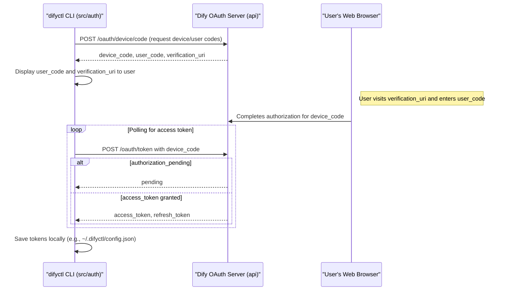
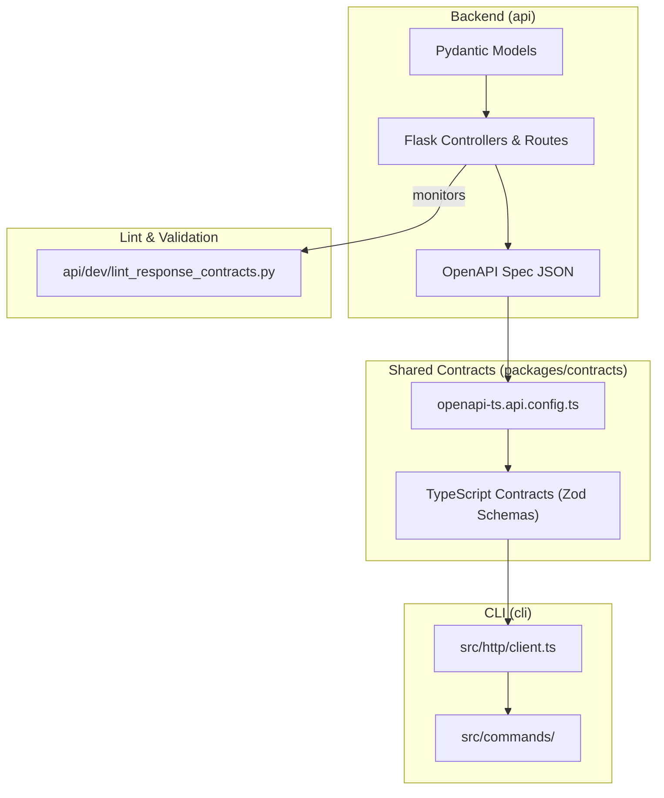
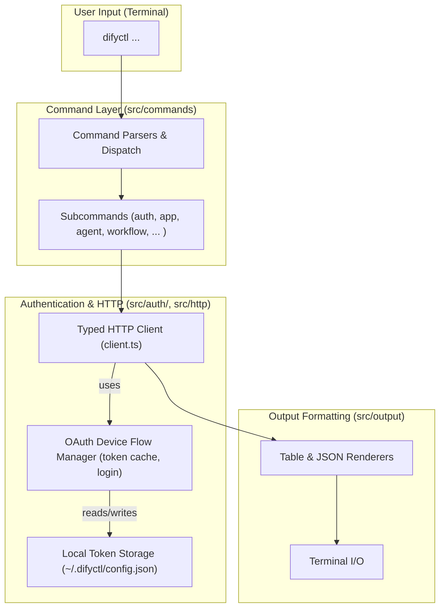

<!-- source: DeepWiki mcp.deepwiki.com · repo langgenius/dify · page 11.7 difyctl CLI (cli) Architecture and Workflows · fetched 2026-10-26 -->

# difyctl CLI (cli) Architecture and Workflows

<details>
<summary>Relevant source files</summary>

The following files were used as context for generating this wiki page:

- [.github/actions/setup-web/action.yml](.github/actions/setup-web/action.yml)
- [.github/workflows/cli-e2e.yml](.github/workflows/cli-e2e.yml)
- [.github/workflows/cli-release.yml](.github/workflows/cli-release.yml)
- [.github/workflows/cli-tests.yml](.github/workflows/cli-tests.yml)
- [AGENTS.md](AGENTS.md)
- [api/controllers/common/errors.py](api/controllers/common/errors.py)
- [cli/AGENTS.md](cli/AGENTS.md)
- [cli/ARD.md](cli/ARD.md)
- [cli/bin/dev.js](cli/bin/dev.js)
- [cli/package.json](cli/package.json)
- [cli/scripts/e2e-provision.ts](cli/scripts/e2e-provision.ts)
- [cli/scripts/install-local.sh](cli/scripts/install-local.sh)
- [cli/scripts/lib/resolve-buildinfo.ts](cli/scripts/lib/resolve-buildinfo.ts)
- [cli/scripts/release-build.sh](cli/scripts/release-build.sh)
- [cli/scripts/release-naming.mjs](cli/scripts/release-naming.mjs)
- [cli/scripts/release-naming.test.ts](cli/scripts/release-naming.test.ts)
- [cli/scripts/release-r2-edge.test.ts](cli/scripts/release-r2-edge.test.ts)
- [cli/scripts/release-write-checksums.sh](cli/scripts/release-write-checksums.sh)
- [cli/src/version/info.ts](cli/src/version/info.ts)
- [cli/test/fixtures/pkg-manifest.ts](cli/test/fixtures/pkg-manifest.ts)
- [cli/vite.config.ts](cli/vite.config.ts)
- [codecov.yml](codecov.yml)
- [dify-agent/Makefile](dify-agent/Makefile)
- [dify-agent/pyproject.toml](dify-agent/pyproject.toml)
- [dify-agent/src/dify_agent/agent_stub/protocol/agent_stub.py](dify-agent/src/dify_agent/agent_stub/protocol/agent_stub.py)
- [dify-agent/src/dify_agent/layers/dify_plugin/configs.py](dify-agent/src/dify_agent/layers/dify_plugin/configs.py)
- [dify-agent/src/dify_agent/runtime_backend/e2b.py](dify-agent/src/dify_agent/runtime_backend/e2b.py)
- [dify-agent/tests/local/dify_agent/runtime_backend/test_e2b.py](dify-agent/tests/local/dify_agent/runtime_backend/test_e2b.py)
- [dify-agent/tests/local/dify_agent/runtime_backend/test_e2b_sdk.py](dify-agent/tests/local/dify_agent/runtime_backend/test_e2b_sdk.py)
- [dify-agent/tests/local/test_packaging.py](dify-agent/tests/local/test_packaging.py)
- [dify-agent/uv.lock](dify-agent/uv.lock)
- [eslint.config.mjs](eslint.config.mjs)
- [lint.config.ts](lint.config.ts)
- [package.json](package.json)
- [packages/dify-ui/README.md](packages/dify-ui/README.md)
- [packages/dify-ui/package.json](packages/dify-ui/package.json)
- [packages/dify-ui/src/scroll-area/__tests__/index.spec.tsx](packages/dify-ui/src/scroll-area/__tests__/index.spec.tsx)
- [packages/dify-ui/src/scroll-area/index.stories.tsx](packages/dify-ui/src/scroll-area/index.stories.tsx)
- [packages/dify-ui/src/scroll-area/index.tsx](packages/dify-ui/src/scroll-area/index.tsx)
- [packages/dify-ui/tsconfig.json](packages/dify-ui/tsconfig.json)
- [pnpm-lock.yaml](pnpm-lock.yaml)
- [pnpm-workspace.yaml](pnpm-workspace.yaml)
- [vite.config.ts](vite.config.ts)
- [web/docs/lint.md](web/docs/lint.md)
- [web/plugins/eslint/index.js](web/plugins/eslint/index.js)
- [web/plugins/eslint/rules/no-app-store-imports.js](web/plugins/eslint/rules/no-app-store-imports.js)
- [web/plugins/eslint/rules/no-app-store-imports.test.js](web/plugins/eslint/rules/no-app-store-imports.test.js)
- [web/vite.config.ts](web/vite.config.ts)

</details>


The `difyctl` CLI is a command-line client designed to interact efficiently with the Dify platform, supporting automation, management of cloud resources, applications, workflows, and agents. Situated in the `cli/` directory, it is authored in TypeScript and Bun-compiled for optimal performance. This page thoroughly documents its architecture, device-flow authentication process, and how it aligns with backend server contracts ensuring type-safe API interactions and consistent integration across the platform.

---

## Purpose and Scope

`difyctl` enables users and automation environments (e.g., CI/CD pipelines, remote terminals) to manage Dify services without using a graphical UI. It is architected to:

- Facilitate resource management through modular CLI commands.
- Use OAuth 2.0 Device Authorization flow for secure, non-web login.
- Leverage shared OpenAPI-based contracts for guaranteed schema consistency.
- Provide human-friendly and machine-readable output formatting.

The CLI’s design promotes maintainability by clean separation of concerns, and robustness by strict contract adherence shared with the backend services.

---

## Architecture Overview

The CLI’s source code is organized into distinct functional layers to isolate responsibilities and allow extensibility:

```
cli/
 ├─ src/
 │   ├─ commands/      # Subcommand implementations (auth, app, agent, etc.)
 │   ├─ auth/          # Device flow authentication logic & token persistence
 │   ├─ http/          # Typed HTTP client with contract-validated API calls
 │   └─ output/        # Output formatters: tables and JSON serializers
 ├─ package.json       # CLI dependencies and build scripts
 └─ AGENTS.md          # Developer guidelines for CLI
```

### Core Components

- **Command Registry and Handlers (`src/commands/`)**

  Contains modular command definitions each responsible for a specific feature (e.g., `auth login`, `app create`). The command parser dispatches arguments to these handlers which then invoke HTTP client calls.

- **Authentication Module (`src/auth/`)**

  Implements the OAuth 2.0 Device Authorization Grant flow for interactive CLI login. It manages device/user code retrieval, polling for tokens, and local secure storage of tokens (e.g., in `~/.difyctl/config.json`).

- **HTTP Client (`src/http/`)**

  A lightweight, typed HTTP client wraps around Bun’s `fetch` using `@orpc/client`. It automatically attaches OAuth tokens, sets the base URL of the Dify server, and incorporates runtime validation with zod schemas generated from shared OpenAPI contracts.

- **Output Formatting (`src/output/`)**

  Utilities support two main output formats:

  - **Table format**: Human-readable tabular data printed with neat alignment, truncation, and colorizing helpers.
  - **JSON format**: Strict JSON output enabling scripting and automation compatibility (e.g., piping to other CLI tools).

This layered approach empowers separation of concerns, reducing coupling and making each component independently testable and evolvable.

**Sources:** [pnpm-workspace.yaml:28-28](), [cli/AGENTS.md:1-10]()

---

## Authentication Workflow: OAuth 2.0 Device Flow

Due to the lack of browser support in CLI contexts, `difyctl` leverages OAuth 2.0’s Device Authorization Grant specification, enabling secure interoperable login without redirect URLs or embedded secrets.

### Device Flow Steps

1. **Initiation**: When the user runs `difyctl auth login`, the CLI requests device credentials from the Dify backend at `/oauth/device/code`, receiving a `device_code`, `user_code`, and verification URL.
2. **User Guidance**: The CLI prints instructions prompting the user to open the verification URL and enter the `user_code` on a separate device/browser to authenticate.
3. **Polling Loop**: The CLI continuously polls `/oauth/token` with the `device_code` until authorization is either granted or denied.
4. **Token Reception & Caching**: Upon success, the CLI obtains access and refresh tokens and stores them locally.
5. **Token Usage**: Stored tokens are injected as `Authorization` headers for subsequent API requests.

### Device Flow Diagram



This approach enables secure CLI logins leveraging out-of-band user approvals without embedding client secrets or relying on redirect URLs.

**Sources:** [cli/AGENTS.md:1-20]()

---

## Alignment with Server API Contracts

To avoid discrepancies between client and server API specifications, `difyctl` relies on shared, compiled contracts generated from the backend OpenAPI schema.

### Contract Synchronization Pipeline

1. **Backend Models**: The server (in `api/`) implements request & response schemas as Pydantic models.
2. **OpenAPI Spec Generation**: These models generate an OpenAPI JSON description via the backend API.
3. **Contract Generation**: The `packages/contracts/` package uses tools like `@orpc/contract` and `@hey-api/openapi-ts` to generate TypeScript types and runtime zod validators from the OpenAPI spec.
4. **CLI Consumption**: The CLI imports these generated contracts to validate data at compile-time and runtime, assuring API request/response compatibility.

### Contract Alignment Diagram



This pipeline ensures that API breaking changes are caught early and the CLI remains functionally consistent with the backend throughout development and deployment.

**Sources:** [api/dev/lint_response_contracts.py:1-20](), [packages/contracts/openapi-ts.api.config.ts:1-20](), [cli/package.json:1-20]()

---

## HTTP Client and Output Handling

### HTTP Client Architecture

The HTTP client abstracts API interaction with these features:

- **Typed Requests**: Uses TypeScript contracts for strong typing of request payloads and responses.
- **Token Injection**: Automates including OAuth `access_token` from local config in the `Authorization` header.
- **Base URL Config**: Supports environment-configurable API base URL.
- **Response Validation**: Applies contract-based runtime checks with zod to avoid deserialization errors.
- **Error Handling**: Captures network failures and API error states, presenting user-friendly messages.

This client implementation is contained within `src/http/client.ts`.

### Output Formatter

`difyctl` supports dual output modes controlled via CLI flags or env variables:

| Output Mode | Implementation                                     | Use Case                     |
|-------------|--------------------------------------------------|------------------------------|
| Table       | Uses the `cli-table3` library for neat, aligned  | Ideal for human terminal use, readable summaries |
| JSON        | Serializes objects with `JSON.stringify`          | Suitable for machine parsing, scripting, and automation |

The output formatters are in `src/output/`, modularized so commands can produce consistent results in either mode without duplicating formatting logic.

**Sources:** [pnpm-workspace.yaml:144-144](), [cli/AGENTS.md:10-25]()

---

## Bridging Natural Language Concepts to Code Entities

This section maps user-facing concepts in natural language to the concrete code artifacts within the `difyctl` CLI project.

### User Command to CLI Codebase Execution Flow



This diagram illustrates the command flow from user input through parsing, authentication, API interaction, and final output presentation.

### System Components with Code Entity Reference

| Natural Language Concept     | Corresponding Code Entity/File                          |
|-----------------------------|--------------------------------------------------------|
| CLI Commands                | `cli/src/commands/*`                                    |
| Authentication Logic       | `cli/src/auth/`                                         |
| HTTP Client                | `cli/src/http/client.ts`                                |
| Output Formatting          | `cli/src/output/`                                       |
| Shared API Contracts       | `packages/contracts/` (OpenAPI -> TypeScript contracts)|
| Token Storage              | `~/.difyctl/config.json` (local file system)           |
| Contract Linting           | `api/dev/lint_response_contracts.py`                   |
| Developer Docs             | `cli/AGENTS.md`                                         |

---

# Summary

The `difyctl` CLI is a high-performance Bun-compiled command-line interface built with modularity and type safety as core design principles. It employs a layered architecture separating commands, authentication, HTTP communication, and output formatting. Using OAuth 2.0 Device Authorization flow, it enables secure login without a browser, suitable for CLI environments. By leveraging shared OpenAPI-based contracts generated from the backend, it maintains strict type-safe API interactions, minimizing runtime errors.

These design decisions produce a robust and user-friendly CLI tool that facilitates broad automation, resource management, and bot operation tasks in the Dify ecosystem while ensuring coordination and consistency with the server’s API schema.

---

# References

- [cli/AGENTS.md:1-25]()
- [pnpm-workspace.yaml:28-28]()
- [packages/contracts/openapi-ts.api.config.ts:1-20]()
- [api/dev/lint_response_contracts.py:1-20]()
- [cli/package.json:1-20]()

---

