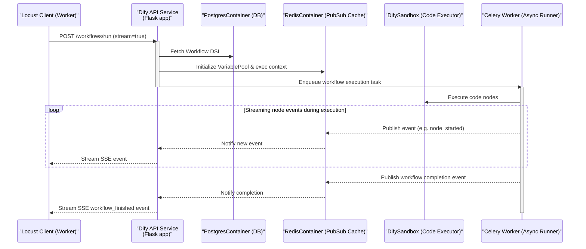

<!-- source: DeepWiki mcp.deepwiki.com · repo langgenius/dify · page 11.8 Performance and Stress Testing · fetched 2026-10-26 -->

# Performance and Stress Testing

<details>
<summary>Relevant source files</summary>

The following files were used as context for generating this wiki page:

- [.github/workflows/api-tests.yml](.github/workflows/api-tests.yml)
- [.github/workflows/autofix.yml](.github/workflows/autofix.yml)
- [.github/workflows/db-migration-test.yml](.github/workflows/db-migration-test.yml)
- [.github/workflows/main-ci.yml](.github/workflows/main-ci.yml)
- [.github/workflows/pyrefly-diff-comment.yml](.github/workflows/pyrefly-diff-comment.yml)
- [.github/workflows/pyrefly-diff.yml](.github/workflows/pyrefly-diff.yml)
- [.github/workflows/pyrefly-type-coverage-comment.yml](.github/workflows/pyrefly-type-coverage-comment.yml)
- [.github/workflows/pyrefly-type-coverage.yml](.github/workflows/pyrefly-type-coverage.yml)
- [.github/workflows/style.yml](.github/workflows/style.yml)
- [.github/workflows/tool-test-sdks.yaml](.github/workflows/tool-test-sdks.yaml)
- [.github/workflows/translate-i18n-claude.yml](.github/workflows/translate-i18n-claude.yml)
- [.github/workflows/trigger-i18n-sync.yml](.github/workflows/trigger-i18n-sync.yml)
- [.github/workflows/vdb-tests-full.yml](.github/workflows/vdb-tests-full.yml)
- [.github/workflows/vdb-tests.yml](.github/workflows/vdb-tests.yml)
- [.github/workflows/web-e2e.yml](.github/workflows/web-e2e.yml)
- [.github/workflows/web-tests.yml](.github/workflows/web-tests.yml)
- [api/controllers/console/app/workflow_app_log.py](api/controllers/console/app/workflow_app_log.py)
- [api/controllers/service_api/app/completion.py](api/controllers/service_api/app/completion.py)
- [api/controllers/service_api/app/workflow.py](api/controllers/service_api/app/workflow.py)
- [api/controllers/web/workflow.py](api/controllers/web/workflow.py)
- [api/fields/dataset_fields.py](api/fields/dataset_fields.py)
- [api/openapi/markdown/service-openapi.md](api/openapi/markdown/service-openapi.md)
- [api/services/app_task_service.py](api/services/app_task_service.py)
- [api/tests/unit_tests/controllers/console/app/test_workflow_app_log_api.py](api/tests/unit_tests/controllers/console/app/test_workflow_app_log_api.py)
- [api/tests/unit_tests/controllers/service_api/app/test_completion.py](api/tests/unit_tests/controllers/service_api/app/test_completion.py)
- [api/tests/unit_tests/controllers/service_api/app/test_workflow.py](api/tests/unit_tests/controllers/service_api/app/test_workflow.py)
- [api/tests/unit_tests/controllers/test_swagger.py](api/tests/unit_tests/controllers/test_swagger.py)
- [api/tests/unit_tests/services/test_app_task_service.py](api/tests/unit_tests/services/test_app_task_service.py)
- [packages/contracts/generated/api/console/datasets/orpc.gen.ts](packages/contracts/generated/api/console/datasets/orpc.gen.ts)
- [packages/contracts/generated/api/console/datasets/types.gen.ts](packages/contracts/generated/api/console/datasets/types.gen.ts)
- [packages/contracts/generated/api/console/datasets/zod.gen.ts](packages/contracts/generated/api/console/datasets/zod.gen.ts)
- [packages/contracts/generated/api/service/orpc.gen.ts](packages/contracts/generated/api/service/orpc.gen.ts)
- [packages/contracts/generated/api/service/types.gen.ts](packages/contracts/generated/api/service/types.gen.ts)
- [packages/contracts/generated/api/service/zod.gen.ts](packages/contracts/generated/api/service/zod.gen.ts)

</details>


This page details how to perform performance and stress testing on the Dify platform, focusing on the API endpoints, particularly those involving workflow streaming. It also covers how to reproduce the performance checks executed in the Continuous Integration (CI) pipeline locally.

---

## Overview of Stress Testing with Locust

Dify utilizes [Locust](https://locust.io), an open-source load testing tool, for stress testing. Locust allows defining simulated user behavior in Python, then flooding the system with many virtual users to identify performance bottlenecks and verify system stability under load.

The main focus of stress testing in Dify is the streaming capabilities of its workflow execution subsystem, which are critical for real-time LLM and agent interactions.

Sources:  
[.github/workflows/api-tests.yml:119-121]()  
[.github/workflows/main-ci.yml:54-62]()

---

## Endpoints Exercised

Stress tests primarily target workflow streaming API endpoints, which power interactive applications relying on near-real-time data streaming. These endpoints include:

| HTTP Method | Endpoint                | Purpose                                                                              |
|-------------|-------------------------|--------------------------------------------------------------------------------------|
| POST        | `/workflows/run`        | Starts a workflow run; supports streaming workflow events in the response.           |
| POST        | `/chat-messages`        | Sends and receives chat messages with streaming response support.                    |
| POST        | `/completion-messages`  | Handles completion requests with streaming response.                                |
| GET         | `/messages`             | Fetches paginated messages within conversations.                                    |
| GET         | `/conversations`        | Lists conversations for a given workspace/user.                                    |

These endpoints ensure seamless interaction in workflows, chat apps, and completions.

Sources:  
[.github/workflows/api-tests.yml:119-121]()  
[.github/workflows/main-ci.yml:54-62]()

---

## Reproducing CI Performance Checks Locally

While the CI workflows do not explicitly define dedicated performance or stress test jobs, comprehensive API unit and integration tests run with concurrency and extensive coverage to implicitly validate performance and stability.

### Steps to Reproduce Locally

1. **Set up the development environment**

   Configure dependencies and run database migrations:

   ```bash
   uv sync --project api --dev
   uv run --directory api flask upgrade-db
   ```

   - `uv sync` installs Python packages for the API project.  
   - `flask upgrade-db` applies database schema migrations.

2. **Start middleware services**

   Run middleware dependencies such as PostgreSQL and Redis, essential for integration tests. The `DifyTestContainers` class in `api/tests/test_containers_integration_tests/conftest.py` manages lifecycle and readiness of these containers.

3. **Execute parallel API tests**

   Run integration tests simulating workload with concurrency and timeouts:

   ```bash
   uv run --project api pytest -n auto api/tests/integration_tests/workflow
   ```

   - The `-n auto` flag activates parallel execution (pytest-xdist), simulating concurrent requests for performance validation.

4. **Run local code health checks**

   To maintain code quality and performance standards, run the pyrefly diagnostic tool locally:

   ```bash
   dev/pyrefly-check-local
   ```

These tests collectively serve as local performance and stability checks against the backend API.

Sources:  
[.github/workflows/api-tests.yml:1-204]()  
[api/tests/test_containers_integration_tests/conftest.py:61-166]()  
[dev/pyrefly-check-local:1-105]()

---

## Stress Testing Architecture

Stress tests simulate many concurrent clients sending streaming requests to the workflow run endpoints, validating system throughput and stability with real-time event streaming.

### Key Components Under Test

- **Locust Cluster**: Master-worker architecture generating load via streaming HTTP requests.  
- **Dify API Service**: Flask-based backend executing workflows, handling Server-Sent Events (SSE) streams.  
- **PostgresContainer**: Stores workflow DSLs, run states, and logs persistently.  
- **RedisContainer**: Cache and pub-sub layer for event streaming coordination.  
- **DifySandbox**: Secure isolated runtime environment for code execution in workflows.  
- **Celery Workers and Beat**: Asynchronous task processing and scheduled background jobs.

---

### Diagram 1: Stress Testing Setup and Key Code Entities

```mermaid
graph TD
    subgraph Locust_Environment
        Master[LocustMaster]
        Worker1[LocustWorker_1]
        Worker2[LocustWorker_2]
        WorkerN[LocustWorker_n]
    end

    subgraph Dify_Backend
        API[DifyAPI_Service<br/>(Flask API app)]
        PG[PostgresContainer]
        Redis[RedisContainer]
        Sandbox[DifySandbox]
        CeleryWorker[CeleryWorker]
        CeleryBeat[CeleryBeat]
    end

    Master --> Worker1
    Master --> Worker2
    Master --> WorkerN

    Worker1 -->|HTTP requests| API
    Worker2 -->|HTTP requests| API
    WorkerN -->|HTTP requests| API

    API -->|DB queries| PG
    API -->|Cache & pub-sub| Redis
    API -->|Exec code nodes| Sandbox
    API -->|Enqueue async tasks| CeleryWorker

    CeleryWorker -->|Execute async tasks| PG
    CeleryWorker --> Redis
    CeleryWorker --> Sandbox
    CeleryBeat --> Redis
```

This diagram shows Locust workers issuing requests to the Dify API service, which interfaces with the underlying PostgreSQL DB, Redis cache/pub-sub, the sandbox environment, and Celery for async workflows.

- The `DifyAPI_Service` is the Flask app created via app factory, handling REST and SSE endpoints [api/tests/test_containers_integration_tests/conftest.py:29-32]().  
- Celery workers execute asynchronous tasks such as workflow node execution [api/extensions/ext_celery.py:112]().  
- The sandbox environment runs code nodes in isolated processes [api/tests/test_containers_integration_tests/conftest.py:35-40]().

Sources:  
[api/tests/test_containers_integration_tests/conftest.py:73-75]()  
[.github/workflows/api-tests.yml:113-122]()  
[api/docker/entrypoint.sh:21-73]()  
[api/extensions/ext_celery.py:112]()

---

## Workflow Streaming and Server-Sent Events (SSE)

Dify supports real-time workflow execution responses via Server-Sent Events (SSE) at the `/workflows/run` endpoint. This enables streaming incremental workflow node execution events to clients, crucial for interactive experiences in LLM-powered workflows and agents.

### Streaming Request & Event Flow

1. The Locust client or user sends an HTTP `POST /workflows/run` request with `stream=true` query parameter to enable SSE.  
2. The Dify API fetches the workflow DSL definition from PostgreSQL.  
3. Execution context and variable pools are initialized and cached via Redis.  
4. The workflow execution task is queued asynchronously via Celery.  
5. Celery executes workflow nodes, running user code in the sandbox environment.  
6. Intermediate node execution events (e.g. `node_started`, `node_succeeded`) are published into Redis pub-sub channels.  
7. The API subscribes to these Redis channels and streams events back to the client as SSE chunks.  
8. Upon completion, a final workflow finished event is sent.

---

### Diagram 2: Workflow Streaming Data Flow and Code Entities



- The API’s Flask app with SSE capability is instantiated in `api/docker/entrypoint.sh` [api/docker/entrypoint.sh:133]()  
- Workflow DSL and state are persisted in PostgresContainer [api/tests/test_containers_integration_tests/conftest.py:103-114]()  
- Redis manages pub-sub messages coordinating between Celery tasks and the API streamer [api/tests/test_containers_integration_tests/conftest.py:155-166]()  
- User executable code runs isolated in the DifySandbox [api/tests/test_containers_integration_tests/conftest.py:167-170]()  

Sources:  
[api/tests/test_containers_integration_tests/conftest.py:103-166]()  
[.github/workflows/api-tests.yml:113-122]()  
[api/docker/entrypoint.sh:133]()  
[api/extensions/ext_celery.py:154]()

---

## Interpreting Stress Test Results

When running stress tests, key metrics to monitor and interpret for system performance and stability include:

| Metric                         | Description                                                     | Monitoring / CI Indicators                                     |
|--------------------------------|-----------------------------------------------------------------|---------------------------------------------------------------|
| **Requests per second (RPS)**  | Number of endpoint requests handled per second under load.      | Observed in parallel pytest and Locust runs [.github/workflows/api-tests.yml:117]() |
| **Response time (latency)**    | Time to respond including first SSE event chunk.                | Controlled via pytest timeouts and reported by Locust         |
| **Error rate**                 | Percentage of requests resulting in errors or timeouts.         | Captured in CI logs, test reports, and coverage artifacts [.github/workflows/api-tests.yml:182-184]() |
| **Resource utilization**       | CPU, memory, network usage across backend and runner machines.  | Monitored on CI runners (e.g., depot-ubuntu-24.04-4) [.github/workflows/web-tests.yml:19-26]() |
| **Time To First Byte (TTFB)**  | Delay before receiving the first SSE event in streaming response. | Critical for smooth streaming UX                               |
| **Event Processing Latency**   | Delay between event generation in workflow and SSE push to client. | Impacts responsiveness in streaming applications              |

Additionally, some internal services like the `HitTestingService` track retrieval latencies related to knowledge base queries and RAG pipelines, informing performance bottlenecks in retrieval-augmented generation workflows.

Sources:  
[.github/workflows/api-tests.yml:113-122]()  
[.github/workflows/web-tests.yml:18-26]()  
[api/services/hit_testing_service.py:19-155]()

---

# Summary

Dify’s performance and stress testing strategy focuses on the API's workflow streaming endpoints to ensure low-latency, scalable, and stable interactive experiences with LLM-powered workflows and agents. Stress tests use Locust to simulate extensive concurrent SSE streaming requests backed by a complete backend stack including Postgres DB, Redis cache/pub-sub, Celery async workers, and sandboxed execution environments.

CI pipelines perform extensive parallel API unit and integration tests that implicitly benchmark system performance and correctness. Developers can locally reproduce these performance checks with `uv`, `pytest`, and Docker Compose middleware containers managed via `DifyTestContainers`.

For effective benchmarking, emphasize the `/workflows/run` streaming endpoint and measure throughput, latency, error rates, and streaming responsiveness under load in environments matching CI setups.

---

# References

- [.github/workflows/api-tests.yml](.github/workflows/api-tests.yml)  
- [.github/workflows/main-ci.yml](.github/workflows/main-ci.yml)  
- [.github/workflows/web-tests.yml](.github/workflows/web-tests.yml)  
- [.github/workflows/vdb-tests.yml](.github/workflows/vdb-tests.yml)  
- [api/docker/entrypoint.sh](api/docker/entrypoint.sh)  
- [api/extensions/ext_celery.py](api/extensions/ext_celery.py)  
- [api/tests/test_containers_integration_tests/conftest.py](api/tests/test_containers_integration_tests/conftest.py)  
- [dev/pyrefly-check-local](dev/pyrefly-check-local)  
- [api/services/hit_testing_service.py](api/services/hit_testing_service.py)

---

This page is a leaf node and covers detailed technical aspects for running and interpreting performance and stress tests primarily using Locust and the integrated CI testing pipelines.

---

