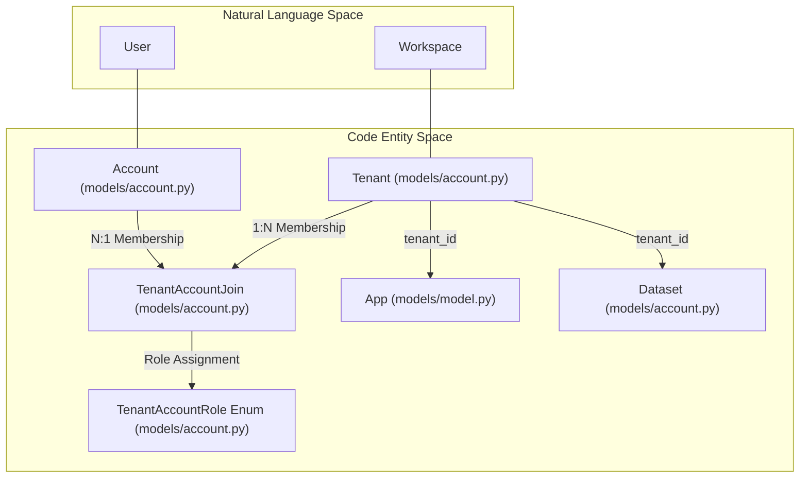
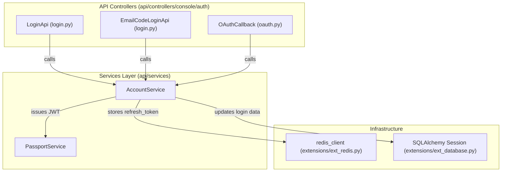
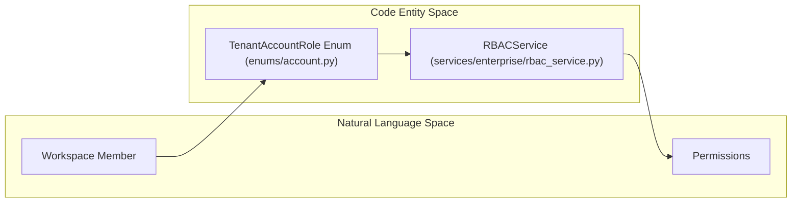
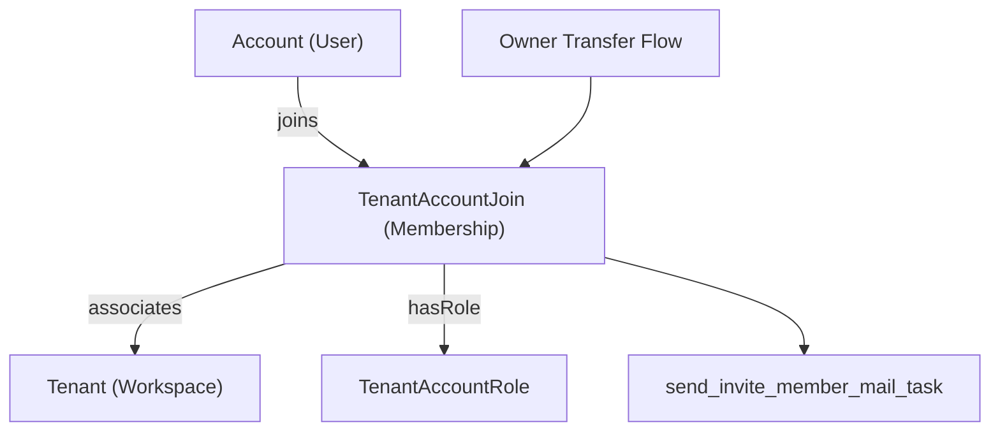
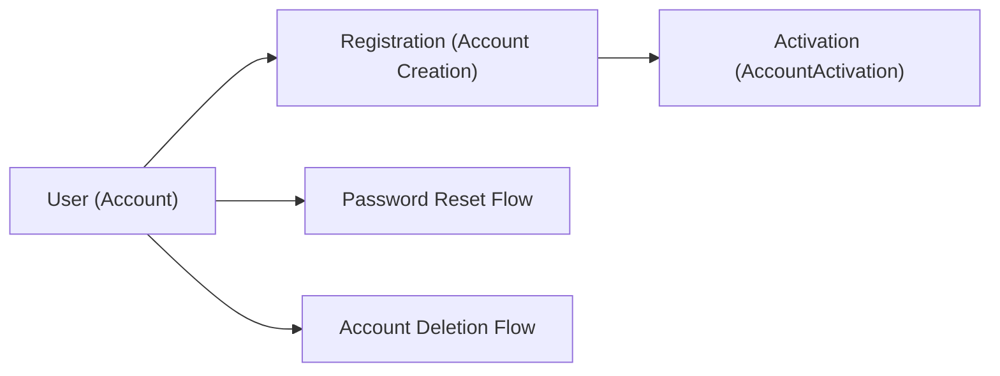

<!-- source: DeepWiki mcp.deepwiki.com · repo langgenius/dify · page 8 Multi-Tenancy and Security · fetched 2026-10-26 -->

# Multi-Tenancy and Security

Relevant source files

The following files were used as context for generating this wiki page:

- [api/controllers/console/workspace/__init__.py](api/controllers/console/workspace/__init__.py)
- [api/controllers/console/workspace/account.py](api/controllers/console/workspace/account.py)
- [api/controllers/console/workspace/agent_providers.py](api/controllers/console/workspace/agent_providers.py)
- [api/controllers/console/workspace/endpoint.py](api/controllers/console/workspace/endpoint.py)
- [api/controllers/console/workspace/members.py](api/controllers/console/workspace/members.py)
- [api/controllers/console/workspace/model_providers.py](api/controllers/console/workspace/model_providers.py)
- [api/controllers/console/workspace/models.py](api/controllers/console/workspace/models.py)
- [api/controllers/console/workspace/plugin.py](api/controllers/console/workspace/plugin.py)
- [api/controllers/console/workspace/workspace.py](api/controllers/console/workspace/workspace.py)
- [api/libs/password.py](api/libs/password.py)
- [api/tests/test_containers_integration_tests/controllers/console/workspace/test_members.py](api/tests/test_containers_integration_tests/controllers/console/workspace/test_members.py)
- [api/tests/test_containers_integration_tests/controllers/console/workspace/test_workspace_wraps.py](api/tests/test_containers_integration_tests/controllers/console/workspace/test_workspace_wraps.py)
- [api/tests/unit_tests/controllers/console/test_workspace_account.py](api/tests/unit_tests/controllers/console/test_workspace_account.py)
- [api/tests/unit_tests/controllers/console/test_workspace_credential_mutation_permissions.py](api/tests/unit_tests/controllers/console/test_workspace_credential_mutation_permissions.py)
- [api/tests/unit_tests/controllers/console/workspace/test_accounts.py](api/tests/unit_tests/controllers/console/workspace/test_accounts.py)
- [api/tests/unit_tests/controllers/console/workspace/test_agent_providers.py](api/tests/unit_tests/controllers/console/workspace/test_agent_providers.py)
- [api/tests/unit_tests/controllers/console/workspace/test_endpoint.py](api/tests/unit_tests/controllers/console/workspace/test_endpoint.py)
- [api/tests/unit_tests/controllers/console/workspace/test_members.py](api/tests/unit_tests/controllers/console/workspace/test_members.py)
- [api/tests/unit_tests/controllers/console/workspace/test_model_providers.py](api/tests/unit_tests/controllers/console/workspace/test_model_providers.py)
- [api/tests/unit_tests/controllers/console/workspace/test_models.py](api/tests/unit_tests/controllers/console/workspace/test_models.py)
- [api/tests/unit_tests/controllers/console/workspace/test_plugin.py](api/tests/unit_tests/controllers/console/workspace/test_plugin.py)
- [api/tests/unit_tests/controllers/console/workspace/test_workspace.py](api/tests/unit_tests/controllers/console/workspace/test_workspace.py)
- [api/tests/unit_tests/libs/test_password.py](api/tests/unit_tests/libs/test_password.py)
- [docker/envs/core-services/api.env.example](docker/envs/core-services/api.env.example)
- [packages/contracts/generated/api/console/account/types.gen.ts](packages/contracts/generated/api/console/account/types.gen.ts)
- [packages/contracts/generated/api/console/account/zod.gen.ts](packages/contracts/generated/api/console/account/zod.gen.ts)
- [web/service/common.ts](web/service/common.ts)

This document provides a high-level overview of the multi-tenancy model, user management, authentication and authorization systems, and workspace management in Dify. It outlines key concepts such as tenant resource isolation, authentication methods, role-based access control, and account lifecycle, linking to detailed child pages for implementation specifics.

---

## Tenant Model and Workspace Isolation

Dify enforces strict multi-tenancy through its `Tenant` model representing distinct workspaces. Each workspace encapsulates users and resources, isolating them from others.

- **Tenant and Membership:** The `Tenant` entity correlates to a workspace [api/models/account.py:39-46](). Users (`Account`) join tenants through joint mappings in `TenantAccountJoin` [api/models/account.py:41-41]() with assigned roles defined by the `TenantAccountRole` enum [api/models/account.py:42-42]().
- **Resource Isolation:** Primary resources such as `App` [api/models/model.py:48-48](), `Dataset` [api/models/account.py:47-47](), and workflows associate with a tenant via `tenant_id`. This tenant scoping ensures data isolation and enforces security boundaries across workspaces.

### Tenant Resource Model Mapping

The diagram below bridges natural language concepts to precise code entities in the ORM, showing the relationships that enforce tenancy boundaries.

The application context holds the current active tenant and account (user) information using constructs such as `current_account_with_tenant()` [api/libs/login.py:27-27](). All resource access filters and policy checks reference the active tenant to uphold strict isolation.

For implementation details, see [Tenant Model and Resource Isolation](#8.1).

**Sources:**  
[api/models/account.py:35-46](), [api/models/model.py:48-48](), [api/services/account_service.py:36-47](), [api/libs/login.py:27-27]()

---

## Authentication Methods and Flows

Dify supports various authentication mechanisms to suit different deployment scenarios and user preferences:

- **Email/Password Login:** The classic authentication flow validating hashed passwords and issuing JWT tokens [api/controllers/console/auth/login.py:108-180]().
- **OAuth Login:** OAuth flows with providers like GitHub and Google are integrated, supporting OAuth authorization and callback flows [api/controllers/console/auth/oauth.py:140-170]().
- **Email Code Login (Magic Link):** Allows users to login via email verification codes without passwords [api/controllers/console/auth/login.py:83-88]().

Upon successful authentication, a `TokenPair` is issued including:
- **Access Token:** JWT bearer token for API authentication, set in secure cookies [api/libs/token.py:48-56]().
- **Refresh Token:** Stored in Redis and used to refresh access tokens, maintaining session continuity [api/services/account_service.py:146-151]().
- **CSRF Token:** Mitigates cross-site request forgery attacks [api/libs/token.py:34-34]().

### Authentication Flow Diagram

This diagram links the web controller endpoints, service layer, and infrastructure involved in logging in and maintaining authentication states.

The `AccountService` handles the core authentication logic, supported by `PassportService` for token issuance and Redis for refresh token persistence.

For comprehensive flow details, see [Authentication Methods and Flows](#8.2).

**Sources:**  
[api/controllers/console/auth/login.py:108-180](), [api/controllers/console/auth/oauth.py:140-170](), [api/services/account_service.py:130-151](), [api/libs/token.py:48-56]()

---

## Role-Based Access Control (RBAC)

Role-based permissions within a tenant are primarily governed by the `TenantAccountRole` enum [enums/account.py:35-42]():

| Role                 | Enum Value         | Core Permissions                                   |
|----------------------|--------------------|---------------------------------------------------|
| **OWNER**            | `owner`            | Full control including owner transfer and deletion |
| **ADMIN**            | `admin`            | Manage members, configure workspace                |
| **EDITOR**           | `editor`           | Create and edit apps, workflows, datasets          |
| **DATASET_OPERATOR** | `dataset_operator` | Specialized knowledge base operations               |
| **NORMAL**           | `normal`           | Basic workspace access                              |

Dify Enterprise extends RBAC functionality with `RBACService` [api/services/enterprise/rbac_service.py]() providing advanced permission scenes, role resolution, and route-level checks. Legacy role resolution methods map `TenantAccountRole` to RBAC role IDs [api/services/account_service.py:170-182]().

### RBAC Model Association Diagram

This RBAC implementation enables fine-grained control on what users can do within their tenant scopes.

For in-depth RBAC details, see [Role-Based Access Control](#8.3).

**Sources:**  
[enums/account.py:35-42](), [api/services/account_service.py:170-182](), [api/services/enterprise/rbac_service.py:40-70]()

---

## Workspace and Member Management

Dify supports robust workspace administration features to manage tenant members and their roles.

- **Inviting Members:** Invitation APIs validate membership and tenancy constraints before sending invite emails asynchronously with `send_invite_member_mail_task` [api/controllers/console/workspace/members.py:174-195](), [api/services/account_service.py:85-93]().
- **Ownership Transfer:** Implements a two-phase verified transfer flow requiring email confirmation to hand over workspace ownership [api/controllers/console/workspace/members.py:370-390]().
- **Role Management:** Admins can update member roles via provided APIs to adjust permissions [api/controllers/console/workspace/members.py:300-350]().

Membership limits and seats availability are enforced depending on the deployment edition, distinguishing Cloud and Enterprise editions [api/controllers/console/workspace/members.py:180-193]().

### Workspace Roles and Membership Flow

For full operational and API discussion, see [Workspace and Member Management](#8.4).

**Sources:**  
[api/controllers/console/workspace/members.py:174-195](), [api/services/account_service.py:85-93](), [api/controllers/console/workspace/members.py:370-390]()

---

## Account Lifecycle Management

The platform manages user account lifecycles with stages that include creation, activation, password reset, and deletion.

- **Account Creation & Activation:** Accounts start with `PENDING` or `ACTIVE` statuses. Activation often occurs on initial login or invitation acceptance [api/tests/unit_tests/services/test_account_service.py:130-160]().
- **Password Reset:** Handled through token verification flows with rate limiting, exposed through endpoints like `ForgotPasswordSendEmailApi` [api/controllers/console/auth/forgot_password.py:50-148]().
- **Account Deletion:** Initiated by the user or admin using secure verification codes to prevent accidental loss, typically asynchronous tasks handle cleanup [api/controllers/console/workspace/account.py:450-480]().

### Account Lifecycle Entity Flow

The lifecycle is supported by `AccountService` methods and client-facing REST APIs that abstract these flows.

For detailed lifecycle processes, see [Account Lifecycle Management](#8.5).

**Sources:**  
[api/tests/unit_tests/services/test_account_service.py:130-160](), [api/controllers/console/auth/forgot_password.py:50-148](), [api/controllers/console/workspace/account.py:450-480]()

---

## Security Utilities and Policies

### Rate Limiting

Critical account operations are protected by rate limiters to prevent abuse, implemented using the `RateLimiter` class [api/services/account_service.py:155-165]():

- Password reset requests
- Email code login attempts
- Owner transfer operations

### Token and API Security

Service APIs authenticate using `ApiToken` linked to `App` and `Tenant` models, with validation implemented in service wrappers like `validate_app_token` [api/controllers/service_api/wraps.py:100-160](). This secures internal service-to-service communication.

### Billing and Resource Quotas

Subscription and resource checks are enforced via decorators like `cloud_edition_billing_resource_check` [api/controllers/console/wraps.py:195-215]() ensuring tenants cannot exceed licensed limits (member seats, storage, etc.).

**Sources:**  
[api/services/account_service.py:150-165](), [api/controllers/service_api/wraps.py:99-173](), [api/controllers/console/wraps.py:180-210]()

---

## Summary

Dify's multi-tenancy and security model is built around a tenant-centric workspace abstraction with:

- Strong tenancy isolation via `Tenant` and `TenantAccountJoin`.
- Flexible authentication methods covering password, OAuth, and email codes.
- Role-based access control from simple enums to advanced enterprise RBAC.
- Rich workspace membership APIs supporting invitations, role management, and ownership transfer.
- Comprehensive account lifecycle flows with secure reset and deletion processes.
- Supporting security mechanisms such as rate limiting, API token validation, and billing quota enforcement.

This page serves as a high-level guide. For full implementation specifics and API details, consult the respective child pages:

- [Tenant Model and Resource Isolation](#8.1)  
- [Authentication Methods and Flows](#8.2)  
- [Role-Based Access Control](#8.3)  
- [Workspace and Member Management](#8.4)  
- [Account Lifecycle Management](#8.5)  

---

**Sources:**  
[api/models/account.py](), [api/services/account_service.py](), [api/controllers/console/auth/login.py](), [api/controllers/console/auth/oauth.py](), [api/controllers/console/auth/forgot_password.py](), [api/controllers/console/workspace/members.py](), [api/controllers/console/workspace/workspace.py](), [api/controllers/console/workspace/account.py]()

---

