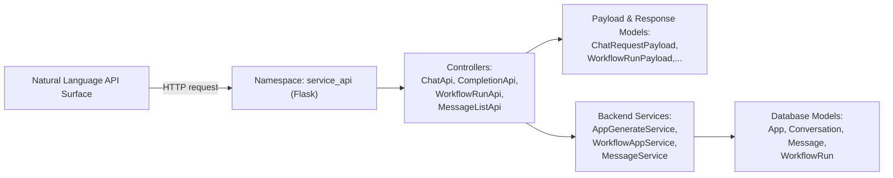
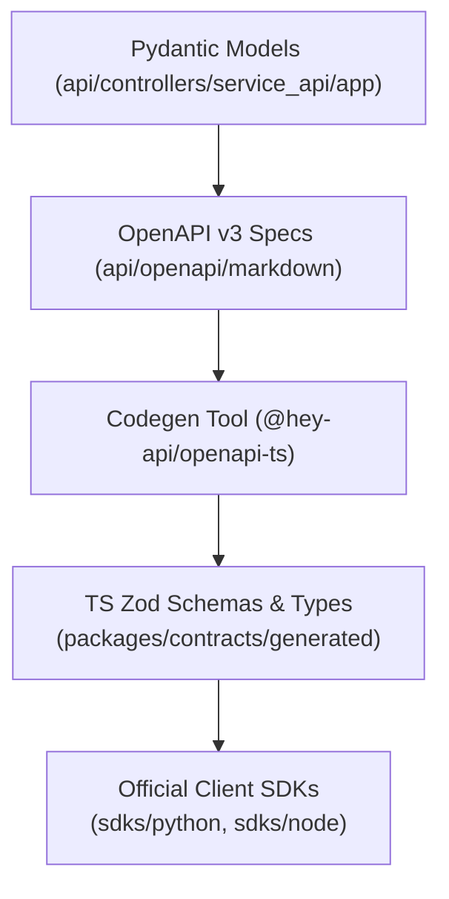

<!-- source: DeepWiki mcp.deepwiki.com · repo langgenius/dify · page 9 APIs and Contracts · fetched 2026-10-26 -->

# APIs and Contracts

<details>
<summary>Relevant source files</summary>

The following files were used as context for generating this wiki page:

- [api/controllers/console/agent/composer.py](api/controllers/console/agent/composer.py)
- [api/controllers/console/agent/roster.py](api/controllers/console/agent/roster.py)
- [api/fields/agent_fields.py](api/fields/agent_fields.py)
- [api/models/agent.py](api/models/agent.py)
- [api/openapi/markdown/console-openapi.md](api/openapi/markdown/console-openapi.md)
- [api/services/agent/composer_service.py](api/services/agent/composer_service.py)
- [api/services/agent/composer_validator.py](api/services/agent/composer_validator.py)
- [api/services/agent/roster_service.py](api/services/agent/roster_service.py)
- [api/services/agent/workflow_publish_service.py](api/services/agent/workflow_publish_service.py)
- [api/services/workflow_service.py](api/services/workflow_service.py)
- [api/tests/unit_tests/controllers/console/agent/test_agent_controllers.py](api/tests/unit_tests/controllers/console/agent/test_agent_controllers.py)
- [api/tests/unit_tests/services/agent/test_agent_composer_entities.py](api/tests/unit_tests/services/agent/test_agent_composer_entities.py)
- [api/tests/unit_tests/services/agent/test_agent_services.py](api/tests/unit_tests/services/agent/test_agent_services.py)
- [api/tests/unit_tests/services/agent/test_workflow_publish_service.py](api/tests/unit_tests/services/agent/test_workflow_publish_service.py)
- [api/tests/unit_tests/services/test_workflow_service.py](api/tests/unit_tests/services/test_workflow_service.py)
- [packages/contracts/generated/api/console/agent/orpc.gen.ts](packages/contracts/generated/api/console/agent/orpc.gen.ts)
- [packages/contracts/generated/api/console/agent/types.gen.ts](packages/contracts/generated/api/console/agent/types.gen.ts)
- [packages/contracts/generated/api/console/agent/zod.gen.ts](packages/contracts/generated/api/console/agent/zod.gen.ts)
- [packages/contracts/generated/api/console/apps/orpc.gen.ts](packages/contracts/generated/api/console/apps/orpc.gen.ts)
- [packages/contracts/generated/api/console/apps/types.gen.ts](packages/contracts/generated/api/console/apps/types.gen.ts)
- [packages/contracts/generated/api/console/apps/zod.gen.ts](packages/contracts/generated/api/console/apps/zod.gen.ts)

</details>


This section provides a high-level overview of Dify’s APIs and the generated contracts that define their usage. It covers the main API categories — Console, Service, Web, and Inner APIs — and describes the request flow, authentication, and how these map to generated client contracts. This page serves as a parent overview and links to detailed child pages for each API category.

---

## Overview and Purpose

Dify offers multiple API surfaces to integrate and extend its platform capabilities:

- **Service APIs**: Primary external-facing APIs serving application workflows, chat, completions, file management, and conversational feedback. These APIs use API key authentication and support streaming or blocking response modes.
- **Console APIs**: Used by the Dify management console UI for administration, resource management, multi-tenancy, and user management.
- **Web APIs**: Support frontend features including embedding scripts and session operations.
- **Inner APIs**: Internal service-to-service APIs facilitating orchestration and cluster-level communication.

All these APIs follow consistent request patterns: authentication, validation using Pydantic models, context propagation (including trace IDs), error handling, and support for different response modes such as streaming (SSE) or blocking.

The backend defines API models and schemas with Pydantic, then generates OpenAPI v3 specifications automatically. These specifications feed into code generation tools that produce synchronized, strongly typed TypeScript contracts and runtime validation schemas in the `packages/contracts` package. Official client SDKs (Python, Node.js, PHP) consume these contracts for reliable and easy integration.

This contract-driven approach streamlines backend-frontend alignment, enhances developer productivity, and improves system robustness.

---

## API Architecture and Request Flow

All external Service API requests pass through centralized authentication and authorization wrappers. Key responsibilities include:

- Verifying valid API keys linked to authorized tenants and apps.
- Enforcing RBAC permissions and multi-tenant isolation.
- Establishing request context with user identities (`Account`, `EndUser`).
- Propagating trace IDs across requests for observability correlation.
- Differentiating streaming (SSE) vs blocking response modes.

The Flask controllers register REST resources under the `service_api` namespace, leveraging wrappers such as `validate_app_token` which handles these cross-cutting concerns ([api/controllers/service_api/wraps.py:102-173]()).

### API Request Processing Diagram

```mermaid
graph TD
  subgraph ExternalClient["External Client/Application"]
    EC[Request]
  end

  subgraph ServiceAPI["Dify Service API Layer"]
    VT[validate_app_token<br/>(api/controllers/service_api/wraps.py)]
    ChatAPI[ChatApi<br/>(completion.py)]
    WorkflowAPI[WorkflowRunApi<br/>(workflow.py)]
    MessageAPI[MessageListApi<br/>(message.py)]
  end

  subgraph CoreService["Core Service and Business Logic"]
    AppGenerateService["AppGenerateService<br/>(services/app_generate_service.py)"]
    WorkflowService["WorkflowAppService<br/>(services/workflow_app_service.py)"]
    MessageService["MessageService<br/>(services/message_service.py)"]
  end

  EC --> VT
  VT --> ChatAPI
  VT --> WorkflowAPI
  VT --> MessageAPI
  
  ChatAPI --> AppGenerateService
  WorkflowAPI --> WorkflowService
  MessageAPI --> MessageService
```

Requests are first authenticated and context-initialized, then dispatched to specialized controllers for chat, workflow runs, or messages. These controllers invoke underlying domain services managing business logic, database operations, workflow orchestration, and LLM runtime interactions.

For comprehensive details, see [API Architecture and Request Flow](#9.1).

---

## Main API Categories

Below is a high-level summary of the key Service API categories and links to their detailed documentation:

### Chat and Completion APIs

These APIs provide endpoints for AI chat and text completion applications, supporting session and stateful conversations.

- **Endpoints**: `POST /chat-messages`, `POST /completion-messages`
- **Features**:
  - Session management via `conversation_id`
  - Support for variable inputs and multi-modal file attachments
  - Streaming (SSE) and blocking response modes
  - Agent mode with advanced streaming events for agent applications
- **Implementation**: Uses `AppGenerateService` to prepare prompts, invoke models, and handle streaming

For details, see [Chat and Completion APIs](#9.2).

---

### Workflow Execution API

This API executes composable graph-based workflows representing complex business logic.

- **Endpoint**: `POST /workflows/run`
- **Features**:
  - Workflow run execution with unique `workflow_run_id`
  - Streaming event responses to provide real-time progress to clients
  - Tracks node statuses, input/output data, errors, and billing tokens usage
- **Backend**: Implements graph execution engine (`GraphEngineManager`) managing node runtimes

For details, see [Workflow Execution API](#9.3).

---

### File Upload and Management APIs

APIs for uploading, previewing, and managing files used in chat, completion, and workflows.

- Supports chunked uploads and whole file uploads
- Handles file transfer by `local_file` or `remote_url`
- Provides file preview, access control scoped by tenant and app
- Manage diverse file types with metadata and multi-tenant permissions

For details, see [File Upload and Management APIs](#9.4).

---

### Conversation, Annotation and Feedback APIs

Manage conversation histories, annotations, suggested questions, and user feedback.

- APIs to list and paginate message history
- Submit annotations and end-user feedback (ratings, corrections)
- Suggest conversation questions contextually
- Backed by services like `ConversationService`, `MessageService`

For details, see [Conversation, Annotation and Feedback APIs](#9.5).

---

### Advanced Chat and Agent APIs

Advanced APIs supporting Dify's Agent V2 architecture with workflow-backed agent chat.

- Enables agent thought streaming events (`agent_thought`)
- Supports multi-turn agent workflows and execution event introspection
- Detailed runtime events including tool calls and decision traces

For details, see [Advanced Chat and Agent APIs](#9.6).

---

### Client SDKs

Official client SDKs provide typed programmatic access to Dify APIs.

- Python and Node.js SDKs with most API coverage
- Partial PHP SDK support
- Generated clients based on API contracts
- Usage examples and helpers under `sdks/` directory

For details, see [Client SDKs](#9.7).

---

### OpenAPI Contracts and Generated API Clients

Backend API contracts are defined with Pydantic models on the server and compiled to OpenAPI specs.

- Specs are maintained under `api/openapi/markdown/`, generated automatically from Pydantic schemas
- The specs feed code generation tooling (`@hey-api/openapi-ts`):
  - Generates runtime Zod schemas for validation
  - Produces TypeScript type definitions and strongly typed clients in `packages/contracts/generated/api/`
  - Supports ORPC contracts for RPC-style usage
- Automated regeneration keeps frontend and backend contracts in sync

For details, see [OpenAPI Contracts and Generated API Clients](#9.8).

---

## Bridging Natural Language to Code Entities

The following diagrams illustrate how Dify’s API conceptual space maps to concrete implementation entities in code, helping engineers navigate from system design to source code.

### Diagram 1: Service API Surface to Backend Controllers and Services



This diagram shows the flow starting from natural user/API invocations traversing the Flask REST namespace and controller layer, which use Pydantic models for validation, then call backend services interacting with database entities.

---

### Diagram 2: Contract Generation Flow



This depicts the contract generation pipeline, starting from Python Pydantic models to OpenAPI specs, then TypeScript contract and runtime schema generation, culminating in client SDKs.

---

## Summary

Dify’s APIs and contract system provide a secure, scalable, and developer-friendly integration layer encompassing:

- Rich, multi-modal chat and workflow APIs with strong typing.
- Streaming and blocking response models aligned with LLM workloads.
- Administrative Console APIs supporting resource and user management.
- A contract-first approach ensuring backend-frontend schema parity via automated generation.
- Robust multi-tenancy and authorization enforced consistently across endpoints.

For detailed technical implementations, request flow, endpoint specifications, and examples, please consult the following child pages:

- [API Architecture and Request Flow](#9.1)
- [Chat and Completion APIs](#9.2)
- [Workflow Execution API](#9.3)
- [File Upload and Management APIs](#9.4)
- [Conversation, Annotation and Feedback APIs](#9.5)
- [Advanced Chat and Agent APIs](#9.6)
- [Client SDKs](#9.7)
- [OpenAPI Contracts and Generated API Clients](#9.8)

---

**Sources:**  
- [api/controllers/service_api/wraps.py:102-173]()  
- [api/controllers/service_api/app/completion.py:1-162]()  
- [api/controllers/service_api/app/workflow.py:1-176]()  
- [packages/contracts/generated/api/service/zod.gen.ts:1-252]()  
- [packages/contracts/generated/api/service/types.gen.ts:1-267]()  
- [api/openapi/markdown/service-openapi.md:1-179]()  
- [api/openapi/markdown/console-openapi.md:1-169]()  
- [api/controllers/console/agent/roster.py:1-181]()  
- [packages/contracts/generated/api/console/apps/types.gen.ts:1-273]()  
- [packages/contracts/generated/api/console/agent/types.gen.ts:1-271]()

---

