# Page: Introduction to Dify

# Introduction to Dify

<details>
<summary>Relevant source files</summary>

The following files were used as context for generating this wiki page:

- [README.md](README.md)
- [api/.env.example](api/.env.example)
- [api/configs/feature/__init__.py](api/configs/feature/__init__.py)
- [api/configs/middleware/__init__.py](api/configs/middleware/__init__.py)
- [api/configs/middleware/vdb/weaviate_config.py](api/configs/middleware/vdb/weaviate_config.py)
- [api/configs/packaging/__init__.py](api/configs/packaging/__init__.py)
- [api/core/rag/datasource/vdb/vector_factory.py](api/core/rag/datasource/vdb/vector_factory.py)
- [api/core/rag/datasource/vdb/vector_type.py](api/core/rag/datasource/vdb/vector_type.py)
- [api/extensions/ext_app_metrics.py](api/extensions/ext_app_metrics.py)
- [api/extensions/ext_celery.py](api/extensions/ext_celery.py)
- [api/extensions/ext_database.py](api/extensions/ext_database.py)
- [api/extensions/ext_import_modules.py](api/extensions/ext_import_modules.py)
- [api/extensions/ext_sentry.py](api/extensions/ext_sentry.py)
- [api/migrations/README](api/migrations/README)
- [api/providers/vdb/vdb-weaviate/tests/unit_tests/test_weaviate_integration_header.py](api/providers/vdb/vdb-weaviate/tests/unit_tests/test_weaviate_integration_header.py)
- [api/pyproject.toml](api/pyproject.toml)
- [api/schedule/queue_monitor_task.py](api/schedule/queue_monitor_task.py)
- [api/tests/integration_tests/.env.example](api/tests/integration_tests/.env.example)
- [api/tests/unit_tests/configs/test_dify_config.py](api/tests/unit_tests/configs/test_dify_config.py)
- [api/tests/unit_tests/core/rag/datasource/vdb/test_vector_factory.py](api/tests/unit_tests/core/rag/datasource/vdb/test_vector_factory.py)
- [api/tests/unit_tests/extensions/test_celery_ssl.py](api/tests/unit_tests/extensions/test_celery_ssl.py)
- [api/uv.lock](api/uv.lock)
- [docker/.env.example](docker/.env.example)
- [docker/docker-compose-template.yaml](docker/docker-compose-template.yaml)
- [docker/docker-compose.middleware.yaml](docker/docker-compose.middleware.yaml)
- [docker/docker-compose.yaml](docker/docker-compose.yaml)
- [docker/envs/core-services/shared.env.example](docker/envs/core-services/shared.env.example)
- [docker/envs/infrastructure/ssrf-proxy.env.example](docker/envs/infrastructure/ssrf-proxy.env.example)
- [docker/envs/middleware.env.example](docker/envs/middleware.env.example)
- [web/package.json](web/package.json)

</details>


## Purpose and Scope

This document provides a high-level introduction to the Dify platform, covering its purpose, key features, supported deployment options, and a map of the repository structure. It serves as the entry point for technical onboarding, mapping high-level concepts to key code entities and repository organization. For detailed technical architecture, see [System Architecture Overview]() and for repository insights, see [Repository Layout and Monorepo Packages](#1.1).

**Sources:** [README.md:1-172](), [docker/docker-compose.yaml:7-209]()

---

## What is Dify?

Dify is an open-source LLM (Large Language Model) application development platform that integrates:

- AI workflows with visual canvas design and execution.
- Retrieval-Augmented Generation (RAG) pipelines for knowledge integration.
- Agent capabilities allowing complex task automation.
- Model management supporting over 100 LLM models from numerous providers.
- Observability features integrated with tools like Opik, Langfuse, and Arize Phoenix.

It empowers developers and organizations to rapidly prototype, customize, and deploy AI-powered applications either in the cloud or self-hosted environments.

### Key Characteristics

- **Multi-Tenancy & RBAC:** Workspace and role-based access control enable secure shared environments.
- **Model-Agnostic:** Unified interface supports 100+ models from providers such as OpenAI, Anthropic, Azure, Google, and many more.
- **Extensible:** Offers a plugin and custom tool ecosystem for expanding functionality.
- **Production-Ready:** Includes quota management, telemetry, and robust background processing.

**Sources:** [README.md:63-114](), [api/pyproject.toml:1-51]()

---

## Edition Types

| Edition                    | Description                                   | Deployment Options               |
|----------------------------|---------------------------------------------|--------------------------------|
| **Dify Cloud (Hosted SaaS)**| Managed cloud service for instant use        | https://cloud.dify.ai           |
| **Self-Hosted (Community)** | Open-source edition for local or private cloud | Docker Compose, Kubernetes      |
| **Enterprise**              | Advanced features including SSO, branding    | Self-hosted or managed solutions|

**Sources:** [README.md:4-8]()

---

## High-Level Service Architecture

Dify follows a modular microservice architecture with separation into layers for client access, application services, execution environments, and data storage.

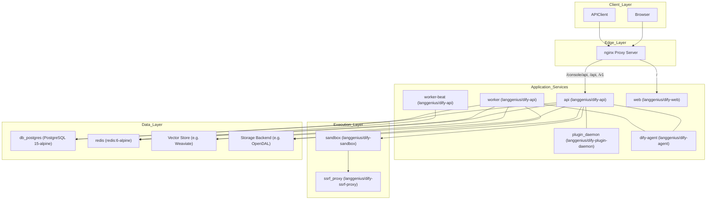

### Architecture Notes

- The single Docker image `langgenius/dify-api` runs different roles (API server, Worker, Beat) selected by environment variable `MODE`.
- Internal communication leverages Docker network, e.g., API service connects to `plugin_daemon` with secured keys.
- The `sandbox` and `ssrf_proxy` provide a secure isolated environment for code execution and controlled network access.
- The `dify-agent` runtime is a standalone agent runtime integrated for complex agent workflows.

**Sources:** [docker/docker-compose.yaml:7-209](), [docker/docker-compose.middleware.yaml:1-186](), [api/pyproject.toml:1-31]()

---

## Core Service Components

### API Service (`api`)

- The core Flask application serving RESTful APIs for console management and user apps.
- Uses modular Pydantic-based configuration (`configs.feature`) for extensible settings.
- Runs with Gunicorn using `gevent` workers by default.

### Worker Service (`worker`)

- Celery worker responsible for asynchronous background tasks like indexing, workflow execution, and document processing.
- Scalable with environment-configured worker count and autoscaling options.

### Web Service (`web`)

- Next.js and React-based frontend offering intuitive UI for building AI workflows, managing agents, and datasets.
- Uses state management libraries such as `zustand` and `jotai` to manage complex UI state and data fetching.

### Sandbox Service (`sandbox`)

- A secure isolated execution environment for running untrusted user code safely.
- Written in Go, it manages network restrictions and resource limits for code execution nodes in workflows.

**Sources:** [api/pyproject.toml:1-40](), [docker/docker-compose.middleware.yaml:100-140](), [web/package.json:1-140](), [api/configs/feature/__init__.py:21-194]()

---

## Data Layer Components

### Databases

- **PostgreSQL 15** is the primary production database for structured data.
- **MySQL 8.0** is also supported as an alternative.
  
### Redis

- Used as a caching layer and message broker for Celery.
- Configured with authentication and connection pooling.

### Vector Databases (Vector Stores)

- Supports 23+ vector database providers via a factory abstraction located under `api/providers/vdb/`.
- Includes popular options such as Milvus, Qdrant, PGVector, Weaviate, Elasticsearch, Chroma, and many others.
- Default often configured for Weaviate with endpoints settable in environment files.

### Storage Backends

- Implements file storage through Apache OpenDAL abstraction.
- Supports local filesystem and cloud providers like S3, Aliyun OSS, Azure Blob Storage, Google Storage, Tencent COS, Huawei OBS, Baidu OBS, Volcengine TOS, and Supabase.
- Files include document archives, uploaded assets, and application export bundles.

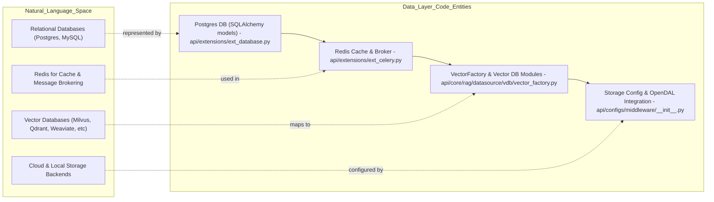

**Sources:** [api/configs/middleware/__init__.py:7-200](), [api/extensions/ext_celery.py:1-184](), [docker/.env.example:73-213](), [api/uv.lock:12-52]()

---

## Configuration System Overview

Dify uses a layered configuration setup driven by environment variables and managed with Pydantic models (`BaseSettings`). Configuration settings are grouped by domain for clarity and extensibility.

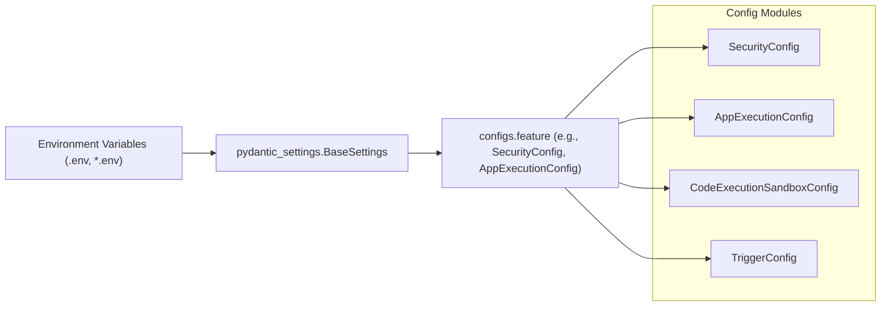

| Configuration Class            | Responsibility                              | File Path                              |
|-------------------------------|---------------------------------------------|--------------------------------------|
| `SecurityConfig`               | Secret keys, token expiry, rate limits      | [api/configs/feature/__init__.py:22-78]()  |
| `AppExecutionConfig`           | Max execution time, concurrency limits      | [api/configs/feature/__init__.py:79-113]() |
| `CodeExecutionSandboxConfig`   | Sandbox API endpoint and request limits     | [api/configs/feature/__init__.py:114-203]()|
| `TriggerConfig`                | Webhook request size limits                  | [api/configs/feature/__init__.py:195-204]()|

**Sources:** [api/configs/feature/__init__.py:1-221](), [docker/.env.example:1-214]()

---

## Supported Deployment Options

### Docker Compose (Recommended)

- Primary deployment method for self-hosting.
- Includes a pre-defined multi-service stack orchestrated via `docker/docker-compose.yaml`.
- Services include API server, workers, frontend, database, Redis, sandbox, and plugin daemon.
- Configuration managed through `.env` files containing environment variables for credentials, service URLs, and feature flags.
- Quick start commands:

```bash
cd docker
cp .env.example .env
docker compose up -d
```

### Local Development Setup

- **Backend** uses the `uv` Python workspace manager and Pydantic configuration layers for dependency isolation and settings management.
- **Frontend** uses `pnpm` with workspaces for JavaScript/TypeScript dependency management and build tooling.
- Helper scripts and `Makefile` targets facilitate local development and testing.

**Sources:** [README.md:74-81](), [docker/docker-compose.yaml:1-132](), [api/pyproject.toml:1-187](), [web/package.json:1-193](), [api/uv.lock:1-52]()

---

## Repository Structure Overview

Dify is organized as a monorepo integrating multiple interrelated packages and services, tied together by front-end `pnpm` workspaces and back-end `uv` workspaces.

| Folder               | Description                                               |
|----------------------|-----------------------------------------------------------|
| `api/`               | Backend API server and core Python services                |
| `web/`               | Next.js React web frontend UI                              |
| `cli/`               | CLI tool `difyctl` for managing deployments and devices    |
| `packages/`          | Shared TypeScript packages: contracts, UI libraries        |
| `dify-agent/`        | Python-based agent runtime package                         |
| `dify-agent-runtime/`| Go-based shellctl sandbox environment runtime             |
| `docker/`            | Docker Compose stack manifests and environment file templates |
| `e2e/`               | End-to-end tests using Cucumber and Playwright             |
| `sdks/`              | Client SDKs for Python, Node.js, and PHP                    |
| `docs/`              | Additional user and developer documentation                 |

For an indepth tour of repository layout and workspaces, see [Repository Layout and Monorepo Packages](#1.1).

---

## Next Steps & Links to Child Pages

- For an in-depth repository tour and package relationship: see [Repository Layout and Monorepo Packages](#1.1).
- To quickly get a local development environment running using Docker or raw source, see [Quick Start and Local Development](#1.2).
- For a detailed understanding of the internal system architecture, components, and runtime behavior, refer to [System Architecture Overview]().

---

## System Requirements Summary

| Component       | Minimum Requirement                    |
|-----------------|--------------------------------------|
| CPU             | 2 cores or more                      |
| Memory (RAM)    | 4 GiB or more                        |
| Operating System| Linux, macOS, Windows (via Docker)  |
| Python          | Version 3.13                        |
| Node.js         | Version 22 (for frontend build)      |

**Sources:** [README.md:67-70](), [api/pyproject.toml:4-11](), [api/uv.lock:3-10]()

---

This page serves as the gateway for newcomers to understand the Dify platform at a high level, outlining how the pieces fit together and pointing to detailed reference pages for each subsystem.

# End of "Introduction to Dify"

---

# Page: Repository Layout and Monorepo Packages

# 1.1 Repository Layout and Monorepo Packages

<details>
<summary>Relevant source files</summary>

The following files were used as context for generating this wiki page:

- [.github/actions/setup-web/action.yml](.github/actions/setup-web/action.yml)
- [AGENTS.md](AGENTS.md)
- [Makefile](Makefile)
- [api/AGENTS.md](api/AGENTS.md)
- [api/controllers/API_SCHEMA_GUIDE.md](api/controllers/API_SCHEMA_GUIDE.md)
- [api/dev/lint_response_contracts.py](api/dev/lint_response_contracts.py)
- [api/tests/unit_tests/commands/test_check_no_new_base_model.py](api/tests/unit_tests/commands/test_check_no_new_base_model.py)
- [api/tests/unit_tests/commands/test_lint_response_contracts.py](api/tests/unit_tests/commands/test_lint_response_contracts.py)
- [cli/AGENTS.md](cli/AGENTS.md)
- [cli/ARD.md](cli/ARD.md)
- [cli/vite.config.ts](cli/vite.config.ts)
- [eslint.config.mjs](eslint.config.mjs)
- [lint.config.ts](lint.config.ts)
- [package.json](package.json)
- [packages/contracts/openapi-ts.api.config.ts](packages/contracts/openapi-ts.api.config.ts)
- [packages/contracts/package.json](packages/contracts/package.json)
- [packages/dify-ui/README.md](packages/dify-ui/README.md)
- [packages/dify-ui/package.json](packages/dify-ui/package.json)
- [packages/dify-ui/src/scroll-area/__tests__/index.spec.tsx](packages/dify-ui/src/scroll-area/__tests__/index.spec.tsx)
- [packages/dify-ui/src/scroll-area/index.stories.tsx](packages/dify-ui/src/scroll-area/index.stories.tsx)
- [packages/dify-ui/src/scroll-area/index.tsx](packages/dify-ui/src/scroll-area/index.tsx)
- [packages/dify-ui/tsconfig.json](packages/dify-ui/tsconfig.json)
- [packages/jotai-tanstack-form/package.json](packages/jotai-tanstack-form/package.json)
- [pnpm-lock.yaml](pnpm-lock.yaml)
- [pnpm-workspace.yaml](pnpm-workspace.yaml)
- [scripts/ast_grep_rules/no_new_base_model.yml](scripts/ast_grep_rules/no_new_base_model.yml)
- [scripts/check_no_new_base_model.py](scripts/check_no_new_base_model.py)
- [vite.config.ts](vite.config.ts)
- [web/docs/lint.md](web/docs/lint.md)
- [web/plugins/eslint/index.js](web/plugins/eslint/index.js)
- [web/plugins/eslint/rules/no-app-store-imports.js](web/plugins/eslint/rules/no-app-store-imports.js)
- [web/plugins/eslint/rules/no-app-store-imports.test.js](web/plugins/eslint/rules/no-app-store-imports.test.js)
- [web/vite.config.ts](web/vite.config.ts)

</details>


This page offers a comprehensive technical tour of the Dify monorepo layout and its package organization. It explicitly describes the primary directories, their roles and interactions, and how tools like **pnpm** workspaces and **uv** workspaces coordinate the development workflow.

---

## 1. Monorepo Overview

Dify is organized as a monorepo containing backend, frontend, tooling, development aids, and runtime components. This structure promotes modularity, efficient local development, and streamlined CI/CD pipelines.

The major directories and packages at the repository root are:

| Directory / Package        | Purpose                                                                                     |
|---------------------------|---------------------------------------------------------------------------------------------|
| `api/`                    | Backend service codebase implementing REST API services, database models, business logic.   |
| `web/`                    | Frontend application built with Next.js, including React components and routes.             |
| `cli/`                    | Command line interface utilities, including `difyctl` for workflows and auth.               |
| `packages/`                | Shared packages and libraries used by both backend and frontend, e.g., UI components.       |
| `dify-agent/`             | Standalone Python-based agent runtime backend service, leveraging `Agenton` framework.      |
| `dify-agent-runtime/`     | Go-based sandbox runtime for executing agent shell commands safely, includes Docker assets. |
| `docker/`                 | Deployment and infrastructure assets including Docker Compose files and environment configs.|
| `e2e/`                    | End-to-end Cucumber and Playwright test suites for full system integration testing.        |
| `sdks/`                   | Official client SDKs in multiple languages like Node.js and Python.                         |
| `docs/`                   | Markdown documentation and guides for contributors and users.                               |

The monorepo is managed using **pnpm workspaces** plus **uv** workspaces:

- **pnpm workspaces** organize JavaScript/TypeScript packages to share dependencies, allow cross-package linking, and optimize installs.
- **uv workspaces** handle unified invocation of Python backend tasks and scripts with isolated environment and concurrency control.

This combination allows the backend Python code, frontend TypeScript code, CLI tools, shared UI libs, and runtime agent services to coexist, build, and test cohesively.

---

## 2. Top-Level Directory Descriptions and Roles

### 2.1 `api/`

- **Role:** The backend API service implemented mainly in Python using Flask.
- **Contents:** Application startup/factory, ORM models, API controllers, Celery task queues, service providers, and configuration.
- **Key points:**  
  - Uses SQLAlchemy for database schema and persistence.
  - Implements core domain entities such as Account, Tenant, App, Workflow, Agent.
  - Exposes REST endpoints consumed by frontend and SDKs.
  - Integrates third-party services for storage, vector DB, tracing.
- **Development:** Run backend commands via `uv run --project api <command>` for consistent environment.
- **Testing:** Unit tests under `api/tests/unit_tests`, integration tests under `api/tests/integration_tests`.

### 2.2 `web/`

- **Role:** The frontend application implementing the user interface.
- **Tech stack:** Next.js, React, TypeScript, Tailwind CSS, and Vite+ (vinext dev server).
- **Contents:**  
  - React components and hooks under `web/app/`.
  - i18n and routing configurations.
  - Custom Vite plugins such as i18n hot module reload plugin and route namespace analysis.
  - Storybook for UI component development.
- **Development:**  
  - Development server started via `pnpm dev` from repo root (runs vinext + proxy).
  - Environment configs in `.env.local`.
- **Testing:** Uses Vitest for unit tests and Playwright for browser/integration tests.
- **Build:** Production build with `pnpm -C web run build`.

### 2.3 `cli/`

- **Role:** Command line tools including the primary CLI `difyctl`.
- **Tech stack:** TypeScript, Bun runtime.
- **Functionality:**  
  - Handles commands, authentication (device flow), HTTP requests to backend.
  - Output formatting and command orchestration framework.
- **Packaging:** A standalone package compiled via Bun.

### 2.4 `packages/`

- **Role:** Shared reusable libraries and component packages.
- **Notable package:** `@langgenius/dify-ui`, providing isolated UI primitives (buttons, inputs, dialogs) built on Headless UI, Tailwind, and base React components.
- **Layout:** Each package resides in a subfolder with its own `package.json`.
- **Usage:** Backend, frontend, and CLI consume selected packages for shared logic and UI consistency.

### 2.5 `dify-agent/`

- **Role:** Python-based standalone agent runtime backend leveraging the `Agenton` framework.
- **Core tech:** Provides FastAPI server to receive run requests for agent workflows.
- **Functionality:**  
  - Redis scheduler and run state store.
  - Adapter layer bridging agent runtime and Dify backend.

### 2.6 `dify-agent-runtime/`

- **Role:** Go-based shell sandbox runtime.
- **Purpose:** Secure, sandboxed execution of shell commands for agents with tmux-backed job lifecycle.
- **Assets:**  
  - Dockerfile for sandbox runtime image.
  - Implements Landlock sandboxing, exit persistence, pty filtering.

### 2.7 `docker/`

- **Role:** Deployment artifacts for Docker and Docker Compose.
- **Contents:**  
  - Core `docker-compose.middleware.yaml` to orchestrate middleware services.
  - Environment example files for middleware and other services.
  - Volume configuration for persistent storage.
- **Makefile integration:** Has targets to prepare Docker middleware, build web/api images, and run environment setup.

### 2.8 `e2e/`

- **Role:** End-to-end test suites for integration validation.
- **Technologies:** Cucumber BDD and Playwright for browser tests.
- **Usage:** Tests simulate real user workflows by running against deployed backend and frontend services.

### 2.9 `sdks/`

- **Role:** Official client SDK implementations.
- **Languages include:** Node.js, Python, PHP.
- **Purpose:** Provide idiomatic libraries to wrap backend APIs and simplify client integration.

### 2.10 `docs/`

- **Role:** Central repository for markdown documentation.
- **Content:** Guides, technical architecture, design documents, testing instructions, and contributor guidance.

---

## 3. How pnpm Workspaces and uv Workspaces Coordinate the Monorepo

### 3.1 pnpm Workspaces

The monorepo defines a `pnpm-workspace.yaml` file specifying packages and directories:

```yaml
packages:
  - web
  - e2e
  - sdks/nodejs-client
  - packages/*
  - cli
```

- This instructs `pnpm` to treat these folders as workspace packages.
- `pnpm` cross-links dependencies across packages (e.g., linking `@langgenius/dify-ui` from `packages` into `web`).
- Dependency versions are deduplicated and isolated per workspace package.
- The root `package.json` manages JavaScript/TypeScript-related scripts like linting, formatting, and development.
- Engine versions and dependency overrides ensure consistent dependency trees across all JS/TS packages.

### 3.2 uv Workspaces

- `uv` is a workspace and task runner for managing Python backend code.
- It defines isolated workspaces for projects like the `api/`, ensuring environment variables, virtual environments, and invocation contexts are properly configured.
- Backend commands (e.g., Flask app run, database migrations) are executed with `uv run --project api <command>`, guaranteeing consistent and reproducible execution environments.
- `uv sync` synchronizes Python dependencies and database migrations into the virtual environment.
- This manages complexities of Python dependency versioning within the polyglot monorepo environment, isolating Python-specific development lifecycle from Node-related tooling.

---

## 4. Package Interaction and Data Flow

### 4.1 Development Flow

- **Shared UI and logic libraries** are maintained mainly in `packages/dify-ui` (UI primitives) and consumed by the `web/` frontend and `cli/` tools.
- The **backend API** (`api/`) implements core RESTful services, domain models, and business logic.
- The **frontend** (`web/`) interfaces with the backend API, leveraging shared UI packages to maintain consistency.
- **CLI tools** (`cli/`) communicate with backend APIs to perform workflow control, authentication, and various utilities.
- The **agent runtime components**, split between `dify-agent/` (Python) and `dify-agent-runtime/` (Go sandbox), run as separate services but interface with the backend via well-defined APIs.
- The **end-to-end tests** (`e2e/`) orchestrate the entire stack (frontend, backend, agent runtimes) for integration and system-level validation.

---

## 5. Visual Diagrams

### Diagram 1: Monorepo Directory Map and Core Packages

```mermaid
graph TD
  RepoRoot["Dify Monorepo Root"]

  RepoRoot --> API["api/ (Python Backend API)"]
  RepoRoot --> Web["web/ (Next.js Frontend)"]
  RepoRoot --> CLI["cli/ (difyctl CLI Tools)"]
  RepoRoot --> Packages["packages/ (Shared Libraries)"]
  RepoRoot --> AgentPy["dify-agent/ (Python Agent Runtime)"]
  RepoRoot --> AgentGo["dify-agent-runtime/ (Go Sandbox Runtime)"]
  RepoRoot --> Docker["docker/ (Deployment & Docker Compose)"]
  RepoRoot --> E2E["e2e/ (End-to-End Tests)"]
  RepoRoot --> SDKs["sdks/ (Client SDKs)"]
  RepoRoot --> Docs["docs/ (Documentation)"]

  Packages --> DifyUI["@langgenius/dify-ui (UI primitives)"]
  SDKs --> NodeSDK["nodejs-client/"]
  SDKs --> PythonSDK["python-client/"]

  style RepoRoot stroke:#333,stroke-width:2px
  style API stroke:#333,stroke-width:1px
  style Web stroke:#333,stroke-width:1px
  style CLI stroke:#333,stroke-width:1px
  style Packages stroke:#333,stroke-width:1px
  style AgentPy stroke:#333,stroke-width:1px
  style AgentGo stroke:#333,stroke-width:1px
  style Docker stroke:#333,stroke-width:1px
  style E2E stroke:#333,stroke-width:1px
  style SDKs stroke:#333,stroke-width:1px
  style Docs stroke:#333,stroke-width:1px
```
*Diagram 1 shows the high-level directory structure of the Dify monorepo with key packages.*

---

### Diagram 2: Monorepo Package Workflow and Toolchain Integration

```mermaid
flowchart TD
  PNPM["pnpm Workspaces"]
  UV["uv Workspaces"]

  subgraph Frontend
    Web["web/ Next.js App"]
    Packages["packages/dify-ui UI Package"]
  end

  subgraph Backend
    API["api/ Flask REST API"]
    AgentPy["dify-agent/ Python Agent Runtime"]
    AgentGo["dify-agent-runtime/ Go Sandbox"]
  end

  subgraph CLI
    CLI["cli/ difyctl CLI"]
  end

  subgraph Tests
    E2E["e2e/ Cucumber & Playwright"]
  end

  PNPM --> Web
  PNPM --> CLI
  PNPM --> Packages

  UV --> API
  UV --> AgentPy

  Web -. HTTP API .-> API
  CLI -. HTTP API .-> API

  AgentPy -. AgentRun API .-> API

  AgentGo -. Sandboxed Runtime .-> AgentPy

  E2E -. Integration Tests .-> Web
  E2E -. Integration Tests .-> API
  E2E -. Integration Tests .-> AgentPy
```

*Diagram 2 illustrates the coordination between `pnpm` and `uv` workspace tools tying together the frontend, backend, CLI, agent runtimes, and test suites.*

---

## 6. Summary

The Dify repository is a carefully structured monorepo combining diverse technologies and languages to support a rich LLM application platform:

- Frontend React/TypeScript in `web/`
- Backend Python Flask API in `api/`
- Shared UI and utility libraries in `packages/`
- Python and Go agent runtime services in `dify-agent/` and `dify-agent-runtime/`
- CLI tools in `cli/`
- Deployment assets and configuration in `docker/`
- End-to-end testing suites in `e2e/`
- Official client SDKs in `sdks/`
- Documentation in `docs/`

**pnpm workspaces** enable tight integration and dependency sharing among JavaScript/TypeScript projects.

**uv workspaces** manage Python backend commands and environment isolation.

This layout supports modular full-stack development, comprehensive testing, and smooth CI/CD pipelines for scalable platform evolution.

---

## References and Sources

- `pnpm-workspace.yaml` (monorepo package configuration) [pnpm-workspace.yaml:1-65]()
- `Makefile` (dev setup, Docker build targets, uv commands) [Makefile:1-172]()
- `packages/dify-ui/package.json` (shared UI package structure and exports) [packages/dify-ui/package.json:1-220]()
- `web/vite.config.ts` (frontend build tooling with Vite+ and pnpm) [web/vite.config.ts:1-155]()
- `package.json` (root dependency and script management) [package.json:1-64]()
- `AGENTS.md` (monorepo overview notes) [AGENTS.md:1-9]()

---

# Page: Quick Start and Local Development

# Quick Start and Local Development

<details>
<summary>Relevant source files</summary>

The following files were used as context for generating this wiki page:

- [.devcontainer/devcontainer.json](.devcontainer/devcontainer.json)
- [.devcontainer/post_create_command.sh](.devcontainer/post_create_command.sh)
- [.github/workflows/build-push.yml](.github/workflows/build-push.yml)
- [.github/workflows/docker-build.yml](.github/workflows/docker-build.yml)
- [.gitignore](.gitignore)
- [.vscode/launch.json.template](.vscode/launch.json.template)
- [Makefile](Makefile)
- [api/AGENTS.md](api/AGENTS.md)
- [api/Dockerfile](api/Dockerfile)
- [api/Dockerfile.dockerignore](api/Dockerfile.dockerignore)
- [api/README.md](api/README.md)
- [api/controllers/API_SCHEMA_GUIDE.md](api/controllers/API_SCHEMA_GUIDE.md)
- [api/dev/lint_response_contracts.py](api/dev/lint_response_contracts.py)
- [api/docker/entrypoint.sh](api/docker/entrypoint.sh)
- [api/providers/vdb/vdb-alibabacloud-mysql/src/dify_vdb_alibabacloud_mysql/alibabacloud_mysql_vector.py](api/providers/vdb/vdb-alibabacloud-mysql/src/dify_vdb_alibabacloud_mysql/alibabacloud_mysql_vector.py)
- [api/providers/vdb/vdb-hologres/src/dify_vdb_hologres/hologres_vector.py](api/providers/vdb/vdb-hologres/src/dify_vdb_hologres/hologres_vector.py)
- [api/providers/vdb/vdb-matrixone/src/dify_vdb_matrixone/matrixone_vector.py](api/providers/vdb/vdb-matrixone/src/dify_vdb_matrixone/matrixone_vector.py)
- [api/providers/vdb/vdb-matrixone/tests/unit_tests/test_matrixone_vector.py](api/providers/vdb/vdb-matrixone/tests/unit_tests/test_matrixone_vector.py)
- [api/providers/vdb/vdb-opengauss/src/dify_vdb_opengauss/opengauss.py](api/providers/vdb/vdb-opengauss/src/dify_vdb_opengauss/opengauss.py)
- [api/providers/vdb/vdb-oracle/src/dify_vdb_oracle/oraclevector.py](api/providers/vdb/vdb-oracle/src/dify_vdb_oracle/oraclevector.py)
- [api/tests/unit_tests/commands/test_check_no_new_base_model.py](api/tests/unit_tests/commands/test_check_no_new_base_model.py)
- [api/tests/unit_tests/commands/test_lint_response_contracts.py](api/tests/unit_tests/commands/test_lint_response_contracts.py)
- [dev/start-web](dev/start-web)
- [dev/start-worker](dev/start-worker)
- [packages/contracts/openapi-ts.api.config.ts](packages/contracts/openapi-ts.api.config.ts)
- [packages/contracts/package.json](packages/contracts/package.json)
- [packages/jotai-tanstack-form/package.json](packages/jotai-tanstack-form/package.json)
- [scripts/ast_grep_rules/no_new_base_model.yml](scripts/ast_grep_rules/no_new_base_model.yml)
- [scripts/check_no_new_base_model.py](scripts/check_no_new_base_model.py)
- [web/Dockerfile](web/Dockerfile)
- [web/Dockerfile.dockerignore](web/Dockerfile.dockerignore)

</details>


This page provides detailed instructions and explanations to get Dify running locally, including methods using Docker Compose and development scripts. It covers environment configuration, Makefile targets, and important helper scripts within the `dev/` directory essential for local development and testing.

---

## 1. Overview

Dify can be run locally either by orchestrating containerized services via Docker Compose or by running backend and frontend development servers through dedicated scripts. The backend API service, worker processes, database, Redis cache, vector stores, and other essential services are orchestrated through Docker Compose. For development, the codebase supports using scripts under `dev/` to start individual components with hot reload and debugging capabilities.

This page focuses on covering:

- Environment configuration and `.env` files  
- Docker Compose stack and custom environment layers  
- Development helper scripts in the `dev/` directory  
- Makefile targets aiding local build, run, and testing tasks  

---

## 2. Environment Configuration

### 2.1 `.env` Files

Configuration variables are primarily stored in `.env` files which Docker and application services load on startup.

- **`docker/.env.example`**: This file contains the essential environment variable defaults used for Docker Compose deployments. It's the source template to create your own `.env` file under `docker/` for local runs.  
  It contains core service URLs, runtime settings, logging configurations, database credentials, Redis and Celery broker information, storage backend options, vector database settings, sandbox execution parameters, and API keys.  
  Variables affecting logging and worker concurrency are also detailed here (e.g., `SERVER_WORKER_AMOUNT`, `CELERY_WORKER_AMOUNT`).  
  To run locally, users usually copy `.env.example` to `.env` and modify values as needed before starting the stack.  
  [docker/.env.example:1-214]()

- **`api/.env.example`**: Contains environment variables specific to the API backend service, such as Flask secret keys, API URLs, Redis config, Celery URLs, and database details. It offers a local configuration template matching the backend expectations during development or local execution.  
  Environment variables can often be overridden or merged from multiple sources for layered configurations.  
  [api/.env.example:1-202]()

- **Docker Compose Env Layers**: The Docker Compose files use multiple `.env` files organized under `docker/envs/` directories (e.g., `core-services/shared.env`, `databases/db-postgres.env`, `vectorstores/weaviate.env`) for segmented configuration. These env files are merged or layered in the service definitions using YAML anchors and extensions.  
  This modular approach facilitates more fine-grained control and optionally enables or disables some service-specific configs while sharing common configs across services.  
  [docker/docker-compose.yaml:7-201]()  
  [docker/docker-compose-template.yaml:2-198]()

---

## 3. Running Dify with Docker Compose

### 3.1 Docker Compose Stack

The Compose stack orchestrates essential backend and infrastructure components needed by Dify:

- **Primary Services**:  
  - `api`: The main backend API service, running Flask and SocketIO.  
  - `worker`: Celery worker process handling asynchronous background tasks.  
  - `worker-beat`: Celery Beat scheduler responsible for running periodic scheduled tasks.  
  - `db_postgres` or `db_mysql`: PostgreSQL or MySQL relational database for persistence.  
  - `redis`: Cache and message broker used by Celery and caching layers.  
  - `sandbox`: Code execution sandbox service for safe runtime execution of user code.  
  - Vector database services such as Weaviate, Qdrant, Chroma, etc., controlled through configuration.  
  - `plugin_daemon`: Manages plugin lifecycle operations and isolated environments.  

Each service consumes environment variables using shared env layers defined under `x-shared-api-worker-config` and corresponding worker and beat anchors to unify configuration scopes. Common environment files provide configuration inheritance, avoiding duplication.

The `restart: always` policy ensures resilience and continuous availability for local development or staging environments.

An example excerpt of the postgres service configuration illustrating environment variable usage and health checks:

```yaml
services:
  db_postgres:
    image: postgres:15-alpine
    restart: always
    env_file:
      - ./middleware.env
    environment:
      POSTGRES_PASSWORD: ${DB_PASSWORD:-difyai123456}
      POSTGRES_DB: ${DB_DATABASE:-dify}
    ports:
      - "${EXPOSE_POSTGRES_PORT:-5432}:5432"
    healthcheck:
      test: ["CMD", "pg_isready", "-h", "db_postgres"]
      interval: 1s
      timeout: 3s
      retries: 30
```

This health check ensures the database is ready before dependent services start.  
[docker/docker-compose.middleware.yaml:1-186]()

### 3.2 Starting the Stack

To launch the entire local stack via Docker Compose:

1. Copy `docker/.env.example` to `docker/.env` and customize as needed.
2. Run the following inside the `docker` directory or from the repository root with the proper docker-compose command:

```bash
docker compose up -d
```

This command will start all defined services asynchronously in detached mode.

### 3.3 Customizing Vector Stores and Extras

Vector database services such as Weaviate, Qdrant, or Chroma can be enabled, disabled, or customized by editing their specific environment files in `docker/envs/vectorstores/` or adjusting relevant variables inside the `.env`. This allows local developers to tailor which vector databases run in the local stack for testing or development purposes.

---

## 4. Development Scripts and Local Execution

Dify provides development scripts within the `dev/` directory to run backend API, worker, and web frontend without full Docker containerization, enabling a more dynamic local development experience with hot reload and debugging.

### 4.1 Backend and Worker Scripts

- **`dev/start-api`**: Starts the Python backend API service using UVicorn or Flask with options for hot reload and debug mode.

- **`dev/start-worker`**: Launches Celery worker processes to process asynchronous background tasks. Supports options for queue selection, concurrency, and pool type. The script parses args for these options and sources environment variables optionally from an `.env` file. If no queues are specified, it falls back to edition-specific defaults covering dataset, workflow, plugin, and other queues.

- **`dev/start-web`**: Runs the web frontend in a development server mode, often React or Next.js with hot reload.

These scripts encapsulate environment setup, dependency management, and server invocation to promote smooth iterative development without container orchestration overhead.

### 4.2 Makefile Targets

The root `Makefile` defines common targets to build Docker images, prepare environments, run tests, and start or stop the entire stack. Key targets for local development:

| Target            | Description                                         |
|-------------------|----------------------------------------------------|
| `make dev-setup`  | Prepares the entire dev environment (Docker, Web, API) by copying envs and installing dependencies. |
| `make dev-clean`  | Stops Docker containers and cleans up persisted volumes and storage directories.                |
| `make prepare-docker` | Copies middleware env and starts the Docker Compose middleware stack.                         |
| `make prepare-web`  | Prepares the web frontend environment (installs JS deps, copies .env).                        |
| `make prepare-api`  | Prepares the API backend environment (copies .env, syncs dependencies, runs DB migrations).   |
| `make build-web`    | Builds the web Docker image.                                                               |
| `make build-api`    | Builds the API Docker image.                                                               |
| `make build-sandbox-runtime` | Builds the sandbox runtime Docker image.                                           |
| `make push-web`     | Pushes the web Docker image to the registry.                                              |
| `make push-api`     | Pushes the API Docker image to the registry.                                              |

Additionally, the Makefile supports linting and type-check targets for the backend codebase.

These targets provide convenient shortcuts for local environment setup, build, and testing commands.  
[Makefile:1-181]()

---

## 5. Data Flow and Startup Interaction

Below diagrams illustrate the key relationships between natural language system components as described in the docs and their corresponding code entities and files relevant to local startup and development.

### 5.1 System Startup Flow with Docker Compose and Env Layers

```mermaid
flowchart TD
  subgraph Config
    E1[.env (docker/.env)]
    E2[docker/envs/*.env files]
  end

  subgraph DockerComposeStack
    S1[db_postgres service]
    S2[redis service]
    S3[sandbox service]
    S4[api service]
    S5[worker service]
    S6[plugin_daemon service]
  end

  E1 --> |merged env vars| S1
  E1 --> |merged env vars| S2
  E1 --> |merged env vars| S3
  E1 --> |merged env vars| S4
  E1 --> |merged env vars| S5
  E1 --> |merged env vars| S6

  S1 --> |PersistentStorage| PostgresDB[(Postgres DB)]
  S2 --> |Cache & Broker| Redis[(Redis Cache)]
  S3 --> |Exec Environment| Sandbox((Code Execution Service))
  S4 --> |API Server| APIApp["api/app.py (Flask/SocketIO)"]
  S5 --> |Celery Workers| CeleryWorker["celery worker process (app.celery)"]
  S6 --> |Plugin management| PluginDaemonApp["plugin daemon process"]

  style S4 fill:#f9f,stroke:#333,stroke-width:2px
  style S5 fill:#bbf,stroke:#333,stroke-width:2px
```

This flow visualizes merged environmental configuration feeding into the docker-compose services and their runtime roles.  
Sources: 
- `docker/docker-compose.yaml:1-202`  
- `docker/.env.example:1-214`  
- `docker/docker-compose.middleware.yaml:1-186`

### 5.2 Local Development Scripts and Makefile Targets Correlated

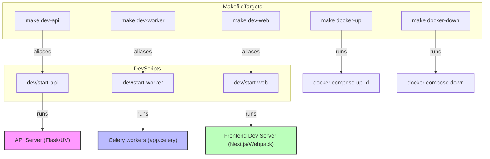

This diagram links dev scripts to their Makefile shorthand usage and the underlying processes they start and manage.  
Sources:
- `dev/start-api` (implied from usage)  
- `dev/start-worker` (lines 1-127)  
- `dev/start-web` (implied, straightforward)  
- `Makefile:1-181` (partial, includes dev-setup and docker commands)  
- `web/package.json` (dependency info, implied)

---

## 6. Additional Notes

- To debug or extend environment variables, check `.env` files under `docker/envs/` and `api/.env.example`. Configuration layering via Docker Compose YAML anchors unifies variables neatly.

- Container logs can be observed via `docker compose logs <service>` or by Makefile or script commands if defined.

- The backend API Dockerfile (`api/Dockerfile`) builds a Python environment with pinned dependencies using `uv` for package management, installs necessary system packages, sets locale and timezone, prepares non-root user `dify`, and sets entrypoint to `api/docker/entrypoint.sh` which handles modes such as API, worker, beat, or migration command execution.

- The entrypoint script (`api/docker/entrypoint.sh`) inspects the environment variable `MODE` to switch between:
  - Running Flask API server (with Gunicorn in production mode, or direct python module in debug mode)
  - Running Celery worker
  - Running Celery Beat for scheduled tasks
  - Running one-off Flask management commands in job mode (e.g., migrations or tenant setup)
  
  This facilitates running different container roles with a single image.  
  [api/Dockerfile:1-127]()  
  [api/docker/entrypoint.sh:1-135]()

- Development environment aliases (e.g., in `.devcontainer/post_create_command.sh`) facilitate quick command usage like `start-api`, `start-worker`, `start-web`, and Docker container management commands.

---

# Summary

| Aspect                     | Location / File / Command                         | Description                                       |
|----------------------------|-------------------------------------------------|-------------------------------------------------|
| Main Docker Compose stack   | `docker/docker-compose.yaml`                      | Defines services and env files for full stack   |
| Core Docker env example     | `docker/.env.example`                             | Template for environment variables               |
| Backend API Dockerfile      | `api/Dockerfile`                                 | Docker image build instructions for API         |
| Backend API entrypoint      | `api/docker/entrypoint.sh`                       | Container entrypoint handling modes and commands|
| Backend env example         | `api/.env.example`                               | API service environment variable defaults       |
| Dev start scripts           | `dev/start-api`, `dev/start-worker`, `dev/start-web` | Scripts for running services locally without Docker |
| Makefile development targets| `Makefile`                                      | Aliases for dev setup, docker-compose control, build, lint, and test commands |

This page equips developers with the necessary knowledge and configuration insights to run Dify locally, either containerized or in development mode, enabling iterative development and troubleshooting with ease.

---

Sources:  
- `docker/.env.example:1-214`  
- `docker/docker-compose.yaml:1-202`  
- `docker/docker-compose.middleware.yaml:1-186`  
- `docker/docker-compose-template.yaml:2-198`  
- `api/.env.example:1-202`  
- `api/Dockerfile:1-128`  
- `api/docker/entrypoint.sh:1-136`  
- `Makefile:1-181`  
- `dev/start-worker:1-127`  
- `web/Dockerfile:1-90` (to infer web environment setup)  
- `.devcontainer/post_create_command.sh:1-17`

---

# Page: System Architecture Overview

# System Architecture Overview

<details>
<summary>Relevant source files</summary>

The following files were used as context for generating this wiki page:

- [api/.env.example](api/.env.example)
- [api/app.py](api/app.py)
- [api/app_factory.py](api/app_factory.py)
- [api/celery_entrypoint.py](api/celery_entrypoint.py)
- [api/configs/feature/__init__.py](api/configs/feature/__init__.py)
- [api/configs/middleware/__init__.py](api/configs/middleware/__init__.py)
- [api/configs/middleware/vdb/weaviate_config.py](api/configs/middleware/vdb/weaviate_config.py)
- [api/configs/observability/__init__.py](api/configs/observability/__init__.py)
- [api/configs/observability/otel/otel_config.py](api/configs/observability/otel/otel_config.py)
- [api/configs/packaging/__init__.py](api/configs/packaging/__init__.py)
- [api/core/rag/datasource/vdb/vector_factory.py](api/core/rag/datasource/vdb/vector_factory.py)
- [api/core/rag/datasource/vdb/vector_type.py](api/core/rag/datasource/vdb/vector_type.py)
- [api/core/schemas/registry.py](api/core/schemas/registry.py)
- [api/extensions/ext_app_metrics.py](api/extensions/ext_app_metrics.py)
- [api/extensions/ext_celery.py](api/extensions/ext_celery.py)
- [api/extensions/ext_database.py](api/extensions/ext_database.py)
- [api/extensions/ext_import_modules.py](api/extensions/ext_import_modules.py)
- [api/extensions/ext_otel.py](api/extensions/ext_otel.py)
- [api/extensions/ext_sentry.py](api/extensions/ext_sentry.py)
- [api/gunicorn.conf.py](api/gunicorn.conf.py)
- [api/migrations/README](api/migrations/README)
- [api/providers/vdb/vdb-weaviate/tests/unit_tests/test_weaviate_integration_header.py](api/providers/vdb/vdb-weaviate/tests/unit_tests/test_weaviate_integration_header.py)
- [api/pyproject.toml](api/pyproject.toml)
- [api/schedule/queue_monitor_task.py](api/schedule/queue_monitor_task.py)
- [api/tests/integration_tests/.env.example](api/tests/integration_tests/.env.example)
- [api/tests/unit_tests/configs/test_dify_config.py](api/tests/unit_tests/configs/test_dify_config.py)
- [api/tests/unit_tests/core/rag/datasource/vdb/test_vector_factory.py](api/tests/unit_tests/core/rag/datasource/vdb/test_vector_factory.py)
- [api/tests/unit_tests/extensions/test_celery_ssl.py](api/tests/unit_tests/extensions/test_celery_ssl.py)
- [api/tests/unit_tests/services/test_feature_service_education.py](api/tests/unit_tests/services/test_feature_service_education.py)
- [api/tests/unit_tests/test_app_factory.py](api/tests/unit_tests/test_app_factory.py)
- [api/uv.lock](api/uv.lock)
- [docker/.env.example](docker/.env.example)
- [docker/docker-compose-template.yaml](docker/docker-compose-template.yaml)
- [docker/docker-compose.middleware.yaml](docker/docker-compose.middleware.yaml)
- [docker/docker-compose.yaml](docker/docker-compose.yaml)
- [docker/envs/core-services/shared.env.example](docker/envs/core-services/shared.env.example)
- [docker/envs/infrastructure/ssrf-proxy.env.example](docker/envs/infrastructure/ssrf-proxy.env.example)
- [docker/envs/middleware.env.example](docker/envs/middleware.env.example)
- [web/package.json](web/package.json)

</details>


## Purpose and Scope

This document provides a comprehensive overview of Dify's system architecture, highlighting its service topology, core components, data models, and deployment structure. It explains the interaction between the different layers of the platform that facilitate AI application development and execution.

For detailed technical information about individual subsystems, look at the following child pages:  
- Service deployment and Docker configuration: [Service Topology and Docker Compose Stack](#2.1)  
- Data models and domain entities: [Core Data Models and Domain Entities](#2.2)  
- Application execution patterns: [Application Types and Execution Modes](#2.3)  
- Configuration and environment setup: [Configuration Management System](#2.4)  
- Flask app setup and request lifecycle: [Flask App Factory, Extensions and Request Lifecycle](#2.5)

---

## High-Level Architecture

Dify is organized into distinct layers, each encapsulating specific responsibilities to support scalability and maintainability:

- **Client Layer**: Includes web browsers and official API clients consuming the platform services.
- **Reverse Proxy Layer**: Nginx reverse proxy routes incoming traffic to frontend or API services.
- **Frontend Layer**: Next.js hosting the Single Page Application (SPA) providing the user interface.
- **API Layer**: Core backend API in Flask, running in multiple modes (`api`, `worker`, `beat`) for request handling, background job processing, and scheduled tasks.
- **Business Logic Layer**: Contains core service modules such as account management, dataset processing, workflow execution, and model management.
- **Specialized Services**: Auxiliary services like the sandbox for secure code execution, plugin daemon for extensibility, and SSRF proxy for request control.
- **Data Persistence Layer**: Stores data in PostgreSQL, MySQL, Redis, object storage, and vector databases for similarity search.

### Architecture Layers Diagram

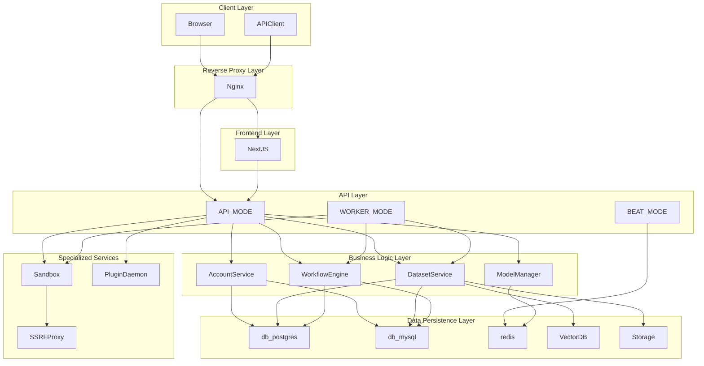

**Sources:** [docker/docker-compose.yaml:206-350](), [docker/docker-compose-template.yaml:200-350](), [api/pyproject.toml:12-18](), [docker/docker-compose.middleware.yaml:1-130]()

---

## Service Topology

### Container Architecture

Dify leverages a suite of Docker containers orchestrated through Docker Compose. The core backend runs from a single API Docker image (`langgenius/dify-api`) that operates in various modes dictated by the `MODE` environment variable, enabling unified image management across API serving, background processing, and scheduling.

### Service Roles and Coordination

- **Initialization**  
  The `init_permissions` container (busybox-based) is responsible for fixing volume permissions before other services start, ensuring writable storage directories.

- **Frontend Services**  
  - `nginx`: Reverse proxy and static content server.  
  - `web`: Next.js frontend providing the web console UI.

- **Backend Services**  
  - `api`: Flask API server (`MODE=api`) handling synchronous HTTP requests.  
  - `worker`: Celery worker (`MODE=worker`) for asynchronous background jobs.  
  - `worker_beat`: Celery beat (`MODE=beat`) for periodic task scheduling.

- **Specialized Services**  
  - `sandbox`: Isolated, secure code execution service accessible over HTTP.  
  - `plugin_daemon`: Manages plugin lifecycle, installation, and isolated runtime execution.  
  - `ssrf_proxy`: Secure SSRF proxy controlling outbound HTTP requests from sandbox or agent runtime.

- **Data Services**  
  - `db_postgres` and `db_mysql`: Relational databases supporting multi-backend flexibility.  
  - `redis`: Caching, message broker for Celery.

- **Vector Databases**  
  Configurable vector similarity backends such as `weaviate`, `qdrant`, and `milvus` provide fast vector-based data retrieval for RAG (Retrieval-Augmented Generation) workloads.

### Docker Compose Service Topology

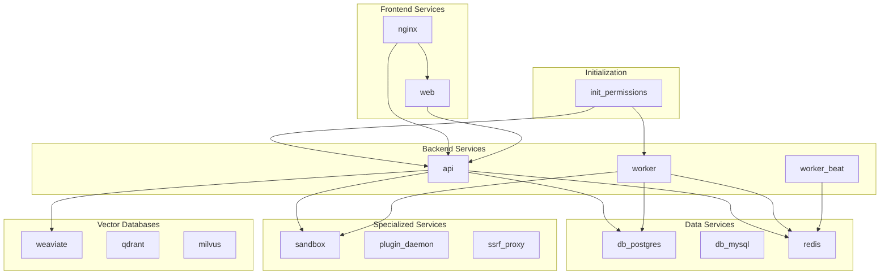

### Design Patterns and Notes

| Pattern                        | Implementation                                                       | Purpose                                                    |
|-------------------------------|----------------------------------------------------------------------|------------------------------------------------------------|
| Single API Image Multi-Mode    | A single Docker image (`langgenius/dify-api`) runs as `api`, `worker`, or `worker_beat` depending on `MODE` env var | Reduces image management and deployment complexity         |
| Non-root Containers            | Containers run as user `1001:1001`                                  | Improves security by avoiding processes running as root    |
| Init Container for Permissions| `init_permissions` container fixes permissions on shared volumes    | Prevents runtime file permission errors                     |
| Multiple DB Profiles           | Docker Compose profiles enable switching between `postgresql` and `mysql` backends | Allows flexible database choice                             |
| Shared Env Using YAML Anchors  | Environment variables are reused via YAML anchors shared by API and workers | Ensures configuration consistency and avoid duplications   |

For a detailed explanation of the Docker Compose setup, service dependencies, and network configuration, see [Service Topology and Docker Compose Stack](#2.1).

**Sources:** [docker/docker-compose.yaml:8-205](), [docker/docker-compose-template.yaml:202-350](), [docker/docker-compose.middleware.yaml:1-130](), [docker/.env.example:53-70]()

---

## Core Components

### Business Logic Services

The core domain logic resides in modular service classes. These services implement functionality and workflows acting as the backend for API routes and interacting extensively with data models and persistence layers.

| Service            | Responsibility                                                      | Location                          |
|--------------------|---------------------------------------------------------------------|---------------------------------|
| `AccountService`   | User accounts, authentication, tenant and member management          | `api/services/account_service.py` |
| `DatasetService`   | Knowledge bases, datasets, document management and indexing          | `api/services/dataset_service.py`; models in `api/models/dataset.py` |
| `DocumentService`  | Document extraction, segmentation, knowledge base processing         | Part of `DatasetService` components |
| `IndexingRunner`   | ETL pipeline for document indexing and vectorization                | `api/core/indexing_runner.py`     |
| `WorkflowEngine`   | Graph-based workflow execution, orchestration for AI apps            | `api/models/workflow.py`; core logic components |
| `ModelManager`     | Manages AI/LLM models, provider integrations, quotas, and invocations| LLM integration subsystem         |

These services coordinate with the persistence layers like databases and Redis, and specialized services such as sandbox and plugin daemon for advanced functionality.

**Sources:** [api/models/dataset.py:22-166](), [api/models/model.py:65-68](), [api/models/workflow.py:176-220]()

---

## Data Models and Relationships

Dify uses SQLAlchemy ORM for modeling its core domain entities and managing persistent state in relational databases.

### Core Entity Relationships Diagram

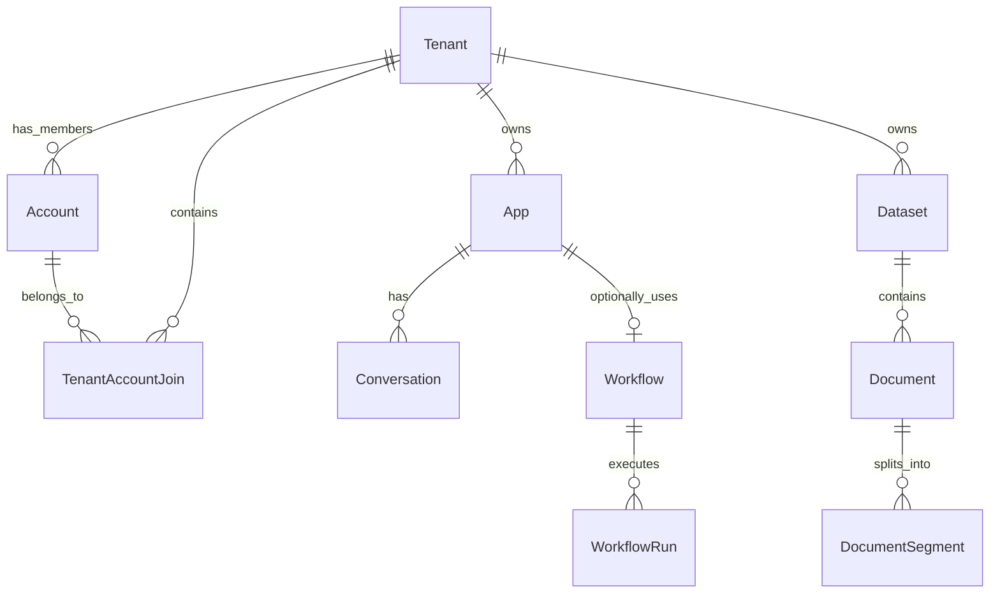

### Key Model Classes

| Model      | Role                                  | Location & Notes                                   |
|------------|-------------------------------------|---------------------------------------------------|
| `Account`  | User accounts, integrates with Flask-Login | `api/models/model.py`, `api/models/account.py`    |
| `Tenant`   | Workspace or org owning apps, datasets | `api/models/account.py`                            |
| `App`      | AI application entity, deployment unit | Defined in `api/models/model.py`                   |
| `Workflow` | Graph-based workflow definitions for execution and apps | `api/models/workflow.py`                           |
| `Dataset`  | Knowledge base container for documents | `api/models/dataset.py`                            |
| `Document` | Individual documents within datasets | `api/models/dataset.py`                            |

These entities enable multi-tenancy, app lifecycle management, knowledge base storage, and workflow execution features.

For full schema and relationships, see [Core Data Models and Domain Entities](#2.2).

**Sources:** [api/models/model.py:15-32](), [api/models/workflow.py:176-220](), [api/models/dataset.py:110-166](), [api/models/account.py:16-16]()

---

## Configuration Management

Dify uses Pydantic's `BaseSettings` classes for robust and type-safe configuration management. Configuration is resolved by layering `.env` files and environment variables, allowing flexible environment-specific overrides.

### Configuration Resolution Flow

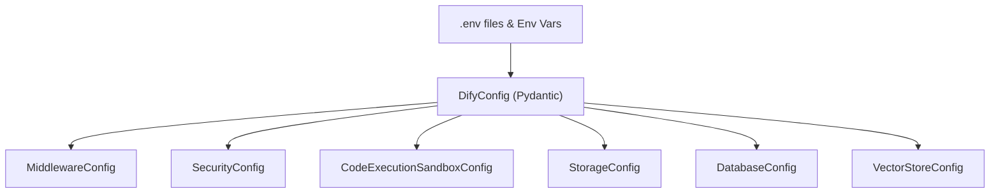

### Key Configuration Areas

- **Database Settings**  
  Database engine and connection settings are configured by `DB_TYPE`, `DB_HOST`, `DB_PORT`, `DB_DATABASE` environment variables to support multiple backends [docker/.env.example:77-83]().

- **Redis & Celery**  
  Redis cache and task queues are configured through `REDIS_HOST`, `REDIS_PORT`, and `CELERY_BROKER_URL` environment variables [docker/.env.example:98-105]().

- **Storage System**  
  Abstracted storage backend configured via `STORAGE_TYPE`, `OPENDAL_SCHEME`, and specific service environment variables for S3, Azure, etc [api/.env.example:114-117]().

- **Code Execution Sandbox**  
  Dedicated settings such as `CODE_EXECUTION_ENDPOINT`, API keys, and timeout parameters control the isolated code sandbox service [api/configs/feature/__init__.py:105-193]().

The configuration system provides consistent and validated environment-driven parameterization that supports production and development deployments.

For complete configuration management details, refer to [Configuration Management System](#2.4).

**Sources:** [api/configs/feature/__init__.py:20-220](), [api/.env.example:88-213](), [docker/.env.example:72-115]()

---

## Vector Database and Retrieval-Augmented Generation (RAG)

Dify supports more than 23 vector database implementations to enable efficient vector similarity search and RAG workflows. The integration uses a factory pattern to abstract and select the backend dynamically.

### Vector Factory and Backend Abstraction Diagram

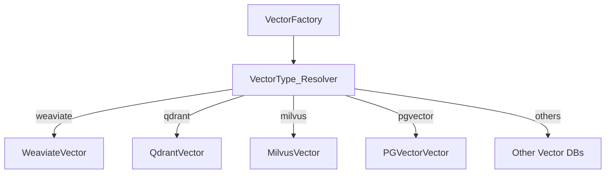

- The precise vector store backend is controlled by the `VECTOR_STORE` environment variable.
- Supported vector databases include `weaviate`, `qdrant`, `milvus`, `pgvector`, and many others maintained as workspace packages under `providers/vdb/` in the codebase.
- Vector backends integrate into the DatasetService and RAG pipeline components.

For detailed vector database integration and configuration, see related child pages.

**Sources:** [api/core/rag/datasource/vdb/vector_factory.py:1-50](), [api/core/rag/datasource/vdb/vector_type.py:1-30](), [api/.env.example:211-211](), [api/pyproject.toml:70-99]()

---

## Summary

Dify's architecture is designed for a scalable, multi-tenant AI application platform that supports both synchronous user-facing requests and asynchronous background processing. Its technical pillars include:

- A modular Docker Compose multi-container deployment with a single multi-mode backend API image.  
- Service-oriented business logic combining API route handlers, core services, and domain models.  
- A well-designed SQLAlchemy ORM data model supporting tenants, apps, workflows, datasets, and documents.  
- Strong, Pydantic-based environment configuration layered from `.env` files to runtime.  
- Extensible plugin and sandboxed code execution services.  
- Rich integration with diverse vector databases for efficient semantic search and RAG pipelines.

This overview grounds the more detailed explanations found in the child pages, facilitating efficient onboarding and comprehension of system design.

---

# See Also (Child Pages)

- [Service Topology and Docker Compose Stack](#2.1)  
- [Core Data Models and Domain Entities](#2.2)  
- [Application Types and Execution Modes](#2.3)  
- [Configuration Management System](#2.4)  
- [Flask App Factory, Extensions and Request Lifecycle](#2.5)

---

**Sources:**  
- docker/docker-compose.yaml  
- docker/docker-compose-template.yaml  
- docker/docker-compose.middleware.yaml  
- docker/.env.example  
- api/pyproject.toml  
- api/configs/feature/__init__.py  
- api/models/dataset.py  
- api/models/model.py  
- api/models/workflow.py  
- api/models/account.py  
- api/core/rag/datasource/vdb/vector_factory.py  
- api/core/rag/datasource/vdb/vector_type.py

---

# Page: Service Topology and Docker Compose Stack

# Service Topology and Docker Compose Stack

<details>
<summary>Relevant source files</summary>

The following files were used as context for generating this wiki page:

- [api/.env.example](api/.env.example)
- [api/configs/feature/__init__.py](api/configs/feature/__init__.py)
- [api/configs/middleware/__init__.py](api/configs/middleware/__init__.py)
- [api/configs/middleware/vdb/weaviate_config.py](api/configs/middleware/vdb/weaviate_config.py)
- [api/configs/packaging/__init__.py](api/configs/packaging/__init__.py)
- [api/core/rag/datasource/vdb/vector_factory.py](api/core/rag/datasource/vdb/vector_factory.py)
- [api/core/rag/datasource/vdb/vector_type.py](api/core/rag/datasource/vdb/vector_type.py)
- [api/extensions/ext_app_metrics.py](api/extensions/ext_app_metrics.py)
- [api/extensions/ext_celery.py](api/extensions/ext_celery.py)
- [api/extensions/ext_database.py](api/extensions/ext_database.py)
- [api/extensions/ext_import_modules.py](api/extensions/ext_import_modules.py)
- [api/extensions/ext_sentry.py](api/extensions/ext_sentry.py)
- [api/migrations/README](api/migrations/README)
- [api/providers/vdb/vdb-weaviate/tests/unit_tests/test_weaviate_integration_header.py](api/providers/vdb/vdb-weaviate/tests/unit_tests/test_weaviate_integration_header.py)
- [api/pyproject.toml](api/pyproject.toml)
- [api/schedule/queue_monitor_task.py](api/schedule/queue_monitor_task.py)
- [api/tests/integration_tests/.env.example](api/tests/integration_tests/.env.example)
- [api/tests/unit_tests/configs/test_dify_config.py](api/tests/unit_tests/configs/test_dify_config.py)
- [api/tests/unit_tests/core/rag/datasource/vdb/test_vector_factory.py](api/tests/unit_tests/core/rag/datasource/vdb/test_vector_factory.py)
- [api/tests/unit_tests/extensions/test_celery_ssl.py](api/tests/unit_tests/extensions/test_celery_ssl.py)
- [api/uv.lock](api/uv.lock)
- [docker/.env.example](docker/.env.example)
- [docker/docker-compose-template.yaml](docker/docker-compose-template.yaml)
- [docker/docker-compose.middleware.yaml](docker/docker-compose.middleware.yaml)
- [docker/docker-compose.yaml](docker/docker-compose.yaml)
- [docker/envs/core-services/shared.env.example](docker/envs/core-services/shared.env.example)
- [docker/envs/infrastructure/ssrf-proxy.env.example](docker/envs/infrastructure/ssrf-proxy.env.example)
- [docker/envs/middleware.env.example](docker/envs/middleware.env.example)
- [web/package.json](web/package.json)

</details>


This document provides a detailed technical explanation of the Docker Compose orchestration for the Dify platform, including the complete service topology, container dependencies, environment variable management, networking, and volumes. It covers how the container architecture maps to the repository codebase and runtime modes, explaining service roles and their interdependencies.

For complementary information, see related pages on [3.1 Docker Build Process and Multi-Stage Images]() and [3.2 Environment Configuration and Runtime Modes]().

---

## Service Topology Overview

Dify orchestrates a multi-container Docker Compose stack comprising several layers of services. These include:

- **Core Application Services**: Backend API server, asynchronous worker processes, and frontend web application.
- **Infrastructure Services**: Databases (PostgreSQL or MySQL), Redis cache, SSRF proxy.
- **Execution Services**: Sandboxed code execution (for safe code runs) and plugin daemon (for plugin lifecycles).

The composition is articulated in `docker/docker-compose.yaml`, leveraging Docker Compose profiles to optionally enable some components like MySQL [docker/docker-compose.yaml:1-5](), [docker/docker-compose.middleware.yaml:1-131]().

### Service to Code Entity Mapping Diagram

This diagram maps the Docker Compose service names to container images, exposed ports, and critical codebase runtime modes or entrypoints, bridging operational names with implementation references.

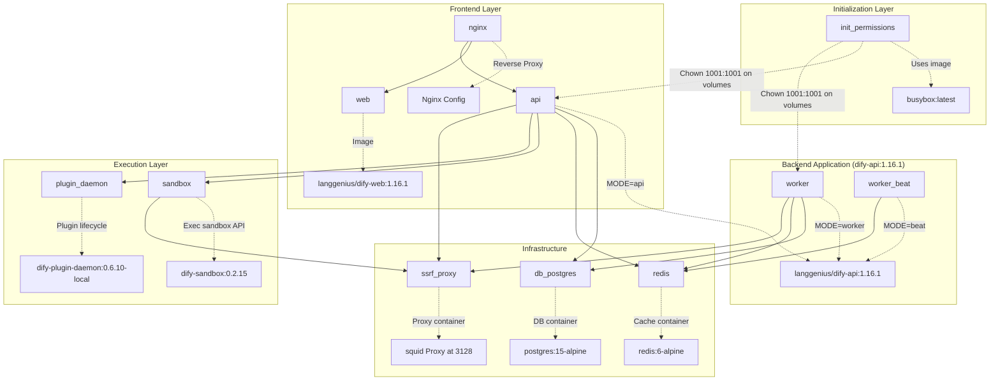

This clearly connects:

- `init_permissions` container runs a lightweight permissions fix at startup.
- Backend `api`, `worker`, and `worker_beat` share the same container image but operate in distinct modes.
- Frontend served via `web` and proxied by `nginx`.
- `sandbox` service for isolated code execution.
- `plugin_daemon` handles plugin management lifecycle.
- Infrastructure components: PostgreSQL DB, Redis caching, and SSRF proxy via Squid.

**Sources:**  
[docker/docker-compose.yaml:1-250](), [docker/docker-compose.middleware.yaml:1-131](), [docker/docker-compose.middleware.yaml:132-186](), [web/package.json:1-4](), [api/pyproject.toml:1-3]()  

---

## Docker Compose Structure and Environment Management

### Shared Environment Variable Anchors

The Compose stack uses YAML anchors to define reusable environment variable settings blocks, minimizing duplication and improving consistency. The main shared anchors for environment files are:

| Anchor Name                  | Target Services               | Environment Files Included                                                                                                                  |
|-----------------------------|------------------------------|--------------------------------------------------------------------------------------------------------------------------------------------|
| `x-shared-api-worker-config`| `api`                        | `shared.env`, `api.env`, `security.env`, database envs (`db-postgres.env`, `db-mysql.env`), Redis env, vectorstore envs (e.g. `weaviate.env`), `.env`  |
| `x-shared-worker-config`     | `worker`                     | Similar to API but with `worker.env` instead of `api.env`                                                                                   |
| `x-shared-worker-beat-config`| `worker_beat`               | Similar, substituting `worker-beat.env`                                                                                                     |

These environment files configure critical runtime parameters like database credentials, Redis URIs, vector store details, and security tokens. Services inherit these anchors to load consistent configuration [docker/docker-compose.yaml:8-201](), [docker/docker-compose-template.yaml:1-198]().

### Environment File Relationship Diagram

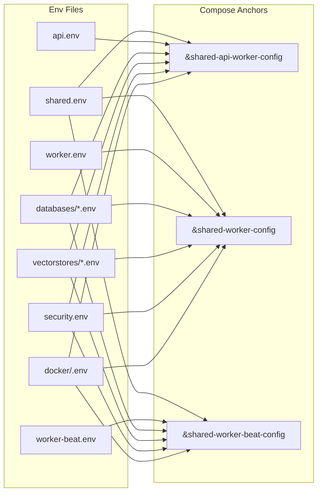

This modular and layered environment loading ensures consistent propagation of key runtime settings across API and worker services.

**Sources:**  
[docker/docker-compose.yaml:8-201](), [docker/docker-compose-template.yaml:1-198]()  

---

## Core Application Services

### Backend Application Services

The core backend runs the `langgenius/dify-api` container image, instantiated in three roles distinguished by the environment variable `MODE`:

| Service      | Mode    | Description                                                                                   | Entrypoint    |
|--------------|---------|-----------------------------------------------------------------------------------------------|---------------|
| `api`        | `api`   | REST API service handles HTTP requests, REST routes, and WebSocket APIs via Flask and Gunicorn. | `/entrypoint.sh`, launches Flask app in API mode. |
| `worker`     | `worker`| Celery worker processes asynchronous tasks like indexing, workflow execution, and triggers.    | `/entrypoint.sh` with worker mode. |
| `worker_beat`| `beat`  | Celery Beat scheduler runs periodic jobs such as cleanup, summary generation.                 | `/entrypoint.sh` with beat mode.  |

The `api` service exposes port 5001, using environment variables to tune concurrency (`SERVER_WORKER_AMOUNT`), worker class (default `gevent`), and timeouts. The workers connect to Redis for task queueing and to the database for persistence.

Sources in the codebase relevant to operation are `api/` for application logic and `extensions/ext_celery.py` showing Celery integration and task scheduling [docker/docker-compose.yaml:220-377](), [api/extensions/ext_celery.py:118-170](), [docker/.env.example:55-67]().

### Frontend Service

The frontend service runs a Next.js-based React application served by the container `langgenius/dify-web`. It listens on port 3000 by default and provides the Console UI and web apps.

The frontend is typically fronted by the `nginx` container which handles SSL termination, routing, and caching proxying.

**Sources:**  
[web/package.json:1-37](), [docker/docker-compose.yaml:100-140](), [docker/.env.example:55-58]()  

---

## Infrastructure and Execution Services

| Service          | Image                         | Port(s) | Function/Role                                         |
|------------------|-------------------------------|---------|------------------------------------------------------|
| `db_postgres`    | `postgres:15-alpine`           | 5432    | PostgreSQL database with tuned config and healthchecks |
| `db_mysql`       | `mysql:8.0`                   | 3306    | MySQL database (optional, profile enabled)           |
| `redis`          | `redis:6-alpine`              | 6379    | Redis cache backing Celery, pubsub, and session data |
| `ssrf_proxy`     | Squid Proxy container         | 3128    | SSRF Proxy for filtered external outbound HTTP       |
| `sandbox`        | `dify-sandbox:0.2.15`         | 8194    | Secure code execution sandbox providing isolated HTTP API for user code execution inside workflows |
| `plugin_daemon`  | `dify-plugin-daemon:0.6.10-local` | 5002   | Plugin lifecycle manager, installation, execution isolation |

The PostgreSQL and MySQL images are configured with startup parameters for performance and persistent volumes for data durability. Redis is configured with authentication and persistent storage.

The `sandbox` is critical for running untrusted user code securely with restricted timeouts and network access controlled via environment variables. The sandbox routes outbound requests through the SSRF proxy for security [docker/docker-compose.middleware.yaml:1-150](), [docker/.env.example:183-200](), [api/configs/feature/__init__.py:114-202]().

The plugin daemon manages third-party plugin lifecycle and runs as an isolated service communicating internally with the API backend [docker/docker-compose.middleware.yaml:157-186]().

**Sources:**  
[docker/docker-compose.middleware.yaml:1-186](), [api/configs/feature/__init__.py:114-202](), [docker/.env.example:183-200](), [api/configs/middleware/__init__.py:140-191]()  

---

## Network Architecture and SSRF Proxy Usage

Dify deploys two isolated Docker networks:

- **`default` network:** Contains core services like `api`, `web`, `nginx`, `db_postgres`, and `redis` communicating freely internally.
- **`ssrf_proxy_network` network:** Contains services such as `api`, `worker`, and `sandbox` which require internet access but must be mediated through an SSRF proxy for security.

Outbound HTTP/HTTPS requests from services on `ssrf_proxy_network` are proxied through the `ssrf_proxy` Squid container, which enforces deny-by-default access to private IP ranges, preventing malicious SSRF attacks.

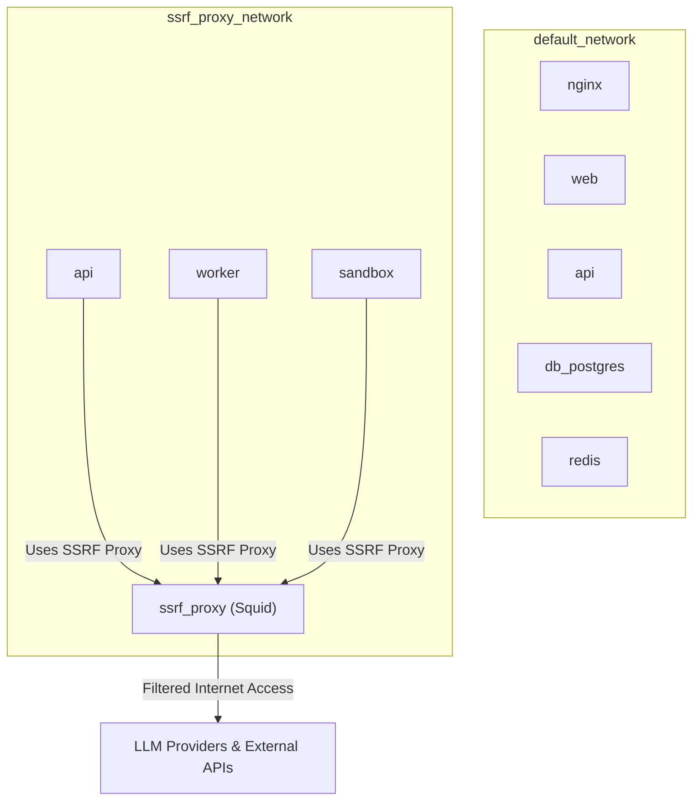

Network isolation ensures core internal traffic is segregated from external network access, improving security posture.

**Sources:**  
[docker/docker-compose.yaml:70-71](), [docker/docker-compose.middleware.yaml:105-128](), [docker/.env.example:201-218]()  

---

## Volume Management and Persistent Storage

Dify mounts several host volumes into containers to persist user data, database files, and runtime state:

| Host Path                         | Container Path                   | Services               | Purpose                                              |
|----------------------------------|--------------------------------|------------------------|------------------------------------------------------|
| `./volumes/app/storage`           | `/app/api/storage`               | `api`, `worker`        | Stores user uploads, document files, plugin storage  |
| `./volumes/db/data`               | `/var/lib/postgresql/data`       | `db_postgres`          | Persistent PostgreSQL data files                      |
| `./volumes/redis/data`            | `/data`                         | `redis`                | Redis persistent data                                 |
| `./volumes/sandbox/dependencies` | `/dependencies`                  | `sandbox`              | Cached binaries and packages for code execution       |

### Initialization Container: `init_permissions`

`init_permissions` is a short-lived container that runs before API and worker services start to fix ownership permissions of mounted volumes. It changes ownership to UID/GID 1001 (the `dify` user inside containers), preventing permission errors during runtime.

It uses a sentinel file `.init_permissions` in the storage directory to skip repeated execution on subsequent runs [docker/docker-compose.yaml:208-218]().

---

## Summary

This comprehensive stack architecture and Docker Compose orchestration enable Dify to run a modular, scalable system with strong isolation in container services:

- Separate execution modes (API, worker, scheduler) run from the same backend image.
- Frontend served via Next.js behind an Nginx reverse proxy.
- Infrastructure managed with dedicated databases, Redis cache, and SSRF proxy networks.
- Execution environment sandboxed and securely proxied.
- Plugin management segregated in a dedicated daemon.
- Environment and configuration centrally managed via layered `.env` files.
- Persistent volumes ensure data durability.
- Initialization container manages file permissions for smooth operations.

---

**Sources:**  
- [docker/docker-compose.yaml:1-250,208-218]()  
- [docker/docker-compose-template.yaml:1-198]()  
- [docker/docker-compose.middleware.yaml:1-186]()  
- [docker/.env.example:55-218]()  
- [api/extensions/ext_celery.py:118-170]()  
- [api/configs/feature/__init__.py:114-202]()  
- [api/configs/middleware/__init__.py:140-191]()  
- [web/package.json:1-37]()  
- [api/pyproject.toml:1-3]()

---

# Page: Core Data Models and Domain Entities

# Core Data Models and Domain Entities

<details>
<summary>Relevant source files</summary>

The following files were used as context for generating this wiki page:

- [api/controllers/console/app/model_config_payload.py](api/controllers/console/app/model_config_payload.py)
- [api/models/account.py](api/models/account.py)
- [api/models/api_based_extension.py](api/models/api_based_extension.py)
- [api/models/dataset.py](api/models/dataset.py)
- [api/models/model.py](api/models/model.py)
- [api/models/provider.py](api/models/provider.py)
- [api/models/source.py](api/models/source.py)
- [api/models/task.py](api/models/task.py)
- [api/models/tools.py](api/models/tools.py)
- [api/models/trigger.py](api/models/trigger.py)
- [api/models/web.py](api/models/web.py)
- [api/models/workflow.py](api/models/workflow.py)
- [api/repositories/recommended_app_catalog_repository.py](api/repositories/recommended_app_catalog_repository.py)
- [api/tests/test_containers_integration_tests/models/test_conversation_status_count.py](api/tests/test_containers_integration_tests/models/test_conversation_status_count.py)
- [api/tests/test_containers_integration_tests/models/test_dataset_models.py](api/tests/test_containers_integration_tests/models/test_dataset_models.py)
- [api/tests/test_containers_integration_tests/repositories/test_recommended_app_catalog_repository.py](api/tests/test_containers_integration_tests/repositories/test_recommended_app_catalog_repository.py)
- [api/tests/unit_tests/controllers/console/app/test_model_config_api.py](api/tests/unit_tests/controllers/console/app/test_model_config_api.py)
- [api/tests/unit_tests/models/test_app_models.py](api/tests/unit_tests/models/test_app_models.py)
- [api/tests/unit_tests/models/test_dataset_models.py](api/tests/unit_tests/models/test_dataset_models.py)
- [api/tests/unit_tests/repositories/test_recommended_app_catalog_repository.py](api/tests/unit_tests/repositories/test_recommended_app_catalog_repository.py)
- [packages/contracts/app-model-config.test.ts](packages/contracts/app-model-config.test.ts)

</details>


This document provides a technical reference for the core data models and domain entities in Dify. These SQLAlchemy models embody the persistent data structures foundational to multi-tenancy, applications, workflows, knowledge bases, and tool integrations.

---

## Multi-Tenant Architecture Foundation

Dify implements a strict multi-tenant architecture where all resources are isolated by workspace. The foundational models establish tenant ownership and role-based access control (RBAC).

### Domain to Entity Mapping: Identity and Access

The following diagram bridges the natural language concepts of **Workspace** and **User** to the code-level `Tenant` and `Account` entities.

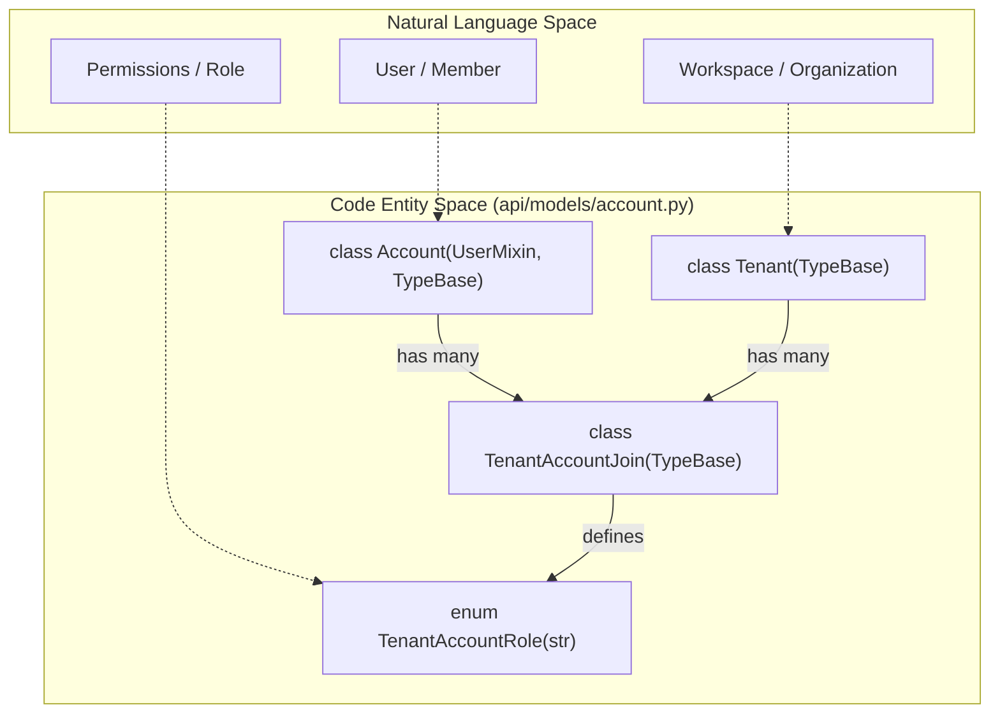

- `Account` holds user authentication data including login info, profile, status, and role context.
- `Tenant` represents a workspace or organization boundary in a multi-tenant setup.
- `TenantAccountJoin` implements the many-to-many association between user accounts and tenants with role information.
- `TenantAccountRole` enum defines roles such as `OWNER`, `ADMIN`, `EDITOR`, `NORMAL`, and `DATASET_OPERATOR`.

Notable features:
- The `Account` model supports session-aware tenant context switching to ensure consistent role-tenant resolution.
- Tenants hold encrypted keys and optional custom workspace configuration.

Sources: [api/models/account.py:21-78](), [api/models/account.py:89-152](), [api/models/account.py:242-302]()

---

## Application Models

Applications represent Dify’s user-facing entities that orchestrate workflows, chats, or agent interactions powered by LLMs and tools.

### App and AppModelConfig

- **`App`**: Core entity representing an application that belongs to a tenant. Fields include workspace association (`tenant_id`), operational mode (e.g., `chat`, `workflow`, `agent-chat`), status, feature flags (`enable_site`, `enable_api`), icon metadata, and API rate limits [api/models/model.py:678-778]().

- **`AppModelConfig`**: Application-specific configuration entity that stores model provider information, prompts, runtime flags, suggested question settings, agent tool configurations, and other operational parameters [api/models/model.py:420-512]().

### App Mode Enum

Operational types of an app are enumerated in `AppMode` with values such as:

- `CHAT`
- `COMPLETION`
- `WORKFLOW`
- `ADVANCED_CHAT`
- `AGENT_CHAT`
- `AGENT`
- `CHANNEL`
- `RAG_PIPELINE`

These modes dictate how the app runs, its UI behavior, and underlying workflow integration.

Sources: [api/models/model.py:323-393]()

### Entity Association: Application Configuration

This diagram maps natural application concepts to code-level classes managing app configuration and invocation context within the codebase:

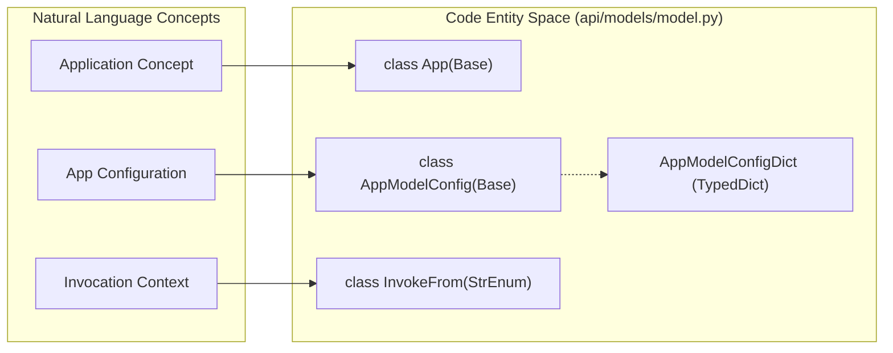

---

## Workflow Models

Workflows enable graph-based orchestration with nodes representing discrete processing steps or tasks enabled by LLMs.

### Workflow Entity

- `Workflow` stores the definition of a workflow in JSON format (`graph` column) capturing nodes, edges, and execution metadata.
- Supported workflow types include `workflow`, `chat`, `rag-pipeline`, and `snippet`.
- Supports versioning with draft and published versions.
- Includes creator and timestamp tracking [api/models/workflow.py:175-220]().

### WorkflowRun and WorkflowNodeExecution

- `WorkflowRun`: Represents execution instances of a workflow with execution status, timings, and statistics [api/models/workflow.py:555-645]().
- `WorkflowNodeExecution`: Tracks individual node executions within a run including inputs, outputs, error status, and metadata [api/models/workflow.py:727-832]().

These models enable rich lifecycle tracking and offloading of large execution data when required.

Sources: [api/models/workflow.py:176-225](), [api/models/workflow.py:555-645](), [api/models/workflow.py:727-832]()

---

## Dataset and Knowledge Models

Datasets act as knowledge bases supporting document ingestion, segmentation, and retrieval (RAG pipelines).

### Dataset and Document Entities

- `Dataset`: Metadata entity for knowledge collections including indexing, retrieval models, and permission configurations. Fields like `embedding_model`, `indexing_technique`, and `retrieval_model` configure vector search and retrieval behavior [api/models/dataset.py:100-180]().

- `Document`: Represents individual source files or documents within a dataset. Tracks upload metadata, indexing stages (`waiting`, `parsing`, `indexing`, `completed`), and archival status [api/models/dataset.py:354-470]().

- `DocumentSegment`: Stores text chunks from documents for use in vector indexing and retrieval, with attributes like position, content, tokens, and hit counts [api/models/dataset.py:796-857]().

### Selected Dataset Properties

| Property             | Description                                                  |
| -------------------- | ------------------------------------------------------------ |
| `indexing_technique` | Type of indexing to perform (e.g., `high_quality`, `economy`) |
| `retrieval_model`    | Configuration dict for retrieval setup (top-k, thresholds)  |
| `embedding_model`    | Embedding model name                                           |
| `permission`         | Access control enum for the dataset                           |

### Knowledge Index Node Integration

Within a workflow context, the `KnowledgeIndexNode` manages document chunk indexing. It leverages the `IndexProcessor` component to perform full or preview indexing and triggers summary index generation for RAG pipelines. This node integrates tightly with dataset and document entities, respecting session context and offload settings [api/core/workflow/nodes/knowledge_index/knowledge_index_node.py:31-161]().

Sources: [api/models/dataset.py:100-190](), [api/models/dataset.py:354-470](), [api/models/dataset.py:796-857](), [api/core/workflow/nodes/knowledge_index/knowledge_index_node.py:31-161]()

---

## Tool Provider Models

Dify manages tools and APIs across both built-in integrations and custom API tool providers.

| Model Class           | Tool Type     | Description                                             |
| --------------------- | ------------ | -------------------------------------------------------|
| `BuiltinToolProvider` | Built-in     | Tenant-specific built-in tools with encrypted credentials [api/models/tools.py:74-127]() |
| `ApiToolProvider`     | API-based    | Tools defined by OpenAPI schemas stored as JSON schema  [api/models/tools.py:135-182]() |
| `WorkflowToolProvider`| Workflow     | Workflows published as reusable tools (snippet workflows) [api/models/tools.py:216-281]() |

### OAuth Credentials Management

- `ToolOAuthSystemClient`: Stores system-wide OAuth client credentials [api/models/tools.py:33-49]().
- `ToolOAuthTenantClient`: Tenant-level overrides for OAuth clients [api/models/tools.py:50-70]().

These entities manage the OAuth client configurations and encrypted params essential for secure integration with external service providers.

Sources: [api/models/tools.py:33-281]()

---

## Provider and Model Configuration

- `Provider`: Represents API or LLM providers with details on quota limits, type (custom or system), and credential references. Validity and enablement states are tracked [api/models/provider.py:34-199]().

- `ProviderModel`: Specific model configurations under a provider, with model name, type, validation, and credential linkage.

- `TenantDefaultModel`: Tenant-specific default provider model settings by model type (e.g., chat, embedding).

This layered model structure enables complex provider management for multi-tenant operations and quota tracking.

Sources: [api/models/provider.py:34-199]()

---

## Trigger Models

Event-driven automation via triggers enables workflows to respond to external or scheduled events.

### Key Trigger Models

- `TriggerSubscription`: Stores configured trigger subscriptions, credentials, and parameters, with expiration and visibility management [api/models/trigger.py:68-131]().

- `TriggerOAuthSystemClient` and `TriggerOAuthTenantClient`: Storage for OAuth clients used by triggers at system and tenant level [api/models/trigger.py:158-208]().

- `WorkflowTriggerLog`: Records logs for workflow trigger executions capturing event data and status [api/models/trigger.py:211-270]().

- `WorkflowSchedulePlan`: Manages scheduled execution of workflows via cron expressions and timezone-aware scheduling [api/models/trigger.py:273-300]().

These models enable integration with external events and time-based triggers that invoke workflows dynamically.

Sources: [api/models/trigger.py:68-131](), [api/models/trigger.py:158-208](), [api/models/trigger.py:211-300]()

---

## Implementation Patterns and Integration Notes

### Data Types and Enums

- Primary keys are UUID strings using `StringUUID` for consistent 128-bit UUID representation.
- Enum types utilize a custom `EnumText` type mapping Python enums to string columns for clarity.

### JSON Model Storage

- Complex configurations (e.g., app models, dataset retrieval settings) are stored as JSON blobs within `LongText` or `AdjustedJSON` fields.
- Properties deserialize these JSON configs into Python dicts on-demand for business logic use.

### Example: Lazy Credentials Property in `BuiltinToolProvider`

```python
@property
def credentials(self) -> dict[str, Any]:
    if not self.encrypted_credentials:
        return {}
    return json.loads(self.encrypted_credentials)
```

### Message and Interaction Logs

- Conversation messages and their annotations are tracked via models in `api/models/model.py` supporting app-level message threading.
- Additional features like `SavedMessage` and `PinnedConversation` provide user bookmarking capabilities [api/models/web.py:14-65](), [api/models/model.py:1010-1120]().

---

# Summary Diagrams Bridging Domains to Code

### Identity and Access Domain to Code Entities

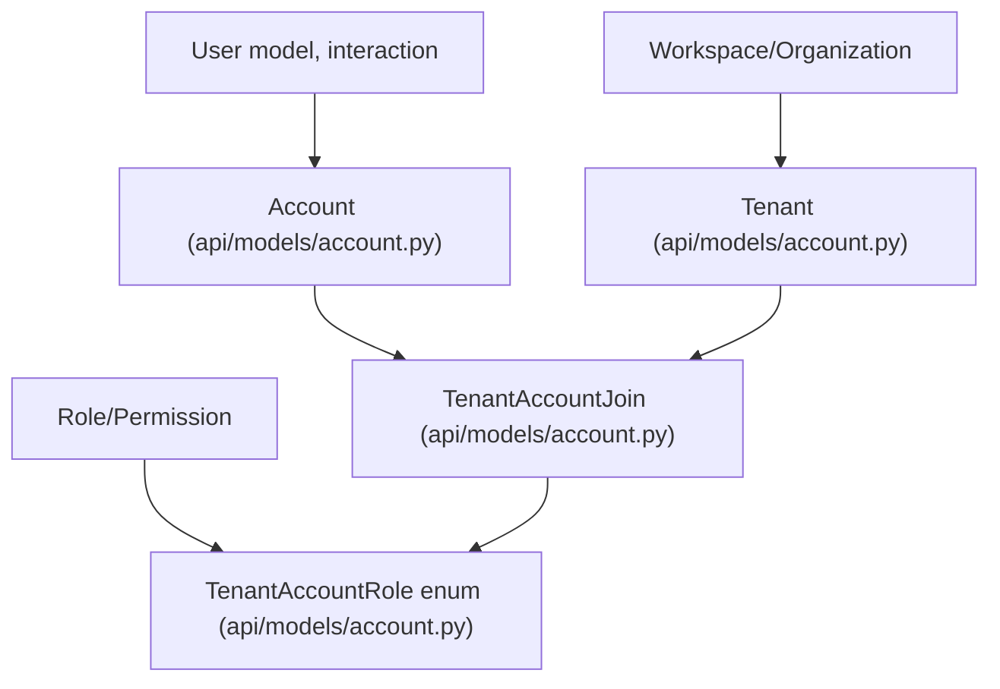

### Application Configuration Domain to Code Entities

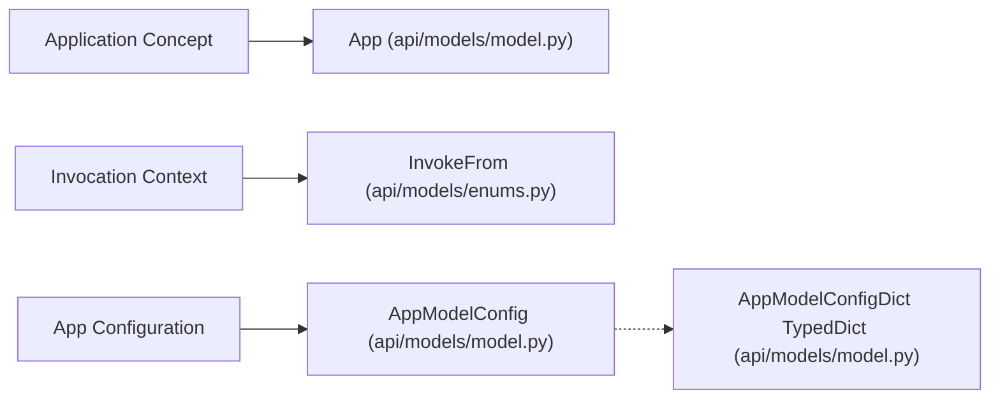

---

This page outlines Dify's core data models and how they correspond to domain concepts, central to multi-tenant management, app configuration, workflow orchestration, knowledge base handling, tool integration, and event triggers.

Sources:  
[api/models/account.py:21-78](), [api/models/account.py:89-152](), [api/models/account.py:242-302](),  
[api/models/model.py:323-393](), [api/models/model.py:420-512](), [api/models/model.py:678-778](), [api/models/enums.py:179-192](),  
[api/models/workflow.py:175-220](), [api/models/workflow.py:555-645](), [api/models/workflow.py:727-832](),  
[api/models/dataset.py:100-190](), [api/models/dataset.py:354-470](), [api/models/dataset.py:796-857](),  
[api/core/workflow/nodes/knowledge_index/knowledge_index_node.py:31-161](),  
[api/models/tools.py:33-281](),  
[api/models/provider.py:34-199](),  
[api/models/trigger.py:68-131](), [api/models/trigger.py:158-208](), [api/models/trigger.py:211-300](),  
[api/models/model.py:1010-1120](), [api/models/web.py:14-65](), [api/models/tools.py:120-130](), [api/models/types.py:15-210]()

---

# Page: Application Types and Execution Modes

# Application Types and Execution Modes

<details>
<summary>Relevant source files</summary>

The following files were used as context for generating this wiki page:

- [api/core/app/app_config/entities.py](api/core/app/app_config/entities.py)
- [api/core/app/apps/advanced_chat/app_config_manager.py](api/core/app/apps/advanced_chat/app_config_manager.py)
- [api/core/app/apps/advanced_chat/app_generator.py](api/core/app/apps/advanced_chat/app_generator.py)
- [api/core/app/apps/agent_chat/app_config_manager.py](api/core/app/apps/agent_chat/app_config_manager.py)
- [api/core/app/apps/agent_chat/app_generator.py](api/core/app/apps/agent_chat/app_generator.py)
- [api/core/app/apps/base_app_generator.py](api/core/app/apps/base_app_generator.py)
- [api/core/app/apps/chat/app_generator.py](api/core/app/apps/chat/app_generator.py)
- [api/core/app/apps/completion/app_generator.py](api/core/app/apps/completion/app_generator.py)
- [api/core/app/apps/message_based_app_generator.py](api/core/app/apps/message_based_app_generator.py)
- [api/core/app/apps/pipeline/pipeline_generator.py](api/core/app/apps/pipeline/pipeline_generator.py)
- [api/core/app/apps/workflow/app_generator.py](api/core/app/apps/workflow/app_generator.py)
- [api/core/datasource/datasource_manager.py](api/core/datasource/datasource_manager.py)
- [api/core/datasource/entities/datasource_entities.py](api/core/datasource/entities/datasource_entities.py)
- [api/core/ops/base_trace_instance.py](api/core/ops/base_trace_instance.py)
- [api/core/rag/entities/__init__.py](api/core/rag/entities/__init__.py)
- [api/core/rag/entities/index_entities.py](api/core/rag/entities/index_entities.py)
- [api/core/rag/entities/metadata_entities.py](api/core/rag/entities/metadata_entities.py)
- [api/core/rag/entities/processing_entities.py](api/core/rag/entities/processing_entities.py)
- [api/core/rag/entities/retrieval_settings.py](api/core/rag/entities/retrieval_settings.py)
- [api/core/rag/rerank/entity/weight.py](api/core/rag/rerank/entity/weight.py)
- [api/core/workflow/nodes/datasource/datasource_node.py](api/core/workflow/nodes/datasource/datasource_node.py)
- [api/core/workflow/nodes/knowledge_index/entities.py](api/core/workflow/nodes/knowledge_index/entities.py)
- [api/core/workflow/nodes/knowledge_retrieval/entities.py](api/core/workflow/nodes/knowledge_retrieval/entities.py)
- [api/migrations/versions/2025_10_14_1618-d98acf217d43_add_app_mode_for_messsage.py](api/migrations/versions/2025_10_14_1618-d98acf217d43_add_app_mode_for_messsage.py)
- [api/services/entities/knowledge_entities/rag_pipeline_entities.py](api/services/entities/knowledge_entities/rag_pipeline_entities.py)
- [api/tests/unit_tests/core/app/apps/advanced_chat/test_app_generator.py](api/tests/unit_tests/core/app/apps/advanced_chat/test_app_generator.py)
- [api/tests/unit_tests/core/app/apps/pipeline/test_pipeline_config_manager.py](api/tests/unit_tests/core/app/apps/pipeline/test_pipeline_config_manager.py)
- [api/tests/unit_tests/core/app/apps/pipeline/test_pipeline_generator.py](api/tests/unit_tests/core/app/apps/pipeline/test_pipeline_generator.py)
- [api/tests/unit_tests/core/app/apps/pipeline/test_pipeline_queue_manager.py](api/tests/unit_tests/core/app/apps/pipeline/test_pipeline_queue_manager.py)
- [api/tests/unit_tests/core/app/apps/pipeline/test_pipeline_runner.py](api/tests/unit_tests/core/app/apps/pipeline/test_pipeline_runner.py)
- [api/tests/unit_tests/core/app/apps/test_base_app_generator.py](api/tests/unit_tests/core/app/apps/test_base_app_generator.py)
- [api/tests/unit_tests/core/app/apps/test_pause_resume.py](api/tests/unit_tests/core/app/apps/test_pause_resume.py)
- [api/tests/unit_tests/core/app/apps/test_workflow_app_generator.py](api/tests/unit_tests/core/app/apps/test_workflow_app_generator.py)
- [api/tests/unit_tests/core/app/apps/workflow/test_app_generator_extra.py](api/tests/unit_tests/core/app/apps/workflow/test_app_generator_extra.py)
- [api/tests/unit_tests/core/ops/test_base_trace_instance.py](api/tests/unit_tests/core/ops/test_base_trace_instance.py)
- [api/tests/unit_tests/core/workflow/nodes/datasource/test_datasource_node.py](api/tests/unit_tests/core/workflow/nodes/datasource/test_datasource_node.py)
- [api/tests/unit_tests/core/workflow/nodes/test_start_node_json_object.py](api/tests/unit_tests/core/workflow/nodes/test_start_node_json_object.py)
- [api/tests/unit_tests/services/document_service_validation.py](api/tests/unit_tests/services/document_service_validation.py)
- [web/app/components/base/chat/chat/utils.ts](web/app/components/base/chat/chat/utils.ts)

</details>


This document explains the different application types supported by Dify and their execution modes. It covers how apps are configured, how their modes determine execution behavior, and the relationship between app modes, workflows, and agent configurations.

For information about workflow execution details, see [Workflow Definition and Execution Model](#5.1). For RAG-specific configuration, see [Retrieval Strategies and Metadata Filtering](#4.3).

---

## Purpose and Scope

Dify supports several distinct application types, each designed for different use cases. This document describes:

- The `AppMode` enumeration and its possible values.
- How each mode determines application behavior and execution flow.
- The relationship between app modes, `AppModelConfig`, and `Workflow` entities.
- The distinction between "Easy UI" (prompt-based) apps and workflow-based apps.
- The task pipeline architecture for managing streaming and blocking generation responses.
- Execution characteristics including thread management, file scope handling, and draft variable saving.

---

## Application Mode Enumeration

All Dify applications have a `mode` field that determines their type and execution behavior. The available modes are defined in the `AppMode` enum in `models/model.py` [api/models/model.py:227-232]().

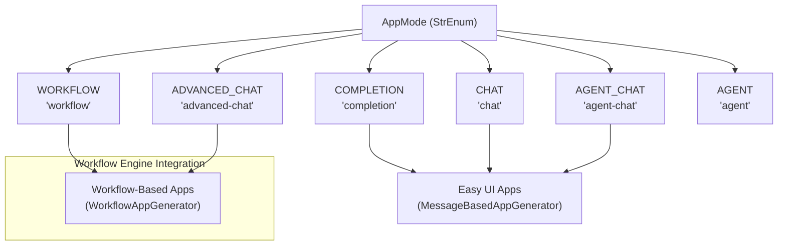

- **Easy UI Apps:** `COMPLETION`, `CHAT`, `AGENT_CHAT` modes are simpler, prompt-based apps managed by `MessageBasedAppGenerator`.
- **Workflow-Based Apps:** `WORKFLOW` and `ADVANCED_CHAT` modes involve graph-based execution managed by `WorkflowAppGenerator` and `AdvancedChatAppGenerator`.
- **Agent Mode:** `AGENT` mode represents Agent V2 apps built around the agent runtime and roster.

Sources: [api/models/model.py:227-232](), [api/core/app/apps/message_based_app_generator.py:46-46](), [api/core/app/apps/workflow/app_generator.py:72-72](), [api/core/app/apps/advanced_chat/app_generator.py:75-75](), [api/models/workflow.py:121-123]()

---

## Execution Pipeline Architecture

Dify uses a layered pipeline architecture to process application requests. This pipeline handles input validation, variable preparation, workflow or prompt execution, and streaming or blocking response delivery.

### Task Pipeline Class Hierarchy

The core class `BasedGenerateTaskPipeline` (in `api/core/app/task_pipeline/based_generate_task_pipeline.py`) provides base functionality including event consumption and response streaming. Specialized subclasses implement mode-specific logic.

```mermaid
classDiagram
    class BasedGenerateTaskPipeline {
        +process()
        -_to_stream_response()
        -_to_blocking_response()
    }
    class EasyUIBasedGenerateTaskPipeline {
        +process()
    }
    class WorkflowAppGenerateTaskPipeline {
        +process()
    }
    class AdvancedChatAppGenerateTaskPipeline {
        +process()
    }

    BasedGenerateTaskPipeline <|-- EasyUIBasedGenerateTaskPipeline
    BasedGenerateTaskPipeline <|-- WorkflowAppGenerateTaskPipeline
    BasedGenerateTaskPipeline <|-- AdvancedChatAppGenerateTaskPipeline
```

- **EasyUIBasedGenerateTaskPipeline:** Used by `CompletionAppGenerator`, `ChatAppGenerator`, and `AgentChatAppGenerator` for prompt-based modes.
- **WorkflowAppGenerateTaskPipeline:** Manages node-based graph execution for `WorkflowAppGenerator`.
- **AdvancedChatAppGenerateTaskPipeline:** Used in `AdvancedChatAppGenerator` to integrate workflow execution with chat memory.

Sources: [api/core/app/task_pipeline/based_generate_task_pipeline.py:45-45](), [api/core/app/task_pipeline/easy_ui_based_generate_task_pipeline.py:71-71](), [api/core/app/apps/workflow/generate_task_pipeline.py:77-77](), [api/core/app/apps/advanced_chat/generate_task_pipeline.py:142-142]()

---

## Easy UI (Prompt-Based) Modes

These application modes use simpler prompt and model configuration without a full workflow graph. They are managed by implementations of `MessageBasedAppGenerator`:

### Completion Mode
- **Mode:** `"completion"`
- **Behavior:** Single-turn completion with prompt templates from `CompletionAppGenerator`.
- **Implementation:** `CompletionAppGenerator` generates responses based on user input and prompt templates [api/core/app/apps/completion/app_generator.py]().

### Chat and Agent Chat Modes
- **Modes:** `"chat"`, `"agent-chat"`
- **Behavior:** Multi-turn conversations; Agent Chat adds autonomous agent capabilities (tool calls, reasoning).
- **Implementation Classes:** 
  - `ChatAppGenerator` for `"chat"` [api/core/app/apps/chat/app_generator.py]()
  - `AgentChatAppGenerator` for `"agent-chat"` [api/core/app/apps/agent_chat/app_generator.py]()
- **Configuration:** Uses `AppModelConfig` holding prompt templates, model configs, tools, and file upload configs [api/models/model.py:240-256]().

### Components and Data Flow

- **AppModelConfig:** Defines prompt, model, and tool configs
- **MessageBasedAppGenerator:** Base class handling input, file conversion, and creating `AppGenerateEntity`
- **EasyUIBasedGenerateTaskPipeline:** Coordinates LLM call and streams response [api/core/app/task_pipeline/easy_ui_based_generate_task_pipeline.py]()
- **MessageCycleManager:** Manages conversation states such as generating conversation names and updating message statuses

Sources: [api/core/app/apps/message_based_app_generator.py:46-175](), [api/core/app/task_pipeline/easy_ui_based_generate_task_pipeline.py:110-113](), [api/core/app/apps/completion/app_generator.py](), [api/core/app/apps/chat/app_generator.py](), [api/core/app/apps/agent_chat/app_generator.py:37-83](), [api/models/model.py:240-256]()

---

## Workflow-Based Modes

These modes execute a graph of interconnected nodes, enabling richer workflows than prompt-based UIs. They leverage the `GraphEngine` for runtime node execution:

### Workflow Mode
- **Mode:** `"workflow"`
- **Behavior:** Executes a graph workflow with nodes, stateless from conversation perspective.
- **Primary class:** `WorkflowAppGenerator` [api/core/app/apps/workflow/app_generator.py:72-162]()
- **Execution:** Uses `WorkflowAppGenerateTaskPipeline` to manage lifecycle [api/core/app/apps/workflow/generate_task_pipeline.py]()

### Advanced Chat Mode
- **Mode:** `"advanced-chat"`
- **Behavior:** Combines workflow execution with chat memory, maintaining multi-turn conversations.
- **Primary class:** `AdvancedChatAppGenerator` [api/core/app/apps/advanced_chat/app_generator.py:75-135]()
- **Uses:** `AdvancedChatAppGenerateTaskPipeline` and `AdvancedChatAppRunner` for response generation [api/core/app/apps/advanced_chat/generate_task_pipeline.py]()

### RAG Pipeline Mode
- **Mode:** `"rag-pipeline"`
- **Description:** Specialized workflow type for document indexing and retrieval-augmented generation (RAG).
- **Not a typical user app mode**, but uses the same workflow infrastructure.
- **Identified by:** `WorkflowType.RAG_PIPELINE` in workflow entity [api/models/workflow.py:177-210]()

Sources: [api/core/app/apps/workflow/app_generator.py:72-162](), [api/core/app/apps/advanced_chat/app_generator.py:75-135](), [api/core/app/apps/advanced_chat/generate_task_pipeline.py](), [api/models/workflow.py:121-123,177-210]()

---

## Agent and Agent-Chat Modes

- **Agent Chat Mode (`agent-chat`)**  
  A hybrid mode managed by `AgentChatAppGenerator` that extends standard chat with agent capabilities such as autonomous tool calling and interaction with backend agent runtime. It supports streaming responses and tightly integrates with agent soul configuration [api/core/app/apps/agent_chat/app_generator.py:37-180]().

- **Agent Mode (`agent`)**  
  Advanced Agent framework (Agent V2) where the app backend delegates runtime to the external Dify Agent runtime (`dify-agent`). Managed by `AgentAppGenerator` which orchestrates conversations, messages, and streaming responses, but offloads answer generation to the external backend client via `AgentAppRunner` [api/core/app/apps/agent_app/app_generator.py:78-150]().

Sources: [api/core/app/apps/agent_chat/app_generator.py:37-180](), [api/core/app/apps/agent_app/app_generator.py:78-150]()

---

## Application Data Flow: Natural Language to Code Entity Space

The following diagram illustrates how user application requests in natural language map into code entities, generators, and pipelines fulfilling the request:

```mermaid
graph TD
    subgraph "Natural Language Space"
        NLUser["User invokes app (query, inputs, files, context)"]
        NLConversation["Conversation context, possibly for multi-turn"]
        NLAppConfig["Application config (prompt templates, model, tools)"]
    end

    subgraph "Code Entity Space"
        BAG["BaseAppGenerator<br/>base_app_generator.py"]
        MBAG["MessageBasedAppGenerator<br/>message_based_app_generator.py"]
        CAG["ChatAppGenerator<br/>chat/app_generator.py"]
        COMPAG["CompletionAppGenerator<br/>completion/app_generator.py"]
        ACAG["AdvancedChatAppGenerator<br/>advanced_chat/app_generator.py"]
        WAG["WorkflowAppGenerator<br/>workflow/app_generator.py"]
        AGCHATAG["AgentChatAppGenerator<br/>agent_chat/app_generator.py"]
        AAG["AgentAppGenerator<br/>agent_app/app_generator.py"]

        EUP["EasyUIBasedGenerateTaskPipeline<br/>easy_ui_based_generate_task_pipeline.py"]
        WAP["WorkflowAppGenerateTaskPipeline<br/>workflow/generate_task_pipeline.py"]
        ACP["AdvancedChatAppGenerateTaskPipeline<br/>advanced_chat/generate_task_pipeline.py"]

        APP["App Model<br/>model.py"]
        APPMODE["AppMode enum<br/>model.py"]
        APPMODELCONFIG["AppModelConfig<br/>model.py"]
        WORKFLOW["Workflow Model<br/>workflow.py"]
        GRAPHRT["GraphRuntimeState<br/>graphon/runtime.py"]
    end

    NLUser --> BAG
    BAG --> MBAG
    MBAG --> CAG
    MBAG --> COMPAG
    MBAG --> AGCHATAG
    BAG --> WAG
    BAG --> ACAG
    BAG --> AAG

    CAG --> EUP
    COMPAG --> EUP
    AGCHATAG --> EUP
    WAG --> WAP
    ACAG --> ACP

    APP --> APPMODE
    APP --> APPMODELCONFIG
    APP --> WORKFLOW

    WORKFLOW --> GRAPHRT
```

- Incoming user queries and inputs are processed by specific `AppGenerator` subclasses depending on the app mode.
- Easy UI apps use `MessageBasedAppGenerator` family with `EasyUIBasedGenerateTaskPipeline`.
- Workflow and advanced chat apps utilize graph-based execution with corresponding task pipelines.
- The `App` entity configures the mode and references a workflow if applicable.
- The `GraphRuntimeState` handles node execution in workflows.

Sources: [api/core/app/apps/base_app_generator.py:71-71](), [api/core/app/apps/message_based_app_generator.py:46-175](), [api/core/app/apps/chat/app_generator.py:18-18](), [api/core/app/apps/completion/app_generator.py](), [api/core/app/apps/agent_chat/app_generator.py:37-83](), [api/core/app/apps/workflow/app_generator.py:72-160](), [api/core/app/apps/advanced_chat/app_generator.py:75-135](), [api/core/app/apps/agent_app/app_generator.py:78-150](), [api/core/app/task_pipeline/easy_ui_based_generate_task_pipeline.py:71-71](), [api/core/app/apps/workflow/generate_task_pipeline.py:77-77](), [api/core/app/apps/advanced_chat/generate_task_pipeline.py:142-172](), [api/models/model.py:227-256](), [api/models/workflow.py:121-123](), [api/graphon/runtime.py]()

---

## Task States and Execution Characteristics

### Task State Entities

These classes maintain the execution state and accumulate results during the generation lifecycle:

| Entity Class                       | App Mode(s)                               | Description                                            |
|----------------------------------|------------------------------------------|--------------------------------------------------------|
| `EasyUITaskState`                 | `CHAT`, `COMPLETION`, `AGENT_CHAT`       | Tracks LLMResult and usage, manages streaming events [api/core/app/task_pipeline/easy_ui_based_generate_task_pipeline.py:76-77]() |
| `WorkflowTaskState`               | `ADVANCED_CHAT`                           | Tracks streaming timing, answers, nodes state [api/core/app/apps/advanced_chat/generate_task_pipeline.py:193-194]() |

### Execution Features

- **Draft Variable Saving:** Workflow execution nodes save temporary state via `DraftVariableSaver` or its DB counterpart for debugging and resumption support. `WorkflowAppGenerator` uses factory creation of these savers bound to node execution and context information [api/core/app/apps/workflow/app_generator.py:34-68]().
- **File Access Scope Management:** `BaseAppGenerator` binds tenant/user context for downstream file lookups, converting user-provided file metadata into internal `File` entities for access control and validation [api/core/app/apps/base_app_generator.py:106-128]().
- **Thread Management:** Blocking workflows and advanced chat apps spawn separate worker threads executed in isolated contexts which are joined with timeout safety to avoid thread leaks while yielding streaming responses [api/core/app/apps/base_app_generator.py:83-104]().
- **TTS and Multi-Modal Support:** Task pipelines support Text-to-Speech audio chunk publishing where enabled and integrate with advanced chat message roles [api/core/app/apps/advanced_chat/generate_task_pipeline.py:67-85]().
- **Rate Limiting & Quota:** The generation entrypoint (`AppGenerateService`) applies rate limiting and quota checks ensuring fair usage prior to pipeline execution [api/services/app_generate_service.py:55-196]().

Sources: [api/core/app/apps/base_app_generator.py:71-128](), [api/core/app/apps/workflow/app_generator.py:34-90](), [api/core/app/task_pipeline/easy_ui_based_generate_task_pipeline.py:75-90](), [api/core/app/apps/advanced_chat/generate_task_pipeline.py:64-85](), [api/services/app_generate_service.py:55-196]()

---

## Implementation Details: Response Conversion

The generation task pipelines for workflow and advanced chat apps convert raw outputs from the graph runtime into client-consumable formats. This involves applying output schemas, variable mapping, file URL signing, and response formatting.

Example snippet from `AdvancedChatAppGenerateTaskPipeline` constructor initializing a response converter:

```python
self._workflow_response_converter = WorkflowResponseConverter(
    application_generate_entity=application_generate_entity,
    user=user,
    system_variables=self._workflow_system_variables,
)
```

This resolver handles the transformation from internal graph output to messages for clients.

Sources: [api/core/app/apps/workflow/generate_task_pipeline.py:119-123](), [api/core/app/apps/advanced_chat/generate_task_pipeline.py:187-191]()

---

# Summary

Dify supports multiple discrete application types with distinct execution models:

- **Easy UI (Prompt-Based) Apps:** `completion`, `chat`, and `agent-chat` use prompt templates and streaming response pipelines via `MessageBasedAppGenerator`.
- **Workflow-Based Apps:** `workflow` and `advanced-chat` execute rich graph workflows with the `GraphEngine`.
- **Agent Apps:** Use agent-specific generators and backends, including the external `dify-agent` runtime for Agent V2.
- Execution pipelines balance between blocking and streaming modes, use thread isolation, manage file access context, and save state for resumption/debugging.

This layered architecture enables Dify to support both simple chat/completion apps and complex agent and workflow-powered applications in a consistent manner.

Sources: Combined from all above-mentioned files and line ranges.

---

# Page: Configuration Management System

# Configuration Management System

<details>
<summary>Relevant source files</summary>

The following files were used as context for generating this wiki page:

- [api/.env.example](api/.env.example)
- [api/configs/feature/__init__.py](api/configs/feature/__init__.py)
- [api/configs/middleware/__init__.py](api/configs/middleware/__init__.py)
- [api/configs/middleware/cache/redis_config.py](api/configs/middleware/cache/redis_config.py)
- [api/configs/middleware/cache/redis_pubsub_config.py](api/configs/middleware/cache/redis_pubsub_config.py)
- [api/configs/middleware/vdb/weaviate_config.py](api/configs/middleware/vdb/weaviate_config.py)
- [api/configs/packaging/__init__.py](api/configs/packaging/__init__.py)
- [api/core/rag/datasource/vdb/vector_factory.py](api/core/rag/datasource/vdb/vector_factory.py)
- [api/core/rag/datasource/vdb/vector_type.py](api/core/rag/datasource/vdb/vector_type.py)
- [api/extensions/ext_app_metrics.py](api/extensions/ext_app_metrics.py)
- [api/extensions/ext_celery.py](api/extensions/ext_celery.py)
- [api/extensions/ext_database.py](api/extensions/ext_database.py)
- [api/extensions/ext_import_modules.py](api/extensions/ext_import_modules.py)
- [api/extensions/ext_redis.py](api/extensions/ext_redis.py)
- [api/extensions/ext_sentry.py](api/extensions/ext_sentry.py)
- [api/libs/broadcast_channel/channel.py](api/libs/broadcast_channel/channel.py)
- [api/libs/broadcast_channel/redis/__init__.py](api/libs/broadcast_channel/redis/__init__.py)
- [api/libs/broadcast_channel/redis/_subscription.py](api/libs/broadcast_channel/redis/_subscription.py)
- [api/libs/broadcast_channel/redis/pubsub_channel.py](api/libs/broadcast_channel/redis/pubsub_channel.py)
- [api/libs/broadcast_channel/redis/sharded_channel.py](api/libs/broadcast_channel/redis/sharded_channel.py)
- [api/libs/broadcast_channel/redis/streams_channel.py](api/libs/broadcast_channel/redis/streams_channel.py)
- [api/libs/broadcast_channel/signals.py](api/libs/broadcast_channel/signals.py)
- [api/migrations/README](api/migrations/README)
- [api/providers/vdb/vdb-weaviate/tests/unit_tests/test_weaviate_integration_header.py](api/providers/vdb/vdb-weaviate/tests/unit_tests/test_weaviate_integration_header.py)
- [api/pyproject.toml](api/pyproject.toml)
- [api/schedule/queue_monitor_task.py](api/schedule/queue_monitor_task.py)
- [api/tests/integration_tests/.env.example](api/tests/integration_tests/.env.example)
- [api/tests/test_containers_integration_tests/libs/broadcast_channel/redis/test_channel.py](api/tests/test_containers_integration_tests/libs/broadcast_channel/redis/test_channel.py)
- [api/tests/test_containers_integration_tests/libs/broadcast_channel/redis/test_sharded_channel.py](api/tests/test_containers_integration_tests/libs/broadcast_channel/redis/test_sharded_channel.py)
- [api/tests/test_containers_integration_tests/libs/broadcast_channel/redis/test_streams_channel.py](api/tests/test_containers_integration_tests/libs/broadcast_channel/redis/test_streams_channel.py)
- [api/tests/unit_tests/commands/test_data_migration_wizard.py](api/tests/unit_tests/commands/test_data_migration_wizard.py)
- [api/tests/unit_tests/configs/test_dify_config.py](api/tests/unit_tests/configs/test_dify_config.py)
- [api/tests/unit_tests/controllers/console/datasets/test_wraps.py](api/tests/unit_tests/controllers/console/datasets/test_wraps.py)
- [api/tests/unit_tests/controllers/console/workspace/test_load_balancing_config.py](api/tests/unit_tests/controllers/console/workspace/test_load_balancing_config.py)
- [api/tests/unit_tests/controllers/console/workspace/test_trigger_providers.py](api/tests/unit_tests/controllers/console/workspace/test_trigger_providers.py)
- [api/tests/unit_tests/core/rag/datasource/vdb/test_vector_factory.py](api/tests/unit_tests/core/rag/datasource/vdb/test_vector_factory.py)
- [api/tests/unit_tests/extensions/test_celery_ssl.py](api/tests/unit_tests/extensions/test_celery_ssl.py)
- [api/tests/unit_tests/extensions/test_ext_request_logging.py](api/tests/unit_tests/extensions/test_ext_request_logging.py)
- [api/tests/unit_tests/extensions/test_pubsub_channel.py](api/tests/unit_tests/extensions/test_pubsub_channel.py)
- [api/tests/unit_tests/extensions/test_redis.py](api/tests/unit_tests/extensions/test_redis.py)
- [api/tests/unit_tests/factories/test_variable_factory.py](api/tests/unit_tests/factories/test_variable_factory.py)
- [api/tests/unit_tests/libs/broadcast_channel/redis/test_channel_unit_tests.py](api/tests/unit_tests/libs/broadcast_channel/redis/test_channel_unit_tests.py)
- [api/tests/unit_tests/libs/broadcast_channel/redis/test_streams_channel_unit_tests.py](api/tests/unit_tests/libs/broadcast_channel/redis/test_streams_channel_unit_tests.py)
- [api/tests/unit_tests/libs/test_pyrefly_type_coverage.py](api/tests/unit_tests/libs/test_pyrefly_type_coverage.py)
- [api/tests/unit_tests/models/test_plugin_entities.py](api/tests/unit_tests/models/test_plugin_entities.py)
- [api/tests/unit_tests/services/test_app_generate_service_streaming_integration.py](api/tests/unit_tests/services/test_app_generate_service_streaming_integration.py)
- [api/tests/unit_tests/tasks/test_duplicate_document_indexing_task.py](api/tests/unit_tests/tasks/test_duplicate_document_indexing_task.py)
- [api/uv.lock](api/uv.lock)
- [docker/.env.example](docker/.env.example)
- [docker/docker-compose-template.yaml](docker/docker-compose-template.yaml)
- [docker/docker-compose.middleware.yaml](docker/docker-compose.middleware.yaml)
- [docker/docker-compose.yaml](docker/docker-compose.yaml)
- [docker/envs/core-services/shared.env.example](docker/envs/core-services/shared.env.example)
- [docker/envs/infrastructure/ssrf-proxy.env.example](docker/envs/infrastructure/ssrf-proxy.env.example)
- [docker/envs/middleware.env.example](docker/envs/middleware.env.example)
- [web/package.json](web/package.json)

</details>


This document provides an in-depth technical overview of the Configuration Management System in Dify. It covers the environment variable system, Pydantic-based settings management, and the configuration flow from `.env` files through Docker Compose down to application runtime components for both backend and frontend.

---

## Architecture Overview

Dify’s configuration system is designed to be type-safe, modular, and environment-aware. It utilizes Pydantic’s `BaseSettings` classes to define structured configurations, loading values primarily from environment variables, which themselves are populated via layered `.env` files and Docker Compose environment file definitions.

The following diagram illustrates the data flow, mapping between natural language / environment configuration sources and code entities that represent configuration classes, culminating in runtime initialization of the backend Flask application:

```mermaid
graph TB
    subgraph "Natural Language / Environment Space"
        DotEnvFiles[".env Files<br/>(docker/.env, api/.env)"]
        SystemEnv["System Environment Variables"]
        DockerComposeEnv["docker-compose.yaml<br/>env_file list"]
    end
    
    subgraph "Code Entity Space - api/configs/"
        DifyConfig["DifyConfig (app_config.py)"]
        
        subgraph "Feature Configuration (feature/__init__.py)"
            SecurityConfig["SecurityConfig<br/>SECRET_KEY, token expiry"]
            AppExecutionConfig["AppExecutionConfig<br/>APP_MAX_EXECUTION_TIME"]
            CodeSandboxConfig["CodeExecutionSandboxConfig<br/>CODE_EXECUTION_ENDPOINT"]
            AsyncWorkflowConfig["AsyncWorkflowConfig<br/>SCHEDULER_GRANULARITY"]
        end
        
        subgraph "Middleware Configuration (middleware/__init__.py)"
            DatabaseConfig["DatabaseConfig<br/>DB_TYPE, SQLALCHEMY_*"]
            RedisConfig["RedisConfig<br/>REDIS_HOST, Sentinel"]
            StorageConfig["StorageConfig<br/>STORAGE_TYPE"]
            VectorStoreConfig["VectorStoreConfig<br/>VECTOR_STORE"]
            KeyProviderConfig["KeyProviderConfig<br/>KEY_PROVIDER_TYPE"]
        end
        
        subgraph "Packaging Info (packaging/__init__.py)"
            PackagingInfo["PackagingInfo<br/>COMMIT_SHA"]
        end
        
        DifyConfig --> SecurityConfig
        DifyConfig --> AppExecutionConfig
        DifyConfig --> DatabaseConfig
        DifyConfig --> StorageConfig
        DifyConfig --> PackagingInfo
    end
    
    subgraph "Runtime Initialization"
        AppFactory["app_factory.py<br/>create_app()"]
        FlaskMapping["Flask app.config.from_mapping()"]
        
        DifyConfig --> AppFactory
        AppFactory --> FlaskMapping
    end
    
    DotEnvFiles --> SystemEnv
    DockerComposeEnv --> SystemEnv
    SystemEnv --> DifyConfig
```

This layered configuration design enables backend services to maintain a unified, type-checked, validated, and extensible configuration model.

**Sources:**  
[api/configs/feature/__init__.py:1-101](),  
[api/configs/middleware/__init__.py:1-170](),  
[api/configs/packaging/__init__.py:1-14](),  
[docker/docker-compose.yaml:8-68](),  
[docker/docker-compose-template.yaml:2-62]()

---

## Backend Configuration Loading Process

### Three-Stage Configuration Loading with Pydantic

The backend uses Pydantic `BaseSettings` classes to manage configuration. When instantiated, the configuration undergoes the following stages:

1. **Source Resolution:** Environment variables are fetched according to the current environment; if absent, fallback values specified in the Pydantic fields (or aliases) are used.
2. **Validation:** Pydantic coerces simple types (e.g., from string env vars to typed integers, URLs, booleans), validates constraints (such as minimum values or string patterns), and evaluates computed fields (annotated with `@computed_field`).
3. **Binding to Runtime:** The final validated config instance is injected into service factories or Flask app configuration maps, effectively wiring settings into the application runtime.

Diagram illustrating this process:

```mermaid
graph TB
    subgraph "Stage 1: Source Resolution"
        EnvLookup["Environment Variable Lookup"]
        FieldDefault["Pydantic Field default values"]
        AliasChoices["AliasChoices fallback"]
    end
    
    subgraph "Stage 2: Pydantic Validation (pydantic-settings)"
        TypeCoercion["Converts str to Typed Fields"]
        ConstraintCheck["Validates Constraints (min, max, regex, etc.)"]
        ComputedField["@computed_field evaluation"]
    end
    
    subgraph "Stage 3: Runtime Binding"
        DifyConfigInit["Instantiate DifyConfig()"]
        FlaskConfig["Flask app.config.from_mapping() binding"]
    end
    
    EnvLookup --> TypeCoercion
    FieldDefault --> TypeCoercion
    AliasChoices --> TypeCoercion
    TypeCoercion --> ConstraintCheck
    ConstraintCheck --> ComputedField
    ComputedField --> DifyConfigInit
    DifyConfigInit --> FlaskConfig
```

**Sources:**  
[api/configs/feature/__init__.py:5-15](), [api/configs/feature/__init__.py:150-188](), [api/configs/packaging/__init__.py:6-14]()

---

### Docker Compose Environment File Hierarchy

The configuration layering in production is heavily driven by Docker Compose environment files. The Docker Compose YAML references multiple `.env` file paths in order, forming a layered precedence where variables defined later override earlier ones.

A typical environment file precedence as found in `docker/docker-compose.yaml`:

```yaml
env_file:
  - path: ./envs/core-services/shared.env
  - path: ./envs/core-services/api.env
  - path: ./envs/security.env
  - path: ./envs/databases/db-postgres.env
  - path: ./envs/databases/db-mysql.env
  - path: ./envs/databases/redis.env
  - path: ./envs/vectorstores/weaviate.env
  - path: ./envs/vectorstores/qdrant.env
  - path: ./envs/vectorstores/oceanbase.env
  - path: ./envs/vectorstores/seekdb.env
  - path: ./envs/vectorstores/couchbase.env
  - path: ./envs/vectorstores/pgvector.env
  - path: ./envs/vectorstores/vastbase.env
  - path: ./envs/vectorstores/pgvecto-rs.env
  - path: ./envs/vectorstores/chroma.env
  - path: ./envs/vectorstores/iris.env
  - path: ./envs/vectorstores/oracle.env
  - path: ./envs/vectorstores/opengauss.env
  - path: ./envs/vectorstores/myscale.env
  - path: ./envs/vectorstores/matrixone.env
  - path: ./envs/vectorstores/elasticsearch.env
  - path: ./envs/vectorstores/opensearch.env
  - path: ./envs/vectorstores/milvus.env
  - path: ./envs/infrastructure/nginx.env
  - path: ./envs/infrastructure/certbot.env
  - path: ./envs/infrastructure/ssrf-proxy.env
  - path: ./envs/infrastructure/etcd.env
  - path: ./envs/infrastructure/minio.env
  - path: ./envs/infrastructure/milvus-standalone.env
  - ./.env
```

The last file (`./.env`) usually has the highest precedence enabling overrides for local and environment-specific customizations.

This layered env file system ensures concerns are separated clearly and environment-specific settings can override defaults seamlessly.

**Sources:**  
[docker/docker-compose.yaml:8-68](), [docker/docker-compose-template.yaml:2-62]()

---

## Configuration Class Hierarchy

### Feature Configuration (`api/configs/feature/__init__.py`)

Feature configs define application-specific functional settings primarily related to security, application execution limits, code sandbox integration, and feature toggles.

| Class                   | Description                                      | Important Fields / Example Attributes                                  |
|-------------------------|------------------------------------------------|----------------------------------------------------------------------|
| `SecurityConfig`         | Security keys and token lifetimes               | `SECRET_KEY`, `PASSWORD_PEPPER`, `RESET_PASSWORD_TOKEN_EXPIRY_MINUTES` |
| `AppExecutionConfig`     | App runtime execution limits and concurrency    | `APP_MAX_EXECUTION_TIME`, `APP_MAX_ACTIVE_REQUESTS`                   |
| `CodeExecutionSandboxConfig`| Code sandbox endpoint and API key           | `CODE_EXECUTION_ENDPOINT`, `CODE_EXECUTION_API_KEY`                   |
| `AsyncWorkflowConfig`    | Async workflow scheduling granularity and limits| `SCHEDULER_GRANULARITY`                                               |

Example snippet from `AppExecutionConfig`:

```python
class AppExecutionConfig(BaseSettings):
    APP_MAX_EXECUTION_TIME: PositiveInt = Field(
        description="Maximum allowed execution time for the application in seconds",
        default=3600,
    )
    APP_DEFAULT_ACTIVE_REQUESTS: NonNegativeInt = Field(
        description="Default number of concurrent active requests per app (0 for unlimited)",
        default=0,
    )
    APP_MAX_ACTIVE_REQUESTS: NonNegativeInt = Field(
        description="Maximum number of concurrent active requests per app (0 for unlimited)",
        default=0,
    )
```

This module also contains validation and field metadata leveraged by Pydantic for type coercion and documentation.

**Sources:**  
[api/configs/feature/__init__.py:1-220]()

---

### Middleware Configuration (`api/configs/middleware/__init__.py`)

Middleware configs manage infrastructure service integration including database connections, caches (Redis), storage backends, and vector databases. They are critical for connecting the app runtime with required external services.

| Class                 | Description                               | Key Fields / Notes                                                  |
|-----------------------|-------------------------------------------|-------------------------------------------------------------------|
| `DatabaseConfig`       | Database connection configuration        | `DB_TYPE`, `DB_HOST`, `DB_PORT`, `DB_USERNAME`, `DB_PASSWORD`, `SQLALCHEMY_DATABASE_URI` (computed)|
| `RedisConfig`          | Redis setup including Sentinel and clusters | `REDIS_HOST`, `REDIS_SENTINELS`, `REDIS_PASSWORD`                |
| `StorageConfig`        | File storage backend                      | `STORAGE_TYPE` (e.g. `opendal`, `s3`, `aliyun-oss`, deprecated `local`) |
| `VectorStoreConfig`    | Vector database selection and config     | `VECTOR_STORE` (name string), whitelist flag                      |
| `KeyProviderConfig`    | Tenant credentials encryption provider   | `KEY_PROVIDER_TYPE` (e.g., `local`, `azure-keyvault`)             |

The `DatabaseConfig` class dynamically constructs the `SQLALCHEMY_DATABASE_URI` via a Pydantic computed field property, ensuring consistent URI formation based on component fields.

Example computed field snippet:

```python
@computed_field
@property
def SQLALCHEMY_DATABASE_URI(self) -> str:
    # Compose the database URI from type, user, password, host, port, and db name
    # Handles optional extras and supports PostgreSQL/MySQL/OceanBase
    ...
```

This class also supports connection pool parameters, session timezone overrides, and charset configurations allowing flexible database connectivity.

**Sources:**  
[api/configs/middleware/__init__.py:71-184](),  
[api/.env.example:51-111](),  
[docker/docker-compose.yaml:16-100]()

---

## Environment Variable Resolution Strategy

Dify uses a modular, layered `.env` file and environment variable strategy to configure services. Domain-specific `.env` files (e.g. for databases, Redis, vector stores) are listed explicitly in the docker-compose environment section for each service, making the configuration easily traceable and override-able.

For example, the `db_postgres` and `redis` service blocks in the middleware docker compose file include:

```yaml
services:
  db_postgres:
    env_file:
      - ./middleware.env
    environment:
      POSTGRES_PASSWORD: ${DB_PASSWORD:-difyai123456}
      POSTGRES_DB: ${DB_DATABASE:-dify}
    command: >
      postgres -c 'max_connections=${POSTGRES_MAX_CONNECTIONS:-100}'
               -c 'shared_buffers=${POSTGRES_SHARED_BUFFERS:-128MB}'
               -c 'work_mem=${POSTGRES_WORK_MEM:-4MB}'
               -c 'maintenance_work_mem=${POSTGRES_MAINTENANCE_WORK_MEM:-64MB}'
               -c 'effective_cache_size=${POSTGRES_EFFECTIVE_CACHE_SIZE:-4096MB}'
               -c 'statement_timeout=${POSTGRES_STATEMENT_TIMEOUT:-0}'
               -c 'idle_in_transaction_session_timeout=${POSTGRES_IDLE_IN_TRANSACTION_SESSION_TIMEOUT:-0}'

  redis:
    env_file:
      - ./middleware.env
    environment:
      REDISCLI_AUTH: ${REDIS_PASSWORD:-difyai123456}
    command: redis-server --requirepass ${REDIS_PASSWORD:-difyai123456}
```

By default, core variables like `DB_PASSWORD`, `DB_DATABASE`, and `REDIS_PASSWORD` have sensible defaults but can be overridden by `.env` or environment to provide secure, environment-specific settings.

**Sources:**  
[docker/docker-compose.middleware.yaml:11-22](),  
[docker/docker-compose.middleware.yaml:87-96](),  
[docker/.env.example:51-117]()

---

## Type Safety and Validation

Dify leverages Pydantic’s type system to enforce strong typing and runtime validation for config parameters:

- **Constrained types:** e.g., `PositiveInt`, `NonNegativeInt`, `PositiveFloat` ensure numeric values fall within expected ranges.
- **URL validation:** e.g., `HttpUrl` type enforces valid URLs for external service endpoints (e.g. code sandbox URL).
- **Computed fields:** Complex computed properties combine multiple fields coherently, e.g., the SQLAlchemy DB URI combining DB user, password, and host components.

Example fragment showing a computed DB URI property in `DatabaseConfig`:

```python
@computed_field
@property
def SQLALCHEMY_DATABASE_URI(self) -> str:
    userpass = f"{self.DB_USERNAME}:{self.DB_PASSWORD}@" if self.DB_USERNAME or self.DB_PASSWORD else ""
    query = f"?{self.DB_EXTRAS}" if self.DB_EXTRAS else ""
    if self.DB_TYPE == "postgresql":
        return f"postgresql://{userpass}{self.DB_HOST}:{self.DB_PORT}/{self.DB_DATABASE}{query}"
    # similarly for MySQL, OceanBase ...
```

Validation errors at instantiation-time alert developers to incorrect or missing runtime configuration, improving reliability.

**Sources:**  
[api/configs/feature/__init__.py:104-196](),  
[api/configs/middleware/__init__.py:140-184]()

---

## Storage and Vector Database Configuration

### Storage Backend Selection

Storage backend choice is controlled by the `STORAGE_TYPE` environment variable and represented by `StorageConfig`. Options include:

- `opendal` (default, Apache OpenDAL abstraction)
- `s3` (Amazon S3)
- `aliyun-oss` (Alibaba Cloud)
- `azure-blob` (Azure Blob Storage)
- `google-storage` (Google Cloud Storage)
- Plus others such as `baidu-obs`, `huawei-obs`, `oci-storage`, `tencent-cos`, `volcengine-tos`, `supabase`
- Deprecated: `local` (local filesystem storage)

This modular approach allows easy switching of the storage backend to fit hosting environments or compliance needs.

### Vector Store Selection

Vector similarity search storage is configured by the `VECTOR_STORE` environment variable bound in `VectorStoreConfig`. Supported vector databases include:

- `weaviate`  
- `qdrant`  
- `milvus`  
- `pgvector`  
- `chroma`  
- `elasticsearch`  
- Many others via the included vendor-specific configs (e.g. `MilvusConfig`, `QdrantConfig`, `WeaviateConfig`).

The dependency between the vector store selection variable and specific configuration schemas can be visualized as:

```mermaid
graph LR
    VS_VAR["VECTOR_STORE environment variable"]
    VSC["VectorStoreConfig"]

    VS_VAR --> VSC

    VSC --> Milvus["MilvusConfig"]
    VSC --> Qdrant["QdrantConfig"]
    VSC --> Weaviate["WeaviateConfig"]
    VSC --> PGVector["PGVectorConfig"]
    VSC --> Chroma["ChromaConfig"]
    VSC --> Elasticsearch["ElasticsearchConfig"]
```

This layering supports flexible backend choice and extensibility for vector search infrastructure.

**Sources:**  
[api/configs/middleware/__init__.py:103-120](),  
[api/configs/middleware/__init__.py:23-52](),  
[docker/.env.example:158-162]()

---

## Frontend Configuration System

The web frontend (Next.js-based) exposes configuration via environment variables prefixed with `NEXT_PUBLIC_`, which are statically injected during build time.

### Frontend Environment Variables

Commonly seen frontend environment variables:

- `CONSOLE_API_URL` — Base URL for Console API  
- `APP_API_URL` — Base API URL for the web application's backend  
- `NEXT_PUBLIC_SOCKET_URL` — WebSocket URL for live event streams  
- Feature toggles such as `NEXT_PUBLIC_ENABLE_AGENT_V2` (enabling Agent V2 UI features)

These variables are typically propagated from backend environment variables via Docker Compose or `.env` files into the frontend environment at build time to control UI behavior and integration endpoints.

Snippet example from `docker/.env.example`:

```bash
CONSOLE_API_URL=http://localhost:5001
APP_API_URL=http://localhost:5001
NEXT_PUBLIC_SOCKET_URL=ws://localhost
NEXT_PUBLIC_ENABLE_AGENT_V2=true
```

This scheme ensures separation of runtime config for backend services and the frontend React app, while aligning environment specifics and feature flags coherently.

**Sources:**  
[web/package.json:12-37](),  
[docker/.env.example:15-26]()

---

# Summary

The Dify Configuration Management System combines Pydantic-based settings classes, layered `.env` file loading, Docker Compose environment injection, and runtime validation to build a unified, type-safe, and extensible configuration environment. It supports backend infrastructure, security credentials, feature toggles, storage and vector database backends, as well as frontend environment variables for the UI.

This design balances flexibility for multi-environment deployment with strict validation guarantees, enabling stable and clear configuration management in both local development and production.

---

**Complete File Source References:**  
- [api/configs/feature/__init__.py:1-220]()  
- [api/configs/middleware/__init__.py:1-184]()  
- [api/configs/packaging/__init__.py:1-14]()  
- [docker/docker-compose.yaml:1-70]()  
- [docker/docker-compose-template.yaml:1-62]()  
- [docker/docker-compose.middleware.yaml:1-110]()  
- [docker/.env.example:1-214]()  
- [web/package.json:1-37]()

---

# Page: Flask App Factory, Extensions and Request Lifecycle

# Flask App Factory, Extensions and Request Lifecycle

<details>
<summary>Relevant source files</summary>

The following files were used as context for generating this wiki page:

- [.coveragerc](.coveragerc)
- [api/.importlinter](api/.importlinter)
- [api/app.py](api/app.py)
- [api/app_factory.py](api/app_factory.py)
- [api/celery_entrypoint.py](api/celery_entrypoint.py)
- [api/configs/observability/__init__.py](api/configs/observability/__init__.py)
- [api/configs/observability/otel/otel_config.py](api/configs/observability/otel/otel_config.py)
- [api/controllers/console/app/wraps.py](api/controllers/console/app/wraps.py)
- [api/controllers/console/flask_admission.py](api/controllers/console/flask_admission.py)
- [api/controllers/console/wraps.py](api/controllers/console/wraps.py)
- [api/controllers/service_api/wraps.py](api/controllers/service_api/wraps.py)
- [api/core/schemas/registry.py](api/core/schemas/registry.py)
- [api/extensions/ext_application_services.py](api/extensions/ext_application_services.py)
- [api/extensions/ext_blueprints.py](api/extensions/ext_blueprints.py)
- [api/extensions/ext_login.py](api/extensions/ext_login.py)
- [api/extensions/ext_otel.py](api/extensions/ext_otel.py)
- [api/gunicorn.conf.py](api/gunicorn.conf.py)
- [api/libs/external_api.py](api/libs/external_api.py)
- [api/libs/login.py](api/libs/login.py)
- [api/libs/token.py](api/libs/token.py)
- [api/machinery/__init__.py](api/machinery/__init__.py)
- [api/machinery/context.py](api/machinery/context.py)
- [api/machinery/errors.py](api/machinery/errors.py)
- [api/services/account_errors.py](api/services/account_errors.py)
- [api/services/account_ports.py](api/services/account_ports.py)
- [api/services/entities/account_entities.py](api/services/entities/account_entities.py)
- [api/tests/integration_tests/conftest.py](api/tests/integration_tests/conftest.py)
- [api/tests/unit_tests/.ruff.toml](api/tests/unit_tests/.ruff.toml)
- [api/tests/unit_tests/controllers/console/app/test_app_apis.py](api/tests/unit_tests/controllers/console/app/test_app_apis.py)
- [api/tests/unit_tests/controllers/console/app/test_conversation_api.py](api/tests/unit_tests/controllers/console/app/test_conversation_api.py)
- [api/tests/unit_tests/controllers/console/app/test_wraps.py](api/tests/unit_tests/controllers/console/app/test_wraps.py)
- [api/tests/unit_tests/controllers/console/test_wraps.py](api/tests/unit_tests/controllers/console/test_wraps.py)
- [api/tests/unit_tests/core/prompt/test_agent_history_prompt_transform.py](api/tests/unit_tests/core/prompt/test_agent_history_prompt_transform.py)
- [api/tests/unit_tests/core/prompt/test_prompt_message.py](api/tests/unit_tests/core/prompt/test_prompt_message.py)
- [api/tests/unit_tests/core/prompt/test_prompt_transform.py](api/tests/unit_tests/core/prompt/test_prompt_transform.py)
- [api/tests/unit_tests/core/prompt/test_simple_prompt_transform.py](api/tests/unit_tests/core/prompt/test_simple_prompt_transform.py)
- [api/tests/unit_tests/extensions/test_ext_application_services.py](api/tests/unit_tests/extensions/test_ext_application_services.py)
- [api/tests/unit_tests/extensions/test_ext_login.py](api/tests/unit_tests/extensions/test_ext_login.py)
- [api/tests/unit_tests/libs/test_login.py](api/tests/unit_tests/libs/test_login.py)
- [api/tests/unit_tests/libs/test_token.py](api/tests/unit_tests/libs/test_token.py)
- [api/tests/unit_tests/pyrefly.toml](api/tests/unit_tests/pyrefly.toml)
- [api/tests/unit_tests/services/test_feature_service_education.py](api/tests/unit_tests/services/test_feature_service_education.py)
- [api/tests/unit_tests/test_app_factory.py](api/tests/unit_tests/test_app_factory.py)

</details>


This page details the implementation of the Flask application factory in the Dify backend, focusing on how it wires the various extensions such as database, Redis, login, storage, Celery, and OpenTelemetry (OTel). It also explains blueprint registration and how the request lifecycle is managed, including authentication wrappers and error handling. Understanding these core integrations is crucial for grasping how Dify initializes, manages state, and ensures security and observability throughout request processing.

---

## 1. Purpose and Scope

The Flask application factory centralizes configuration and setup of key components needed for the API to run efficiently and securely. This includes extension initialization, route grouping via blueprints, and request lifecycle hooks that enforce licensing, logging, error handling, and trace propagation. The `api/app_factory.py` module implements this with fine-grained control over startup, runtime behavior, and request pre/post processing.

---

## 2. Application Factory: `create_flask_app_with_configs`

### 2.1 Creating the Flask App Instance

- **Function:** `create_flask_app_with_configs()` creates an instance of `DifyApp`, a subclass of Flask tailored for the backend.
- **Configuration:**
  - Loads environment-based configuration via `dify_config`.
  - Sets Flask-RESTX configurations:
    - `RESTX_INCLUDE_ALL_MODELS` is enabled to include all models.
    - `RESTX_ERROR_404_HELP` is disabled to avoid disclosing URL map suggestions on 404 errors for security reasons.
- **Extensions:** The actual extension wiring occurs after the Flask app is created (in the `create_app` function discussed later).

### 2.2 Request Lifecycle Hooks

`create_flask_app_with_configs()` registers two key hooks on the Flask app:

#### 2.2.1 `before_request`

- Initializes logging context for request tracing (`init_request_context()`).
- Manages concurrency context recycling (`RecyclableContextVar.increment_thread_recycles()`).
- Enforces **enterprise license gating** if the deployment edition is `ENTERPRISE`:
  - Checks if the request path matches any license-gated surface, based on URL prefixes.
  - Queries cached license status from `EnterpriseService.get_cached_license_status()`.
  - If the license status is invalid (`INACTIVE`, `EXPIRED`, `LOST`), raises an HTTP exception that enforces user logout or denies the request depending on the endpoint type.
  - Some endpoints have exemptions, such as login, setup, activation, system features, workspace, and version checks in the console API.
  
This mechanism ensures that enterprise-licensed features cannot be accessed without a valid license, yet essential system endpoints remain available.

#### 2.2.2 `after_request`

- Injects OpenTelemetry trace headers, specifically `X-Trace-Id` and `X-Span-Id`, into the HTTP response headers if a valid OTEL span is active.
- This assists downstream telemetry correlation.
- The injection is exception-safe to never disrupt the response flow even if tracing fails.

### 2.3 Important Constants for License Gating

- `_CONSOLE_EXEMPT_PREFIXES`: Console API endpoints exempt from license gating (e.g., `/console/api/login`, `/console/api/setup`).
- `_WEBAPP_EXEMPT_PREFIXES`: Web API endpoints exempted similarly.
- `_LICENSE_GATED_SURFACES`: A tuple of `_LicenseGatedSurface` namedtuples describing URL prefix, exemption prefixes, and factory functions for building appropriate HTTP exceptions on license failure.

The helper function `_match_license_gated_surface(request.path)` identifies if a request should be license-gated, returning gating metadata or `None` if exempt.

```mermaid
flowchart TD
  subgraph LicenseGating
    A["Request path"] --> B{Match license-gated surface?}
    B -- Yes --> C{In exemption prefixes?}
    C -- Yes --> D[Allow request]
    C -- No --> E[Check license status]
    E --> F{License OK?}
    F -- Yes --> D
    F -- No --> G[Raise HTTPException (logout or forbidden)]
  end
```

---

## 3. Main App Factory Entry: `create_app`

- Entry function `create_app()` creates the application for WSGI/ASGI servers.
- Steps inside `create_app()`:
  1. Calls `create_flask_app_with_configs()` to create the Flask app instance configured with environment variables and lifecycle hooks.
  2. Calls `initialize_extensions(app)` to initialize all the Flask extensions (database, redis, login manager, storage, Celery, OpenTelemetry, Socket.IO).
  3. Assigns `app` to the Socket.IO server instance (`sio.app`) for real-time websocket handling.
  4. Registers all Flask Blueprints and namespaces associated with RESTX APIs.
  5. Registers error handlers for unified error response handling.
  6. Returns a tuple `(socketio.WSGIApp, DifyApp)` combining HTTP and websocket serving capabilities.

```mermaid
graph LR
    create_app --> create_flask_app_with_configs
    create_app --> initialize_extensions
    create_app --> register_blueprints
    create_app --> register_error_handlers
    create_app --> return_sio_and_app
```

---

## 4. Extension Initialization: `initialize_extensions`

This function is responsible for wiring all key Flask and third-party extensions for the app instance:

- **Database (`ext_database`)**: Initializes SQLAlchemy database ORM with connection handling.
- **Redis (`ext_redis`)**: Initializes Redis client wrapper for caching, state sharing, and task queue support.
- **Login Manager (`ext_login`)**: Sets up Flask-Login with custom user loading, session management, and unauthorized response handling.
- **Storage (`ext_storage`)**: Sets up OpenDAL based file storage abstraction supporting various backends (S3, OSS, Azure, local).
- **Celery (`ext_celery`)**: Initializes asynchronous task queueing via Celery.
- **OpenTelemetry (`ext_otel`)**: Attaches instrumentation for distributed tracing of HTTP requests and database operations.
- **Socket.IO (`ext_socketio`)**: Sets up Socket.IO server for websocket-based real-time communication.

All these extensions are imported from `api/extensions/*` modules. Each extension exposes an `init_app` method that is called with the Flask app, binding the service to the app's lifecycle.

---

## 5. Blueprint Registration and API Namespace Wiring

- The app factory registers multiple Flask Blueprints:
  - Console admin APIs
  - Service APIs
  - Inner APIs
  - OpenAPI docs and health checks
- Flask-RESTX namespaces are registered to support modular API groups with shared authentication and request handling logic.
- This structure enables separation of concerns and fine-grained control of route grouping, versioning, and middleware application.

---

## 6. Request Lifecycle: Authentication Wrappers and Error Handling

### 6.1 License Enforcement Per Request

- The `before_request()` hook in the app factory enforces license gating.
- Depending on URL, the license gating behaves differently:
  - Console and Web APIs enforce logout via raising `UnauthorizedAndForceLogout`.
  - Bearer token APIs respond with HTTP 403 Forbidden or 503 Service Unavailable to avoid leaking license states.
- This nuanced approach balances security with operational robustness.

### 6.2 Error Types and Handling

- Special exception `UnauthorizedAndForceLogout` is used for UI session logout on license failure.
- Other exceptions like `Forbidden` and `ServiceUnavailable` are used depending on API surface to communicate denial or retry signals.
- Flask error handlers serialize these exceptions into JSON error responses to clients uniformly.

### 6.3 Auth Wrappers (Cross-reference)

- Authentication and authorization decorators such as `validate_app_token` in `controllers/service_api/wraps.py` validate app API tokens and end-user identities.
- These work in complement to app-level license controls and enable per-request security context enrichment.

---

## 7. Data Flow Overview

The application factory coordinates several components involved during startup and request processing:

```mermaid
flowchart TD
    subgraph Init
      A1[Load Configs] --> A2[Create Flask App (DifyApp)]
      A2 --> A3[Initialize Extensions (DB, Redis, Login, Storage, Celery, OTEL, SocketIO)]
      A3 --> A4[Register Blueprints / RESTX Namespaces]
      A4 --> A5[Register Error Handlers]
    end

    subgraph Request
      R1[Incoming HTTP Request] --> R2[before_request hook (context init, license gating)]
      R2 --> R3[Route to Controller via Blueprints]
      R3 --> R4[Controller Authentication Wrappers (e.g. validate_app_token)]
      R4 --> R5[Use Extensions (DB, Redis, Celery, Storage, OTEL)]
      R5 --> R6[Generate HTTP Response]
      R6 --> R7[after_request hook (trace header injection)]
      R7 --> R8[Send Response to Client]
    end
```

---

## 8. Key Classes and Functions Summary

| Name                             | Location                        | Role                                                                                              |
|----------------------------------|--------------------------------|--------------------------------------------------------------------------------------------------|
| `create_flask_app_with_configs()`| `api/app_factory.py:100-158`   | Creates Flask app, configures before/after request hooks, loads environment-based configurations. |
| `create_app()`                   | `api/app_factory.py:161-270`   | Main entrypoint creating app, initializing extensions, registering blueprints, returning WSGI app.|
| `_match_license_gated_surface()` | `api/app_factory.py:87-94`     | Finds if a request path should be license gated and returns gating info.                          |
| `_LicenseGatedSurface`           | `api/app_factory.py:70-73`     | Defines license gated URL prefix, exempt endpoints, and error builders as a NamedTuple.          |
| `initialize_extensions(app)`    | `api/app_factory.py` (inside `create_app()`) | Initializes database, Redis, login, storage, Celery, OTel, SocketIO extensions on Flask app.     |
| `UnauthorizedAndForceLogout`     | `controllers/console/error.py` | Exception to force frontend logout on license failure.                                           |
| `validate_app_token`             | `controllers/service_api/wraps.py` | Decorator enforcing API token validation and request context user setup.                         |

---

## 9. Natural Language to Code Entity Mapping (Diagram 1)

Mapping the conceptual system components to their code implementations in `api/app_factory.py` and related extension modules:

```mermaid
graph LR
    NL_FlaskAppFactory["Flask App Factory"] -.-> DifyApp["DifyApp (__name__)"]
    DifyApp --> Config["Loads dify_config"]
    DifyApp --> Hooks["Registers before_request and after_request hooks"]
    Hooks --> LicenseCheck["EnterpriseService license check (_match_license_gated_surface)"]
    Hooks --> OTEL["OpenTelemetry trace header injection (after_request hook)"]
    DifyApp --> Extensions["Initialize extensions via initialize_extensions()"]
    Extensions --> DB["ext_database (SQLAlchemy)"]
    Extensions --> Redis["ext_redis (RedisClientWrapper)"]
    Extensions --> Login["ext_login (Flask-Login manager)"]
    Extensions --> Storage["ext_storage (OpenDAL)"]
    Extensions --> Celery["ext_celery (Celery app)"]
    Extensions --> OTELExt["ext_otel (OpenTelemetry instrumentation)"]
    Extensions --> SocketIO["ext_socketio (Socket.IO server)"]
    DifyApp --> Blueprints["Register Blueprints and RESTX Namespaces"]
    Blueprints --> Controllers["API Controllers (with auth wraps like validate_app_token)"]
```

---

## 10. Natural Language to Code Entity Mapping (Diagram 2)

Detailed license gating logic for incoming HTTP requests based on URL prefix and deployment edition:

```mermaid
graph TD
    RequestIn["Incoming HTTP Request (request.path)"]
    
    RequestIn -->|Starts with "/console/api/"| ConsoleAPI["Console API license gating"]
    RequestIn -->|Starts with "/api/"| WebAPI["Web API license gating"]
    RequestIn -->|Starts with "/v1" or "/mcp"| BearerAPI["Bearer token API license gating"]
    RequestIn -->|Starts with "/triggers"| RetryableAPI["Retryable license gating (webhook)"]
    RequestIn --> Others["No license gating"]
    
    subgraph ConsoleGating
      ConsoleAPI --> CheckConsoleExempt["Check exemption prefixes (_CONSOLE_EXEMPT_PREFIXES)"]
      CheckConsoleExempt -- exempt --> ConsoleAllow["Allow request"]
      CheckConsoleExempt -- not exempt --> ConsoleLicenseCheck["Check license status via EnterpriseService"]
      ConsoleLicenseCheck -- valid --> ConsoleAllow
      ConsoleLicenseCheck -- invalid --> ConsoleDeny["Raise UnauthorizedAndForceLogout (401)"]
    end

    subgraph WebAPIGating
      WebAPI --> CheckWebExempt["Check exemption prefixes (_WEBAPP_EXEMPT_PREFIXES)"]
      CheckWebExempt -- exempt --> WebAllow["Allow request"]
      CheckWebExempt -- not exempt --> WebLicenseCheck["Check license status"]
      WebLicenseCheck -- valid --> WebAllow
      WebLicenseCheck -- invalid --> WebDeny["Raise UnauthorizedAndForceLogout (401)"]
    end

    subgraph BearerGating
      BearerAPI --> BearerLicenseCheck["Check license status"]
      BearerLicenseCheck -- valid --> BearerAllow["Allow request"]
      BearerLicenseCheck -- invalid --> BearerDeny["Raise Forbidden (403)"]
    end

    subgraph RetryableGating
      RetryableAPI --> RetryLicenseCheck["Check license status"]
      RetryLicenseCheck -- valid --> RetryAllow["Allow request"]
      RetryLicenseCheck -- invalid --> RetryDeny["Raise ServiceUnavailable (503)"]
    end

    Others --> AllowAll["Allow request without license gating"]
```

---

## Summary

- The Flask app factory in Dify (`api/app_factory.py`) bootstraps the application with configuration, extensions, middleware, blueprints, and error handlers.
- It enforces enterprise license gating carefully depending on API surface and endpoint definition.
- Extensions like database, redis, login, Celery, storage, and OpenTelemetry are initialized cleanly and bound to the Flask app lifecycle.
- Request lifecycle hooks manage logging context, license validation, and trace header propagation.
- Blueprint registration organizes the API into modular namespaces.
- Authentication wrappers complement app-level licensing by validating API tokens and injecting security context.
- This factory design ensures consistent, secure, and observable backend API processing.

---

### Sources

- `api/app_factory.py:1-166`  
- `api/controllers/service_api/wraps.py:1-175`  
- `api/extensions/ext_application_services.py` (referenced for extension wiring)  
- `api/controllers/console/error.py` (for `UnauthorizedAndForceLogout`)  
- `api/extensions/ext_otel.py` (for OpenTelemetry instrumentation)

---

# Page: Deployment and Operations

# Deployment and Operations

<details>
<summary>Relevant source files</summary>

The following files were used as context for generating this wiki page:

- [.devcontainer/devcontainer.json](.devcontainer/devcontainer.json)
- [.devcontainer/post_create_command.sh](.devcontainer/post_create_command.sh)
- [.github/workflows/build-push.yml](.github/workflows/build-push.yml)
- [.github/workflows/docker-build.yml](.github/workflows/docker-build.yml)
- [.gitignore](.gitignore)
- [.vscode/launch.json.template](.vscode/launch.json.template)
- [api/Dockerfile](api/Dockerfile)
- [api/Dockerfile.dockerignore](api/Dockerfile.dockerignore)
- [api/README.md](api/README.md)
- [api/docker/entrypoint.sh](api/docker/entrypoint.sh)
- [api/providers/vdb/vdb-alibabacloud-mysql/src/dify_vdb_alibabacloud_mysql/alibabacloud_mysql_vector.py](api/providers/vdb/vdb-alibabacloud-mysql/src/dify_vdb_alibabacloud_mysql/alibabacloud_mysql_vector.py)
- [api/providers/vdb/vdb-hologres/src/dify_vdb_hologres/hologres_vector.py](api/providers/vdb/vdb-hologres/src/dify_vdb_hologres/hologres_vector.py)
- [api/providers/vdb/vdb-matrixone/src/dify_vdb_matrixone/matrixone_vector.py](api/providers/vdb/vdb-matrixone/src/dify_vdb_matrixone/matrixone_vector.py)
- [api/providers/vdb/vdb-matrixone/tests/unit_tests/test_matrixone_vector.py](api/providers/vdb/vdb-matrixone/tests/unit_tests/test_matrixone_vector.py)
- [api/providers/vdb/vdb-opengauss/src/dify_vdb_opengauss/opengauss.py](api/providers/vdb/vdb-opengauss/src/dify_vdb_opengauss/opengauss.py)
- [api/providers/vdb/vdb-oracle/src/dify_vdb_oracle/oraclevector.py](api/providers/vdb/vdb-oracle/src/dify_vdb_oracle/oraclevector.py)
- [dev/start-web](dev/start-web)
- [dev/start-worker](dev/start-worker)
- [web/Dockerfile](web/Dockerfile)
- [web/Dockerfile.dockerignore](web/Dockerfile.dockerignore)

</details>


This document provides an overview of deployment strategies and operational considerations for the Dify platform. It covers the service architecture, deployment methods, configuration management, runtime modes, and volume management necessary to deploy and operate Dify in production environments.

For detailed information on specific topics:  
- [Docker Build Process and Multi-Stage Images](#3.1) — Multi-stage Dockerfile architecture, build optimization, and image creation for API and Web services.  
- [Environment Configuration and Runtime Modes](#3.2) — Container entrypoint logic, `MODE` environment variable, and different runtime configurations (api, worker, beat, job).  
- [Storage Backends and Vector Database Configuration](#3.3) — OpenDAL storage abstraction, S3/OSS/Azure configuration, and vector database options (23+ implementations).  
- [Background Task Processing with Celery](#3.4) — Celery worker configuration, queue topology, task scheduling with Beat, and async processing patterns.  
- [Cross-Environment Migration and Import/Export Tooling](#3.5) — How app/workflow DSL export/import works across environments, including migration wizards and dependency packaging for tools/plugins.  
- [Data Retention, Cleanup and Log Archival](#3.6) — Retention services for conversations and workflow runs, free-plan expired log cleanup, message cleaning, and archival/restore paths.

For development environment setup, see [Development Environment Setup](#11.1). For system architecture details, see [System Architecture Overview](#2).

---

## Deployment Architecture

The Dify platform consists of multiple containerized services orchestrated via Docker Compose or Kubernetes. The architecture separates concerns into distinct service layers: presentation (web), application (api), background processing (worker/beat), execution isolation (sandbox), and data persistence (databases).

### Service Topology

```mermaid
graph TB
    subgraph "Entry Layer"
        Nginx["nginx<br/>(Reverse Proxy)<br/>Port 80/443"]
    end
    
    subgraph "Application Layer"
        API["api<br/>dify-api<br/>MODE=api<br/>Port 5001"]
        Web["web<br/>dify-web<br/>Port 3000"]
    end
    
    subgraph "Processing Layer"
        Worker["worker<br/>dify-api<br/>MODE=worker<br/>Celery Workers"]
        WorkerBeat["worker_beat<br/>dify-api<br/>MODE=beat"]
    end
    
    subgraph "Execution Layer"
        Sandbox["sandbox<br/>langgenius/dify-sandbox<br/>Port 8194<br/>API_KEY"]
        PluginDaemon["plugin_daemon<br/>langgenius/dify-plugin-daemon<br/>Port 5002"]
    end
    
    subgraph "Data Layer"
        DBPostgres["db_postgres<br/>postgres:15-alpine<br/>Port 5432<br/>PGDATA"]
        DBMySQL["db_mysql<br/>mysql:8.0<br/>(Optional)"]
        Redis["redis<br/>redis:6-alpine<br/>Port 6379<br/>REDIS_PASSWORD"]
    end
    
    subgraph "Network Isolation"
        SSRFProxy["ssrf_proxy<br/>squid<br/>Port 3128"]
    end
    
    Nginx --> Web
    Nginx --> API
    
    API --> DBPostgres
    API --> DBMySQL
    API --> Redis
    API --> Sandbox
    API --> PluginDaemon
    
    Worker --> DBPostgres
    Worker --> DBMySQL
    Worker --> Redis
    
    WorkerBeat --> Redis
    
    Sandbox --> SSRFProxy
    API --> SSRFProxy
    
    Web -.CONSOLE_API_URL.-> API
```

Sources: [api/Dockerfile:1-123](), [web/Dockerfile:1-89](), [docker/docker-compose.middleware.yaml:1-130]()

**Service Dependencies and Startup Order**

```mermaid
graph TB
    InitPermissions["init_permissions<br/>busybox:latest<br/>chown -R 1001:1001"]
    
    DBPostgres["db_postgres<br/>healthcheck: pg_isready"]
    DBMySQL["db_mysql<br/>healthcheck: SELECT 1"]
    Redis["redis<br/>healthcheck: redis-cli ping"]
    
    API["api<br/>depends_on:<br/>- init_permissions<br/>- db_postgres/db_mysql<br/>- redis"]
    Worker["worker<br/>depends_on:<br/>- init_permissions<br/>- db_postgres/db_mysql<br/>- redis"]
    WorkerBeat["worker_beat<br/>depends_on:<br/>- init_permissions<br/>- db_postgres/db_mysql<br/>- redis"]
    
    InitPermissions -->|service_completed_successfully| API
    InitPermissions -->|service_completed_successfully| Worker
    InitPermissions -->|service_completed_successfully| WorkerBeat
    
    DBPostgres -->|service_healthy| API
    DBPostgres -->|service_healthy| Worker
    DBPostgres -->|service_healthy| WorkerBeat
    
    DBMySQL -->|service_healthy| API
    DBMySQL -->|service_healthy| Worker
    DBMySQL -->|service_healthy| WorkerBeat
    
    Redis -->|service_started| API
    Redis -->|service_started| Worker
    Redis -->|service_started| WorkerBeat
```

Sources: [docker/docker-compose.middleware.yaml:10-80](), [docker/docker-compose-template.yaml:200-220]()

---

## Deployment Methods

### Docker Compose Deployment

Docker Compose is the recommended method for development, testing, and small-scale production deployments. Pre-configured compose files orchestrate all necessary services including API, Web, worker, databases, Redis, sandbox, and plugin daemon.

**Key Files**:

- `docker/docker-compose.yaml` — main compose file (auto-generated)  
- `docker/docker-compose.middleware.yaml` — focused middleware and core services stack  
- `.env` files for environment variable customization  

**Deployment Steps**:

1. **Configure Environment**: Copy and customize environment files e.g. `.env` file with secrets and ports.  
2. **Select Database**: Choose database profile (PostgreSQL default or MySQL alternative).  
3. **Launch Services**: Start the full stack with docker compose for the chosen profile.  

```bash
cp docker/.env.example docker/.env
docker compose --profile postgresql up -d
```

**Service Profiles**:

| Profile       | Services                                                                                         | Use Case                       |
|---------------|------------------------------------------------------------------------------------------------|-------------------------------|
| `postgresql`  | `db_postgres`, `api`, `worker`, `worker_beat`, `web`, `redis`, `sandbox`, `plugin_daemon`      | Default production setup       |
| `mysql`       | `db_mysql`, `api`, `worker`, `worker_beat`, `web`, `redis`, `sandbox`, `plugin_daemon`         | MySQL-based deployment         |

Sources: [docker/docker-compose.middleware.yaml:5-80](), [docker/.env.example:1-110]()

---

## Service Components

### API Service (`api`)

The API service is the main application server, serving both console and runtime APIs.

- **Image**: built from `api/Dockerfile` with Python 3.13-slim base  
- **Entrypoint Script**: Custom `entrypoint.sh` handles migration, mode dispatch, and starts Gunicorn or Celery [api/docker/entrypoint.sh]()  
- **Runtime Mode**: `MODE=api` runs Gunicorn server with gevent websocket workers  
- **Port**: 5001 by default, configurable  
- **Process Model**: Gunicorn with configurable worker count and worker class  

**Startup Logic Diagram** (from `entrypoint.sh`):

```mermaid
graph LR
    Start["Entrypoint.sh"] --> CheckMigration{"MIGRATION_ENABLED == true?"}
    CheckMigration -->|Yes| RunMigration["flask upgrade-db"]
    RunMigration --> CheckMode{"MODE == 'migration'?"}
    CheckMigration -->|No| CheckMode
    CheckMode -->|api| StartGunicorn["Start Gunicorn Server"]
    CheckMode -->|worker| StartWorker["Start Celery Worker"]
    CheckMode -->|beat| StartBeat["Start Celery Beat"]
    CheckMode -->|job| RunJob["Run one-off Flask job"]
    CheckMode -->|Other| StartDefault["Start Default Process"]
    
    StartGunicorn --> Ready["API ready, serving requests on Port 5001"]
```

**Important Environment Variables**:

| Variable             | Default   | Description                              |
|----------------------|-----------|----------------------------------------|
| `MODE`               | `api`     | Selects container mode (`api`/`worker`/`beat`/`job`/`migration`) |
| `DIFY_PORT`          | `5001`    | Port the API listens on                 |
| `SERVER_WORKER_AMOUNT` | `1`     | Number of Gunicorn workers              |
| `SERVER_WORKER_CLASS` | `gevent` | Gunicorn worker class                   |
| `MIGRATION_ENABLED`  | `true`    | Auto-run DB migrations on startup      |

Sources: [api/docker/entrypoint.sh:1-135](), [api/Dockerfile:1-127](), [docker/.env.example:38-60]()

### Worker Service (`worker`)

The Worker service runs asynchronous background tasks using Celery.

- **Image**: Same as API image  
- **Runtime Mode**: `MODE=worker` runs Celery worker with queue and concurrency configurations  
- **Scaling**: Supports fixed concurrency or autoscaling mode with min/max workers  
- **Queue Configuration**: Uses multiple specialized queues for isolated task types  

**Queue Communication Diagram**:

```mermaid
graph LR
    Redis["Redis<br/>CELERY_BROKER_URL<br/>Port 6379"] --> DatasetQueue["dataset queue<br/>(Document Indexing)"]
    Redis --> GenQueue["pipeline queue<br/>(LLM Processing)"]
    Redis --> MailQueue["mail queue<br/>(Email Delivery)"]
    Redis --> OpsTraceQueue["ops_trace queue<br/>(Tracing Data)"]
    Redis --> SummaryQueue["dataset_summary queue<br/>(Summary Generation)"]
    
    DatasetQueue --> Worker
    GenQueue --> Worker
    MailQueue --> Worker
    OpsTraceQueue --> Worker
    SummaryQueue --> Worker
```

**Worker Scaling Variables**:

| Variable             | Default   | Purpose                             |
|----------------------|-----------|-----------------------------------|
| `CELERY_WORKER_AMOUNT`| `4`       | Fixed number of workers            |
| `CELERY_AUTO_SCALE`   | `false`   | Enable autoscaling                 |
| `CELERY_MAX_WORKERS`  | (unset)   | Max workers in autoscaling         |
| `CELERY_MIN_WORKERS`  | (unset)   | Min workers in autoscaling         |

Sources: [api/docker/entrypoint.sh:20-70](), [docker/.env.example:65-80](), [dev/start-worker:1-126]()

### Worker Beat Service (`worker_beat`)

The Beat service runs scheduled recurring tasks via Celery Beat.

- **Image**: Same as API image  
- **Runtime Mode**: `MODE=beat`  
- **Connectivity**: Requires Redis connection; no DB queries or HTTP serving  
- **Instance Count**: Only one Beat instance should run per deployment to avoid duplicate scheduling  

Sources: [api/docker/entrypoint.sh:71-73](), [docker/docker-compose.middleware.yaml:290-292]()

### Web Service (`web`)

The Web service hosts the Next.js frontend application.

- **Image**: `dify-web` image built from `web/Dockerfile`  
- **Framework**: Next.js built with Node.js 24 (alpine base)  
- **Port**: 3000 by default, configurable  
- **Environment**: Injects backend URLs such as `CONSOLE_API_URL` and `APP_API_URL` as Next.js environment variables  

Sources: [web/Dockerfile:1-89](), [docker/docker-compose.middleware.yaml:292]()

### Sandbox Service (`sandbox`)

The Sandbox service performs isolated code execution for workflow `CodeNode` and tool executions.

- **Image**: `langgenius/dify-sandbox`  
- **Port**: 8194  
- **Authentication**: Uses `API_KEY` environment variable for secured API access  
- **Execution Controls**: Timeout and network enable/disable flags  
- **Security**: Limits and isolates execution environment for safety  

Sources: [docker/docker-compose.middleware.yaml:105-128](), [api/configs/feature/__init__.py:109-118]()

### Plugin Daemon Service (`plugin_daemon`)

Manages lifecycle and execution of plugins in isolated environments.

- **Image**: `langgenius/dify-plugin-daemon`  
- **Port**: 5002  
- **Database**: Uses main DB for plugin metadata persistence  

Sources: [docker/docker-compose.middleware.yaml:130-180]()

---

## Configuration Management

### Configuration Hierarchy

Dify uses Pydantic-based configuration models to compose the overall system configuration, enabling validation and runtime injection.

Some key configuration classes include:  
- `SecurityConfig` for secrets, tokens, CSRF, and rate limiting  
- `AppExecutionConfig` for timeout and concurrency limits  
- `CodeExecutionSandboxConfig` for sandbox connection parameters and resource limits  

(Refer to `api/configs/feature/__init__.py` for details.)

### Important Configuration Variables

**Security & Secrets**:

```bash
SECRET_KEY=<generated_random_key>  # For session and token encryption
```

**Database Connection**:

```bash
DB_TYPE=postgresql
DB_USERNAME=postgres
DB_PASSWORD=difyai123456
DB_HOST=db_postgres
DB_PORT=5432
```

**Redis Connection**:

```bash
REDIS_HOST=redis
REDIS_PORT=6379
REDIS_PASSWORD=difyai123456
```

**Celery Worker Config**:

```bash
CELERY_WORKER_AMOUNT=4
CELERY_AUTO_SCALE=false
CELERY_QUEUES=dataset,dataset_summary,workflow,...
```

**API Runtime Config**:

```bash
MODE=api               # api, worker, beat, job, migration
DIFY_PORT=5001
SERVER_WORKER_AMOUNT=1
SERVER_WORKER_CLASS=gevent
MIGRATION_ENABLED=true
```

Sources: [docker/.env.example:1-110](), [api/configs/feature/__init__.py:1-210]()

---

## Volume and Data Persistence

Dify relies on Docker volumes for persistent data storage, including database files, application storage, and caches.

| Host Volume Path           | Container Path               | Service(s)        | Purpose                                      |
|---------------------------|-----------------------------|-------------------|----------------------------------------------|
| `./volumes/db/data`        | `/var/lib/postgresql/data`  | `db_postgres`     | PostgreSQL persistent data                   |
| `./volumes/app/storage`    | `/app/api/storage`           | `api`, `worker`   | User files and uploaded content              |
| `./volumes/redis/data`     | Redis data volume            | `redis`           | Redis persistence (if configured)            |
| `./volumes/plugin_daemon`  | Plugin daemon volume         | `plugin_daemon`   | Plugin metadata and runtime files             |

Volume ownership and permission initialization is ensured by a dedicated `init_permissions` ephemeral container that runs early in the container startup and sets `1001:1001` ownership appropriately.

Sources: [docker/docker-compose.middleware.yaml:20-40](), [docker/docker-compose-template.yaml:200-220]()

---

## Logging and Observability

Dify supports structured logging, with configurable log levels, formats, and output destinations.

| Variable            | Default          | Description                         |
|---------------------|------------------|-----------------------------------|
| `LOG_LEVEL`         | `INFO`           | Log output severity threshold     |
| `LOG_OUTPUT_FORMAT` | `text`           | Output format: `text` or `json`   |
| `LOG_FILE`          | `/app/logs/server.log` | Log file path           |

OpenTelemetry instrumentation is integrated into services to provide distributed tracing and metrics collection, including instrumentation for Celery, Flask, Redis, and SQLAlchemy.

Sources: [docker/.env.example:45-55]()

---

## High-Level Natural Language to Code Entity Association Diagrams

### Deployment Services to Code Artifacts

```mermaid
graph TD
    API["API Service"] -->|Dockerfile| ApiDockerfile["api/Dockerfile"]
    API -->|Entrypoint Script| ApiEntrypoint["api/docker/entrypoint.sh"]
    API -->|Settings| ApiConfig["api/configs/feature/__init__.py"]

    Web["Web Service"] -->|Dockerfile| WebDockerfile["web/Dockerfile"]
    Web -->|Next.js app source| WebSource["web/"]

    Worker["Celery Worker"] -->|Entrypoint Script| ApiEntrypoint
    Worker -->|Celery Configuration| CeleryConfig["api/celery_entrypoint.py"]

    WorkerBeat["Celery Beat"] -->|Entrypoint Script| ApiEntrypoint

    Sandbox["Sandbox service"] -->|Docker Image| SandboxImage["langgenius/dify-sandbox"]
    PluginDaemon["Plugin Daemon"] -->|Docker Image| PluginImage["langgenius/dify-plugin-daemon"]
```

### Container Runtime Modes to Entrypoint Behavior

```mermaid
stateDiagram-v2
    [*] --> ModeApi: MODE=api
    [*] --> ModeWorker: MODE=worker
    [*] --> ModeBeat: MODE=beat
    [*] --> ModeJob: MODE=job
    [*] --> ModeMigration: MIGRATION_ENABLED=true

    ModeApi --> RunGunicorn : "Run gunicorn server for API"
    ModeWorker --> RunCeleryWorker : "Start Celery worker with queues"
    ModeBeat --> RunCeleryBeat : "Start Celery beat for scheduled tasks"
    ModeJob --> RunFlaskJob : "Run Flask one-off CLI job"
    ModeMigration --> RunMigration : "Perform DB migrations then exit"
```

Sources: [api/docker/entrypoint.sh:1-135](), [docker/docker-compose-template.yaml:220-270]()

---

This page provides a comprehensive overview of Dify’s deployment and operations strategies, including containerized service topology, configuration hierarchy, and runtime behaviors. For implementation details and step-by-step guides, refer to the child pages:

- [Docker Build Process and Multi-Stage Images](#3.1)  
- [Environment Configuration and Runtime Modes](#3.2)  
- [Storage Backends and Vector Database Configuration](#3.3)  
- [Background Task Processing with Celery](#3.4)  
- [Cross-Environment Migration and Import/Export Tooling](#3.5)  
- [Data Retention, Cleanup and Log Archival](#3.6)

Sources:  
[api/Dockerfile:1-127](), [web/Dockerfile:1-89](), [docker/docker-compose.middleware.yaml:1-130](),  
[api/docker/entrypoint.sh:1-135](), [dev/start-worker:1-126](), [docker/.env.example:1-110](),  
[api/configs/feature/__init__.py:1-210](), [docker/docker-compose-template.yaml:200-220]()

---

# Page: Docker Build Process and Multi-Stage Images

# Docker Build Process and Multi-Stage Images

<details>
<summary>Relevant source files</summary>

The following files were used as context for generating this wiki page:

- [.devcontainer/devcontainer.json](.devcontainer/devcontainer.json)
- [.devcontainer/post_create_command.sh](.devcontainer/post_create_command.sh)
- [.github/workflows/build-push.yml](.github/workflows/build-push.yml)
- [.github/workflows/docker-build.yml](.github/workflows/docker-build.yml)
- [.gitignore](.gitignore)
- [.vscode/launch.json.template](.vscode/launch.json.template)
- [api/Dockerfile](api/Dockerfile)
- [api/Dockerfile.dockerignore](api/Dockerfile.dockerignore)
- [api/README.md](api/README.md)
- [api/docker/entrypoint.sh](api/docker/entrypoint.sh)
- [api/providers/vdb/vdb-alibabacloud-mysql/src/dify_vdb_alibabacloud_mysql/alibabacloud_mysql_vector.py](api/providers/vdb/vdb-alibabacloud-mysql/src/dify_vdb_alibabacloud_mysql/alibabacloud_mysql_vector.py)
- [api/providers/vdb/vdb-hologres/src/dify_vdb_hologres/hologres_vector.py](api/providers/vdb/vdb-hologres/src/dify_vdb_hologres/hologres_vector.py)
- [api/providers/vdb/vdb-matrixone/src/dify_vdb_matrixone/matrixone_vector.py](api/providers/vdb/vdb-matrixone/src/dify_vdb_matrixone/matrixone_vector.py)
- [api/providers/vdb/vdb-matrixone/tests/unit_tests/test_matrixone_vector.py](api/providers/vdb/vdb-matrixone/tests/unit_tests/test_matrixone_vector.py)
- [api/providers/vdb/vdb-opengauss/src/dify_vdb_opengauss/opengauss.py](api/providers/vdb/vdb-opengauss/src/dify_vdb_opengauss/opengauss.py)
- [api/providers/vdb/vdb-oracle/src/dify_vdb_oracle/oraclevector.py](api/providers/vdb/vdb-oracle/src/dify_vdb_oracle/oraclevector.py)
- [dev/start-web](dev/start-web)
- [dev/start-worker](dev/start-worker)
- [web/Dockerfile](web/Dockerfile)
- [web/Dockerfile.dockerignore](web/Dockerfile.dockerignore)

</details>


## Purpose and Scope

This document details the Docker image build process for the API and Web services within the Dify platform. It focuses on the multi-stage Dockerfile architecture that optimizes build size and execution speed, the use of modern package managers (`uv` for Python backend, `pnpm` for frontend), and how these configurations produce production-ready containers. This page explains the build stages for API and Web services, key dependency management strategies, security considerations like non-root users, and the runtime entrypoint scripting that controls container behavior.

For runtime environment configurations and execution modes inside containers, refer to [Environment Configuration and Runtime Modes (3.2)]().

Sources: `api/Dockerfile:1-128` [api/Dockerfile:1-127](), `web/Dockerfile:1-90` [web/Dockerfile:1-89]()

---

## Multi-Stage Build Architecture

Dify employs a multi-stage build design in Dockerfiles to separate build-time dependencies and tooling from final runtime images, resulting in leaner, more secure containers. Below are detailed flows for API and Web services.

### API Multi-Stage Build Flow

Defined in `api/Dockerfile`, the API build comprises three primary stages forming a progressive layering:

```mermaid
graph TD
    subgraph "Stage: base [api/Dockerfile:2-10]"
        BaseImg["python:3.13-slim-bookworm"]
        InstallUV["pip install uv==0.8.9"]
    end

    subgraph "Stage: packages [api/Dockerfile:12-31]"
        PkgDeps["apt-get install git, g++, libmpfr-dev, libmpc-dev"]
        CopyLock["COPY api/pyproject.toml, api/uv.lock"]
        CopyProviders["COPY api/providers/, dify-agent/pyproject.toml, dify-agent/src"]
        UVSync["uv sync --frozen --no-dev --no-editable"]
    end

    subgraph "Stage: production [api/Dockerfile:33-128]"
        RuntimeDeps["apt-get install nodejs=24.20.0, libmagic1, fonts-noto-cjk, media-types"]
        CopyVenv["COPY --from=packages /app/api/.venv /app/api/.venv"]
        SetupNLTK["Download NLTK data sets (punkt_tab, tagger, stopwords)"]
        SetupTiktoken["Pre-warm tiktoken encoding cache"]
        CopySource["COPY api source code"]
        CreateUser["Create non-root user 'dify' (UID 1001)"]
        Entrypoint["Set ENTRYPOINT to /entrypoint.sh"]
    end

    BaseImg --> InstallUV
    InstallUV --> PkgDeps
    CopyLock --> CopyProviders
    CopyProviders --> UVSync
    UVSync -.-> CopyVenv
    PkgDeps --> UVSync
    RuntimeDeps --> CopyVenv
    CopyVenv --> SetupNLTK
    SetupNLTK --> SetupTiktoken
    SetupTiktoken --> CopySource
    CopySource --> CreateUser
    CreateUser --> Entrypoint
```

- **Stage 1: base**  
  Uses the official `python:3.13-slim-bookworm` image and installs the `uv` Python package manager (version 0.8.9) to handle fast dependency synchronization [api/Dockerfile:2-10]().

- **Stage 2: packages**  
  Installs system-level compilation dependencies (`git`, `g++`, `libmpfr-dev`, `libmpc-dev` required for packages like `gmpy2`), then copies package manifests and source trees for `providers` and `dify-agent`. The `uv sync` command builds the virtual environment (`.venv`) using `uv.lock` under a frozen state without development or editable packages [api/Dockerfile:12-31]().

- **Stage 3: production**  
  Prepares the final runtime image by installing Node.js (v24.20.0), file type detection libraries (`libmagic1`), PDF fonts (`fonts-noto-cjk`), and media types. The pre-built `.venv` is copied from the `packages` stage [api/Dockerfile:33-98](). NLTK tokenization data and `tiktoken` encoding caches are pre-warmed [api/Dockerfile:100-109](). Source code is copied into `/app/api/`, ownership is assigned to the non-root `dify` user (UID 1001), and `/entrypoint.sh` is set as the entrypoint [api/Dockerfile:115-127]().

Sources: `api/Dockerfile:2-128` [api/Dockerfile:2-127]()

### Web Multi-Stage Build Flow

Defined in `web/Dockerfile`, the Web service utilizes a Node.js Alpine base image combined with `pnpm` workspaces for efficient monorepo dependency resolution.

```mermaid
graph TD
    subgraph "Stage: base [web/Dockerfile:2-17]"
        NodeBase["node:24.20.0-alpine"]
        CorepackEnable["Run corepack enable to activate pnpm"]
        TimezoneSetup["apk add tzdata"]
    end

    subgraph "Stage: packages [web/Dockerfile:20-35]"
        CopyManifests["COPY package.json, pnpm-lock.yaml, pnpm-workspace.yaml"]
        CopyWorkspaces["COPY web/, e2e/, sdks/nodejs-client/, packages/"]
        PNPMInstall["pnpm install --frozen-lockfile --ignore-scripts"]
    end

    subgraph "Stage: builder [web/Dockerfile:38-46]"
        CopySource["COPY source code into /app"]
        BuildWeb["Run pnpm build && pnpm build:vinext"]
    end

    subgraph "Stage: production [web/Dockerfile:49-90]"
        CreateUser["Create non-root user 'dify' with UID 1001"]
        CopyBuildArtifacts["COPY built Next.js standalone and static files"]
        Entrypoint["Set ENTRYPOINT to ./entrypoint.sh"]
    end

    NodeBase --> CorepackEnable
    CorepackEnable --> TimezoneSetup
    TimezoneSetup --> CopyManifests
    CopyManifests --> PNPMInstall
    PNPMInstall --> CopySource
    CopySource --> BuildWeb
    BuildWeb --> CreateUser
    CreateUser --> CopyBuildArtifacts
    CopyBuildArtifacts --> Entrypoint
```

- **Stage 1: base**  
  Starts with `node:24.20.0-alpine`, configures timezone data (`tzdata`), and activates package manager tooling via `corepack` [web/Dockerfile:2-17]().

- **Stage 2: packages**  
  Copies workspace manifests (`package.json`, `pnpm-lock.yaml`, `pnpm-workspace.yaml`) and package folders (`web`, `e2e`, `sdks/nodejs-client`, `packages`). Installs dependencies via `pnpm install --frozen-lockfile --ignore-scripts` [web/Dockerfile:20-35]().

- **Stage 3: builder**  
  Copies full repository source code and executes the Next.js production build (`pnpm build && pnpm build:vinext`) [web/Dockerfile:38-46]().

- **Stage 4: production**  
  Configures the non-root `dify` user (UID 1001), copies Next.js standalone outputs, static assets, and `./entrypoint.sh`, setting it as the container entrypoint [web/Dockerfile:49-89]().

Sources: `web/Dockerfile:2-90` [web/Dockerfile:2-89]()

---

## Dependency Management and Optimization

### API: Using `uv` Package Manager

- The backend leverages `uv` for fast dependency locking and virtual environment generation.
- The `.venv` environment is built inside the isolated `packages` stage and copied directly into `production`, avoiding redundant build steps or compiling wheels at container startup [api/Dockerfile:12-31](), [api/Dockerfile:97]().
- `--frozen` flag guarantees reproducible builds against `uv.lock` [api/Dockerfile:30]().

### Web: `pnpm` Workspace Utilization

- Monorepo package sharing is handled through `pnpm-workspace.yaml` [web/Dockerfile:25]().
- Selective file copying allows Docker layer caching for node module installations.
- Next.js standalone output mode bundles only necessary production files, trimming container image footprints.

Sources: `api/Dockerfile:12-31` [api/Dockerfile:12-31](), `web/Dockerfile:20-46` [web/Dockerfile:20-46]()

---

## Security and User Configuration

Containers run under dedicated non-root users (`dify`, UID 1001) to restrict privilege escalation risks.

| Component | User | UID | Implementation Detail |
|---|---|---|---|
| API | dify | 1001 | Created via `useradd -r -u 1001` with `/bin/bash` shell [api/Dockerfile:55-60]() |
| Web | dify | 1001 | Created via `adduser -S -u 1001` with `/bin/ash` shell [web/Dockerfile:68-72]() |

File ownership across application paths is recursively assigned to `dify` [api/Dockerfile:60](), [web/Dockerfile:72]().

Sources: `api/Dockerfile:55-60` [api/Dockerfile:55-60](), `web/Dockerfile:68-72` [web/Dockerfile:68-72]()

---

## Entrypoint Execution Logic

Container entrypoints evaluate environment variables to configure runtime modes.

### API Entrypoint: `api/docker/entrypoint.sh`

```mermaid
graph TD
    Start["Container Start [/entrypoint.sh]"] --> CheckMigration{"MIGRATION_ENABLED == 'true'?"}
    CheckMigration -->|yes| RunMigrations["Run flask upgrade-db"]
    RunMigrations --> CheckModeMigration{"MODE=='migration'?"}
    CheckModeMigration -->|yes| ExitSuccess["Exit 0"]
    CheckModeMigration -->|no| ContinueStart["Continue Startup"]
    CheckMigration -->|no| ContinueStart

    ContinueStart --> CheckMode
    CheckMode{"MODE value?"}
    CheckMode -->|worker| StartWorker["Start Celery Worker [celery worker -P gevent]"]
    CheckMode -->|beat| StartBeat["Start Celery Beat [celery beat]"]
    CheckMode -->|job| RunJob["Run Flask CLI Job [flask $*]"]
    CheckMode -->|default| StartGunicorn["Start Gunicorn Web Server [app:socketio_app]"]
```

- **Migrations**: If `MIGRATION_ENABLED=true`, `flask upgrade-db` runs. If `MODE=migration`, the container terminates successfully [api/docker/entrypoint.sh:11-19]().
- **Worker**: If `MODE=worker`, spawns a Celery worker process with gevent pool, configuring queues based on product edition or `CELERY_QUEUES` overrides [api/docker/entrypoint.sh:21-70]().
- **Beat**: If `MODE=beat`, starts Celery beat scheduler [api/docker/entrypoint.sh:71-73]().
- **Job**: If `MODE=job`, runs one-off CLI commands (e.g., `create-tenant`, `reset-password`) and exits with the command's exit code [api/docker/entrypoint.sh:74-118]().
- **Server**: Default mode launches Gunicorn with `geventwebsocket.gunicorn.workers.GeventWebSocketWorker` on port 5001 [api/docker/entrypoint.sh:120-135]().

Sources: `api/docker/entrypoint.sh:1-135` [api/docker/entrypoint.sh:1-135]()

### Web Entrypoint

The web container delegates startup to `./entrypoint.sh`, launching the production Next.js application server on port 3000 [web/Dockerfile:81-89]().

Sources: `web/Dockerfile:81-89` [web/Dockerfile:81-89]()

---

## Natural Language to Code Mapping

```mermaid
graph TD
    NL_API_BUILD["Natural Language: API Docker Image Build Pipeline"] --> CodeApiDocker["File: api/Dockerfile"]
    NL_WEB_BUILD["Natural Language: Web Docker Image Build Pipeline"] --> CodeWebDocker["File: web/Dockerfile"]
    NL_ENTRYPOINT["Natural Language: API Container Runtime Dispatcher"] --> CodeEntrypoint["File: api/docker/entrypoint.sh"]
    NL_CI_WORKFLOW["Natural Language: Multi-Arch CI Build Action"] --> CodeWorkflow["File: .github/workflows/build-push.yml"]

    CodeApiDocker --> CodeEntrypoint
    CodeWorkflow --> CodeApiDocker
    CodeWorkflow --> CodeWebDocker
```

Sources: `api/Dockerfile:1-128` [api/Dockerfile:1-127](), `web/Dockerfile:1-90` [web/Dockerfile:1-89](), `api/docker/entrypoint.sh:1-135` [api/docker/entrypoint.sh:1-135](), `.github/workflows/build-push.yml:1-180` [.github/workflows/build-push.yml:1-180]()

---

# References and Sources

- `api/Dockerfile:1-128` [api/Dockerfile:1-127]()
- `web/Dockerfile:1-90` [web/Dockerfile:1-89]()
- `api/docker/entrypoint.sh:1-135` [api/docker/entrypoint.sh:1-135]()
- `.github/workflows/build-push.yml:1-180` [.github/workflows/build-push.yml:1-180]()

---

# Page: Environment Configuration and Runtime Modes

# Environment Configuration and Runtime Modes

<details>
<summary>Relevant source files</summary>

The following files were used as context for generating this wiki page:

- [.devcontainer/devcontainer.json](.devcontainer/devcontainer.json)
- [.devcontainer/post_create_command.sh](.devcontainer/post_create_command.sh)
- [.github/workflows/build-push.yml](.github/workflows/build-push.yml)
- [.github/workflows/docker-build.yml](.github/workflows/docker-build.yml)
- [.gitignore](.gitignore)
- [.vscode/launch.json.template](.vscode/launch.json.template)
- [api/Dockerfile](api/Dockerfile)
- [api/Dockerfile.dockerignore](api/Dockerfile.dockerignore)
- [api/README.md](api/README.md)
- [api/docker/entrypoint.sh](api/docker/entrypoint.sh)
- [api/providers/vdb/vdb-alibabacloud-mysql/src/dify_vdb_alibabacloud_mysql/alibabacloud_mysql_vector.py](api/providers/vdb/vdb-alibabacloud-mysql/src/dify_vdb_alibabacloud_mysql/alibabacloud_mysql_vector.py)
- [api/providers/vdb/vdb-hologres/src/dify_vdb_hologres/hologres_vector.py](api/providers/vdb/vdb-hologres/src/dify_vdb_hologres/hologres_vector.py)
- [api/providers/vdb/vdb-matrixone/src/dify_vdb_matrixone/matrixone_vector.py](api/providers/vdb/vdb-matrixone/src/dify_vdb_matrixone/matrixone_vector.py)
- [api/providers/vdb/vdb-matrixone/tests/unit_tests/test_matrixone_vector.py](api/providers/vdb/vdb-matrixone/tests/unit_tests/test_matrixone_vector.py)
- [api/providers/vdb/vdb-opengauss/src/dify_vdb_opengauss/opengauss.py](api/providers/vdb/vdb-opengauss/src/dify_vdb_opengauss/opengauss.py)
- [api/providers/vdb/vdb-oracle/src/dify_vdb_oracle/oraclevector.py](api/providers/vdb/vdb-oracle/src/dify_vdb_oracle/oraclevector.py)
- [dev/start-web](dev/start-web)
- [dev/start-worker](dev/start-worker)
- [docker/envs/core-services/web.env.example](docker/envs/core-services/web.env.example)
- [web/.env.example](web/.env.example)
- [web/Dockerfile](web/Dockerfile)
- [web/Dockerfile.dockerignore](web/Dockerfile.dockerignore)
- [web/__tests__/env.spec.ts](web/__tests__/env.spec.ts)
- [web/app/(commonLayout)/layout.tsx](web/app/(commonLayout)/layout.tsx)
- [web/app/(humanInputLayout)/form/[token]/page.tsx](web/app/(humanInputLayout)/form/[token]/page.tsx)
- [web/app/(shareLayout)/layout.tsx](web/app/(shareLayout)/layout.tsx)
- [web/app/account/(commonLayout)/layout.tsx](web/app/account/(commonLayout)/layout.tsx)
- [web/app/components/base/markdown-blocks/__tests__/form-default-name-characters.spec.tsx](web/app/components/base/markdown-blocks/__tests__/form-default-name-characters.spec.tsx)
- [web/app/components/base/markdown-blocks/__tests__/form-field-name-max-length.spec.tsx](web/app/components/base/markdown-blocks/__tests__/form-field-name-max-length.spec.tsx)
- [web/app/components/base/markdown-blocks/__tests__/form.spec.tsx](web/app/components/base/markdown-blocks/__tests__/form.spec.tsx)
- [web/app/components/base/markdown-blocks/form.tsx](web/app/components/base/markdown-blocks/form.tsx)
- [web/app/components/base/markdown/__tests__/streamdown-wrapper-form.spec.tsx](web/app/components/base/markdown/__tests__/streamdown-wrapper-form.spec.tsx)
- [web/app/components/base/markdown/streamdown-wrapper.tsx](web/app/components/base/markdown/streamdown-wrapper.tsx)
- [web/app/education/education-shell.tsx](web/app/education/education-shell.tsx)
- [web/app/layout.tsx](web/app/layout.tsx)
- [web/config/index.ts](web/config/index.ts)
- [web/docker/entrypoint.sh](web/docker/entrypoint.sh)
- [web/env.ts](web/env.ts)

</details>


This document details how Dify's API container operates in multiple runtime modes through the `entrypoint.sh` script and `MODE` environment variable. A single Docker image (`langgenius/dify-api`) serves as an API server, Celery worker, scheduler, or migration tool based on runtime configuration.

## Core Concepts

**Entrypoint Script**: `api/docker/entrypoint.sh` [api/docker/entrypoint.sh:1-135]() controls container startup, sets encoding, runs migrations, and switches execution mode based on the `MODE` environment variable.

**MODE Variable**: Determines service behavior:
- `api`: Gunicorn HTTP server with Flask application (default) [api/docker/entrypoint.sh:126-133]().
- `worker`: Celery worker processing async tasks across specialized queues [api/docker/entrypoint.sh:66-69]().
- `beat`: Celery Beat scheduler for periodic tasks [api/docker/entrypoint.sh:71-72]().
- `migration`: Run database migrations via Flask-Migrate and exit [api/docker/entrypoint.sh:11-19]().
- `job`: Execute arbitrary Flask CLI commands (e.g., `flask create-tenant`) [api/docker/entrypoint.sh:74-118]().

**Configuration Management**: Dify uses `uv` as the package manager for the API backend service [api/Dockerfile:7-9](). Environment variables are validated and loaded into the application context via Pydantic-based settings defined in `api/configs/` [api/configs/feature/__init__.py:21-206]().

Sources:
- [api/docker/entrypoint.sh:1-135]()
- [api/Dockerfile:7-9]()
- [api/configs/feature/__init__.py:21-206]()

---

## Environment Variable Management

### Configuration Loading Process

Dify uses a multi-layered configuration system. For local development, `uv` is used to manage backend dependencies and run the server [api/pyproject.toml:63-68](). In containerized environments, variables are passed from `.env` files to the OS environment [docker/docker-compose.yaml:8-68](). The `entrypoint.sh` script ensures standard UTF-8 encoding for the Python runtime by setting `LANG`, `LC_ALL`, and `PYTHONIOENCODING` [api/docker/entrypoint.sh:5-9]().

The backend configuration is managed by classes inheriting from `pydantic_settings.BaseSettings`, such as `SecurityConfig`, `DatabaseConfig`, and `StorageConfig` [api/configs/feature/__init__.py:21-79](), [api/configs/middleware/__init__.py:140-190]().

### Configuration Flow Diagram

This diagram maps the flow from environment variables to code entities within the Flask application.

Title: Environment Configuration Flow to Code Entities
```mermaid
graph LR
    subgraph "Infrastructure_Space"
        "docker/.env" --> "Entrypoint_Sh[api/docker/entrypoint.sh]"
        "docker-compose.yaml" --> "Entrypoint_Sh"
    end
    
    subgraph "Backend_Code_Space"
        "Entrypoint_Sh" --> "DifyConfig[api/configs/dify_config.py]"
        "DifyConfig" --> "DatabaseConfig[api/configs/middleware/__init__.py]"
        "DifyConfig" --> "StorageConfig[api/configs/middleware/__init__.py]"
        "DatabaseConfig" --> "SQLAlchemy[api/extensions/ext_database.py]"
    end
```
Sources:
- [api/docker/entrypoint.sh:1-10]()
- [docker/docker-compose.yaml:8-68]()
- [api/configs/feature/__init__.py:21-79]()
- [api/configs/middleware/__init__.py:140-190]()

### Environment Variable Categories

Backend configurations are partitioned into functional segments:

| Category | Key Variables | Purpose |
|----------|--------------|---------|
| **Server** | `DIFY_BIND_ADDRESS`, `DIFY_PORT`, `SERVER_WORKER_AMOUNT` | Tuning the Gunicorn/Flask web server [api/docker/entrypoint.sh:122-129]() |
| **Worker** | `CELERY_WORKER_CLASS`, `CELERY_WORKER_AMOUNT`, `CELERY_AUTO_SCALE` | Tuning asynchronous task processing [docker/.env.example:65-67]() |
| **Database** | `DB_TYPE`, `DB_HOST`, `DB_PORT`, `SQLALCHEMY_POOL_SIZE` | Database connection and pooling settings [api/configs/middleware/__init__.py:140-190]() |
| **Security** | `SECRET_KEY`, `ACCESS_TOKEN_EXPIRE_MINUTES` | Session security and JWT expiration [api/configs/feature/__init__.py:26-46]() |
| **Storage** | `STORAGE_TYPE`, `OPENDAL_SCHEME`, `S3_ENDPOINT` | File storage backend configuration [api/configs/middleware/__init__.py:71-78]() |

Sources:
- [api/docker/entrypoint.sh:122-129]()
- [docker/.env.example:65-67]()
- [api/configs/middleware/__init__.py:140-190]()
- [api/configs/feature/__init__.py:26-46]()
- [api/configs/middleware/__init__.py:71-78]()

---

## Runtime Modes

### Entrypoint Script Decision Logic

The `entrypoint.sh` script acts as the primary router for the container's lifecycle.

Title: Entrypoint Logic and Runtime Selection
```mermaid
graph TB
    "Container_Start[entrypoint.sh]" --> "Set_Encoding[Set UTF-8]"
    "Set_Encoding" --> "Migration_Check{MIGRATION_ENABLED?}"
    
    "Migration_Check" -- "true" --> "flask_upgrade[flask db upgrade]"
    "flask_upgrade" --> "Mode_Check{MODE == migration?}"
    "Mode_Check" -- "yes" --> "Exit_Success"
    
    "Migration_Check" -- "false" --> "Mode_Switch{MODE?}"
    "Mode_Check" -- "no" --> "Mode_Switch"
    
    "Mode_Switch" -- "worker" --> "Celery_Worker[celery worker]"
    "Mode_Switch" -- "beat" --> "Celery_Beat[celery beat]"
    "Mode_Switch" -- "job" --> "Flask_Job[flask command]"
    "Mode_Switch" -- "api/default" --> "Debug_Check{DEBUG?}"
    
    "Debug_Check" -- "true" --> "Flask_Debug[python -m app]"
    "Debug_Check" -- "false" --> "Gunicorn[gunicorn app:socketio_app]"
```
Sources:
- [api/docker/entrypoint.sh:1-135]()

### API Mode (`MODE=api` or Default)

**Purpose**: Serves the REST API using Gunicorn in production or the Python module `app` in debug mode.

**Production Configuration** [api/docker/entrypoint.sh:126-133]():
- **Server**: Gunicorn.
- **Worker Class**: `SERVER_WORKER_CLASS` (defaults to `gevent`).
- **Timeout**: `GUNICORN_TIMEOUT` (defaults to 200) [api/docker/entrypoint.sh:130]().
- **Binding**: Configured via `DIFY_BIND_ADDRESS` and `DIFY_PORT` (defaults to `0.0.0.0:5001`) [api/docker/entrypoint.sh:122-128]().

Sources:
- [api/docker/entrypoint.sh:122-133]()

### Worker Mode (`MODE=worker`)

**Purpose**: Executes asynchronous background tasks such as RAG indexing and workflow execution.

**Queue Management**:
The worker dynamically determines which queues to listen to based on the `EDITION` and `CELERY_QUEUES` environment variables [api/docker/entrypoint.sh:35-45]():
- **Cloud Edition**: Includes specialized queues like `workflow_professional`, `workflow_team`, and `workflow_sandbox` [api/docker/entrypoint.sh:38]().
- **Community Edition (SELF_HOSTED)**: Uses a standard `workflow` queue [api/docker/entrypoint.sh:41]().
- **Kubernetes Support**: `CELERY_WORKER_QUEUES` can override defaults for granular scaling [api/docker/entrypoint.sh:53-56]().

**Autoscaling**:
If `CELERY_AUTO_SCALE` is true, the worker uses `nproc` to determine the maximum number of processes [api/docker/entrypoint.sh:24-32]().

Sources:
- [api/docker/entrypoint.sh:24-45]()
- [api/docker/entrypoint.sh:53-56]()

### Beat Mode (`MODE=beat`)

**Purpose**: The scheduler that triggers periodic tasks.
**Implementation**: Runs `celery beat` using the `app.celery` instance [api/docker/entrypoint.sh:72](). It handles scheduled maintenance and cleanup tasks.

Sources:
- [api/docker/entrypoint.sh:72]()

### Job Mode (`MODE=job`)

**Purpose**: Runs one-time administrative tasks or Flask CLI commands like `create-tenant`, `reset-password`, or `upgrade-db`.
**Usage**: Arguments passed to the container are forwarded to the `flask` command, and the container exits with the job's exit code [api/docker/entrypoint.sh:104-118]().

Sources:
- [api/docker/entrypoint.sh:74-118]()

---

## Technical Summary of Mode Execution

| Mode | Entrypoint Command | Primary Process | Key Config Source |
|------|-------------------|-----------------|-----------|
| **api** | `gunicorn app:socketio_app` | Gunicorn Master | `api/docker/entrypoint.sh` |
| **worker** | `celery worker` | Celery Worker | `api/docker/entrypoint.sh` |
| **beat** | `celery beat` | Celery Scheduler | `api/docker/entrypoint.sh` |
| **migration** | `flask db upgrade` | Flask CLI (Alembic) | `api/docker/entrypoint.sh` |
| **job** | `flask <args>` | Flask CLI | `api/docker/entrypoint.sh` |

Sources:
- [api/docker/entrypoint.sh:1-135]()

---

# Page: Storage Backends and Vector Database Configuration

# Storage Backends and Vector Database Configuration

<details>
<summary>Relevant source files</summary>

The following files were used as context for generating this wiki page:

- [api/.env.example](api/.env.example)
- [api/configs/feature/__init__.py](api/configs/feature/__init__.py)
- [api/configs/middleware/__init__.py](api/configs/middleware/__init__.py)
- [api/configs/middleware/vdb/milvus_config.py](api/configs/middleware/vdb/milvus_config.py)
- [api/configs/middleware/vdb/weaviate_config.py](api/configs/middleware/vdb/weaviate_config.py)
- [api/configs/packaging/__init__.py](api/configs/packaging/__init__.py)
- [api/core/mcp/auth/auth_flow.py](api/core/mcp/auth/auth_flow.py)
- [api/core/mcp/auth_client.py](api/core/mcp/auth_client.py)
- [api/core/mcp/entities.py](api/core/mcp/entities.py)
- [api/core/mcp/error.py](api/core/mcp/error.py)
- [api/core/mcp/types.py](api/core/mcp/types.py)
- [api/core/rag/datasource/vdb/field.py](api/core/rag/datasource/vdb/field.py)
- [api/core/rag/datasource/vdb/vector_factory.py](api/core/rag/datasource/vdb/vector_factory.py)
- [api/core/rag/datasource/vdb/vector_type.py](api/core/rag/datasource/vdb/vector_type.py)
- [api/core/tools/custom_tool/tool.py](api/core/tools/custom_tool/tool.py)
- [api/core/tools/mcp_tool/tool.py](api/core/tools/mcp_tool/tool.py)
- [api/extensions/ext_app_metrics.py](api/extensions/ext_app_metrics.py)
- [api/extensions/ext_celery.py](api/extensions/ext_celery.py)
- [api/extensions/ext_database.py](api/extensions/ext_database.py)
- [api/extensions/ext_import_modules.py](api/extensions/ext_import_modules.py)
- [api/extensions/ext_sentry.py](api/extensions/ext_sentry.py)
- [api/migrations/README](api/migrations/README)
- [api/providers/vdb/vdb-baidu/src/dify_vdb_baidu/baidu_vector.py](api/providers/vdb/vdb-baidu/src/dify_vdb_baidu/baidu_vector.py)
- [api/providers/vdb/vdb-clickzetta/tests/integration_tests/test_docker_integration.py](api/providers/vdb/vdb-clickzetta/tests/integration_tests/test_docker_integration.py)
- [api/providers/vdb/vdb-lindorm/src/dify_vdb_lindorm/lindorm_vector.py](api/providers/vdb/vdb-lindorm/src/dify_vdb_lindorm/lindorm_vector.py)
- [api/providers/vdb/vdb-milvus/src/dify_vdb_milvus/milvus_vector.py](api/providers/vdb/vdb-milvus/src/dify_vdb_milvus/milvus_vector.py)
- [api/providers/vdb/vdb-milvus/tests/unit_tests/test_milvus.py](api/providers/vdb/vdb-milvus/tests/unit_tests/test_milvus.py)
- [api/providers/vdb/vdb-weaviate/tests/unit_tests/test_weaviate_integration_header.py](api/providers/vdb/vdb-weaviate/tests/unit_tests/test_weaviate_integration_header.py)
- [api/pyproject.toml](api/pyproject.toml)
- [api/schedule/queue_monitor_task.py](api/schedule/queue_monitor_task.py)
- [api/services/knowledge/dataset_read_service.py](api/services/knowledge/dataset_read_service.py)
- [api/tests/integration_tests/.env.example](api/tests/integration_tests/.env.example)
- [api/tests/unit_tests/configs/test_dify_config.py](api/tests/unit_tests/configs/test_dify_config.py)
- [api/tests/unit_tests/core/agent/test_plugin_entities.py](api/tests/unit_tests/core/agent/test_plugin_entities.py)
- [api/tests/unit_tests/core/mcp/auth/test_auth_flow.py](api/tests/unit_tests/core/mcp/auth/test_auth_flow.py)
- [api/tests/unit_tests/core/mcp/client/test_sse.py](api/tests/unit_tests/core/mcp/client/test_sse.py)
- [api/tests/unit_tests/core/mcp/fixtures.py](api/tests/unit_tests/core/mcp/fixtures.py)
- [api/tests/unit_tests/core/mcp/session/test_base_session.py](api/tests/unit_tests/core/mcp/session/test_base_session.py)
- [api/tests/unit_tests/core/mcp/session/test_client_session.py](api/tests/unit_tests/core/mcp/session/test_client_session.py)
- [api/tests/unit_tests/core/mcp/test_auth_client_inheritance.py](api/tests/unit_tests/core/mcp/test_auth_client_inheritance.py)
- [api/tests/unit_tests/core/mcp/test_entities.py](api/tests/unit_tests/core/mcp/test_entities.py)
- [api/tests/unit_tests/core/mcp/test_mcp_client.py](api/tests/unit_tests/core/mcp/test_mcp_client.py)
- [api/tests/unit_tests/core/mcp/test_types.py](api/tests/unit_tests/core/mcp/test_types.py)
- [api/tests/unit_tests/core/rag/datasource/vdb/test_vector_factory.py](api/tests/unit_tests/core/rag/datasource/vdb/test_vector_factory.py)
- [api/tests/unit_tests/extensions/test_celery_ssl.py](api/tests/unit_tests/extensions/test_celery_ssl.py)
- [api/tests/unit_tests/libs/test_email_i18n.py](api/tests/unit_tests/libs/test_email_i18n.py)
- [api/tests/unit_tests/tools/test_api_tool.py](api/tests/unit_tests/tools/test_api_tool.py)
- [api/tests/unit_tests/tools/test_mcp_tool.py](api/tests/unit_tests/tools/test_mcp_tool.py)
- [api/uv.lock](api/uv.lock)
- [docker/.env.example](docker/.env.example)
- [docker/docker-compose-template.yaml](docker/docker-compose-template.yaml)
- [docker/docker-compose.middleware.yaml](docker/docker-compose.middleware.yaml)
- [docker/docker-compose.yaml](docker/docker-compose.yaml)
- [docker/envs/core-services/shared.env.example](docker/envs/core-services/shared.env.example)
- [docker/envs/infrastructure/ssrf-proxy.env.example](docker/envs/infrastructure/ssrf-proxy.env.example)
- [docker/envs/middleware.env.example](docker/envs/middleware.env.example)
- [web/package.json](web/package.json)

</details>


## Purpose and Scope

This document details Dify's storage backend configuration for handling user-uploaded files and assets, alongside the vector database configuration layer supporting knowledge base embeddings. It outlines the OpenDAL storage abstraction, cloud provider integration (S3, OSS, Azure, etc.), the 23+ supported vector database implementations, and the factory and configuration patterns used to initialize these subsystems at runtime.

---

## 1. Storage Backend Architecture

### Overview

Dify uses a pluggable storage backend system for storing user-uploaded files, documents, and generated artifacts. The system supports multiple cloud providers and local storage through a unified interface, anchored by Apache OpenDAL as the primary storage abstraction layer.

```mermaid
graph TB
    EnvConfig["Environment Variable STORAGE_TYPE"] --> StorageFactory["Storage.get_storage_factory() api/extensions/ext_storage.py"]
    StorageFactory --> StorageType{StorageType Enum}

    StorageType -->|"STORAGE_TYPE: opendal"| OpenDALStorage["OpenDALStorage api/extensions/storage/opendal_storage.py"]
    StorageType -->|"STORAGE_TYPE: s3"| S3Storage["AwsS3Storage api/extensions/storage/aws_s3_storage.py"]
    StorageType -->|"STORAGE_TYPE: azure-blob"| AzureBlobStorage["AzureBlobStorage api/extensions/storage/azure_blob_storage.py"]
    StorageType -->|"STORAGE_TYPE: aliyun-oss"| AliyunOssStorage["AliyunOssStorage api/extensions/storage/aliyun_oss_storage.py"]
    StorageType -->|"STORAGE_TYPE: local"| OpenDALLocal["OpenDALStorage(scheme='fs') api/extensions/storage/opendal_storage.py"]

    OpenDALStorage --> OpenDALOperator["opendal.Operator Init"]
    OpenDALLocal --> OpenDALOperator
```
Sources: [api/configs/middleware/__init__.py:54-84](), [api/.env.example:126-130]()

### Storage Configuration and Types

The storage subsystem supports multiple providers configured via `STORAGE_TYPE` in environment variables or `.env` settings [api/.env.example:128-130](). The valid storage types and their configuration parameters are defined in `StorageConfig` [api/configs/middleware/__init__.py:71-86]():

| STORAGE_TYPE Value | Provider Description | Configuration Class / Mapping |
|-------------------|----------------------|-------------------------------|
| `opendal` | Apache OpenDAL Universal Layer | `OpenDALStorageConfig` [api/configs/middleware/__init__.py:19]() |
| `s3` | Amazon S3 & Compatible Storage | `S3StorageConfig` [api/configs/middleware/__init__.py:12]() |
| `aliyun-oss` | Alibaba Cloud OSS | `AliyunOSSStorageConfig` [api/configs/middleware/__init__.py:11]() |
| `azure-blob` | Azure Blob Storage | `AzureBlobStorageConfig` [api/configs/middleware/__init__.py:13]() |
| `baidu-obs` | Baidu OBS | `BaiduOBSStorageConfig` [api/configs/middleware/__init__.py:14]() |
| `clickzetta-volume` | ClickZetta Volume Storage | `ClickZettaVolumeStorageConfig` [api/configs/middleware/__init__.py:15]() |
| `google-storage` | Google Cloud Storage | `GoogleCloudStorageConfig` [api/configs/middleware/__init__.py:16]() |
| `huawei-obs` | Huawei Cloud OBS | `HuaweiCloudOBSStorageConfig` [api/configs/middleware/__init__.py:17]() |
| `oci-storage` | Oracle Cloud Infrastructure | `OCIStorageConfig` [api/configs/middleware/__init__.py:18]() |
| `tencent-cos` | Tencent Cloud COS | `TencentCloudCOSStorageConfig` [api/configs/middleware/__init__.py:21]() |
| `volcengine-tos` | Volcengine TOS | `VolcengineTOSStorageConfig` [api/configs/middleware/__init__.py:22]() |
| `supabase` | Supabase Storage | `SupabaseStorageConfig` [api/configs/middleware/__init__.py:20]() |
| `local` | Deprecated local filesystem | `StorageConfig.STORAGE_LOCAL_PATH` [api/configs/middleware/__init__.py:80-84]() |

Sources: [api/configs/middleware/__init__.py:11-86](), [api/.env.example:126-173]()

---

## 2. Vector Database Integration Architecture

### Vector Factory and Initialization Flow

Dify integrates with over 23 vector database implementations. Each implementation is declared as a package in the uv workspace and managed via `VectorFactory` [api/pyproject.toml:58-94]().

```mermaid
graph TB
    Dataset["Dataset Model Instance"] --> VectorFactory["VectorFactory.get_vector_factory() api/core/rag/datasource/vdb/vector_factory.py"]
    DifyConfig["DifyConfig VECTOR_STORE setting"] --> VectorFactory

    VectorFactory --> VectorTypeEnum{VectorType Enum api/core/rag/datasource/vdb/vector_type.py}

    VectorTypeEnum -->|"WEAVIATE"| WeaviateVector["WeaviateVector Implementation"]
    VectorTypeEnum -->|"MILVUS"| MilvusVector["MilvusVector Implementation"]
    VectorTypeEnum -->|"PGVECTOR"| PGVectorVector["PGVector Implementation"]
    VectorTypeEnum -->|"QDRANT"| QdrantVectorProvider["QdrantVector Implementation"]
    VectorTypeEnum -->|"ELASTICSEARCH"| ElasticsearchVector["ElasticsearchVector Implementation"]

    WeaviateVector --> BaseVector["BaseVector Interface"]
    MilvusVector --> BaseVector
    PGVectorVector --> BaseVector
    QdrantVectorProvider --> BaseVector
    ElasticsearchVector --> BaseVector
```
Sources: [api/pyproject.toml:58-94](), [api/configs/middleware/__init__.py:103-120]()

### Supported Vector Databases

The vector database layer utilizes workspace modules configured under `api/pyproject.toml` [api/pyproject.toml:58-60](). The supported vector stores, along with their Pydantic configuration mappings from `api/configs/middleware/__init__.py`, include:

| Vector Store Identifier | Configuration Class | Module Reference |
|-------------------------|---------------------|------------------|
| `weaviate` | `WeaviateConfig` [api/configs/middleware/__init__.py:52]() | `dify-vdb-weaviate` |
| `qdrant` | `QdrantConfig` [api/configs/middleware/__init__.py:43]() | `dify-vdb-qdrant` |
| `milvus` | `MilvusConfig` [api/configs/middleware/__init__.py:35]() | `dify-vdb-milvus` |
| `pgvector` | `PGVectorConfig` [api/configs/middleware/__init__.py:41]() | `dify-vdb-pgvector` |
| `pgvecto-rs` | `PGVectoRSConfig` [api/configs/middleware/__init__.py:42]() | `dify-vdb-pgvectors` |
| `chroma` | `ChromaConfig` [api/configs/middleware/__init__.py:26]() | `dify-vdb-chroma` |
| `elasticsearch` | `ElasticsearchConfig` [api/configs/middleware/__init__.py:29]() | `dify-vdb-elasticsearch` |
| `opensearch` | `OpenSearchConfig` [api/configs/middleware/__init__.py:39]() | `dify-vdb-opensearch` |
| `tidb` | `TiDBVectorConfig` [api/configs/middleware/__init__.py:48]() | `dify-vdb-tidb-vector` |
| `clickzetta` | `ClickzettaConfig` [api/configs/middleware/__init__.py:27]() | `dify-vdb-clickzetta` |

Sources: [api/pyproject.toml:58-94](), [api/configs/middleware/__init__.py:23-52]()

---

## 3. Configuration and Environment Mapping

All storage and vector store parameters are parsed via Pydantic settings models and populated from environment variables or Docker `.env` files [docker/.env.example:158-182]().

Key configuration options such as `VECTOR_STORE`, `VECTOR_INDEX_NAME_PREFIX`, and storage credentials are validated at startup to ensure service connectivity and correct fallback behavior [api/configs/middleware/__init__.py:103-120]().

Sources: [api/configs/middleware/__init__.py:71-120](), [docker/.env.example:158-182]()

---

# Page: Background Task Processing with Celery

# Background Task Processing with Celery

<details>
<summary>Relevant source files</summary>

The following files were used as context for generating this wiki page:

- [api/.env.example](api/.env.example)
- [api/configs/feature/__init__.py](api/configs/feature/__init__.py)
- [api/configs/middleware/__init__.py](api/configs/middleware/__init__.py)
- [api/configs/middleware/vdb/weaviate_config.py](api/configs/middleware/vdb/weaviate_config.py)
- [api/configs/packaging/__init__.py](api/configs/packaging/__init__.py)
- [api/core/rag/datasource/vdb/vector_factory.py](api/core/rag/datasource/vdb/vector_factory.py)
- [api/core/rag/datasource/vdb/vector_type.py](api/core/rag/datasource/vdb/vector_type.py)
- [api/events/event_handlers/clean_when_dataset_deleted.py](api/events/event_handlers/clean_when_dataset_deleted.py)
- [api/events/event_handlers/clean_when_document_deleted.py](api/events/event_handlers/clean_when_document_deleted.py)
- [api/extensions/ext_app_metrics.py](api/extensions/ext_app_metrics.py)
- [api/extensions/ext_celery.py](api/extensions/ext_celery.py)
- [api/extensions/ext_database.py](api/extensions/ext_database.py)
- [api/extensions/ext_import_modules.py](api/extensions/ext_import_modules.py)
- [api/extensions/ext_sentry.py](api/extensions/ext_sentry.py)
- [api/migrations/README](api/migrations/README)
- [api/providers/vdb/vdb-weaviate/tests/unit_tests/test_weaviate_integration_header.py](api/providers/vdb/vdb-weaviate/tests/unit_tests/test_weaviate_integration_header.py)
- [api/pyproject.toml](api/pyproject.toml)
- [api/schedule/queue_monitor_task.py](api/schedule/queue_monitor_task.py)
- [api/tasks/add_document_to_index_task.py](api/tasks/add_document_to_index_task.py)
- [api/tasks/batch_clean_document_task.py](api/tasks/batch_clean_document_task.py)
- [api/tasks/clean_dataset_task.py](api/tasks/clean_dataset_task.py)
- [api/tasks/clean_document_task.py](api/tasks/clean_document_task.py)
- [api/tasks/create_segment_to_index_task.py](api/tasks/create_segment_to_index_task.py)
- [api/tasks/deal_dataset_vector_index_task.py](api/tasks/deal_dataset_vector_index_task.py)
- [api/tasks/delete_segment_from_index_task.py](api/tasks/delete_segment_from_index_task.py)
- [api/tasks/disable_segment_from_index_task.py](api/tasks/disable_segment_from_index_task.py)
- [api/tasks/disable_segments_from_index_task.py](api/tasks/disable_segments_from_index_task.py)
- [api/tasks/document_indexing_sync_task.py](api/tasks/document_indexing_sync_task.py)
- [api/tasks/enable_segment_to_index_task.py](api/tasks/enable_segment_to_index_task.py)
- [api/tasks/enable_segments_to_index_task.py](api/tasks/enable_segments_to_index_task.py)
- [api/tasks/generate_summary_index_task.py](api/tasks/generate_summary_index_task.py)
- [api/tasks/regenerate_summary_index_task.py](api/tasks/regenerate_summary_index_task.py)
- [api/tasks/remove_document_from_index_task.py](api/tasks/remove_document_from_index_task.py)
- [api/tests/integration_tests/.env.example](api/tests/integration_tests/.env.example)
- [api/tests/unit_tests/configs/test_dify_config.py](api/tests/unit_tests/configs/test_dify_config.py)
- [api/tests/unit_tests/core/rag/datasource/vdb/test_vector_factory.py](api/tests/unit_tests/core/rag/datasource/vdb/test_vector_factory.py)
- [api/tests/unit_tests/extensions/test_celery_ssl.py](api/tests/unit_tests/extensions/test_celery_ssl.py)
- [api/tests/unit_tests/services/retention/workflow_run/test_archive_bundle_index.py](api/tests/unit_tests/services/retention/workflow_run/test_archive_bundle_index.py)
- [api/tests/unit_tests/tasks/test_batch_clean_document_task.py](api/tests/unit_tests/tasks/test_batch_clean_document_task.py)
- [api/tests/unit_tests/tasks/test_clean_dataset_task.py](api/tests/unit_tests/tasks/test_clean_dataset_task.py)
- [api/tests/unit_tests/tasks/test_clean_document_task.py](api/tests/unit_tests/tasks/test_clean_document_task.py)
- [api/tests/unit_tests/tasks/test_community_telemetry_task.py](api/tests/unit_tests/tasks/test_community_telemetry_task.py)
- [api/tests/unit_tests/tasks/test_document_indexing_sync_task.py](api/tests/unit_tests/tasks/test_document_indexing_sync_task.py)
- [api/tests/unit_tests/tasks/test_enable_segment_index_tasks.py](api/tests/unit_tests/tasks/test_enable_segment_index_tasks.py)
- [api/tests/unit_tests/tasks/test_retry_document_indexing_task.py](api/tests/unit_tests/tasks/test_retry_document_indexing_task.py)
- [api/tests/unit_tests/tasks/test_segment_index_cleanup_tasks.py](api/tests/unit_tests/tasks/test_segment_index_cleanup_tasks.py)
- [api/tests/unit_tests/tasks/test_summary_queue_isolation.py](api/tests/unit_tests/tasks/test_summary_queue_isolation.py)
- [api/uv.lock](api/uv.lock)
- [docker/.env.example](docker/.env.example)
- [docker/docker-compose-template.yaml](docker/docker-compose-template.yaml)
- [docker/docker-compose.middleware.yaml](docker/docker-compose.middleware.yaml)
- [docker/docker-compose.yaml](docker/docker-compose.yaml)
- [docker/envs/core-services/shared.env.example](docker/envs/core-services/shared.env.example)
- [docker/envs/infrastructure/ssrf-proxy.env.example](docker/envs/infrastructure/ssrf-proxy.env.example)
- [docker/envs/middleware.env.example](docker/envs/middleware.env.example)
- [web/package.json](web/package.json)

</details>


## Purpose and Scope

This document describes the background task processing infrastructure in Dify, which uses Celery for asynchronous task execution. The system handles long-running operations such as dataset indexing, workflow execution, data cleanup, and resource deletion outside the request-response cycle of the API service.

For information about workflow execution engines, see [5.1](). For document indexing pipeline details, see [4.2]().

---

## Architecture Overview

### Service Topology

Dify's background processing infrastructure consists of three main components that share the same container image (`langgenius/dify-api`) but operate in different modes. The system utilizes Redis as the central message broker to manage task distribution across worker nodes.

```mermaid
graph TB
    subgraph "Shared Image: langgenius/dify-api"
        API["API Service<br/>MODE=api<br/>Flask/Gunicorn"]
        Worker["Worker Service<br/>MODE=worker<br/>Celery Worker"]
        Beat["Beat Service<br/>MODE=beat<br/>Celery Beat Scheduler"]
    end
    
    subgraph "Message Broker"
        Redis["Redis<br/>Celery Broker"]
    end
    
    subgraph "Task Queues"
        DatasetQueue["'dataset' queue"]
        WorkflowQueue["'workflow' queue"]
        AppDeletionQueue["'app_deletion' queue"]
        MailQueue["'mail' queue"]
        DatasetSummaryQueue["'dataset_summary' queue"]
        OpsTraceQueue["'ops_trace' queue"]
    end
    
    subgraph "Data Storage"
        PostgreSQL[("PostgreSQL<br/>session_factory")]
        VectorDB[("Vector Database<br/>IndexProcessorFactory")]
        Storage["Object Storage<br/>(ext_storage)"]
    end
    
    API -->|"dispatch tasks"| Redis
    Beat -->|"schedule periodic tasks"| Redis
    
    Redis --> DatasetQueue
    Redis --> WorkflowQueue
    Redis --> AppDeletionQueue
    Redis --> MailQueue
    Redis --> DatasetSummaryQueue
    Redis --> OpsTraceQueue
    
    Worker -->|"consume tasks"| Redis
    Worker -->|"read/write"| PostgreSQL
    Worker -->|"IndexProcessor.clean()"| VectorDB
    Worker -->|"storage.download()"| Storage
```

Sources: [api/extensions/ext_celery.py:118-135](), [api/tasks/add_document_to_index_task.py:23-23]()

### Mode-Based Service Differentiation

The container entrypoint script differentiates the service role based on the `MODE` environment variable.

| Mode | Service | Purpose | Process Command |
|------|---------|---------|-----------------|
| `api` | API Server | Handle HTTP requests | `gunicorn app:socketio_app` or `python -m app` |
| `worker` | Celery Worker | Execute background tasks | `celery -A celery_entrypoint.celery worker` |
| `beat` | Celery Beat | Schedule periodic tasks | `celery -A app.celery beat` |

Sources: [api/extensions/ext_celery.py:118-166]()

---

## Queue Topology

### Queue Structure and Isolation

Celery workers consume from specialized queues. Task definitions use decorators or routing keys to route tasks to specific hardware or logical isolation groups.

| Queue | Task Types | Key Implementation Files |
|-------|-----------|--------------------------|
| `dataset` | Document processing, indexing, syncing, cleanup | [api/tasks/document_indexing_sync_task.py](), [api/tasks/add_document_to_index_task.py](), [api/tasks/clean_dataset_task.py](), [api/tasks/clean_document_task.py](), [api/tasks/batch_clean_document_task.py]() |
| `dataset_summary` | Generating summaries for document chunks | [api/tasks/generate_summary_index_task.py](), [api/tasks/regenerate_summary_index_task.py]() |
| `workflow` | Workflow execution (Community Edition) | [api/tasks/async_workflow_tasks.py]() |
| `app_deletion` | Deleting applications and related data | [api/tasks/remove_app_and_related_data_task.py]() |

Sources: [api/extensions/ext_celery.py:172-184](), [api/tasks/document_indexing_sync_task.py:21-22](), [api/tasks/clean_dataset_task.py:34-34]()

---

## Worker Configuration

### Worker Process Management

The Celery application is initialized in `api/extensions/ext_celery.py`. It uses a custom `FlaskTask` class to ensure every background task runs within a Flask application context, providing access to database sessions via `app.app_context()` and request logging context initialization.

```python
class FlaskTask(Task):
    def __call__(self, *args: object, **kwargs: object) -> object:
        from core.logging.context import init_request_context

        with app.app_context():
            # Initialize logging context for this task (similar to before_request in Flask)
            init_request_context()
            return self.run(*args, **kwargs)
```

Sources: [api/extensions/ext_celery.py:118-127]()

---

## Broker and Backend Configuration

### Redis Integration

Dify uses Redis as the primary message broker and result backend. The system supports advanced Redis configurations including SSL/TLS and Sentinels.

#### SSL/TLS Support
If `dify_config.BROKER_USE_SSL` is enabled, `get_celery_ssl_options()` maps certificate requirement strings (e.g., `CERT_REQUIRED`) to Python `ssl` constants and applies them to both the broker and the Redis result backend.

Sources: [api/extensions/ext_celery.py:58-86](), [api/extensions/ext_celery.py:154-161]()

#### Sentinel and Namespace Support
When `CELERY_USE_SENTINEL` is true, transport options include `master_name` and `sentinel_kwargs`. Namespace isolation is achieved via `global_keyprefix` using the normalized `REDIS_KEY_PREFIX`.

Sources: [api/extensions/ext_celery.py:89-107](), [api/extensions/ext_celery.py:110-116]()

---

## Task Scheduling with Beat

Celery Beat manages periodic maintenance tasks. The schedule is defined dynamically during initialization based on environment feature flags and configurations in `dify_config`.

### Periodic Task Schedule

| Task Name | Frequency | Purpose |
|-----------|-----------|---------|
| `clean_embedding_cache_task` | Configured interval | Removes old embedding results from cache |
| `clean_unused_datasets_task` | Configured interval | Cleanup of datasets and vector indexes |
| `queue_monitor_task` | Every 5 minutes | Monitors and manages tenant-isolated task queues |
| `community_telemetry.send_heartbeat` | Configured in `beat_schedule` | Sends anonymous usage data for community edition |

Sources: [api/extensions/ext_celery.py:45-55](), [api/schedule/queue_monitor_task.py:13-13]()

---

## Core Background Task Patterns

### 1. Document Indexing and Sync
The indexing pipeline handles asynchronous preparation of documents. Tasks like `document_indexing_sync_task` specifically handle Notion synchronization by comparing `last_edited_time`.

```mermaid
graph TD
    subgraph "Natural Language Space"
        SyncReq["User requests Notion Sync"]
    end

    subgraph "Code Entity Space"
        Task["tasks.document_indexing_sync_task.document_indexing_sync_task"]
        DatasourceProvider["services.datasource_provider_service.DatasourceProviderService"]
        Extractor["core.rag.extractor.notion_extractor.NotionExtractor"]
        ProcessorFactory["core.rag.index_processor.index_processor_factory.IndexProcessorFactory"]
        IndexingRunner["core.indexing_runner.IndexingRunner"]
        DB[("PostgreSQL<br/>models.dataset.Document")]
    end

    SyncReq --> Task
    Task --> DatasourceProvider
    Task --> Extractor
    Task --> ProcessorFactory
    ProcessorFactory -->|"init_index_processor()"| IndexingRunner
    IndexingRunner -->|"run(documents, session)"| DB
    Task --> DB
```

Sources: [api/tasks/document_indexing_sync_task.py:21-115](), [api/tasks/document_indexing_sync_task.py:143-147]()

### 2. Segment Batch Processing
For bulk operations, Dify uses background tasks that process records in batches, leveraging storage download utilities and vector services for embedding insertion.

```mermaid
graph LR
    subgraph "Code Entity Space"
        CSVTask["tasks.batch_create_segment_to_index_task.batch_create_segment_to_index_task"]
        Storage["extensions.ext_storage.storage"]
        ModelManager["core.model_manager.ModelManager"]
        VectorSvc["services.vector_service.VectorService"]
        DB[("core.db.session_factory.session_factory")]
        RedisClient["extensions.ext_redis.redis_client"]
    end

    CSVTask -->|"download(upload_file_key, file_path)"| Storage
    CSVTask -->|"create_session()"| DB
    CSVTask -->|"get_model_instance()"| ModelManager
    CSVTask -->|"create_segments_vector()"| VectorSvc
    CSVTask -->|"setex(indexing_cache_key, ...)"| RedisClient
```

Sources: [api/tasks/add_document_to_index_task.py:33-45](), [api/tasks/add_document_to_index_task.py:104-106]()

### 3. Resource Cleanup and Deletion
Cleanup tasks implement complex logic to identify datasets and documents for removal, triggering `IndexProcessor.clean()` for vector data and `storage.delete()` for associated files. The application removal task handles comprehensive deletion of all data associated with an application.

```mermaid
graph TD
    subgraph "Natural Language Space"
        CleanupTrigger["Scheduled Cleanup / User Deletion"]
        AppDeletionTrigger["User Deletes Application"]
    end

    subgraph "Code Entity Space"
        CleanDatasetTask["tasks.clean_dataset_task.clean_dataset_task"]
        CleanDocumentTask["tasks.clean_document_task.clean_document_task"]
        BatchCleanDocumentTask["tasks.batch_clean_document_task.batch_clean_document_task"]
        RemoveAppTask["tasks.remove_app_and_related_data_task.remove_app_and_related_data_task"]
        IndexProcessorFactory["core.rag.index_processor.index_processor_factory.IndexProcessorFactory"]
        Storage["extensions.ext_storage.storage"]
        DB[("PostgreSQL<br/>models.*")]
    end

    CleanupTrigger --> CleanDatasetTask
    CleanupTrigger --> CleanDocumentTask
    CleanupTrigger --> BatchCleanDocumentTask
    AppDeletionTrigger --> RemoveAppTask

    CleanDatasetTask --> IndexProcessorFactory
    CleanDatasetTask --> Storage
    CleanDatasetTask --> DB

    CleanDocumentTask --> IndexProcessorFactory
    CleanDocumentTask --> Storage
    CleanDocumentTask --> DB

    BatchCleanDocumentTask --> IndexProcessorFactory
    BatchCleanDocumentTask --> Storage
    BatchCleanDocumentTask --> DB

    RemoveAppTask --> DB
    RemoveAppTask --> Storage
```

Sources: [api/tasks/clean_dataset_task.py:34-34](), [api/tasks/clean_document_task.py:19-19](), [api/tasks/batch_clean_document_task.py:25-25](), [api/tasks/remove_app_and_related_data_task.py:59-59]()

---

## Implementation Details

### Database Session Management
Tasks utilize session factories to ensure clean transaction boundaries in background threads. Many tasks use a multi-phase approach: a short transaction to update status, followed by long-running logic (such as LLM calls or file downloads), and a final transaction to commit results.

Sources: [api/extensions/ext_celery.py:118-127](), [api/tasks/document_indexing_sync_task.py:34-34]()

### Tenant Isolation in Queues
For heavy operations, Dify manages task distribution to prevent a single tenant from monopolizing worker resources, supervised by monitoring tasks such as `queue_monitor_task`.

Sources: [api/schedule/queue_monitor_task.py:13-13]()

---

# Page: Cross-Environment Migration and Import/Export Tooling

# Cross-Environment Migration and Import/Export Tooling

<details>
<summary>Relevant source files</summary>

The following files were used as context for generating this wiki page:

- [api/controllers/console/app/app_import.py](api/controllers/console/app/app_import.py)
- [api/controllers/console/datasets/rag_pipeline/rag_pipeline_datasets.py](api/controllers/console/datasets/rag_pipeline/rag_pipeline_datasets.py)
- [api/controllers/console/datasets/rag_pipeline/rag_pipeline_import.py](api/controllers/console/datasets/rag_pipeline/rag_pipeline_import.py)
- [api/core/helper/creators.py](api/core/helper/creators.py)
- [api/services/app/console_gateway.py](api/services/app/console_gateway.py)
- [api/services/app/console_service.py](api/services/app/console_service.py)
- [api/services/app/creators_platform_gateway.py](api/services/app/creators_platform_gateway.py)
- [api/services/app_dsl_service.py](api/services/app_dsl_service.py)
- [api/services/enterprise/rbac_service.py](api/services/enterprise/rbac_service.py)
- [api/services/entities/dsl_entities.py](api/services/entities/dsl_entities.py)
- [api/services/knowledge/dataset_service.py](api/services/knowledge/dataset_service.py)
- [api/services/rag_pipeline/rag_pipeline_dsl_service.py](api/services/rag_pipeline/rag_pipeline_dsl_service.py)
- [api/services/snippet_dsl_service.py](api/services/snippet_dsl_service.py)
- [api/tests/test_containers_integration_tests/services/test_app_dsl_service.py](api/tests/test_containers_integration_tests/services/test_app_dsl_service.py)
- [api/tests/unit_tests/controllers/console/app/test_app_import_api.py](api/tests/unit_tests/controllers/console/app/test_app_import_api.py)
- [api/tests/unit_tests/controllers/console/workspace/test_rbac.py](api/tests/unit_tests/controllers/console/workspace/test_rbac.py)
- [api/tests/unit_tests/core/helper/test_creators.py](api/tests/unit_tests/core/helper/test_creators.py)
- [api/tests/unit_tests/services/app/test_console_gateway.py](api/tests/unit_tests/services/app/test_console_gateway.py)
- [api/tests/unit_tests/services/app/test_console_service.py](api/tests/unit_tests/services/app/test_console_service.py)
- [api/tests/unit_tests/services/app/test_creators_platform_gateway.py](api/tests/unit_tests/services/app/test_creators_platform_gateway.py)
- [api/tests/unit_tests/services/enterprise/test_rbac_service.py](api/tests/unit_tests/services/enterprise/test_rbac_service.py)
- [api/tests/unit_tests/services/rag_pipeline/test_rag_pipeline_dsl_service.py](api/tests/unit_tests/services/rag_pipeline/test_rag_pipeline_dsl_service.py)
- [api/tests/unit_tests/services/test_app_dsl_service.py](api/tests/unit_tests/services/test_app_dsl_service.py)
- [api/tests/unit_tests/services/test_snippet_dsl_service.py](api/tests/unit_tests/services/test_snippet_dsl_service.py)

</details>


This page explains in technical detail how Dify handles application and workflow DSL (Domain Specific Language) export and import across different environments, focusing on migration wizards, dependency packaging for tools and plugins, and the RAG pipeline transformation logic.

## 1. App and Workflow DSL Export/Import Overview

Dify applications are serialized into a YAML-based DSL that includes the application metadata, model configurations, and the underlying workflow graph.

### Core Service: `AppDslService`
The `AppDslService` is the central authority defined in `api/services/app_dsl_service.py` [api/services/app_dsl_service.py:151-174]() for transforming between database entities and the DSL format.

- **Import Modes**: Supports `yaml-content` (direct string) and `yaml-url` (fetching from remote sources like GitHub) [api/services/app_dsl_service.py:161-174]().
- **Validation**:
    - **Size**: Enforces a `DSL_MAX_SIZE` limit via `dsl_content_size` [api/services/app_dsl_service.py:62-62]().
    - **Version Compatibility**: Uses `check_version_compatibility` to ensure the imported DSL version aligns with `CURRENT_APP_DSL_VERSION` [api/services/app_dsl_service.py:20-20](), [api/services/dsl_version.py:1-20]().
    - **Structure**: Validates the YAML mapping and ensures required top-level structures exist [api/services/app_dsl_service.py:118-131]().

### App Import Flow
The import process utilizes Redis to store `PendingData` for multi-step confirmation [api/services/app_dsl_service.py:92-95](), [api/services/app_dsl_service.py:134-144]().

1. **Initiation**: The `AppImportApi` controller (`api/controllers/console/app/app_import.py`) receives requests [api/controllers/console/app/app_import.py:44-112]() and delegates to `AppDslService.import_app()` [api/services/app_dsl_service.py:158-174]().
2. **Dependency Check**: Before persistence, the system analyzes required plugins and tools using `DependenciesAnalysisService` [api/services/app_dsl_service.py:86-86]().
3. **Persistence**: The service creates the `App` model and associated `Workflow` or `AppModelConfig` records, and initializes RBAC creator access via `try_sync_creator_access_policy_member_bindings` [api/services/app_dsl_service.py:98-115](), [api/services/enterprise/rbac_service.py:90-105]().

Sources: [api/services/app_dsl_service.py:1-174](), [api/controllers/console/app/app_import.py:44-112](), [api/services/enterprise/rbac_service.py:90-105]()

---

## 2. RAG Pipeline Transformation and Migration

Dify allows for migrating standard Datasets into advanced RAG Pipelines, which use a graph-based workflow for ingestion and retrieval.

### RAG Pipeline DSL Service
The `RagPipelineDslService` (`api/services/rag_pipeline/rag_pipeline_dsl_service.py`) provides specialized import/export logic for RAG pipelines scoped to the `rag_pipeline` kind [api/services/rag_pipeline/rag_pipeline_dsl_service.py:87-97]().

- **Import Logic**: Implements `import_rag_pipeline()` which handles `YAML_URL` and `YAML_CONTENT` modes [api/services/rag_pipeline/rag_pipeline_dsl_service.py:98-111]().
- **Version Control**: Defines `CURRENT_DSL_VERSION` as `"0.1.0"` for pipelines [api/services/rag_pipeline/rag_pipeline_dsl_service.py:61-61]().
- **Dataset Integration**: Allows binding imported pipelines to existing or newly created `Dataset` models [api/controllers/console/datasets/rag_pipeline/rag_pipeline_import.py:96-124]().

Sources: [api/services/rag_pipeline/rag_pipeline_dsl_service.py:87-111](), [api/controllers/console/datasets/rag_pipeline/rag_pipeline_import.py:96-124]()

---

## 3. Dependency Packaging and Tool Migration

When moving apps across environments, the system must ensure that the target environment has the necessary tools and plugins.

### Dependency Analysis
The `DependenciesAnalysisService` scans the workflow graph for nodes that rely on external providers.
- **Model Dependencies**: `AppDslService._extract_dependencies_from_workflow` extracts provider requirements from LLM nodes, including those using `LLMEnvironmentVariable` [api/tests/unit_tests/services/test_app_dsl_service.py:118-153]().
- **Tool and Trigger Dependencies**: Detects `ToolNodeData`, trigger plugin nodes, and datasource nodes [api/tests/unit_tests/services/test_app_dsl_service.py:95-116]().

Sources: [api/services/app_dsl_service.py:86-86](), [api/tests/unit_tests/services/test_app_dsl_service.py:95-153]()

---

## 4. Snippet DSL Persistence

Dify supports importing and exporting code snippets as DSL to facilitate reuse across different workflows and environments via `SnippetDslService` [api/services/snippet_dsl_service.py:1-190]().

- **Kind Validation**: Strictly enforces `kind: snippet` in the YAML metadata [api/services/snippet_dsl_service.py:1-190]().
- **Confirmation Flow**: Uses Redis-backed structures to allow users to review snippet dependencies before final creation [api/services/snippet_dsl_service.py:1-190]().

Sources: [api/services/snippet_dsl_service.py:1-190]()

---

## 5. Import/Export Data Flow

The following diagram illustrates the interaction between controllers and services during a DSL import.

```mermaid
sequenceDiagram
    participant UI as "AppImportApi (Web UI)"
    participant C as "AppImportApi (Controller)"
    participant S as "AppDslService"
    participant DB as "SQLAlchemy (PostgreSQL)"
    participant R as "Redis (redis_client)"

    UI->>C: "POST /apps/imports (YAML)"
    C->>S: "import_app(yaml_content)"
    S->>S: "yaml.safe_load()"
    S->>S: "check_version_compatibility()"
    Note over S, R: "Store data in app_import_info:{id}"
    S->>R: "SETEX app_import_info:{id} (PendingData)"
    S-->>C: "Import(status=PENDING)"
    C-->>UI: "202 Accepted (import_id)"
    UI->>C: "POST /apps/imports/{id}/confirm"
    C->>S: "confirm_import(import_id)"
    S->>R: "GET app_import_info:{id}"
    S->>DB: "INSERT App, Workflow, AppModelConfig"
    S-->>C: "Import(status=COMPLETED)"
    C-->>UI: "200 OK"
```
Sources: [api/controllers/console/app/app_import.py:44-129](), [api/services/app_dsl_service.py:92-95]()

---

## 6. System Architecture: Conversion Entity Mapping

The architecture bridges the gap between YAML DSL content and internal SQLAlchemy models.

```mermaid
flowchart LR
    subgraph "Natural Language / YAML Space"
        DSL["YAML DSL (kind: app/snippet/rag_pipeline)"]
    end

    subgraph "Code Entity Space"
        direction TB
        ADS["AppDslService"]
        SDS["SnippetDslService"]
        RPDS["RagPipelineDslService"]
        
        AM["App (Model)"]
        WM["Workflow (Model)"]
        SM["CustomizedSnippet (Model)"]
        PM["Pipeline (Model)"]
    end

    DSL --> ADS
    DSL --> SDS
    DSL --> RPDS

    ADS -->|"confirm_import()"| AM
    ADS -->|"confirm_import()"| WM
    SDS -->|"import_snippet()"| SM
    RPDS -->|"import_rag_pipeline()"| PM
```
Sources: [api/services/app_dsl_service.py:151-174](), [api/services/snippet_dsl_service.py:1-190](), [api/services/rag_pipeline/rag_pipeline_dsl_service.py:87-97]()

---

## 7. Summary of Key Components

| Class | Responsibility | File Reference |
| :--- | :--- | :--- |
| `AppDslService` | Logic for app YAML serialization/deserialization and version checking. | [api/services/app_dsl_service.py:151-174]() |
| `RagPipelineDslService` | Specialized logic for RAG pipeline DSL import/export. | [api/services/rag_pipeline/rag_pipeline_dsl_service.py:87-97]() |
| `SnippetDslService` | Logic for code snippet YAML import and validation. | [api/services/snippet_dsl_service.py:1-190]() |
| `DependenciesAnalysisService` | Analyzes DSL content to identify required model and tool providers. | [api/services/plugin/dependencies_analysis.py:1-50]() |

Sources: [api/services/app_dsl_service.py:151-174](), [api/services/rag_pipeline/rag_pipeline_dsl_service.py:87-97](), [api/services/snippet_dsl_service.py:1-190]()

---

# Page: Data Retention, Cleanup and Log Archival

# Data Retention, Cleanup and Log Archival

<details>
<summary>Relevant source files</summary>

The following files were used as context for generating this wiki page:

- [api/controllers/console/datasets/hit_testing_base.py](api/controllers/console/datasets/hit_testing_base.py)
- [api/controllers/service_api/dataset/hit_testing.py](api/controllers/service_api/dataset/hit_testing.py)
- [api/libs/passport.py](api/libs/passport.py)
- [api/repositories/api_workflow_run_repository.py](api/repositories/api_workflow_run_repository.py)
- [api/repositories/sqlalchemy_api_workflow_run_repository.py](api/repositories/sqlalchemy_api_workflow_run_repository.py)
- [api/schedule/clean_workflow_runlogs_precise.py](api/schedule/clean_workflow_runlogs_precise.py)
- [api/services/clear_free_plan_tenant_expired_logs.py](api/services/clear_free_plan_tenant_expired_logs.py)
- [api/services/retention/conversation/messages_clean_service.py](api/services/retention/conversation/messages_clean_service.py)
- [api/services/retention/workflow_run/clear_free_plan_expired_workflow_run_logs.py](api/services/retention/workflow_run/clear_free_plan_expired_workflow_run_logs.py)
- [api/services/retention/workflow_run/delete_archived_workflow_run.py](api/services/retention/workflow_run/delete_archived_workflow_run.py)
- [api/tests/test_containers_integration_tests/repositories/test_sqlalchemy_api_workflow_run_repository.py](api/tests/test_containers_integration_tests/repositories/test_sqlalchemy_api_workflow_run_repository.py)
- [api/tests/test_containers_integration_tests/repositories/test_sqlalchemy_workflow_run_cleanup_repository.py](api/tests/test_containers_integration_tests/repositories/test_sqlalchemy_workflow_run_cleanup_repository.py)
- [api/tests/unit_tests/commands/test_clean_expired_messages.py](api/tests/unit_tests/commands/test_clean_expired_messages.py)
- [api/tests/unit_tests/controllers/console/datasets/test_hit_testing.py](api/tests/unit_tests/controllers/console/datasets/test_hit_testing.py)
- [api/tests/unit_tests/controllers/console/datasets/test_hit_testing_base.py](api/tests/unit_tests/controllers/console/datasets/test_hit_testing_base.py)
- [api/tests/unit_tests/controllers/service_api/dataset/test_hit_testing.py](api/tests/unit_tests/controllers/service_api/dataset/test_hit_testing.py)
- [api/tests/unit_tests/enums/test_quota_type.py](api/tests/unit_tests/enums/test_quota_type.py)
- [api/tests/unit_tests/libs/test_passport.py](api/tests/unit_tests/libs/test_passport.py)
- [api/tests/unit_tests/repositories/test_sqlalchemy_api_workflow_run_repository.py](api/tests/unit_tests/repositories/test_sqlalchemy_api_workflow_run_repository.py)
- [api/tests/unit_tests/schedule/test_clean_workflow_runlogs_precise.py](api/tests/unit_tests/schedule/test_clean_workflow_runlogs_precise.py)
- [api/tests/unit_tests/services/retention/workflow_run/test_clear_free_plan_expired_workflow_run_logs.py](api/tests/unit_tests/services/retention/workflow_run/test_clear_free_plan_expired_workflow_run_logs.py)
- [api/tests/unit_tests/services/test_clear_free_plan_expired_workflow_run_logs.py](api/tests/unit_tests/services/test_clear_free_plan_expired_workflow_run_logs.py)
- [api/tests/unit_tests/services/test_clear_free_plan_tenant_expired_logs.py](api/tests/unit_tests/services/test_clear_free_plan_tenant_expired_logs.py)
- [api/tests/unit_tests/services/test_messages_clean_service.py](api/tests/unit_tests/services/test_messages_clean_service.py)
- [api/tests/unit_tests/utils/encryption/test_system_encryption.py](api/tests/unit_tests/utils/encryption/test_system_encryption.py)

</details>


This page documents the comprehensive data retention, cleanup, and log archival mechanisms implemented in Dify. It covers the services responsible for managing the lifecycle and retention of conversation and workflow run data, cleanup of expired logs especially for free-plan tenants, precise workflow runlog cleanup via Celery schedules, message cleaning policies, and archival/restore workflows. Emphasis is placed on technical implementation, data flows, key service classes and functions, and their orchestration in the background task system.

Sources: `api/services/clear_free_plan_tenant_expired_logs.py:1-176`, `api/schedule/clean_workflow_runlogs_precise.py:1-170`, `api/repositories/api_workflow_run_repository.py:69-83`

---

## Overview and Purpose

Dify maintains retention and cleanup workflows to manage storage costs, enforce data lifecycle policies, and enable regulatory and privacy compliance. These tasks include:
- Periodic deletion of stale conversations and workflow runs beyond retention periods using cursor-based pagination and time-range filters.
- Cleanup of expired logs specifically for free-plan (sandbox) tenants with backup serialization to object storage.
- Deep cleaning of messages and their closely related records using customizable policies (`MessagesCleanPolicy`).
- Precise workflow run log cleanup via Celery scheduled tasks (`clean_workflow_runlogs_precise`) with complete message cascades and retry mechanisms.
- Archival and restore paths for workflow run logs in cloud deployments when configured.
- App removal handling including related data and offloaded artifacts.

The retention and cleanup services work efficiently with batch operations, database transactions, and Celery tasks for asynchronous execution.

Sources: `api/services/clear_free_plan_tenant_expired_logs.py:37-126`, `api/schedule/clean_workflow_runlogs_precise.py:43-105`, `api/services/retention/conversation/messages_clean_service.py:168-185`

---

## Main Components and Data Flow

The cleanup and retention features are driven by key modules and services:
1. **App Data Removal Task**: `remove_app_and_related_data_task` removes an entire app's related data from the database and storage.
2. **Precise Workflow Run Cleanup**: `clean_workflow_runlogs_precise` (`api/schedule/clean_workflow_runlogs_precise.py:43-105`) handles time-range-based workflow run log pruning with nested transactions and batch retries.
3. **Free-Plan Expired Logs Cleanup Service**: `ClearFreePlanTenantExpiredLogs` (`api/services/clear_free_plan_tenant_expired_logs.py:37-484`) targets sandbox tenants, backing up expired messages/conversations to object storage before deletion.
4. **Message Cleaning Service**: `MessagesCleanService` (`api/services/retention/conversation/messages_clean_service.py:168-575`) executes retention policies on messages and related message tables.

```mermaid
flowchart TD
    subgraph Natural_Language_Space
        A1["WorkflowRun Retention"]
        A2["Free Plan Expired Logs Cleanup"]
        A3["Message Cleaning"]
        A4["App Data Removal"]
    end

    subgraph Code_Entity_Space
        B1["remove_app_and_related_data_task"]
        B2["clean_workflow_runlogs_precise"]
        B3["ClearFreePlanTenantExpiredLogs"]
        B4["MessagesCleanService"]
        B5["storage (ext_storage)"]
        B6["WorkflowRun Model & Repository"]
    end

    A1 --> B2
    A2 --> B3
    A3 --> B4
    A4 --> B1

    B1 --> B5
    B2 --> B6
    B3 --> B5
    B4 --> B5
```
Sources: `api/tasks/remove_app_and_related_data_task.py:1-103`, `api/schedule/clean_workflow_runlogs_precise.py:43-105`, `api/services/clear_free_plan_tenant_expired_logs.py:37-176`, `api/services/retention/conversation/messages_clean_service.py:168-185`

---

## 1. Precise Workflow Run Log Cleanup

### 1.1 Task: `clean_workflow_runlogs_precise`

- Defined as a Celery task queue-bound to `"retention"` (`api/schedule/clean_workflow_runlogs_precise.py:43-44`).
- Calculates the cutoff date using `dify_config.WORKFLOW_LOG_RETENTION_DAYS` (`api/schedule/clean_workflow_runlogs_precise.py:50-51`).
- Utilizes `APIWorkflowRunRepository` via `DifyAPIRepositoryFactory.create_api_workflow_run_repository(...)` (`api/schedule/clean_workflow_runlogs_precise.py:52-53`).
- Iteratively fetches batches of expired runs using cursor-based timestamps (`api/schedule/clean_workflow_runlogs_precise.py:62-69`).
- Executes deletions within a nested transaction (`session.begin_nested()`) handling cascades for `Message`, `ConversationVariable`, `Conversation`, node executions, and workflow trigger logs (`api/schedule/clean_workflow_runlogs_precise.py:107-165`).
- Implements an incremental retry mechanism (5, 10, 15 minutes delay) up to `MAX_RETRIES = 3` upon failure (`api/schedule/clean_workflow_runlogs_precise.py:32,86-93`).

Sources: `api/schedule/clean_workflow_runlogs_precise.py:32-105`

### 1.2 Repository Support: `DifyAPISQLAlchemyWorkflowRunRepository`

- Implements `APIWorkflowRunRepository` protocol (`api/repositories/sqlalchemy_api_workflow_run_repository.py:180-193`).
- Provides optimized batch queries such as `get_runs_batch_by_time_range` and lightweight cleanup references (`WorkflowRunCleanupRef`) to avoid unnecessary model hydration (`api/repositories/api_workflow_run_repository.py:69-83`).

Sources: `api/repositories/sqlalchemy_api_workflow_run_repository.py:1-193`, `api/repositories/api_workflow_run_repository.py:69-83`

```mermaid
flowchart TD
    Start["clean_workflow_runlogs_precise"] --> Fetch["workflow_run_repo.get_runs_batch_by_time_range"]
    Fetch --> Check{"Runs found?"}
    Check -->|No| End["Complete"]
    Check -->|Yes| Session["session_factory.begin()"]
    Session --> Nested["session.begin_nested()"]
    Nested --> DelMsg["Delete Messages & Related Tables"]
    DelMsg --> DelConv["Delete Conversations & Variables"]
    DelConv --> DelNodes["Delete Node Executions & Trigger Logs"]
    DelNodes --> Commit["Commit Batch"]
    Commit --> CheckRetry{"Success?"}
    CheckRetry -->|Yes| Fetch
    CheckRetry -->|No| Retry[("Sleep & Retry (5/10/15m)")]
    Retry --> Fetch
```
Sources: `api/schedule/clean_workflow_runlogs_precise.py:43-165`

---

## 2. Free-Plan Expired Logs Cleanup Service

### Service: `ClearFreePlanTenantExpiredLogs`

- Scans tenants on free/sandbox plans for expired messages and conversations (`api/services/clear_free_plan_tenant_expired_logs.py:37-176`).
- Serializes records to JSON and backs them up to object storage (`storage.save`) under `free_plan_tenant_expired_logs/{tenant_id}/...` (`api/services/clear_free_plan_tenant_expired_logs.py:101-108,145-154`).
- Cleans up message-related tables (`MessageFeedback`, `MessageFile`, `MessageAnnotation`, `MessageChain`, `MessageAgentThought`, `AppAnnotationHitHistory`, `SavedMessage`) in batches (`api/services/clear_free_plan_tenant_expired_logs.py:68-125`).

Sources: `api/services/clear_free_plan_tenant_expired_logs.py:37-176`

---

## 3. Message Cleaning Service

### Service: `MessagesCleanService`

- Implements message retention enforcement (`MessagesCleanService`) driven by `MessagesCleanPolicy` (`api/services/retention/conversation/messages_clean_service.py:168-185`).
- Supports time window filters (`start_from`, `end_before`) and dry-run execution modes.
- Records low-cardinality OpenTelemetry metrics via `MessagesCleanupMetrics` (counters and histograms tracking scanned, filtered, and deleted messages) (`api/services/retention/conversation/messages_clean_service.py:40-160`).

Sources: `api/services/retention/conversation/messages_clean_service.py:40-185`

---

## 4. Summary of Files and Key Classes/Functions

| File Path | Key Components | Description |
|---|---|---|
| `api/schedule/clean_workflow_runlogs_precise.py` | `clean_workflow_runlogs_precise` | Celery task for precise workflow run log cleanup with batch retries and cascades. |
| `api/repositories/sqlalchemy_api_workflow_run_repository.py` | `DifyAPISQLAlchemyWorkflowRunRepository` | SQLAlchemy 2.0 repository implementing service-layer workflow run operations. |
| `api/services/clear_free_plan_tenant_expired_logs.py` | `ClearFreePlanTenantExpiredLogs` | Service for backing up and cleaning free-plan tenant expired logs. |
| `api/services/retention/conversation/messages_clean_service.py` | `MessagesCleanService`, `MessagesCleanupMetrics` | Message cleanup policy engine with telemetry instrumentation. |

Sources: `api/schedule/clean_workflow_runlogs_precise.py:1-170`, `api/repositories/sqlalchemy_api_workflow_run_repository.py:1-193`, `api/services/clear_free_plan_tenant_expired_logs.py:1-176`, `api/services/retention/conversation/messages_clean_service.py:1-185`

---

## 5. Mermaid Diagrams Connecting Natural Language Concepts to Code Entities

### Diagram 1: Workflow Run Cleanup Architecture Mapping

```mermaid
flowchart LR
    "Scheduled Workflow Run Cleanup" -->|Triggered by| "clean_workflow_runlogs_precise (api/schedule/clean_workflow_runlogs_precise.py)"
    "Workflow Run Repository Query" -->|Handled by| "DifyAPISQLAlchemyWorkflowRunRepository (api/repositories/sqlalchemy_api_workflow_run_repository.py)"
    "Lightweight Run Filtering" -->|Uses DTO| "WorkflowRunCleanupRef (api/repositories/api_workflow_run_repository.py)"
    "Trigger Log Deletion" -->|Uses Repo| "SQLAlchemyWorkflowTriggerLogRepository (api/repositories/sqlalchemy_workflow_trigger_log_repository.py)"
```
Sources: `api/schedule/clean_workflow_runlogs_precise.py:43-165`, `api/repositories/sqlalchemy_api_workflow_run_repository.py:180-193`, `api/repositories/api_workflow_run_repository.py:69-83`

---

# Page: Knowledge Base and RAG System

# Knowledge Base and RAG System

<details>
<summary>Relevant source files</summary>

The following files were used as context for generating this wiki page:

- [api/core/app/apps/agent_chat/app_runner.py](api/core/app/apps/agent_chat/app_runner.py)
- [api/core/app/apps/base_app_runner.py](api/core/app/apps/base_app_runner.py)
- [api/core/app/apps/chat/app_runner.py](api/core/app/apps/chat/app_runner.py)
- [api/core/app/apps/completion/app_runner.py](api/core/app/apps/completion/app_runner.py)
- [api/core/callback_handler/index_tool_callback_handler.py](api/core/callback_handler/index_tool_callback_handler.py)
- [api/core/plugin/backwards_invocation/app.py](api/core/plugin/backwards_invocation/app.py)
- [api/core/rag/datasource/retrieval_service.py](api/core/rag/datasource/retrieval_service.py)
- [api/core/rag/retrieval/dataset_retrieval.py](api/core/rag/retrieval/dataset_retrieval.py)
- [api/core/tools/utils/dataset_retriever/dataset_multi_retriever_tool.py](api/core/tools/utils/dataset_retriever/dataset_multi_retriever_tool.py)
- [api/core/tools/utils/dataset_retriever/dataset_retriever_tool.py](api/core/tools/utils/dataset_retriever/dataset_retriever_tool.py)
- [api/core/workflow/nodes/knowledge_retrieval/knowledge_retrieval_node.py](api/core/workflow/nodes/knowledge_retrieval/knowledge_retrieval_node.py)
- [api/services/hit_testing_service.py](api/services/hit_testing_service.py)
- [api/tests/unit_tests/core/app/apps/chat/test_base_app_runner_multimodal.py](api/tests/unit_tests/core/app/apps/chat/test_base_app_runner_multimodal.py)
- [api/tests/unit_tests/core/callback_handler/test_index_tool_callback_handler.py](api/tests/unit_tests/core/callback_handler/test_index_tool_callback_handler.py)
- [api/tests/unit_tests/core/plugin/test_backwards_invocation_app.py](api/tests/unit_tests/core/plugin/test_backwards_invocation_app.py)
- [api/tests/unit_tests/core/rag/datasource/test_datasource_retrieval.py](api/tests/unit_tests/core/rag/datasource/test_datasource_retrieval.py)
- [api/tests/unit_tests/core/rag/retrieval/test_dataset_retrieval.py](api/tests/unit_tests/core/rag/retrieval/test_dataset_retrieval.py)
- [api/tests/unit_tests/core/rag/retrieval/test_dataset_retrieval_methods.py](api/tests/unit_tests/core/rag/retrieval/test_dataset_retrieval_methods.py)
- [api/tests/unit_tests/core/tools/utils/test_misc_utils_extra.py](api/tests/unit_tests/core/tools/utils/test_misc_utils_extra.py)
- [api/tests/unit_tests/extensions/otel/test_retrieval_tracing.py](api/tests/unit_tests/extensions/otel/test_retrieval_tracing.py)

</details>


This document describes the Knowledge Base and Retrieval-Augmented Generation (RAG) system in Dify, designed to enable semantic search and retrieval over large collections of documents. The system covers the complete lifecycle from document ingestion, processing, indexing, vectorization, storage, and semantic retrieval integrated with generative workflows. It is a core technology enabling AI knowledge augmentation in applications powered by Dify.

For detailed subsystem information, related child pages cover dataset and document management, indexing pipelines, retrieval strategies, vector database integration, external knowledge bases, summary index generation, RAG pipeline workflows, and the new KnowledgeFS frontend UI.

---

## System Overview and Component Interactions

The Knowledge Base and RAG system manages knowledge content organized hierarchically as `Dataset` models containing `Document` records, each decomposed into `DocumentSegment` entries and optionally `ChildChunk` entities [api/core/rag/datasource/retrieval_service.py:29-35](). Documents can be ingested from multiple sources and segmented for indexing.

```mermaid
flowchart TB
    subgraph NaturalLanguageSpace["Natural Language Space"]
        UQ["User Query Formulation"]
        KB["Knowledge Base Retrieval"]
    end

    subgraph CodeEntitySpace["Code Entity Space"]
        DR["DatasetRetrieval [api/core/rag/retrieval/dataset_retrieval.py:127-154]()"]
        RS["RetrievalService [api/core/rag/datasource/retrieval_service.py:93-109]()"]
        CB["DatasetIndexToolCallbackHandler [api/core/callback_handler/index_tool_callback_handler.py:21-32]()"]
        VF["VectorFactory / Vector [api/core/rag/datasource/retrieval_service.py:16]()"]
    end

    UQ --> DR
    DR --> RS
    RS --> VF
    RS --> CB
    KB --> RS
```
*Figure: Bridging Natural Language Retrieval to Code Entities (`DatasetRetrieval`, `RetrievalService`, `DatasetIndexToolCallbackHandler`).*

**Sources:**  
- Dataset and Segment models [api/core/rag/datasource/retrieval_service.py:29-35]()  
- DatasetRetrieval class [api/core/rag/retrieval/dataset_retrieval.py:127-154]()  
- RetrievalService class [api/core/rag/datasource/retrieval_service.py:93-109]()  

---

## Dataset Service and Document Management

Datasets and documents provide the administrative boundary for Dify knowledge bases. The backend handles dataset creation, CRUD operations on documents, file uploads, permissions, and metadata configurations.

For details, see [Dataset Service and Document Management](#4.1).

**Sources:** [api/services/dataset_service.py:1-178]()

---

## Document Indexing Pipeline

Raw documents undergo an Extract-Transform-Load (ETL) process managed by the indexing pipeline. Content is extracted from sources (files, Notion, web), transformed using specialized index processors into paragraph, hierarchical parent-child, or QA chunks, and loaded into vector or keyword storage.

For details, see [Document Indexing Pipeline](#4.2).

**Sources:** [api/core/indexing_runner.py:50-128]()

---

## Retrieval Strategies and Metadata Filtering

The retrieval layer supports semantic vector search, keyword search, hybrid fusion, reranking models, and manual or automated metadata-based filtering. 

```mermaid
flowchart TD
    subgraph NaturalLanguageSpace["Natural Language Query"]
        Q["Query String & Attachment IDs"]
    end

    subgraph CodeEntitySpace["Retrieval Execution Space"]
        TS["DatasetRetrieverTool [api/core/tools/utils/dataset_retriever/dataset_retriever_tool.py:34-44]()"]
        MTS["DatasetMultiRetrieverTool [api/core/tools/utils/dataset_retriever/dataset_multi_retriever_tool.py:36-45]()"]
        KR["KnowledgeRetrievalNode [api/core/workflow/nodes/knowledge_retrieval/knowledge_retrieval_node.py:68-74]()"]
        HT["HitTestingService [api/services/hit_testing_service.py:47-48]()"]
    end

    Q --> TS
    Q --> MTS
    Q --> KR
    Q --> HT
```
*Figure: Code Entity Space for Retrieval Tools and Nodes (`DatasetRetrieverTool`, `DatasetMultiRetrieverTool`, `KnowledgeRetrievalNode`, `HitTestingService`).*

For details, see [Retrieval Strategies and Metadata Filtering](#4.3).

**Sources:** [api/core/rag/datasource/retrieval_service.py:93-109](), [api/core/tools/utils/dataset_retriever/dataset_retriever_tool.py:34-44](), [api/core/workflow/nodes/knowledge_retrieval/knowledge_retrieval_node.py:68-74]()

---

## Vector Database Integration Architecture

Dify provides an abstraction layer over 23+ vector databases via `VectorFactory` and concrete `BaseVector` implementations under `api/providers/vdb`, enabling configuration-driven vector storage selection.

For details, see [Vector Database Integration Architecture](#4.4).

**Sources:** [api/core/rag/datasource/vdb/vector_factory.py:29-159]()

---

## External Knowledge Base Integration

External datasets connect to third-party knowledge providers through HTTP APIs rather than internal storage. The `ExternalDatasetService` manages authentication, payload mapping, and external retrieval calls.

For details, see [External Knowledge Base Integration](#4.5).

**Sources:** [api/services/external_knowledge_service.py:1-163](), [api/core/rag/datasource/retrieval_service.py:176-194]()

---

## Summary Index Generation

Datasets can optionally generate condensed summary embeddings for document segments to accelerate context retrieval. Summary tasks run asynchronously using dedicated Celery background queues.

For details, see [Summary Index Generation](#4.6).

**Sources:** [api/services/summary_index_service.py:1-10]()

---

## RAG Pipeline Workflow

The RAG pipeline is exposed as a standalone workflow type. It uses a workflow DSL service and transform pipelines to execute multi-step retrieval operations as background tasks.

For details, see [RAG Pipeline Workflow](#4.7).

**Sources:** [api/services/rag_pipeline/rag_pipeline.py:10-100]()

---

## KnowledgeFS Frontend (New RAG UI)

The frontend under `web/features/new-rag` delivers a KnowledgeFS-backed user interface for knowledge lists, dataset creation wizards, document management, chunk inspection, and real-time processing task tracking.

For details, see [KnowledgeFS Frontend (New RAG UI)](#4.8).

**Sources:** `web/features/new-rag` module structure.

---

## Summary

The Dify Knowledge Base and RAG system provides a modular, high-performance architecture for document processing, multi-strategy retrieval, and generative workflow integration. 

For deep technical details, refer to the child pages:
- [Dataset Service and Document Management](#4.1)
- [Document Indexing Pipeline](#4.2)
- [Retrieval Strategies and Metadata Filtering](#4.3)
- [Vector Database Integration Architecture](#4.4)
- [External Knowledge Base Integration](#4.5)
- [Summary Index Generation](#4.6)
- [RAG Pipeline Workflow](#4.7)
- [KnowledgeFS Frontend (New RAG UI)](#4.8)

**Sources:**  
- api/services/dataset_service.py (lines 1-178)  
- api/core/rag/datasource/retrieval_service.py (lines 93-109)  
- api/core/rag/retrieval/dataset_retrieval.py (lines 127-154)  
- api/core/tools/utils/dataset_retriever/dataset_retriever_tool.py (lines 34-44)  
- api/core/workflow/nodes/knowledge_retrieval/knowledge_retrieval_node.py (lines 68-74)

---

# Page: Dataset Service and Document Management

# Dataset Service and Document Management

<details>
<summary>Relevant source files</summary>

The following files were used as context for generating this wiki page:

- [api/controllers/console/datasets/data_source.py](api/controllers/console/datasets/data_source.py)
- [api/controllers/console/datasets/datasets.py](api/controllers/console/datasets/datasets.py)
- [api/controllers/console/datasets/datasets_document.py](api/controllers/console/datasets/datasets_document.py)
- [api/controllers/console/datasets/datasets_segments.py](api/controllers/console/datasets/datasets_segments.py)
- [api/controllers/console/datasets/external.py](api/controllers/console/datasets/external.py)
- [api/controllers/console/datasets/metadata.py](api/controllers/console/datasets/metadata.py)
- [api/controllers/console/tag/tags.py](api/controllers/console/tag/tags.py)
- [api/controllers/service_api/dataset/dataset.py](api/controllers/service_api/dataset/dataset.py)
- [api/controllers/service_api/dataset/document.py](api/controllers/service_api/dataset/document.py)
- [api/controllers/service_api/dataset/metadata.py](api/controllers/service_api/dataset/metadata.py)
- [api/controllers/service_api/dataset/segment.py](api/controllers/service_api/dataset/segment.py)
- [api/services/tag_service.py](api/services/tag_service.py)
- [api/tests/test_containers_integration_tests/controllers/service_api/__init__.py](api/tests/test_containers_integration_tests/controllers/service_api/__init__.py)
- [api/tests/test_containers_integration_tests/controllers/service_api/dataset/__init__.py](api/tests/test_containers_integration_tests/controllers/service_api/dataset/__init__.py)
- [api/tests/test_containers_integration_tests/controllers/service_api/dataset/test_dataset.py](api/tests/test_containers_integration_tests/controllers/service_api/dataset/test_dataset.py)
- [api/tests/test_containers_integration_tests/services/test_dataset_service_document.py](api/tests/test_containers_integration_tests/services/test_dataset_service_document.py)
- [api/tests/test_containers_integration_tests/services/test_hit_testing_service.py](api/tests/test_containers_integration_tests/services/test_hit_testing_service.py)
- [api/tests/test_containers_integration_tests/services/test_tag_service.py](api/tests/test_containers_integration_tests/services/test_tag_service.py)
- [api/tests/unit_tests/controllers/console/datasets/rag_pipeline/test_rag_pipeline_import.py](api/tests/unit_tests/controllers/console/datasets/rag_pipeline/test_rag_pipeline_import.py)
- [api/tests/unit_tests/controllers/console/datasets/test_datasets.py](api/tests/unit_tests/controllers/console/datasets/test_datasets.py)
- [api/tests/unit_tests/controllers/console/datasets/test_datasets_document.py](api/tests/unit_tests/controllers/console/datasets/test_datasets_document.py)
- [api/tests/unit_tests/controllers/console/datasets/test_datasets_segments.py](api/tests/unit_tests/controllers/console/datasets/test_datasets_segments.py)
- [api/tests/unit_tests/controllers/console/datasets/test_external.py](api/tests/unit_tests/controllers/console/datasets/test_external.py)
- [api/tests/unit_tests/controllers/console/datasets/test_metadata.py](api/tests/unit_tests/controllers/console/datasets/test_metadata.py)
- [api/tests/unit_tests/controllers/console/tag/test_tags.py](api/tests/unit_tests/controllers/console/tag/test_tags.py)
- [api/tests/unit_tests/controllers/service_api/dataset/test_dataset_apis.py](api/tests/unit_tests/controllers/service_api/dataset/test_dataset_apis.py)
- [api/tests/unit_tests/controllers/service_api/dataset/test_dataset_payloads.py](api/tests/unit_tests/controllers/service_api/dataset/test_dataset_payloads.py)
- [api/tests/unit_tests/controllers/service_api/dataset/test_dataset_segment.py](api/tests/unit_tests/controllers/service_api/dataset/test_dataset_segment.py)
- [api/tests/unit_tests/controllers/service_api/dataset/test_dataset_tag_apis.py](api/tests/unit_tests/controllers/service_api/dataset/test_dataset_tag_apis.py)
- [api/tests/unit_tests/controllers/service_api/dataset/test_document.py](api/tests/unit_tests/controllers/service_api/dataset/test_document.py)
- [api/tests/unit_tests/controllers/service_api/dataset/test_metadata.py](api/tests/unit_tests/controllers/service_api/dataset/test_metadata.py)
- [api/tests/unit_tests/services/dataset_service_test_helpers.py](api/tests/unit_tests/services/dataset_service_test_helpers.py)
- [api/tests/unit_tests/services/hit_service.py](api/tests/unit_tests/services/hit_service.py)
- [api/tests/unit_tests/services/test_dataset_service_dataset.py](api/tests/unit_tests/services/test_dataset_service_dataset.py)
- [api/tests/unit_tests/services/test_dataset_service_document.py](api/tests/unit_tests/services/test_dataset_service_document.py)
- [api/tests/unit_tests/services/test_dataset_service_segment.py](api/tests/unit_tests/services/test_dataset_service_segment.py)
- [api/tests/unit_tests/services/test_hit_testing_service.py](api/tests/unit_tests/services/test_hit_testing_service.py)

</details>


This page covers the knowledge base management architecture in Dify, centered on the `DatasetService`, `DocumentService`, `SegmentService`, and supporting controllers. Dify implements a **dual API architecture** where the same underlying service layer is exposed through two distinct API interfaces:

1. **Console API** (`/console/api/datasets/*`): Internal administrative interface for workspace members to manage datasets through the Dify web UI (`[api/controllers/console/datasets/datasets.py:1]()`, `[api/controllers/console/datasets/datasets_document.py:1]()`).
2. **Service API** (`/v1/datasets/*`): External developer API for programmatic dataset management via API keys (`[api/controllers/service_api/dataset/dataset.py:1]()`, `[api/controllers/service_api/dataset/document.py:1]()`).

For information about the document indexing pipeline, see section 4.2. For retrieval strategies, see section 4.3.

Sources:
- `[api/controllers/console/datasets/datasets.py:1-67]()`
- `[api/controllers/service_api/dataset/dataset.py:1-40]()`

## Dataset Entity Model

The `Dataset` model represents a knowledge base and contains configuration for indexing, retrieval, and permissions.

Diagram: Dataset Entity Relationships
```mermaid
erDiagram
    "Dataset" ||--o{ "Document" : "contains"
    "Dataset" ||--o{ "DatasetProcessRule" : "has"
    "Dataset" ||--o{ "DatasetPermission" : "has"
    "Dataset" ||--o| "DatasetCollectionBinding" : "binds_to_vector_db"
    "Dataset" ||--o| "ExternalKnowledgeBindings" : "links_to_external_api"
    
    "Document" ||--o{ "DocumentSegment" : "split_into"
    "Document" ||--o| "DatasetProcessRule" : "uses"
    "Document" ||--o| "UploadFile" : "references"
    
    "DocumentSegment" ||--o{ "ChildChunk" : "may_have"
    
    "Dataset" {
        uuid id
        uuid tenant_id
        string name
        string indexing_technique
        string embedding_model
        string provider
    }
    
    "Document" {
        uuid id
        uuid dataset_id
        string name
        string indexing_status
        string doc_form
    }
    
    "DocumentSegment" {
        uuid id
        string content
        string status
        bool enabled
        int hit_count
    }
```

Sources:
- `[api/controllers/service_api/dataset/dataset.py:46-49]()`
- `[models/dataset.py:39-54]()`

## DatasetService Core Operations

The `DatasetService` class provides the primary interface for dataset management operations, including creation, updates, and permission validation, exposed via payloads like `DatasetCreatePayload` (`[api/controllers/console/datasets/datasets.py:102-123]()`) and `DatasetUpdatePayload` (`[api/controllers/console/datasets/datasets.py:124-139]()`).

### DatasetService Method Catalog

Diagram: DatasetService Public Methods & Code Entities
```mermaid
graph TB
    subgraph "Query_Methods"
        get_datasets["DatasetService.get_datasets()"]
        get_dataset["DatasetService.get_dataset()"]
    end
    
    subgraph "Lifecycle_Methods"
        create_empty_dataset["DatasetService.create_empty_dataset()"]
        update_dataset["DatasetService.update_dataset()"]
        delete_dataset["DatasetService.delete_dataset()"]
    end
    
    subgraph "Validation_Methods"
        check_dataset_permission["DatasetService.check_dataset_permission()"]
        check_embedding_model_setting["DatasetService.check_embedding_model_setting()"]
    end
    
    update_dataset --> check_dataset_permission
    create_empty_dataset --> check_embedding_model_setting
```

**Key Operations Table:**

| Method / Route | Purpose | Code Entity / Controller |
| :--- | :--- | :--- |
| `get_datasets()` | Lists datasets for a tenant, applying permission filters. | `DatasetListApi` (`[api/controllers/console/datasets/datasets.py:1]()`) |
| `create_empty_dataset()` | Creates a `Dataset` entry and handles external bindings if applicable. | `DatasetListApi.post` (`[api/controllers/console/datasets/datasets.py:102-123]()`) |
| `update_dataset()` | Updates metadata and triggers re-indexing if model or technique changes. | `DatasetApi.patch` (`[api/controllers/console/datasets/datasets.py:124-139]()`) |
| `delete_dataset()` | Deletes dataset records and triggers deletion events. | `DatasetApi.delete` (`[api/controllers/console/datasets/datasets.py:1]()`) |

Sources:
- `[api/controllers/console/datasets/datasets.py:102-139]()`
- `[api/controllers/service_api/dataset/dataset.py:128-176]()`

### Indexing Technique Transitions

When a dataset's `indexing_technique` is modified (e.g., from `economy` to `high_quality`), `DatasetService` manages the transition by triggering background tasks:
- **Economy to High Quality:** Dispatches tasks to generate embeddings for existing segments using embedding model configs (`[api/controllers/console/datasets/datasets.py:102-139]`).
- **Embedding Model Change:** Re-embeds the entire dataset collection when `embedding_model` or `embedding_model_provider` fields change (`[api/controllers/console/datasets/datasets.py:124-139]()`).

Sources:
- `[api/controllers/console/datasets/datasets.py:124-139]()`

## Document Management Lifecycle

Documents represent individual source files processed into knowledge bases, handled via `DocumentService` and controllers like `DatasetDocumentApi` (`[api/controllers/console/datasets/datasets_document.py:1]()`) and `DocumentTextCreatePayload` (`[api/controllers/service_api/dataset/document.py:104-150]()`).

### Document States and Status Flow

Diagram: Document Indexing State Transition
```mermaid
stateDiagram-v2
    [*] --> waiting: "Document created"
    waiting --> parsing: "IndexingRunner starts"
    parsing --> splitting: "Text extracted"
    splitting --> indexing: "Segments created"
    indexing --> completed: "Successfully indexed"
    
    indexing --> error: "Task failure"
    completed --> paused: "User disables document"
```

**Implementation Details:**
- **Creation & Text Upload:** `DocumentTextCreatePayload` defines fields such as `name`, `text`, `process_rule`, `doc_form` (`text_model`, `hierarchical_model`, `qa_model`), and `indexing_technique` (`[api/controllers/service_api/dataset/document.py:104-150]()`).
- **Error Handling:** Translation functions like `_raise_document_error` and `_raise_document_indexing_error` map domain exceptions (such as `DocumentNotFoundError`, `DocumentIndexingStateError`, or provider quota limits) to HTTP status codes (`[api/controllers/console/datasets/datasets_document.py:85-107]()`).

Sources:
- `[api/controllers/console/datasets/datasets_document.py:85-126]()`
- `[api/controllers/service_api/dataset/document.py:104-150]()`

## External Knowledge Integration

Dify supports connecting to external knowledge bases via `ExternalDatasetService` and external API templates (`[api/controllers/console/datasets/external.py:1]()`).

Diagram: External Knowledge Data Flow
```mermaid
graph LR
    subgraph "Dify_Internal"
        DS["DatasetService"]
        EDS["ExternalDatasetService"]
    end
    
    subgraph "External_Provider"
        API["External API Endpoint"]
    end
    
    DS -->|calls| EDS
    EDS -->|POST /retrieval| API
    API -->|returns| Records["Hit Records"]
```

- **API Templates:** Managed via `ExternalApiTemplateListApi` and `ExternalKnowledgeApiPayload`, storing credentials and settings (`[api/controllers/console/datasets/external.py:57-60]()`).
- **Hit Testing:** `ExternalHitTestingPayload` allows validating queries against external knowledge endpoints (`[api/controllers/console/datasets/external.py:62-66]()`).

Sources:
- `[api/controllers/console/datasets/external.py:45-67]()`

## Segment and Child Chunk Management

Segments are granular retrieval units managed by `SegmentService` and exposed through `SegmentApi` (`[api/controllers/service_api/dataset/segment.py:150-153]()`).

### Segment Operations & Payloads
- **Creation:** `SegmentCreatePayload` and `SegmentCreateItemPayload` handle batch chunk creation with fields like `content`, `answer`, and `keywords` (`[api/controllers/service_api/dataset/segment.py:54-70]()`).
- **Querying & Filtering:** `SegmentListQuery` supports filtering by indexing `status` and search `keyword` (`[api/controllers/service_api/dataset/segment.py:72-80]()`).
- **Child Chunks (Hierarchical Model):** Parent segments can hold child chunks configured via `ChildChunkCreatePayload` and `ChildChunkUpdatePayload` (`[api/controllers/console/datasets/datasets_segments.py:8-89]()`).

Sources:
- `[api/controllers/service_api/dataset/segment.py:54-90]()`
- `[api/controllers/console/datasets/datasets_segments.py:76-94]()`

## Metadata and Tagging

### Metadata Service
Custom metadata fields are managed via `DatasetMetadataCreateServiceApi` (`[api/controllers/service_api/dataset/metadata.py:55-56]()`) using `MetadataArgs` and `MetadataUpdatePayload` (`[api/controllers/service_api/dataset/metadata.py:8-11]()`). They enable structured annotations and filtering per document (`[api/controllers/service_api/dataset/metadata.py:57-86]()`).

### Tagging Service
The `TagService` provides unified tagging across apps, snippets, and datasets (`[api/services/tag_service.py:43-114]()`).
- **Bindings:** `TagBindingPayload` and `TagBindingRemovePayload` bind or unbind tags (`[api/controllers/console/tag/tags.py:43-52]()`).
- **Filtering:** `TagService.get_target_ids_by_tag_ids` supports matching specific or all requested tags (`[api/services/tag_service.py:66-114]()`).

Sources:
- `[api/controllers/service_api/dataset/metadata.py:55-103]()`
- `[api/services/tag_service.py:43-114]()`
- `[api/controllers/console/tag/tags.py:43-52]()`

## Permission and Access Control

Dataset access is governed by RBAC checks and permission enums (`DatasetPermissionEnum`):
- **`ONLY_ME`**: Restricted to the creator or tenant owners/admins (`[api/controllers/service_api/dataset/dataset.py:135-142]()`).
- **`ALL_TEAM_MEMBERS`**: Grants workspace-wide access (`[api/controllers/service_api/dataset/dataset.py:135-142]()`).
- **`PARTIAL_MEMBERS`**: Grants access to specified team member IDs via `partial_member_list` (`[api/controllers/console/datasets/datasets.py:124-139]()`).
- **Roles**: Enforced through `_DATASET_EDIT_ROLES` consisting of `OWNER`, `ADMIN`, `EDITOR`, and `DATASET_OPERATOR` (`[api/controllers/console/datasets/datasets.py:63-65]()`).

Sources:
- `[api/controllers/console/datasets/datasets.py:63-65]()`
- `[api/controllers/service_api/dataset/dataset.py:135-142]()`

---

# Page: Document Indexing Pipeline

# Document Indexing Pipeline

<details>
<summary>Relevant source files</summary>

The following files were used as context for generating this wiki page:

- [api/configs/middleware/vdb/iris_config.py](api/configs/middleware/vdb/iris_config.py)
- [api/core/app/app_config/common/sensitive_word_avoidance/manager.py](api/core/app/app_config/common/sensitive_word_avoidance/manager.py)
- [api/core/app/layers/conversation_variable_persist_layer.py](api/core/app/layers/conversation_variable_persist_layer.py)
- [api/core/app/layers/suspend_layer.py](api/core/app/layers/suspend_layer.py)
- [api/core/app/layers/timeslice_layer.py](api/core/app/layers/timeslice_layer.py)
- [api/core/app/layers/trigger_post_layer.py](api/core/app/layers/trigger_post_layer.py)
- [api/core/app/workflow/layers/persistence.py](api/core/app/workflow/layers/persistence.py)
- [api/core/extension/api_based_extension_requestor.py](api/core/extension/api_based_extension_requestor.py)
- [api/core/extension/extensible.py](api/core/extension/extensible.py)
- [api/core/extension/extension.py](api/core/extension/extension.py)
- [api/core/external_data_tool/base.py](api/core/external_data_tool/base.py)
- [api/core/external_data_tool/factory.py](api/core/external_data_tool/factory.py)
- [api/core/llm_generator/output_parser/structured_output.py](api/core/llm_generator/output_parser/structured_output.py)
- [api/core/plugin/entities/plugin_daemon.py](api/core/plugin/entities/plugin_daemon.py)
- [api/core/plugin/impl/agent.py](api/core/plugin/impl/agent.py)
- [api/core/plugin/impl/oauth.py](api/core/plugin/impl/oauth.py)
- [api/core/plugin/impl/plugin.py](api/core/plugin/impl/plugin.py)
- [api/core/plugin/impl/tool.py](api/core/plugin/impl/tool.py)
- [api/core/plugin/utils/chunk_merger.py](api/core/plugin/utils/chunk_merger.py)
- [api/core/rag/docstore/dataset_docstore.py](api/core/rag/docstore/dataset_docstore.py)
- [api/core/rag/embedding/cached_embedding.py](api/core/rag/embedding/cached_embedding.py)
- [api/core/rag/embedding/embedding_base.py](api/core/rag/embedding/embedding_base.py)
- [api/core/rag/embedding/token_counter.py](api/core/rag/embedding/token_counter.py)
- [api/core/rag/extractor/extract_processor.py](api/core/rag/extractor/extract_processor.py)
- [api/core/rag/extractor/notion_extractor.py](api/core/rag/extractor/notion_extractor.py)
- [api/core/rag/extractor/pdf_extractor.py](api/core/rag/extractor/pdf_extractor.py)
- [api/core/rag/index_processor/index_processor.py](api/core/rag/index_processor/index_processor.py)
- [api/core/rag/index_processor/index_processor_base.py](api/core/rag/index_processor/index_processor_base.py)
- [api/core/rag/index_processor/processor/paragraph_index_processor.py](api/core/rag/index_processor/processor/paragraph_index_processor.py)
- [api/core/rag/index_processor/processor/parent_child_index_processor.py](api/core/rag/index_processor/processor/parent_child_index_processor.py)
- [api/core/rag/index_processor/processor/qa_index_processor.py](api/core/rag/index_processor/processor/qa_index_processor.py)
- [api/core/rag/rerank/rerank_model.py](api/core/rag/rerank/rerank_model.py)
- [api/core/rag/rerank/weight_rerank.py](api/core/rag/rerank/weight_rerank.py)
- [api/core/rag/retrieval/output_parser/react_output.py](api/core/rag/retrieval/output_parser/react_output.py)
- [api/core/rag/splitter/fixed_text_splitter.py](api/core/rag/splitter/fixed_text_splitter.py)
- [api/core/rag/splitter/text_splitter.py](api/core/rag/splitter/text_splitter.py)
- [api/core/rag/summary_index/summary_index.py](api/core/rag/summary_index/summary_index.py)
- [api/core/telemetry/gateway.py](api/core/telemetry/gateway.py)
- [api/core/workflow/nodes/knowledge_index/knowledge_index_node.py](api/core/workflow/nodes/knowledge_index/knowledge_index_node.py)
- [api/extensions/otel/__init__.py](api/extensions/otel/__init__.py)
- [api/extensions/otel/context.py](api/extensions/otel/context.py)
- [api/migrations/versions/2025_07_22_0019-375fe79ead14_oauth_refresh_token.py](api/migrations/versions/2025_07_22_0019-375fe79ead14_oauth_refresh_token.py)
- [api/providers/vdb/vdb-weaviate/src/dify_vdb_weaviate/weaviate_vector.py](api/providers/vdb/vdb-weaviate/src/dify_vdb_weaviate/weaviate_vector.py)
- [api/providers/vdb/vdb-weaviate/tests/unit_tests/test_doc_id_cleanup_41714.py](api/providers/vdb/vdb-weaviate/tests/unit_tests/test_doc_id_cleanup_41714.py)
- [api/providers/vdb/vdb-weaviate/tests/unit_tests/test_weaviate_vector.py](api/providers/vdb/vdb-weaviate/tests/unit_tests/test_weaviate_vector.py)
- [api/repositories/knowledge/retrieval_source_repository.py](api/repositories/knowledge/retrieval_source_repository.py)
- [api/services/conversation_variable_updater.py](api/services/conversation_variable_updater.py)
- [api/services/plugin/oauth_service.py](api/services/plugin/oauth_service.py)
- [api/services/workflow/inspector_events.py](api/services/workflow/inspector_events.py)
- [api/tests/unit_tests/controllers/common/test_fields.py](api/tests/unit_tests/controllers/common/test_fields.py)
- [api/tests/unit_tests/core/app/app_config/__init__.py](api/tests/unit_tests/core/app/app_config/__init__.py)
- [api/tests/unit_tests/core/app/app_config/common/test_sensitive_word_avoidance_manager.py](api/tests/unit_tests/core/app/app_config/common/test_sensitive_word_avoidance_manager.py)
- [api/tests/unit_tests/core/app/app_config/easy_ui_based_app/test_agent_manager.py](api/tests/unit_tests/core/app/app_config/easy_ui_based_app/test_agent_manager.py)
- [api/tests/unit_tests/core/app/app_config/easy_ui_based_app/test_model_config_converter.py](api/tests/unit_tests/core/app/app_config/easy_ui_based_app/test_model_config_converter.py)
- [api/tests/unit_tests/core/app/app_config/easy_ui_based_app/test_model_config_manager.py](api/tests/unit_tests/core/app/app_config/easy_ui_based_app/test_model_config_manager.py)
- [api/tests/unit_tests/core/app/layers/test_timeslice_layer.py](api/tests/unit_tests/core/app/layers/test_timeslice_layer.py)
- [api/tests/unit_tests/core/app/layers/test_trigger_post_layer.py](api/tests/unit_tests/core/app/layers/test_trigger_post_layer.py)
- [api/tests/unit_tests/core/app/workflow/layers/test_persistence_inspector_publish.py](api/tests/unit_tests/core/app/workflow/layers/test_persistence_inspector_publish.py)
- [api/tests/unit_tests/core/extension/test_api_based_extension_requestor.py](api/tests/unit_tests/core/extension/test_api_based_extension_requestor.py)
- [api/tests/unit_tests/core/extension/test_extensible.py](api/tests/unit_tests/core/extension/test_extensible.py)
- [api/tests/unit_tests/core/extension/test_extension.py](api/tests/unit_tests/core/extension/test_extension.py)
- [api/tests/unit_tests/core/external_data_tool/api/test_api.py](api/tests/unit_tests/core/external_data_tool/api/test_api.py)
- [api/tests/unit_tests/core/external_data_tool/test_base.py](api/tests/unit_tests/core/external_data_tool/test_base.py)
- [api/tests/unit_tests/core/external_data_tool/test_external_data_fetch.py](api/tests/unit_tests/core/external_data_tool/test_external_data_fetch.py)
- [api/tests/unit_tests/core/external_data_tool/test_factory.py](api/tests/unit_tests/core/external_data_tool/test_factory.py)
- [api/tests/unit_tests/core/helper/code_executor/test_template_transformer.py](api/tests/unit_tests/core/helper/code_executor/test_template_transformer.py)
- [api/tests/unit_tests/core/llm_generator/output_parser/test_rule_config_generator.py](api/tests/unit_tests/core/llm_generator/output_parser/test_rule_config_generator.py)
- [api/tests/unit_tests/core/llm_generator/output_parser/test_structured_output.py](api/tests/unit_tests/core/llm_generator/output_parser/test_structured_output.py)
- [api/tests/unit_tests/core/moderation/test_content_moderation.py](api/tests/unit_tests/core/moderation/test_content_moderation.py)
- [api/tests/unit_tests/core/plugin/__init__.py](api/tests/unit_tests/core/plugin/__init__.py)
- [api/tests/unit_tests/core/plugin/utils/__init__.py](api/tests/unit_tests/core/plugin/utils/__init__.py)
- [api/tests/unit_tests/core/plugin/utils/test_chunk_merger.py](api/tests/unit_tests/core/plugin/utils/test_chunk_merger.py)
- [api/tests/unit_tests/core/rag/datasource/keyword/jieba/test_stopwords.py](api/tests/unit_tests/core/rag/datasource/keyword/jieba/test_stopwords.py)
- [api/tests/unit_tests/core/rag/datasource/keyword/test_keyword_base.py](api/tests/unit_tests/core/rag/datasource/keyword/test_keyword_base.py)
- [api/tests/unit_tests/core/rag/datasource/keyword/test_keyword_factory.py](api/tests/unit_tests/core/rag/datasource/keyword/test_keyword_factory.py)
- [api/tests/unit_tests/core/rag/datasource/vdb/test_field.py](api/tests/unit_tests/core/rag/datasource/vdb/test_field.py)
- [api/tests/unit_tests/core/rag/datasource/vdb/test_vector_base.py](api/tests/unit_tests/core/rag/datasource/vdb/test_vector_base.py)
- [api/tests/unit_tests/core/rag/docstore/test_dataset_docstore.py](api/tests/unit_tests/core/rag/docstore/test_dataset_docstore.py)
- [api/tests/unit_tests/core/rag/embedding/__init__.py](api/tests/unit_tests/core/rag/embedding/__init__.py)
- [api/tests/unit_tests/core/rag/embedding/test_cached_embedding.py](api/tests/unit_tests/core/rag/embedding/test_cached_embedding.py)
- [api/tests/unit_tests/core/rag/embedding/test_embedding_base.py](api/tests/unit_tests/core/rag/embedding/test_embedding_base.py)
- [api/tests/unit_tests/core/rag/embedding/test_embedding_service.py](api/tests/unit_tests/core/rag/embedding/test_embedding_service.py)
- [api/tests/unit_tests/core/rag/embedding/test_token_counter.py](api/tests/unit_tests/core/rag/embedding/test_token_counter.py)
- [api/tests/unit_tests/core/rag/extractor/test_extract_processor.py](api/tests/unit_tests/core/rag/extractor/test_extract_processor.py)
- [api/tests/unit_tests/core/rag/extractor/test_extractor_base.py](api/tests/unit_tests/core/rag/extractor/test_extractor_base.py)
- [api/tests/unit_tests/core/rag/extractor/test_jina_reader_extractor.py](api/tests/unit_tests/core/rag/extractor/test_jina_reader_extractor.py)
- [api/tests/unit_tests/core/rag/extractor/test_notion_extractor.py](api/tests/unit_tests/core/rag/extractor/test_notion_extractor.py)
- [api/tests/unit_tests/core/rag/extractor/test_notion_page_rich_text.py](api/tests/unit_tests/core/rag/extractor/test_notion_page_rich_text.py)
- [api/tests/unit_tests/core/rag/extractor/test_pdf_extractor.py](api/tests/unit_tests/core/rag/extractor/test_pdf_extractor.py)
- [api/tests/unit_tests/core/rag/extractor/test_text_extractor.py](api/tests/unit_tests/core/rag/extractor/test_text_extractor.py)
- [api/tests/unit_tests/core/rag/indexing/processor/conftest.py](api/tests/unit_tests/core/rag/indexing/processor/conftest.py)
- [api/tests/unit_tests/core/rag/indexing/processor/test_paragraph_index_processor.py](api/tests/unit_tests/core/rag/indexing/processor/test_paragraph_index_processor.py)
- [api/tests/unit_tests/core/rag/indexing/processor/test_parent_child_index_processor.py](api/tests/unit_tests/core/rag/indexing/processor/test_parent_child_index_processor.py)
- [api/tests/unit_tests/core/rag/indexing/processor/test_qa_index_processor.py](api/tests/unit_tests/core/rag/indexing/processor/test_qa_index_processor.py)
- [api/tests/unit_tests/core/rag/indexing/test_index_processor.py](api/tests/unit_tests/core/rag/indexing/test_index_processor.py)
- [api/tests/unit_tests/core/rag/indexing/test_index_processor_base.py](api/tests/unit_tests/core/rag/indexing/test_index_processor_base.py)
- [api/tests/unit_tests/core/rag/rerank/__init__.py](api/tests/unit_tests/core/rag/rerank/__init__.py)
- [api/tests/unit_tests/core/rag/rerank/test_reranker.py](api/tests/unit_tests/core/rag/rerank/test_reranker.py)
- [api/tests/unit_tests/core/rag/retrieval/test_dataset_retrieval_attachment_entry.py](api/tests/unit_tests/core/rag/retrieval/test_dataset_retrieval_attachment_entry.py)
- [api/tests/unit_tests/core/rag/retrieval/test_multi_dataset_function_call_router.py](api/tests/unit_tests/core/rag/retrieval/test_multi_dataset_function_call_router.py)
- [api/tests/unit_tests/core/rag/retrieval/test_multi_dataset_react_route.py](api/tests/unit_tests/core/rag/retrieval/test_multi_dataset_react_route.py)
- [api/tests/unit_tests/core/rag/retrieval/test_retrieval_source_query.py](api/tests/unit_tests/core/rag/retrieval/test_retrieval_source_query.py)
- [api/tests/unit_tests/core/rag/splitter/__init__.py](api/tests/unit_tests/core/rag/splitter/__init__.py)
- [api/tests/unit_tests/core/rag/splitter/test_text_splitter.py](api/tests/unit_tests/core/rag/splitter/test_text_splitter.py)
- [api/tests/unit_tests/enterprise/telemetry/test_enterprise_trace.py](api/tests/unit_tests/enterprise/telemetry/test_enterprise_trace.py)
- [api/tests/unit_tests/utils/http_parser/test_oauth_convert_request_to_raw_data.py](api/tests/unit_tests/utils/http_parser/test_oauth_convert_request_to_raw_data.py)

</details>


## Purpose and Scope

This page details the **Document Indexing Pipeline** implemented in the Dify backend, focusing on the ETL (Extract-Transform-Load) process executed by the `IndexingRunner` class. The pipeline handles extraction of textual content from various data sources (Notion, uploaded files, websites), transforms the content by cleaning and segmentation (including Paragraph, ParentChild, and QA formats), and loads indexed segments into vector and keyword indexes to provide fast retrieval.

This pipeline is a critical component of the Knowledge Base and Retrieval-Augmented Generation system within Dify.

**Sources:**  
[api/core/rag/extractor/extract_processor.py:44-122](),  
[api/core/rag/index_processor/processor/paragraph_index_processor.py:64-135](),  
[api/core/rag/index_processor/processor/parent_child_index_processor.py:44-142](),  
[api/core/rag/index_processor/processor/qa_index_processor.py:43-124]()

---

## Pipeline Overview

The document indexing pipeline is organized as a sequential ETL process. The runner orchestrates the flow from raw data to searchable segments.

| Phase     | Description                                         | Key Operations                                               |
|-----------|-----------------------------------------------------|--------------------------------------------------------------|
| **Extract**   | Parse and load raw data content from sources        | Content extraction via `ExtractProcessor` and specialized Extractors [api/core/rag/extractor/extract_processor.py:120-127]() |
| **Transform** | Clean and segment content into structured documents | Text cleaning via `CleanProcessor`, segmentation via `TextSplitter` implementations [api/core/rag/index_processor/processor/paragraph_index_processor.py:101-105]() |
| **Load**      | Store processed segments into indexes                | Persisting `DocumentSegment` and `ChildChunk` records, embedding generation via `Vector` factory [api/core/rag/index_processor/processor/paragraph_index_processor.py:146-156]() |

The process supports indexing from common data sources including Notion pages, file uploads, and the web. It integrates multiple extractor implementations to handle formats like PDFs, Microsoft Office docs, markdown, and HTML.

**Sources:**  
[api/core/rag/extractor/extract_processor.py:120-127](), [api/core/rag/index_processor/processor/paragraph_index_processor.py:101-156]()

---

## Core Components and Data Flow

### IndexingRunner Class and Index Processor Factory

The indexing lifecycle manages document extraction, transformation, token counting, and vector/keyword index loading. For each document in a dataset, the system delegates to an index processor subclass implementing `BaseIndexProcessor`.

1. **Extract**: Calls `index_processor.extract()` using specific extract settings [api/core/rag/index_processor/processor/paragraph_index_processor.py:66-74]() [api/core/rag/index_processor/processor/parent_child_index_processor.py:46-55]() [api/core/rag/index_processor/processor/qa_index_processor.py:45-53]().
2. **Transform**: Cleans text and runs chunk splitting (e.g., `FixedRecursiveCharacterTextSplitter`) [api/core/rag/index_processor/processor/paragraph_index_processor.py:78-134]() [api/core/rag/index_processor/processor/parent_child_index_processor.py:58-142]() [api/core/rag/index_processor/processor/qa_index_processor.py:56-124]().
3. **Load**: Persists segments to the database, creates vector embeddings via `Vector`, and builds inverted keyword indexes via `Keyword` [api/core/rag/index_processor/processor/paragraph_index_processor.py:137-166]().

### Natural Language Space to Code Entity Space: Pipeline Mapping

This diagram associates high-level concepts with specific code entities and data models.

```mermaid
graph TB
    subgraph "Input Source (Natural Language Space)"
        DocFile["Uploaded PDF/Word/CSV"]
        WebPage["Website Content"]
        NotionPage["Notion Workspace"]
    end

    subgraph "Dify Code Entity Space"
        ExtProc["ExtractProcessor (api/core/rag/extractor/extract_processor.py)"]
        ProcPara["ParagraphIndexProcessor (api/core/rag/index_processor/processor/paragraph_index_processor.py)"]
        ProcPC["ParentChildIndexProcessor (api/core/rag/index_processor/processor/parent_child_index_processor.py)"]
        ProcQA["QAIndexProcessor (api/core/rag/index_processor/processor/qa_index_processor.py)"]
        Splitter["FixedRecursiveCharacterTextSplitter (api/core/rag/splitter/fixed_text_splitter.py)"]
        VectorFac["Vector (api/core/rag/datasource/vdb/vector_factory.py)"]
    end

    subgraph "Persistence (Data Model Space)"
        DS_Doc["DatasetDocument (models.dataset.Document)"]
        DS_Seg["DocumentSegment (models.dataset.DocumentSegment)"]
        DS_Child["ChildChunk (models.dataset.ChildChunk)"]
    end

    DocFile --> ExtProc
    WebPage --> ExtProc
    NotionPage --> ExtProc
    ExtProc --> ProcPara
    ExtProc --> ProcPC
    ExtProc --> ExtProc
    ProcPara --> Splitter
    Splitter --> DS_Seg
    ProcPC --> DS_Child
    ProcPara --> VectorFac
    ProcPC --> VectorFac
    ProcQA --> VectorFac
    ProcPara --> DS_Doc
```

**Sources:**  
[api/core/rag/extractor/extract_processor.py:45-122](),  
[api/core/rag/index_processor/processor/paragraph_index_processor.py:64-156](),  
[api/core/rag/index_processor/processor/parent_child_index_processor.py:44-142](),  
[api/core/rag/index_processor/processor/qa_index_processor.py:43-124](),  
[api/core/rag/splitter/fixed_text_splitter.py:34-57]()

---

## ETL Pipeline Phases in Detail

### 1. Extract Phase

The `ExtractProcessor` chooses an appropriate extractor based on the `DatasourceType` and file extension:

- **WordExtractor & Unstructured Word**: Parses `.docx` files.
- **PdfExtractor**: Handles PDF text extraction and image parsing [api/core/rag/extractor/pdf_extractor.py:30-32]().
- **NotionExtractor**: Fetches content via the Notion API, querying databases and blocks recursively [api/core/rag/extractor/notion_extractor.py:38-169]().
- **Web Extractors**: Uses `FirecrawlWebExtractor`, `JinaReaderWebExtractor`, or `WaterCrawlWebExtractor` for web scraping [api/core/rag/extractor/extract_processor.py:17-32]().

**Sources:**  
[api/core/rag/extractor/extract_processor.py:45-142](), [api/core/rag/extractor/notion_extractor.py:38-169](), [api/core/rag/extractor/pdf_extractor.py:30-32]()

### 2. Transform Phase

The transformation phase cleans text and breaks it into segments using index processors.

- **Paragraph Index Processor (`ParagraphIndexProcessor`)**: Standard linear splitting via `FixedRecursiveCharacterTextSplitter` [api/core/rag/index_processor/processor/paragraph_index_processor.py:64-135]().
- **Parent-Child Index Processor (`ParentChildIndexProcessor`)**: Creates larger parent sections and splits them further into smaller child chunks for fine-grained vector embedding lookup [api/core/rag/index_processor/processor/parent_child_index_processor.py:44-142]().
- **QA Index Processor (`QAIndexProcessor`)**: Invokes an LLM generator to transform text blocks into Question-Answer pairs [api/core/rag/index_processor/processor/qa_index_processor.py:43-124]().

**Sources:**  
[api/core/rag/index_processor/processor/paragraph_index_processor.py:64-135](), [api/core/rag/index_processor/processor/parent_child_index_processor.py:44-142](), [api/core/rag/index_processor/processor/qa_index_processor.py:43-124]()

### 3. Load Phase

This phase persists data and populates search indexes.

- **Vector Indexing**: `Vector(dataset, session=session).create(documents)` generates embeddings and inserts them into the vector store [api/core/rag/index_processor/processor/paragraph_index_processor.py:146-152]().
- **Keyword Indexing**: `Keyword(dataset)` builds the keyword-based inverted index for hybrid retrieval [api/core/rag/index_processor/processor/paragraph_index_processor.py:153-156]().

### System Component Association Diagram

This diagram maps the logical ETL stages to internal Dify services and models.

```mermaid
graph LR
    subgraph "Extract Phase"
        EP["ExtractProcessor (api/core/rag/extractor/extract_processor.py)"]
        NE["NotionExtractor (api/core/rag/extractor/notion_extractor.py)"]
    end

    subgraph "Transform Phase"
        PIP["ParagraphIndexProcessor (api/core/rag/index_processor/processor/paragraph_index_processor.py)"]
        PCIP["ParentChildIndexProcessor (api/core/rag/index_processor/processor/parent_child_index_processor.py)"]
        QAIP["QAIndexProcessor (api/core/rag/index_processor/processor/qa_index_processor.py)"]
        TS["FixedRecursiveCharacterTextSplitter (api/core/rag/splitter/fixed_text_splitter.py)"]
    end

    subgraph "Load Phase"
        VF["Vector (api/core/rag/datasource/vdb/vector_factory.py)"]
        KF["Keyword (api/core/rag/datasource/keyword/keyword_factory.py)"]
    end

    EP --> PIP
    EP --> PCIP
    EP --> QAIP
    PIP --> TS
    PCIP --> TS
    QAIP --> TS
    PIP --> VF
    PIP --> KF
```

**Sources:**  
[api/core/rag/extractor/extract_processor.py:45-122](), [api/core/rag/index_processor/processor/paragraph_index_processor.py:64-166](), [api/core/rag/splitter/fixed_text_splitter.py:34-57]()

---

## Summary of Key Classes

| Class | Responsibility | File |
| :--- | :--- | :--- |
| `ExtractProcessor` | Dispatcher for file/web/notion extractors | `api/core/rag/extractor/extract_processor.py` |
| `NotionExtractor` | Notion API workspace/database/page content loader | `api/core/rag/extractor/notion_extractor.py` |
| `BaseIndexProcessor` | Abstract interface for index processors | `api/core/rag/index_processor/index_processor_base.py` |
| `ParagraphIndexProcessor` | Paragraph strategy ETL implementation | `api/core/rag/index_processor/processor/paragraph_index_processor.py` |
| `ParentChildIndexProcessor` | Parent-Child hierarchical strategy ETL implementation | `api/core/rag/index_processor/processor/parent_child_index_processor.py` |
| `QAIndexProcessor` | Question-Answer extraction and splitting strategy | `api/core/rag/index_processor/processor/qa_index_processor.py` |
| `FixedRecursiveCharacterTextSplitter` | Logic for splitting text into chunks recursively | `api/core/rag/splitter/fixed_text_splitter.py` |

**Sources:**  
[api/core/rag/extractor/extract_processor.py:45](), [api/core/rag/extractor/notion_extractor.py:38](), [api/core/rag/index_processor/index_processor_base.py:46](), [api/core/rag/index_processor/processor/paragraph_index_processor.py:64](), [api/core/rag/index_processor/processor/parent_child_index_processor.py:44](), [api/core/rag/index_processor/processor/qa_index_processor.py:43](), [api/core/rag/splitter/fixed_text_splitter.py:34]()

---

# Page: Retrieval Strategies and Metadata Filtering

# Retrieval Strategies and Metadata Filtering

<details>
<summary>Relevant source files</summary>

The following files were used as context for generating this wiki page:

- [api/core/app/apps/agent_chat/app_runner.py](api/core/app/apps/agent_chat/app_runner.py)
- [api/core/app/apps/base_app_runner.py](api/core/app/apps/base_app_runner.py)
- [api/core/app/apps/chat/app_runner.py](api/core/app/apps/chat/app_runner.py)
- [api/core/app/apps/completion/app_runner.py](api/core/app/apps/completion/app_runner.py)
- [api/core/callback_handler/index_tool_callback_handler.py](api/core/callback_handler/index_tool_callback_handler.py)
- [api/core/plugin/backwards_invocation/app.py](api/core/plugin/backwards_invocation/app.py)
- [api/core/rag/datasource/retrieval_service.py](api/core/rag/datasource/retrieval_service.py)
- [api/core/rag/retrieval/dataset_retrieval.py](api/core/rag/retrieval/dataset_retrieval.py)
- [api/core/tools/utils/dataset_retriever/dataset_multi_retriever_tool.py](api/core/tools/utils/dataset_retriever/dataset_multi_retriever_tool.py)
- [api/core/tools/utils/dataset_retriever/dataset_retriever_tool.py](api/core/tools/utils/dataset_retriever/dataset_retriever_tool.py)
- [api/core/workflow/nodes/knowledge_retrieval/knowledge_retrieval_node.py](api/core/workflow/nodes/knowledge_retrieval/knowledge_retrieval_node.py)
- [api/services/hit_testing_service.py](api/services/hit_testing_service.py)
- [api/tests/unit_tests/core/app/apps/chat/test_base_app_runner_multimodal.py](api/tests/unit_tests/core/app/apps/chat/test_base_app_runner_multimodal.py)
- [api/tests/unit_tests/core/callback_handler/test_index_tool_callback_handler.py](api/tests/unit_tests/core/callback_handler/test_index_tool_callback_handler.py)
- [api/tests/unit_tests/core/plugin/test_backwards_invocation_app.py](api/tests/unit_tests/core/plugin/test_backwards_invocation_app.py)
- [api/tests/unit_tests/core/rag/datasource/test_datasource_retrieval.py](api/tests/unit_tests/core/rag/datasource/test_datasource_retrieval.py)
- [api/tests/unit_tests/core/rag/retrieval/test_dataset_retrieval.py](api/tests/unit_tests/core/rag/retrieval/test_dataset_retrieval.py)
- [api/tests/unit_tests/core/rag/retrieval/test_dataset_retrieval_methods.py](api/tests/unit_tests/core/rag/retrieval/test_dataset_retrieval_methods.py)
- [api/tests/unit_tests/core/tools/utils/test_misc_utils_extra.py](api/tests/unit_tests/core/tools/utils/test_misc_utils_extra.py)
- [api/tests/unit_tests/extensions/otel/test_retrieval_tracing.py](api/tests/unit_tests/extensions/otel/test_retrieval_tracing.py)

</details>


## Purpose and Scope

This page details the technical implementation of retrieval strategies and metadata filtering within Dify's RAG (Retrieval-Augmented Generation) system. It covers single vs. multiple dataset retrieval, search method execution (semantic, full-text, hybrid, keyword), reranking pipelines, and the mechanisms for manual and LLM-based metadata filtering.

The core retrieval logic is encapsulated in the `DatasetRetrieval` class [api/core/rag/retrieval/dataset_retrieval.py:125](), while the execution of specific search methods against data sources is handled by the `RetrievalService` [api/core/rag/datasource/retrieval_service.py:93]().

Sources: [api/core/rag/retrieval/dataset_retrieval.py:125-150](), [api/core/rag/datasource/retrieval_service.py:93-110]()

---

## Retrieval Strategy Architecture

Dify supports two primary strategies for querying knowledge bases, configured via `DatasetRetrieveConfigEntity` [api/core/app/app_config/entities.py:20]().

### 1. Single Dataset Retrieval (N-to-1 Routing)
In this mode, an LLM acts as a router to select the most relevant dataset from a list of available options before executing the search.

```mermaid
graph TD
    "UserQuery" --> "DatasetRetrieval.single_retrieve"
    "DatasetRetrieval.single_retrieve" --> "RouterSelection"
    
    subgraph "RouterLogic"
        "RouterSelection" --> "FunctionCallMultiDatasetRouter[api/core/rag/retrieval/router/multi_dataset_function_call_router.py]"
        "RouterSelection" --> "ReactMultiDatasetRouter[api/core/rag/retrieval/router/multi_dataset_react_route.py]"
    end
    
    "FunctionCallMultiDatasetRouter" --> "SelectedDatasetID"
    "ReactMultiDatasetRouter" --> "SelectedDatasetID"
    
    "SelectedDatasetID" --> "RetrievalService.retrieve[api/core/rag/datasource/retrieval_service.py::retrieve]"
    "RetrievalService.retrieve[api/core/rag/datasource/retrieval_service.py::retrieve]" --> "FinalDocuments"
```
**Diagram: Single Dataset Routing Flow**

*   **Routing Mechanism**: The system converts available datasets into tool representations using their descriptions [api/core/rag/retrieval/dataset_retrieval.py:607-616]().
*   **Model Selection**: If the model supports `ModelFeature.TOOL_CALL`, it invokes `FunctionCallMultiDatasetRouter` [api/core/rag/retrieval/dataset_retrieval.py:633](). Otherwise, it falls back to a ReAct prompt strategy via `ReactMultiDatasetRouter` [api/core/rag/retrieval/dataset_retrieval.py:648]().

### 2. Multiple Dataset Retrieval (N-to-N Parallel)
This strategy executes searches across all selected datasets in parallel and aggregates the results.

*   **Parallel Execution**: Utilizes a `ThreadPoolExecutor` bounded by `dify_config.RETRIEVAL_SERVICE_EXECUTORS` [api/core/rag/datasource/retrieval_service.py:120]().
*   **Aggregation**: Results from all worker threads are gathered into a shared `all_documents` list, deduplicated, and optionally reranked [api/core/rag/datasource/retrieval_service.py:116-173]().

Sources: [api/core/rag/retrieval/dataset_retrieval.py:125-150](), [api/core/rag/datasource/retrieval_service.py:116-173](), [api/core/app/app_config/entities.py:18-23]()

---

## Search Methods and Execution

Dify implements retrieval via the `RetrievalMethod` enum [api/core/rag/retrieval/retrieval_methods.py:16]().

| Method | Code Entity / Handler | Implementation Detail |
| :--- | :--- | :--- |
| `SEMANTIC_SEARCH` | `Vector.search_by_vector()` | Vector similarity search using embedded vectors stored in the VDB backend. |
| `FULL_TEXT_SEARCH` | `Vector.search_by_full_text()` | Keyword matching using database-native full-text indices. |
| `HYBRID_SEARCH` | `RetrievalService._retrieve()` | Executes semantic and full-text searches concurrently, merging results [api/core/rag/datasource/retrieval_service.py:120-160](). |
| `KEYWORD_SEARCH` | `JiebaKeywordTableHandler` | BM25-based keyword search primarily used for Economy-tier indexes [api/core/rag/datasource/keyword/jieba/jieba_keyword_table_handler.py:45](). |

### Hybrid Search and Reranking Flow

```mermaid
graph TB
    subgraph "RetrievalService[api/core/rag/datasource/retrieval_service.py]"
        "Query" --> "SearchLogic[_retrieve]"
        "SearchLogic[_retrieve]" --> "Vector.search_by_vector"
        "SearchLogic[_retrieve]" --> "Vector.search_by_full_text"
    end

    subgraph "PostProcessing[api/core/rag/data_post_processor/]"
        "Vector.search_by_vector" --> "DataPostProcessor.invoke[api/core/rag/data_post_processor/data_post_processor.py]"
        "Vector.search_by_full_text" --> "DataPostProcessor.invoke[api/core/rag/data_post_processor/data_post_processor.py]"
        "DataPostProcessor.invoke[api/core/rag/data_post_processor/data_post_processor.py]" --> "RerankCheck{RerankEnabled?}"
        "RerankCheck" -- "Yes" --> "RerankModelRunner[api/core/rag/rerank/rerank_model.py]"
        "RerankCheck" -- "No" --> "WeightedScoreFusion"
    end

    "RerankModelRunner[api/core/rag/rerank/rerank_model.py]" --> "FinalSortedDocs"
    "WeightedScoreFusion" --> "FinalSortedDocs"
```
**Diagram: Hybrid Search to Code Entity Mapping**

*   **Reranking**: When reranking is enabled, `DataPostProcessor` processes the retrieved document set [api/core/rag/datasource/retrieval_service.py:14-15](). The `RerankModelRunner` executes cross-encoder scoring using the selected model instance [api/core/tools/utils/dataset_retriever/dataset_multi_retriever_tool.py:73-81]().
*   **Parent-Child Retrieval**: For datasets structured with `IndexStructureType.PARENT_CHILD_INDEX`, the vector store retrieves fine-grained child chunks, but the system maps them back to their parent segments before returning context to the application [api/core/callback_handler/index_tool_callback_handler.py:71-83]().

Sources: [api/core/rag/datasource/retrieval_service.py:93-173](), [api/core/rag/data_post_processor/data_post_processor.py:44](), [api/core/tools/utils/dataset_retriever/dataset_multi_retriever_tool.py:73-81](), [api/core/callback_handler/index_tool_callback_handler.py:71-83]()

---

## Metadata Filtering

Metadata filtering narrows the search space by enforcing attribute-based constraints (e.g., tags, categories, document IDs) before vector or full-text queries run.

### Filtering Modes
Dify supports three modes for metadata filtering:
1.  **Disabled**: No constraints applied.
2.  **Manual**: Evaluates explicit `MetadataFilteringCondition` instances supplied in configuration [api/core/app/app_config/entities.py:21]().
3.  **Automatic (LLM-based)**: Uses an LLM to extract filtering conditions and parameters from the user's natural language query [api/core/rag/retrieval/dataset_retrieval.py:133]().

### Workflow Node Integration
During workflow execution, the `KnowledgeRetrievalNode` resolves query variables and optional metadata filter configurations [api/core/workflow/nodes/knowledge_retrieval/knowledge_retrieval_node.py:101-143]().

```python
# KnowledgeRetrievalNode execution snippet
results, usage = self._fetch_dataset_retriever(
    session=session, node_data=self._node_data, variables=variables
)
```
[api/core/workflow/nodes/knowledge_retrieval/knowledge_retrieval_node.py:140-142]()

Sources: [api/core/rag/retrieval/dataset_retrieval.py:125-157](), [api/core/workflow/nodes/knowledge_retrieval/knowledge_retrieval_node.py:101-143](), [api/core/app/app_config/entities.py:18-23]()

---

## Hit Testing Service

The `HitTestingService` enables developers and administrators to test dataset retrieval rules and metadata filters interactively via the Dify Console [api/services/hit_testing_service.py:47]().

*   **Execution**: Resolves retrieval configurations and invokes `RetrievalService.retrieve()` with optional `document_ids_filter` [api/services/hit_testing_service.py:123-164]().
*   **Audit Logging**: Records query payloads via `DatasetQuery` entities to track search analytics [api/services/hit_testing_service.py:168-171]().

Sources: [api/services/hit_testing_service.py:47-171](), [api/core/rag/datasource/retrieval_service.py:93-173]()

---

## Technical Data Flow: Query to Result

```mermaid
sequenceDiagram
    participant App as "KnowledgeRetrievalNode[api/core/workflow/nodes/knowledge_retrieval/knowledge_retrieval_node.py]"
    participant DR as "DatasetRetrieval[api/core/rag/retrieval/dataset_retrieval.py]"
    participant RS as "RetrievalService[api/core/rag/datasource/retrieval_service.py]"
    participant VDB as "Vector[api/core/rag/datasource/vdb/vector_factory.py]"

    App->>DR: "retrieve()"
    DR->>DR: "get_metadata_filter_condition()"
    Note over DR: "Manual or LLM Condition Resolution"
    DR->>RS: "RetrievalService.retrieve(retrieval_method, document_ids_filter)"
    RS->>VDB: "search_by_vector() / search_by_full_text()"
    VDB-->>RS: "list[Document]"
    RS-->>DR: "list[Document]"
    DR-->>App: "list[Source]"
```
**Diagram: Retrieval Execution Sequence**

Sources: [api/core/rag/retrieval/dataset_retrieval.py:125-170](), [api/core/rag/datasource/retrieval_service.py:93-173](), [api/core/workflow/nodes/knowledge_retrieval/knowledge_retrieval_node.py:101-143]()

---

# Page: Vector Database Integration Architecture

# Vector Database Integration Architecture

<details>
<summary>Relevant source files</summary>

The following files were used as context for generating this wiki page:

- [api/.env.example](api/.env.example)
- [api/configs/feature/__init__.py](api/configs/feature/__init__.py)
- [api/configs/middleware/__init__.py](api/configs/middleware/__init__.py)
- [api/configs/middleware/vdb/weaviate_config.py](api/configs/middleware/vdb/weaviate_config.py)
- [api/configs/packaging/__init__.py](api/configs/packaging/__init__.py)
- [api/controllers/console/workspace/skills.py](api/controllers/console/workspace/skills.py)
- [api/core/helper/ssrf_proxy.py](api/core/helper/ssrf_proxy.py)
- [api/core/rag/datasource/vdb/vector_factory.py](api/core/rag/datasource/vdb/vector_factory.py)
- [api/core/rag/datasource/vdb/vector_type.py](api/core/rag/datasource/vdb/vector_type.py)
- [api/core/rag/extractor/word_extractor.py](api/core/rag/extractor/word_extractor.py)
- [api/extensions/ext_app_metrics.py](api/extensions/ext_app_metrics.py)
- [api/extensions/ext_celery.py](api/extensions/ext_celery.py)
- [api/extensions/ext_database.py](api/extensions/ext_database.py)
- [api/extensions/ext_import_modules.py](api/extensions/ext_import_modules.py)
- [api/extensions/ext_sentry.py](api/extensions/ext_sentry.py)
- [api/migrations/README](api/migrations/README)
- [api/providers/vdb/vdb-alibabacloud-mysql/tests/unit_tests/test_alibabacloud_mysql_factory.py](api/providers/vdb/vdb-alibabacloud-mysql/tests/unit_tests/test_alibabacloud_mysql_factory.py)
- [api/providers/vdb/vdb-analyticdb/tests/unit_tests/test_analyticdb_vector.py](api/providers/vdb/vdb-analyticdb/tests/unit_tests/test_analyticdb_vector.py)
- [api/providers/vdb/vdb-baidu/tests/unit_tests/test_baidu_vector.py](api/providers/vdb/vdb-baidu/tests/unit_tests/test_baidu_vector.py)
- [api/providers/vdb/vdb-chroma/tests/unit_tests/test_chroma_vector.py](api/providers/vdb/vdb-chroma/tests/unit_tests/test_chroma_vector.py)
- [api/providers/vdb/vdb-clickzetta/tests/unit_tests/test_clickzetta_vector.py](api/providers/vdb/vdb-clickzetta/tests/unit_tests/test_clickzetta_vector.py)
- [api/providers/vdb/vdb-couchbase/tests/unit_tests/test_couchbase_vector.py](api/providers/vdb/vdb-couchbase/tests/unit_tests/test_couchbase_vector.py)
- [api/providers/vdb/vdb-elasticsearch/src/dify_vdb_elasticsearch/elasticsearch_vector.py](api/providers/vdb/vdb-elasticsearch/src/dify_vdb_elasticsearch/elasticsearch_vector.py)
- [api/providers/vdb/vdb-elasticsearch/tests/unit_tests/test_elasticsearch_ja_vector.py](api/providers/vdb/vdb-elasticsearch/tests/unit_tests/test_elasticsearch_ja_vector.py)
- [api/providers/vdb/vdb-elasticsearch/tests/unit_tests/test_elasticsearch_vector.py](api/providers/vdb/vdb-elasticsearch/tests/unit_tests/test_elasticsearch_vector.py)
- [api/providers/vdb/vdb-hologres/tests/unit_tests/test_hologres_vector.py](api/providers/vdb/vdb-hologres/tests/unit_tests/test_hologres_vector.py)
- [api/providers/vdb/vdb-huawei-cloud/src/dify_vdb_huawei_cloud/huawei_cloud_vector.py](api/providers/vdb/vdb-huawei-cloud/src/dify_vdb_huawei_cloud/huawei_cloud_vector.py)
- [api/providers/vdb/vdb-huawei-cloud/tests/unit_tests/test_huawei_cloud_vector.py](api/providers/vdb/vdb-huawei-cloud/tests/unit_tests/test_huawei_cloud_vector.py)
- [api/providers/vdb/vdb-iris/tests/unit_tests/test_iris_vector.py](api/providers/vdb/vdb-iris/tests/unit_tests/test_iris_vector.py)
- [api/providers/vdb/vdb-lindorm/tests/unit_tests/test_lindorm_vector.py](api/providers/vdb/vdb-lindorm/tests/unit_tests/test_lindorm_vector.py)
- [api/providers/vdb/vdb-opengauss/tests/unit_tests/test_opengauss.py](api/providers/vdb/vdb-opengauss/tests/unit_tests/test_opengauss.py)
- [api/providers/vdb/vdb-opensearch/src/dify_vdb_opensearch/opensearch_vector.py](api/providers/vdb/vdb-opensearch/src/dify_vdb_opensearch/opensearch_vector.py)
- [api/providers/vdb/vdb-pgvecto-rs/tests/unit_tests/test_pgvecto_rs.py](api/providers/vdb/vdb-pgvecto-rs/tests/unit_tests/test_pgvecto_rs.py)
- [api/providers/vdb/vdb-pgvector/src/dify_vdb_pgvector/pgvector.py](api/providers/vdb/vdb-pgvector/src/dify_vdb_pgvector/pgvector.py)
- [api/providers/vdb/vdb-tablestore/src/dify_vdb_tablestore/tablestore_vector.py](api/providers/vdb/vdb-tablestore/src/dify_vdb_tablestore/tablestore_vector.py)
- [api/providers/vdb/vdb-vastbase/pyproject.toml](api/providers/vdb/vdb-vastbase/pyproject.toml)
- [api/providers/vdb/vdb-vastbase/src/dify_vdb_vastbase/vastbase_vector.py](api/providers/vdb/vdb-vastbase/src/dify_vdb_vastbase/vastbase_vector.py)
- [api/providers/vdb/vdb-vastbase/tests/unit_tests/test_vastbase_vector.py](api/providers/vdb/vdb-vastbase/tests/unit_tests/test_vastbase_vector.py)
- [api/providers/vdb/vdb-weaviate/tests/unit_tests/test_weaviate_integration_header.py](api/providers/vdb/vdb-weaviate/tests/unit_tests/test_weaviate_integration_header.py)
- [api/pyproject.toml](api/pyproject.toml)
- [api/schedule/queue_monitor_task.py](api/schedule/queue_monitor_task.py)
- [api/tests/integration_tests/.env.example](api/tests/integration_tests/.env.example)
- [api/tests/unit_tests/configs/test_dify_config.py](api/tests/unit_tests/configs/test_dify_config.py)
- [api/tests/unit_tests/controllers/console/workspace/test_skills.py](api/tests/unit_tests/controllers/console/workspace/test_skills.py)
- [api/tests/unit_tests/core/helper/test_ssrf_proxy.py](api/tests/unit_tests/core/helper/test_ssrf_proxy.py)
- [api/tests/unit_tests/core/rag/datasource/vdb/test_vector_factory.py](api/tests/unit_tests/core/rag/datasource/vdb/test_vector_factory.py)
- [api/tests/unit_tests/core/rag/extractor/test_word_extractor.py](api/tests/unit_tests/core/rag/extractor/test_word_extractor.py)
- [api/tests/unit_tests/core/rag/extractor/unstructured/test_unstructured_extractors.py](api/tests/unit_tests/core/rag/extractor/unstructured/test_unstructured_extractors.py)
- [api/tests/unit_tests/extensions/test_celery_ssl.py](api/tests/unit_tests/extensions/test_celery_ssl.py)
- [api/uv.lock](api/uv.lock)
- [docker/.env.example](docker/.env.example)
- [docker/docker-compose-template.yaml](docker/docker-compose-template.yaml)
- [docker/docker-compose.middleware.yaml](docker/docker-compose.middleware.yaml)
- [docker/docker-compose.yaml](docker/docker-compose.yaml)
- [docker/envs/core-services/shared.env.example](docker/envs/core-services/shared.env.example)
- [docker/envs/infrastructure/ssrf-proxy.env.example](docker/envs/infrastructure/ssrf-proxy.env.example)
- [docker/envs/middleware.env.example](docker/envs/middleware.env.example)
- [web/package.json](web/package.json)

</details>


## Purpose and Scope

This document describes the vector database integration architecture in Dify, including the `VectorFactory` abstraction that enables support for 23+ different vector database implementations, the configuration-driven selection mechanism, and how vector databases integrate with the document indexing and retrieval pipelines.

For information about how documents are indexed into vector databases, see [Document Indexing Pipeline](4.2). For information about how vector search is used during retrieval, see [Retrieval Strategies and Metadata Filtering](4.3). For deployment-level storage and VDB configuration, see [Storage Backends and Vector Database Configuration](3.3).

## Architecture Overview

The vector database integration architecture uses a factory pattern to abstract away the specifics of individual vector database implementations, allowing the system to switch between different vector databases through configuration alone.

### System Context Diagram

```mermaid
graph TB
    subgraph "Application Layer"
        IndexingRunner["IndexingRunner<br/>(api/core/indexing_runner.py)"]
        DatasetRetrieval["DatasetRetrieval<br/>(api/core/rag/retrieval/dataset_retrieval.py)"]
        RetrievalService["RetrievalService<br/>(api/core/rag/datasource/retrieval_service.py)"]
        KnowledgeRetrievalNode["KnowledgeRetrievalNode<br/>(api/core/workflow/nodes/knowledge_retrieval/knowledge_retrieval_node.py)"]
    end
    
    subgraph "Vector Abstraction Layer"
        Vector["Vector<br/>(api/core/rag/datasource/vdb/vector_factory.py)"]
        VectorFactory["AbstractVectorFactory<br/>(api/core/rag/datasource/vdb/vector_factory.py)"]
        BaseVector["BaseVector<br/>(Abstract Base)"]
    end
    
    subgraph "Configuration Layer"
        DifyConfig["dify_config<br/>(VECTOR_STORE)"]
        VDBConfigs["VDB-specific Configs<br/>(WeaviateConfig, MilvusConfig, etc.)"]
    end
    
    subgraph "Vector Database Implementations"
        Weaviate["WeaviateVector"]
        Milvus["MilvusVector"]
        PGVector["PGVector"]
        Qdrant["QdrantVector"]
        TidbVector["TiDBVector"]
        Others["... 20+ more"]
    end
    
    subgraph "External Services"
        WeaviateDB[("Weaviate<br/>Service")]
        MilvusDB[("Milvus<br/>Service")]
        PostgresDB[("PostgreSQL<br/>w/ pgvector")]
        QdrantDB[("Qdrant<br/>Service")]
    end
    
    IndexingRunner --> Vector
    DatasetRetrieval --> RetrievalService
    RetrievalService --> Vector
    KnowledgeRetrievalNode --> DatasetRetrieval
    
    Vector --> VectorFactory
    VectorFactory --> DifyConfig
    VectorFactory --> VDBConfigs
    
    BaseVector <|-- Weaviate
    BaseVector <|-- Milvus
    BaseVector <|-- PGVector
    BaseVector <|-- Qdrant
    BaseVector <|-- TidbVector
    
    Weaviate --> WeaviateDB
    Milvus --> MilvusDB
    PGVector --> PostgresDB
    Qdrant --> QdrantDB
```

**Sources:**
[api/core/rag/datasource/vdb/vector_factory.py:29-101](), [api/core/rag/datasource/vdb/vector_type.py:4-30](), [api/core/rag/retrieval/dataset_retrieval.py:103-111](), [api/core/rag/datasource/retrieval_service.py:93-109](), [api/core/workflow/nodes/knowledge_retrieval/knowledge_retrieval_node.py:91-92]()

## Vector Factory Pattern

The `Vector` class serves as the entry point for creating vector database instances. It determines which implementation to instantiate based on the `VECTOR_STORE` environment variable or the specific dataset configuration stored in the database.

### Factory Class Structure

```mermaid
classDiagram
    class Vector {
        -Dataset _dataset
        -Embeddings _embeddings
        -Session _session
        +resolve_vector_type(dataset, session) str
        +get_vector_factory(vector_type) AbstractVectorFactory
        +create(texts, attributes)
        +search_by_vector(query_vector)
    }
    
    class AbstractVectorFactory {
        <<abstract>>
        +init_vector(dataset, attributes, embeddings) BaseVector
        +gen_index_struct_dict(vector_type, collection_name)
    }
    
    class BaseVector {
        <<abstract>>
        +create(texts, embeddings)
        +add_texts(documents, embeddings)
        +delete_by_ids(ids)
        +search_by_vector(query_vector) list
        +search_by_full_text(query) list
    }
    
    class VectorType {
        <<enumeration>>
        WEAVIATE
        QDRANT
        MILVUS
        PGVECTOR
        TIDB_VECTOR
        +20 more types
    }
    
    Vector ..> AbstractVectorFactory : uses
    AbstractVectorFactory ..> BaseVector : creates
```

**Sources:**
[api/core/rag/datasource/vdb/vector_factory.py:29-41](), [api/core/rag/datasource/vdb/vector_factory.py:101-130](), [api/core/rag/datasource/vdb/vector_factory.py:151-159](), [api/core/rag/datasource/vdb/vector_type.py:4-30]()

### Lazy Embedding Initialization
Dify implements a `_LazyEmbeddings` proxy to defer the materialization of embedding models. This ensures that cleanup operations (like `delete_by_ids`) do not trigger expensive or fragile calls to model providers or billing APIs if embeddings are not strictly required for the operation.

**Sources:**
[api/core/rag/datasource/vdb/vector_factory.py:43-58](), [api/core/rag/datasource/vdb/vector_factory.py:64-74]()

## Configuration System

Vector database selection is driven by the `dify_config.VECTOR_STORE` setting and metadata stored in the `Dataset` model.

### Selection Logic
The `Vector.resolve_vector_type` function determines the backend using the following priority:
1. If `dataset.index_struct_dict` contains a `type`, use it. [api/core/rag/datasource/vdb/vector_factory.py:135-136]()
2. If `VECTOR_STORE_WHITELIST_ENABLE` is true and the tenant is whitelisted, use `TIDB_ON_QDRANT`. [api/core/rag/datasource/vdb/vector_factory.py:138-144]()
3. Fall back to the global `dify_config.VECTOR_STORE`. [api/core/rag/datasource/vdb/vector_factory.py:133-133]()

**Sources:**
[api/core/rag/datasource/vdb/vector_factory.py:131-150]()

## Supported Vector Database Implementations

Dify supports over 23 vector database implementations. These are defined in `VectorType` and mapped to specific factory classes via a registry. The `api/uv.lock` and `api/pyproject.toml` files list the `dify-vdb-*` packages, indicating the breadth of supported vector databases. The `docker/docker-compose.yaml` and `docker/docker-compose-template.yaml` files also show how environment variables for various vector stores are loaded from `envs/vectorstores/*.env` files.

| VectorType | Code Identifier | Description |
|---|---|---|
| `WEAVIATE` | `weaviate` | High-performance vector search engine |
| `MILVUS` | `milvus` | Cloud-native vector database |
| `PGVECTOR` | `pgvector` | PostgreSQL extension for vector similarity |
| `QDRANT` | `qdrant` | Vector database with extended filtering |
| `TIDB_VECTOR` | `tidb_vector` | TiDB vector search capabilities |
| `ELASTICSEARCH` | `elasticsearch` | Distributed search and analytics engine |
| `ALIBABACLOUD_MYSQL` | `alibabacloud_mysql` | Alibaba Cloud MySQL with vector capabilities |
| `ANALYTICDB` | `analyticdb` | Alibaba Cloud AnalyticDB |
| `BAIDU` | `baidu` | Baidu Vector DB |
| `CHROMA` | `chroma` | Embeddings database |
| `CLICKZETTA` | `clickzetta` | ClickZetta vector store |
| `COUCHBASE` | `couchbase` | Couchbase vector store |
| `HOLOGRES` | `hologres` | Alibaba Cloud Hologres |
| `HUAWEI_CLOUD` | `huawei_cloud` | Huawei Cloud vector store |
| `IRIS` | `iris` | InterSystems IRIS vector store |
| `LINDORM` | `lindorm` | Alibaba Cloud Lindorm |
| `MATRIXONE` | `matrixone` | MatrixOne vector store |
| `MYSCALE` | `myscale` | MyScale vector store |
| `OCEANBASE` | `oceanbase` | OceanBase vector store |
| `OPENGAUSS` | `opengauss` | OpenGauss vector store |
| `OPENSEARCH` | `opensearch` | OpenSearch vector store |
| `ORACLE` | `oracle` | Oracle vector store |
| `PGVECTO_RS` | `pgvecto_rs` | pgvecto.rs vector store |
| `RELYT` | `relyt` | Relyt vector store |
| `TABLESTORE` | `tablestore` | Alibaba Cloud Table Store |
| `TENCENT` | `tencent` | Tencent Vector DB |
| `TIDB_ON_QDRANT` | `tidb_on_qdrant` | TiDB on Qdrant |
| `UPSTASH` | `upstash` | Upstash vector store |
| `VASTBASE_VECTOR` | `vastbase_vector` | Vastbase vector store |
| `VIKINGDB` | `vikingdb` | VikingDB vector store |

**Sources:**
[api/core/rag/datasource/vdb/vector_type.py:4-30](), [api/core/rag/datasource/vdb/vector_factory.py:152-153](), [api/uv.lock:22-51](), [api/pyproject.toml:70-99](), [docker/docker-compose.yaml:22-52](), [docker/docker-compose.yaml:88-118](), [docker/docker-compose.yaml:154-187](), [docker/docker-compose-template.yaml:16-49](), [docker/docker-compose-template.yaml:82-115](), [docker/docker-compose-template.yaml:148-180]()

## Vector Database Lifecycle

### Data Flow: Indexing documents into Vector Space

This diagram bridges the Natural Language processing to the code-level vector storage during the indexing phase handled by `IndexingRunner`.

```mermaid
sequenceDiagram
    participant IR as "IndexingRunner (api/core/indexing_runner.py)"
    participant Embed as "Embeddings (Core)"
    participant V as "Vector (api/core/rag/datasource/vdb/vector_factory.py)"
    participant VDB as "BaseVector (Implementation)"
    
    IR->>V: create(texts, attributes)
    V->>Embed: embed_documents(texts)
    Embed-->>V: list[list[float]] (Vector Embeddings)
    V->>VDB: create(texts, embeddings)
    Note over VDB: Backend-specific storage
    VDB-->>V: Success
    V-->>IR: list[str] (Primary Keys)
```

**Sources:**
[api/core/rag/datasource/vdb/vector_factory.py:101-130](), [api/core/rag/datasource/vdb/vector_factory.py:168-175]()

### Data Flow: Querying from Natural Language to Vector Search

This flow shows how a natural language query is transformed and searched within the retrieval logic via `DatasetRetrieval` and `RetrievalService`.

```mermaid
sequenceDiagram
    participant KRN as "KnowledgeRetrievalNode (api/core/workflow/nodes/knowledge_retrieval/knowledge_retrieval_node.py)"
    participant DR as "DatasetRetrieval (api/core/rag/retrieval/dataset_retrieval.py)"
    participant RS as "RetrievalService (api/core/rag/datasource/retrieval_service.py)"
    participant Embed as "Embeddings (Core)"
    participant V as "Vector (api/core/rag/datasource/vdb/vector_factory.py)"
    participant VDB as "BaseVector (Implementation)"
    
    KRN->>DR: knowledge_retrieval(request)
    DR->>RS: retrieve(retrieval_method, dataset_id, query, ...)
    RS->>V: search_by_vector(query_vector, top_k)
    V->>Embed: embed_query(query)
    Embed-->>V: list[float] (Query Vector)
    V->>VDB: search_by_vector(query_vector, top_k)
    VDB-->>V: list[Document]
    V-->>RS: list[Document]
    RS-->>DR: list[Document]
    DR-->>KRN: list[Source]
```

**Sources:**
[api/core/rag/retrieval/dataset_retrieval.py:121-123](), [api/core/rag/datasource/retrieval_service.py:93-109](), [api/core/rag/datasource/vdb/vector_factory.py:101-130](), [api/core/workflow/nodes/knowledge_retrieval/knowledge_retrieval_node.py:139-141]()

## Key Functions and Classes

### Vector Class (`api/core/rag/datasource/vdb/vector_factory.py`)
- `__init__`: Initializes the vector backend. It sets up default attributes such as `doc_id`, `dataset_id`, and `is_summary` which are critical for routing summary hits through parent chunks. [api/core/rag/datasource/vdb/vector_factory.py:102-129]()
- `create`: High-level method to embed texts and store them in the VDB. [api/core/rag/datasource/vdb/vector_factory.py:168-175]()
- `search_by_vector`: Performs similarity search using a provided vector. [api/core/rag/datasource/vdb/vector_factory.py:184-188]()
- `delete_by_ids`: Removes entries from the vector store by their IDs. [api/core/rag/datasource/vdb/vector_factory.py:202-203]()

### RetrievalService (`api/core/rag/datasource/retrieval_service.py`)
- `retrieve`: Orchestrates multi-threaded retrieval. It uses a `ThreadPoolExecutor` to handle concurrent searches when multiple attachment IDs or queries are provided. [api/core/rag/datasource/retrieval_service.py:97-120]()

### DatasetRetrieval (`api/core/rag/retrieval/dataset_retrieval.py`)
- `knowledge_retrieval`: The primary entry point for RAG retrieval, handling rate limits, dataset availability checks, and metadata filtering. [api/core/rag/retrieval/dataset_retrieval.py:121-158]()

**Sources:**
[api/core/rag/datasource/vdb/vector_factory.py:102-203](), [api/core/rag/datasource/retrieval_service.py:93-120](), [api/core/rag/retrieval/dataset_retrieval.py:121-158]()

---

# Page: External Knowledge Base Integration

# External Knowledge Base Integration

<details>
<summary>Relevant source files</summary>

The following files were used as context for generating this wiki page:

- [api/controllers/console/datasets/data_source.py](api/controllers/console/datasets/data_source.py)
- [api/controllers/console/datasets/datasets.py](api/controllers/console/datasets/datasets.py)
- [api/controllers/console/datasets/datasets_document.py](api/controllers/console/datasets/datasets_document.py)
- [api/controllers/console/datasets/datasets_segments.py](api/controllers/console/datasets/datasets_segments.py)
- [api/controllers/console/datasets/external.py](api/controllers/console/datasets/external.py)
- [api/controllers/console/datasets/metadata.py](api/controllers/console/datasets/metadata.py)
- [api/controllers/console/tag/tags.py](api/controllers/console/tag/tags.py)
- [api/controllers/service_api/dataset/dataset.py](api/controllers/service_api/dataset/dataset.py)
- [api/controllers/service_api/dataset/document.py](api/controllers/service_api/dataset/document.py)
- [api/controllers/service_api/dataset/metadata.py](api/controllers/service_api/dataset/metadata.py)
- [api/controllers/service_api/dataset/segment.py](api/controllers/service_api/dataset/segment.py)
- [api/services/tag_service.py](api/services/tag_service.py)
- [api/tests/test_containers_integration_tests/controllers/service_api/__init__.py](api/tests/test_containers_integration_tests/controllers/service_api/__init__.py)
- [api/tests/test_containers_integration_tests/controllers/service_api/dataset/__init__.py](api/tests/test_containers_integration_tests/controllers/service_api/dataset/__init__.py)
- [api/tests/test_containers_integration_tests/controllers/service_api/dataset/test_dataset.py](api/tests/test_containers_integration_tests/controllers/service_api/dataset/test_dataset.py)
- [api/tests/test_containers_integration_tests/services/test_tag_service.py](api/tests/test_containers_integration_tests/services/test_tag_service.py)
- [api/tests/unit_tests/controllers/console/datasets/test_datasets.py](api/tests/unit_tests/controllers/console/datasets/test_datasets.py)
- [api/tests/unit_tests/controllers/console/datasets/test_datasets_document.py](api/tests/unit_tests/controllers/console/datasets/test_datasets_document.py)
- [api/tests/unit_tests/controllers/console/datasets/test_datasets_segments.py](api/tests/unit_tests/controllers/console/datasets/test_datasets_segments.py)
- [api/tests/unit_tests/controllers/console/datasets/test_external.py](api/tests/unit_tests/controllers/console/datasets/test_external.py)
- [api/tests/unit_tests/controllers/console/datasets/test_metadata.py](api/tests/unit_tests/controllers/console/datasets/test_metadata.py)
- [api/tests/unit_tests/controllers/console/tag/test_tags.py](api/tests/unit_tests/controllers/console/tag/test_tags.py)
- [api/tests/unit_tests/controllers/service_api/dataset/test_dataset_apis.py](api/tests/unit_tests/controllers/service_api/dataset/test_dataset_apis.py)
- [api/tests/unit_tests/controllers/service_api/dataset/test_dataset_payloads.py](api/tests/unit_tests/controllers/service_api/dataset/test_dataset_payloads.py)
- [api/tests/unit_tests/controllers/service_api/dataset/test_dataset_segment.py](api/tests/unit_tests/controllers/service_api/dataset/test_dataset_segment.py)
- [api/tests/unit_tests/controllers/service_api/dataset/test_dataset_tag_apis.py](api/tests/unit_tests/controllers/service_api/dataset/test_dataset_tag_apis.py)
- [api/tests/unit_tests/controllers/service_api/dataset/test_document.py](api/tests/unit_tests/controllers/service_api/dataset/test_document.py)
- [api/tests/unit_tests/controllers/service_api/dataset/test_metadata.py](api/tests/unit_tests/controllers/service_api/dataset/test_metadata.py)
- [oxlint-suppressions.json](oxlint-suppressions.json)
- [web/app/components/app/configuration/debug/__tests__/index.spec.tsx](web/app/components/app/configuration/debug/__tests__/index.spec.tsx)
- [web/app/components/app/configuration/debug/debug-with-multiple-model/__tests__/chat-item.spec.tsx](web/app/components/app/configuration/debug/debug-with-multiple-model/__tests__/chat-item.spec.tsx)
- [web/app/components/app/configuration/debug/debug-with-multiple-model/__tests__/text-generation-item.spec.tsx](web/app/components/app/configuration/debug/debug-with-multiple-model/__tests__/text-generation-item.spec.tsx)
- [web/app/components/app/configuration/debug/debug-with-multiple-model/text-generation-item.tsx](web/app/components/app/configuration/debug/debug-with-multiple-model/text-generation-item.tsx)
- [web/app/components/app/configuration/debug/index.tsx](web/app/components/app/configuration/debug/index.tsx)
- [web/app/components/app/log/__tests__/list.spec.tsx](web/app/components/app/log/__tests__/list.spec.tsx)
- [web/app/components/app/log/list.tsx](web/app/components/app/log/list.tsx)
- [web/app/components/base/agent-log-modal/__tests__/detail.spec.tsx](web/app/components/base/agent-log-modal/__tests__/detail.spec.tsx)
- [web/app/components/base/agent-log-modal/__tests__/index.spec.tsx](web/app/components/base/agent-log-modal/__tests__/index.spec.tsx)
- [web/app/components/base/agent-log-modal/detail.tsx](web/app/components/base/agent-log-modal/detail.tsx)
- [web/app/components/base/agent-log-modal/index.stories.tsx](web/app/components/base/agent-log-modal/index.stories.tsx)
- [web/app/components/base/agent-log-modal/index.tsx](web/app/components/base/agent-log-modal/index.tsx)
- [web/app/components/base/chat/chat/answer/__tests__/feedback-focus.browser.spec.tsx](web/app/components/base/chat/chat/answer/__tests__/feedback-focus.browser.spec.tsx)
- [web/app/components/base/chat/chat/answer/__tests__/operation.spec.tsx](web/app/components/base/chat/chat/answer/__tests__/operation.spec.tsx)
- [web/app/components/base/chat/chat/answer/operation.tsx](web/app/components/base/chat/chat/answer/operation.tsx)
- [web/app/components/base/message-log-modal/__tests__/index.spec.tsx](web/app/components/base/message-log-modal/__tests__/index.spec.tsx)
- [web/app/components/base/message-log-modal/index.stories.tsx](web/app/components/base/message-log-modal/index.stories.tsx)
- [web/app/components/base/message-log-modal/index.tsx](web/app/components/base/message-log-modal/index.tsx)
- [web/app/components/datasets/external-knowledge-base/create/ExternalApiSelect.tsx](web/app/components/datasets/external-knowledge-base/create/ExternalApiSelect.tsx)
- [web/app/components/datasets/external-knowledge-base/create/ExternalApiSelection.tsx](web/app/components/datasets/external-knowledge-base/create/ExternalApiSelection.tsx)
- [web/app/components/datasets/external-knowledge-base/create/__tests__/ExternalApiSelect.spec.tsx](web/app/components/datasets/external-knowledge-base/create/__tests__/ExternalApiSelect.spec.tsx)
- [web/app/components/datasets/external-knowledge-base/create/__tests__/ExternalApiSelection.spec.tsx](web/app/components/datasets/external-knowledge-base/create/__tests__/ExternalApiSelection.spec.tsx)
- [web/app/components/workflow-app/components/workflow-header/chat-variable-trigger.tsx](web/app/components/workflow-app/components/workflow-header/chat-variable-trigger.tsx)
- [web/app/components/workflow-app/components/workflow-panel.tsx](web/app/components/workflow-app/components/workflow-panel.tsx)
- [web/app/components/workflow-app/hooks/use-is-chat-mode.ts](web/app/components/workflow-app/hooks/use-is-chat-mode.ts)
- [web/app/components/workflow/note-node/note-editor/plugins/link-editor-plugin/__tests__/focus.browser.spec.tsx](web/app/components/workflow/note-node/note-editor/plugins/link-editor-plugin/__tests__/focus.browser.spec.tsx)

</details>


## Purpose and Scope

This page documents Dify's external knowledge base integration system (`api/controllers/console/datasets/external.py`), which enables datasets to retrieve information from external HTTP API-based knowledge sources rather than internally stored documents. While internal datasets (`provider="vendor"`) use Dify's local indexing and vector database pipelines (`api/controllers/console/datasets/datasets.py`), external datasets (`provider="external"`) delegate storage, chunking, and vector indexing to third-party APIs.

External knowledge integration allows systems to:
- Connect Dify to custom enterprise knowledge APIs or third-party retrieval engines (e.g., AWS Bedrock Knowledge Bases).
- Avoid local data duplication by querying external collections directly via unified REST contracts.
- Maintain strict data residency while leveraging Dify's RAG orchestration and prompt execution engine.

Sources: [api/controllers/console/datasets/datasets.py:102-121](), [api/controllers/console/datasets/external.py:57-60]()

## Architecture Overview

The external knowledge architecture decouples API authentication/endpoint configurations from individual datasets through a template binding pattern. 

### Component & Code Entity Mapping

The following diagram bridges natural language concepts with concrete code symbols across controllers and data handlers:

```mermaid
graph TB
    subgraph "NaturalLanguageSpace"
        A["External API Template Management"]
        B["Dataset Creation with External Provider"]
        C["External Hit Testing & Retrieval"]
    end
    
    subgraph "CodeEntitySpace"
        D["api/controllers/console/datasets/external.py:ExternalApiTemplateListApi"]
        E["api/controllers/console/datasets/datasets.py:DatasetCreatePayload"]
        F["api/controllers/console/datasets/external.py:ExternalHitTestingApi"]
    end
    
    A --> D
    B --> E
    C --> F
```

Sources: [api/controllers/console/datasets/datasets.py:102-110](), [api/controllers/console/datasets/external.py:141-142]()

## Data Models and Domain Entities

External knowledge integration relies on two primary data structures: template configurations and dataset bindings.

### Entity Relationship Mapping

```mermaid
erDiagram
    "DatasetModel" ||--o| "ExternalKnowledgeBindings" : "bound_to"
    "ExternalKnowledgeBindings" ||--|| "ExternalKnowledgeApis" : "uses_template"
    
    "DatasetModel" {
        string id PK
        string tenant_id
        string name
        string provider "external"
    }
    
    "ExternalKnowledgeBindings" {
        string id PK
        string dataset_id FK
        string external_knowledge_api_id FK
        string external_knowledge_id "External Collection ID"
        string tenant_id
    }
    
    "ExternalKnowledgeApis" {
        string id PK
        string name
        string settings "JSON Settings"
        string tenant_id
    }
```

Sources: [api/controllers/console/datasets/external.py:57-88]()

## External Dataset Lifecycle

### Creation Flow

When creating an external dataset (`DatasetCreatePayload`), the client passes `provider="external"`, along with `external_knowledge_api_id` and `external_knowledge_id` [api/controllers/console/datasets/datasets.py:102-110]().

```mermaid
graph LR
    subgraph "RequestProcessing"
        P["DatasetCreatePayload"] --> V["DatasetCreateApi"]
        V --> S["DatasetService"]
        S --> B["ExternalKnowledgeBindings"]
    end
```

Sources: [api/controllers/console/datasets/datasets.py:102-110]()

### Retrieval and Hit Testing

External hit testing allows administrators to test external knowledge queries before binding them to live workflow applications (`ExternalHitTestingPayload`) [api/controllers/console/datasets/external.py:62-67]().

| Operation Class / Function | Route Decorator | Role |
| :--- | :--- | :--- |
| `ExternalApiTemplateListApi` | `@console_ns.route("/datasets/external-knowledge-api")` | Lists or creates external API connection templates [api/controllers/console/datasets/external.py:141-142]() |
| `DatasetCreatePayload` | N/A (Pydantic Model) | Validates external provider and binding identifiers [api/controllers/console/datasets/datasets.py:102-110]() |
| `ExternalHitTestingPayload` | N/A (Pydantic Model) | Validates query string and optional metadata filtering conditions [api/controllers/console/datasets/external.py:62-67]() |

Sources: [api/controllers/console/datasets/datasets.py:102-110](), [api/controllers/console/datasets/external.py:62-67](), [api/controllers/console/datasets/external.py:141-142]()

## Comparison: External vs Internal Datasets

| Feature | Internal Dataset (`vendor`) | External Dataset (`external`) |
| :--- | :--- | :--- |
| **Data Storage & Indexing** | Local Vector DB (Milvus, Qdrant, PGVector) managed via ETL | Third-party System via HTTP API |
| **Data Synchronization** | Document upload, chunking, and embedding worker pipelines | None (managed entirely externally) |
| **Payload Validation** | `IndexingEstimatePayload` [api/controllers/console/datasets/datasets.py:146-153]() | `ExternalKnowledgeApiPayload` [api/controllers/console/datasets/external.py:57-59]() |
| **Testing Interface** | Internal Chunk inspection / Segment CRUD | `ExternalHitTestingPayload` [api/controllers/console/datasets/external.py:62-67]() |

Sources: [api/controllers/console/datasets/datasets.py:146-153](), [api/controllers/console/datasets/external.py:57-67]()

## Security, RBAC, and Access Control

1. **Role-Based Access Control**: Administrative modification or creation of external API templates requires privileged workspace roles (`_DATASET_EDIT_ROLES` or `_EXTERNAL_CONNECT_ROLES`) [api/controllers/console/datasets/external.py:39-42]() via `console_account_admission` decorators [api/controllers/console/datasets/external.py:169-169]().
2. **Tenant Isolation**: All operations enforce workspace-level scoping through `RequestContext` and repository filters to prevent cross-tenant exposure of external API credentials.
3. **SSRF and Proxy Safeguards**: External knowledge endpoints are validated and executed through secure internal proxy layers to protect against server-side request forgery.

Sources: [api/controllers/console/datasets/external.py:39-42](), [api/controllers/console/datasets/external.py:169-169]()

---

# Page: Summary Index Generation

# Summary Index Generation

<details>
<summary>Relevant source files</summary>

The following files were used as context for generating this wiki page:

- [api/core/workflow/nodes/knowledge_retrieval/exc.py](api/core/workflow/nodes/knowledge_retrieval/exc.py)
- [api/providers/vdb/vdb-tencent/src/dify_vdb_tencent/tencent_vector.py](api/providers/vdb/vdb-tencent/src/dify_vdb_tencent/tencent_vector.py)
- [api/providers/vdb/vdb-tencent/tests/unit_tests/test_tencent_vector.py](api/providers/vdb/vdb-tencent/tests/unit_tests/test_tencent_vector.py)
- [api/providers/vdb/vdb-vikingdb/src/dify_vdb_vikingdb/vikingdb_vector.py](api/providers/vdb/vdb-vikingdb/src/dify_vdb_vikingdb/vikingdb_vector.py)
- [api/tasks/batch_create_segment_to_index_task.py](api/tasks/batch_create_segment_to_index_task.py)
- [api/tasks/delete_account_task.py](api/tasks/delete_account_task.py)
- [api/tasks/document_indexing_task.py](api/tasks/document_indexing_task.py)
- [api/tasks/duplicate_document_indexing_task.py](api/tasks/duplicate_document_indexing_task.py)
- [api/tasks/retry_document_indexing_task.py](api/tasks/retry_document_indexing_task.py)
- [api/tasks/sync_website_document_indexing_task.py](api/tasks/sync_website_document_indexing_task.py)
- [api/tests/integration_tests/controllers/console/app/test_chat_message_permissions.py](api/tests/integration_tests/controllers/console/app/test_chat_message_permissions.py)
- [api/tests/integration_tests/controllers/console/app/test_model_config_permissions.py](api/tests/integration_tests/controllers/console/app/test_model_config_permissions.py)
- [api/tests/integration_tests/workflow/nodes/knowledge_retrieval/__init__.py](api/tests/integration_tests/workflow/nodes/knowledge_retrieval/__init__.py)
- [api/tests/test_containers_integration_tests/core/rag/retrieval/test_dataset_retrieval_integration.py](api/tests/test_containers_integration_tests/core/rag/retrieval/test_dataset_retrieval_integration.py)
- [api/tests/test_containers_integration_tests/services/document_service_status.py](api/tests/test_containers_integration_tests/services/document_service_status.py)
- [api/tests/test_containers_integration_tests/services/test_dataset_service_delete_dataset.py](api/tests/test_containers_integration_tests/services/test_dataset_service_delete_dataset.py)
- [api/tests/test_containers_integration_tests/services/test_dataset_service_retrieval.py](api/tests/test_containers_integration_tests/services/test_dataset_service_retrieval.py)
- [api/tests/test_containers_integration_tests/services/test_document_service_rename_document.py](api/tests/test_containers_integration_tests/services/test_document_service_rename_document.py)
- [api/tests/test_containers_integration_tests/services/test_workflow_service.py](api/tests/test_containers_integration_tests/services/test_workflow_service.py)
- [api/tests/test_containers_integration_tests/tasks/__init__.py](api/tests/test_containers_integration_tests/tasks/__init__.py)
- [api/tests/test_containers_integration_tests/tasks/test_add_document_to_index_task.py](api/tests/test_containers_integration_tests/tasks/test_add_document_to_index_task.py)
- [api/tests/test_containers_integration_tests/tasks/test_batch_clean_document_task.py](api/tests/test_containers_integration_tests/tasks/test_batch_clean_document_task.py)
- [api/tests/test_containers_integration_tests/tasks/test_batch_create_segment_to_index_task.py](api/tests/test_containers_integration_tests/tasks/test_batch_create_segment_to_index_task.py)
- [api/tests/test_containers_integration_tests/tasks/test_clean_dataset_task.py](api/tests/test_containers_integration_tests/tasks/test_clean_dataset_task.py)
- [api/tests/test_containers_integration_tests/tasks/test_create_segment_to_index_task.py](api/tests/test_containers_integration_tests/tasks/test_create_segment_to_index_task.py)
- [api/tests/test_containers_integration_tests/tasks/test_dataset_indexing_task.py](api/tests/test_containers_integration_tests/tasks/test_dataset_indexing_task.py)
- [api/tests/test_containers_integration_tests/tasks/test_deal_dataset_vector_index_task.py](api/tests/test_containers_integration_tests/tasks/test_deal_dataset_vector_index_task.py)
- [api/tests/test_containers_integration_tests/tasks/test_delete_segment_from_index_task.py](api/tests/test_containers_integration_tests/tasks/test_delete_segment_from_index_task.py)
- [api/tests/test_containers_integration_tests/tasks/test_disable_segments_from_index_task.py](api/tests/test_containers_integration_tests/tasks/test_disable_segments_from_index_task.py)
- [api/tests/test_containers_integration_tests/tasks/test_document_indexing_sync_task.py](api/tests/test_containers_integration_tests/tasks/test_document_indexing_sync_task.py)
- [api/tests/test_containers_integration_tests/tasks/test_document_indexing_task.py](api/tests/test_containers_integration_tests/tasks/test_document_indexing_task.py)
- [api/tests/test_containers_integration_tests/tasks/test_document_indexing_update_task.py](api/tests/test_containers_integration_tests/tasks/test_document_indexing_update_task.py)
- [api/tests/test_containers_integration_tests/tasks/test_duplicate_document_indexing_task.py](api/tests/test_containers_integration_tests/tasks/test_duplicate_document_indexing_task.py)
- [api/tests/test_containers_integration_tests/tasks/test_enable_segments_to_index_task.py](api/tests/test_containers_integration_tests/tasks/test_enable_segments_to_index_task.py)
- [api/tests/test_containers_integration_tests/tasks/test_mail_account_deletion_task.py](api/tests/test_containers_integration_tests/tasks/test_mail_account_deletion_task.py)
- [api/tests/test_containers_integration_tests/tasks/test_mail_email_code_login_task.py](api/tests/test_containers_integration_tests/tasks/test_mail_email_code_login_task.py)
- [api/tests/test_containers_integration_tests/tasks/test_mail_invite_member_task.py](api/tests/test_containers_integration_tests/tasks/test_mail_invite_member_task.py)
- [api/tests/test_containers_integration_tests/tasks/test_mail_register_task.py](api/tests/test_containers_integration_tests/tasks/test_mail_register_task.py)
- [api/tests/unit_tests/core/repositories/test_workflow_node_execution_conflict_handling.py](api/tests/unit_tests/core/repositories/test_workflow_node_execution_conflict_handling.py)
- [api/tests/unit_tests/core/workflow/nodes/knowledge_retrieval/__init__.py](api/tests/unit_tests/core/workflow/nodes/knowledge_retrieval/__init__.py)
- [api/tests/unit_tests/services/test_summary_index_service.py](api/tests/unit_tests/services/test_summary_index_service.py)
- [api/tests/unit_tests/tasks/test_dataset_indexing_task.py](api/tests/unit_tests/tasks/test_dataset_indexing_task.py)

</details>


## Purpose and Scope
Summary Index Generation is a specialized feature designed to automatically produce concise LLM-based summaries for document segments (chunks) within datasets. This capability enables summary-based retrieval as a complement to regular vector or keyword retrieval, improving efficiency and user experience by providing digestible overviews of segmented content.

To ensure that the computationally expensive LLM inference for summaries does not block standard document indexing workflows, this system isolates summary generation into a dedicated Celery queue (`dataset_summary`). This separation supports scalability and responsiveness in large-scale document management.

Sources: `[api/tasks/generate_summary_index_task.py:31-33]`, `[api/tests/unit_tests/services/test_summary_index_service.py:1-18]`, `[api/tasks/document_indexing_task.py:23-23]`

---

## Architecture Overview
The system maps domain concepts into specific backend entities, services, and asynchronous worker queues:

```mermaid
graph TB
    subgraph NaturalLanguage["Natural Language Space"]
        DatasetSummary["Dataset Summary Configuration"]
        SegmentProcessing["Segment Summarization & Vectorization"]
    end

    subgraph CodeEntitySpace["Code Entity Space"]
        ModelDataset["Dataset Model<br/>models/dataset.py"]
        ModelSummary["DocumentSegmentSummary<br/>models/dataset.py"]
        ServiceSummary["SummaryIndexService<br/>services/knowledge/summaries/adapters.py"]
        TaskGenerate["generate_summary_index_task<br/>tasks/generate_summary_index_task.py"]
    end

    DatasetSummary --> ModelDataset
    ModelDataset --> TaskGenerate
    TaskGenerate --> ServiceSummary
    ServiceSummary --> ModelSummary
```
Sources: `[models/dataset.py:1-30]`, `[api/tasks/generate_summary_index_task.py:31-33]`, `[api/tests/unit_tests/services/test_summary_index_service.py:14-18]`

```mermaid
graph TB
    subgraph ConfigLayer["Configuration Layer"]
        Dataset["Dataset Model<br/>summary_index_setting"]
        SummaryConfig["SummaryIndexSettingDict<br/>{enable, model, prompt}"]
    end
    
    subgraph AsyncTaskLayer["Async Task Layer"]
        GenerateTask["generate_summary_index_task<br/>Queue: dataset_summary"]
        RegenerateTask["regenerate_summary_index_task<br/>Queue: dataset_summary"]
    end
    
    subgraph ServiceLayer["Service Layer"]
        SummaryService["SummaryIndexService<br/>Business Logic"]
        ParaProcessor["ParagraphIndexProcessor<br/>LLM Invocation"]
    end
    
    subgraph StorageLayer["Storage Layer"]
        SegmentTable["DocumentSegment<br/>Table"]
        SummaryTable["DocumentSegmentSummary<br/>Table"]
        VectorDB["VectorFactory<br/>Stores summary embeddings"]
    end
    
    Dataset --> SummaryConfig
    SummaryConfig --> GenerateTask
    SummaryConfig --> RegenerateTask
    
    GenerateTask --> SummaryService
    RegenerateTask --> SummaryService
    
    SummaryService --> ParaProcessor
    SummaryService --> SummaryTable
    SummaryService --> VectorDB
    
    SegmentTable -.references.-> SummaryTable
```
Sources: `[api/tasks/generate_summary_index_task.py:31-33]`, `[api/tests/unit_tests/services/test_summary_index_service.py:14-18]`

---

## Task Queue Isolation
Summary generation and regeneration are routed exclusively to the dedicated `dataset_summary` queue. This queue isolation strategy is critical because:
- Each segment’s summary requires an LLM call, which takes several seconds.
- Regenerating summaries for an entire dataset can take hours.
- Running summary tasks on the same queue as faster indexing tasks would block standard document processing.

```mermaid
graph LR
    subgraph CeleryWorkerPool["Celery Worker Pool"]
        WorkerDataset["Worker dataset queue"]
        WorkerSummary["Worker dataset_summary queue"]
    end

    subgraph TaskExecutionCodeEntities["Task Execution Code Entities"]
        StandardIndexing["document_indexing_task<br/>api/tasks/document_indexing_task.py"]
        SummaryGeneration["generate_summary_index_task<br/>api/tasks/generate_summary_index_task.py"]
    end

    StandardIndexing --> WorkerDataset
    SummaryGeneration --> WorkerSummary

    WorkerDataset -.-> |Fast Completion| Success1[Done]
    WorkerSummary -.-> |Slow LLM Inference| Success2[Done]
```
Sources: `[api/tasks/document_indexing_task.py:34-35]`, `[api/tasks/generate_summary_index_task.py:31-33]`

---

## Implementation and Logic Flow
Summary index generation is implemented primarily through the `SummaryIndexService` class, which handles generating LLM summaries, persisting results, and vectorizing summaries for retrieval.

| Component | Description | Location |
|---|---|---|
| `SummaryIndexService` | Main entrypoint for summary generation logic | `[api/tests/unit_tests/services/test_summary_index_service.py:18-18]` |
| `generate_summary_index_task` | Celery background task routing summary work | `[api/tasks/generate_summary_index_task.py:31-33]` |
| `DocumentSegmentSummary` | SQLAlchemy model holding summary content and states | `[api/tests/unit_tests/services/test_summary_index_service.py:16-16]` |

```mermaid
sequenceDiagram
    participant Task as "generate_summary_index_task"
    participant Srv as "SummaryIndexService"
    participant Proc as "ParagraphIndexProcessor"
    participant VDB as "Vector"

    Task->>Srv: generate_summary_for_segment()
    Srv->>Proc: generate_summary()
    Proc-->>Srv: summary_text, usage
    Srv->>Srv: create_summary_record()
    Srv->>VDB: vectorize_summary()
```
Sources: `[api/tasks/generate_summary_index_task.py:31-51]`, `[api/tests/unit_tests/services/test_summary_index_service.py:14-18]`

---

## Summary Generation, Cleanup, and Error Handling
- **Generation Flow**: The asynchronous task `generate_summary_index_task` is triggered after document segments are processed. Summaries are stored in `DocumentSegmentSummary` and vectorized via `Vector`.
- **Cleanup Tasks**: Handled by `clean_document_task` and `clean_dataset_task` where summaries and vector bindings are purged.
- **Error Handling**: Tracks `status` (`GENERATING`, `SUCCESS`, `FAILED`) in `DocumentSegmentSummary` with atomic SQLAlchemy session handling.

Sources: `[api/tasks/generate_summary_index_task.py:31-108]`, `[api/tests/unit_tests/services/test_summary_index_service.py:130-146]`, `[api/tests/test_containers_integration_tests/tasks/test_clean_dataset_task.py:45-45]`

---

# Page: RAG Pipeline Workflow

# RAG Pipeline Workflow

<details>
<summary>Relevant source files</summary>

The following files were used as context for generating this wiki page:

- [api/core/plugin/impl/model.py](api/core/plugin/impl/model.py)
- [api/core/plugin/impl/model_runtime.py](api/core/plugin/impl/model_runtime.py)
- [api/core/plugin/plugin_service.py](api/core/plugin/plugin_service.py)
- [api/core/repositories/__init__.py](api/core/repositories/__init__.py)
- [api/core/repositories/celery_workflow_execution_repository.py](api/core/repositories/celery_workflow_execution_repository.py)
- [api/core/repositories/celery_workflow_node_execution_repository.py](api/core/repositories/celery_workflow_node_execution_repository.py)
- [api/core/repositories/factory.py](api/core/repositories/factory.py)
- [api/core/repositories/human_input_repository.py](api/core/repositories/human_input_repository.py)
- [api/core/repositories/sqlalchemy_workflow_execution_repository.py](api/core/repositories/sqlalchemy_workflow_execution_repository.py)
- [api/core/repositories/sqlalchemy_workflow_node_execution_repository.py](api/core/repositories/sqlalchemy_workflow_node_execution_repository.py)
- [api/core/workflow/node_factory.py](api/core/workflow/node_factory.py)
- [api/core/workflow/node_runtime.py](api/core/workflow/node_runtime.py)
- [api/libs/module_loading.py](api/libs/module_loading.py)
- [api/repositories/factory.py](api/repositories/factory.py)
- [api/services/human_input_delivery_test_service.py](api/services/human_input_delivery_test_service.py)
- [api/services/plugin/dependencies_analysis.py](api/services/plugin/dependencies_analysis.py)
- [api/services/plugin/plugin_migration.py](api/services/plugin/plugin_migration.py)
- [api/services/rag_pipeline/rag_pipeline.py](api/services/rag_pipeline/rag_pipeline.py)
- [api/services/rag_pipeline/rag_pipeline_transform_service.py](api/services/rag_pipeline/rag_pipeline_transform_service.py)
- [api/tests/test_containers_integration_tests/services/rag_pipeline/__init__.py](api/tests/test_containers_integration_tests/services/rag_pipeline/__init__.py)
- [api/tests/test_containers_integration_tests/services/rag_pipeline/test_rag_pipeline_service_db.py](api/tests/test_containers_integration_tests/services/rag_pipeline/test_rag_pipeline_service_db.py)
- [api/tests/unit_tests/core/plugin/test_model_runtime_adapter.py](api/tests/unit_tests/core/plugin/test_model_runtime_adapter.py)
- [api/tests/unit_tests/core/repositories/test_celery_workflow_execution_repository.py](api/tests/unit_tests/core/repositories/test_celery_workflow_execution_repository.py)
- [api/tests/unit_tests/core/repositories/test_celery_workflow_node_execution_repository.py](api/tests/unit_tests/core/repositories/test_celery_workflow_node_execution_repository.py)
- [api/tests/unit_tests/core/repositories/test_factory.py](api/tests/unit_tests/core/repositories/test_factory.py)
- [api/tests/unit_tests/core/repositories/test_sqlalchemy_workflow_node_execution_repository.py](api/tests/unit_tests/core/repositories/test_sqlalchemy_workflow_node_execution_repository.py)
- [api/tests/unit_tests/core/repositories/test_workflow_node_execution_truncation.py](api/tests/unit_tests/core/repositories/test_workflow_node_execution_truncation.py)
- [api/tests/unit_tests/core/workflow/entities/test_private_workflow_pause.py](api/tests/unit_tests/core/workflow/entities/test_private_workflow_pause.py)
- [api/tests/unit_tests/core/workflow/nodes/tool/test_tool_node_runtime.py](api/tests/unit_tests/core/workflow/nodes/tool/test_tool_node_runtime.py)
- [api/tests/unit_tests/core/workflow/test_node_factory.py](api/tests/unit_tests/core/workflow/test_node_factory.py)
- [api/tests/unit_tests/core/workflow/test_node_runtime.py](api/tests/unit_tests/core/workflow/test_node_runtime.py)
- [api/tests/unit_tests/models/test_workflow.py](api/tests/unit_tests/models/test_workflow.py)
- [api/tests/unit_tests/services/plugin/__init__.py](api/tests/unit_tests/services/plugin/__init__.py)
- [api/tests/unit_tests/services/plugin/conftest.py](api/tests/unit_tests/services/plugin/conftest.py)
- [api/tests/unit_tests/services/plugin/test_dependencies_analysis.py](api/tests/unit_tests/services/plugin/test_dependencies_analysis.py)
- [api/tests/unit_tests/services/plugin/test_endpoint_service.py](api/tests/unit_tests/services/plugin/test_endpoint_service.py)
- [api/tests/unit_tests/services/plugin/test_oauth_service.py](api/tests/unit_tests/services/plugin/test_oauth_service.py)
- [api/tests/unit_tests/services/plugin/test_plugin_migration.py](api/tests/unit_tests/services/plugin/test_plugin_migration.py)
- [api/tests/unit_tests/services/plugin/test_plugin_service.py](api/tests/unit_tests/services/plugin/test_plugin_service.py)
- [api/tests/unit_tests/services/plugin/test_plugin_service_installation.py](api/tests/unit_tests/services/plugin/test_plugin_service_installation.py)
- [api/tests/unit_tests/services/rag_pipeline/test_rag_pipeline_service.py](api/tests/unit_tests/services/rag_pipeline/test_rag_pipeline_service.py)
- [api/tests/unit_tests/services/rag_pipeline/test_rag_pipeline_transform_service.py](api/tests/unit_tests/services/rag_pipeline/test_rag_pipeline_transform_service.py)
- [api/tests/unit_tests/services/test_human_input_delivery_test_service.py](api/tests/unit_tests/services/test_human_input_delivery_test_service.py)

</details>


The RAG (Retrieval-Augmented Generation) Pipeline in Dify is a specialized workflow type designed to enable flexible and powerful ETL (Extract, Transform, Load) and knowledge retrieval pipelines decoupled from typical chat or completion apps. It is modeled as a standalone pipeline entity associated with a `Dataset` and managed via a graph-based DSL. Execution is asynchronous using Celery, and detailed state management is supported through draft variables and workflow run histories.

---

## 1. RAG Pipeline as a Standalone Workflow

### Overview

- The RAG Pipeline is a distinct workflow type tied directly to a `Dataset`. It uses the `DatasetRuntimeMode.RAG_PIPELINE` mode to indicate this specialized role [api/services/rag_pipeline/rag_pipeline_transform_service.py:39-44]().
- It stores its configuration and execution logic primarily in:
  - The `Pipeline` model representing the RAG pipeline entity [api/models/dataset.py:65-65]().
  - The associated `Workflow` which defines the directed graph of nodes for execution [api/models/workflow.py:71-76]().
  - Draft variables for workflow input/output state during development phases.
- Runs are triggered by specific RAG-related events such as data ingestion or debugging. The trigger source is recorded via workflow run triggers and metadata [models/workflow.py:74-74]().
- Permissions and access to manage/edit the RAG pipelines are enforced via RBAC on the Dataset resource using repository and service patterns [api/services/rag_pipeline/rag_pipeline.py:123-126]().

### Data Model Mapping

| Concept in RAG Pipeline Workflow | Corresponding Code Entity (Model) |
| :--- | :--- |
| RAG Pipeline entity | `models.dataset.Pipeline` [api/models/dataset.py:65-65]() |
| Execution graph | `models.workflow.Workflow` [api/models/workflow.py:71-76]() |
| Execution history (runs) | `models.workflow.WorkflowRun` [api/models/workflow.py:75-75]() |
| Pipeline execution logs | `models.dataset.DocumentPipelineExecutionLog` [api/models/dataset.py:64-64]() |

### Diagram: RAG Pipeline Entities in Codebase

```mermaid
graph TD
    K["Natural Language Space"]
    C["Code Entity Space (SQLAlchemy Models)"]

    K -->|Represents| C
    C -->|stores workflow graph| WF["Workflow"]
    C -->|associates pipeline config| P["Pipeline"]
    C -->|records run history| WR["WorkflowRun"]
    C -->|stores execution logs| EPL["DocumentPipelineExecutionLog"]
```
Sources: [api/models/dataset.py:61-68](), [api/models/workflow.py:71-76](), [api/services/rag_pipeline/rag_pipeline.py:123-126]().

---

## 2. Pipeline DSL and Transform Service

### Transforming Legacy Datasets to RAG Pipelines

- The `RagPipelineTransformService` converts existing datasets into RAG pipelines by generating a YAML DSL representing the indexing and retrieval graph [api/services/rag_pipeline/rag_pipeline_transform_service.py:31-38]().
- The transformation process inspects:
  - Dataset `doc_form` - such as `PARAGRAPH_INDEX` or `PARENT_CHILD_INDEX` [api/services/rag_pipeline/rag_pipeline_transform_service.py:60-61]().
  - Data source type, e.g., uploaded files (`DataSourceType.UPLOAD_FILE`), Notion imports (`DataSourceType.NOTION_IMPORT`), website crawl [api/services/rag_pipeline/rag_pipeline_transform_service.py:54-54](), [api/services/rag_pipeline/rag_pipeline_transform_service.py:123-136]().
- Based on these attributes, corresponding DSL templates are selected from predefined YAML files [api/services/rag_pipeline/rag_pipeline_transform_service.py:120-146]().
- Nodes of the graph are patched with dataset-specific configuration, including:
  - Handling file extensions for local files [api/services/rag_pipeline/rag_pipeline_transform_service.py:75-80]().
  - Injecting knowledge index configuration data for retrieval nodes [api/services/rag_pipeline/rag_pipeline_transform_service.py:81-85]().
- The resulting pipeline is saved as a `Pipeline` record, and the dataset’s runtime mode is switched to `RAG_PIPELINE`, linking the new pipeline [api/services/rag_pipeline/rag_pipeline_transform_service.py:91-108]().

### Pipeline DSL Import/Export and Dependency Checking

- The `RagPipelineDslService` manages the import and export of pipeline DSL YAML configurations [api/services/rag_pipeline/rag_pipeline.py:90-90]().
- Import supports parsing YAML, creating/updating pipeline and workflow entities atomically.
- Dependency checks validate required plugins and model providers before pipeline execution.

Sources: [api/services/rag_pipeline/rag_pipeline_transform_service.py:31-146](), [api/services/rag_pipeline/rag_pipeline.py:90-90]().

---

## 3. Pipeline Service and Variable Loading

### Variable Management in RAG Pipelines

- The execution of RAG pipelines relies on variable pools seeded via helper functions like `_build_seeded_variable_pool` [api/services/rag_pipeline/rag_pipeline.py:103-106]().
- `RagPipelineService` initializes repositories using `DifyAPIRepositoryFactory` to manage persistence and retrieval across workflow executions [api/services/rag_pipeline/rag_pipeline.py:117-121]().
- Variable initialization incorporates system variables and tenant-scoped runtime contexts to feed the execution engine [api/services/rag_pipeline/rag_pipeline.py:37-44]().

### Variable Resolution Dataflow Diagram

```mermaid
graph TD
    A["RagPipelineService"]
    B["_build_seeded_variable_pool"]
    C["add_variables_to_pool"]
    D["VariablePool"]
    E["Node"]

    A --> B
    B --> C
    C --> D
    D --> E
```
Sources: [api/services/rag_pipeline/rag_pipeline.py:37-44](), [api/services/rag_pipeline/rag_pipeline.py:103-121]().

---

## 4. Pipeline Execution via Celery Tasks

### Asynchronous Execution Architecture

- Execution of RAG pipelines is done asynchronously via Celery to allow large-scale ETL operations without blocking frontend or API processing.
- `PipelineGenerator` converts the DSL graph into an executable workflow instance [api/services/rag_pipeline/rag_pipeline.py:16-16]().
- The `RagPipelineService` class orchestrates pipeline template retrieval, draft workflow management, and execution hooks [api/services/rag_pipeline/rag_pipeline.py:109-153]().
- Node-level execution traces are managed via `SQLAlchemyWorkflowNodeExecutionRepository` created through `DifyAPIRepositoryFactory` [api/services/rag_pipeline/rag_pipeline.py:117-119]().

### Execution Flow Sequence Diagram

```mermaid
sequenceDiagram
    participant API as "RagPipelineEndpoint"
    participant Service as "RagPipelineService"
    participant Repo as "SQLAlchemyWorkflowNodeExecutionRepository"
    participant Generator as "PipelineGenerator"

    API->>Service: get_pipeline_by_id()
    Service->>Repo: create_api_workflow_node_execution_repository()
    Service->>Generator: generate()
    Generator->>Generator: Execute Extraction/Transform/Load Nodes
    Generator->>Service: Return Execution Results
    Service->>API: Return Pipeline Status
```

### Additional Execution Details

- Methods exist to list, retrieve, and show details of pipeline templates to support frontend DSL builder UI [api/services/rag_pipeline/rag_pipeline.py:129-153]().
- The `RagPipelineService` utilizes API repository factories to persist node-level execution traces and workflow runs [api/services/rag_pipeline/rag_pipeline.py:33-33](), [api/services/rag_pipeline/rag_pipeline.py:117-121]().

Sources: [api/services/rag_pipeline/rag_pipeline.py:16-121](), [api/core/app/apps/pipeline/pipeline_generator.py:1-16]().

---

# Page: KnowledgeFS Frontend (New RAG UI)

# KnowledgeFS Frontend (New RAG UI)

<details>
<summary>Relevant source files</summary>

The following files were used as context for generating this wiki page:

- [web/app/components/datasets/create/step-three/index.tsx](web/app/components/datasets/create/step-three/index.tsx)
- [web/app/components/datasets/create/step-two/index.tsx](web/app/components/datasets/create/step-two/index.tsx)
- [web/app/components/datasets/documents/detail/settings/__tests__/document-settings.spec.tsx](web/app/components/datasets/documents/detail/settings/__tests__/document-settings.spec.tsx)
- [web/app/components/datasets/documents/detail/settings/document-settings.tsx](web/app/components/datasets/documents/detail/settings/document-settings.tsx)
- [web/app/components/datasets/settings/form/index.tsx](web/app/components/datasets/settings/form/index.tsx)
- [web/app/components/workflow/nodes/_base/components/before-run-form/form.tsx](web/app/components/workflow/nodes/_base/components/before-run-form/form.tsx)
- [web/app/components/workflow/nodes/_base/components/before-run-form/index.tsx](web/app/components/workflow/nodes/_base/components/before-run-form/index.tsx)
- [web/app/components/workflow/nodes/_base/hooks/__tests__/use-one-step-run.spec.ts](web/app/components/workflow/nodes/_base/hooks/__tests__/use-one-step-run.spec.ts)
- [web/app/components/workflow/nodes/_base/hooks/use-one-step-run.ts](web/app/components/workflow/nodes/_base/hooks/use-one-step-run.ts)
- [web/app/components/workflow/nodes/list-operator/components/filter-condition.tsx](web/app/components/workflow/nodes/list-operator/components/filter-condition.tsx)
- [web/app/components/workflow/nodes/list-operator/panel.tsx](web/app/components/workflow/nodes/list-operator/panel.tsx)
- [web/app/components/workflow/nodes/utils.ts](web/app/components/workflow/nodes/utils.ts)
- [web/models/datasets.ts](web/models/datasets.ts)
- [web/service/knowledge/use-create-dataset.ts](web/service/knowledge/use-create-dataset.ts)

</details>


## Purpose and Scope
This page details the implementation of the KnowledgeFS-backed frontend user interface for knowledge base management under the `web/app/components/datasets` and related feature modules in Dify. It explains how the Retrieval-Augmented Generation (RAG) UI is architected to provide knowledge list views, creation flows (empty, source import, file upload), document and chunk management, and asynchronous processing task tracking. It also covers source providers (Notion, Website Crawl, local files) and how the UI manages complex indexing and retrieval configurations.

---

## 1. Overview: KnowledgeFS-backed New RAG UI
The RAG UI in Dify is implemented as a frontend module offering an integrated experience for managing knowledge bases backed by the KnowledgeFS filesystem abstraction. It supports flexible knowledge base creation, document and chunk views, and indexing task tracking.

### Key UI Capabilities
*   **Knowledge Base Listing:** Support for filtering, tagging, and permission management as defined in `DataSet` models [web/models/datasets.ts:55-105]().
*   **Creation Flows:**
    *   **Empty Knowledge Base:** Creates a blank container without initial documents.
    *   **Source Import:** Fetches documents from external sources like Notion or Website Crawls [web/models/datasets.ts:12-18]().
    *   **File Upload:** Bulk ingestion from local files (PDF, TXT, Markdown, etc.).
*   **Hierarchical Management:** Specialized views for Parent-Child chunking (`hierarchical_model`) and QA pairs (`qa_model`) [web/models/datasets.ts:25-30]().
*   **Indexing Tracking:** Live status display for indexing segments and vector space limit checks [web/models/datasets.ts:244-257]().

**Sources:** [web/models/datasets.ts:12-105]()

---

## 2. Key Components and Flows

### 2.1 Knowledge Creation Pipeline
The creation process is structured as a multi-step wizard where `StepTwo` handles chunking and processing rules, while `StepThree` coordinates embedding progress and finalization [web/app/components/datasets/create/step-two/index.tsx:38-192](), [web/app/components/datasets/create/step-three/index.tsx:20-107]().

1.  **Step One (Data Source):** Selection of `DataSourceType` (FILE, NOTION, WEB) [web/models/datasets.ts:12-18]().
2.  **Step Two (Indexing & Segmentation):** Configuration of `ChunkingMode` (`text`, `qa`, `parentChild`) and indexing parameters [web/app/components/datasets/create/step-two/index.tsx:60-157]().
3.  **Step Three (Completion):** Renders the embedding progress component `EmbeddingProcess` [web/app/components/datasets/create/step-three/index.tsx:73-81]().

### 2.2 Retrieval and Indexing Configuration
The UI provides detailed control over how data is retrieved and indexed through form components such as `IndexingSection` [web/app/components/datasets/settings/form/index.tsx:96-112]().

| Feature | Description | Code Reference |
| :--- | :--- | :--- |
| **Chunking Mode** | Switch between text model, QA model, and hierarchical model. | [web/models/datasets.ts:25-30]() |
| **Retrieval Config** | Configure hybrid search, top-k, and score thresholds. | [web/models/datasets.ts:79-93]() |
| **Summary Index** | Optional LLM-generated summaries for document-level retrieval. | [web/models/datasets.ts:48-53]() |
| **Document Settings** | Manages individual document rule overrides and source info. | [web/app/components/datasets/documents/detail/settings/document-settings.tsx:40-186]() |

**Sources:** [web/models/datasets.ts:25-105](), [web/app/components/datasets/create/step-two/index.tsx:38-192](), [web/app/components/datasets/settings/form/index.tsx:96-112](), [web/app/components/datasets/documents/detail/settings/document-settings.tsx:40-186]()

---

## 3. Data Flow and Code-Entity Mapping

### 3.1 Creation Flow Entity Mapping
This diagram bridges the natural language concepts of the creation flow to code entities and hooks in the frontend codebase.

```mermaid
flowchart TD
    subgraph "Natural Language Space"
        NL_Step1["Choose Data Source File/Notion/Web"]
        NL_Step2["Configure Chunking & Indexing"]
        NL_Step3["Monitor Embedding Progress"]
    end

    subgraph "Code Entity Space"
        S2_Comp["StepTwo" "web/app/components/datasets/create/step-two/index.tsx"]
        S3_Comp["StepThree" "web/app/components/datasets/create/step-three/index.tsx"]
        DS_Enum["DataSourceType" "web/models/datasets.ts"]
        C_Mode["ChunkingMode" "web/models/datasets.ts"]
        Hook_Seg["useSegmentationState" "web/app/components/datasets/create/step-two/index.tsx"]
        Hook_Idx["useIndexingConfig" "web/app/components/datasets/create/step-two/index.tsx"]
        Emb_Proc["EmbeddingProcess" "web/app/components/datasets/create/step-three/index.tsx"]
    end

    NL_Step1 --> S2_Comp
    S2_Comp --> DS_Enum
    
    NL_Step2 --> S2_Comp
    S2_Comp --> Hook_Seg
    S2_Comp --> Hook_Idx
    Hook_Seg --> C_Mode

    NL_Step3 --> S3_Comp
    S3_Comp --> Emb_Proc
```
**Sources:** [web/app/components/datasets/create/step-two/index.tsx:38-192](), [web/app/components/datasets/create/step-three/index.tsx:20-107](), [web/models/datasets.ts:12-32]()

### 3.2 Dataset Settings Architecture
Mapping the settings UI form hierarchy to the underlying `DataSet` type definition.

```mermaid
flowchart LR
    subgraph "UI Component Space"
        FormComp["Form" "web/app/components/datasets/settings/form/index.tsx"]
        BasicSec["BasicInfoSection"]
        IdxSec["IndexingSection"]
        ExtSec["ExternalKnowledgeSection"]
    end

    subgraph "Data Model Space"
        DataSetType["DataSet" "web/models/datasets.ts"]
        NameField["name: string"]
        PermField["permission: DatasetPermission"]
        RetModel["retrieval_model_dict: RetrievalConfig"]
        SumSetting["summary_index_setting: SummaryIndexSetting"]
    end

    FormComp --> BasicSec
    FormComp --> IdxSec
    FormComp --> ExtSec

    BasicSec --> NameField
    BasicSec --> PermField
    IdxSec --> RetModel
    IdxSec --> SumSetting
    DataSetType --> NameField
    DataSetType --> PermField
    DataSetType --> RetModel
    DataSetType --> SumSetting
```
**Sources:** [web/app/components/datasets/settings/form/index.tsx:10-133](), [web/models/datasets.ts:55-105]()

---

## 4. Document Management & Processing Status

### 4.1 Document Settings and Lifecycle
Individual document configurations are handled via `DocumentSettings`, which loads document attributes and fallback information using `useDocumentDetail` [web/app/components/datasets/documents/detail/settings/document-settings.tsx:40-64]().

*   **Data Source Inspection:** Type guards inspect `DataSourceInfo` unions (legacy info, website crawls, local files, upload file IDs) to construct correct file arrays [web/app/components/datasets/documents/detail/settings/document-settings.tsx:73-149]().
*   **Cache Invalidation:** Saving changes triggers `useInvalidDocumentList` and `useInvalidDocumentDetail` before returning to the document view [web/app/components/datasets/documents/detail/settings/document-settings.tsx:50-56]().

**Sources:** [web/app/components/datasets/documents/detail/settings/document-settings.tsx:40-186]()

---

# Page: Workflow Engine and Node Execution

# Workflow Engine and Node Execution

<details>
<summary>Relevant source files</summary>

The following files were used as context for generating this wiki page:

- [api/core/app/apps/base_app_queue_manager.py](api/core/app/apps/base_app_queue_manager.py)
- [api/core/app/apps/message_based_app_queue_manager.py](api/core/app/apps/message_based_app_queue_manager.py)
- [api/core/app/apps/pipeline/pipeline_queue_manager.py](api/core/app/apps/pipeline/pipeline_queue_manager.py)
- [api/core/app/apps/workflow/app_queue_manager.py](api/core/app/apps/workflow/app_queue_manager.py)
- [api/core/workflow/nodes/human_input/boundary.py](api/core/workflow/nodes/human_input/boundary.py)
- [api/core/workflow/nodes/human_input/callback.py](api/core/workflow/nodes/human_input/callback.py)
- [api/core/workflow/nodes/human_input/constants.py](api/core/workflow/nodes/human_input/constants.py)
- [api/core/workflow/workflow_entry.py](api/core/workflow/workflow_entry.py)
- [api/services/retention/workflow_run/restore_archived_workflow_run.py](api/services/retention/workflow_run/restore_archived_workflow_run.py)
- [api/tests/unit_tests/core/app/apps/test_base_app_queue_manager.py](api/tests/unit_tests/core/app/apps/test_base_app_queue_manager.py)
- [api/tests/unit_tests/core/app/apps/test_legacy_stop_graphengine_lifecycle.py](api/tests/unit_tests/core/app/apps/test_legacy_stop_graphengine_lifecycle.py)
- [api/tests/unit_tests/core/app/apps/test_message_based_app_queue_manager.py](api/tests/unit_tests/core/app/apps/test_message_based_app_queue_manager.py)
- [api/tests/unit_tests/core/app/apps/workflow/test_app_queue_manager.py](api/tests/unit_tests/core/app/apps/workflow/test_app_queue_manager.py)
- [api/tests/unit_tests/core/rag/datasource/keyword/jieba/test_jieba.py](api/tests/unit_tests/core/rag/datasource/keyword/jieba/test_jieba.py)
- [api/tests/unit_tests/core/workflow/nodes/human_input/test_human_input_form_filled_event.py](api/tests/unit_tests/core/workflow/nodes/human_input/test_human_input_form_filled_event.py)
- [api/tests/unit_tests/core/workflow/test_human_input_callback.py](api/tests/unit_tests/core/workflow/test_human_input_callback.py)
- [api/tests/unit_tests/core/workflow/test_workflow_entry.py](api/tests/unit_tests/core/workflow/test_workflow_entry.py)
- [api/tests/unit_tests/core/workflow/test_workflow_entry_helpers.py](api/tests/unit_tests/core/workflow/test_workflow_entry_helpers.py)
- [api/tests/unit_tests/services/retention/workflow_run/test_restore_archived_workflow_run.py](api/tests/unit_tests/services/retention/workflow_run/test_restore_archived_workflow_run.py)
- [api/tests/unit_tests/services/workflow/test_node_output_inspector_service.py](api/tests/unit_tests/services/workflow/test_node_output_inspector_service.py)

</details>


## Purpose and Scope

This document describes the workflow execution engine in Dify, which orchestrates graph-based application logic through a node-based execution model. The engine processes workflows defined as directed acyclic graphs (DAGs) where nodes represent operations (LLM calls, HTTP requests, code execution, human input, etc.) and edges define data flow.

This page covers:
- Workflow definition and lifecycle management
- Node types and their execution semantics
- Variable management and data passing between nodes
- Execution tracking, queue management, and state persistence
- Node factory patterns and dependency injection

For details on the underlying execution logic, see [Workflow Definition and Execution Model](#5.1).

---

## Architecture Overview

### Workflow Execution Architecture

```mermaid
graph TB
    subgraph "Execution Entry"
        WorkflowEntry["WorkflowEntry<br/>(core/workflow/workflow_entry.py)"]
        RagPipelineService["RagPipelineService<br/>(services/rag_pipeline/rag_pipeline.py)"]
        WorkflowService["WorkflowService<br/>(services/workflow_service.py)"]
    end
    
    subgraph "Workflow Models"
        Workflow["Workflow<br/>(models/workflow.py)"]
        WorkflowRun["WorkflowRun<br/>(models/workflow.py)"]
        NodeExecution["WorkflowNodeExecutionModel<br/>(models/workflow.py)"]
    end
    
    subgraph "Graph Engine (graphon)"
        Graph["Graph<br/>(graphon/graph.py)"]
        GraphEngine["GraphEngine<br/>(graphon/graph_engine)"]
        GraphRuntimeState["GraphRuntimeState<br/>(graphon/runtime.py)"]
        VariablePool["VariablePool<br/>(graphon/runtime.py)"]
    end
    
    subgraph "Node System"
        NodeFactory["DifyNodeFactory<br/>(core/workflow/node_factory.py)"]
        LLMNode["LLMNode<br/>(graphon/nodes/llm)"]
        HttpRequestNode["HttpRequestNode<br/>(graphon/nodes/http_request)"]
        HumanInputNode["HumanInputNode<br/>(graphon/nodes/human_input)"]
    end
    
    WorkflowService --> WorkflowEntry
    RagPipelineService --> WorkflowEntry
    WorkflowEntry --> Workflow
    WorkflowEntry --> NodeFactory
    
    NodeFactory --> Graph
    NodeFactory --> GraphRuntimeState
    
    Graph --> GraphEngine
    GraphEngine --> LLMNode
    GraphEngine --> HttpRequestNode
    GraphEngine --> HumanInputNode
    
    GraphEngine --> NodeExecution
    GraphRuntimeState --> VariablePool
```

**Sources:** [api/core/workflow/workflow_entry.py:102-173](), [api/core/workflow/node_factory.py:14-37]()

The workflow engine uses a layered architecture:

1. **Entry Layer** - `WorkflowEntry` initializes the `GraphEngine` with specific configurations such as `min_workers` and `max_workers`, and manages execution layers like `ExecutionLimitsLayer` and `DebugLoggingLayer` [api/core/workflow/workflow_entry.py:102-173]().
2. **Model Layer** - `Workflow` stores graph definitions, `WorkflowRun` tracks executions, and `WorkflowNodeExecutionModel` records node-level results [api/models/workflow.py:86]().
3. **Graph Engine** - Orchestration logic resides in the `graphon` package, managing node scheduling and state via `GraphEngine` and `GraphRuntimeState` [api/core/workflow/workflow_entry.py:36-49]().
4. **Node Layer** - Specific node implementations execute business logic, resolved via `resolve_workflow_node_class` [api/core/workflow/node_factory.py:19-24]().

---

## Workflow Definition and Lifecycle

### Workflow Model Structure

The `Workflow` model stores the complete graph definition as JSON serialization of nodes and edges. Versioning uses constants like `VERSION_DRAFT` for drafts edited in the UI and published versions for runtime use. Workflows can have multiple types such as standard workflows or specialized RAG-pipelines tagged by `WorkflowType` [api/models/workflow.py:86]().

### Graph Configuration Structure

Graph configuration includes arrays of node and edge definitions. During execution, the `DifyGraphInitContext` holds this graph config and user context [api/core/workflow/node_factory.py:20-21](). Nodes are registered and resolved by type through a mapping that performs necessary dynamic imports.

### Workflow Lifecycle States

Workflows maintain draft and published lifecycle states. `WorkflowService` manages transitions and version checks, ensuring that executions target the correct hash and version. Node execution status is tracked using `WorkflowNodeExecutionStatus` which covers states like `RUNNING`, `SUCCEEDED`, `FAILED`, and `PAUSED` [api/tests/unit_tests/services/workflow/test_node_output_inspector_service.py:20-21]().

---

## Node Types and Execution

### Node Factory Pattern

Node instantiation is centralized in the `DifyNodeFactory`. It resolves the appropriate class for a node type and version (defaulting to latest) and handles instantiation with dependency injection [api/core/workflow/node_factory.py:19-24]().

```mermaid
graph TB
    subgraph "DifyNodeFactory Dependency Injection"
        DNF["DifyNodeFactory<br/>(core/workflow/node_factory.py)"]
        DGIC["DifyGraphInitContext<br/>(core/workflow/node_factory.py)"]
        GRS["GraphRuntimeState<br/>(graphon/runtime.py)"]
        
        DNF -->|uses| DGIC
        DNF -->|uses| GRS
        
        DNF -->|resolves| LLM["LLMNode<br/>(graphon/nodes/llm)"]
        DNF -->|resolves| HTTP["HttpRequestNode<br/>(graphon/nodes/http_request)"]
    end
```

**Sources:** [api/core/workflow/node_factory.py:19-24](), [api/core/workflow/workflow_entry.py:14-49]()

### Core Node Types

| Node Type | Implementation Class | Description | Key Dependencies |
|---|---|---|---|
| LLM Node | `LLMNode` | Performs language model inference | `ModelConfig` |
| HTTP Request Node | `HttpRequestNode` | Executes external REST API calls | Template variable interpolation |
| Knowledge Retrieval Node | `KnowledgeIndexNode` | Integrates RAG pipelines | Dataset retrieval engine |
| Human Input Node | `HumanInputNode` | Supports human-in-the-loop interactions | `DifyHITLCallback` [api/tests/unit_tests/core/workflow/nodes/human_input/test_human_input_form_filled_event.py:43-45]() |
| Agent Node | `AgentNode` | Invokes advanced agent runners in workflows | Strategy resolver pattern |

For detailed node lifecycle and implementation, see the child pages linked below.

---

## Variable Management and Data Flow

### VariablePool Architecture

The `VariablePool` is the per-execution in-memory store of variables. It is initialized with system variables (via `build_system_variables`), user inputs, and environment variables [api/core/workflow/workflow_entry.py:26-31](). Variables are represented as `Variable` objects with typed entities.

### Queue Management and Streaming

App execution events are bridged to SSE responses via queue managers like `AppQueueManager`, `WorkflowAppQueueManager`, and `MessageBasedAppQueueManager` [api/core/app/apps/base_app_queue_manager.py:50-66](), [api/core/app/apps/workflow/app_queue_manager.py:19-24](), [api/core/app/apps/message_based_app_queue_manager.py:19-23](). These managers handle task lifecycles, stop flags via Redis, and queue event dispatching [api/core/app/apps/base_app_queue_manager.py:134-143]().

---

## Summary of Subsystems and Child Pages

- [Workflow Definition and Execution Model](#5.1) — Workflow and WorkflowRun models, GraphEngine architecture, VariablePool, execution lifecycle, and node execution repositories
- [Node Factory and Dependency Injection](#5.2) — DifyNodeFactory pattern, node instantiation, and dependency injection for different node types
- [LLM Node Implementation](#5.3) — LLM node architecture, prompt construction, memory integration, and model invocation
- [HTTP Request, Code and Document Extractor Nodes](#5.4) — HttpRequestNode with template variables, CodeNode with sandbox integration, document extractor node, and security considerations
- [Knowledge Retrieval Node](#5.5) — Integration of RAG retrieval within workflows, knowledge retrieval node configuration
- [Human Input Node and Pause-Resume Mechanism](#5.6) — HumanInputNode implementation, form delivery, state persistence, and workflow resumption
- [Agent Node in Workflows](#5.7) — AgentNode implementation within the workflow graph engine, strategy resolver pattern, agent-workflow binding, and how inline vs roster agents are invoked from workflow nodes
- [Workflow Testing and Mock System](#5.8) — MockNodeFactory, mock configurations, and table-driven testing for workflows
- [Streaming Task Pipelines and Queue Managers](#5.9) — How generate task pipelines convert queue events into SSE responses for advanced-chat, workflow and easy-UI apps; AppQueueManager, task entities, and message cycle management

**Sources:** [api/core/workflow/workflow_entry.py:102-173](), [api/core/app/apps/base_app_queue_manager.py:50-66](), [api/core/app/apps/workflow/app_queue_manager.py:19-24]()

---

# Page: Workflow Definition and Execution Model

# Workflow Definition and Execution Model

<details>
<summary>Relevant source files</summary>

The following files were used as context for generating this wiki page:

- [api/core/app/apps/base_app_queue_manager.py](api/core/app/apps/base_app_queue_manager.py)
- [api/core/app/apps/message_based_app_queue_manager.py](api/core/app/apps/message_based_app_queue_manager.py)
- [api/core/app/apps/pipeline/pipeline_queue_manager.py](api/core/app/apps/pipeline/pipeline_queue_manager.py)
- [api/core/app/apps/workflow/app_queue_manager.py](api/core/app/apps/workflow/app_queue_manager.py)
- [api/core/repositories/__init__.py](api/core/repositories/__init__.py)
- [api/core/repositories/celery_workflow_execution_repository.py](api/core/repositories/celery_workflow_execution_repository.py)
- [api/core/repositories/celery_workflow_node_execution_repository.py](api/core/repositories/celery_workflow_node_execution_repository.py)
- [api/core/repositories/factory.py](api/core/repositories/factory.py)
- [api/core/repositories/human_input_repository.py](api/core/repositories/human_input_repository.py)
- [api/core/repositories/sqlalchemy_workflow_execution_repository.py](api/core/repositories/sqlalchemy_workflow_execution_repository.py)
- [api/core/repositories/sqlalchemy_workflow_node_execution_repository.py](api/core/repositories/sqlalchemy_workflow_node_execution_repository.py)
- [api/core/workflow/nodes/human_input/boundary.py](api/core/workflow/nodes/human_input/boundary.py)
- [api/core/workflow/nodes/human_input/callback.py](api/core/workflow/nodes/human_input/callback.py)
- [api/core/workflow/nodes/human_input/constants.py](api/core/workflow/nodes/human_input/constants.py)
- [api/core/workflow/workflow_entry.py](api/core/workflow/workflow_entry.py)
- [api/libs/module_loading.py](api/libs/module_loading.py)
- [api/repositories/factory.py](api/repositories/factory.py)
- [api/services/rag_pipeline/rag_pipeline.py](api/services/rag_pipeline/rag_pipeline.py)
- [api/services/retention/workflow_run/restore_archived_workflow_run.py](api/services/retention/workflow_run/restore_archived_workflow_run.py)
- [api/tests/test_containers_integration_tests/services/rag_pipeline/__init__.py](api/tests/test_containers_integration_tests/services/rag_pipeline/__init__.py)
- [api/tests/test_containers_integration_tests/services/rag_pipeline/test_rag_pipeline_service_db.py](api/tests/test_containers_integration_tests/services/rag_pipeline/test_rag_pipeline_service_db.py)
- [api/tests/unit_tests/core/app/apps/test_base_app_queue_manager.py](api/tests/unit_tests/core/app/apps/test_base_app_queue_manager.py)
- [api/tests/unit_tests/core/app/apps/test_legacy_stop_graphengine_lifecycle.py](api/tests/unit_tests/core/app/apps/test_legacy_stop_graphengine_lifecycle.py)
- [api/tests/unit_tests/core/app/apps/test_message_based_app_queue_manager.py](api/tests/unit_tests/core/app/apps/test_message_based_app_queue_manager.py)
- [api/tests/unit_tests/core/app/apps/workflow/test_app_queue_manager.py](api/tests/unit_tests/core/app/apps/workflow/test_app_queue_manager.py)
- [api/tests/unit_tests/core/rag/datasource/keyword/jieba/test_jieba.py](api/tests/unit_tests/core/rag/datasource/keyword/jieba/test_jieba.py)
- [api/tests/unit_tests/core/repositories/test_celery_workflow_execution_repository.py](api/tests/unit_tests/core/repositories/test_celery_workflow_execution_repository.py)
- [api/tests/unit_tests/core/repositories/test_celery_workflow_node_execution_repository.py](api/tests/unit_tests/core/repositories/test_celery_workflow_node_execution_repository.py)
- [api/tests/unit_tests/core/repositories/test_factory.py](api/tests/unit_tests/core/repositories/test_factory.py)
- [api/tests/unit_tests/core/repositories/test_sqlalchemy_workflow_node_execution_repository.py](api/tests/unit_tests/core/repositories/test_sqlalchemy_workflow_node_execution_repository.py)
- [api/tests/unit_tests/core/repositories/test_workflow_node_execution_truncation.py](api/tests/unit_tests/core/repositories/test_workflow_node_execution_truncation.py)
- [api/tests/unit_tests/core/workflow/entities/test_private_workflow_pause.py](api/tests/unit_tests/core/workflow/entities/test_private_workflow_pause.py)
- [api/tests/unit_tests/core/workflow/nodes/human_input/test_human_input_form_filled_event.py](api/tests/unit_tests/core/workflow/nodes/human_input/test_human_input_form_filled_event.py)
- [api/tests/unit_tests/core/workflow/test_human_input_callback.py](api/tests/unit_tests/core/workflow/test_human_input_callback.py)
- [api/tests/unit_tests/core/workflow/test_workflow_entry.py](api/tests/unit_tests/core/workflow/test_workflow_entry.py)
- [api/tests/unit_tests/core/workflow/test_workflow_entry_helpers.py](api/tests/unit_tests/core/workflow/test_workflow_entry_helpers.py)
- [api/tests/unit_tests/models/test_workflow.py](api/tests/unit_tests/models/test_workflow.py)
- [api/tests/unit_tests/services/rag_pipeline/test_rag_pipeline_service.py](api/tests/unit_tests/services/rag_pipeline/test_rag_pipeline_service.py)
- [api/tests/unit_tests/services/retention/workflow_run/test_restore_archived_workflow_run.py](api/tests/unit_tests/services/retention/workflow_run/test_restore_archived_workflow_run.py)
- [api/tests/unit_tests/services/workflow/test_node_output_inspector_service.py](api/tests/unit_tests/services/workflow/test_node_output_inspector_service.py)

</details>


## Purpose and Scope

This document describes the workflow definition and execution model in Dify, covering the static graph blueprint, runtime orchestration by the engine (`GraphEngine`), variable handling (`VariablePool`), and the lifecycle of an execution run including persistence and resumption via specialized repositories.

The architecture distinctly separates the following concerns:
1. **Static Definition Layer**: The `Workflow` SQLAlchemy model represents the blueprint and graph JSON of nodes and edges defining user workflows [api/models/workflow.py:177-222]().
2. **Execution Engine Layer**: The runtime `GraphEngine` executes graph logic and manages node dependencies, invoking node logic via `DifyNodeFactory` and `WorkflowEntry` [api/core/workflow/workflow_entry.py:102-163]().
3. **Runtime State Management**: `VariablePool` tracks variable scopes and data flowing through nodes during execution [api/core/workflow/workflow_entry.py:48]().
4. **Execution Persistence Layer**: `WorkflowRun` and `WorkflowNodeExecutionModel` track and store per-execution metadata, node inputs/outputs, status, and logs [api/models/workflow.py:581-891]().
5. **Async Execution and Resumption**: Background processing and queuing infrastructure supporting state persistence and pause-resume mechanics [api/core/app/apps/base_app_queue_manager.py:50-123]().

Sources: [api/models/workflow.py:177-222](), [api/core/workflow/workflow_entry.py:102-163](), [api/core/workflow/workflow_entry.py:48](), [api/models/workflow.py:581-891](), [api/core/app/apps/base_app_queue_manager.py:50-123]()

---

## Workflow Model: Static Definition

The `Workflow` SQLAlchemy model embodies the design-time representation of a workflow instance:

| Field | Type | Description |
| :--- | :--- | :--- |
| `id` | UUID | Primary workflow identifier [api/models/workflow.py:216]() |
| `tenant_id` | UUID | Multi-tenant workspace ID [api/models/workflow.py:217]() |
| `app_id` | UUID | Associated application/project [api/models/workflow.py:218]() |
| `type` | `WorkflowType` | Workflow variant (e.g., `workflow`, `chat`, `rag-pipeline`) [api/models/workflow.py:219]() |
| `version` | String | Version tag, e.g., `'draft'` or immutable version string [api/models/workflow.py:192-194]() |
| `graph` | LongText (JSON) | Serialized graph JSON expressing nodes and edges [api/models/workflow.py:196-203]() |

Sources: [api/models/workflow.py:177-222]()

---

## Workflow-to-Execution Entity Mapping

The following diagram bridges high-level workflow lifecycle concepts from the Natural Language Space to concrete Code Entities and Database Models.

```mermaid
graph TD
    subgraph "Natural Language Space"
        UserRequest["User starts a Workflow"]
        GraphBlueprint["Workflow Blueprint"]
        ExecutionLog["Execution History"]
    end

    subgraph "Code Entity Space"
        WorkflowEntry["WorkflowEntry<br/>api/core/workflow/workflow_entry.py"]
        GraphEngine["GraphEngine<br/>graphon/graph_engine/manager.py"]
        VariablePool["VariablePool<br/>graphon/runtime.py"]
        DifyNodeFactory["DifyNodeFactory<br/>api/core/workflow/node_factory.py"]
    end

    subgraph "Database Entity Space"
        WorkflowModel["Workflow model<br/>api/models/workflow.py"]
        WorkflowRun["WorkflowRun model<br/>api/models/workflow.py"]
        NodeExec["WorkflowNodeExecutionModel<br/>api/models/workflow.py"]
    end

    UserRequest --> WorkflowEntry
    GraphBlueprint --> WorkflowModel
    WorkflowModel --> WorkflowEntry
    WorkflowEntry --> GraphEngine
    GraphEngine --> VariablePool
    GraphEngine --> DifyNodeFactory
    GraphEngine --> WorkflowRun
    GraphEngine --> NodeExec
    WorkflowRun --> ExecutionLog
```

Sources: [api/core/workflow/workflow_entry.py:102-163](), [api/models/workflow.py:177-222](), [api/models/workflow.py:581-647]()

---

## GraphEngine Architecture and WorkflowEntry

The `GraphEngine` is the core workflow runtime responsible for invoking node logic in dependency order, managing data flow, and enforcing execution policies.

### Initialization and Runtime Setup
- **WorkflowEntry Integration**: The `WorkflowEntry` class initializes the `GraphEngine` with a `Graph` instance, a `GraphRuntimeState`, a `CommandChannel` (defaulting to `InMemoryChannel`), and configuration parameters [api/core/workflow/workflow_entry.py:102-163]().
- **Execution Limits & Observability**: `WorkflowEntry` attaches execution layers such as `DebugLoggingLayer`, `ExecutionLimitsLayer`, and `ObservabilityLayer` to the engine [api/core/workflow/workflow_entry.py:165-179]().

Sources: [api/core/workflow/workflow_entry.py:102-179]()

---

## VariablePool and Variable Loading

`VariablePool` is the key abstraction for variable storage and lookup during workflow runs.

- **Initialization**: The pool is seeded with system variables, user inputs, and environment variables using pool initializer helpers [api/core/workflow/variable_pool_initializer.py]().
- **Draft Variable Loading**: For draft workflows, variable loaders fetch parameters and support multi-threaded loading of offloaded large variables [api/services/workflow_draft_variable_service.py:80-165]().

Sources: [api/core/workflow/variable_pool_initializer.py](), [api/services/workflow_draft_variable_service.py:80-165]()

---

## Execution Recording, Truncation, and Persistence

Workflow executions and per-node activity are persisted for traceability and auditing via repositories implementing `WorkflowNodeExecutionRepository` [api/core/repositories/sqlalchemy_workflow_node_execution_repository.py:51-61]().

### `SQLAlchemyWorkflowNodeExecutionRepository`
- **Context Handling**: Accepts session factories, tenant IDs, users, app IDs, and trigger sources [api/core/repositories/sqlalchemy_workflow_node_execution_repository.py:63-80]().
- **Truncation and Offloading**: Large inputs and outputs are truncated using `VariableTruncator` and offloaded to object storage as `UploadFile` records referenced through `WorkflowNodeExecutionOffload` [api/core/repositories/sqlalchemy_workflow_node_execution_repository.py:44-49](), [api/core/repositories/sqlalchemy_workflow_node_execution_repository.py:113-118]().
- **Domain Mapping**: Converts database models (`WorkflowNodeExecutionModel`) to domain entities (`WorkflowNodeExecution`) [api/core/repositories/sqlalchemy_workflow_node_execution_repository.py:120-161]().

Sources: [api/core/repositories/sqlalchemy_workflow_node_execution_repository.py:44-161]()

---

## Execution Data Flow

The following sequence diagram illustrates the flow from workflow execution initiation to node evaluation, truncation checks, file offloading, and persistence in database models.

```mermaid
sequenceDiagram
    participant Entry as WorkflowEntry<br/>api/core/workflow/workflow_entry.py
    participant GE as GraphEngine<br/>graphon/runtime.py
    participant Repo as SQLAlchemyWorkflowNodeExecutionRepository<br/>api/core/repositories/sqlalchemy_workflow_node_execution_repository.py
    participant DB as Postgres<br/>SQLAlchemy Models
    participant FS as FileService<br/>api/services/file_service.py

    Entry->>GE: start()
    GE->>GE: Execute Node (Node._run)
    GE->>Repo: save(WorkflowNodeExecution)

    alt Data size > Threshold (Truncation)
        Repo->>FS: upload_file()
        FS-->>Repo: UploadFile entity
        Repo->>DB: session.add(WorkflowNodeExecutionOffload)
    end

    Repo->>DB: session.add(WorkflowNodeExecutionModel)
    DB-->>GE: Commit Node Execution
```

Sources: [api/core/workflow/workflow_entry.py:102-163](), [api/core/repositories/sqlalchemy_workflow_node_execution_repository.py:113-172](), [api/models/workflow.py:833-891]()

---

## Summary

The workflow execution framework in Dify is engineered for flexibility, scalability, and observability:
- The **`Workflow`** model defines the static graph blueprint [api/models/workflow.py:177-222]().
- The **`GraphEngine`** executes workflows with typed nodes and layered interceptors [api/core/workflow/workflow_entry.py:102-179]().
- The **`VariablePool`** manages data flow and state across node executions [api/core/workflow/workflow_entry.py:48]().
- The **`WorkflowRun`** and **`WorkflowNodeExecutionModel`** provide a complete audit trail backed by dedicated persistence repositories [api/core/repositories/sqlalchemy_workflow_node_execution_repository.py:51-161]().

Sources: [api/models/workflow.py:177-222](), [api/core/workflow/workflow_entry.py:102-179](), [api/core/workflow/workflow_entry.py:48](), [api/core/repositories/sqlalchemy_workflow_node_execution_repository.py:51-161]()

---

# Page: Node Factory and Dependency Injection

# Node Factory and Dependency Injection

<details>
<summary>Relevant source files</summary>

The following files were used as context for generating this wiki page:

- [api/core/plugin/impl/model.py](api/core/plugin/impl/model.py)
- [api/core/plugin/impl/model_runtime.py](api/core/plugin/impl/model_runtime.py)
- [api/core/plugin/plugin_service.py](api/core/plugin/plugin_service.py)
- [api/core/workflow/node_factory.py](api/core/workflow/node_factory.py)
- [api/core/workflow/node_runtime.py](api/core/workflow/node_runtime.py)
- [api/services/human_input_delivery_test_service.py](api/services/human_input_delivery_test_service.py)
- [api/services/plugin/dependencies_analysis.py](api/services/plugin/dependencies_analysis.py)
- [api/services/plugin/plugin_migration.py](api/services/plugin/plugin_migration.py)
- [api/services/rag_pipeline/rag_pipeline_transform_service.py](api/services/rag_pipeline/rag_pipeline_transform_service.py)
- [api/tests/unit_tests/core/plugin/test_model_runtime_adapter.py](api/tests/unit_tests/core/plugin/test_model_runtime_adapter.py)
- [api/tests/unit_tests/core/workflow/nodes/tool/test_tool_node_runtime.py](api/tests/unit_tests/core/workflow/nodes/tool/test_tool_node_runtime.py)
- [api/tests/unit_tests/core/workflow/test_node_factory.py](api/tests/unit_tests/core/workflow/test_node_factory.py)
- [api/tests/unit_tests/core/workflow/test_node_runtime.py](api/tests/unit_tests/core/workflow/test_node_runtime.py)
- [api/tests/unit_tests/services/plugin/__init__.py](api/tests/unit_tests/services/plugin/__init__.py)
- [api/tests/unit_tests/services/plugin/conftest.py](api/tests/unit_tests/services/plugin/conftest.py)
- [api/tests/unit_tests/services/plugin/test_dependencies_analysis.py](api/tests/unit_tests/services/plugin/test_dependencies_analysis.py)
- [api/tests/unit_tests/services/plugin/test_endpoint_service.py](api/tests/unit_tests/services/plugin/test_endpoint_service.py)
- [api/tests/unit_tests/services/plugin/test_oauth_service.py](api/tests/unit_tests/services/plugin/test_oauth_service.py)
- [api/tests/unit_tests/services/plugin/test_plugin_migration.py](api/tests/unit_tests/services/plugin/test_plugin_migration.py)
- [api/tests/unit_tests/services/plugin/test_plugin_service.py](api/tests/unit_tests/services/plugin/test_plugin_service.py)
- [api/tests/unit_tests/services/plugin/test_plugin_service_installation.py](api/tests/unit_tests/services/plugin/test_plugin_service_installation.py)
- [api/tests/unit_tests/services/rag_pipeline/test_rag_pipeline_transform_service.py](api/tests/unit_tests/services/rag_pipeline/test_rag_pipeline_transform_service.py)
- [api/tests/unit_tests/services/test_human_input_delivery_test_service.py](api/tests/unit_tests/services/test_human_input_delivery_test_service.py)

</details>


This page provides a technical deep dive into the `DifyNodeFactory` pattern, node instantiation, and the dependency injection mechanism within the Dify workflow engine. It explains in detail how the system converts workflow graph definitions into executable Python node instances, injecting required runtime dependencies based on node types and workflow context.

---

## System Architecture: From DSL to Code Entities

The Dify workflow engine transforms a workflow graph, typically defined in a Domain Specific Language (DSL) or constructed via UI, into a set of executable Python objects. The `DifyNodeFactory` is the core component responsible for this translation. It ensures each instantiated node is provided with the proper runtime dependencies, such as model access credentials, code execution capabilities, HTTP clients, file managers, and memory components.

### Mapping: Natural Language / UI Space to Code Entity Space

This diagram maps common user-facing concepts and workflow artifacts to their corresponding backend code entities and classes during node instantiation:

```mermaid
graph TD
    subgraph "NaturalLanguageUISpace"
        UserNode["Workflow Node (UI)"]
        UserVar["Variable {{#node.var#}}"]
        UserModel["Model Selection (e.g. GPT-4)"]
        UserCode["Python/JS Code Block"]
    end

    subgraph "CodeEntitySpace"
        NodeFactory["DifyNodeFactory<br/>(node_factory.py)"]
        VariablePool["VariablePool<br/>(graphon/runtime.py)"]
        ModelInstance["ModelInstance<br/>(core/model_manager.py)"]
        CodeExecutor["CodeExecutor<br/>(core/helper/code_executor/code_executor.py)"]
    end

    UserNode -->|Instantiated by| NodeFactory
    UserVar -->|Resolved via| VariablePool
    UserModel -->|Managed by| ModelInstance
    UserCode -->|Executed by| CodeExecutor

    style NodeFactory stroke-width:2px
    style VariablePool stroke-width:2px
```

**Explanation:**

- Workflow nodes defined in UI are instantiated by `DifyNodeFactory` to actual node objects [api/core/workflow/node_factory.py:59-66]().
- Variables referenced in workflow are resolved dynamically via `VariablePool` [api/core/workflow/node_factory.py:75-76]() (implicitly used by `GraphRuntimeState`).
- Model selections in the UI translate to `ModelInstance` objects managing model invocation [api/core/workflow/node_factory.py:21-22]().
- User code snippets are run via `CodeExecutor` instances injected into relevant nodes [api/core/workflow/node_factory.py:16-19]().

Sources: [api/core/workflow/node_factory.py:16-66](), [api/core/workflow/node_factory.py:75-76](), [api/core/workflow/node_factory.py:113-137]()

---

## DifyNodeFactory Implementation

The node instantiation and dependency injection logic is coordinated around workflow initialization parameters (`GraphInitParams`) and runtime state (`GraphRuntimeState`).

### Initialization and Dependency Resolution Flow

When a workflow execution begins, the factory resolves various dependencies needed by all node types. This includes building model access providers, HTTP clients with SSRF proxy, code executors for script nodes, and file reference factories, all derived from the current workflow run context [api/core/workflow/node_factory.py:88-111]().

The dependency resolution pipeline:

```mermaid
graph LR
    subgraph "InputContext"
        GIP["GraphInitParams<br/>(graphon/entities.py)"]
        GRS["GraphRuntimeState<br/>(graphon/runtime.py)"]
    end

    subgraph "DifyNodeFactoryModule"
        DRC["DifyGraphInitContext<br/>(node_factory.py)"]
        LLM_Acc["build_dify_model_access()<br/>(core/app/llm/model_access.py)"]
        HTTP_Acc["build_http_request_config()<br/>(graphon/nodes/http_request.py)"]
        CodeExec["CodeExecutor<br/>(core/helper/code_executor/code_executor.py)"]
        SSRFProxy["graphon_ssrf_proxy<br/>(core/helper/ssrf_proxy.py)"]
    end

    subgraph "InjectedDependencies"
        CP["CredentialsProvider"]
        MF["ModelFactory"]
        HC["HttpClient"]
        CE["CodeExecutor"]
    end

    GIP --> DRC
    GRS --> DRC
    DRC --> LLM_Acc
    DRC --> HTTP_Acc
    DRC --> CodeExec
    DRC --> SSRFProxy
    
    LLM_Acc --> CP
    LLM_Acc --> MF
    SSRFProxy --> HC
    CodeExec --> CE
```

- `DifyGraphInitContext` encapsulates explicit graph-init values owned by the workflow layer [api/core/workflow/node_factory.py:88-111]().
- `build_dify_model_access` creates credential providers and model factories, providing model invocation abstractions [api/core/workflow/node_factory.py:12-12]().
- HTTP request config and SSRF proxy client are configured to manage external calls safely [api/core/workflow/node_factory.py:20-20](), [api/core/workflow/node_factory.py:71-71]().
- `CodeExecutor` handles sandboxed code execution for code node types [api/core/workflow/node_factory.py:16-19]().

Sources: [api/core/workflow/node_factory.py:12-20](), [api/core/workflow/node_factory.py:71-71](), [api/core/workflow/node_factory.py:88-111]()

### Key Dependencies Managed by DifyNodeFactory

| Dependency Category | Code Entity | Source / Implementation |
| ------------------- | ----------- | ----------------------- |
| **Model Access** | `CredentialsProvider`, `ModelFactory` | `build_dify_model_access()` [api/core/workflow/node_factory.py:12-12]() |
| **Code Execution** | `CodeExecutor` | `core.helper.code_executor.code_executor` [api/core/workflow/node_factory.py:16-19]() |
| **HTTP Client** | `graphon_ssrf_proxy` | `core.helper.ssrf_proxy` [api/core/workflow/node_factory.py:20-20]() |
| **File Management** | `DifyFileReferenceFactory` | `core.workflow.node_runtime` [api/core/workflow/node_runtime.py:33-33]() |

Sources: [api/core/workflow/node_factory.py:12-20](), [api/core/workflow/node_runtime.py:33-33]()

---

## Node Instantiation Logic

The central resolution logic maps node types and versions to specific Python classes using the node registry [api/core/workflow/node_factory.py:128-161]().

### Detailed Node Creation Sequence

```mermaid
sequenceDiagram
    participant GE as GraphEngine
    participant NF as DifyNodeFactory
    participant LC as NodeClass (e.g. DifyLLMNode, CodeNode)

    GE->>NF: resolve_workflow_node_class(node_type, node_version, node_data)
    NF->>NF: get_node_type_classes_mapping()
    
    alt Node is Agent V2 / Special Type
        NF->>NF: Check discriminator is_dify_agent_node_data()
        NF->>LC: init(workflow_agent_binding_resolver, ...)
    else Standard Node Types
        NF->>LC: init(with resolved runtime dependencies)
    end

    LC-->>NF: Node Instance
    NF-->>GE: Node Instance
```

### Special Adapters and Runtime Components

Dify uses specialized runtime adapters to meet extended node interface contracts while keeping backend logic decoupled from lower-level graph primitives:

- `DifyPreparedLLM`: Simplifies full `ModelManager` into a lightweight LLM invocation facade for nodes [api/core/workflow/node_runtime.py:35-35]().
- `DifyFileReferenceFactory`: Bridges raw file reference data into Dify's file storage logic [api/core/workflow/node_runtime.py:33-33]().
- `DifyToolFileManager`: Manages temporary file lifecycles for tool execution nodes [api/core/workflow/node_runtime.py:39-39]().
- `DifyHumanInputNodeRuntime`: Implements specialized runtime for Human-in-the-loop nodes [api/core/workflow/node_runtime.py:34-34]().
- `WorkflowAgentBindingResolver`: Resolves agent-to-workflow bindings for Agent V2 nodes [api/core/workflow/node_factory.py:50-50]().

Sources: [api/core/workflow/node_factory.py:25-52](), [api/core/workflow/node_factory.py:128-161](), [api/core/workflow/node_runtime.py:33-39]()

---

## Plugin-Backed Model Runtime Integration

Dify incorporates a plugin system for extending model provider support dynamically [api/core/plugin/plugin_service.py:1-15](). This is integrated through `PluginModelClient` and `PluginModelRuntime` [api/tests/unit_tests/core/plugin/test_model_runtime_adapter.py:15-18]().

### Mapping Plugin Runtime Space to Code Entities

```mermaid
graph TD
    subgraph "PluginMetadataSpace"
        PluginManifest["Plugin Manifest<br/>(marketplace metadata)"]
        PluginModelProvider["PluginModelProviderEntity<br/>(plugin_daemon.py)"]
    end

    subgraph "CodeEntitySpace"
        PluginService["PluginService<br/>(plugin_service.py)"]
        PluginModelRuntime["PluginModelRuntime<br/>(model_runtime.py)"]
        ProviderEntity["ProviderEntity<br/>(provider_entities.py)"]
    end

    PluginManifest -->|Fetched via| PluginService
    PluginModelProvider -->|Managed by| PluginService
    PluginService -->|Provides metadata to| PluginModelRuntime
    PluginModelRuntime -->|Normalizes to| ProviderEntity

    style PluginService stroke-width:2px
    style PluginModelRuntime stroke-width:2px
```

**Key Points:**

- `PluginService` manages tenant-scoped plugin metadata and discovery [api/core/plugin/plugin_service.py:1-15]().
- `PluginModelRuntime` is an adapter encapsulating plugin model execution [api/tests/unit_tests/core/plugin/test_model_runtime_adapter.py:15-18]().
- This allows nodes to resolve tenant-specific model providers transparently via `ModelInstance` [api/core/workflow/node_factory.py:22-22]().

Sources: [api/core/workflow/node_factory.py:22-22](), [api/core/plugin/plugin_service.py:1-15](), [api/tests/unit_tests/core/plugin/test_model_runtime_adapter.py:15-18]()

---

## Variable and File Dependency Injection

During the node lifecycle, runtime variables and file resources are injected via specialized pools and factories.

### Variable Pool and System Variables

`VariablePool` acts as the unified interface for accessing variables. System variables are resolved using system variable selectors [api/core/workflow/node_factory.py:56-56]().

| Component | Description | Source / Usage |
|-----------|-------------|---------------|
| `VariablePool` | Interface for dynamic variable resolution | `graphon.runtime.GraphRuntimeState` [api/core/workflow/node_factory.py:80-80]() |
| `DifyPromptMessageSerializer` | Serializes complex prompt variables | [api/core/workflow/node_runtime.py:37-37]() |
| `SystemVariableKey` | Keys for system-level metadata (user, query, etc.) | [api/core/workflow/node_factory.py:56-56]() |

### File Reference Injection

Files are transformed using `DifyFileReferenceFactory` [api/core/workflow/node_runtime.py:33-33](). This factory handles the translation between raw storage data and node-consumable file objects.

Sources: [api/core/workflow/node_factory.py:56-56](), [api/core/workflow/node_factory.py:80-80](), [api/core/workflow/node_runtime.py:33-37]()

---

## Registry and Discovery of Node Classes

The workflow engine uses a node registry that combines built-in implementations with Dify-specific nodes [api/core/workflow/node_factory.py:113-137]().

- `register_nodes()` imports `graphon.nodes` and `core.workflow.nodes` packages recursively to trigger self-registration [api/core/workflow/node_factory.py:113-122]().
- `resolve_workflow_node_class(node_type, node_version, node_data)` maps a node type and version to the registered Python class [api/core/workflow/node_factory.py:140-161]().
- `get_node_type_classes_mapping()` returns a read-only snapshot of the production node registry [api/core/workflow/node_factory.py:128-137]().

### Node Registry Loading and Lookup Flow

```mermaid
graph LR
    RN["register_nodes()"] --> GI["Imports graphon.nodes and core.workflow.nodes"]
    GI --> NR["Node Registry Populated"]

    resolve_workflow_node_class --> RWNC["resolve_workflow_node_class(node_type, version)"]
    RWNC --> NR
    NR --> NodeClass["Returns Node Class"]
```

Sources: [api/core/workflow/node_factory.py:113-161]()

---

# Summary

The `DifyNodeFactory` mechanism converts workflow graph nodes into executable Python objects. It orchestrates injected dependencies such as:

- Model access components (`CredentialsProvider`, `ModelFactory`) [api/core/workflow/node_factory.py:12-12]()
- HTTP clients with SSRF protection [api/core/workflow/node_factory.py:20-20]()
- `CodeExecutor` for script nodes [api/core/workflow/node_factory.py:16-19]()
- `DifyFileReferenceFactory` and `DifyToolFileManager` for handling file lifecycle [api/core/workflow/node_runtime.py:33-39]()

The factory uses a centralized node registry to dynamically resolve node types and versions, enabling flexible extensibility and consistent node behavior [api/core/workflow/node_factory.py:113-137]().

Sources: [api/core/workflow/node_factory.py:12-20](), [api/core/workflow/node_factory.py:113-137](), [api/core/workflow/node_runtime.py:33-39]()

---

# Page: LLM Node Implementation

# LLM Node Implementation

<details>
<summary>Relevant source files</summary>

The following files were used as context for generating this wiki page:

- [api/core/app/apps/advanced_chat/generate_task_pipeline.py](api/core/app/apps/advanced_chat/generate_task_pipeline.py)
- [api/core/app/apps/workflow/generate_task_pipeline.py](api/core/app/apps/workflow/generate_task_pipeline.py)
- [api/core/app/entities/queue_entities.py](api/core/app/entities/queue_entities.py)
- [api/core/app/entities/task_entities.py](api/core/app/entities/task_entities.py)
- [api/core/app/llm/model_access.py](api/core/app/llm/model_access.py)
- [api/core/app/task_pipeline/based_generate_task_pipeline.py](api/core/app/task_pipeline/based_generate_task_pipeline.py)
- [api/core/app/task_pipeline/easy_ui_based_generate_task_pipeline.py](api/core/app/task_pipeline/easy_ui_based_generate_task_pipeline.py)
- [api/core/app/task_pipeline/message_cycle_manager.py](api/core/app/task_pipeline/message_cycle_manager.py)
- [api/tasks/app_generate/workflow_execute_task.py](api/tasks/app_generate/workflow_execute_task.py)
- [api/tasks/async_workflow_tasks.py](api/tasks/async_workflow_tasks.py)
- [api/tests/unit_tests/core/app/apps/test_advanced_chat_app_generator.py](api/tests/unit_tests/core/app/apps/test_advanced_chat_app_generator.py)
- [api/tests/unit_tests/core/app/llm/test_model_access.py](api/tests/unit_tests/core/app/llm/test_model_access.py)
- [api/tests/unit_tests/core/app/task_pipeline/test_easy_ui_based_generate_task_pipeline.py](api/tests/unit_tests/core/app/task_pipeline/test_easy_ui_based_generate_task_pipeline.py)
- [api/tests/unit_tests/core/app/task_pipeline/test_easy_ui_based_generate_task_pipeline_core.py](api/tests/unit_tests/core/app/task_pipeline/test_easy_ui_based_generate_task_pipeline_core.py)
- [api/tests/unit_tests/core/app/task_pipeline/test_message_cycle_manager_optimization.py](api/tests/unit_tests/core/app/task_pipeline/test_message_cycle_manager_optimization.py)
- [api/tests/unit_tests/core/prompt/test_advanced_prompt_transform.py](api/tests/unit_tests/core/prompt/test_advanced_prompt_transform.py)
- [api/tests/unit_tests/core/workflow/graph_engine/test_mock_nodes.py](api/tests/unit_tests/core/workflow/graph_engine/test_mock_nodes.py)
- [api/tests/unit_tests/core/workflow/nodes/llm/test_node.py](api/tests/unit_tests/core/workflow/nodes/llm/test_node.py)
- [api/tests/unit_tests/tasks/test_async_workflow_tasks.py](api/tests/unit_tests/tasks/test_async_workflow_tasks.py)
- [api/tests/unit_tests/tasks/test_mail_send_task.py](api/tests/unit_tests/tasks/test_mail_send_task.py)
- [api/tests/unit_tests/tasks/test_workflow_execute_task.py](api/tests/unit_tests/tasks/test_workflow_execute_task.py)
- [web/app/components/app/configuration/index.tsx](web/app/components/app/configuration/index.tsx)
- [web/app/components/workflow/datasets-detail-store/store.ts](web/app/components/workflow/datasets-detail-store/store.ts)
- [web/app/components/workflow/nodes/knowledge-retrieval/components/metadata/condition-list/condition-common-variable-selector.tsx](web/app/components/workflow/nodes/knowledge-retrieval/components/metadata/condition-list/condition-common-variable-selector.tsx)
- [web/app/components/workflow/nodes/knowledge-retrieval/components/metadata/condition-list/condition-number.tsx](web/app/components/workflow/nodes/knowledge-retrieval/components/metadata/condition-list/condition-number.tsx)
- [web/app/components/workflow/nodes/knowledge-retrieval/components/metadata/condition-list/condition-string.tsx](web/app/components/workflow/nodes/knowledge-retrieval/components/metadata/condition-list/condition-string.tsx)
- [web/app/components/workflow/nodes/llm/__tests__/utils.spec.ts](web/app/components/workflow/nodes/llm/__tests__/utils.spec.ts)
- [web/app/components/workflow/nodes/llm/components/json-schema-config-modal/error-message.tsx](web/app/components/workflow/nodes/llm/components/json-schema-config-modal/error-message.tsx)
- [web/app/components/workflow/nodes/llm/components/json-schema-config-modal/json-importer.tsx](web/app/components/workflow/nodes/llm/components/json-schema-config-modal/json-importer.tsx)
- [web/app/components/workflow/nodes/llm/components/json-schema-config-modal/visual-editor/context.tsx](web/app/components/workflow/nodes/llm/components/json-schema-config-modal/visual-editor/context.tsx)
- [web/app/components/workflow/nodes/llm/components/json-schema-config-modal/visual-editor/store.ts](web/app/components/workflow/nodes/llm/components/json-schema-config-modal/visual-editor/store.ts)
- [web/app/components/workflow/nodes/llm/panel.tsx](web/app/components/workflow/nodes/llm/panel.tsx)
- [web/app/components/workflow/nodes/llm/use-config.ts](web/app/components/workflow/nodes/llm/use-config.ts)
- [web/app/components/workflow/nodes/llm/utils.ts](web/app/components/workflow/nodes/llm/utils.ts)
- [web/app/components/workflow/nodes/parameter-extractor/panel.tsx](web/app/components/workflow/nodes/parameter-extractor/panel.tsx)
- [web/app/components/workflow/nodes/question-classifier/panel.tsx](web/app/components/workflow/nodes/question-classifier/panel.tsx)
- [web/app/components/workflow/types.ts](web/app/components/workflow/types.ts)
- [web/utils/completion-params.ts](web/utils/completion-params.ts)
- [web/utils/draft-07.json](web/utils/draft-07.json)
- [web/utils/index.ts](web/utils/index.ts)
- [web/utils/validators.ts](web/utils/validators.ts)

</details>


## Purpose and Scope

This page documents the implementation of the LLM Node in Dify's workflow engine. The LLM Node is responsible for orchestrating large language model invocations within workflows, including prompt construction with variable interpolation, integration with memory for conversational context, handling multimodal inputs such as images, and processing responses—including streamed outputs, structured data, and reasoning content extraction.

The discussion includes the architecture of the `LLMNode` class, the data flow during node execution, prompt formation, memory and knowledge context integration, model invocation, and response handling. For broader workflow and node factory context, see [Workflow Definition and Execution Model (5.1)]() and [Node Factory and Dependency Injection (5.2)](). For quota and model management, see [LLM Integration and Model Management (6.0)]().

---

## Node Class Architecture

The core implementation of the LLM Node is in the `LLMNode` class. It extends the base `Node` class and adds specialized logic to handle LLM prompts, memory, context, and invocation.

### LLMNode Class and Associated Types

```mermaid
graph TB
  Node["Node<br/>Base workflow node"]
  LLMNode["LLMNode<br/>graphon.nodes.llm.node.LLMNode"]
  LLMNodeData["LLMNodeData<br/>graphon.nodes.llm.entities.LLMNodeData"]
  
  Node -->|extends| LLMNode
  LLMNode -->|configured by| LLMNodeData
  
  LLMNodeData -->|contains| ModelConfig["ModelConfig<br/>provider, name, mode, completion_params"]
  LLMNodeData -->|contains| PromptConfig["PromptConfig<br/>graphon.nodes.llm.entities.PromptConfig"]
  LLMNodeData -->|contains| MemoryConfig["MemoryConfig<br/>core.prompt.entities.advanced_prompt_entities.MemoryConfig"]
  LLMNodeData -->|contains| ContextConfig["ContextConfig<br/>graphon.nodes.llm.entities.ContextConfig"]
  LLMNodeData -->|contains| VisionConfig["VisionConfig<br/>graphon.nodes.llm.entities.VisionConfig"]
  
  LLMNode -->|uses| LLMFileSaver["LLMFileSaver<br/>graphon.nodes.llm.file_saver"]
  LLMNode -->|invokes| ModelInstance["ModelInstance<br/>core.model_manager.ModelInstance"]
  LLMNode -->|reads from| VariablePool["VariablePool<br/>graphon.runtime.VariablePool"]
  
  LLMNode -->|emits| LLMResultChunk["LLMResultChunk<br/>graphon.model_runtime.entities.llm_entities.LLMResultChunk"]
  LLMNode -->|emits| LLMResult["LLMResult<br/>graphon.model_runtime.entities.llm_entities.LLMResult"]
```

The `LLMNodeData` defines the node data payload including the model configuration, prompt templates, memory and context settings, and vision (e.g., image) configurations managed in the frontend and passed to the backend node [api/tests/unit_tests/core/workflow/nodes/llm/test_node.py:65-70]().

`LLMNode` leverages:

- `ModelInstance` to perform the actual model invocation [api/core/model_manager.py:35-40]().
- `LLMFileSaver` to manage file persistence for the node [graphon/nodes/llm/file_saver.py]().
- `VariablePool` to access runtime variables bound to the execution context [graphon/runtime.py:86]().
- Serialization and deserialization of prompt messages via a `PromptMessageSerializerProtocol`.

**Sources:** [api/tests/unit_tests/core/workflow/nodes/llm/test_node.py:58-85](), [api/core/model_manager.py:35-63](), [api/tests/unit_tests/core/workflow/nodes/llm/test_node.py:65-70]()

---

## Node Execution Lifecycle

The LLM Node execution proceeds through a well-defined pipeline involving prompt preparation, context and memory fetching, model invocation, and response handling.

### Execution Flow Overview

```mermaid
graph TB
  Start["LLMNode._run() entry"] --> TransformMessages["_render_jinja2_message()<br/>Jinja2 → text conversion"]
  TransformMessages --> FetchInputs["Fetch input variables<br/>Extract from VariablePool"]
  FetchInputs --> FetchFiles["Fetch vision files<br/>From vision.configs.variable_selector"]
  
  FetchFiles --> FetchContext["Fetch context<br/>From context.variable_selector"]
  
  FetchContext --> FetchModelConfig["Obtain ModelInstance invoke_llm()"]
  FetchModelConfig --> FetchMemory["Fetch memory messages<br/>TokenBufferMemory.get_history_prompt_messages()"]
  
  FetchMemory --> InvokeLLM["ModelInstance.invoke_llm()"]
  InvokeLLM --> HandleResponse["handle_invoke_result()"]
  
  HandleResponse --> ProcessStreaming{"Streaming mode?"}
  ProcessStreaming -->|Yes| StreamLoop["Stream chunks<br/>Yield LLMResultChunk events"]
  ProcessStreaming -->|No| BlockingResult["Process full LLMResult"]
  
  StreamLoop --> ExtractReasoning["Extract reasoning content<br/>split_reasoning()"]
  BlockingResult --> ExtractReasoning
  
  ExtractReasoning --> BuildOutputs["Build output variables<br/>text, usage, reasoning_content"]
  BuildOutputs --> End["Return NodeRunResult"]
```

The `_run()` method of `LLMNode` orchestrates this. After formatting prompt templates by rendering Jinja2 variables via `_render_jinja2_message` [graphon/nodes/llm/node.py:85](), it loads vision files and retrieval context. The node then fetches memory history via `MockTokenBufferMemory.get_history_prompt_messages` [api/tests/unit_tests/core/workflow/nodes/llm/test_node.py:97-102](). The LLM is invoked via `ModelInstance.invoke_llm` [api/core/model_manager.py:145-150]() and either streamed or awaited. Response chunks are parsed to separate text and reasoning content using `split_reasoning` [graphon/nodes/llm/node.py:86]().

**Sources:** [graphon/nodes/llm/node.py](), [api/core/model_manager.py:145-150](), [api/tests/unit_tests/core/workflow/nodes/llm/test_node.py:97-102]()

---

## Prompt Construction Pipeline

Prompt construction is a key responsibility, combining templates, variable substitution, memory, context, and multimodal inputs.

### Prompt Assembly Pipeline

```mermaid
graph TB
  PromptRequest["LLMNode._run()"]
  
  PromptRequest --> CheckMode{"Model mode?"}
  CheckMode -->|chat| ChatFlow["_handle_memory_chat_mode()"]
  CheckMode -->|completion| CompletionFlow["_handle_completion_template()"]
  
  ChatFlow --> SystemMsg["Add SystemPromptMessage<br/>From prompt_template"]
  SystemMsg --> UserAssistantPairs["Add User/AssistantPromptMessages<br/>From prompt_template"]
  UserAssistantPairs --> SubstituteVars["_render_jinja2_message()<br/>Jinja2 variable substitution"]
  
  SubstituteVars --> AddMemory{"Memory enabled?"}
  AddMemory -->|Yes| FetchHistory["TokenBufferMemory.get_history_prompt_messages()"]
  FetchHistory --> InsertHistory["Insert history into prompt messages"]
  AddMemory -->|No| AddQuery
  InsertHistory --> AddQuery
  
  AddQuery["Add UserPromptMessage with query sys.query variable"]
  AddQuery --> AddFiles{"Vision enabled?"}
  AddFiles -->|Yes| AttachVision["Attach ImagePromptMessageContent from files"]
  AddFiles -->|No| FinalMessages["Return final prompt messages list"]
  
  CompletionFlow --> BuildTemplate["PromptTemplateParser.format()"]
  BuildTemplate --> FinalTemplate["Return UserPromptMessage"]
```

For chat mode, the node builds a messages list including `SystemPromptMessage`, `UserPromptMessage`, and `AssistantPromptMessage` [graphon/model_runtime/entities/message_entities.py:39-41](). If memory is enabled, it includes conversation history via `MockTokenBufferMemory`. Vision-enabled nodes add image files as `ImagePromptMessageContent` [graphon/model_runtime/entities/message_entities.py:33]().

### Variable Types and Transformations

| Variable Type | Source | Transformation |
| :--- | :--- | :--- |
| `{{input_var}}` | User inputs or upstream outputs | Substituted via Jinja2 in templates [graphon/nodes/llm/node.py:85]() |
| `#context#` | Knowledge retrieval output | Assembled from document segments [core/prompt/utils/prompt_template_parser.py:128]() |
| `#histories#` | Conversation memory | Retrieved from `MockTokenBufferMemory` [api/tests/unit_tests/core/workflow/nodes/llm/test_node.py:97]() |
| `#files#` | Vision files variable selector | Transformed to `ImagePromptMessageContent` [graphon/model_runtime/entities/message_entities.py:33]() |

**Sources:** [graphon/nodes/llm/node.py:85](), [core/prompt/utils/prompt_template_parser.py:124-136](), [api/tests/unit_tests/core/workflow/nodes/llm/test_node.py:97]()

---

## Memory Integration

To handle conversational multi-turn contexts, the LLM Node integrates with `MockTokenBufferMemory` which stores past prompt messages.

### Memory Flow

```mermaid
graph TB
  FetchMemory["During LLMNode execution"]
  FetchMemory --> CreateMemory["Instantiate MockTokenBufferMemory with conversation and model_instance"]
  
  CreateMemory --> GetHistory["Call get_history_prompt_messages(max_token_limit)"]
  GetHistory --> FormattedHistory["Return list[PromptMessage] for prompt inclusion"]
```

The memory fetch prepend the last N messages based on token or message count limits [api/tests/unit_tests/core/workflow/nodes/llm/test_node.py:97-102]().

**Sources:** [api/tests/unit_tests/core/workflow/nodes/llm/test_node.py:94-105]()

---

## Multimodal Support (Vision Integration)

LLM nodes may enable vision support where image files are passed as prompt attachments.

### Vision File Processing

```mermaid
graph TB
  VisionCheck["VisionConfig.enabled == True"]
  VisionCheck --> FetchFiles["VariablePool.get(['sys', 'files'])"]
  
  FetchFiles --> IterateFiles["Iterate files list"]
  IterateFiles --> ConvertFiles["Convert each file to ImagePromptMessageContent(detail)"]
  
  ConvertFiles --> AttachToMessage["Attach images to UserPromptMessage content array"]
```

The vision configuration references variables indicating files to embed alongside textual prompts as structured message content [api/tests/unit_tests/core/workflow/nodes/llm/test_node.py:68-70](). The `_build_image_file` method in `test_node.py` demonstrates how `File` objects are constructed for testing, which are then converted into `ImagePromptMessageContent` [api/tests/unit_tests/core/workflow/nodes/llm/test_node.py:189-196]().

**Sources:** [api/tests/unit_tests/core/workflow/nodes/llm/test_node.py:68-70](), [api/tests/unit_tests/core/workflow/nodes/llm/test_node.py:189-196]()

---

## Model Invocation

The node invokes the model via `ModelInstance` which abstracts provider interactions.

### Invocation Architecture and Modes

```mermaid
graph TB
  InvokeLLM["ModelInstance.invoke_llm()"]
  InvokeLLM --> CheckStructured{"structured_output enabled?"}
  
  CheckStructured -->|Yes| StructuredPath["LLMResultWithStructuredOutput<br/>validate JSON schema parse"]
  CheckStructured -->|No| StandardPath["Standard LLMResult"]
  
  StandardPath --> HandleStream["Return Generator[LLMResultChunk] if stream=True"]
  StandardPath --> HandleBlocking["Return LLMResult if stream=False"]
```

The node supports both streaming and blocking invocation modes [api/core/model_manager.py:145-150](), optionally parsing structured output formats [graphon/model_runtime/entities/llm_entities.py:30-31]().

**Sources:** [api/core/model_manager.py:145-150](), [graphon/model_runtime/entities/llm_entities.py:30-31]()

---

## Response Processing and Streaming

Response chunks from streaming calls are iterated and parsed for text and reasoning events.

### Streaming Response Handling

```mermaid
graph TB
  HandleResult["LLMNode execution receiving stream"]
  HandleResult --> IterateChunks["Iterate Generator[LLMResultChunk]"]
  
  IterateChunks --> CheckChunk{"Chunk type?"}
  CheckChunk -->|Reasoning| ReasoningUpdate["Yield StreamReasoningEvent for reasoning content"]
  CheckChunk -->|Content| TextUpdate["Yield StreamChunkEvent for generated text"]
  
  TextUpdate --> YieldChunk["Append chunk to final_answer state"]
  
  IterateChunks -->|Complete| UpdateUsage["Calculate LLMUsage token consumption"]
```

The node separates reasoning tags or content from plain text using `StreamReasoningEvent` and `StreamChunkEvent` [graphon/node_events.py:57-58]().

**Sources:** [graphon/node_events.py:57-58](), [api/core/model_manager.py:170-190]()

---

## Configuration and UI

The frontend UI for configuring the LLM node is implemented in React. It uses the `useConfig` hook for managing model selection, prompt editing, and memory.

### Frontend Configuration Hook Diagram

```mermaid
graph TB
  Panel["web/app/components/workflow/nodes/llm/panel.tsx"]
  UseConfig["useConfig Hook<br/>web/app/components/workflow/nodes/llm/use-config.ts"]
  
  Panel --> UseConfig
  UseConfig --> ModelModal["ModelParameterModal"]
  UseConfig --> ConfigPrompt["ConfigPrompt"]
  UseConfig --> VarPicker["VarReferencePicker"]
  UseConfig --> Vision["ConfigVision"]
  
  UseConfig --> StructuredOutput["PanelOutputSection"]
```

The panel supports editing prompt templates, selecting multimodal file inputs, and adjusting model parameters [web/app/components/workflow/nodes/llm/panel.tsx:54-89](). It uses `fetchAndMergeValidCompletionParams` to validate model parameters [web/utils/completion-params.ts:27-32]() and `useModelListAndDefaultModelAndCurrentProviderAndModel` to manage model selection [web/app/components/workflow/nodes/llm/use-config.ts:7]().

**Sources:** [web/app/components/workflow/nodes/llm/panel.tsx:29-33](), [web/app/components/workflow/nodes/llm/panel.tsx:54-89](), [web/utils/completion-params.ts:27-32](), [web/app/components/workflow/nodes/llm/use-config.ts:7]()

---

# Page: HTTP Request, Code and Document Extractor Nodes

# HTTP Request, Code and Document Extractor Nodes

<details>
<summary>Relevant source files</summary>

The following files were used as context for generating this wiki page:

- [api/controllers/console/workspace/skills.py](api/controllers/console/workspace/skills.py)
- [api/core/extension/api_based_extension_requestor.py](api/core/extension/api_based_extension_requestor.py)
- [api/core/helper/ssrf_proxy.py](api/core/helper/ssrf_proxy.py)
- [api/core/llm_generator/output_parser/structured_output.py](api/core/llm_generator/output_parser/structured_output.py)
- [api/core/rag/extractor/extract_processor.py](api/core/rag/extractor/extract_processor.py)
- [api/core/rag/extractor/pdf_extractor.py](api/core/rag/extractor/pdf_extractor.py)
- [api/core/rag/extractor/word_extractor.py](api/core/rag/extractor/word_extractor.py)
- [api/providers/vdb/vdb-alibabacloud-mysql/tests/unit_tests/test_alibabacloud_mysql_factory.py](api/providers/vdb/vdb-alibabacloud-mysql/tests/unit_tests/test_alibabacloud_mysql_factory.py)
- [api/providers/vdb/vdb-analyticdb/tests/unit_tests/test_analyticdb_vector.py](api/providers/vdb/vdb-analyticdb/tests/unit_tests/test_analyticdb_vector.py)
- [api/providers/vdb/vdb-baidu/tests/unit_tests/test_baidu_vector.py](api/providers/vdb/vdb-baidu/tests/unit_tests/test_baidu_vector.py)
- [api/providers/vdb/vdb-chroma/tests/unit_tests/test_chroma_vector.py](api/providers/vdb/vdb-chroma/tests/unit_tests/test_chroma_vector.py)
- [api/providers/vdb/vdb-clickzetta/tests/unit_tests/test_clickzetta_vector.py](api/providers/vdb/vdb-clickzetta/tests/unit_tests/test_clickzetta_vector.py)
- [api/providers/vdb/vdb-couchbase/tests/unit_tests/test_couchbase_vector.py](api/providers/vdb/vdb-couchbase/tests/unit_tests/test_couchbase_vector.py)
- [api/providers/vdb/vdb-elasticsearch/src/dify_vdb_elasticsearch/elasticsearch_vector.py](api/providers/vdb/vdb-elasticsearch/src/dify_vdb_elasticsearch/elasticsearch_vector.py)
- [api/providers/vdb/vdb-elasticsearch/tests/unit_tests/test_elasticsearch_ja_vector.py](api/providers/vdb/vdb-elasticsearch/tests/unit_tests/test_elasticsearch_ja_vector.py)
- [api/providers/vdb/vdb-elasticsearch/tests/unit_tests/test_elasticsearch_vector.py](api/providers/vdb/vdb-elasticsearch/tests/unit_tests/test_elasticsearch_vector.py)
- [api/providers/vdb/vdb-hologres/tests/unit_tests/test_hologres_vector.py](api/providers/vdb/vdb-hologres/tests/unit_tests/test_hologres_vector.py)
- [api/providers/vdb/vdb-huawei-cloud/src/dify_vdb_huawei_cloud/huawei_cloud_vector.py](api/providers/vdb/vdb-huawei-cloud/src/dify_vdb_huawei_cloud/huawei_cloud_vector.py)
- [api/providers/vdb/vdb-huawei-cloud/tests/unit_tests/test_huawei_cloud_vector.py](api/providers/vdb/vdb-huawei-cloud/tests/unit_tests/test_huawei_cloud_vector.py)
- [api/providers/vdb/vdb-iris/tests/unit_tests/test_iris_vector.py](api/providers/vdb/vdb-iris/tests/unit_tests/test_iris_vector.py)
- [api/providers/vdb/vdb-lindorm/tests/unit_tests/test_lindorm_vector.py](api/providers/vdb/vdb-lindorm/tests/unit_tests/test_lindorm_vector.py)
- [api/providers/vdb/vdb-opengauss/tests/unit_tests/test_opengauss.py](api/providers/vdb/vdb-opengauss/tests/unit_tests/test_opengauss.py)
- [api/providers/vdb/vdb-opensearch/src/dify_vdb_opensearch/opensearch_vector.py](api/providers/vdb/vdb-opensearch/src/dify_vdb_opensearch/opensearch_vector.py)
- [api/providers/vdb/vdb-pgvecto-rs/tests/unit_tests/test_pgvecto_rs.py](api/providers/vdb/vdb-pgvecto-rs/tests/unit_tests/test_pgvecto_rs.py)
- [api/providers/vdb/vdb-pgvector/src/dify_vdb_pgvector/pgvector.py](api/providers/vdb/vdb-pgvector/src/dify_vdb_pgvector/pgvector.py)
- [api/providers/vdb/vdb-tablestore/src/dify_vdb_tablestore/tablestore_vector.py](api/providers/vdb/vdb-tablestore/src/dify_vdb_tablestore/tablestore_vector.py)
- [api/providers/vdb/vdb-vastbase/pyproject.toml](api/providers/vdb/vdb-vastbase/pyproject.toml)
- [api/providers/vdb/vdb-vastbase/src/dify_vdb_vastbase/vastbase_vector.py](api/providers/vdb/vdb-vastbase/src/dify_vdb_vastbase/vastbase_vector.py)
- [api/providers/vdb/vdb-vastbase/tests/unit_tests/test_vastbase_vector.py](api/providers/vdb/vdb-vastbase/tests/unit_tests/test_vastbase_vector.py)
- [api/providers/vdb/vdb-weaviate/src/dify_vdb_weaviate/weaviate_vector.py](api/providers/vdb/vdb-weaviate/src/dify_vdb_weaviate/weaviate_vector.py)
- [api/providers/vdb/vdb-weaviate/tests/unit_tests/test_doc_id_cleanup_41714.py](api/providers/vdb/vdb-weaviate/tests/unit_tests/test_doc_id_cleanup_41714.py)
- [api/providers/vdb/vdb-weaviate/tests/unit_tests/test_weaviate_vector.py](api/providers/vdb/vdb-weaviate/tests/unit_tests/test_weaviate_vector.py)
- [api/tests/unit_tests/controllers/common/test_fields.py](api/tests/unit_tests/controllers/common/test_fields.py)
- [api/tests/unit_tests/controllers/console/workspace/test_skills.py](api/tests/unit_tests/controllers/console/workspace/test_skills.py)
- [api/tests/unit_tests/core/extension/test_api_based_extension_requestor.py](api/tests/unit_tests/core/extension/test_api_based_extension_requestor.py)
- [api/tests/unit_tests/core/extension/test_extensible.py](api/tests/unit_tests/core/extension/test_extensible.py)
- [api/tests/unit_tests/core/extension/test_extension.py](api/tests/unit_tests/core/extension/test_extension.py)
- [api/tests/unit_tests/core/external_data_tool/api/test_api.py](api/tests/unit_tests/core/external_data_tool/api/test_api.py)
- [api/tests/unit_tests/core/external_data_tool/test_base.py](api/tests/unit_tests/core/external_data_tool/test_base.py)
- [api/tests/unit_tests/core/external_data_tool/test_external_data_fetch.py](api/tests/unit_tests/core/external_data_tool/test_external_data_fetch.py)
- [api/tests/unit_tests/core/external_data_tool/test_factory.py](api/tests/unit_tests/core/external_data_tool/test_factory.py)
- [api/tests/unit_tests/core/helper/code_executor/test_template_transformer.py](api/tests/unit_tests/core/helper/code_executor/test_template_transformer.py)
- [api/tests/unit_tests/core/helper/test_ssrf_proxy.py](api/tests/unit_tests/core/helper/test_ssrf_proxy.py)
- [api/tests/unit_tests/core/llm_generator/output_parser/test_rule_config_generator.py](api/tests/unit_tests/core/llm_generator/output_parser/test_rule_config_generator.py)
- [api/tests/unit_tests/core/llm_generator/output_parser/test_structured_output.py](api/tests/unit_tests/core/llm_generator/output_parser/test_structured_output.py)
- [api/tests/unit_tests/core/moderation/test_content_moderation.py](api/tests/unit_tests/core/moderation/test_content_moderation.py)
- [api/tests/unit_tests/core/rag/datasource/keyword/jieba/test_stopwords.py](api/tests/unit_tests/core/rag/datasource/keyword/jieba/test_stopwords.py)
- [api/tests/unit_tests/core/rag/datasource/keyword/test_keyword_base.py](api/tests/unit_tests/core/rag/datasource/keyword/test_keyword_base.py)
- [api/tests/unit_tests/core/rag/datasource/keyword/test_keyword_factory.py](api/tests/unit_tests/core/rag/datasource/keyword/test_keyword_factory.py)
- [api/tests/unit_tests/core/rag/datasource/vdb/test_field.py](api/tests/unit_tests/core/rag/datasource/vdb/test_field.py)
- [api/tests/unit_tests/core/rag/datasource/vdb/test_vector_base.py](api/tests/unit_tests/core/rag/datasource/vdb/test_vector_base.py)
- [api/tests/unit_tests/core/rag/embedding/test_embedding_base.py](api/tests/unit_tests/core/rag/embedding/test_embedding_base.py)
- [api/tests/unit_tests/core/rag/extractor/test_extract_processor.py](api/tests/unit_tests/core/rag/extractor/test_extract_processor.py)
- [api/tests/unit_tests/core/rag/extractor/test_pdf_extractor.py](api/tests/unit_tests/core/rag/extractor/test_pdf_extractor.py)
- [api/tests/unit_tests/core/rag/extractor/test_text_extractor.py](api/tests/unit_tests/core/rag/extractor/test_text_extractor.py)
- [api/tests/unit_tests/core/rag/extractor/test_word_extractor.py](api/tests/unit_tests/core/rag/extractor/test_word_extractor.py)
- [api/tests/unit_tests/core/rag/extractor/unstructured/test_unstructured_extractors.py](api/tests/unit_tests/core/rag/extractor/unstructured/test_unstructured_extractors.py)
- [api/tests/unit_tests/core/rag/indexing/processor/conftest.py](api/tests/unit_tests/core/rag/indexing/processor/conftest.py)
- [api/tests/unit_tests/core/rag/retrieval/test_dataset_retrieval_attachment_entry.py](api/tests/unit_tests/core/rag/retrieval/test_dataset_retrieval_attachment_entry.py)
- [api/tests/unit_tests/enterprise/telemetry/test_enterprise_trace.py](api/tests/unit_tests/enterprise/telemetry/test_enterprise_trace.py)

</details>


This document describes the HTTP Request, Code Execution, and Document Extractor nodes in the Dify workflow engine. These nodes enable workflows to interact with external services via HTTP with template variable substitution, execute custom code logic within sandboxed environments with security and resource limits, and extract text content from various document types.

---

## HTTP Request Node Architecture

The `HttpRequestNode` supports sending HTTP requests in workflows with powerful features like templated variables, flexible authentication, and security safeguards including SSRF protection. It composes modular entities for configuration, authorization, timeout management, and dynamic request body serialization.

### Component Structure

```mermaid
graph TB
    subgraph "HttpRequestNode_Components"
        HttpRequestNode["HttpRequestNode"]
        NodeData["HttpRequestNodeData"]
        Executor["Executor"]
        Config["HttpRequestNodeConfig"]
    end
    
    subgraph "Entity_Classes"
        Authorization["HttpRequestNodeAuthorization"]
        Body["HttpRequestNodeBody"]
        Timeout["HttpRequestNodeTimeout"]
        Response["Response"]
    end
    
    subgraph "External_Dependencies"
        SSRFProxy["ssrf_proxy"]
        FileManager["file_manager"]
        ToolFileManager["ToolFileManager"]
    end
    
    HttpRequestNode --> NodeData
    HttpRequestNode --> Executor
    HttpRequestNode --> Config
    
    Executor --> Authorization
    Executor --> Body
    Executor --> Timeout
    Executor --> Response
    
    Executor --> SSRFProxy
    HttpRequestNode --> FileManager
    HttpRequestNode --> ToolFileManager
    
    NodeData -.contains.-> Authorization
    NodeData -.contains.-> Body
    NodeData -.contains.-> Timeout
```

- `HttpRequestNode`: Main node class handling the workflow execution logic.
- `HttpRequestNodeData`: Holds per-node HTTP request configuration, including method, URL, headers, params, body, authorization, and timeout.
- `Executor`: Responsible for resolving templated variables, building the request, applying security policies, and invoking the external HTTP call.
- `HttpRequestNodeConfig`: Global/system config defining limits such as timeout maxima and response size bounds.
- `HttpRequestNodeAuthorization`, `HttpRequestNodeBody`, `HttpRequestNodeTimeout`, and `Response`: Detailed entity models for respective parts of the HTTP request lifecycle.

Sources: [api/tests/unit_tests/core/workflow/nodes/http_request/test_http_request_executor.py:7-16](), [api/tests/unit_tests/core/workflow/nodes/http_request/test_http_request_node.py:14-16](), [api/tests/unit_tests/core/workflow/nodes/http_request/test_http_request_node.py:119-129]()

---

### Configuration and Initialization

The node configuration is derived from `HttpRequestNodeConfig`, which defines node-wide execution constraints based on `dify_config`.

| Parameter | Type | Purpose | Source File / Logic |
|---|---|---|---|
| `max_connect_timeout` | int | Max connect timeout (seconds) | `dify_config.HTTP_REQUEST_MAX_CONNECT_TIMEOUT` |
| `max_read_timeout` | int | Max read timeout (seconds) | `dify_config.HTTP_REQUEST_MAX_READ_TIMEOUT` |
| `max_write_timeout` | int | Max write timeout (seconds) | `dify_config.HTTP_REQUEST_MAX_WRITE_TIMEOUT` |
| `max_binary_size` | int | Max binary response size (B) | `dify_config.HTTP_REQUEST_NODE_MAX_BINARY_SIZE` |
| `ssl_verify` | bool | Enable SSL certificate verify | `dify_config.HTTP_REQUEST_NODE_SSL_VERIFY` |

Sources: [api/tests/unit_tests/core/workflow/nodes/http_request/test_http_request_executor.py:19-27](), [api/tests/unit_tests/core/workflow/nodes/http_request/test_http_request_node.py:19-27]()

---

## Template Variable Substitution in HTTP Requests

The HTTP Request node supports Jinja2-like templating to substitute variables during execution across request components. The special syntax is `{{#node_id.variable#}}` to refer to data from the `VariablePool`.

### Variable Resolution Flow

- The `Executor` reads the HTTP request's templated strings and resolves variable placeholders via an internal `VariablePool`.
- **JSON Body Handling**: The Executor serializes resolved objects as JSON automatically when they are embedded in JSON bodies.
- **Nested Objects**: Supports deep object resolution within JSON templates, e.g., `'{"object": {{#pre_node_id.object#}}}'`.

Sources: [api/tests/unit_tests/core/workflow/nodes/http_request/test_http_request_executor.py:30-84](), [api/tests/unit_tests/core/workflow/nodes/http_request/test_http_request_executor.py:86-142](), [api/tests/unit_tests/core/workflow/nodes/http_request/test_http_request_executor.py:144-180]()

---

## Authorization Methods

The HTTP Request node supports a variety of authorization schemes configured by the `HttpRequestNodeAuthorization` entity:

| Authorization Type | Description | Implementation Reference |
|---|---|---|
| `no-auth` | No authentication | [api/tests/integration_tests/workflow/nodes/test_http.py:138-139]() |
| `api-key` (basic) | API key with basic encoding | [api/tests/integration_tests/workflow/nodes/test_http.py:104-107]() |
| `api-key` (custom) | Custom API key with user-defined header | [api/tests/integration_tests/workflow/nodes/test_http.py:169-173]() |

Missing or empty keys in custom API key auth raise `AuthorizationConfigError`. [api/tests/integration_tests/workflow/nodes/test_http.py:193-202]()

Sources: [api/tests/integration_tests/workflow/nodes/test_http.py:104-202]()

---

## Security Considerations for HTTP Requests

The `core.helper.ssrf_proxy` module is crucial for securing outbound HTTP requests. It acts as an SSRF-protected HTTP client, ensuring that all external HTTP interactions adhere to network and proxy policies.

### SSRF Protection Mechanism

The `ssrf_proxy` module [api/core/helper/ssrf_proxy.py:1-11]() is designed to prevent Server-Side Request Forgery (SSRF) attacks. It achieves this by:
- Routing requests through a configured proxy if `SSRF_PROXY_ALL_URL`, `SSRF_PROXY_HTTP_URL`, or `SSRF_PROXY_HTTPS_URL` are set in the Dify configuration [api/core/helper/ssrf_proxy.py:87-101]().
- Enforcing connection limits and timeouts to prevent resource exhaustion [api/core/helper/ssrf_proxy.py:37-41]().
- Providing retry mechanisms for transient errors with exponential backoff [api/core/helper/ssrf_proxy.py:166-169]().

### Key Functions and Classes

- `make_request(method, url, max_retries, stream_response, **kwargs)`: The primary function for sending SSRF-protected HTTP requests. It handles retries, timeouts, and integrates with the underlying `httpx` client [api/core/helper/ssrf_proxy.py:163-169]().
- `_get_ssrf_client(ssl_verify_enabled)`: Retrieves a pooled `httpx.Client` instance, configured with or without SSL verification and proxy settings [api/core/helper/ssrf_proxy.py:104-111]().
- `MaxRetriesExceededError`: Raised when the maximum number of retries is exceeded for a request [api/core/helper/ssrf_proxy.py:44-47]().
- `ResponseTooLargeError`: Raised when an identity response exceeds the configured byte limit [api/core/helper/ssrf_proxy.py:56-59]().
- `UnsupportedResponseEncodingError`: Raised when response encoding prevents safe decoded-size enforcement [api/core/helper/ssrf_proxy.py:62-65]().

Sources: [api/core/helper/ssrf_proxy.py:1-169](), [api/tests/unit_tests/core/helper/test_ssrf_proxy.py:1-181]()

---

## Code Execution Node Architecture

The `CodeNode` enables the execution of code snippets in supported languages (Python, JavaScript) inside a sandboxed environment.

### Sandbox Integration and Request Flow

```mermaid
graph TB
    subgraph "Code_Node_Execution"
        CodeNode["CodeNode"]
        CodeExecutor["CodeExecutor"]
        Limits["CodeNodeLimits"]
    end
    
    subgraph "Sandbox_Backend"
        SandboxAPI["RemoteExecutionService"]
    end
    
    CodeNode --> CodeExecutor
    CodeNode --> Limits
    CodeExecutor --> SandboxAPI
```

- `CodeNode`: Main workflow node invoking code execution.
- `CodeExecutor`: Manages code payload transformation and communication with the remote sandbox.
- `CodeNodeLimits`: Enforces strict resource and data shape constraints on code outputs.

Sources: [api/tests/integration_tests/workflow/nodes/test_code.py:67-83](), [api/tests/unit_tests/core/workflow/nodes/code/code_node_spec.py:12-21]()

---

### Security and Resource Limits

The `CodeNode` enforces strict limits via `CodeNodeLimits` to prevent resource exhaustion or maliciously large outputs.

| Limit | Logic Reference | Purpose |
|---|---|---|
| `max_string_length` | [api/tests/unit_tests/core/workflow/nodes/code/code_node_spec.py:13-13]() | Prevents oversized string outputs. |
| `max_depth` | [api/tests/unit_tests/core/workflow/nodes/code/code_node_spec.py:17-17]() | Limits nesting depth of returned objects. |
| `max_number` | [api/tests/unit_tests/core/workflow/nodes/code/code_node_spec.py:14-14]() | Caps the maximum allowed numeric value. |

If these limits are exceeded, the node raises specific exceptions like `DepthLimitError` or `OutputValidationError`.

Sources: [api/tests/unit_tests/core/workflow/nodes/code/code_node_spec.py:12-69](), [api/tests/integration_tests/workflow/nodes/test_code.py:73-82]()

---

## Document Extractor Node

The `DocumentExtractorNode` is responsible for extracting text content from various file types within a workflow using modules such as `ExtractProcessor` [api/core/rag/extractor/extract_processor.py:45-127](), `PdfExtractor` [api/core/rag/extractor/pdf_extractor.py:28-118](), and `WordExtractor` [api/core/rag/extractor/word_extractor.py:37-110]().

### Extraction Process

```mermaid
graph TD
    A[DocumentExtractorNode] --> B{GetFileVariable}
    B --> C{IsArrayFileSegment?}
    C -- No --> D[Fail: Invalid Variable Type]
    C -- Yes --> E{Is File List Empty?}
    E -- Yes --> F[Succeed: Empty Output]
    E -- No --> G{Iterate Files}
    G --> H[Download Content via storage/remote_fetcher]
    H --> I[Determine Mime Type and Extension]
    I --> J[Call ExtractProcessor.extract]
    J --> K[Return NodeRunResult]
```

- **Variable Retrieval**: Retrieves file segments from the `VariablePool`.
- **Extraction Processing**: Dispatches to specific extractors (`PdfExtractor`, `WordExtractor`, `TextExtractor`, etc.) via `ExtractProcessor`.

Sources: [api/core/rag/extractor/extract_processor.py:45-142](), [api/core/rag/extractor/pdf_extractor.py:28-118](), [api/core/rag/extractor/word_extractor.py:37-110]()

---

## Summary Diagrams Bridging Natural Language & Code

### HTTP Request Node: Intent to Entity Mapping

```mermaid
graph TB
    Intent["Intent: 'Call external API with dynamic parameters'"]
    NodeClass["HttpRequestNode"]
    ExecClass["Executor"]
    VarPool["VariablePool"]
    Proxy["ssrf_proxy"]

    Intent --> |"Implemented by"| NodeClass
    NodeClass --> |"Uses"| ExecClass
    ExecClass --> |"Resolves variables via"| VarPool
    ExecClass --> |"Sends via"| Proxy
```

Sources: [api/core/helper/ssrf_proxy.py:163-169]()

### Code Execution Node: Intent to Entity Mapping

```mermaid
graph TB
    Intent["Intent: 'Run custom Python logic on workflow data'"]
    NodeClass["CodeNode"]
    LimitsClass["CodeNodeLimits"]
    
    Intent --> |"Implemented by"| NodeClass
    NodeClass --> |"Enforces"| LimitsClass
```

Sources: [api/tests/unit_tests/core/workflow/nodes/code/code_node_spec.py:12-21]()

---

# Page: Knowledge Retrieval Node

# Knowledge Retrieval Node

<details>
<summary>Relevant source files</summary>

The following files were used as context for generating this wiki page:

- [api/core/app/apps/agent_chat/app_runner.py](api/core/app/apps/agent_chat/app_runner.py)
- [api/core/app/apps/base_app_runner.py](api/core/app/apps/base_app_runner.py)
- [api/core/app/apps/chat/app_runner.py](api/core/app/apps/chat/app_runner.py)
- [api/core/app/apps/completion/app_runner.py](api/core/app/apps/completion/app_runner.py)
- [api/core/callback_handler/index_tool_callback_handler.py](api/core/callback_handler/index_tool_callback_handler.py)
- [api/core/plugin/backwards_invocation/app.py](api/core/plugin/backwards_invocation/app.py)
- [api/core/rag/datasource/retrieval_service.py](api/core/rag/datasource/retrieval_service.py)
- [api/core/rag/retrieval/dataset_retrieval.py](api/core/rag/retrieval/dataset_retrieval.py)
- [api/core/tools/utils/dataset_retriever/dataset_multi_retriever_tool.py](api/core/tools/utils/dataset_retriever/dataset_multi_retriever_tool.py)
- [api/core/tools/utils/dataset_retriever/dataset_retriever_tool.py](api/core/tools/utils/dataset_retriever/dataset_retriever_tool.py)
- [api/core/workflow/nodes/knowledge_retrieval/knowledge_retrieval_node.py](api/core/workflow/nodes/knowledge_retrieval/knowledge_retrieval_node.py)
- [api/services/hit_testing_service.py](api/services/hit_testing_service.py)
- [api/tests/unit_tests/core/app/apps/chat/test_base_app_runner_multimodal.py](api/tests/unit_tests/core/app/apps/chat/test_base_app_runner_multimodal.py)
- [api/tests/unit_tests/core/callback_handler/test_index_tool_callback_handler.py](api/tests/unit_tests/core/callback_handler/test_index_tool_callback_handler.py)
- [api/tests/unit_tests/core/plugin/test_backwards_invocation_app.py](api/tests/unit_tests/core/plugin/test_backwards_invocation_app.py)
- [api/tests/unit_tests/core/rag/datasource/test_datasource_retrieval.py](api/tests/unit_tests/core/rag/datasource/test_datasource_retrieval.py)
- [api/tests/unit_tests/core/rag/retrieval/test_dataset_retrieval.py](api/tests/unit_tests/core/rag/retrieval/test_dataset_retrieval.py)
- [api/tests/unit_tests/core/rag/retrieval/test_dataset_retrieval_methods.py](api/tests/unit_tests/core/rag/retrieval/test_dataset_retrieval_methods.py)
- [api/tests/unit_tests/core/tools/utils/test_misc_utils_extra.py](api/tests/unit_tests/core/tools/utils/test_misc_utils_extra.py)
- [api/tests/unit_tests/extensions/otel/test_retrieval_tracing.py](api/tests/unit_tests/extensions/otel/test_retrieval_tracing.py)

</details>


The **Knowledge Retrieval Node** (`KnowledgeRetrievalNode`) integrates Retrieval-Augmented Generation (RAG) capabilities into workflows, enabling querying of knowledge bases (datasets) to retrieve relevant document segments. This retrieved information can then serve as contextual input for Large Language Models (LLMs) downstream, facilitating AI responses grounded in specific knowledge.

This page details:
- The node implementation and configuration.
- Underlying retrieval strategies.
- Metadata filtering mechanisms.
- Data flow and integration with retrieval services.
- Rate limiting and usage tracking.

---

## Node Overview and Architecture

The `KnowledgeRetrievalNode` is a core workflow node designed to fetch knowledge from one or more datasets through RAG retrieval. It tracks LLM usage and supports multiple retrieval strategies including single dataset via routing model and multiple datasets in parallel.

### Key Properties

| Property          | Value                                               | Source                                                       |
|-------------------|-----------------------------------------------------|--------------------------------------------------------------|
| Node Type         | `BuiltinNodeTypes.KNOWLEDGE_RETRIEVAL`              | [api/core/workflow/nodes/knowledge_retrieval/knowledge_retrieval_node.py:69-69]() |
| Node Class        | `KnowledgeRetrievalNode`                             | [api/core/workflow/nodes/knowledge_retrieval/knowledge_retrieval_node.py:68-68]() |
| Input             | Query string variable, attachments variable          | [api/core/workflow/nodes/knowledge_retrieval/knowledge_retrieval_node.py:114-137]() |
| Output            | Array of `Source` objects wrapped in `ArrayObjectSegment` | [api/core/workflow/nodes/knowledge_retrieval/knowledge_retrieval_node.py:143-143]() |
| Execution Model   | Sequential execution; retrieves knowledge using `DatasetRetrieval` service | [api/core/workflow/nodes/knowledge_retrieval/knowledge_retrieval_node.py:101-155]() |

### Architecture Diagram: Node to Retrieval Components

```mermaid
graph TB
    KRNode["KnowledgeRetrievalNode<br/>(knowledge_retrieval_node.py)"]
    KRNode --> NodeData["KnowledgeRetrievalNodeData<br/>(entities.py)"]
    KRNode --> DatasetRetrieval["DatasetRetrieval<br/>(dataset_retrieval.py)"]
    
    DatasetRetrieval --> RetrievalService["RetrievalService<br/>(retrieval_service.py)"]
    DatasetRetrieval --> Router["Multi-Dataset Router<br/>(multi_dataset_function_call_router.py, multi_dataset_react_route.py)"]
    
    RetrievalService --> VectorFactory["VectorFactory Implementations<br/>(vector_factory.py)"]
    RetrievalService --> KeywordFactory["KeywordFactory<br/>(keyword_factory.py)"]
    RetrievalService --> PostProcessor["DataPostProcessor<br/>(data_post_processor.py)"]
    
    DatasetRetrieval --> ExternalService["ExternalDatasetService<br/>(service.py)"]
```

This diagram shows how the `KnowledgeRetrievalNode` depends on a request data model, invokes the `DatasetRetrieval` service which internally coordinates with the `RetrievalService` and possibly routers for multi-dataset selection, leveraging vector and keyword vector DB factories, and processes results with post-processing tools. External datasets are handled via a separate external service.

Sources:  
[api/core/workflow/nodes/knowledge_retrieval/knowledge_retrieval_node.py:68-94](),   
[api/core/rag/retrieval/dataset_retrieval.py:127-182](),  
[api/core/rag/datasource/retrieval_service.py:93-173]()

---

## Node Configuration Model

The node configuration is encapsulated in the `KnowledgeRetrievalNodeData` entity, which defines input selectors, retrieval strategy, and metadata filtering configuration.

### Configuration Attributes

```mermaid
graph TB
    NodeData["KnowledgeRetrievalNodeData"]
    NodeData --> Inputs["Input Variables"]
    NodeData --> RetrievalConfig["Retrieval Configuration"]
    NodeData --> MetadataFilter["Metadata Filtering"]
    
    Inputs --> QueryVariable["query_variable_selector: list[str]"]
    Inputs --> AttachmentVariable["query_attachment_selector: list[str]"]
    
    RetrievalConfig --> DatasetIDs["dataset_ids: list[str]"]
    RetrievalConfig --> RetrievalMode["retrieval_mode: RetrieveStrategy"]
    
    MetadataFilter --> FilterMode["metadata_filtering_mode: str (disabled/manual/automatic)"]
    MetadataFilter --> FilterConditions["metadata_filtering_conditions (MetadataFilteringCondition)"]
    MetadataFilter --> FilterModelConfig["metadata_model_config (ModelConfig)"]
```

The node selects the query text and attachments from workflow variables, specifies datasets to retrieve from, chooses a retrieval mode (single dataset routing or multiple parallel retrieval), and configures metadata filtering which can be disabled, manually specified, or automatically inferred via an LLM.

Sources:  
[api/core/workflow/nodes/knowledge_retrieval/entities.py:37-41](),  
[api/core/workflow/nodes/knowledge_retrieval/knowledge_retrieval_node.py:114-137]()

---

## Retrieval Strategies

The retrieval implementation supports two main modes defined by `retrieval_mode`:

### 1. Single Retrieval Mode (LLM Router Based)

In this mode, an LLM router analyzes the user's query and selects the most relevant dataset before performing retrieval. The router implements either a function-call API model (`FunctionCallMultiDatasetRouter`) or a React-style reasoning model (`ReactMultiDatasetRouter`) depending on the configured router.

- The router selects `dataset_id` based on the query and dataset descriptions.
- Post router selection, the system calls `RetrievalService.retrieve()` to fetch relevant documents from the chosen dataset.

#### Single Mode Call Flow

```mermaid
sequenceDiagram
    participant KRNode as KnowledgeRetrievalNode
    participant DatasetRetrieval
    participant Router
    participant RetrievalService
    
    KRNode->>DatasetRetrieval: knowledge_retrieval(request with SINGLE mode)
    DatasetRetrieval->>Router: Choose dataset_id using router model
    Router-->>DatasetRetrieval: dataset_id selected
    DatasetRetrieval->>RetrievalService: retrieve(dataset_id, query)
    RetrievalService-->>DatasetRetrieval: retrieved documents
    DatasetRetrieval-->>KRNode: list[Source]
```

### 2. Multiple Retrieval Mode (Parallel Retrieval)

This mode queries all selected datasets concurrently using a thread pool executor.

- `RetrievalService` submits parallel retrieval tasks to each dataset using `ThreadPoolExecutor` [api/core/rag/datasource/retrieval_service.py:120-120]().
- Results are aggregated, deduplicated, and optionally reranked using post-processing.
- Final aggregated document sources are returned to the node.

#### Multiple Mode Call Flow

```mermaid
sequenceDiagram
    participant KRNode as KnowledgeRetrievalNode
    participant DatasetRetrieval
    participant RetrievalService
    participant ThreadPoolExecutor
    
    KRNode->>DatasetRetrieval: knowledge_retrieval(request with MULTIPLE mode)
    DatasetRetrieval->>RetrievalService: retrieve(query across multiple datasets)
    RetrievalService->>ThreadPoolExecutor: submit _retrieve tasks for each dataset
    loop Parallel retrieval tasks
        ThreadPoolExecutor->>RetrievalService: _retrieve(datasetId, query)
    end
    RetrievalService-->>DatasetRetrieval: aggregated documents
    DatasetRetrieval-->>KRNode: list[Source]
```

Sources:  
[api/core/rag/retrieval/dataset_retrieval.py:149-155](),  
[api/core/rag/datasource/retrieval_service.py:97-173]()

---

## Metadata Filtering

Metadata filtering enables restricting search results by document metadata, improving retrieval precision.

### Filtering Modes

| Mode      | Description                                                                |
|-----------|----------------------------------------------------------------------------|
| `disabled` | No metadata filtering is applied.                                         |
| `manual`   | Uses user-provided structured filter conditions (`MetadataFilteringCondition`). |
| `automatic`| Uses an LLM to extract filter conditions from the query automatically via prompt templates |

### Mechanism

- For manual filtering, variables from workflow are applied to template through the variable pool.
- For automatic mode, a dedicated LLM prompt chain generates structured JSON filter conditions using `get_metadata_filter_condition` [api/core/rag/retrieval/dataset_retrieval.py:192-207]().
- Filtering is applied in retrieval by constraining document candidates with metadata conditions.

### Prompt Templates for Automatic Filtering

The system employs specific system and user prompt templates for automatic metadata extraction in the retrieval pipeline:
- `METADATA_FILTER_SYSTEM_PROMPT` [api/core/rag/retrieval/template_prompts.py:60-60]()
- `METADATA_FILTER_USER_PROMPT_1` [api/core/rag/retrieval/template_prompts.py:61-61]()
- `METADATA_FILTER_ASSISTANT_PROMPT_1` [api/core/rag/retrieval/template_prompts.py:57-57]()

Sources:  
[api/core/rag/retrieval/dataset_retrieval.py:57-64](),  
[api/core/rag/retrieval/dataset_retrieval.py:184-207](),  
[api/core/workflow/nodes/knowledge_retrieval/knowledge_retrieval_node.py:185-202]()

---

## Node Execution and Data Flow

### Internal Execution (`_run()` method)

1. **Input Extraction and Validation**  
   Extracts the query text and attachments from the workflow's variable pool based on selectors. Validates types (query must be a string; attachments must be file references) [api/core/workflow/nodes/knowledge_retrieval/knowledge_retrieval_node.py:114-137]().

2. **Create Retrieval Request**  
   Packages query, attachments, dataset selections, metadata filtering mode, and other retrieval options into `KnowledgeRetrievalRequest` fed to `DatasetRetrieval.knowledge_retrieval()` [api/core/workflow/nodes/knowledge_retrieval/knowledge_retrieval_node.py:193-207]().

3. **Execute Retrieval**  
   Calls `DatasetRetrieval.knowledge_retrieval()`, which performs dataset access, routing (if applicable), and results aggregation [api/core/rag/retrieval/dataset_retrieval.py:149-155]().

4. **Return Results**  
   Maps retrieved document sources to workflow output variables as an array segment (`ArrayObjectSegment`) for use in downstream nodes [api/core/workflow/nodes/knowledge_retrieval/knowledge_retrieval_node.py:143-143]().

5. **Error Handling**  
   Catches known retrieval exceptions (e.g., `RateLimitExceededError`, `KnowledgeRetrievalNodeError`) and returns failure results with error details and usage data [api/core/workflow/nodes/knowledge_retrieval/knowledge_retrieval_node.py:156-183]().

### Data Flow Diagram (Natural Language Space → Code Entity Space)

```mermaid
graph LR
  UserQuery["User Query Text"] --"query_variable_selector"--> KRNode["KnowledgeRetrievalNode<br/>(knowledge_retrieval_node.py)"]
  KRNode --"KnowledgeRetrievalRequest"--> DatasetRetrieval["DatasetRetrieval.knowledge_retrieval()<br/>(dataset_retrieval.py)"]
  DatasetRetrieval --"RetrievalMethod"--> RetrievalService["RetrievalService.retrieve()<br/>(retrieval_service.py)"]
  RetrievalService --"Vector / Keyword Factory"--> VDB["Vector / Keyword Implementations<br/>(vector_factory.py / keyword_factory.py)"]
  VDB --"Document"--> RetrievalService
  RetrievalService --"DataPostProcessor"--> PostProcessor["DataPostProcessor.process()<br/>(data_post_processor.py)"]
  RetrievalService --"Document[]"--> DatasetRetrieval
  DatasetRetrieval --"Source[]"--> KRNode
  KRNode --"ArrayObjectSegment"--> WorkflowOutput["NodeRunResult.outputs['result']"]
```

Sources:  
[api/core/workflow/nodes/knowledge_retrieval/knowledge_retrieval_node.py:101-155](),  
[api/core/rag/retrieval/dataset_retrieval.py:127-155](),  
[api/core/rag/datasource/retrieval_service.py:97-126]()

---

## Indexing and Post-Processing

The RAG system supports diverse indexing and post-processing for retrieved documents, enabling versatility in knowledge representation.

- **Index Processors**  
  - `IndexStructureType.PARAGRAPH_INDEX`: Processes standard paragraph chunking.
  - `IndexStructureType.QA_INDEX`: Structures document segments into Q&A format.
  - `IndexStructureType.PARENT_CHILD_INDEX`: Manages hierarchical document structures with parent-child relationships [api/core/rag/index_processor/constant/index_type.py:10-12]().

- **Hit Testing and Callbacks**  
  When retrieved documents are returned, the system updates hit counts for document segments using `DatasetIndexToolCallbackHandler.on_tool_end()` [api/core/callback_handler/index_tool_callback_handler.py:55-93](). This feedback improves dataset usage analytics and ranking.

Sources:  
[api/core/rag/datasource/retrieval_service.py:19-22](),  
[api/core/callback_handler/index_tool_callback_handler.py:21-102]()

---

## Rate Limiting and Usage Tracking

### Rate Limiting Enforcement

To prevent excessive knowledge retrieval calls per tenant, the node invokes a rate limit check `_check_knowledge_rate_limit(request.tenant_id)` [api/core/rag/retrieval/dataset_retrieval.py:156-156](). This verifies request frequency against usage logs stored in `RateLimitLog` [api/core/rag/retrieval/dataset_retrieval.py:91-91]().

### LLM Usage Tracking

- When the chosen retrieval strategy employs an LLM (e.g., a router model or automatic metadata filtering), token usage and cost are collected using `LLMUsage` [api/core/rag/retrieval/dataset_retrieval.py:143-152]().
- Usage info is encapsulated and propagated through to workflow execution metadata:
  - `WorkflowNodeExecutionMetadataKey.TOTAL_TOKENS` [api/core/workflow/nodes/knowledge_retrieval/knowledge_retrieval_node.py:150-150]()
  - `WorkflowNodeExecutionMetadataKey.TOTAL_PRICE` [api/core/workflow/nodes/knowledge_retrieval/knowledge_retrieval_node.py:151-151]()
  - `WorkflowNodeExecutionMetadataKey.CURRENCY` [api/core/workflow/nodes/knowledge_retrieval/knowledge_retrieval_node.py:152-152]()

Sources:  
[api/core/workflow/nodes/knowledge_retrieval/knowledge_retrieval_node.py:149-152](),  
[api/core/rag/retrieval/dataset_retrieval.py:143-152]()

---

# Summary

The `KnowledgeRetrievalNode` integrates RAG knowledge retrieval into workflows with flexible dataset routing, multi-dataset parallel retrieval, and rich metadata filtering. Its architecture couples workflow execution, retrieval services, and vector database implementations. Usage tracking and rate limiting maintain operational control and observability.

Sources:  
- [api/core/workflow/nodes/knowledge_retrieval/knowledge_retrieval_node.py:68-183]()  
- [api/core/rag/retrieval/dataset_retrieval.py:127-182]()  
- [api/core/rag/datasource/retrieval_service.py:93-173]()  
- [api/core/callback_handler/index_tool_callback_handler.py:21-102]()

---

# Page: Human Input Node and Pause-Resume Mechanism

# Human Input Node and Pause-Resume Mechanism

<details>
<summary>Relevant source files</summary>

The following files were used as context for generating this wiki page:

- [api/controllers/trigger/trigger.py](api/controllers/trigger/trigger.py)
- [api/controllers/web/human_input_form.py](api/controllers/web/human_input_form.py)
- [api/controllers/web/site.py](api/controllers/web/site.py)
- [api/core/app/apps/base_app_queue_manager.py](api/core/app/apps/base_app_queue_manager.py)
- [api/core/app/apps/message_based_app_queue_manager.py](api/core/app/apps/message_based_app_queue_manager.py)
- [api/core/app/apps/pipeline/pipeline_queue_manager.py](api/core/app/apps/pipeline/pipeline_queue_manager.py)
- [api/core/app/apps/workflow/app_queue_manager.py](api/core/app/apps/workflow/app_queue_manager.py)
- [api/core/workflow/nodes/human_input/boundary.py](api/core/workflow/nodes/human_input/boundary.py)
- [api/core/workflow/nodes/human_input/callback.py](api/core/workflow/nodes/human_input/callback.py)
- [api/core/workflow/nodes/human_input/constants.py](api/core/workflow/nodes/human_input/constants.py)
- [api/core/workflow/workflow_entry.py](api/core/workflow/workflow_entry.py)
- [api/services/file_service.py](api/services/file_service.py)
- [api/services/icon_configuration.py](api/services/icon_configuration.py)
- [api/services/retention/workflow_run/restore_archived_workflow_run.py](api/services/retention/workflow_run/restore_archived_workflow_run.py)
- [api/services/web_app_runtime_query_service.py](api/services/web_app_runtime_query_service.py)
- [api/tests/test_containers_integration_tests/controllers/web/test_human_input_form.py](api/tests/test_containers_integration_tests/controllers/web/test_human_input_form.py)
- [api/tests/test_containers_integration_tests/controllers/web/test_site.py](api/tests/test_containers_integration_tests/controllers/web/test_site.py)
- [api/tests/test_containers_integration_tests/services/test_file_service.py](api/tests/test_containers_integration_tests/services/test_file_service.py)
- [api/tests/unit_tests/controllers/trigger/test_trigger.py](api/tests/unit_tests/controllers/trigger/test_trigger.py)
- [api/tests/unit_tests/controllers/web/test_human_input_form.py](api/tests/unit_tests/controllers/web/test_human_input_form.py)
- [api/tests/unit_tests/controllers/web/test_site.py](api/tests/unit_tests/controllers/web/test_site.py)
- [api/tests/unit_tests/core/app/apps/test_base_app_queue_manager.py](api/tests/unit_tests/core/app/apps/test_base_app_queue_manager.py)
- [api/tests/unit_tests/core/app/apps/test_legacy_stop_graphengine_lifecycle.py](api/tests/unit_tests/core/app/apps/test_legacy_stop_graphengine_lifecycle.py)
- [api/tests/unit_tests/core/app/apps/test_message_based_app_queue_manager.py](api/tests/unit_tests/core/app/apps/test_message_based_app_queue_manager.py)
- [api/tests/unit_tests/core/app/apps/workflow/test_app_queue_manager.py](api/tests/unit_tests/core/app/apps/workflow/test_app_queue_manager.py)
- [api/tests/unit_tests/core/datasource/test_file_upload.py](api/tests/unit_tests/core/datasource/test_file_upload.py)
- [api/tests/unit_tests/core/rag/datasource/keyword/jieba/test_jieba.py](api/tests/unit_tests/core/rag/datasource/keyword/jieba/test_jieba.py)
- [api/tests/unit_tests/core/workflow/nodes/human_input/test_human_input_form_filled_event.py](api/tests/unit_tests/core/workflow/nodes/human_input/test_human_input_form_filled_event.py)
- [api/tests/unit_tests/core/workflow/test_human_input_callback.py](api/tests/unit_tests/core/workflow/test_human_input_callback.py)
- [api/tests/unit_tests/core/workflow/test_workflow_entry.py](api/tests/unit_tests/core/workflow/test_workflow_entry.py)
- [api/tests/unit_tests/core/workflow/test_workflow_entry_helpers.py](api/tests/unit_tests/core/workflow/test_workflow_entry_helpers.py)
- [api/tests/unit_tests/models/test_app_session_accessors.py](api/tests/unit_tests/models/test_app_session_accessors.py)
- [api/tests/unit_tests/services/retention/workflow_run/test_restore_archived_workflow_run.py](api/tests/unit_tests/services/retention/workflow_run/test_restore_archived_workflow_run.py)
- [api/tests/unit_tests/services/test_file_service.py](api/tests/unit_tests/services/test_file_service.py)
- [api/tests/unit_tests/services/test_icon_configuration.py](api/tests/unit_tests/services/test_icon_configuration.py)
- [api/tests/unit_tests/services/test_remote_file_service.py](api/tests/unit_tests/services/test_remote_file_service.py)
- [api/tests/unit_tests/services/test_web_app_runtime_query_service.py](api/tests/unit_tests/services/test_web_app_runtime_query_service.py)
- [api/tests/unit_tests/services/workflow/test_node_output_inspector_service.py](api/tests/unit_tests/services/workflow/test_node_output_inspector_service.py)

</details>


## Purpose and Scope

This page provides a detailed technical overview of the Human Input Node within Dify's workflow engine and its associated pause-resume mechanism. It covers how the node is implemented to request and await human input via dynamically rendered forms, how the workflow execution state is paused and persisted, and how the workflow is resumed upon user submission. The documentation also explains the state persistence, delivery, and lifecycle management of human input forms, including timeout and error handling.

## Architecture Overview

The human input and pause-resume mechanism in Dify is architected using specialized classes and layers enabling the workflow engine (`GraphEngine`) to pause execution and later resume seamlessly when an external human input event occurs.

### Key Components and Code Entities

| Natural Language Concept | Code Entity Name | File Path |
| :----------------------- | :--------------- | :-------- |
| Node Implementation | `HumanInputNode` | [api/tests/unit_tests/core/workflow/nodes/human_input/test_human_input_form_filled_event.py:75-75]() |
| Pause Reason Signaling | `HumanInputFormEventFilter` | [api/core/workflow/nodes/human_input/boundary.py:10-10]() |
| Runtime Graph Execution State | `GraphRuntimeState` | [api/core/workflow/workflow_entry.py:48-48]() |
| Workflow Entry Point | `WorkflowEntry` | [api/core/workflow/workflow_entry.py:102-118]() |
| Human Input Form Model | `HumanInputForm` | [api/tests/unit_tests/core/workflow/nodes/human_input/test_human_input_form_filled_event.py:100-110]() |
| Workflow Status Event | `QueueWorkflowPausedEvent` | [api/core/app/apps/workflow/app_queue_manager.py:13-13]() |
| Human Input Service | `HumanInputService` | [api/controllers/web/human_input_form.py:36-38]() |

### System Diagram: From Natural Language to Code Entities

```mermaid
graph TB
    subgraph "Natural Language Space"
        UserSubmit["User Submits Form"]
        FormTimeout["Form Timeout Triggered"]
        WorkflowDesigner["Workflow Designer UI"]
    end

    subgraph "Code Entity Space"
        HumanInputNode_Code[HumanInputNode]
        HumanInputFormEventFilter_Code[HumanInputFormEventFilter]
        GraphRuntimeState_Code[GraphRuntimeState]
        WorkflowEntry_Code[WorkflowEntry]
        HumanInputForm_Model[HumanInputForm]
        QueueWorkflowPausedEvent_Code[QueueWorkflowPausedEvent]
        HumanInputService_Code[HumanInputService]
        HumanInputFormApi_Code[/api/form/human_input/<form_token>]

        HumanInputNode_Code -- "yields pause with" --> HumanInputFormEventFilter_Code
        HumanInputFormEventFilter_Code -- "filters events for" --> WorkflowEntry_Code
        WorkflowEntry_Code -- "persists" --> GraphRuntimeState_Code
        GraphRuntimeState_Code -- "stored in" --> HumanInputForm_Model
        HumanInputForm_Model -- "managed by" --> HumanInputService_Code
        HumanInputService_Code -- "accessed via" --> HumanInputFormApi_Code
        HumanInputFormApi_Code -- "receives" --> UserSubmit
        WorkflowEntry_Code -- "publishes" --> QueueWorkflowPausedEvent_Code
        FormTimeout -- "triggers" --> QueueWorkflowPausedEvent_Code
        WorkflowDesigner -- "configures" --> HumanInputNode_Code
    end
```

**Sources:**
- [api/tests/unit_tests/core/workflow/nodes/human_input/test_human_input_form_filled_event.py:75-75]()
- [api/core/workflow/nodes/human_input/boundary.py:10-10]()
- [api/core/workflow/workflow_entry.py:48-48]()
- [api/core/workflow/workflow_entry.py:102-118]()
- [api/tests/unit_tests/core/workflow/nodes/human_input/test_human_input_form_filled_event.py:100-110]()
- [api/core/app/apps/workflow/app_queue_manager.py:13-13]()
- [api/controllers/web/human_input_form.py:36-38]()
- [api/controllers/web/human_input_form.py:108-109]()

---

## HumanInputNode Implementation

The `HumanInputNode` is a workflow node specialized for requesting human input via a form and pausing the workflow execution until the form is submitted or times out.

### Node Data Structure and Classes

- The node's data includes the form definition with input fields and user actions.
- When run, the node yields a pause event with a `HumanInputRequired` pause reason including form details.
- This pause event is a special `GraphRunPausedEvent` that the workflow engine recognizes.

```mermaid
classDiagram
    class HumanInputNode {
        +_run() Generator
    }

    class HumanInputFormEventFilter {
        +form_repository: HumanInputFormSubmissionRepository
    }

    class GraphRunPausedEvent {
        +reasons: list
    }

    HumanInputNode ..> GraphRunPausedEvent : yields event
    GraphRunPausedEvent --> HumanInputFormEventFilter : processed by filter
```

**Core Execution Flow:**

1. The `HumanInputNode` triggers when the workflow engine reaches this node [api/tests/unit_tests/core/workflow/nodes/human_input/test_human_input_form_filled_event.py:75-75]().
2. It prepares form data and the `iter_dify_graph_engine_events` function applies the `HumanInputFormEventFilter` to events [api/core/workflow/workflow_entry.py:76-77]().
3. The `GraphEngine` intercepts the pause event and suspends execution [api/core/workflow/workflow_entry.py:153-156]().
4. The current runtime state (`GraphRuntimeState`) and form state are persisted in the database for later resumption.
5. The workflow's status is updated to `PAUSED` [api/core/app/apps/base_app_queue_manager.py:115-115]().

**Sources:**
- [api/tests/unit_tests/core/workflow/nodes/human_input/test_human_input_form_filled_event.py:75-75]()
- [api/core/workflow/workflow_entry.py:76-77]()
- [api/core/workflow/workflow_entry.py:153-156]()
- [api/core/app/apps/base_app_queue_manager.py:115-115]()

---

## Pause-Resume Mechanism

Dify workflows support a pause-resume mechanism implemented via serialization of the runtime state and persistence of human input form contexts.

### Workflow Resumption Flow

Upon user submission of the human input form, the workflow resumes by loading the serialized paused state. The `WorkflowEntry` handles the initialization of the graph from the resumed state.

```mermaid
sequenceDiagram
    participant WorkflowEntry as "WorkflowEntry"
    participant GraphEngine as "GraphEngine"
    participant GraphRuntimeState as "GraphRuntimeState"

    WorkflowEntry->>GraphEngine: init_graph(graph_runtime_state)
    GraphEngine->>GraphRuntimeState: deserialize and rehydrate VariablePool
    GraphEngine->>GraphEngine: continue execution from paused node
```

- The paused workflow state is stored as a serialized `GraphRuntimeState` in the database [api/core/workflow/workflow_entry.py:115-115]().
- The `WorkflowEntry` is initialized with a `graph_runtime_state` and `response_stream_filter` for resuming a paused run [api/core/workflow/workflow_entry.py:115-117]().
- In `WorkflowEntry.__init__()`, if a `graph_runtime_state` is provided, it is used to initialize the `GraphEngine` [api/core/workflow/workflow_entry.py:153-156]().

### Event Handling for Paused Workflow UI Updates

The `AppQueueManager` dispatches events related to human input to the client:

- `QueueWorkflowPausedEvent` is published when the workflow pauses for human input [api/core/app/apps/workflow/app_queue_manager.py:37-38]().
- `QueueStopEvent` or `QueueErrorEvent` are published if the workflow stops or encounters an error [api/core/app/apps/base_app_queue_manager.py:98-102](), [api/core/app/apps/base_app_queue_manager.py:145-153]().

**Sources:**
- [api/core/workflow/workflow_entry.py:115-115]()
- [api/core/workflow/workflow_entry.py:115-117]()
- [api/core/workflow/workflow_entry.py:153-156]()
- [api/core/app/apps/workflow/app_queue_manager.py:37-38]()
- [api/core/app/apps/base_app_queue_manager.py:98-102]()
- [api/core/app/apps/base_app_queue_manager.py:145-153]()

---

## State Persistence Layer

The `GraphRuntimeState` captures the entire execution context of the workflow at the point of pause.

### Persistence Details

- Serialization is performed by invoking `GraphRuntimeState.dumps()` [api/core/workflow/workflow_entry.py:48-48]().
- Variables, including system variables like `workflow_run_id`, are preserved to ensure consistency upon resumption [api/core/workflow/workflow_entry.py:26-31]().
- The `WorkflowEntry` uses `GraphRuntimeState` to manage these transitions between active and paused states [api/core/workflow/workflow_entry.py:115-115]().

```mermaid
classDiagram
    class GraphRuntimeState {
        +dumps() str
        +variable_pool: VariablePool
        +_execution_context: Any
    }
    class VariablePool {
        +from_bootstrap()
        +add()
        +get()
    }

    GraphRuntimeState "1" *-- "1" VariablePool
```

**Sources:**
- [api/core/workflow/workflow_entry.py:48-48]()
- [api/core/workflow/workflow_entry.py:26-31]()
- [api/core/workflow/workflow_entry.py:115-115]()
- [api/core/workflow/workflow_entry.py:151-151]()
- [api/tests/unit_tests/core/workflow/test_workflow_entry.py:60-66]()
- [api/tests/unit_tests/core/workflow/test_workflow_entry.py:161-166]()

---

## Form Delivery and Notification

When a workflow pauses, the system generates form data and manages delivery tracking.

### Human Input Form Lifecycle

- The `HumanInputFormApi` handles requests for form definitions and submissions [api/controllers/web/human_input_form.py:150-152]().
- The `HumanInputFormDefinitionResponse` and `HumanInputFormSubmitPayload` define the structure for form data exchange [api/controllers/web/human_input_form.py:48-55](), [api/controllers/web/human_input_form.py:33-33]().
- Forms can expire, and the `HumanInputService` ensures forms are active before access or submission [api/controllers/web/human_input_form.py:183-183]().
- Rate limiting is applied to form access and submission to prevent abuse [api/controllers/web/human_input_form.py:91-105]().

### Variable Truncation for State Management

Dify enforces size limits on workflow state variables during pause serialization to ensure database efficiency.

- The `WorkflowEntry` uses `ResponseStreamFilter` to manage the stream of events, which can include variable data [api/core/workflow/workflow_entry.py:60-61]().
- The `HumanInputFormEventFilter` is applied to filter graph events related to human input forms [api/core/workflow/workflow_entry.py:76-77]().

```mermaid
graph LR
    subgraph Web API
        HumanInputFormApi["/api/form/human_input/<string:form_token>"]
        HumanInputFormUploadTokenApi["/api/form/human_input/<string:form_token>/upload-token"]
    end

    subgraph Service Layer
        HumanInputService["HumanInputService"]
    end

    subgraph Data Models
        HumanInputForm["HumanInputForm (models.human_input)"]
        FormInputConfig["FormInputConfig (entities)"]
    end

    HumanInputFormApi -- GET --> HumanInputService: get_form_by_token
    HumanInputFormApi -- POST --> HumanInputService: submit_form
    HumanInputFormUploadTokenApi -- POST --> HumanInputService: issue_upload_token
    HumanInputService --> HumanInputForm: CRUD operations
    HumanInputFormApi --> FormInputConfig: defines form structure
```

**Sources:**
- [api/controllers/web/human_input_form.py:150-152]()
- [api/controllers/web/human_input_form.py:48-55]()
- [api/controllers/web/human_input_form.py:33-33]()
- [api/controllers/web/human_input_form.py:183-183]()
- [api/controllers/web/human_input_form.py:91-105]()
- [api/core/workflow/workflow_entry.py:60-61]()
- [api/core/workflow/workflow_entry.py:76-77]()

---

# Summary

The Human Input Node and Pause-Resume mechanism allow Dify workflows to transition from automated execution to human-mediated steps. By serializing the `GraphRuntimeState` and persisting it, the system can halt execution safely, wait for external input via the `HumanInputForm` model, and resume execution precisely where it left off. This architecture is supported by the `HumanInputService` and rehydrated by the `WorkflowEntry` during resumption.

---

# Page: Agent Node in Workflows

# Agent Node in Workflows

<details>
<summary>Relevant source files</summary>

The following files were used as context for generating this wiki page:

- [api/clients/agent_backend/__init__.py](api/clients/agent_backend/__init__.py)
- [api/clients/agent_backend/client.py](api/clients/agent_backend/client.py)
- [api/clients/agent_backend/event_adapter.py](api/clients/agent_backend/event_adapter.py)
- [api/clients/agent_backend/fake_client.py](api/clients/agent_backend/fake_client.py)
- [api/clients/agent_backend/request_builder.py](api/clients/agent_backend/request_builder.py)
- [api/core/agent/plugin_entities.py](api/core/agent/plugin_entities.py)
- [api/core/app/apps/agent_app/session_store.py](api/core/app/apps/agent_app/session_store.py)
- [api/core/workflow/nodes/agent/agent_node.py](api/core/workflow/nodes/agent/agent_node.py)
- [api/core/workflow/nodes/agent/entities.py](api/core/workflow/nodes/agent/entities.py)
- [api/core/workflow/nodes/agent/events.py](api/core/workflow/nodes/agent/events.py)
- [api/core/workflow/nodes/agent/message_transformer.py](api/core/workflow/nodes/agent/message_transformer.py)
- [api/core/workflow/nodes/agent/think_tags.py](api/core/workflow/nodes/agent/think_tags.py)
- [api/core/workflow/nodes/agent_v2/agent_node.py](api/core/workflow/nodes/agent_v2/agent_node.py)
- [api/core/workflow/nodes/agent_v2/binding_resolver.py](api/core/workflow/nodes/agent_v2/binding_resolver.py)
- [api/core/workflow/nodes/agent_v2/file_tenant_validator.py](api/core/workflow/nodes/agent_v2/file_tenant_validator.py)
- [api/core/workflow/nodes/agent_v2/output_adapter.py](api/core/workflow/nodes/agent_v2/output_adapter.py)
- [api/core/workflow/nodes/agent_v2/output_type_checker.py](api/core/workflow/nodes/agent_v2/output_type_checker.py)
- [api/core/workflow/nodes/agent_v2/runtime_request_builder.py](api/core/workflow/nodes/agent_v2/runtime_request_builder.py)
- [api/core/workflow/nodes/agent_v2/session_store.py](api/core/workflow/nodes/agent_v2/session_store.py)
- [api/core/workflow/nodes/agent_v2/validators.py](api/core/workflow/nodes/agent_v2/validators.py)
- [api/models/agent_config_entities.py](api/models/agent_config_entities.py)
- [api/tests/unit_tests/clients/agent_backend/test_client.py](api/tests/unit_tests/clients/agent_backend/test_client.py)
- [api/tests/unit_tests/clients/agent_backend/test_event_adapter.py](api/tests/unit_tests/clients/agent_backend/test_event_adapter.py)
- [api/tests/unit_tests/clients/agent_backend/test_fake_client.py](api/tests/unit_tests/clients/agent_backend/test_fake_client.py)
- [api/tests/unit_tests/clients/agent_backend/test_request_builder.py](api/tests/unit_tests/clients/agent_backend/test_request_builder.py)
- [api/tests/unit_tests/core/app/apps/agent_app/test_session_store.py](api/tests/unit_tests/core/app/apps/agent_app/test_session_store.py)
- [api/tests/unit_tests/core/workflow/nodes/agent/__init__.py](api/tests/unit_tests/core/workflow/nodes/agent/__init__.py)
- [api/tests/unit_tests/core/workflow/nodes/agent/test_agent_node.py](api/tests/unit_tests/core/workflow/nodes/agent/test_agent_node.py)
- [api/tests/unit_tests/core/workflow/nodes/agent/test_message_transformer.py](api/tests/unit_tests/core/workflow/nodes/agent/test_message_transformer.py)
- [api/tests/unit_tests/core/workflow/nodes/agent_v2/test_agent_node.py](api/tests/unit_tests/core/workflow/nodes/agent_v2/test_agent_node.py)
- [api/tests/unit_tests/core/workflow/nodes/agent_v2/test_binding_resolver.py](api/tests/unit_tests/core/workflow/nodes/agent_v2/test_binding_resolver.py)
- [api/tests/unit_tests/core/workflow/nodes/agent_v2/test_file_tenant_validator.py](api/tests/unit_tests/core/workflow/nodes/agent_v2/test_file_tenant_validator.py)
- [api/tests/unit_tests/core/workflow/nodes/agent_v2/test_output_adapter.py](api/tests/unit_tests/core/workflow/nodes/agent_v2/test_output_adapter.py)
- [api/tests/unit_tests/core/workflow/nodes/agent_v2/test_output_failure_orchestrator.py](api/tests/unit_tests/core/workflow/nodes/agent_v2/test_output_failure_orchestrator.py)
- [api/tests/unit_tests/core/workflow/nodes/agent_v2/test_output_file_rebacker.py](api/tests/unit_tests/core/workflow/nodes/agent_v2/test_output_file_rebacker.py)
- [api/tests/unit_tests/core/workflow/nodes/agent_v2/test_output_type_checker.py](api/tests/unit_tests/core/workflow/nodes/agent_v2/test_output_type_checker.py)
- [api/tests/unit_tests/core/workflow/nodes/agent_v2/test_runtime_request_builder.py](api/tests/unit_tests/core/workflow/nodes/agent_v2/test_runtime_request_builder.py)
- [api/tests/unit_tests/core/workflow/nodes/agent_v2/test_session_store.py](api/tests/unit_tests/core/workflow/nodes/agent_v2/test_session_store.py)
- [api/tests/unit_tests/core/workflow/nodes/agent_v2/test_validators.py](api/tests/unit_tests/core/workflow/nodes/agent_v2/test_validators.py)
- [web/app/components/base/markdown/__tests__/markdown-utils.spec.ts](web/app/components/base/markdown/__tests__/markdown-utils.spec.ts)
- [web/app/components/devtools/react-scan/loader.tsx](web/app/components/devtools/react-scan/loader.tsx)
- [web/app/components/plugins/marketplace/hydration-server.tsx](web/app/components/plugins/marketplace/hydration-server.tsx)
- [web/app/components/plugins/plugin-page/__tests__/context-provider.spec.tsx](web/app/components/plugins/plugin-page/__tests__/context-provider.spec.tsx)
- [web/app/components/plugins/plugin-page/context-provider.tsx](web/app/components/plugins/plugin-page/context-provider.tsx)
- [web/app/components/plugins/plugin-page/context.ts](web/app/components/plugins/plugin-page/context.ts)
- [web/app/components/plugins/plugin-page/plugins-panel.tsx](web/app/components/plugins/plugin-page/plugins-panel.tsx)
- [web/app/components/plugins/types.ts](web/app/components/plugins/types.ts)
- [web/app/components/workflow/nodes/_base/components/field.tsx](web/app/components/workflow/nodes/_base/components/field.tsx)
- [web/app/components/workflow/nodes/agent/panel.tsx](web/app/components/workflow/nodes/agent/panel.tsx)
- [web/app/components/workflow/nodes/agent/types.ts](web/app/components/workflow/nodes/agent/types.ts)
- [web/app/components/workflow/nodes/agent/use-config.ts](web/app/components/workflow/nodes/agent/use-config.ts)
- [web/app/components/workflow/nodes/code/panel.tsx](web/app/components/workflow/nodes/code/panel.tsx)
- [web/service/use-plugins.ts](web/service/use-plugins.ts)

</details>


This document details the `AgentNode` implementation within the Dify workflow graph engine. It focuses on the node’s role in invoking agentic strategies, the strategy resolver pattern, the binding mechanism between agents and workflows, and the invocation differences between inline and roster agents from workflow nodes.

## Purpose and Scope

The `AgentNode` [api/core/workflow/nodes/agent/agent_node.py:30-30]() is a specialized node that integrates agent execution into workflows. Unlike conventional nodes that perform predetermined actions, the `AgentNode` dynamically resolves and invokes an agent strategy based on configuration, enabling flexible AI agent behavior embedded within the workflow execution graph.

This page covers:
- The implementation approach for `AgentNode` and how it fits into the workflow graph.
- The strategy resolver pattern for locating and invoking agent logic.
- Agent-workflow binding concepts distinguishing inline agents from roster agents.
- How the workflow engine triggers agent invocation differently depending on agent binding.
- Frontend and validation mechanisms related to the AgentNode.

## AgentNode Implementation

The `AgentNode` extends the base `Node` class and targets the `BuiltinNodeTypes.AGENT` type [api/core/workflow/nodes/agent/agent_node.py:31-31](). Its constructor receives several critical strategy-related dependencies:

- `AgentStrategyResolver`: Resolves and returns a concrete agent strategy implementation [api/core/workflow/nodes/agent/agent_node.py:33-33]().
- `AgentStrategyPresentationProvider`: Supplies UI presentation details like icons [api/core/workflow/nodes/agent/agent_node.py:34-34]().
- `AgentRuntimeSupport`: Builds parameters and credentials for agent invocation [api/core/workflow/nodes/agent/agent_node.py:35-35]().
- `AgentMessageTransformer`: Converts streaming messages from agents into events the workflow graph can handle [api/core/workflow/nodes/agent/agent_node.py:36-36]().

### Execution Flow

The core runtime logic occurs in the `_run()` method [api/core/workflow/nodes/agent/agent_node.py:101-190]():

1.  **Context Extraction**: Obtains the `DifyRunContext` from the execution state [api/core/workflow/nodes/agent/agent_node.py:104-104]().
2.  **Strategy Resolution**: Using the resolver, it retrieves the strategy instance configured for the node (e.g., plugin-based agents) [api/core/workflow/nodes/agent/agent_node.py:107-111]().
3.  **Parameter Preparation**: `AgentRuntimeSupport` translates workflow variables and node data into the concrete parameters needed for invocation [api/core/workflow/nodes/agent/agent_node.py:124-133]().
4.  **Agent Invocation**: The resolved strategy's `invoke()` method is called, producing a `message_stream` [api/core/workflow/nodes/agent/agent_node.py:150-156]().
5.  **Message Transformation**: These streamed messages are transformed into node events using `AgentMessageTransformer` and yielded back to the graph engine [api/core/workflow/nodes/agent/agent_node.py:169-188]().

### Key `_run()` Flow Mermaid Diagram

Title: AgentNode Runtime Execution Flow
```mermaid
sequenceDiagram
    participant AN as "AgentNode"
    participant ARS as "AgentRuntimeSupport"
    participant ASR as "AgentStrategyResolver"
    participant AS as "AgentStrategy"
    participant AMT as "AgentMessageTransformer"

    AN->>ASR: "resolve(tenant_id, provider, strategy_name)"
    ASR-->>AN: "strategy instance"
    AN->>ARS: "build_parameters(variable_pool, node_data)"
    ARS-->>AN: "parameters & credentials"
    AN->>AS: "invoke(params, credentials, conversation_id)"
    AS-->>AN: "message_stream"
    AN->>AMT: "transform(messages, tool_info)"
    AMT-->>AN: "Generator[NodeEventBase]"
    AN->>AN: "yield events to GraphEngine"
```
Sources: [api/core/workflow/nodes/agent/agent_node.py:101-190](), [api/core/workflow/nodes/agent/entities.py:12-28]()

## Strategy Resolver Pattern

The `AgentStrategyResolver` interface enables flexible selection of the proper agent implementation at runtime. The `AgentNode` delegates the heavy lifting of finding the logic to this resolver [api/core/workflow/nodes/agent/agent_node.py:107-111]().

This pattern supports multiple agent providers, including built-in and plugin-based strategies, letting the workflow engine remain agnostic of the agent implementation details.

| Class/Protocol | Role |
|----------------|------|
| `AgentStrategyResolver` | Abstracts agent strategy lookup [api/core/workflow/nodes/agent/strategy_protocols.py:23-23](). |
| `AgentStrategy` | Protocol defining the `invoke` and `get_parameters` methods. |
| `AgentNodeData` | Pydantic model storing strategy name, provider name, and parameter mappings [api/core/workflow/nodes/agent/entities.py:12-28](). |

Sources: [api/core/workflow/nodes/agent/agent_node.py:33-59](), [api/core/workflow/nodes/agent/entities.py:12-28]()

## Agent-Workflow Binding & Invocation

The system distinguishes two major ways a workflow node can invoke agents:

### 1. Roster Agent Binding
- Refers to a pre-existing shared agent defined in the **Agent Roster**.
- The workflow node references this roster agent by its unique identifier.
- This mode supports agent reuse across multiple workflows.
- Validation for roster agents ensures they are `ROSTER` scoped and have an active snapshot [api/core/workflow/nodes/agent_v2/validators.py:147-151]().

### 2. Inline Agent Binding
- An inline, workflow-only agent living inside the workflow definition itself.
- Often defined as `WORKFLOW_ONLY` scope [api/tests/unit_tests/core/workflow/nodes/agent_v2/test_validators.py:53-53]().
- Invocation triggers a specialized runtime with its own configuration stored within the node data.

### Workflow Agent Binding Diagram

Title: Workflow to Agent Entity Mapping
```mermaid
graph TD
    subgraph "Workflow Engine"
        AN[AgentNode]
        AND[AgentNodeData]
        WNB[WorkflowAgentNodeBinding]
    end

    subgraph "Agent Roster System"
        ARS[AgentRosterService]
        ASC[AgentSoulConfig]
        A[Agent]
        ACS[AgentConfigSnapshot]
    end

    subgraph "Agent Runtime"
        ASR[AgentStrategyResolver]
        AS[AgentStrategy]
    end

    AN -->|uses| AND
    AND -->|references| WNB
    WNB -->|binds to| A
    A -->|has| ACS
    ACS -->|contains| ASC
    ASC -->|defines behavior for| AS
    ASR -->|loads| AS
```
Sources: [api/core/workflow/nodes/agent/agent_node.py:107-111](), [api/core/workflow/nodes/agent/entities.py:12-28](), [api/core/workflow/nodes/agent_v2/validators.py:147-151](), [api/tests/unit_tests/core/workflow/nodes/agent_v2/test_validators.py:53-53]()

## AgentNode Output Variables

The `AgentNode` exposes several output variables automatically mapped from the agent event stream. These are rendered in the UI for downstream node consumption:

| Output Variable | Type | Description |
|-----------------|------|-------------|
| `text` | String | Plain text response from the agent. |
| `usage` | Object | Token usage and cost statistics. |
| `files` | Array[File] | Files generated or referenced by the agent. |
| `json` | Array[Object] | Structured JSON output. |

Sources: [web/app/components/workflow/nodes/agent/panel.tsx:95-119]()

## Frontend Agent Node Configuration

The frontend React components supporting `AgentNode` include:

- **AgentPanel** (`web/app/components/workflow/nodes/agent/panel.tsx`): Provides the node configuration UI, allowing users to select agent strategy via the `AgentStrategy` component. It also handles memory configuration and displays output variables.
- **useConfig hook** (`web/app/components/workflow/nodes/agent/use-config.ts`): Manages state, variable filtering, and legacy data formatting for the `AgentPanel`.
- **AgentStrategy** (`web/app/components/workflow/nodes/_base/components/agent-strategy.tsx`): A reusable component for selecting and configuring agent strategies, including their parameters.
- **MCPToolAvailabilityProvider** (`web/app/components/workflow/nodes/_base/components/mcp-tool-availability.tsx`): Checks if the current agent strategy version supports the Model Context Protocol (MCP).

### Frontend Component Interaction

Title: Agent Node Frontend Architecture
```mermaid
graph TD
    subgraph "Web Application"
        AP["web/app/components/workflow/nodes/agent/panel.tsx::AgentPanel"]
        UC["web/app/components/workflow/nodes/agent/use-config.ts::useConfig"]
        AS["web/app/components/workflow/nodes/_base/components/agent-strategy.tsx::AgentStrategy"]
        MCP["web/app/components/workflow/nodes/_base/components/mcp-tool-availability.tsx::MCPToolAvailabilityProvider"]
        OV["web/app/components/workflow/nodes/_base/components/output-vars.tsx::OutputVars"]
        VI["web/app/components/workflow/nodes/_base/components/output-vars.tsx::VarItem"]
    end

    AP -- "uses hook" --> UC
    AP -- "renders" --> MCP
    MCP -- "wraps" --> AS
    AP -- "renders" --> OV
    OV -- "renders" --> VI

    UC -- "provides inputs, formData, currentStrategy" --> AP
    AS -- "onStrategyChange, onFormValueChange" --> AP
```
Sources: [web/app/components/workflow/nodes/agent/panel.tsx:18-128](), [web/app/components/workflow/nodes/agent/use-config.ts](), [web/app/components/plugins/types.ts:18-23]()

## Summary

The `AgentNode` is the critical integration point for embedding AI agents inside workflows. It leverages a **Strategy Resolver** to dynamically load agent logic, supports both **Roster** and **Inline** agent configurations, and provides a structured set of output variables (`text`, `usage`, `files`, `json`) for workflow interoperability.

Sources:
- [api/core/workflow/nodes/agent/agent_node.py:30-190]()
- [api/core/workflow/nodes/agent/entities.py:12-28]()
- [api/core/workflow/nodes/agent_v2/validators.py:147-151]()
- [api/tests/unit_tests/core/workflow/nodes/agent_v2/test_validators.py:53-53]()
- [web/app/components/workflow/nodes/agent/panel.tsx:18-128]()
- [web/app/components/workflow/nodes/agent/use-config.ts]()
- [web/app/components/plugins/types.ts:18-23]()

---

# Page: Workflow Testing and Mock System

# Workflow Testing and Mock System

<details>
<summary>Relevant source files</summary>

The following files were used as context for generating this wiki page:

- [api/.ruff.toml](api/.ruff.toml)
- [api/core/app/app_config/common/parameters_mapping/__init__.py](api/core/app/app_config/common/parameters_mapping/__init__.py)
- [api/core/app/task_pipeline/message_file_utils.py](api/core/app/task_pipeline/message_file_utils.py)
- [api/core/entities/mcp_provider.py](api/core/entities/mcp_provider.py)
- [api/core/external_data_tool/api/api.py](api/core/external_data_tool/api/api.py)
- [api/core/model_manager.py](api/core/model_manager.py)
- [api/core/workflow/human_input_policy.py](api/core/workflow/human_input_policy.py)
- [api/libs/helper.py](api/libs/helper.py)
- [api/migrations/versions/2026_03_02_1805-0ec65df55790_add_indexes_for_human_input_forms.py](api/migrations/versions/2026_03_02_1805-0ec65df55790_add_indexes_for_human_input_forms.py)
- [api/models/human_input.py](api/models/human_input.py)
- [api/services/data_source/provider_service.py](api/services/data_source/provider_service.py)
- [api/tasks/annotation/batch_import_annotations_task.py](api/tasks/annotation/batch_import_annotations_task.py)
- [api/tasks/annotation/disable_annotation_reply_task.py](api/tasks/annotation/disable_annotation_reply_task.py)
- [api/tasks/annotation/enable_annotation_reply_task.py](api/tasks/annotation/enable_annotation_reply_task.py)
- [api/tasks/clean_notion_document_task.py](api/tasks/clean_notion_document_task.py)
- [api/tasks/deal_dataset_index_update_task.py](api/tasks/deal_dataset_index_update_task.py)
- [api/tasks/document_indexing_update_task.py](api/tasks/document_indexing_update_task.py)
- [api/tasks/mail_account_deletion_task.py](api/tasks/mail_account_deletion_task.py)
- [api/tasks/recover_document_indexing_task.py](api/tasks/recover_document_indexing_task.py)
- [api/tasks/trigger_subscription_refresh_tasks.py](api/tasks/trigger_subscription_refresh_tasks.py)
- [api/tests/unit_tests/agent_runtime_fixtures.py](api/tests/unit_tests/agent_runtime_fixtures.py)
- [api/tests/unit_tests/conftest.py](api/tests/unit_tests/conftest.py)
- [api/tests/unit_tests/core/agent/test_cot_agent_runner.py](api/tests/unit_tests/core/agent/test_cot_agent_runner.py)
- [api/tests/unit_tests/core/agent/test_fc_agent_runner.py](api/tests/unit_tests/core/agent/test_fc_agent_runner.py)
- [api/tests/unit_tests/core/app/apps/agent_chat/test_agent_chat_app_config_manager.py](api/tests/unit_tests/core/app/apps/agent_chat/test_agent_chat_app_config_manager.py)
- [api/tests/unit_tests/core/app/apps/agent_chat/test_agent_chat_app_generator.py](api/tests/unit_tests/core/app/apps/agent_chat/test_agent_chat_app_generator.py)
- [api/tests/unit_tests/core/app/apps/agent_chat/test_agent_chat_app_runner.py](api/tests/unit_tests/core/app/apps/agent_chat/test_agent_chat_app_runner.py)
- [api/tests/unit_tests/core/app/apps/chat/test_app_generator_and_runner.py](api/tests/unit_tests/core/app/apps/chat/test_app_generator_and_runner.py)
- [api/tests/unit_tests/core/app/apps/completion/test_completion_app_config_manager.py](api/tests/unit_tests/core/app/apps/completion/test_completion_app_config_manager.py)
- [api/tests/unit_tests/core/app/apps/completion/test_completion_completion_app_generator.py](api/tests/unit_tests/core/app/apps/completion/test_completion_completion_app_generator.py)
- [api/tests/unit_tests/core/app/apps/workflow/test_generate_task_pipeline.py](api/tests/unit_tests/core/app/apps/workflow/test_generate_task_pipeline.py)
- [api/tests/unit_tests/core/app/task_pipeline/test_easy_ui_message_end_files.py](api/tests/unit_tests/core/app/task_pipeline/test_easy_ui_message_end_files.py)
- [api/tests/unit_tests/core/mcp/client/test_session.py](api/tests/unit_tests/core/mcp/client/test_session.py)
- [api/tests/unit_tests/core/mcp/test_error.py](api/tests/unit_tests/core/mcp/test_error.py)
- [api/tests/unit_tests/core/test_model_manager.py](api/tests/unit_tests/core/test_model_manager.py)
- [api/tests/unit_tests/core/variables/test_segment.py](api/tests/unit_tests/core/variables/test_segment.py)
- [api/tests/unit_tests/core/variables/test_segment_type.py](api/tests/unit_tests/core/variables/test_segment_type.py)
- [api/tests/unit_tests/core/variables/test_variables.py](api/tests/unit_tests/core/variables/test_variables.py)
- [api/tests/unit_tests/core/workflow/graph_engine/test_table_runner.py](api/tests/unit_tests/core/workflow/graph_engine/test_table_runner.py)
- [api/tests/unit_tests/core/workflow/test_enrich_pause_reasons.py](api/tests/unit_tests/core/workflow/test_enrich_pause_reasons.py)
- [api/tests/unit_tests/core/workflow/test_human_input_policy.py](api/tests/unit_tests/core/workflow/test_human_input_policy.py)
- [api/tests/unit_tests/libs/test_helper.py](api/tests/unit_tests/libs/test_helper.py)
- [api/tests/unit_tests/services/test_human_input_service.py](api/tests/unit_tests/services/test_human_input_service.py)
- [api/tests/unit_tests/tasks/test_document_indexing_update_task.py](api/tests/unit_tests/tasks/test_document_indexing_update_task.py)
- [api/tests/unit_tests/test_sqlite_fixtures.py](api/tests/unit_tests/test_sqlite_fixtures.py)

</details>


The Workflow Testing and Mock System in Dify provides a comprehensive framework aimed at validating workflow execution in isolation from real external services such as LLM providers or HTTP endpoints. This is achieved by injecting mock implementations of workflow nodes, enabling deterministic and fast tests. The system further supports flexible table-driven testing for different node types by configuring input scenarios and expected behaviors.

This page discusses the design and implementation of the mock system, the factory patterns for node instantiation, table-driven testing strategies, and integration test workflows.

---

## MockNodeFactory and Node Mocking

At the core of the system is the use of a customized **Node Factory** that enables substituting real node classes with mock variants. This allows unit tests and integration tests to simulate node behaviors without calling live LLMs, external APIs, or other side effects.

### Implementation and Data Flow

- The main production factory for workflow nodes is the `DifyNodeFactory` class. It is responsible for instantiating workflow node classes according to node type and version declarations in the workflow graph [api/core/workflow/node_factory.py:70-73]().
- The factory references a centralized node registry powered by the base `Node` class from the `graphon` library, which maps each workflow node type and version to a Python class [api/core/workflow/node_factory.py:124-133]().
- For testing, special mock factories leverage Python's `unittest.mock.MagicMock` or custom lightweight mocks to replace components such as model instances inside LLM nodes, or HTTP clients for HTTP request nodes [api/tests/unit_tests/core/workflow/graph_engine/test_mock_nodes.py:67-73]().
- The workflow engine obtains node instances from the factory. When using a mock factory, these nodes return controlled fixed data or simulated results as configured by the test setup.
- The test environment orchestrates these substitutions by configuring the `GraphInitParams` and `GraphRuntimeState` with mock data and injecting mock dependencies [api/tests/unit_tests/core/workflow/graph_engine/test_mock_nodes.py:61-62]().
- The `DifyGraphInitContext` dataclass represents explicit graph initialization parameters owned by the workflow layer, encapsulating the workflow id, graph configuration, run context values, and call depth [api/core/workflow/node_factory.py:85-106]().

Sources:
- [api/core/workflow/node_factory.py:70-73]()
- [api/core/workflow/node_factory.py:85-106]()
- [api/core/workflow/node_factory.py:124-133]()
- [api/tests/unit_tests/core/workflow/graph_engine/test_mock_nodes.py:61-62]()
- [api/tests/unit_tests/core/workflow/graph_engine/test_mock_nodes.py:67-73]()

### Key Components

| Component | Role | Source |
| :--- | :--- | :--- |
| `DifyNodeFactory` | Factory class for instantiating workflow node classes by type/version, supports mocking. | [api/core/workflow/node_factory.py:70-73]() |
| `DifyGraphInitContext` | Data container for explicit workflow graph initialization context used in node factory. | [api/core/workflow/node_factory.py:85-106]() |
| `VariablePool` | Maintains variable context during mock execution, supporting variable injection and retrieval. | [api/tests/unit_tests/core/variables/test_segment.py:79-88]() |
| `LLMNode` (mocked) | LLMNode's internal `ModelInstance` is replaced with a `MagicMock` to simulate LLM responses. | [api/tests/unit_tests/core/workflow/graph_engine/test_mock_nodes.py:67-73]() |
| `Executor` | Executes HTTP requests, can be mocked to generate logs without real network calls. | [api/tests/unit_tests/core/workflow/graph_engine/test_mock_nodes.py:22-22]() |

Sources:
- [api/core/workflow/node_factory.py:70-73]()
- [api/core/workflow/node_factory.py:85-106]()
- [api/core/workflow/node_factory.py:124-133]()
- [api/tests/unit_tests/core/variables/test_segment.py:79-88]()
- [api/tests/unit_tests/core/workflow/graph_engine/test_mock_nodes.py:22-22]()
- [api/tests/unit_tests/core/workflow/graph_engine/test_mock_nodes.py:61-62]()
- [api/tests/unit_tests/core/workflow/graph_engine/test_mock_nodes.py:67-73]()

---

### Code Entity Space to Mock System Diagram

This diagram relates core production classes involved in workflow execution to their corresponding test/mock components for LLM node mocking.

```mermaid
graph TD
    subgraph Execution_Space ["Code Entity Space: Production"]
        WE["WorkflowEntry"] --> GE["GraphEngine"]
        GE --> DNFactory["DifyNodeFactory"]
        DNFactory --> NodeInstance["Node Instance"]
        NodeInstance -->|invoke| ModelInstance["ModelInstance"]
    end

    subgraph Mock_System_Test_Space ["Code Entity Space: Testing"]
        PytestFixture["pytest.fixture"] --> MagicMockModel["MagicMock ModelInstance"]
        GraphInitParams["GraphInitParams"] --> DNFactory
        MagicMockModel --> LLMNode["LLMNode (Test)"]
    end

    LLMNode -. "calls" .-> MagicMockModel
    MagicMockModel -->|returns| MockedLLMResult["LLMResult (Mocked)"]
```

Sources:
- [api/core/workflow/node_factory.py:70-73]()
- [api/tests/unit_tests/core/workflow/graph_engine/test_mock_nodes.py:67-73]()

---

## Table-Driven Testing for Workflows

Dify uses **parameterized testing** extensively to validate multiple scenarios of node execution using `pytest.mark.parametrize`. This allows running the same test logic on different node configuration data and expected outcomes, greatly increasing test coverage with less duplication.

The `WorkflowRunner` class [api/tests/unit_tests/core/workflow/graph_engine/test_table_runner.py:109-112]() provides a framework for executing `WorkflowTestCase` instances [api/tests/unit_tests/core/workflow/graph_engine/test_table_runner.py:55-68](). It loads workflow definitions from YAML fixture files [api/tests/unit_tests/core/workflow/graph_engine/test_table_runner.py:131-137]() and constructs a `Graph` instance [api/tests/unit_tests/core/workflow/graph_engine/test_table_runner.py:146-147]().

### HTTP Request Node Testing

- Defined in integration tests under `tests/integration_tests/workflow/nodes/test_http.py`.
- The helper function `init_http_node` constructs a minimal graph configuration including a start node and the HTTP request node configured from test parameters [api/tests/unit_tests/core/workflow/test_node_factory.py:111-147]().
- A `VariablePool` is initialized with system variables simulating user/environment variables needed for the node [api/tests/unit_tests/core/workflow/test_node_factory.py:150-179]().
- Different authorization modes are tested (`no-auth`, `api-key`, `custom`), ensuring the HTTP client executor serializes headers correctly and constructs request data per configuration [api/tests/unit_tests/core/workflow/graph_engine/test_mock_nodes.py:77-79]().
- Raw HTTP request strings are inspected with `Executor.to_log()` to verify headers, query params, and JSON body with variable interpolation [api/tests/unit_tests/core/workflow/graph_engine/test_mock_nodes.py:108-123]().

### LLM Node Testing

- The tests mock the `ModelInstance.invoke_llm` call to return a controlled `LLMResult` object, allowing assertion of prompt correctness and output handling [api/tests/unit_tests/core/workflow/graph_engine/test_mock_nodes.py:153-166]().
- Fixtures build a complete node instance with mock dependencies, including mock prompt message serializer and file savers [api/tests/unit_tests/core/workflow/graph_engine/test_mock_nodes.py:67-76]().
- Tests verify that prompt templates interpolate variables from the `VariablePool` and that usage metadata (token counts, prices) is reported correctly after invocation [api/tests/unit_tests/core/workflow/graph_engine/test_mock_nodes.py:18-19]().

Sources:
- [api/tests/unit_tests/core/workflow/graph_engine/test_mock_nodes.py:18-19]()
- [api/tests/unit_tests/core/workflow/graph_engine/test_mock_nodes.py:67-76]()
- [api/tests/unit_tests/core/workflow/graph_engine/test_mock_nodes.py:77-79]()
- [api/tests/unit_tests/core/workflow/graph_engine/test_mock_nodes.py:108-123]()
- [api/tests/unit_tests/core/workflow/graph_engine/test_mock_nodes.py:153-166]()
- [api/tests/unit_tests/core/workflow/graph_engine/test_table_runner.py:55-68]()
- [api/tests/unit_tests/core/workflow/graph_engine/test_table_runner.py:109-112]()
- [api/tests/unit_tests/core/workflow/graph_engine/test_table_runner.py:131-137]()
- [api/tests/unit_tests/core/workflow/graph_engine/test_table_runner.py:146-147]()
- [api/tests/unit_tests/core/workflow/test_node_factory.py:111-147]()
- [api/tests/unit_tests/core/workflow/test_node_factory.py:150-179]()

### Table-Driven Testing Data Flow Diagram

```mermaid
graph TD
    subgraph Test_Setup ["Natural Language: Test Preparation"]
        InputConfigs["Node Configurations"] --> InitFunctions["init_http_node / init_llm_node"]
        InitFunctions --> GraphInitParams["GraphInitParams"]
        InitFunctions --> VariablePool["VariablePool"]
    end

    subgraph Node_Execution ["Code Entity: Runtime Simulation"]
        GraphInitParams --> DNFactory["DifyNodeFactory (Mock Mode)"]
        VariablePool --> NodeExecution["Node Instance Execution"]
        NodeExecution --> MockDeps["Mocked ModelInstance / Executor"]
        MockDeps --> MockedOutput["LLMResult / Response"]
    end

    subgraph Test_Verification ["Natural Language: Validation"]
        MockedOutput --> Assertions["Assertions on Outputs & Logs"]
    end
```

Sources:
- [api/tests/unit_tests/core/workflow/graph_engine/test_mock_nodes.py:18-19]()
- [api/tests/unit_tests/core/workflow/graph_engine/test_mock_nodes.py:67-76]()
- [api/tests/unit_tests/core/workflow/graph_engine/test_mock_nodes.py:77-79]()
- [api/tests/unit_tests/core/workflow/graph_engine/test_mock_nodes.py:108-123]()
- [api/tests/unit_tests/core/workflow/graph_engine/test_mock_nodes.py:153-166]()
- [api/tests/unit_tests/core/workflow/test_node_factory.py:111-147]()
- [api/tests/unit_tests/core/workflow/test_node_factory.py:150-179]()

---

## Integration Testing Infrastructure

Beyond unit- and node-level testing, Dify implements integration tests that validate end-to-end workflow execution with background tasks and database interactions.

### Node Configuration Defaults
The testing system also validates the generation of default configurations for nodes. For example, `HttpRequestNode.get_default_config()` is tested to ensure it correctly merges injected `HttpRequestNodeConfig` filters with literal defaults [api/tests/unit_tests/core/workflow/graph_engine/test_mock_nodes.py:22-22]().

Sources:
- [api/tests/unit_tests/core/workflow/graph_engine/test_mock_nodes.py:22-22]()

---

## Key Functions and Helpers for Mocking

### `_build_llm_model_schema(*, features: list[ModelFeature] | None = None) -> AIModelEntity`
- A helper function used in tests to construct a mock `AIModelEntity` for LLM nodes. This allows defining specific model features for testing purposes without relying on actual model provider configurations. [api/tests/unit_tests/core/workflow/test_node_factory.py:80-85]()

### `_ModelInstanceStub`
- A stub class that mimics the `ModelInstance` interface, used to inject controlled behavior into LLM nodes during testing. It allows setting mock return values for `invoke_llm` and `get_llm_num_tokens`. [api/tests/unit_tests/core/workflow/test_node_factory.py:131-148]()

### `_build_run_context(*, invoke_from: InvokeFrom | str = InvokeFrom.DEBUGGER) -> dict[str, object]`
- Creates a mock `run_context` dictionary, which is essential for initializing workflow nodes with tenant, app, user, and invocation source information. This ensures that nodes behave as if they are running within a Dify application context. [api/tests/unit_tests/core/workflow/test_node_runtime.py:159-166]()

### `resolve_workflow_node_class`
- Resolves the production node class for a requested type/version. This function is crucial for the `DifyNodeFactory` to correctly identify and instantiate the appropriate node implementation, including handling versioning and specific node data types like `AGENT` nodes. [api/core/workflow/node_factory.py:140-162]()

| Helper Function | Usage | Source |
| :--- | :--- | :--- |
| `_build_llm_model_schema` | Creates a mock `AIModelEntity` for LLM node testing. | [api/tests/unit_tests/core/workflow/test_node_factory.py:80-85]() |
| `_ModelInstanceStub` | Provides a stub for `ModelInstance` to control LLM node behavior. | [api/tests/unit_tests/core/workflow/test_node_factory.py:131-148]() |
| `_build_run_context` | Generates a mock `run_context` for node initialization. | [api/tests/unit_tests/core/workflow/test_node_runtime.py:159-166]() |
| `resolve_workflow_node_class` | Resolves the production node class for a requested type/version. | [api/core/workflow/node_factory.py:140-162]() |

Sources:
- [api/core/workflow/node_factory.py:140-162]()
- [api/tests/unit_tests/core/workflow/test_node_factory.py:80-85]()
- [api/tests/unit_tests/core/workflow/test_node_factory.py:131-148]()
- [api/tests/unit_tests/core/workflow/test_node_runtime.py:159-166]()

---

# Summary

The Dify workflow testing architecture centers on flexible mock factories and table-driven test cases. The `DifyNodeFactory` pattern facilitates replacing real node runtime components with mocks to simulate node execution reliably and repeatably in unit and integration tests. This infrastructure supports end-to-end workflow validation with real persistence layers and asynchronous task execution while isolating complex external interactions to mocks. Table-driven tests verify node behavior across diverse input cases to improve code quality and maintainability in this graph-driven AI platform.

Sources:
- [api/core/workflow/node_factory.py:70-106]()
- [api/tests/unit_tests/core/workflow/graph_engine/test_mock_nodes.py:18-19]()
- [api/tests/unit_tests/core/workflow/graph_engine/test_mock_nodes.py:22-22]()
- [api/tests/unit_tests/core/workflow/graph_engine/test_mock_nodes.py:67-76]()
- [api/tests/unit_tests/core/workflow/graph_engine/test_mock_nodes.py:77-79]()
- [api/tests/unit_tests/core/workflow/graph_engine/test_mock_nodes.py:108-123]()
- [api/tests/unit_tests/core/workflow/graph_engine/test_mock_nodes.py:153-166]()
- [api/tests/unit_tests/core/workflow/test_node_factory.py:80-85]()
- [api/tests/unit_tests/core/workflow/test_node_factory.py:111-147]()
- [api/tests/unit_tests/core/workflow/test_node_factory.py:131-148]()
- [api/tests/unit_tests/core/workflow/test_node_factory.py:150-179]()
- [api/tests/unit_tests/core/workflow/test_node_runtime.py:159-166]()

---

# Page: Streaming Task Pipelines and Queue Managers

# Streaming Task Pipelines and Queue Managers

<details>
<summary>Relevant source files</summary>

The following files were used as context for generating this wiki page:

- [api/core/app/app_config/easy_ui_based_app/dataset/manager.py](api/core/app/app_config/easy_ui_based_app/dataset/manager.py)
- [api/core/app/apps/advanced_chat/app_runner.py](api/core/app/apps/advanced_chat/app_runner.py)
- [api/core/app/apps/advanced_chat/generate_task_pipeline.py](api/core/app/apps/advanced_chat/generate_task_pipeline.py)
- [api/core/app/apps/agent_app/app_config_manager.py](api/core/app/apps/agent_app/app_config_manager.py)
- [api/core/app/apps/agent_app/app_variable_projection.py](api/core/app/apps/agent_app/app_variable_projection.py)
- [api/core/app/apps/common/workflow_response_converter.py](api/core/app/apps/common/workflow_response_converter.py)
- [api/core/app/apps/execution_coordinator.py](api/core/app/apps/execution_coordinator.py)
- [api/core/app/apps/pipeline/pipeline_runner.py](api/core/app/apps/pipeline/pipeline_runner.py)
- [api/core/app/apps/workflow/app_runner.py](api/core/app/apps/workflow/app_runner.py)
- [api/core/app/apps/workflow/command_channels.py](api/core/app/apps/workflow/command_channels.py)
- [api/core/app/apps/workflow/generate_task_pipeline.py](api/core/app/apps/workflow/generate_task_pipeline.py)
- [api/core/app/apps/workflow/stop_aware_ready_queue.py](api/core/app/apps/workflow/stop_aware_ready_queue.py)
- [api/core/app/apps/workflow_app_runner.py](api/core/app/apps/workflow_app_runner.py)
- [api/core/app/entities/queue_entities.py](api/core/app/entities/queue_entities.py)
- [api/core/app/entities/task_entities.py](api/core/app/entities/task_entities.py)
- [api/core/app/features/annotation_reply/annotation_reply.py](api/core/app/features/annotation_reply/annotation_reply.py)
- [api/core/app/llm/model_access.py](api/core/app/llm/model_access.py)
- [api/core/app/task_pipeline/based_generate_task_pipeline.py](api/core/app/task_pipeline/based_generate_task_pipeline.py)
- [api/core/app/task_pipeline/easy_ui_based_generate_task_pipeline.py](api/core/app/task_pipeline/easy_ui_based_generate_task_pipeline.py)
- [api/core/app/task_pipeline/message_cycle_manager.py](api/core/app/task_pipeline/message_cycle_manager.py)
- [api/core/helper/position_helper.py](api/core/helper/position_helper.py)
- [api/core/prompt/utils/prompt_message_util.py](api/core/prompt/utils/prompt_message_util.py)
- [api/core/workflow/llm_environment_variable.py](api/core/workflow/llm_environment_variable.py)
- [api/services/variable_truncator.py](api/services/variable_truncator.py)
- [api/services/workflow_event_snapshot_service.py](api/services/workflow_event_snapshot_service.py)
- [api/services/workflow_node_execution_trace_service.py](api/services/workflow_node_execution_trace_service.py)
- [api/services/workflow_run_service.py](api/services/workflow_run_service.py)
- [api/tasks/app_generate/workflow_execute_task.py](api/tasks/app_generate/workflow_execute_task.py)
- [api/tasks/async_workflow_tasks.py](api/tasks/async_workflow_tasks.py)
- [api/tasks/remove_app_and_related_data_task.py](api/tasks/remove_app_and_related_data_task.py)
- [api/tests/integration_tests/tasks/test_remove_app_and_related_data_task.py](api/tests/integration_tests/tasks/test_remove_app_and_related_data_task.py)
- [api/tests/test_containers_integration_tests/services/test_end_user_service.py](api/tests/test_containers_integration_tests/services/test_end_user_service.py)
- [api/tests/test_containers_integration_tests/tasks/test_remove_app_and_related_data_task.py](api/tests/test_containers_integration_tests/tasks/test_remove_app_and_related_data_task.py)
- [api/tests/unit_tests/core/app/app_config/easy_ui_based_app/test_dataset_manager.py](api/tests/unit_tests/core/app/app_config/easy_ui_based_app/test_dataset_manager.py)
- [api/tests/unit_tests/core/app/app_config/easy_ui_based_app/test_prompt_template_manager.py](api/tests/unit_tests/core/app/app_config/easy_ui_based_app/test_prompt_template_manager.py)
- [api/tests/unit_tests/core/app/apps/advanced_chat/test_app_config_manager.py](api/tests/unit_tests/core/app/apps/advanced_chat/test_app_config_manager.py)
- [api/tests/unit_tests/core/app/apps/advanced_chat/test_app_runner_conversation_variables.py](api/tests/unit_tests/core/app/apps/advanced_chat/test_app_runner_conversation_variables.py)
- [api/tests/unit_tests/core/app/apps/advanced_chat/test_app_runner_input_moderation.py](api/tests/unit_tests/core/app/apps/advanced_chat/test_app_runner_input_moderation.py)
- [api/tests/unit_tests/core/app/apps/agent_app/test_app_config_manager.py](api/tests/unit_tests/core/app/apps/agent_app/test_app_config_manager.py)
- [api/tests/unit_tests/core/app/apps/agent_app/test_input_guards.py](api/tests/unit_tests/core/app/apps/agent_app/test_input_guards.py)
- [api/tests/unit_tests/core/app/apps/chat/test_app_config_manager.py](api/tests/unit_tests/core/app/apps/chat/test_app_config_manager.py)
- [api/tests/unit_tests/core/app/apps/common/test_workflow_response_converter_human_input.py](api/tests/unit_tests/core/app/apps/common/test_workflow_response_converter_human_input.py)
- [api/tests/unit_tests/core/app/apps/common/test_workflow_response_converter_resumption.py](api/tests/unit_tests/core/app/apps/common/test_workflow_response_converter_resumption.py)
- [api/tests/unit_tests/core/app/apps/common/test_workflow_response_converter_truncation.py](api/tests/unit_tests/core/app/apps/common/test_workflow_response_converter_truncation.py)
- [api/tests/unit_tests/core/app/apps/test_advanced_chat_app_generator.py](api/tests/unit_tests/core/app/apps/test_advanced_chat_app_generator.py)
- [api/tests/unit_tests/core/app/apps/test_execution_coordinator.py](api/tests/unit_tests/core/app/apps/test_execution_coordinator.py)
- [api/tests/unit_tests/core/app/apps/test_message_based_app_generator.py](api/tests/unit_tests/core/app/apps/test_message_based_app_generator.py)
- [api/tests/unit_tests/core/app/apps/test_workflow_app_runner_core.py](api/tests/unit_tests/core/app/apps/test_workflow_app_runner_core.py)
- [api/tests/unit_tests/core/app/apps/test_workflow_app_runner_single_node.py](api/tests/unit_tests/core/app/apps/test_workflow_app_runner_single_node.py)
- [api/tests/unit_tests/core/app/apps/test_workflow_pause_events.py](api/tests/unit_tests/core/app/apps/test_workflow_pause_events.py)
- [api/tests/unit_tests/core/app/apps/workflow/test_app_config_manager.py](api/tests/unit_tests/core/app/apps/workflow/test_app_config_manager.py)
- [api/tests/unit_tests/core/app/apps/workflow/test_command_channels.py](api/tests/unit_tests/core/app/apps/workflow/test_command_channels.py)
- [api/tests/unit_tests/core/app/apps/workflow/test_generate_task_pipeline_core.py](api/tests/unit_tests/core/app/apps/workflow/test_generate_task_pipeline_core.py)
- [api/tests/unit_tests/core/app/apps/workflow/test_stop_aware_ready_queue.py](api/tests/unit_tests/core/app/apps/workflow/test_stop_aware_ready_queue.py)
- [api/tests/unit_tests/core/app/features/test_annotation_reply.py](api/tests/unit_tests/core/app/features/test_annotation_reply.py)
- [api/tests/unit_tests/core/app/llm/test_model_access.py](api/tests/unit_tests/core/app/llm/test_model_access.py)
- [api/tests/unit_tests/core/app/task_pipeline/test_easy_ui_based_generate_task_pipeline.py](api/tests/unit_tests/core/app/task_pipeline/test_easy_ui_based_generate_task_pipeline.py)
- [api/tests/unit_tests/core/app/task_pipeline/test_easy_ui_based_generate_task_pipeline_core.py](api/tests/unit_tests/core/app/task_pipeline/test_easy_ui_based_generate_task_pipeline_core.py)
- [api/tests/unit_tests/core/app/task_pipeline/test_message_cycle_manager_optimization.py](api/tests/unit_tests/core/app/task_pipeline/test_message_cycle_manager_optimization.py)
- [api/tests/unit_tests/core/app/workflow/test_observability_layer_extra.py](api/tests/unit_tests/core/app/workflow/test_observability_layer_extra.py)
- [api/tests/unit_tests/core/prompt/test_advanced_prompt_transform.py](api/tests/unit_tests/core/prompt/test_advanced_prompt_transform.py)
- [api/tests/unit_tests/core/workflow/graph_engine/test_mock_nodes.py](api/tests/unit_tests/core/workflow/graph_engine/test_mock_nodes.py)
- [api/tests/unit_tests/core/workflow/nodes/agent/test_agent_entities.py](api/tests/unit_tests/core/workflow/nodes/agent/test_agent_entities.py)
- [api/tests/unit_tests/core/workflow/nodes/llm/test_node.py](api/tests/unit_tests/core/workflow/nodes/llm/test_node.py)
- [api/tests/unit_tests/services/test_end_user_service.py](api/tests/unit_tests/services/test_end_user_service.py)
- [api/tests/unit_tests/services/test_variable_truncator.py](api/tests/unit_tests/services/test_variable_truncator.py)
- [api/tests/unit_tests/services/test_workflow_node_execution_trace_service.py](api/tests/unit_tests/services/test_workflow_node_execution_trace_service.py)
- [api/tests/unit_tests/services/test_workflow_run_service.py](api/tests/unit_tests/services/test_workflow_run_service.py)
- [api/tests/unit_tests/services/test_workflow_run_service_pause.py](api/tests/unit_tests/services/test_workflow_run_service_pause.py)
- [api/tests/unit_tests/services/workflow/test_workflow_converter_additional.py](api/tests/unit_tests/services/workflow/test_workflow_converter_additional.py)
- [api/tests/unit_tests/services/workflow/test_workflow_event_snapshot_service.py](api/tests/unit_tests/services/workflow/test_workflow_event_snapshot_service.py)
- [api/tests/unit_tests/tasks/test_async_workflow_tasks.py](api/tests/unit_tests/tasks/test_async_workflow_tasks.py)
- [api/tests/unit_tests/tasks/test_mail_send_task.py](api/tests/unit_tests/tasks/test_mail_send_task.py)
- [api/tests/unit_tests/tasks/test_remove_app_and_related_data_task.py](api/tests/unit_tests/tasks/test_remove_app_and_related_data_task.py)
- [api/tests/unit_tests/tasks/test_workflow_execute_task.py](api/tests/unit_tests/tasks/test_workflow_execute_task.py)

</details>


This page details how Dify handles real-time communication for advanced chat, workflow, and easy-UI applications. It focuses on the architecture of streaming task pipelines, the role of `AppQueueManager` in managing events, the various task entities involved, and the message lifecycle. The core mechanism involves converting internal queue events into Server-Sent Events (SSE) responses, enabling dynamic and interactive user experiences.

## Overview of Streaming Task Pipelines

Dify's streaming task pipelines are responsible for processing application-generated events and transforming them into a stream of responses that can be consumed by client applications. This is particularly crucial for interactive applications like chat and workflows, where immediate feedback and continuous updates are essential. The pipelines leverage a queue-based system to handle events asynchronously and efficiently.

The primary components involved are:
*   **`AppQueueManager`**: Manages the queue of events for a specific task, handling publishing and listening.
*   **`BasedGenerateTaskPipeline`**: The abstract base class for all generate task pipelines, providing common functionalities.
*   **`AdvancedChatAppGenerateTaskPipeline`**: Handles streaming for advanced chat applications, which often involve complex workflows.
*   **`EasyUIBasedGenerateTaskPipeline`**: Manages streaming for simpler chat and completion applications.
*   **`WorkflowAppGenerateTaskPipeline`**: Specifically designed for streaming events from workflow executions.
*   **Task Entities**: A set of Pydantic models (`StreamResponse` and its subclasses) that define the structure of events sent to the client.
*   **`MessageCycleManager`**: Manages the lifecycle of messages, including generating conversation names and handling annotations.
*   **`WorkflowResponseConverter`**: Converts internal workflow events into a format suitable for streaming to the client.

### Core Data Flow

The general data flow for streaming tasks involves:
1.  An application (e.g., chat, workflow) initiates a generation task.
2.  A specific `GenerateTaskPipeline` (e.g., `AdvancedChatAppGenerateTaskPipeline`) is instantiated.
3.  This pipeline interacts with an `AppQueueManager` to publish internal events.
4.  The `AppQueueManager` places these events into an in-memory queue.
5.  A listener (typically the client-facing API endpoint) consumes events from the queue.
6.  The `GenerateTaskPipeline` converts these internal events into `StreamResponse` objects.
7.  These `StreamResponse` objects are then sent to the client as SSE.

```mermaid
graph TD
    A[Application Request] --> B{Generate Task Pipeline};
    B -- "Instantiates" --> C[AppQueueManager];
    B -- "Publishes Events" --> C;
    C -- "Internal Queue" --> D[Queue Listener];
    D -- "Converts to StreamResponse" --> E[SSE Response to Client];
    E -- "Client Application" --> F[Display Updates];

    subgraph Generate Task Pipeline
        B1[AdvancedChatAppGenerateTaskPipeline]
        B2[EasyUIBasedGenerateTaskPipeline]
        B3[WorkflowAppGenerateTaskPipeline]
    end

    B --> B1;
    B --> B2;
    B --> B3;

    subgraph AppQueueManager
        C1[In-memory Queue]
        C2[Execution Coordinator]
    end

    C --> C1;
    C --> C2;

    subgraph Queue Listener
        D1[Event Conversion Logic]
        D2[WorkflowResponseConverter]
    end

    D --> D1;
    D --> D2;

    style A fill:#ace,stroke:#333,stroke-width:2px
    style B fill:#ace,stroke:#333,stroke-width:2px
    style C fill:#ace,stroke:#333,stroke-width:2px
    style D fill:#ace,stroke:#333,stroke-width:2px
    style E fill:#ace,stroke:#333,stroke-width:2px
    style F fill:#ace,stroke:#333,stroke-width:2px
```

Sources:
- [api/core/app/apps/advanced_chat/generate_task_pipeline.py:143-146]()
- [api/core/app/task_pipeline/easy_ui_based_generate_task_pipeline.py:72-75]()
- [api/core/app/apps/workflow/generate_task_pipeline.py:76-79]()
- [api/core/app/apps/base_app_queue_manager.py:50-58]()

## AppQueueManager

The `AppQueueManager` [api/core/app/apps/base_app_queue_manager.py:50-58]() is a crucial component responsible for managing the event queue for a specific application task. It acts as an intermediary between the task execution logic and the client-facing SSE stream.

### Initialization and Task Management

When an `AppQueueManager` is initialized, it takes a `task_id`, `user_id`, and `invoke_from` [api/core/app/apps/base_app_queue_manager.py:50-58](). It sets up an in-memory `queue.Queue` [api/core/app/apps/base_app_queue_manager.py:65]() to hold `AppQueueEvent` objects. It also uses Redis to store a `_task_belong_cache_key` [api/core/app/apps/base_app_queue_manager.py:61-62]() to associate the task with a user, which is crucial for stopping tasks.

```python
class AppQueueManager(ABC):
    def __init__(self, task_id: str, user_id: str, invoke_from: InvokeFrom):
        # ... initialization ...
        self._task_id = task_id
        self._user_id = user_id
        self._invoke_from = invoke_from
        # ...
        q: queue.Queue[WorkflowQueueMessage | MessageQueueMessage | None] = queue.Queue()
        self._q = q
        # ...
```
Sources:
- [api/core/app/apps/base_app_queue_manager.py:50-66]()

### Event Publishing

The `publish` method [api/core/app/apps/base_app_queue_manager.py:164-171]() allows various parts of the application (e.g., `TASK_PIPELINE` or `APPLICATION_MANAGER`) to add events to the queue. Before publishing, it performs a check to ensure no SQLAlchemy model instances are directly passed, as these are not serializable for the queue [api/core/app/apps/base_app_queue_manager.py:171]().

```python
    def publish(self, event: AppQueueEvent, pub_from: PublishFrom) -> None:
        """
        Publish event to queue
        :param event:
        :param pub_from:
        :return:
        """
        self._check_for_sqlalchemy_models(event.model_dump())
        self._publish(event, pub_from)
```
Sources:
- [api/core/app/apps/base_app_queue_manager.py:164-171]()

### Event Listening and Streaming

The `listen` method [api/core/app/apps/base_app_queue_manager.py:76-110]() is a generator that continuously yields events from the queue. It includes logic for:
*   **Timeout handling**: The `_execution_coordinator` [api/core/app/apps/base_app_queue_manager.py:71-74]() monitors the task and can publish a `QueueStopEvent` if a timeout occurs [api/core/app/apps/base_app_queue_manager.py:128-133]().
*   **User-initiated stops**: It checks `_is_stopped()` [api/core/app/apps/base_app_queue_manager.py:96]() to see if the user has manually stopped the task and publishes a `QueueStopEvent` [api/core/app/apps/base_app_queue_manager.py:100-102]() if so.
*   **Ping events**: Periodically sends `QueuePingEvent` [api/core/app/apps/base_app_queue_manager.py:105]() to keep the connection alive and inform the client that the task is still active.
*   **Resource cleanup**: Ensures that the `_graph_runtime_state` is released and the task's Redis cache entry is cleared when listening stops [api/core/app/apps/base_app_queue_manager.py:109-110]().

```python
    def listen(self):
        """
        Listen to queue
        :return:
        """
        self._execution_coordinator.start_watchdog()
        start_time = time.monotonic()
        last_ping_time: int | float = 0
        try:
            while True:
                try:
                    message = self._q.get(timeout=1)
                    if message is None:
                        break

                    yield message
                except queue.Empty:
                    continue
                finally:
                    elapsed_time = time.monotonic() - start_time
                    manually_stopped = self._is_stopped()
                    if manually_stopped and self._execution_coordinator.request_abort("App task was stopped"):
                        # publish two messages to make sure the client can receive the stop signal
                        # and stop listening after the stop signal processed
                        self.publish(
                            QueueStopEvent(stopped_by=QueueStopEvent.StopBy.USER_MANUAL), PublishFrom.TASK_PIPELINE
                        )

                    if elapsed_time // 10 > last_ping_time:
                        self.publish(QueuePingEvent(), PublishFrom.TASK_PIPELINE)
                        last_ping_time = elapsed_time // 10
        finally:
            self._execution_coordinator.listener_closed(segment_completed=self._listener_segment_completed.is_set())
            self._graph_runtime_state = None  # Release reference once consumers finish or close the generator.
```
Sources:
- [api/core/app/apps/base_app_queue_manager.py:76-110]()

### Graph Runtime State

The `AppQueueManager` can hold a reference to a `GraphRuntimeState` [api/core/app/apps/base_app_queue_manager.py:154-162](), which is essential for workflow applications to maintain and resume execution state. This state is released once the listener closes.

## Generate Task Pipelines

Dify implements several specialized generate task pipelines, each tailored to different application types. These pipelines inherit from `BasedGenerateTaskPipeline` [api/core/app/task_pipeline/based_generate_task_pipeline.py]() and are responsible for orchestrating the generation process, publishing events, and converting them into streamable responses.

### `BasedGenerateTaskPipeline`

This abstract base class [api/core/app/task_pipeline/based_generate_task_pipeline.py]() provides the fundamental structure and common methods for all generate task pipelines. It initializes with an `application_generate_entity`, an `AppQueueManager`, and a `stream` flag.

### `AdvancedChatAppGenerateTaskPipeline`

This pipeline [api/core/app/apps/advanced_chat/generate_task_pipeline.py:143]() is used for advanced chat applications, which often involve complex workflows. It extends `GraphRuntimeStateSupport` [api/core/app/apps/advanced_chat/generate_task_pipeline.py:143]() to manage the workflow's runtime state.

Key responsibilities include:
*   **Initialization**: Takes `AdvancedChatAppGenerateEntity`, `WorkflowSnapshot`, `AppQueueManager`, `ConversationSnapshot`, `MessageSnapshot`, user details, and a `DraftVariableSaverFactory` [api/core/app/apps/advanced_chat/generate_task_pipeline.py:150-159]().
*   **System Variables**: Builds `_workflow_system_variables` [api/core/app/apps/advanced_chat/generate_task_pipeline.py:178-187]() based on the message query, files, conversation, and app details.
*   **Response Conversion**: Uses `WorkflowResponseConverter` [api/core/app/apps/advanced_chat/generate_task_pipeline.py:188-192]() to transform internal workflow events into `StreamResponse` objects.
*   **Event Handling**: Contains a `_process_queue_event` method [api/core/app/apps/advanced_chat/generate_task_pipeline.py:200-203]() that matches incoming `AppQueueEvent` types to corresponding `StreamResponse` types. This method handles a wide array of events, including:
    *   `QueueWorkflowStartedEvent` -> `WorkflowStartStreamResponse` [api/core/app/apps/advanced_chat/generate_task_pipeline.py:209-210]()
    *   `QueueNodeStartedEvent` -> `NodeStartStreamResponse` [api/core/app/apps/advanced_chat/generate_task_pipeline.py:220-221]()
    *   `QueueTextChunkEvent` -> `TextChunkStreamResponse` [api/core/app/apps/advanced_chat/generate_task_pipeline.py:260-261]()
    *   `QueueReasoningChunkEvent` -> `ReasoningChunkStreamResponse` [api/core/app/apps/advanced_chat/generate_task_pipeline.py:268-269]()
    *   `QueueHumanInputFormFilledEvent` -> `HumanInputFormFilledResponse` [api/core/app/apps/advanced_chat/generate_task_pipeline.py:300-301]()
    *   `QueueWorkflowPausedEvent` -> `WorkflowPauseStreamResponse` [api/core/app/apps/advanced_chat/generate_task_pipeline.py:310-311]()
    *   `QueueAdvancedChatMessageEndEvent` -> `MessageEndStreamResponse` [api/core/app/apps/advanced_chat/generate_task_pipeline.py:320-321]()
    *   `QueueErrorEvent` -> `ErrorStreamResponse` [api/core/app/apps/advanced_chat/generate_task_pipeline.py:330-331]()

```python
class AdvancedChatAppGenerateTaskPipeline(GraphRuntimeStateSupport):
    """
    AdvancedChatAppGenerateTaskPipeline is a class that generate stream output and state management for Application.
    """

    def __init__(
        self,
        application_generate_entity: AdvancedChatAppGenerateEntity,
        workflow: WorkflowSnapshot,
        queue_manager: AppQueueManager,
        conversation: ConversationSnapshot,
        message: MessageSnapshot,
        user: Union[Account, EndUser],
        stream: bool,
        dialogue_count: int,
        draft_var_saver_factory: DraftVariableSaverFactory,
    ):
        self._base_task_pipeline = BasedGenerateTaskPipeline(
            application_generate_entity=application_generate_entity,
            queue_manager=queue_manager,
            stream=stream,
        )
        # ... other initializations ...
        self._workflow_response_converter = WorkflowResponseConverter(
            application_generate_entity=application_generate_entity,
            user=user,
            system_variables=self._workflow_system_variables,
        )
```
Sources:
- [api/core/app/apps/advanced_chat/generate_task_pipeline.py:143-192]()

### `EasyUIBasedGenerateTaskPipeline`

This pipeline [api/core/app/task_pipeline/easy_ui_based_generate_task_pipeline.py:72]() handles simpler chat and completion applications. It manages the `EasyUITaskState` [api/core/app/task_pipeline/easy_ui_based_generate_task_pipeline.py:77]() which includes the `LLMResult`.

Key features:
*   **Initialization**: Takes `EasyUIAppGenerateEntity`, `AppQueueManager`, `Conversation`, `Message`, and a `stream` flag [api/core/app/task_pipeline/easy_ui_based_generate_task_pipeline.py:81-86]().
*   **Conversation Name Generation**: Initiates a background thread to generate a conversation name if it's a new conversation [api/core/app/task_pipeline/easy_ui_based_generate_task_pipeline.py:126-131]().
*   **Blocking vs. Streaming**: Provides methods `_to_blocking_response` [api/core/app/task_pipeline/easy_ui_based_generate_task_pipeline.py:139-169]() and `_to_stream_response` [api/core/app/task_pipeline/easy_ui_based_generate_task_pipeline.py:123]() to handle both blocking and streaming responses based on the `stream` flag.
*   **Event Mapping**: Converts various `Queue` events into `StreamResponse` types, such as `QueueLLMChunkEvent` to `MessageStreamResponse` [api/core/app/task_pipeline/easy_ui_based_generate_task_pipeline.py:200-201]() and `QueueAgentThoughtEvent` to `AgentThoughtStreamResponse` [api/core/app/task_pipeline/easy_ui_based_generate_task_pipeline.py:230-231]().

```python
class EasyUIBasedGenerateTaskPipeline(BasedGenerateTaskPipeline[EasyUIAppGenerateEntity]):
    """
    EasyUIBasedGenerateTaskPipeline is a class that generate stream output and state management for Application.
    """

    _task_state: EasyUITaskState
    _precomputed_event_type: StreamEvent | None = None

    def __init__(
        self,
        application_generate_entity: EasyUIAppGenerateEntity,
        queue_manager: AppQueueManager,
        conversation: Conversation,
        message: Message,
        stream: bool,
    ):
        super().__init__(
            application_generate_entity=application_generate_entity,
            queue_manager=queue_manager,
            stream=stream,
        )
        # ... other initializations ...
        self._task_state = EasyUITaskState(
            llm_result=LLMResult(
                model=self._model_config.model,
                prompt_messages=[],
                message=AssistantPromptMessage(content=""),
                usage=LLMUsage.empty_usage(),
            )
        )
```
Sources:
- [api/core/app/task_pipeline/easy_ui_based_generate_task_pipeline.py:72-109]()

### `WorkflowAppGenerateTaskPipeline`

This pipeline [api/core/app/apps/workflow/generate_task_pipeline.py:76]() is specifically for applications built on Dify's workflow engine. It also extends `GraphRuntimeStateSupport` [api/core/app/apps/workflow/generate_task_pipeline.py:76]().

Key aspects:
*   **Initialization**: Similar to `AdvancedChatAppGenerateTaskPipeline`, it takes `WorkflowAppGenerateEntity`, `Workflow`, `AppQueueManager`, user details, and `DraftVariableSaverFactory` [api/core/app/apps/workflow/generate_task_pipeline.py:81-89]().
*   **Workflow System Variables**: Builds system variables relevant to workflow execution [api/core/app/apps/workflow/generate_task_pipeline.py:111-117]().
*   **Response Conversion**: Uses `WorkflowResponseConverter` [api/core/app/apps/workflow/generate_task_pipeline.py:118-122]() for event transformation.
*   **Blocking vs. Streaming**: Supports both blocking and streaming responses [api/core/app/apps/workflow/generate_task_pipeline.py:134-138]().
*   **Human Input Handling**: Specifically handles `HumanInputRequiredResponse` [api/core/app/apps/workflow/generate_task_pipeline.py:152-153]() for workflows that pause for user input.

```python
class WorkflowAppGenerateTaskPipeline(GraphRuntimeStateSupport):
    """
    WorkflowAppGenerateTaskPipeline is a class that generate stream output and state management for Application.
    """

    def __init__(
        self,
        application_generate_entity: WorkflowAppGenerateEntity,
        workflow: Workflow,
        queue_manager: AppQueueManager,
        user: Union[Account, EndUser],
        stream: bool,
        draft_var_saver_factory: DraftVariableSaverFactory,
    ):
        self._base_task_pipeline = BasedGenerateTaskPipeline(
            application_generate_entity=application_generate_entity,
            queue_manager=queue_manager,
            stream=stream,
        )
        # ... other initializations ...
        self._workflow_response_converter = WorkflowResponseConverter(
            application_generate_entity=application_generate_entity,
            user=user,
            system_variables=self._workflow_system_variables,
        )
```
Sources:
- [api/core/app/apps/workflow/generate_task_pipeline.py:76-122]()

## Task Entities and StreamResponse

The `core.app.entities.task_entities` module [api/core/app/entities/task_entities.py]() defines the Pydantic models used for streaming responses. These models represent the various events that can be sent to the client.

### `StreamEvent` Enum

The `StreamEvent` enum [api/core/app/entities/task_entities.py:62-96]() defines the types of events that can be streamed, such as `PING`, `ERROR`, `MESSAGE`, `AGENT_THOUGHT`, `WORKFLOW_STARTED`, `NODE_STARTED`, `HUMAN_INPUT_REQUIRED`, etc.

```python
class StreamEvent(StrEnum):
    """
    Stream event
    """

    PING = "ping"
    ERROR = "error"
    MESSAGE = "message"
    MESSAGE_END = "message_end"
    TTS_MESSAGE = "tts_message"
    TTS_MESSAGE_END = "tts_message_end"
    MESSAGE_FILE = "message_file"
    MESSAGE_REPLACE = "message_replace"
    AGENT_THOUGHT = "agent_thought"
    AGENT_MESSAGE = "agent_message"
    WORKFLOW_STARTED = "workflow_started"
    WORKFLOW_PAUSED = "workflow_paused"
    WORKFLOW_FINISHED = "workflow_finished"
    NODE_STARTED = "node_started"
    NODE_FINISHED = "node_finished"
    NODE_RETRY = "node_retry"
    ITERATION_STARTED = "iteration_started"
    ITERATION_NEXT = "iteration_next"
    ITERATION_COMPLETED = "iteration_completed"
    LOOP_STARTED = "loop_started"
    LOOP_NEXT = "loop_next"
    LOOP_COMPLETED = "loop_completed"
    TEXT_CHUNK = "text_chunk"
    TEXT_REPLACE = "text_replace"
    REASONING_CHUNK = "reasoning_chunk"
    AGENT_LOG = "agent_log"
    HUMAN_INPUT_REQUIRED = "human_input_required"
    HUMAN_INPUT_FORM_FILLED = "human_input_form_filled"
    HUMAN_INPUT_FORM_TIMEOUT = "human_input_form_timeout"
```
Sources:
- [api/core/app/entities/task_entities.py:62-96]()

### `StreamResponse` Base Class

All streamable events inherit from `StreamResponse` [api/core/app/entities/task_entities.py:98-105](), which includes the `event` type and `task_id`.

### Specific StreamResponse Types

The module defines numerous specific `StreamResponse` subclasses for different event types, such as:
*   `ErrorStreamResponse` [api/core/app/entities/task_entities.py:107-114]()
*   `MessageStreamResponse` [api/core/app/entities/task_entities.py:117-126]() (for LLM text chunks)
*   `MessageEndStreamResponse` [api/core/app/entities/task_entities.py:147-155]() (signals the end of a message)
*   `AgentThoughtStreamResponse` [api/core/app/entities/task_entities.py:180-194]() (for agent reasoning steps)
*   `WorkflowStartStreamResponse` [api/core/app/entities/task_entities.py:206-225]() (signals the start of a workflow run)
*   `WorkflowPauseStreamResponse` [api/core/app/entities/task_entities.py:252-271]() (when a workflow pauses, e.g., for human input)
*   `HumanInputRequiredResponse` [api/core/app/entities/task_entities.py:400-410]() (when human input is needed)

## Message Cycle Management

The `MessageCycleManager` [api/core/app/task_pipeline/message_cycle_manager.py:45]() is responsible for managing various aspects of the message lifecycle within the streaming pipelines.

### Conversation Name Generation

For chat applications, it can automatically generate a conversation name in a background thread if it's a new conversation [api/core/app/task_pipeline/message_cycle_manager.py:78-114](). This involves using `LLMGenerator` [api/core/app/task_pipeline/message_cycle_manager.py:146]() to create a descriptive name based on the initial query.

```python
    def generate_conversation_name(
        self, *, conversation_id: str, query: str, message_id: str | None = None
    ) -> Thread | None:
        """
        Generate conversation name.
        :param conversation_id: conversation id
        :param query: query
        :return: thread
        """
        if isinstance(self._application_generate_entity, CompletionAppGenerateEntity):
            return None

        is_first_message = self._application_generate_entity.is_new_conversation
        extras = self._application_generate_entity.extras
        auto_generate_conversation_name = extras.get("auto_generate_conversation_name", True)

        thread: Thread | None = None
        if auto_generate_conversation_name and is_first_message:
            # start generate thread
            # time.sleep not block other logic
            thread = Timer(
                1,
                self._generate_conversation_name_worker,
                kwargs={
                    "flask_app": current_app._get_current_object(),  # type: ignore
                    "conversation_id": conversation_id,
                    "query": query,
                    "message_id": message_id,
                },
            )
            thread.daemon = True
            thread.start()

        if is_first_message:
            self._application_generate_entity.is_new_conversation = False

        return thread
```
Sources:
- [api/core/app/task_pipeline/message_cycle_manager.py:78-114]()

### Annotation Reply Handling

It handles `QueueAnnotationReplyEvent` [api/core/app/task_pipeline/message_cycle_manager.py:163-180]() by retrieving the `MessageAnnotation` and enriching the `TaskStateMetadata` with `AnnotationReply` information.

## WorkflowResponseConverter

The `WorkflowResponseConverter` [api/core/app/apps/common/workflow_response_converter.py:124]() plays a critical role in transforming raw workflow events from the `GraphEngine` into structured `StreamResponse` objects suitable for client consumption.

### Initialization and System Variables

It initializes with the application generate entity, user, and system variables [api/core/app/apps/common/workflow_response_converter.py:130-136](). It also prepares workflow inputs by handling special values and system variable injection [api/core/app/apps/common/workflow_response_converter.py:152-163]().

### Event Conversion Logic

The `convert` method [api/core/app/apps/common/workflow_response_converter.py:176-179]() is the core of this class. It takes a `GraphEngineEvent` and converts it into one or more `StreamResponse` objects. This involves:
*   **Workflow Lifecycle Events**: Converts `GraphRunStartedEvent` to `WorkflowStartStreamResponse` [api/core/app/apps/common/workflow_response_converter.py:180-200](), `GraphRunSucceededEvent` to `WorkflowFinishStreamResponse` [api/core/app/apps/common/workflow_response_converter.py:202-222](), etc.
*   **Node Execution Events**: Transforms `NodeRunStartedEvent` to `NodeStartStreamResponse` [api/core/app/apps/common/workflow_response_converter.py:240-259](), `NodeRunSucceededEvent` to `NodeFinishStreamResponse` [api/core/app/apps/common/workflow_response_converter.py:261-280](), and so on.
*   **Human Input Events**: Handles `NodeRunHumanInputFormFilledEvent` to `HumanInputFormFilledResponse` [api/core/app/apps/common/workflow_response_converter.py:360-374]() and `GraphRunPausedEvent` to `WorkflowPauseStreamResponse` [api/core/app/apps/common/workflow_response_converter.py:376-400]().
*   **Agent and Reasoning Events**: Converts `NodeRunAgentLogEvent` to `AgentLogStreamResponse` [api/core/app/apps/common/workflow_response_converter.py:402-416]() and `NodeRunReasoningChunkEvent` to `ReasoningChunkStreamResponse` [api/core/app/apps/common/workflow_response_converter.py:418-432]().
*   **Variable Truncation**: Uses `VariableTruncator` [api/services/variable_truncator.py:77]() to ensure that large variable values in workflow outputs are truncated before being sent to the client, preventing excessive payload sizes [api/core/app/apps/common/workflow_response_converter.py:140-144]().

```mermaid
graph TD
    A[GraphEngineEvent] --> B{WorkflowResponseConverter};
    B -- "Converts" --> C[StreamResponse];

    subgraph GraphEngine Events
        GE1[GraphRunStartedEvent]
        GE2[NodeRunStartedEvent]
        GE3[NodeRunStreamChunkEvent]
        GE4[NodeRunReasoningChunkEvent]
        GE5[GraphRunPausedEvent]
        GE6[NodeRunHumanInputFormFilledEvent]
        GE7[GraphRunSucceededEvent]
        GE8[GraphRunFailedEvent]
    end

    subgraph Stream Responses
        SR1[WorkflowStartStreamResponse]
        SR2[NodeStartStreamResponse]
        SR3[TextChunkStreamResponse]
        SR4[ReasoningChunkStreamResponse]
        SR5[WorkflowPauseStreamResponse]
        SR6[HumanInputFormFilledResponse]
        SR7[WorkflowFinishStreamResponse]
        SR8[ErrorStreamResponse]
    end

    GE1 --> B;
    GE2 --> B;
    GE3 --> B;
    GE4 --> B;
    GE5 --> B;
    GE6 --> B;
    GE7 --> B;
    GE8 --> B;

    B --> SR1;
    B --> SR2;
    B --> SR3;
    B --> SR4;
    B --> SR5;
    B --> SR6;
    B --> SR7;
    B --> SR8;

    style A fill:#ace,stroke:#333,stroke-width:2px
    style B fill:#ace,stroke:#333,stroke-width:2px
    style C fill:#ace,stroke:#333,stroke-width:2px
```
Sources:
- [api/core/app/apps/common/workflow_response_converter.py:124-148]()
- [api/core/app/apps/common/workflow_response_converter.py:176-432]()
- [api/services/variable_truncator.py:77]()

## Workflow Entry and Graph Engine

The `WorkflowEntry` class [api/core/workflow/workflow_entry.py:102]() is the entry point for executing workflows. It initializes the `GraphEngine` [api/core/workflow/workflow_entry.py:153-162]() which is responsible for running the workflow graph.

### `iter_dify_graph_engine_events`

This function [api/core/workflow/workflow_entry.py:56-79]() wraps the `GraphEngine.run()` method and applies Dify-specific filters to the events. This ensures that the events streamed to the client are compatible with Dify's response format and include necessary information like human input form events.

```python
def iter_dify_graph_engine_events(
    engine: GraphEngine,
    response_stream_filter: ResponseStreamFilter | None = None,
) -> Generator[GraphEngineEvent, None, None]:
    """
    Apply Dify's response streaming compatibility filter to GraphEngine events.

    Graphon v0.5.0 emits raw variable stream chunks and requires callers to opt
    into the legacy response-ordered stream behavior that Dify exposes to its
    workflow runners and tests.

    ``response_stream_filter``, when supplied, must be the same instance a
    caller intends to persist on pause (see ``PauseStatePersistenceLayer``) so
    the filter's ``paths_map`` reflects everything the engine has actually
    streamed for this run.
    """
    yield from filter_graph_events(
        engine.run(),
        context=GraphEventFilterContext.from_engine(engine),
        filters=[
            HumanInputFormEventFilter(form_repository=HumanInputFormSubmissionRepository()),
            response_stream_filter or ResponseStreamFilter(),
        ],
    )
```
Sources:
- [api/core/workflow/workflow_entry.py:56-79]()

### `WorkflowBasedAppRunner`

This class [api/core/app/apps/workflow_app_runner.py:161]() is responsible for running workflow-based applications. It initializes the `Graph` and `GraphEngine` and handles the execution of the workflow, publishing events to the `AppQueueManager`. It also manages the `GraphRuntimeState` for pausing and resuming workflows.

Sources:
- [api/core/workflow/workflow_entry.py:102]()
- [api/core/workflow/workflow_entry.py:153-162]()
- [api/core/app/apps/workflow_app_runner.py:161]()

## Conclusion

The streaming task pipelines and queue managers in Dify form a robust system for delivering real-time, interactive experiences across various application types. By leveraging `AppQueueManager` for event handling, specialized `GenerateTaskPipeline` implementations for different app modes, and `WorkflowResponseConverter` for event transformation, Dify efficiently converts internal application events into a continuous stream of SSE responses for client applications. This architecture ensures responsiveness, scalability, and a rich user experience for advanced chat, workflow, and easy-UI applications.

---

# Page: LLM Integration and Model Management

# LLM Integration and Model Management

<details>
<summary>Relevant source files</summary>

The following files were used as context for generating this wiki page:

- [api/core/app/app_config/easy_ui_based_app/model_config/converter.py](api/core/app/app_config/easy_ui_based_app/model_config/converter.py)
- [api/core/entities/knowledge_entities.py](api/core/entities/knowledge_entities.py)
- [api/core/entities/model_entities.py](api/core/entities/model_entities.py)
- [api/core/entities/provider_configuration.py](api/core/entities/provider_configuration.py)
- [api/core/entities/provider_entities.py](api/core/entities/provider_entities.py)
- [api/core/provider_manager.py](api/core/provider_manager.py)
- [api/services/entities/model_provider_entities.py](api/services/entities/model_provider_entities.py)
- [api/services/model_load_balancing_service.py](api/services/model_load_balancing_service.py)
- [api/tests/test_containers_integration_tests/services/test_model_provider_service.py](api/tests/test_containers_integration_tests/services/test_model_provider_service.py)
- [api/tests/unit_tests/core/entities/test_entities_provider_configuration.py](api/tests/unit_tests/core/entities/test_entities_provider_configuration.py)
- [api/tests/unit_tests/core/test_provider_configuration.py](api/tests/unit_tests/core/test_provider_configuration.py)
- [api/tests/unit_tests/core/test_provider_manager.py](api/tests/unit_tests/core/test_provider_manager.py)

</details>


## Purpose and Scope

This document provides a high-level overview of Dify’s Language Model (LLM) integration and model management subsystem. This subsystem abstracts diverse LLM providers (such as OpenAI, Anthropic, and others) behind a unified interface to enable seamless integration, configuration, credential handling, quota enforcement, and invocation.

It covers the core architectural components involved in provider and model configuration, managing credentials, invoking models, and monitoring usage through quotas and credit pools.

For in-depth technical details, see the following child pages:
- **[Provider and Model Architecture](#6.1)**: `ModelManager` and `ProviderManager`, provider configurations, model catalogs, and credential management.
- **[Model Invocation Pipeline](#6.2)**: Details of the invocation flow including `CredentialsProvider`, `ModelFactory`, `ModelInstance` creation, and execution pipeline.
- **[Quota Management and Credit Pools](#6.3)**: Quota layers, usage calculation, quota deduction, and credit pool management for various usage tiers.
- **[Classic Agent Runners (CoT / Function Calling)](#6.4)**: The legacy agent runtime: `BaseAgentRunner`, CoT and function-calling agent runners, prompt transforms, and agent-chat app integration.

---

## Provider and Model Architecture

The provider and model architecture in Dify defines a multi-tenant system where each tenant (workspace) can configure and manage multiple LLM providers and their models.

At the core is the `ProviderManager` class [api/core/provider_manager.py:43]() which orchestrates assembling `ProviderConfiguration` entities for each tenant. These configurations maintain system defaults, custom user credentials, model enablement status, and load balancing settings.

### Core Entities and Relationships

Several SQLAlchemy models and domain entities represent providers, their models, credentials, and load balancing configurations:

```mermaid
classDiagram
    class Tenant {
      +id: String
    }
    class Provider {
      +tenant_id: String
      +provider_name: String
      +provider_type: ProviderType
      +quota_type: ProviderQuotaType
    }
    class ProviderModel {
      +tenant_id: String
      +provider_name: String
      +model_name: String
      +model_type: ModelType
    }
    class ProviderCredential {
      +id: String
      +tenant_id: String
      +provider: String
      +encrypted_config: Text
    }
    class ProviderModelCredential {
      +id: String
      +tenant_id: String
      +provider: String
      +model_name: String
      +encrypted_config: Text
    }
    class LoadBalancingModelConfig {
      +id: String
      +tenant_id: String
      +provider_name: String
      +model_name: String
      +credential_source_type: CredentialSourceType
    }

    Tenant "1" -- "*" Provider : owns
    Provider "1" -- "*" ProviderModel : contains
    Provider "1" -- "*" ProviderCredential : uses
    ProviderModel "1" -- "0..N" ProviderModelCredential : uses
    ProviderModel "1" -- "0..N" LoadBalancingModelConfig : has
    LoadBalancingModelConfig "*" -- "0..1" ProviderCredential : references
    LoadBalancingModelConfig "*" -- "0..1" ProviderModelCredential : references
```

Each tenant manages multiple providers (`Provider` [api/models/provider.py:53]()), which have multiple models (`ProviderModel` [api/models/provider.py:54]()). Providers and individual models can each have credentials that are encrypted and stored separately (`ProviderCredential` [api/models/provider.py:55]() and `ProviderModelCredential` [api/models/provider.py:56]()). Load balancing configurations enable multi-key credential rotation per model (`LoadBalancingModelConfig` [api/models/provider.py:53]()).

### Provider Configuration Composition

The `ProviderManager` aggregated all components for a tenant into `ProviderConfiguration` objects [api/core/entities/provider_configuration.py:84](). These configurations encapsulate:

- **SystemConfiguration**: Managed by Dify, controlling hosted quota types (trial, paid, free), token limits, and global credentials [api/core/entities/provider_entities.py:83]().
- **CustomConfiguration**: Tenant-supplied credentials and models with granular control over keys and model-specific overrides [api/core/entities/provider_entities.py:135]().
- **ModelSettings**: Individual model enablement, load balancing toggles, and credential mapping [api/core/entities/provider_entities.py:153]().

For full details, see **[Provider and Model Architecture](#6.1)**.

**Sources:**  
[api/core/provider_manager.py:43](),  
[api/models/provider.py:53-56](),  
[api/core/entities/provider_configuration.py:84](),  
[api/core/entities/provider_entities.py:83](),  
[api/core/entities/provider_entities.py:135](),  
[api/core/entities/provider_entities.py:153]()

---

## Model Invocation Pipeline

The invocation pipeline is the runtime mechanism that translates application requests into API calls to the underlying LLM provider.

### ModelInstance: The Runtime Abstraction

The `ModelInstance` class represents an active LLM model configured with specific credentials for invocation. It encapsulates:

- The resolved provider and model configuration bundle (`ProviderModelBundle` [api/core/entities/provider_configuration.py:20]())
- Current model credentials, automatically pulled from the associated provider configuration [api/core/app/app_config/easy_ui_based_app/model_config/converter.py:36-38]()
- `LBModelManager` for rotating credentials if load balancing is enabled [api/services/model_load_balancing_service.py:16]()

### Invocation Flow

Applications retrieve a `ModelInstance` from `ModelManager` and invoke methods like `invoke_llm()` passing prompt messages and parameters.

```mermaid
sequenceDiagram
    participant App as "Workflow/AppRunner"
    participant PM as "PluginProviderManager"
    participant PC as "ProviderConfiguration"
    participant LB as "LBModelManager"
    participant MR as "ModelRuntime"
    participant API as "LLM_Provider_API"

    App->>PM: get_provider_model_bundle(tenant_id, provider, model_type)
    PM-->>PC: return ProviderConfiguration
    App->>PC: get_current_credentials(model_type, model)
    PC->>LB: get_current_credentials(model_type, model) (if load balancing enabled)
    LB-->>PC: return Selected Credentials
    PC-->>App: return ModelConfigWithCredentialsEntity
    App->>MR: invoke_llm(...) with credentials
    MR->>API: Provider-specific API call
    API-->>MR: LLMResult or Stream
    MR-->>App: LLMResult or Generator
```

The `ModelRuntime` abstracts provider-specific API calls, while `ProviderConfiguration` manages context and configuration. Streaming responses, callbacks, and error handling are integrated at this layer.

For details on callback orchestration, streaming, and error strategies, see **[Model Invocation Pipeline](#6.2)**.

**Sources:**  
[api/core/entities/provider_configuration.py:20](),  
[api/core/app/app_config/easy_ui_based_app/model_config/converter.py:36-38](),  
[api/services/model_load_balancing_service.py:16]()

---

## Quota and Credit Management

Dify enforces usage quotas and credit pools to control tenant costs and protect hosted resources.

### Quota Types and Units

Quota is tracked per provider/system via:

- **ProviderQuotaType**: `PAID`, `FREE`, `TRIAL` [api/core/entities/provider_entities.py:18]()
- **QuotaUnit**: `TIMES`, `TOKENS`, or `CREDITS` [api/core/entities/provider_entities.py:36]()

Quota configurations (`QuotaConfiguration` [api/core/entities/provider_entities.py:61]()) store limits and usage:

| Field          | Description                               |
| -------------- | -----------------------------------------|
| `quota_limit`  | Maximum allowed quota for the pool       |
| `quota_used`   | Current usage tracked                     |
| `is_valid`     | Validity flag, e.g., quota exhausted     |
| `restrict_models` | Models impacted by this quota           |

[api/core/entities/provider_entities.py:61-71]()

### Load Balancing and Cooldowns

With support for multiple credentials per model, `LBModelManager` handles load balancing by rotating credentials to distribute API requests [api/services/model_load_balancing_service.py:16](). It tracks credential health and applies cooldowns when rate limits are hit [api/services/model_load_balancing_service.py:40-46]() (implicitly via `LBModelManager`'s internal logic).

### Credit Pool Integration

Quota deductions interact with tenant credit pools, ensuring fair usage and monetization enforcement.

For detailed usage deduction, quota checks, and credit pool management, see **[Quota Management and Credit Pools](#6.3)**.

**Sources:**  
[api/core/entities/provider_entities.py:18](),  
[api/core/entities/provider_entities.py:36](),  
[api/core/entities/provider_entities.py:61-71](),  
[api/services/model_load_balancing_service.py:16](),  
[api/services/model_load_balancing_service.py:40-46]()

---

## Model Settings and Tenant Defaults

Tenant administrators can fine-tune available models and default provider selection within their workspace.

- **ModelSettings** entities represent model-specific configuration like on/off status and load balancing toggle [api/core/entities/provider_entities.py:153]().
- **TenantDefaultModel** tracks the preferred default model per `ModelType` for each tenant [api/models/provider.py:60]().
- Obfuscated credentials support ensures that API keys are masked and safely handled in provider listing and configuration UIs without revealing secrets [api/core/entities/provider_configuration.py:167-176]() (referring to `obfuscated_credentials` method).

These settings are accessible and modifiable via `ModelLoadBalancingService` [api/services/model_load_balancing_service.py:53-93]().

**Sources:**
[api/core/entities/provider_entities.py:153](),
[api/models/provider.py:60](),
[api/core/entities/provider_configuration.py:167-176](),
[api/services/model_load_balancing_service.py:53-93]()

---

## Classic Agent Runners (CoT / Function Calling)

Dify includes a legacy agent runtime system, primarily used for Chain-of-Thought (CoT) and function-calling agents. This system is distinct from the newer Agenton-based runtime (see [Agenton Framework and Layer Architecture](#13.1)).

The `BaseAgentRunner` serves as the foundation for these classic agents. It orchestrates the agent's reasoning process, which often involves:
- **Prompt Transforms**: Modifying or enhancing prompts based on agent logic or context.
- **Function Calling**: Integrating with external tools or functions to extend the LLM's capabilities.

These classic agent runners are integrated into chat applications, allowing users to interact with agents that perform multi-step reasoning or tool use.

For a detailed exploration of the legacy agent runtime, prompt transforms, and their integration, see **[Classic Agent Runners (CoT / Function Calling)](#6.4)**.

**Sources:**
[api/core/agent/agent_runner.py:20-25]()

---

# Summary Diagram: LLM Integration System — Natural Language to Code Entity Mapping

```mermaid
graph TD
    NL["Natural Language"]
    NL -->|configures| PM["Provider Manager"]
    NL -->|invokes| MIC["Model Invocation Chain"]
    NL -->|monitors quota| QL["Quota Layer"]
    NL -->|runs agents| CAR["Classic Agent Runners"]

    PM["ProviderManager\n(api/core/provider_manager.py)"] --> PC["ProviderConfiguration\n(api/core/entities/provider_configuration.py)"]
    PC --> MSettings["ModelSettings\n(api/core/entities/provider_entities.py)"]
    PC --> SC["SystemConfiguration\n(api/core/entities/provider_entities.py)"]
    PC --> CC["CustomConfiguration\n(api/core/entities/provider_entities.py)"]

    MIC["Model Invocation Chain"] --> PMC["ProviderModelBundle\n(api/core/entities/provider_configuration.py)"]
    PMC --> LB["LBModelManager\n(api/services/model_load_balancing_service.py)"]
    PMC --> MR["ModelRuntime\n(graphon.model_runtime.protocols.runtime)"]

    QL["LLMQuotaLayer\n(api/core/app/llm/quota.py)"] --> QC["QuotaConfiguration\n(api/core/entities/provider_entities.py)"]
    QL --> CP["CreditPool\n(api/models/provider.py)"]

    CAR["BaseAgentRunner\n(api/core/agent/agent_runner.py)"] --> MIC

    style NL fill:#fff,stroke:#000,stroke-width:1px
    classDef codeEntity fill:#f9f9f9,stroke:#333,stroke-width:1px,font-family: monospace

    class PM,PC,MSettings,SC,CC,MIC,PMC,LB,MR,QL,QC,CP,CAR codeEntity
```

---

# Related Links

- **[Provider and Model Architecture](#6.1)**  
- **[Model Invocation Pipeline](#6.2)**  
- **[Quota Management and Credit Pools](#6.3)**  
- **[Classic Agent Runners (CoT / Function Calling)](#6.4)**

---

**Sources:**  
- [api/core/provider_manager.py:43]()  
- [api/core/entities/provider_configuration.py:20]()  
- [api/core/entities/provider_configuration.py:84]()  
- [api/core/entities/provider_configuration.py:167-176]()  
- [api/core/entities/provider_entities.py:18]()  
- [api/core/entities/provider_entities.py:36]()  
- [api/core/entities/provider_entities.py:61-71]()  
- [api/core/entities/provider_entities.py:83]()  
- [api/core/entities/provider_entities.py:135]()  
- [api/core/entities/provider_entities.py:153]()  
- [api/core/app/app_config/easy_ui_based_app/model_config/converter.py:36-38]()  
- [api/services/model_load_balancing_service.py:16]()  
- [api/services/model_load_balancing_service.py:40-46]()  
- [api/services/model_load_balancing_service.py:53-93]()  
- [api/models/provider.py:53-56]()  
- [api/models/provider.py:60]()  
- [api/core/agent/agent_runner.py:20-25]()

---

# Page: Provider and Model Architecture

# Provider and Model Architecture

<details>
<summary>Relevant source files</summary>

The following files were used as context for generating this wiki page:

- [api/.ruff.toml](api/.ruff.toml)
- [api/core/app/app_config/easy_ui_based_app/model_config/converter.py](api/core/app/app_config/easy_ui_based_app/model_config/converter.py)
- [api/core/entities/knowledge_entities.py](api/core/entities/knowledge_entities.py)
- [api/core/entities/mcp_provider.py](api/core/entities/mcp_provider.py)
- [api/core/entities/model_entities.py](api/core/entities/model_entities.py)
- [api/core/entities/provider_configuration.py](api/core/entities/provider_configuration.py)
- [api/core/entities/provider_entities.py](api/core/entities/provider_entities.py)
- [api/core/external_data_tool/api/api.py](api/core/external_data_tool/api/api.py)
- [api/core/model_manager.py](api/core/model_manager.py)
- [api/core/provider_manager.py](api/core/provider_manager.py)
- [api/libs/helper.py](api/libs/helper.py)
- [api/services/data_source/provider_service.py](api/services/data_source/provider_service.py)
- [api/services/entities/model_provider_entities.py](api/services/entities/model_provider_entities.py)
- [api/services/model_load_balancing_service.py](api/services/model_load_balancing_service.py)
- [api/tasks/annotation/batch_import_annotations_task.py](api/tasks/annotation/batch_import_annotations_task.py)
- [api/tasks/annotation/disable_annotation_reply_task.py](api/tasks/annotation/disable_annotation_reply_task.py)
- [api/tasks/annotation/enable_annotation_reply_task.py](api/tasks/annotation/enable_annotation_reply_task.py)
- [api/tasks/clean_notion_document_task.py](api/tasks/clean_notion_document_task.py)
- [api/tasks/deal_dataset_index_update_task.py](api/tasks/deal_dataset_index_update_task.py)
- [api/tasks/document_indexing_update_task.py](api/tasks/document_indexing_update_task.py)
- [api/tasks/mail_account_deletion_task.py](api/tasks/mail_account_deletion_task.py)
- [api/tasks/recover_document_indexing_task.py](api/tasks/recover_document_indexing_task.py)
- [api/tasks/trigger_subscription_refresh_tasks.py](api/tasks/trigger_subscription_refresh_tasks.py)
- [api/tests/test_containers_integration_tests/services/test_model_provider_service.py](api/tests/test_containers_integration_tests/services/test_model_provider_service.py)
- [api/tests/unit_tests/core/entities/test_entities_provider_configuration.py](api/tests/unit_tests/core/entities/test_entities_provider_configuration.py)
- [api/tests/unit_tests/core/mcp/client/test_session.py](api/tests/unit_tests/core/mcp/client/test_session.py)
- [api/tests/unit_tests/core/mcp/test_error.py](api/tests/unit_tests/core/mcp/test_error.py)
- [api/tests/unit_tests/core/test_model_manager.py](api/tests/unit_tests/core/test_model_manager.py)
- [api/tests/unit_tests/core/test_provider_configuration.py](api/tests/unit_tests/core/test_provider_configuration.py)
- [api/tests/unit_tests/core/test_provider_manager.py](api/tests/unit_tests/core/test_provider_manager.py)
- [api/tests/unit_tests/core/variables/test_segment.py](api/tests/unit_tests/core/variables/test_segment.py)
- [api/tests/unit_tests/core/variables/test_segment_type.py](api/tests/unit_tests/core/variables/test_segment_type.py)
- [api/tests/unit_tests/core/variables/test_variables.py](api/tests/unit_tests/core/variables/test_variables.py)
- [api/tests/unit_tests/core/workflow/graph_engine/test_table_runner.py](api/tests/unit_tests/core/workflow/graph_engine/test_table_runner.py)
- [api/tests/unit_tests/libs/test_helper.py](api/tests/unit_tests/libs/test_helper.py)
- [api/tests/unit_tests/tasks/test_document_indexing_update_task.py](api/tests/unit_tests/tasks/test_document_indexing_update_task.py)

</details>


## Purpose and Scope

This page details the architecture and implementation of the provider and model management subsystem in Dify, responsible for:

- Managing model providers and their configurations per tenant/workspace.
- Resolving and securely managing credentials on both provider and per-model levels.
- Offering load balancing capabilities to distribute requests across multiple credentials.
- Creating runtime model instances ready for invocation, encapsulating resolved provider/model/credential data.

It focuses on the key classes and data flows connecting the database models, configuration assembly (via `ProviderManager` and `ProviderConfiguration`), and request-scoped runtime objects (`ModelInstance`). The goal is to help engineers understand how the system organizes multiple providers and their models, handles credentials, and enables load balancing.

---

## Core Database Schema

The backend stores provider and model metadata using multiple SQLAlchemy ORM models. These define the main entities:

- `Provider`: Represents a provider registration for a tenant, with type (system or custom), credential references, and quota info [api/models/provider.py:49-127]().
- `ProviderModel`: Represents models under a provider, with optional separate credentials [api/models/provider.py:129-177]().
- `ProviderCredential` / `ProviderModelCredential`: Store encrypted credentials at the provider or model level [api/models/provider.py:315-366]().
- `ProviderModelSetting`: Settings tied to per-model enablement and load balancing [api/models/provider.py:257-282]().
- `LoadBalancingModelConfig`: Defines multiple credentials for load balancing per model [api/models/provider.py:284-312]().

### ER Diagram of Key Provider/Model Entities and Relationships

```mermaid
erDiagram
    PROVIDER ||--o| PROVIDER_CREDENTIAL : "credential_id"
    PROVIDER {
        uuid id PK
        uuid tenant_id
        string provider_name
        string provider_type
        bool is_valid
        datetime last_used
        uuid credential_id FK
        string quota_type
        bigint quota_limit
        bigint quota_used
    }
    
    PROVIDER_MODEL ||--o| PROVIDER_MODEL_CREDENTIAL : "credential_id"
    PROVIDER_MODEL {
        uuid id PK
        uuid tenant_id
        string provider_name
        string model_name
        string model_type
        uuid credential_id FK
        bool is_valid
    }
    
    PROVIDER_CREDENTIAL {
        uuid id PK
        uuid tenant_id
        string provider_name
        string credential_name
        text encrypted_config
    }
    
    PROVIDER_MODEL_CREDENTIAL {
        uuid id PK
        uuid tenant_id
        string provider_name
        string model_name
        string model_type
        string credential_name
        text encrypted_config
    }
    
    PROVIDER_MODEL_SETTING {
        uuid id PK
        uuid tenant_id
        string provider_name
        string model_name
        string model_type
        bool enabled
        bool load_balancing_enabled
    }
    
    LOAD_BALANCING_MODEL_CONFIG {
        uuid id PK
        uuid tenant_id
        string provider_name
        string model_name
        string model_type
        string name
        text encrypted_config
        uuid credential_id FK
        string credential_source_type
        bool enabled
    }
    
    TENANT_DEFAULT_MODEL {
        uuid id PK
        uuid tenant_id
        string provider_name
        string model_name
        string model_type
    }
    
    TENANT_PREFERRED_MODEL_PROVIDER {
        uuid id PK
        uuid tenant_id
        string provider_name
        string preferred_provider_type
    }
    
    PROVIDER ||--o{ PROVIDER_MODEL : "provider_name"
    PROVIDER_MODEL_SETTING ||--o{ LOAD_BALANCING_MODEL_CONFIG : "model configuration"
    PROVIDER ||--o| TENANT_PREFERRED_MODEL_PROVIDER : "tenant preference"
```

**Sources:** [api/models/provider.py:49-366]()

---

## Provider Types and Quota System

### Provider Types

Two primary provider types are tracked:

| Provider Type | Description | Usage |
|---|---|---|
| `SYSTEM` | Built-in, predefined providers | Dify-managed hosted providers|
| `CUSTOM` | User-configured or self-hosted setups | Custom API or local models |

These types are enumerated in `ProviderType` [api/models/provider.py:56]().

### Quota Types

To manage API usage quotas, three quota types exist at the provider system level (`ProviderQuotaType`):

| Quota Type | Description | Tracked In |
|---|---|---|
| `PAID` | Paid hosting quota | Deducted from `Provider.quota_used`|
| `FREE` | Free-tier quota (not managed by Dify) | Not tracked internally |
| `TRIAL` | Time or usage-limited trial quota | Managed and deducted |

In cloud deployments, hosting configurations initialize quota limits and types for system providers like Azure OpenAI or Anthropic [api/core/hosting_configuration.py:52-66]().

**Sources:**
[api/models/provider.py:19-28]()
[api/core/entities/provider_entities.py:28]()
[api/core/hosting_configuration.py:52-66]()

---

## Provider and ProviderModel Structure

### Provider

The `Provider` entity represents a configured model provider for a tenant:

```python
class Provider(TypeBase):
    id: Mapped[str]  # UUID PK
    tenant_id: Mapped[str]
    provider_name: Mapped[str]  # e.g., "openai"
    provider_type: Mapped[str]  # "system" or "custom"
    is_valid: Mapped[bool]  # Credential validity
    credential_id: Mapped[str | None]  # FK to ProviderCredential
    quota_type: Mapped[str | None]
    quota_limit: Mapped[int | None]
    quota_used: Mapped[int | None]
```

Credential linkage here references the provider-level credential used by default [api/models/provider.py:49-127]().

### ProviderModel

`ProviderModel` represents specific models under a provider, allowing credential overrides:

```python
class ProviderModel(TypeBase):
    id: Mapped[str]  # UUID PK
    tenant_id: Mapped[str]
    provider_name: Mapped[str]
    model_name: Mapped[str]  # e.g., "gpt-4"
    model_type: Mapped[str]  # e.g., "llm"
    credential_id: Mapped[str | None]  # FK to ProviderModelCredential for override
    is_valid: Mapped[bool]
```

**Sources:** [api/models/provider.py:129-177]()

---

## Credential Management Architecture

Credentials are stored encrypted and can exist at two levels:

- **Provider-level:** Shared by all models of a provider.
- **Model-level:** Specific to an individual model, enabling separate API keys or tokens per model.

Both `ProviderCredential` and `ProviderModelCredential` hold encrypted credentials. They are referenced by `credential_id` fields in `Provider` and `ProviderModel`, respectively, or by load balancing configs.

### Credential Access Logic

```mermaid
graph TB
    subgraph "Credentials Storage"
        PC["ProviderCredential (Provider Level)"]
        PMC["ProviderModelCredential (Model Level)"]
    end
    subgraph "Entities"
        PROVIDER["Provider (credential_id)"]
        PROVIDER_MODEL["ProviderModel (credential_id)"]
        LB_CONFIG["LoadBalancingModelConfig (credential_id)"]
    end
    subgraph "Resolution Logic"
        ACCESS["Credential Resolution"]
        CHECK_MODEL{"Model-level credential?"}
        CHECK_PROVIDER{"Provider-level credential?"}
        USE_PMC["Use ProviderModelCredential"]
        USE_PC["Use ProviderCredential"]
        NO_CRED["No Credential (System Default)"]
    end

    PROVIDER --> PC
    PROVIDER_MODEL --> PMC
    LB_CONFIG --> PC
    LB_CONFIG --> PMC

    ACCESS --> CHECK_MODEL
    CHECK_MODEL -->|Yes| USE_PMC
    CHECK_MODEL -->|No| CHECK_PROVIDER
    CHECK_PROVIDER -->|Yes| USE_PC
    CHECK_PROVIDER -->|No| NO_CRED
```

Credentials are encrypted using `encrypter.encrypt_token` when stored and decrypted during runtime configuration assembly using `ProviderCredentialsCache` [api/core/helper/model_provider_cache.py:35]().

**Sources:**
[api/models/provider.py:315-338]()
[api/models/provider.py:341-366]()
[api/core/helper/model_provider_cache.py:35]()

---

## Load Balancing Architecture

Dify supports multiple credentials per model to enable load balancing for managing quotas and high availability. This is controlled by:

- `ProviderModelSetting.load_balancing_enabled`: Flag enables/disables LB per model [api/models/provider.py:273]().
- `LoadBalancingModelConfig`: Stores multiple credential configurations per model for load balancing [api/models/provider.py:284-312]().

### Load Balancing Data and Runtime Flow

```mermaid
graph TB
    subgraph "Configuration Tables"
        PMS["ProviderModelSetting - load_balancing_enabled flag"]
        LBC1["LoadBalancingModelConfig #1<br/>name='__inherit__'<br/>credential_id=null<br/>credential_source_type='provider'"]
        LBC2["LoadBalancingModelConfig #2<br/>name='API Key 2'<br/>encrypted_config=...<br/>credential_source_type='custom'"]
    end

    subgraph "Runtime Flow"
        REQUEST["Model Invocation Request"]
        CHECK_LB{"Is Load Balancing Enabled?"}
        SINGLE_CRED["Use Default Provider Credential"]
        LOAD_LB_CONFIGS["Load All Enabled LB Configs for Model"]
        SELECT_CRED["LBModelManager Chooses Credential"]
        EXECUTE["Invoke Model with Selected Credential"]

        REQUEST --> CHECK_LB
        CHECK_LB -->|No| SINGLE_CRED
        CHECK_LB -->|Yes| LOAD_LB_CONFIGS
        LOAD_LB_CONFIGS --> SELECT_CRED
        SELECT_CRED --> EXECUTE
        SINGLE_CRED --> EXECUTE
```

At runtime, if load balancing is enabled for a model, `ModelInstance` will instantiate an `LBModelManager` (a credentials selector) with all LB configs available. This object handles credential selection per request, including cooldowns and priority logic [api/core/model_manager.py:68-73]().

**Sources:**
[api/models/provider.py:284-312]()
[api/core/model_manager.py:68-73]()
[api/services/model_load_balancing_service.py:48-180]()

---

## Runtime Architecture: Manager and ModelInstance

### ProviderManager

- Located in `api/core/provider_manager.py`.
- Aggregates provider configurations for a tenant.
- Loads all info from DB and cache, merges multiple data sources into `ProviderConfiguration` instances.
- Provides the central registry that console APIs and runtime layers query for configurations [api/core/provider_manager.py:64-79]().

### ProviderConfiguration

- Located in `api/core/entities/provider_configuration.py`.
- Represents a single provider’s full configuration for a tenant.
- Encapsulates provider entity, credentials (system vs custom), model settings, quota info.
- Supports methods to get current credentials, enable/disable models, bind runtime, and more [api/core/entities/provider_configuration.py:60-81]().

### ModelInstance

- Located in `api/core/model_manager.py`.
- A runtime representation of a model ready for invocation.
- Holds resolved credentials, parameters, model schema, and optional `LBModelManager`.
- Responsible for invoking the LLM (or other model type) with the correct resolved credentials [api/core/model_manager.py:50-73]().

---

### Credential Resolution in ProviderConfiguration

The method `get_current_credentials(model_type, model)` returns the credential dictionary for a requested model by:

- Checking if a custom credential is set per model in `model_settings`.
- Falling back to the provider-level credential if no model-level override exists.
- Returning `None` if no credentials were configured (e.g., system-default/no credentials) [api/core/entities/provider_configuration.py:157-250]().

---

### Bridge: Natural Language Concepts to Code Entities

```mermaid
graph LR
    subgraph "Natural Language Concepts"
        P_CFG["Provider Configuration"]
        M_INST["Model Instance"]
        LB_SETTINGS["Load Balancing Settings"]
    end

    subgraph "Code Entity Space"
        PMGR["ProviderManager (api/core/provider_manager.py)"]
        PCFG["ProviderConfiguration (api/core/entities/provider_configuration.py)"]
        MINST["ModelInstance (api/core/model_manager.py)"]
        MLSVC["ModelLoadBalancingService (api/services/model_load_balancing_service.py)"]
    end

    P_CFG --> PMGR
    PMGR -- "builds" --> PCFG
    M_INST --> MINST
    LB_SETTINGS --> MLSVC
    MINST -- "uses config" --> PCFG
```

**Sources:**
[api/core/provider_manager.py:64-79]()
[api/core/entities/provider_configuration.py:60-81]()
[api/core/model_manager.py:50-73]()
[api/services/model_load_balancing_service.py:48-51]()

---

## Model Provider Service and Load Balancing Control

### ModelProviderService

- API layer service used by console controllers.
- Retrieves and modifies provider/model configurations at a higher abstraction.
- Handles tenant defaults (`TenantDefaultModel`) and preferred providers (`TenantPreferredModelProvider`) for UI and API correctness [api/models/provider.py:180-255]().

### ModelLoadBalancingService

- Manages LB enable/disable lifecycle.
- Ensures existence and priority of an `__inherit__` config to represent inherited provider or model credentials [api/services/model_load_balancing_service.py:159-176]().
- Queries and updates `LoadBalancingModelConfig` entries [api/services/model_load_balancing_service.py:53-94]().

---

### Bridge: Request Flow and Data Updates to Code Entities

```mermaid
graph TD
    CLIENT["Console Client"]
    API["ModelProviderService (api/services/model_provider_service.py)"]
    PMGR["ProviderManager (api/core/provider_manager.py)"]
    MLBS["ModelLoadBalancingService (api/services/model_load_balancing_service.py)"]
    DB_PMS["ProviderModelSetting (api/models/provider.py)"]
    DB_LBMC["LoadBalancingModelConfig (api/models/provider.py)"]

    CLIENT -- "GET /workspaces/current/model-providers" --> API
    API -- "get_provider_list()" --> PMGR
    CLIENT -- "POST /workspaces/current/models/{model_name}/load-balancing" --> MLBS
    MLBS -- "update enable flag" --> DB_PMS
    MLBS -- "create/update configs" --> DB_LBMC
```

**Sources:**
[api/services/model_load_balancing_service.py:53-154]()
[api/models/provider.py:257-282]()
[api/models/provider.py:284-312]()
[api/services/data_source/provider_service.py:10-13]() (Implicitly used by API controllers)

---

## Plugin Integration and Provider Discovery

With the introduction of the plugin system, providers can be installed via plugins. The `PluginService` handles the discovery and caching of these plugin-based model providers.

- `PluginModelProviderDeclaration`: The declaration schema returned by the plugin daemon for a provider [api/core/plugin/entities/plugin_daemon.py:86-89]().
- `PluginModelProviderBinding`: Stores metadata for model providers installed via plugins [api/core/plugin/entities/plugin_daemon.py:91-103]().
- `create_plugin_provider_manager()`: This function is used to create a `ProviderManager` instance that includes plugin-based model providers [api/core/plugin/impl/model_runtime_factory.py:14-15]().

**Sources:**
[api/core/plugin/entities/plugin_daemon.py:86-103]()
[api/core/plugin/impl/model_runtime_factory.py:14-15]()

---

# Summary

The Provider and Model architecture in Dify forms a cohesive system to register, configure, and securely manage LLM providers and their models per tenant. It:

- Uses rich database models with encrypted credential storage.
- Offers runtime managers (`ProviderManager`, `ProviderConfiguration`) to assemble tenant-scoped configurations.
- Implements a `ModelInstance` abstraction representing an LLM invocation ready object.
- Supports load balancing via multi-credential configs dynamically selected at runtime.
- Exposes services to the API layer for provider and model management with credential and load balancing updates.
- Integrates with the plugin system to allow dynamic extension of model providers.

This layered approach enables scalable integration with many providers, addressing credentials, quotas, and advanced invocation needs seamlessly.

---

**References:**
- [api/models/provider.py:49-366]()
- [api/core/provider_manager.py:64-79]()
- [api/core/entities/provider_configuration.py:60-250]()
- [api/core/model_manager.py:50-73]()
- [api/services/model_load_balancing_service.py:48-180]()
- [api/core/hosting_configuration.py:52-66]()
- [api/core/plugin/entities/plugin_daemon.py:86-103]()
- [api/core/plugin/impl/model_runtime_factory.py:14-15]()
- [api/services/data_source/provider_service.py:10-13]()

---

# Page: Model Invocation Pipeline

# Model Invocation Pipeline

<details>
<summary>Relevant source files</summary>

The following files were used as context for generating this wiki page:

- [api/controllers/console/app/generator.py](api/controllers/console/app/generator.py)
- [api/controllers/service_api/app/file_preview.py](api/controllers/service_api/app/file_preview.py)
- [api/core/llm_generator/entities.py](api/core/llm_generator/entities.py)
- [api/core/llm_generator/llm_generator.py](api/core/llm_generator/llm_generator.py)
- [api/core/llm_generator/output_parser/suggested_questions_after_answer.py](api/core/llm_generator/output_parser/suggested_questions_after_answer.py)
- [api/core/llm_generator/prompts.py](api/core/llm_generator/prompts.py)
- [api/core/plugin/impl/model.py](api/core/plugin/impl/model.py)
- [api/core/plugin/impl/model_runtime.py](api/core/plugin/impl/model_runtime.py)
- [api/core/plugin/plugin_service.py](api/core/plugin/plugin_service.py)
- [api/core/workflow/node_factory.py](api/core/workflow/node_factory.py)
- [api/core/workflow/node_runtime.py](api/core/workflow/node_runtime.py)
- [api/core/workflow/nodes/human_input/pause_reason.py](api/core/workflow/nodes/human_input/pause_reason.py)
- [api/migrations/versions/2026_08_14_1200-56124e050600_add_conversation_cleanup_index.py](api/migrations/versions/2026_08_14_1200-56124e050600_add_conversation_cleanup_index.py)
- [api/repositories/message_file_preview_repository.py](api/repositories/message_file_preview_repository.py)
- [api/services/agent/runtime_config_service.py](api/services/agent/runtime_config_service.py)
- [api/services/human_input_delivery_test_service.py](api/services/human_input_delivery_test_service.py)
- [api/services/message_file_preview_service.py](api/services/message_file_preview_service.py)
- [api/services/message_service.py](api/services/message_service.py)
- [api/services/plugin/dependencies_analysis.py](api/services/plugin/dependencies_analysis.py)
- [api/services/plugin/plugin_migration.py](api/services/plugin/plugin_migration.py)
- [api/services/rag_pipeline/rag_pipeline_transform_service.py](api/services/rag_pipeline/rag_pipeline_transform_service.py)
- [api/tasks/delete_conversation_task.py](api/tasks/delete_conversation_task.py)
- [api/tests/unit_tests/controllers/console/app/test_generator_api.py](api/tests/unit_tests/controllers/console/app/test_generator_api.py)
- [api/tests/unit_tests/controllers/service_api/app/test_file_preview.py](api/tests/unit_tests/controllers/service_api/app/test_file_preview.py)
- [api/tests/unit_tests/controllers/test_rbac_route_resource_contract.py](api/tests/unit_tests/controllers/test_rbac_route_resource_contract.py)
- [api/tests/unit_tests/core/llm_generator/test_llm_generator.py](api/tests/unit_tests/core/llm_generator/test_llm_generator.py)
- [api/tests/unit_tests/core/plugin/test_model_runtime_adapter.py](api/tests/unit_tests/core/plugin/test_model_runtime_adapter.py)
- [api/tests/unit_tests/core/workflow/nodes/tool/test_tool_node_runtime.py](api/tests/unit_tests/core/workflow/nodes/tool/test_tool_node_runtime.py)
- [api/tests/unit_tests/core/workflow/test_node_factory.py](api/tests/unit_tests/core/workflow/test_node_factory.py)
- [api/tests/unit_tests/core/workflow/test_node_runtime.py](api/tests/unit_tests/core/workflow/test_node_runtime.py)
- [api/tests/unit_tests/repositories/test_app_definition_query_repository_agent.py](api/tests/unit_tests/repositories/test_app_definition_query_repository_agent.py)
- [api/tests/unit_tests/repositories/test_message_file_preview_repository.py](api/tests/unit_tests/repositories/test_message_file_preview_repository.py)
- [api/tests/unit_tests/services/agent/test_agent_runtime_config_service.py](api/tests/unit_tests/services/agent/test_agent_runtime_config_service.py)
- [api/tests/unit_tests/services/plugin/__init__.py](api/tests/unit_tests/services/plugin/__init__.py)
- [api/tests/unit_tests/services/plugin/conftest.py](api/tests/unit_tests/services/plugin/conftest.py)
- [api/tests/unit_tests/services/plugin/test_dependencies_analysis.py](api/tests/unit_tests/services/plugin/test_dependencies_analysis.py)
- [api/tests/unit_tests/services/plugin/test_endpoint_service.py](api/tests/unit_tests/services/plugin/test_endpoint_service.py)
- [api/tests/unit_tests/services/plugin/test_oauth_service.py](api/tests/unit_tests/services/plugin/test_oauth_service.py)
- [api/tests/unit_tests/services/plugin/test_plugin_migration.py](api/tests/unit_tests/services/plugin/test_plugin_migration.py)
- [api/tests/unit_tests/services/plugin/test_plugin_service.py](api/tests/unit_tests/services/plugin/test_plugin_service.py)
- [api/tests/unit_tests/services/plugin/test_plugin_service_installation.py](api/tests/unit_tests/services/plugin/test_plugin_service_installation.py)
- [api/tests/unit_tests/services/rag_pipeline/test_rag_pipeline_transform_service.py](api/tests/unit_tests/services/rag_pipeline/test_rag_pipeline_transform_service.py)
- [api/tests/unit_tests/services/test_external_dataset_service.py](api/tests/unit_tests/services/test_external_dataset_service.py)
- [api/tests/unit_tests/services/test_human_input_delivery_test_service.py](api/tests/unit_tests/services/test_human_input_delivery_test_service.py)
- [api/tests/unit_tests/services/test_message_file_preview_service.py](api/tests/unit_tests/services/test_message_file_preview_service.py)
- [api/tests/unit_tests/services/test_message_service.py](api/tests/unit_tests/services/test_message_service.py)

</details>


## Purpose and Scope

This page documents the detailed model invocation pipeline in Dify, covering the credential provisioning, model factory usage, model instance creation, and the invocation flow of Large Language Models (LLMs). It explains how providers and credentials are resolved, how model instances encapsulate execution context, and how the system manages streaming versus blocking calls. This leaf page complements related topics on provider and model architecture [6.1]() and quota management [6.3]().

---

## Core Invocation Architecture

At the heart of Dify's model invocation pipeline are the `ProviderManager`, `ProviderConfiguration`, `ModelInstance`, and `ModelManager` classes. The pipeline starts from high-level application or agent runners and funnels down to LLM runtime invocation.

### System Flow Overview

```mermaid
graph TB
    subgraph "Entry Points"
        LLMNode["LLMNode.run()"]
        AgentRunner["BaseAgentRunner.run()"]
        AppRunner["AppRunner.organize_prompt_messages()"]
        LLMGenerator["LLMGenerator.generate_*()"]
    end
    
    subgraph "Provider & Configuration"
        PM["ProviderManager.get_configurations()"]
        PC["ProviderConfiguration"]
        PCreds["ProviderConfiguration.get_current_credentials()"]
    end
    
    subgraph "Model Factory & Instance"
        Bundle["ProviderModelBundle"]
        MI["ModelInstance.__init__"]
        LBManager["LBModelManager (Load Balancing Proxy)"]
        Runtime["ModelRuntime (Plugin-based)"]
    end
    
    subgraph "Invocation"
        InvokeLLM["ModelInstance.invoke_llm()"]
        AIModel["LargeLanguageModel.invoke()"]
    end

    LLMNode --> MI
    AgentRunner --> MI
    AppRunner --> MI
    LLMGenerator --> MI

    PM --> PC
    PC --> PCreds

    MI --> PCreds
    PCreds --> LBManager
    LBManager --> Runtime

    MI --> InvokeLLM
    InvokeLLM --> Runtime
    Runtime --> AIModel
```

This diagram illustrates key components and their interactions starting from prompt generation or agent running, provider configuration and credential lookup, model instance creation, load balancing credential selection, and finally LLM invocation.

**Sources:**  
[api/core/model_manager.py:35-56]()  
[api/core/provider_manager.py:20-81, 96-130]()  
[api/core/entities/provider_configuration.py:60-180]()  
[api/core/app/apps/base_app_runner.py:56-165]()  
[api/core/agent/base_agent_runner.py:51-81]()
[api/core/llm_generator/llm_generator.py:28-29, 63-64]()

---

## Detailed Credential Provisioning and `ProviderConfiguration`

The `ProviderConfiguration` entity encapsulates all the information and logic required to manage one provider's runtime configuration including:

- System-provided credentials and custom credential overrides [api/core/entities/provider_configuration.py:84-113]()
- Model enablement and disabling rules [api/core/entities/provider_configuration.py:93-94]()
- Load balancing configurations at the model level [api/core/entities/provider_configuration.py:92-93]()
- Switching between system and custom provider types [api/core/entities/provider_configuration.py:109-110]()

Key methods related to credential provisioning:

- `get_current_credentials(model_type, model)`: Returns the current credential dict for a given model, resolving the credential from system or custom settings appropriately. It returns `None` if the model is disabled or the credentials are not present or invalid [api/core/entities/provider_configuration.py:170-180]().

- Credential secrets are masked when exposed via `obfuscated_credentials()` which hides only secret inputs (e.g., API keys) while leaving other fields visible for debugging [api/core/entities/provider_configuration.py:199-206]().  

The configurations are fetched via `ProviderManager.get_configurations(tenant_id)` which provides a dictionary of provider names to `ProviderConfiguration` entities [api/core/provider_manager.py:102-120]().

**Sources:**
[api/core/entities/provider_configuration.py:84-206]()
[api/core/provider_manager.py:102-120]()

---

## Model Instance Creation and Credential Resolution

The `ModelInstance` class represents a specific model ready for runtime invocation. It contains:

- The associated `ProviderModelBundle` which bundles the underlying provider schema and models [api/core/model_manager.py:41-43]()
- The model name and provider name [api/core/model_manager.py:42-43]()
- Resolved credentials for invocation, either from system or from a load balancing proxy [api/core/model_manager.py:44-46]()
- Optional load balancing manager (`LBModelManager`) that selects credentials from multiple sources [api/core/model_manager.py:51-56]()

### Credential Resolution Flow inside `ModelInstance.__init__`

```mermaid
graph TD
    MIInit["ModelInstance.__init__"] --> FetchCreds["_fetch_credentials_from_bundle()"]
    FetchCreds --> GetCreds["ProviderConfiguration.get_current_credentials()"]
    
    GetCreds --> LBCheck{"Load Balancing enabled?"}
    LBCheck -->|Yes| LBManager["Create LBModelManager to choose credential"]
    LBCheck -->|No| UseCreds["Use resolved credential dict"]
    
    UseCreds --> ReadyMI["ModelInstance created with credentials"]
    LBManager --> ReadyMI
```

If the tenant's `ProviderConfiguration` enables load balancing on the model, `LBModelManager` is instantiated to act as a proxy to dynamically select credentials for each call [api/core/model_manager.py:103-114]().

If not, the credentials from the provider configuration are used directly [api/core/model_manager.py:44-46]().

The `get_model_schema()` method returns the associated `AIModelEntity` which contains model features and properties such as context size to guide token management [api/core/model_manager.py:58-63]().

**Sources:**
[api/core/model_manager.py:35-117]()

---

## Invocation Flow in `ModelInstance.invoke_llm`

The main function to invoke the LLM is `ModelInstance.invoke_llm()`. This method can be called in streaming or blocking mode and accepts:

- Prompt messages in internal `PromptMessage` format [api/core/model_manager.py:156-157]()
- Model parameters to customize generation (like `max_tokens`, `temperature`) [api/core/model_manager.py:157-158]()
- Tools for interactive calls if the model supports tool usage [api/core/model_manager.py:158-159]()
- Stop tokens, callbacks, and request metadata [api/core/model_manager.py:159-162]()

Internally, the invocation is dispatched through the configured `ModelRuntime` from the plugin architecture which interacts with provider APIs [api/core/model_manager.py:177-195]().

**Key points:**

- If load balancing is enabled, invocation uses the credentials chosen by `LBModelManager` [api/core/model_manager.py:177-185]().
- Streamed results yield incremental tokens or chunks, while blocking returns a final complete `LLMResult` [api/core/model_manager.py:125-141]().
- Model parameters and credentials can be adjusted dynamically before the call.

**Sources:**
[api/core/model_manager.py:119-255]()

---

## Prompt Preparation & Token Management in App Runners

Before runtime invocation, prompts are carefully constructed and token limits adjusted:

- `AppRunner.recalc_llm_max_tokens()` fetches the context window size from the model schema and adjusts `max_tokens` to ensure the sum fits [api/core/app/apps/base_app_runner.py:56-89]().

- Prompt messages can be transformed to simple or advanced templates based on app config in `organize_prompt_messages()` for chat or completion apps [api/core/app/apps/base_app_runner.py:90-165]().

This ensures that runtime calls respect model constraints and optimized prompt usage.

---

## Agent Invocation Pipeline

Agent runners such as `CotAgentRunner` and `FunctionCallAgentRunner` build on top of this invocation pipeline for iterative reasoning loops:

- Tools are converted to `PromptMessageTool` for LLM input [api/core/agent/base_agent_runner.py:141-157]()
- Model is repeatedly invoked until a final answer or max iterations are reached [api/core/agent/fc_agent_runner.py:145-170]()
- Intermediate thoughts are persisted as `MessageAgentThought` for traceability [api/core/agent/fc_agent_runner.py:153-159]()
- Streamed or blocking dispatch adapts to model features (e.g. streaming tool calls) [api/core/agent/base_agent_runner.py:120-124]().

```mermaid
sequenceDiagram
    participant AgentRunner
    participant ModelInstance as MI
    participant ToolEngine

    loop Until Final or Max Iterations
        AgentRunner->>MI: invoke_llm(prompt + tools)
        MI-->>AgentRunner: LLMResult (with tool calls or text)
        alt Has Tool Calls
            AgentRunner->>ToolEngine: process tools
            ToolEngine-->>AgentRunner: observations
            AgentRunner->>AgentRunner: update scratchpad/history
        else Final Answer
            AgentRunner->>AgentRunner: terminate
        end
    end
```

**Sources:**
[api/core/agent/base_agent_runner.py:51-160]()
[api/core/agent/fc_agent_runner.py:101-170]()
[api/core/agent/cot_agent_runner.py:49-180]()

---

## LLM Generator Invocation

The `LLMGenerator` class [api/core/llm_generator/llm_generator.py:46]() provides various utility functions that leverage LLMs for tasks like generating conversation titles, code, suggested questions, or structured outputs. These functions also utilize the core model invocation pipeline.

For example, `LLMGenerator.generate_conversation_name()` [api/core/llm_generator/llm_generator.py:1000-1001]() uses a `ModelInstance` obtained from `ModelManager.for_tenant()` [api/core/llm_generator/llm_generator.py:1005]() to invoke the LLM with a specific prompt (`CONVERSATION_TITLE_PROMPT`) [api/core/llm_generator/llm_generator.py:18]().

Similarly, `LLMGenerator.generate_code()` [api/core/llm_generator/llm_generator.py:600-601]() takes a `ModelConfig` and an instruction, resolves the `ModelInstance` [api/core/llm_generator/llm_generator.py:610](), and invokes it with a language-specific code generation prompt [api/core/llm_generator/llm_generator.py:20-23]().

The `_normalize_completion_params` function [api/core/llm_generator/llm_generator.py:67-88]() is used to prepare model parameters, ensuring compatibility with various model runtimes by handling `stop` sequences and non-positive token limits.

**Sources:**
[api/core/llm_generator/llm_generator.py:46, 67-88, 1000-1005]()
[api/core/llm_generator/prompts.py:1-22, 24-95]()
[api/controllers/console/app/generator.py:32]()
[api/services/message_service.py:13]()
[api/tests/unit_tests/core/llm_generator/test_llm_generator.py:18]()

---

## Plugin Model Runtime

Dify's architecture supports extending model capabilities through plugins. The `PluginModelRuntime` acts as an adapter, allowing plugin-defined models to integrate seamlessly into the Dify model invocation pipeline.

### `PluginModelRuntime` and `PluginModelClient`

The `PluginModelRuntime` class [api/core/plugin/impl/model_runtime.py:29-30]() implements the `ModelRuntime` interface, delegating actual model interactions to a `PluginModelClient` [api/core/plugin/impl/model_runtime.py:32-33](). This client communicates with the plugin daemon to perform operations like fetching model schemas, invoking LLMs, or performing embeddings.

```mermaid
graph TD
    subgraph "Dify Core"
        ModelInstance["ModelInstance"]
        DifyModelFactory["DifyModelFactory"]
    end

    subgraph "Plugin Integration"
        PluginModelRuntime["PluginModelRuntime"]
        PluginModelClient["PluginModelClient"]
        PluginDaemon["Plugin Daemon (External Process)"]
    end

    ModelInstance -- "Uses" --> PluginModelRuntime
    DifyModelFactory -- "Creates" --> PluginModelRuntime
    PluginModelRuntime -- "Delegates to" --> PluginModelClient
    PluginModelClient -- "Communicates with" --> PluginDaemon
    PluginDaemon -- "Hosts & Runs" --> "Plugin-defined Models"
```

The `DifyModelFactory` [api/core/app/llm/model_access.py:13-14]() is responsible for creating `ModelInstance` objects, and when a model is identified as coming from a plugin, it uses `create_plugin_model_assembly` [api/core/plugin/impl/model_runtime_factory.py:13-14]() to construct the necessary `PluginModelRuntime` and `PluginModelClient`.

### Model Provider Discovery

`PluginModelRuntime.fetch_model_providers()` [api/core/plugin/impl/model_runtime.py:40-41]() retrieves model provider declarations from the plugin daemon via `PluginModelClient.fetch_model_providers()` [api/core/plugin/impl/model.py:100-101](). These declarations are then transformed into `ProviderEntity` objects that Dify understands. The `PluginService` caches these declarations to optimize performance and reduce calls to the plugin daemon [api/core/plugin/plugin_service.py:101-102]().

### Credential Handling for Plugin Models

For plugin models, credentials are provided to the `PluginModelRuntime` during its creation [api/core/plugin/impl/model_runtime.py:32-33](). These credentials are then passed to the `PluginModelClient` and subsequently to the plugin daemon when invoking a model. This ensures that plugin models operate with the correct authentication.

**Sources:**
[api/core/plugin/impl/model_runtime.py:29-33, 40-41]()
[api/core/plugin/impl/model.py:100-101]()
[api/core/plugin/impl/model_runtime_factory.py:13-14]()
[api/core/app/llm/model_access.py:13-14]()
[api/core/plugin/plugin_service.py:101-102]()
[api/tests/unit_tests/core/plugin/test_model_runtime_adapter.py:111-139]()

---

## Load Balancing and High Availability

Dify supports load balancing at the credential level for custom providers:

- Enabled via provider or model settings indicating `load_balancing_enabled` [api/core/entities/provider_configuration.py:92-93]()
- The `LBModelManager` mediates credential selection, providing fallback and cooldown-aware rotation among keys or endpoints [api/core/model_manager.py:83-116]()
- Load balancing is transparent to the `ModelInstance.invoke_llm` method — credentials are abstracted behind the manager [api/core/model_manager.py:177-185]()
- The configuration and toggling of load balancing are managed by `ModelLoadBalancingService` [api/services/model_load_balancing_service.py:48-180]()

---

## Summary

The model invocation pipeline in Dify seamlessly connects provider configurations, credentials, and runtime models to application and agent runners. It handles:

- Credential and provider configuration resolution (`ProviderManager` and `ProviderConfiguration`)
- Model instance creation with dynamic load balancing support (`ModelInstance` and `LBModelManager`)
- Prompt preparation and token management in app runners
- Invocation streaming or blocking calls via plugin-based runtime layers
- Specialized LLM utility functions via `LLMGenerator`

This architecture allows Dify to flexibly support multiple LLM providers, dynamic credential management, and complex invocation flows required for AI applications.

---

# Glossary Table of Key Invocation Entities

| Entity                   | Role Description                                   | Source Path & Lines                  |
|--------------------------|----------------------------------------------------|------------------------------------|
| `ProviderManager`        | Manages provider configurations across tenants    | [api/core/provider_manager.py:79-120]() |
| `ProviderConfiguration`  | Encapsulates one provider's settings and credentials | [api/core/entities/provider_configuration.py:84-113]() |
| `ModelInstance`          | Represents a callable model with resolved credentials | [api/core/model_manager.py:35-80]()    |
| `LBModelManager`         | Load balancing proxy selecting credentials dynamically | [api/core/model_manager.py:83-116]()   |
| `LLMGenerator`           | Provides utility functions for LLM-based generation | [api/core/llm_generator/llm_generator.py:46]() |
| `PluginModelRuntime`     | Adapter for plugin-defined models                  | [api/core/plugin/impl/model_runtime.py:29-30]() |
| `PluginModelClient`      | Communicates with the plugin daemon                | [api/core/plugin/impl/model.py:30-31]() |
| `AppRunner`              | Prepares prompts, manages app execution flow       | [api/core/app/apps/base_app_runner.py:14-165]() |
| `AgentRunner`            | Handles agent iterative invocation loops            | [api/core/agent/base_agent_runner.py:51-127]() |

---

**Sources:**  
- [api/core/model_manager.py:35-117,119-255]()  
- [api/core/provider_manager.py:20-81,96-130]()  
- [api/core/entities/provider_configuration.py:60-206]()  
- [api/core/agent/base_agent_runner.py:51-160]()
- [api/core/agent/fc_agent_runner.py:36-170]()  
- [api/services/model_load_balancing_service.py:40-180]()
- [api/core/plugin/impl/model_runtime.py:29-33, 40-41]()
- [api/core/plugin/impl/model.py:30-31, 100-101]()
- [api/core/plugin/impl/model_runtime_factory.py:13-14]()
- [api/core/app/llm/model_access.py:13-14]()
- [api/core/plugin/plugin_service.py:101-102]()
- [api/core/llm_generator/llm_generator.py:46, 67-88, 1000-1005]()
- [api/core/llm_generator/prompts.py:1-22, 24-95]()

---

# Page: Quota Management and Credit Pools

# Quota Management and Credit Pools

<details>
<summary>Relevant source files</summary>

The following files were used as context for generating this wiki page:

- [api/controllers/console/__init__.py](api/controllers/console/__init__.py)
- [api/controllers/console/billing/billing.py](api/controllers/console/billing/billing.py)
- [api/controllers/console/billing/compliance.py](api/controllers/console/billing/compliance.py)
- [api/controllers/console/error.py](api/controllers/console/error.py)
- [api/controllers/console/feature.py](api/controllers/console/feature.py)
- [api/core/app/llm/__init__.py](api/core/app/llm/__init__.py)
- [api/core/app/llm/quota.py](api/core/app/llm/quota.py)
- [api/core/app/workflow/layers/__init__.py](api/core/app/workflow/layers/__init__.py)
- [api/events/event_handlers/update_provider_when_message_created.py](api/events/event_handlers/update_provider_when_message_created.py)
- [api/openapi/markdown/web-openapi.md](api/openapi/markdown/web-openapi.md)
- [api/services/attachment_service.py](api/services/attachment_service.py)
- [api/services/billing_service.py](api/services/billing_service.py)
- [api/services/credit_pool_service.py](api/services/credit_pool_service.py)
- [api/services/feature_service.py](api/services/feature_service.py)
- [api/services/plugin/plugin_parameter_service.py](api/services/plugin/plugin_parameter_service.py)
- [api/services/trigger/trigger_provider_service.py](api/services/trigger/trigger_provider_service.py)
- [api/services/trigger/trigger_subscription_builder_service.py](api/services/trigger/trigger_subscription_builder_service.py)
- [api/tests/test_containers_integration_tests/conftest.py](api/tests/test_containers_integration_tests/conftest.py)
- [api/tests/test_containers_integration_tests/services/plugin/test_plugin_permission_service.py](api/tests/test_containers_integration_tests/services/plugin/test_plugin_permission_service.py)
- [api/tests/test_containers_integration_tests/services/test_billing_service.py](api/tests/test_containers_integration_tests/services/test_billing_service.py)
- [api/tests/test_containers_integration_tests/services/test_credit_pool_service.py](api/tests/test_containers_integration_tests/services/test_credit_pool_service.py)
- [api/tests/test_containers_integration_tests/services/test_feature_service.py](api/tests/test_containers_integration_tests/services/test_feature_service.py)
- [api/tests/test_containers_integration_tests/services/test_trigger_provider_service.py](api/tests/test_containers_integration_tests/services/test_trigger_provider_service.py)
- [api/tests/test_containers_integration_tests/tasks/test_delete_account_task.py](api/tests/test_containers_integration_tests/tasks/test_delete_account_task.py)
- [api/tests/test_containers_integration_tests/test_container_state_isolation.py](api/tests/test_containers_integration_tests/test_container_state_isolation.py)
- [api/tests/unit_tests/controllers/console/billing/test_billing.py](api/tests/unit_tests/controllers/console/billing/test_billing.py)
- [api/tests/unit_tests/controllers/console/test_feature.py](api/tests/unit_tests/controllers/console/test_feature.py)
- [api/tests/unit_tests/core/app/test_llm_quota.py](api/tests/unit_tests/core/app/test_llm_quota.py)
- [api/tests/unit_tests/events/test_update_provider_when_message_created.py](api/tests/unit_tests/events/test_update_provider_when_message_created.py)
- [api/tests/unit_tests/fields/test_message_fields.py](api/tests/unit_tests/fields/test_message_fields.py)
- [api/tests/unit_tests/services/test_billing_service.py](api/tests/unit_tests/services/test_billing_service.py)
- [api/tests/unit_tests/services/test_credit_pool_service.py](api/tests/unit_tests/services/test_credit_pool_service.py)
- [api/tests/unit_tests/services/test_trigger_provider_service.py](api/tests/unit_tests/services/test_trigger_provider_service.py)
- [api/tests/unit_tests/services/test_trigger_subscription_builder_service.py](api/tests/unit_tests/services/test_trigger_subscription_builder_service.py)
- [packages/contracts/generated/api/console/installed-apps/types.gen.ts](packages/contracts/generated/api/console/installed-apps/types.gen.ts)
- [packages/contracts/generated/api/console/installed-apps/zod.gen.ts](packages/contracts/generated/api/console/installed-apps/zod.gen.ts)
- [packages/contracts/generated/api/console/system-features/types.gen.ts](packages/contracts/generated/api/console/system-features/types.gen.ts)
- [packages/contracts/generated/api/console/system-features/zod.gen.ts](packages/contracts/generated/api/console/system-features/zod.gen.ts)
- [packages/contracts/generated/api/web/types.gen.ts](packages/contracts/generated/api/web/types.gen.ts)
- [packages/contracts/generated/api/web/zod.gen.ts](packages/contracts/generated/api/web/zod.gen.ts)
- [web/app/components/header/license-badge/__tests__/index.spec.tsx](web/app/components/header/license-badge/__tests__/index.spec.tsx)
- [web/app/components/header/license-badge/index.tsx](web/app/components/header/license-badge/index.tsx)
- [web/test/console/system-features.ts](web/test/console/system-features.ts)

</details>


## Purpose and Scope

This document describes the quota management system and credit pool architecture in Dify. It covers how the platform tracks and enforces usage limits for LLM API calls, feature usage, and resource allocation across different deployment tiers (Cloud vs. Self-hosted). It specifically details the implementation of quota checking and deduction, the `BillingService` for cloud integration, and the `CreditPoolService` for accounting.

For information about model provider configuration and credentials, see [Provider and Model Architecture (6.1)](). For information about workflow execution and node lifecycle, see [Workflow Definition and Execution Model (5.1)]().

---

## System Overview

The quota management system provides usage tracking and enforcement for LLM invocations and platform resources. It operates through four primary mechanisms:

| Mechanism | Purpose | Scope |
| :--- | :--- | :--- |
| **LLM Quota Configuration** | Defines quota types (Trial, Free, Paid) and model restrictions | Per-provider, per-tenant |
| **Billing Service** | Manages hosted trial/paid credit balances and reservations | Cloud-only, per-tenant |
| **Credit Pool Service** | Unified interface for credit accounting and database row locking | Per-tenant |

**Key Characteristics:**

*   **Pre-execution validation**: Quota availability is checked before tasks or LLM calls begin via decorators and service-layer checks. Enforces plan and billing limits at the controller layer. [api/controllers/console/wraps.py:188-191]()
*   **Reservation/Commit Pattern**: Cloud billing uses a `reserve` and `commit` flow to ensure accuracy during streaming or long-running tasks when the final token usage is unknown upfront. [api/services/billing_service.py:78-93]()
*   **Concurrency Protection**: Credit deductions are guarded by a tenant-level Redis lock followed by a database `SELECT ... FOR UPDATE` row lock to ensure atomic updates and prevent race conditions. [api/services/credit_pool_service.py:67-99]()
*   **Multi-tier support**: Plans range from `SANDBOX` to `TEAM` in Cloud. [api/services/feature_service.py:23]()

Sources: [api/controllers/console/wraps.py:188-191](), [api/services/billing_service.py:78-93](), [api/services/credit_pool_service.py:67-99](), [api/services/feature_service.py:23]()

---

## Core Components and Data Model

### Feature and Billing Models

The system uses Pydantic `TypeAdapter` and `TypedDict` to define limits for various platform resources. These are populated by the `BillingService` which aggregates data from environment variables and the Billing API.

Title: Quota and Billing Data Structures
```mermaid
classDiagram
    class BillingInfo {
        +bool enabled
        +_BillingSubscription subscription
        +_BillingQuota members
        +_BillingQuota apps
        +_VectorSpaceQuota vector_space
        +int next_credit_reset_date
    }
    class _BillingQuota {
        +int size
        +int limit
    }
    class _VectorSpaceQuota {
        +float size
        +int limit
    }
    class QuotaBalanceResult {
        +int available
        +int reserved
        +int quota
        +int usage
    }
    class TenantCreditPool {
        +String tenant_id
        +ProviderQuotaType pool_type
        +Integer quota_limit
        +Integer quota_used
    }

    BillingInfo *-- _BillingQuota
    BillingInfo *-- _VectorSpaceQuota
```

**Resource Limits Descriptions:**
*   `members`: Maximum number of workspace members allowed. [api/services/billing_service.py:168]()
*   `apps`: Maximum number of applications allowed for a tenant. [api/services/billing_service.py:169]()
*   `vector_space`: Storage quota for knowledge base and document vectors. [api/services/billing_service.py:170]()

The `TenantCreditPool` database model tracks workplace credit pools by tenant and pool type (e.g., Trial, Paid), with tracking of quota limits and usage. [api/services/credit_pool_service.py:30-34]()

Sources: [api/services/billing_service.py:166-177](), [api/services/credit_pool_service.py:30-34](), [api/services/billing_service.py:95-100]()

---

## Quota Checking and Deduction Flow

### Credit Pool Management

The `CreditPoolService` centralizes credit checking and deduction. It supports two modes:

*   **Cloud mode (`dify_config.DEPLOYMENT_EDITION == DeploymentEdition.CLOUD`)**: Interacts with remote `BillingService` API for reservation and commit. [api/services/credit_pool_service.py:147-149](), [api/services/credit_pool_service.py:179-202]()
*   **Self-hosted mode**: Directly interacts with the local database `TenantCreditPool` via transactional row locking and Redis locking. [api/services/credit_pool_service.py:210-224]()

Title: Credit Deduction Logic Flow
```mermaid
graph TD
    A["CreditPoolService.check_and_deduct_credits(tenant_id, amount)"] --> B{"Is CLOUD_DEPLOYMENT_EDITION?"}
    B -- "Yes (Cloud)" --> C["BillingService.quota_reserve(tenant_id, amount)"]
    C --> D["BillingService.quota_commit(tenant_id, reservation_id, actual_amount)"]
    B -- "No (Self-hosted)" --> E["_deduct_with_tenant_lock()"]
    E --> F["Acquire Redis Lock (tenant_id)"]
    F --> G["SELECT FOR UPDATE TenantCreditPool"]
    G --> H{"Quota sufficient?"}
    H -- "Yes" --> I["Update quota_used and Commit DB"]
    H -- "No" --> J["Raise QuotaExceededError"]
```

**Key Functions:**
*   `check_and_deduct_credits`: Deducts exact requested credits or raises `QuotaExceededError`. [api/services/credit_pool_service.py:166-234]()
*   `deduct_credits_capped`: Deducts as many credits as possible up to requested amount, never raising `QuotaExceededError` on insufficient funds. [api/services/credit_pool_service.py:236-288]()
*   `_deduct_with_tenant_lock`: Manages thread safety via Redis tenant locks (`credit_pool:tenant:{tenant_id}:deduct_lock`). [api/services/credit_pool_service.py:67-88]()

Sources: [api/services/credit_pool_service.py:67-88](), [api/services/credit_pool_service.py:166-288](), [api/services/credit_pool_service.py:147-149]()

---

## Cloud Edition Quota Lifecycle

In Dify Cloud, the `BillingService` manages quota lifecycle using a distributed reservation system. This ensures quota consistency during LLM streaming calls.

Title: Billing Reservation and Commit Sequence
```mermaid
sequenceDiagram
    participant App as "Dify Engine"
    participant BS as "BillingService (api/services/billing_service.py)"
    participant API as "Remote Billing API"

    Note over App, API: Pre-Execution Phase
    App->>BS: quota_reserve(tenant_id, amount)
    BS->>API: POST /quota/reserve
    API-->>BS: QuotaReserveResult (reservation_id)
    BS-->>App: reservation_id

    Note over App, API: Task Execution Phase

    Note over App, API: Post-Execution Phase
    App->>BS: quota_commit(reservation_id, actual_amount)
    BS->>API: POST /quota/commit
    API-->>BS: QuotaCommitResult
```

Sources: [api/services/billing_service.py:240-267](), [api/services/billing_service.py:78-93]()

---

## Rate Limiting and Controller Enforcement

Dify applies quota enforcement at the API controller level:

*   **Compliance Download Rate Limiting**: A special `RateLimiter` instance limits compliance report downloads (4 per 60 seconds). [api/services/billing_service.py:204]()
*   **Paid Plan Required**: The `cloud_edition_billing_paid_plan_required` decorator restricts access to Dify Cloud specific billing endpoints. [api/controllers/console/billing/billing.py]()
*   **Tenant Membership**: The `BillingService.is_tenant_owner_or_admin` method ensures only authorized users can access billing information. [api/services/billing_service.py:313-333]()

Sources: [api/services/billing_service.py:204](), [api/controllers/console/billing/billing.py](), [api/services/billing_service.py:313-333]()

---

## Natural Language to Code Entity Mapping

### 1. Quota System Mapping

```mermaid
graph TD
    subgraph "Natural Language Space"
        NL_Credits["Credit Pool"]
        NL_Billing["Cloud Billing API"]
        NL_Locks["Concurrency Locks"]
        NL_Limits["Resource Limits"]
    end

    subgraph "Code Entity Space"
        CE_Model["TenantCreditPool [models/model.py]"]
        CE_Svc["CreditPoolService [api/services/credit_pool_service.py]"]
        CE_BSvc["BillingService [api/services/billing_service.py]"]
        CE_Lock["redis_client.lock [api/services/credit_pool_service.py:69]"]
        CE_Limit["BillingInfo [api/services/billing_service.py:156]"]
    end

    NL_Credits --> CE_Model
    NL_Credits --> CE_Svc
    NL_Billing --> CE_BSvc
    NL_Locks --> CE_Lock
    NL_Limits --> CE_Limit
```

Sources: [api/services/credit_pool_service.py](), [api/services/billing_service.py:156](), [api/services/credit_pool_service.py:69]()

### 2. Deduction Flow Mapping

```mermaid
graph LR
    subgraph "Natural Language Space"
        NL_Start["Start Deduction"]
        NL_Check["Check Balance"]
        NL_Deduct["Update Usage"]
    end

    subgraph "Code Entity Space"
        CE_Entry["check_and_deduct_credits() [api/services/credit_pool_service.py:166]"]
        CE_Update["_get_locked_pool() [api/services/credit_pool_service.py:98]"]
        CE_Commit["quota_commit() [api/services/billing_service.py:254]"]
    end

    NL_Start --> CE_Entry
    NL_Check --> CE_Update
    NL_Deduct --> CE_Commit
```

Sources: [api/services/credit_pool_service.py:166](), [api/services/credit_pool_service.py:98](), [api/services/billing_service.py:254]()

---

## Summary of Key Classes

| Class | Responsibility |
| :--- | :--- |
| `BillingService` | Manages communication with remote billing API for quota reservation, commit, and subscription info. [api/services/billing_service.py:218]() |
| `CreditPoolService` | Provides thread-safe local credit pool accounting with Redis tenant locks and DB row-level locking. [api/services/credit_pool_service.py:47]() |
| `TenantCreditPool` | DB model storing per-tenant credit pool state (type, limit, usage). [models/model.py]() |
| `CreditPoolBalance` | Data class representing current balance and sufficiency utility. [api/services/credit_pool_service.py:22]() |

Sources: [api/services/billing_service.py:218](), [api/services/credit_pool_service.py:47](), [api/services/credit_pool_service.py:22]()

---

# Page: Classic Agent Runners (CoT / Function Calling)

# Classic Agent Runners (CoT / Function Calling)

<details>
<summary>Relevant source files</summary>

The following files were used as context for generating this wiki page:

- [api/core/agent/base_agent_runner.py](api/core/agent/base_agent_runner.py)
- [api/core/agent/cot_agent_runner.py](api/core/agent/cot_agent_runner.py)
- [api/core/agent/fc_agent_runner.py](api/core/agent/fc_agent_runner.py)
- [api/core/agent/output_parser/cot_output_parser.py](api/core/agent/output_parser/cot_output_parser.py)
- [api/core/app/app_config/common/parameters_mapping/__init__.py](api/core/app/app_config/common/parameters_mapping/__init__.py)
- [api/core/app/task_pipeline/message_file_utils.py](api/core/app/task_pipeline/message_file_utils.py)
- [api/core/entities/parameter_entities.py](api/core/entities/parameter_entities.py)
- [api/core/plugin/entities/parameters.py](api/core/plugin/entities/parameters.py)
- [api/core/schemas/resolver.py](api/core/schemas/resolver.py)
- [api/core/workflow/human_input_policy.py](api/core/workflow/human_input_policy.py)
- [api/migrations/versions/2026_03_02_1805-0ec65df55790_add_indexes_for_human_input_forms.py](api/migrations/versions/2026_03_02_1805-0ec65df55790_add_indexes_for_human_input_forms.py)
- [api/models/human_input.py](api/models/human_input.py)
- [api/providers/vdb/vdb-analyticdb/src/dify_vdb_analyticdb/analyticdb_vector_openapi.py](api/providers/vdb/vdb-analyticdb/src/dify_vdb_analyticdb/analyticdb_vector_openapi.py)
- [api/services/quota_service.py](api/services/quota_service.py)
- [api/tests/unit_tests/agent_runtime_fixtures.py](api/tests/unit_tests/agent_runtime_fixtures.py)
- [api/tests/unit_tests/conftest.py](api/tests/unit_tests/conftest.py)
- [api/tests/unit_tests/core/agent/conftest.py](api/tests/unit_tests/core/agent/conftest.py)
- [api/tests/unit_tests/core/agent/output_parser/test_cot_output_parser.py](api/tests/unit_tests/core/agent/output_parser/test_cot_output_parser.py)
- [api/tests/unit_tests/core/agent/strategy/test_base.py](api/tests/unit_tests/core/agent/strategy/test_base.py)
- [api/tests/unit_tests/core/agent/strategy/test_plugin.py](api/tests/unit_tests/core/agent/strategy/test_plugin.py)
- [api/tests/unit_tests/core/agent/test_base_agent_runner.py](api/tests/unit_tests/core/agent/test_base_agent_runner.py)
- [api/tests/unit_tests/core/agent/test_cot_agent_runner.py](api/tests/unit_tests/core/agent/test_cot_agent_runner.py)
- [api/tests/unit_tests/core/agent/test_cot_chat_agent_runner.py](api/tests/unit_tests/core/agent/test_cot_chat_agent_runner.py)
- [api/tests/unit_tests/core/agent/test_cot_completion_agent_runner.py](api/tests/unit_tests/core/agent/test_cot_completion_agent_runner.py)
- [api/tests/unit_tests/core/agent/test_fc_agent_runner.py](api/tests/unit_tests/core/agent/test_fc_agent_runner.py)
- [api/tests/unit_tests/core/app/apps/agent_chat/test_agent_chat_app_config_manager.py](api/tests/unit_tests/core/app/apps/agent_chat/test_agent_chat_app_config_manager.py)
- [api/tests/unit_tests/core/app/apps/agent_chat/test_agent_chat_app_generator.py](api/tests/unit_tests/core/app/apps/agent_chat/test_agent_chat_app_generator.py)
- [api/tests/unit_tests/core/app/apps/agent_chat/test_agent_chat_app_runner.py](api/tests/unit_tests/core/app/apps/agent_chat/test_agent_chat_app_runner.py)
- [api/tests/unit_tests/core/app/apps/chat/test_app_generator_and_runner.py](api/tests/unit_tests/core/app/apps/chat/test_app_generator_and_runner.py)
- [api/tests/unit_tests/core/app/apps/completion/test_completion_app_config_manager.py](api/tests/unit_tests/core/app/apps/completion/test_completion_app_config_manager.py)
- [api/tests/unit_tests/core/app/apps/completion/test_completion_completion_app_generator.py](api/tests/unit_tests/core/app/apps/completion/test_completion_completion_app_generator.py)
- [api/tests/unit_tests/core/app/apps/workflow/test_generate_task_pipeline.py](api/tests/unit_tests/core/app/apps/workflow/test_generate_task_pipeline.py)
- [api/tests/unit_tests/core/app/task_pipeline/test_easy_ui_message_end_files.py](api/tests/unit_tests/core/app/task_pipeline/test_easy_ui_message_end_files.py)
- [api/tests/unit_tests/core/plugin/test_plugin_entities.py](api/tests/unit_tests/core/plugin/test_plugin_entities.py)
- [api/tests/unit_tests/core/workflow/test_enrich_pause_reasons.py](api/tests/unit_tests/core/workflow/test_enrich_pause_reasons.py)
- [api/tests/unit_tests/core/workflow/test_human_input_policy.py](api/tests/unit_tests/core/workflow/test_human_input_policy.py)
- [api/tests/unit_tests/services/test_human_input_service.py](api/tests/unit_tests/services/test_human_input_service.py)
- [api/tests/unit_tests/test_sqlite_fixtures.py](api/tests/unit_tests/test_sqlite_fixtures.py)

</details>


## Purpose and Scope

This page documents the legacy agent runtime in the Dify codebase, covering the main components involved in classic agent execution, specifically Chain-of-Thought (CoT) and Function Calling (FC) agent runners. It explains the design and implementation of the `BaseAgentRunner` as the foundational class, and its specialized descendants for CoT (`CotAgentRunner`) and Function Calling (`FunctionCallAgentRunner`) modes. It also covers prompt transformations, the tool invocation system integrated within prompt construction and streaming, and how agents interoperate with the advanced-chat application to produce streaming thought/action events.

This runtime is considered legacy but remains a core foundation for many agent-related workflows in Dify.

---

## 1. Overview of Classic Agent Runners

The classic agent runners implement agent runtime logic where an LLM iteratively generates thoughts and actions, optionally invokes external tools, observes outputs, and refines its response. They extend the common base provided by `BaseAgentRunner` and realize concrete algorithm flows and prompting specific to CoT or FC paradigms.

### Key Classes

- **`BaseAgentRunner`** — Abstract base class encapsulating common agent runtime state, prompt history management, tool initialization, usage handling, and overall lifecycle management for agent runs.

- **`CotAgentRunner`** — Implements the Chain-of-Thought agent logic. It iteratively prompts the model for reasoning steps, parsing actions and observations, invoking tools, and deciding when to stop.

- **`FunctionCallAgentRunner`** — Implements a function-calling style interaction model leveraging LLM function call support. The runner orchestrates prompt composition, tool calls, streaming parsing, and iterative execution loops based on tool availability and model instructions.

These are defined respectively in:

- `api/core/agent/base_agent_runner.py` [api/core/agent/base_agent_runner.py:51-488]()
- `api/core/agent/cot_agent_runner.py` [api/core/agent/cot_agent_runner.py:42-175]()
- `api/core/agent/fc_agent_runner.py` [api/core/agent/fc_agent_runner.py:48-164]()

---

## 2. BaseAgentRunner: The Foundation

The `BaseAgentRunner` class is derived from `AppRunner`. It encapsulates the core state and facilities required for agent runs, including:

- **Initialization and State:**

  - Holds references to tenant, session, conversation context, app config (`AgentChatAppConfig`), model config (`ModelConfigWithCredentialsEntity`), and the runtime model instance [api/core/agent/base_agent_runner.py:69-83]().
  - Maintains the agent's memory buffer using `TokenBufferMemory` [api/core/agent/base_agent_runner.py:78]().
  - Records tool instances and associated prompt message tool metadata [api/core/agent/base_agent_runner.py:141-167]().
  - Manages agent "thought count" measured as the number of agent thought messages associated with the current message [api/core/agent/base_agent_runner.py:108-117]().
  - Configures LLM features like streaming tool call ability, vision-enabled mode, and file access for vision inputs [api/core/agent/base_agent_runner.py:121-126]().

- **Memory and Prompt History:**

  - The method `organize_agent_history()` extracts, orders, and prepares historical conversation messages for prompt construction, optionally injecting memory and context [api/core/agent/base_agent_runner.py:79-81]().

- **Tool Initialization and Conversion:**

  - Converts agent tool entities to `PromptMessageTool` objects consumable by the LLM runtime, via `_convert_tool_to_prompt_message_tool()` [api/core/agent/base_agent_runner.py:141-160]().
  - Similarly handles dataset retriever tools with `_convert_dataset_retriever_tool_to_prompt_message_tool()` [api/core/agent/base_agent_runner.py:162-167]().

- **Agent Thought Messaging:**

  - Creates new agent thought events/messages that represent the agent's reasoning steps, enabling streaming of intermediate thought fragments [api/core/agent/base_agent_runner.py:291-314]().
  - Handles publishing of agent thoughts to an app queue manager, facilitating real-time frontend update propagation [api/core/agent/cot_agent_runner.py:127-129]().

- **Config and Feature Detection:**

  - Reads configuration to detect max iteration limits [api/core/agent/fc_agent_runner.py:120]().
  - Inspects the LLM model schema for features like `STREAM_TOOL_CALL` and `VISION` to condition runtime behavior [api/core/agent/base_agent_runner.py:121-126]().

- **Usage Accounting:**

  - Manages aggregation and recording of LLM usage statistics like token counts and costs through embedded callback handler integration (`DifyAgentCallbackHandler`) [api/core/agent/base_agent_runner.py:85]().

### Data Flow Sketch

```mermaid
flowchart TD
    A[User Input / Query] --> B[BaseAgentRunner]
    B --> C[Organize Prompt History & Memory]
    B --> D[Convert Agent Tools to PromptMessageTool]
    B --> E[Compose Prompt Messages]
    B --> F[Invoke Model (ModelInstance)]
    F --> G[LLM Streaming Responses]
    G --> H[Agent Thought & Action Parsing]
    H --> I[Tool Invocation]
    I --> F
    H --> J[Publish Agent Thought Events (AppQueueManager)]
    J --> K[Agent-Chat Frontend Streaming]
```

Sources:
`api/core/agent/base_agent_runner.py`
`api/core/agent/cot_agent_runner.py`
`api/core/agent/fc_agent_runner.py`

---

## 3. Chain-of-Thought Agent Runner (`CotAgentRunner`)

`CotAgentRunner` inherits from `BaseAgentRunner` and implements the Chain-of-Thought legacy style agent execution where the model alternates between generating reasoning thoughts and invoking tools/actions incrementally until an answer is formed or iteration limit is reached.

### Highlights of Implementation

- **Iterative Loop:** The `run()` method executes multiple iterations up to max steps; each iteration recomposes prompt messages including past agent scratchpad units, recent conversation, query, and tool metadata [api/core/agent/cot_agent_runner.py:108-115]().

- **Prompt and Tool Preparation:** It initializes tools for the agent to call, translates them into prompt messages, and forms the prompt messages for the current step [api/core/agent/cot_agent_runner.py:85-86, 132]().

- **Streaming LLM Invocation:** The runner streams tokens from the model `invoke_llm()` call and uses `CotAgentOutputParser` to parse the model's intermediary REACT outputs into agent thoughts, actions, and observations [api/core/agent/cot_agent_runner.py:146-157]().

- **Agent Scratchpad:** Maintains an in-memory scratchpad of agent reasoning steps (`AgentScratchpadUnit`) for prompt context [api/core/agent/cot_agent_runner.py:158-164]().

- **Agent Thought Publishing:** On each iteration (especially on the first), it publishes thought events via `queue_manager` to downstream message consumers [api/core/agent/cot_agent_runner.py:127-129, 167-170]().

- **Usage Counting:** Aggregates usage statistics for chargeback and monitoring [api/core/agent/cot_agent_runner.py:94-105]().

- **Stopping Conditions:** Stops when no tool calls are returned or max iteration is reached; throws `AgentMaxIterationError` on exceeding iterations [api/core/agent/cot_agent_runner.py:108, 112]().

### Iteration Data Flow (Simplified)

```mermaid
sequenceDiagram
    participant Runner as CotAgentRunner
    participant Model as ModelInstance
    participant Parser as CotAgentOutputParser
    participant Queue as AppQueueManager
    participant Tools as ToolEngine

    Runner->>Runner: Prepare prompt messages + tools
    Runner->>Model: invoke_llm(stream=True)
    Model-->>Runner: Receive token stream (react chunks)
    Runner->>Parser: Parse REACT output to thoughts/actions
    alt Action detected
        Runner->>Tools: Invoke tool with action inputs
        Tools-->>Runner: Return observation
    end
    Runner->>Runner: Update scratchpad with observations/thoughts
    Runner->>Queue: Publish AgentThoughtEvent
    alt Continue iteration
        Runner->>Runner: Compose next prompt including scratchpad
        loop iteration limit not reached
        end
    else Stop
        Runner->>Runner: Return final answer and usage stats
    end
```

Sources:
`api/core/agent/cot_agent_runner.py`
`api/core/agent/base_agent_runner.py`

---

## 4. Function Calling Agent Runner (`FunctionCallAgentRunner`)

`FunctionCallAgentRunner` provides a more modern function calling style agent runtime that leverages LLM-support for explicit function call semantics extended with streaming and tool invocation features.

### Key Features

- **Function Call Loop:** Iterates with multiple calls to the LLM, which may request function/tool calls encoded in streamed chunk data [api/core/agent/fc_agent_runner.py:145]().

- **Tool Invocation:** Interprets function call usages, calls tool functions, collects responses, and feeds back to the model in subsequent prompts [api/core/agent/fc_agent_runner.py:300-302, 310-312]().

- **Vision Support:** If enabled, parses image file previews referenced in tool responses and prepares them as embedded prompt message contents [api/core/agent/fc_agent_runner.py:49-101]().

- **Agent Thought Creation:** Creates agent thought events/messages with empty content placeholders at iteration start for UI updates [api/core/agent/fc_agent_runner.py:153-159]().

- **Token Usage Tracking:** Aggregates and updates prompt and completion tokens, prices, etc. [api/core/agent/fc_agent_runner.py:131-142]().

- **Prompt Assembly:** Organizes prompt messages dynamically for each iteration [api/core/agent/fc_agent_runner.py:162]().

- **Stop Condition:** When function call state is false (no tool call detected), or iteration limit is reached, terminates iteration [api/core/agent/fc_agent_runner.py:123, 145]().

### Function Calling Iteration Diagram

```mermaid
sequenceDiagram
    participant Runner as FunctionCallAgentRunner
    participant Model as ModelInstance
    participant Tools as ToolEngine
    participant Queue as AppQueueManager

    Runner->>Runner: Initialize prompt, tools, iteration
    loop max iterations or function call pending
        Runner->>Model: invoke_llm with current prompt
        Model-->>Runner: stream chunks with results or function call meta
        Runner->>Tools: If function call requested, invoke tool
        Tools-->>Runner: tool response
        Runner->>Runner: Add agent thought events
        Runner->>Queue: publish QueueAgentThoughtEvent
        alt no function call detected
            Runner->>Runner: function_call_state = false (stop)
        else
            Runner->>Runner: prepare prompt for next iteration with tool result
        end
    end
    Runner->>Runner: return streaming final answer chunks and usage
```

Sources:
`api/core/agent/fc_agent_runner.py`
`api/core/agent/base_agent_runner.py`

---

## 5. Prompt Transforms and Tool Integration in Agent Runners

Classic agent runners heavily rely on prompt transforms and LLM prompt message construction facilitated by:

- **Prompt History Processing:** Maintains a history buffer (`self.history_prompt_messages`) using extracted thread messages [api/core/agent/base_agent_runner.py:79-81]().

- **Tool Injection:** Converts agent tools and dataset retriever tools into LLM prompt message tools. These are included in the prompt context and control the API surface the LLM can invoke during generation [api/core/agent/base_agent_runner.py:141-167]().

- **File/Image Reference in Tool Output:**

  - The FC agent runner extracts file preview IDs from tool responses via regex to build special prompt message contents with image metadata, used when vision-enablement is active [api/core/agent/fc_agent_runner.py:49-101]().

- **Callback Handlers:**

  - `DifyAgentCallbackHandler` and `DatasetIndexToolCallbackHandler` hook into the lifecycle to track token usage and dataset hits [api/core/agent/base_agent_runner.py:85-106]().

- **Queue Manager Integration:**

  - Agent thought, result, and file events use `AppQueueManager` subclasses for publishing events that frontend clients subscribe to for streaming updates [api/core/agent/cot_agent_runner.py:127-129]().

---

## 6. Agent-Chat App Integration

Agent runners produce **agent thoughts** (intermediate states of agent reasoning), **tool invocations**, and **final messages** as part of the advanced chat user experience.

- Agent thoughts are created and tracked in the database (`MessageAgentThought`) linked to the conversation [api/core/agent/base_agent_runner.py:291-314]().

- Thought events (`QueueAgentThoughtEvent`) are published to a queue system, enabling clients to stream incremental updates [api/core/agent/cot_agent_runner.py:127-129]().

- When the agent finishes, a `QueueMessageEndEvent` is sent to close the stream [api/core/agent/cot_agent_runner.py:430-432]().

This integration ensures a smooth, interactive user experience with iterative model reasoning visible in the frontend.

---

## 7. Summary Diagrams Connecting Natural Language Space to Code Entities

### Classic Agent Architecture Overview

```mermaid
graph TD
  NL["Natural Language Query"] -->|User Interaction| ACApp["Agent-Chat App"]
  ACApp -->|Triggers| AgentRunner["Classic Agent Runner"]
  AgentRunner --> BaseAR["BaseAgentRunner"]
  BaseAR --> CoTRunner["CotAgentRunner"]
  BaseAR --> FCRunner["FunctionCallAgentRunner"]
  AgentRunner --> Tools["ToolEngine & DatasetRetrieverTool"]
  AgentRunner --> QMgr["AppQueueManager (QueueAgentThoughtEvent)"]
  QMgr --> FE["Advanced-Chat Frontend UI"]
  AgentRunner --> ModelInst["ModelInstance (LLMInvocation)"]
  ModelInst --> LLM["LLM Provider Model"]
```

### Agent Runner Execution Flow

```mermaid
sequenceDiagram
  participant User as User/NL Query
  participant ACApp as Agent-Chat App
  participant Runner as BaseAgentRunner
  participant Model as ModelInstance
  participant Tools as ToolEngine
  participant Queue as AppQueueManager

  User->>ACApp: Send query
  ACApp->>Runner: Start run(session, message, query, inputs)
  Runner->>Runner: Organize prompts + tools
  Runner->>Model: invoke_llm(stream=True)
  Model-->>Runner: streaming tokens
  Runner->>Runner: Parse thought/action (CoT or FC)
  alt Action detected
    Runner->>Tools: invoke tool
    Tools-->>Runner: return observation
  end
  Runner->>Queue: publish agent thought events
  Queue->>FE: stream incremental updates
  Runner->>User: Final answer streaming
```

---

## 8. Key Functions and Methods

| Function / Method | Location | Description |
|---|---|---|
| `BaseAgentRunner.__init__()` | `api/core/agent/base_agent_runner.py:51-78` | Initialize runner state and memory, tools, model etc. |
| `BaseAgentRunner.organize_agent_history()` | `api/core/agent/base_agent_runner.py:79-81` | Process prompt history for the agent |
| `BaseAgentRunner._convert_tool_to_prompt_message_tool()` | `api/core/agent/base_agent_runner.py:141-160` | Convert AgentToolEntity to LLM prompt tool metadata |
| `CotAgentRunner.run()` | `api/core/agent/cot_agent_runner.py:51-175` | Execute iterative CoT agent run with streaming output |
| `FunctionCallAgentRunner.run()` | `api/core/agent/fc_agent_runner.py:103-164` | Execute iterative function calling agent run with streaming |
| `BaseAgentRunner.create_agent_thought()` | `api/core/agent/base_agent_runner.py:291-314` | Create thought message and store in DB |
| `CotAgentOutputParser.handle_react_stream_output()` | `api/core/agent/output_parser/cot_output_parser.py` | Parse streaming model output into agent thoughts/actions |
| `AppQueueManager.publish(event, source)` | `api/core/app/apps/base_app_queue_manager.py` | Publish streaming events for realtime updates |

---

## 9. Summary

- The classic agent runners in Dify implement a multi-iteration reasoning and tool-calling loop leveraging LLM streaming APIs.
- The base agent runner defines common facilities, with CoT and FC runners specializing prompt handling and interaction with tools.
- The system integrates tightly with the app queue manager for live agent thought streaming.
- Tools are exposed to the LLM via prompt messages to support integrated tool use.
- This runtime continues supporting legacy and existing agent-chat features with fine-grained control and streaming capabilities.

---

Sources:
- `api/core/agent/base_agent_runner.py`
- `api/core/agent/cot_agent_runner.py`
- `api/core/agent/fc_agent_runner.py`
- `api/core/agent/output_parser/cot_output_parser.py`
- `api/core/app/apps/base_app_queue_manager.py`

---

# Page: Tool, Trigger and Plugin Ecosystem

# Tool, Trigger and Plugin Ecosystem

<details>
<summary>Relevant source files</summary>

The following files were used as context for generating this wiki page:

- [api/controllers/console/workspace/tool_providers.py](api/controllers/console/workspace/tool_providers.py)
- [api/core/mcp/client/sse_client.py](api/core/mcp/client/sse_client.py)
- [api/core/mcp/client/streamable_client.py](api/core/mcp/client/streamable_client.py)
- [api/core/mcp/mcp_client.py](api/core/mcp/mcp_client.py)
- [api/core/mcp/session/base_session.py](api/core/mcp/session/base_session.py)
- [api/core/mcp/session/client_session.py](api/core/mcp/session/client_session.py)
- [api/core/tools/__base/tool_provider.py](api/core/tools/__base/tool_provider.py)
- [api/core/tools/mcp_tool/provider.py](api/core/tools/mcp_tool/provider.py)
- [api/core/tools/tool_manager.py](api/core/tools/tool_manager.py)
- [api/core/workflow/human_input_adapter.py](api/core/workflow/human_input_adapter.py)
- [api/services/tools/api_tools_manage_service.py](api/services/tools/api_tools_manage_service.py)
- [api/services/tools/builtin_tools_manage_service.py](api/services/tools/builtin_tools_manage_service.py)
- [api/services/tools/mcp_tools_manage_service.py](api/services/tools/mcp_tools_manage_service.py)
- [api/services/tools/tools_transform_service.py](api/services/tools/tools_transform_service.py)
- [api/services/tools/workflow_tools_manage_service.py](api/services/tools/workflow_tools_manage_service.py)
- [api/tests/unit_tests/core/app/workflow/test_persistence_layer.py](api/tests/unit_tests/core/app/workflow/test_persistence_layer.py)
- [api/tests/unit_tests/core/mcp/test_mcp_tool_pagination.py](api/tests/unit_tests/core/mcp/test_mcp_tool_pagination.py)
- [api/tests/unit_tests/core/tools/test_tool_manager.py](api/tests/unit_tests/core/tools/test_tool_manager.py)
- [api/tests/unit_tests/core/workflow/test_human_input_adapter.py](api/tests/unit_tests/core/workflow/test_human_input_adapter.py)
- [api/tests/unit_tests/services/tools/test_builtin_tools_manage_service.py](api/tests/unit_tests/services/tools/test_builtin_tools_manage_service.py)
- [api/tests/unit_tests/services/tools/test_mcp_tools_transform.py](api/tests/unit_tests/services/tools/test_mcp_tools_transform.py)

</details>


## Purpose and Scope

This document describes the tool and plugin architecture in Dify, covering how external tools are integrated, managed, and executed within applications. The tool ecosystem enables agent chat applications and workflow nodes to invoke external functionality through five distinct provider types: built-in tools, API-based tools, workflow-as-tool, plugin-based tools, and MCP (Model Context Protocol) servers. Additionally, it introduces the trigger system for event-driven workflows.

For details, see:
- [Tool Provider Types and Architecture](#7.1) — `ToolManager` singleton, `ToolProviderController` interface, and different provider types.
- [Built-in and API Tool Integration](#7.2) — `BuiltinToolProvider`, `ApiToolProvider`, credential management, and tool runtime creation.
- [MCP Protocol Integration](#7.3) — Model Context Protocol implementation, `MCPClient`, transport layer, and server communication.
- [Plugin Daemon and Execution Environment](#7.4) — Plugin daemon service, plugin installation, security isolation, and marketplace integration.
- [Trigger Providers, Subscriptions and Webhooks](#7.5) — `TriggerProviderService` and `TriggerSubscriptionBuilderService`, OAuth credential handling, webhook endpoints, scheduled triggers, and workflow trigger logs.

---

## Tool Provider Type Taxonomy

Dify supports five distinct tool provider types, each serving different integration patterns and use cases. These types are defined in the `ToolProviderType` enum which includes `PLUGIN`, `BUILT_IN`, `WORKFLOW`, `API`, `APP`, `DATASET_RETRIEVAL`, and `MCP` [api/core/tools/entities/tool_entities.py:65-76]().

### Provider Type Overview and Code Entity Mapping

```mermaid
graph TB
    subgraph "Tool Provider Types [ToolProviderType]"
        BuiltIn["BUILT_IN<br/>Hardcoded and Plugin Tools"]
        API["API<br/>Custom OpenAPI/Swagger Tools"]
        Workflow["WORKFLOW<br/>Published Workflow Apps"]
        Plugin["PLUGIN<br/>Standalone Plugins"]
        MCP["MCP<br/>Model Context Protocol Servers"]
    end
    
    subgraph "Storage Models [api/models/tools.py]"
        BuiltinDB["BuiltinToolProvider"]
        ApiDB["ApiToolProvider"]
        WorkflowDB["WorkflowToolProvider"]
        MCPDB["MCPToolProvider"]
    end
    
    subgraph "Runtime Controllers [ToolProviderController Interface]"
        BuiltinCtrl["BuiltinToolProviderController"]
        ApiCtrl["ApiToolProviderController"]
        WorkflowCtrl["WorkflowToolProviderController"]
        PluginCtrl["PluginToolProviderController"]
        MCPCtrl["MCPToolProviderController"]
    end
    
    BuiltIn --> BuiltinDB
    API --> ApiDB
    Workflow --> WorkflowDB
    MCP --> MCPDB
    
    BuiltinDB --> BuiltinCtrl
    ApiDB --> ApiCtrl
    WorkflowDB --> WorkflowCtrl
    MCPDB --> MCPCtrl
    
    BuiltIn --> PluginCtrl
    Plugin --> PluginCtrl
```

| Provider Type | Storage Model | Controller Class | Typical Use Case |
|---------------|---------------|------------------|------------------|
| `BUILT_IN` | `BuiltinToolProvider` [models/tools.py:60]() | `BuiltinToolProviderController` [api/core/tools/builtin_tool/provider.py:29]() | Pre-packaged tools (e.g., Google, Wikipedia) |
| `API` | `ApiToolProvider` [models/tools.py:60]() | `ApiToolProviderController` [api/core/tools/custom_tool/provider.py:32]() | Custom user-defined OpenAPI/Swagger tools |
| `WORKFLOW` | `WorkflowToolProvider` [models/tools.py:60]() | `WorkflowToolProviderController` [api/core/tools/workflow_as_tool/provider.py:54]() | Workflow apps published as tools |
| `PLUGIN` | None (runtime only) | `PluginToolProviderController` [api/core/tools/plugin_tool/provider.py:48]() | Runtime plugin tools managed by plugin daemon |
| `MCP` | `MCPToolProvider` [models/tools.py:30]() | `MCPToolProviderController` [api/core/tools/mcp_tool/provider.py:46]() | Remote Model Context Protocol servers |

**Sources:** [api/core/tools/entities/tool_entities.py:65-76](), [models/tools.py:30-60](), [api/core/tools/tool_manager.py:27-55]()

---

## ToolManager: Central Coordination Singleton

The `ToolManager` class is the core singleton that coordinates tool provider discovery, credential management, and tool runtime instantiation across all provider types [api/core/tools/tool_manager.py:95-188](). It handles caching of built-in providers, plugin providers, and creation of runtime tool instances needed for invocation.

### ToolManager Architecture and Workflow

```mermaid
graph TB
    subgraph "ToolManager Singleton [api/core/tools/tool_manager.py]"
        Manager["ToolManager<br/>_hardcoded_providers: dict<br/>_builtin_provider_lock: Lock"]
        GetBuiltin["get_builtin_provider(provider: str, tenant_id: str)"]
        GetPlugin["get_plugin_provider(provider: str, tenant_id: str)"]
        GetRuntime["get_tool_runtime(provider_type, provider_id, tool_name, tenant_id, ...)"]
    end
    
    subgraph "Provider Caches"
        HardcodedCache["_hardcoded_providers<br/>(dict[str, BuiltinToolProviderController])"]
        PluginCache["contexts.plugin_tool_providers<br/>(dict[str, PluginToolProviderController])"]
    end
    
    subgraph "Database Models [api/models/tools.py]"
        BuiltinDB["BuiltinToolProvider"]
        ApiDB["ApiToolProvider"]
        WorkflowDB["WorkflowToolProvider"]
        MCPDB["MCPToolProvider"]
    end
    
    GetBuiltin --> HardcodedCache
    GetBuiltin --> PluginCache
    GetPlugin --> PluginCache
    
    GetRuntime --> GetBuiltin
    GetRuntime --> BuiltinDB
    GetRuntime --> ApiDB
    GetRuntime --> WorkflowDB
    GetRuntime --> MCPDB
```

- `get_builtin_provider()` retrieves either a hardcoded built-in provider or a plugin-based provider for the tenant [api/core/tools/tool_manager.py:116-138]().
- `get_plugin_provider()` loads provider controllers from plugin-managed tool providers stored in context-local cache [api/core/tools/tool_manager.py:141-176]().
- `get_tool_runtime()` instantiates a tool runtime instance based on provider type, credentials, and tool name, returning subclasses of `Tool` like `BuiltinTool`, `PluginTool`, `ApiTool`, `WorkflowTool`, or `MCPTool` [api/core/tools/tool_manager.py:179-189]().

The `ToolManager` acts as the single entry point for components wanting to use any tool or invoke providers uniformly.

For detailed architecture and singleton patterns, see [Tool Provider Types and Architecture](#7.1).

**Sources:** [api/core/tools/tool_manager.py:95-188]()

---

## Built-in and API Tool Integration

Dify includes several built-in tools pre-packaged and maintained in `BuiltinToolProviderController` instances. Users can also define API tools dynamically by uploading OpenAPI or Swagger specs. These are managed by `ApiToolProviderController`. Tool credentials are managed via encrypted storage specific to each provider and tenant.

### Key Components

- **BuiltinToolManageService** handles CRUD and credential management for built-in providers [api/services/tools/builtin_tools_manage_service.py:41-152]().
- **ApiToolManageService** manages API tool providers, including parsing OpenAPI schemas and creating tool bundles [api/services/tools/api_tools_manage_service.py:60-140]().
- The **ToolTransformService** converts between database models and API-facing entities, handling icons, credentials, and tool metadata [api/services/tools/tools_transform_service.py:37-109]().

### OpenAPI Schema Parsing

The OpenAPI or Swagger specification parsing into internal tool bundles is done by `ApiBasedToolSchemaParser`, which translates the schema JSON/YAML into executable API tool configurations [api/core/tools/utils/parser.py:32-67](). It supports complex schema features like `$ref` and `allOf` [api/core/tools/utils/parser.py:73-148]().

This mechanism supports credential injection, parameter schema validation, and integrates with frontend tool definition UIs.

For details on credential management, schema parsing, and runtime tool creation, see [Built-in and API Tool Integration](#7.2).

**Sources:**  
- [api/services/tools/builtin_tools_manage_service.py:41-152]()  
- [api/services/tools/api_tools_manage_service.py:60-140]()  
- [api/services/tools/tools_transform_service.py:37-109]()  
- [api/core/tools/utils/parser.py:32-148]()

---

## MCP Protocol Integration

Dify's MCP integration allows it to extend with external MCP servers, which are networked tool providers speaking the Model Context Protocol.

### MCP Components and Workflow

- **MCPToolManageService** manages persistent MCP providers in the database, handling creation, updates, and credential encryption [api/services/tools/mcp_tools_manage_service.py:78-140]().
- The **MCPClient** encapsulates communication with MCP servers, supporting reliable transport over SSE and streamable HTTP via specialized clients [api/core/mcp/mcp_client.py:46](), [api/core/mcp/client/streamable_client.py:19]().
- Authentication is managed with `MCPClientWithAuthRetry`, which wraps the client to handle token refresh and error retries [api/services/tools/mcp_tools_manage_service.py:19]().

```mermaid
graph TB
    subgraph "MCP Integration [api/core/mcp/]"
        Client["MCPClient"]
        AuthRetry["MCPClientWithAuthRetry"]
        BaseSession["BaseSession"]
    end
    
    subgraph "Transport Layer [api/core/mcp/client/]"
        SSE["SSETransport"]
        Stream["StreamableHTTPTransport"]
    end
    
    subgraph "Database [api/models/tools.py]"
        MCPDB["MCPToolProvider"]
    end
    
    AuthRetry --> Client
    Client --> SSE
    Client --> Stream
    Client --> BaseSession
    MCPDB --> AuthRetry
```

MCP providers are stored with encrypted server info and credentials to secure communication [api/services/tools/mcp_tools_manage_service.py:152-176](). The tool runtime for MCP tools coordinates the invocation through the MCP client layer.

For detailed transport layer and server communication details, see [MCP Protocol Integration](#7.3).

**Sources:**  
- [api/services/tools/mcp_tools_manage_service.py:19-176]()  
- [api/core/mcp/mcp_client.py:46]()  
- [api/core/mcp/client/streamable_client.py:19]()  
- [api/core/mcp/client/sse_client.py:41]()

---

## Plugin Daemon and Execution Environment

Plugins are external components running in a separate plugin daemon to provide dynamic tool capabilities. This isolation ensures security and scalability.

### Plugin Tool Handling

- `PluginToolManager` loads and manages installed plugins, fetching tool provider declarations dynamically [api/core/tools/tool_manager.py:25]().
- `PluginToolProviderController` implements the `ToolProviderController` interface for plugin-provided tools, enabling runtime tool discovery and execution [api/core/tools/plugin_tool/provider.py:48]().
- The `ToolManager.get_plugin_provider()` ensures the plugin tool provider is loaded and cached per tenant, interfacing with the plugin daemon service [api/core/tools/tool_manager.py:141-176]().
- URLs for plugin icons are generated by `ToolTransformService` using the plugin system [api/services/tools/tools_transform_service.py:87-94]().

This mechanism offers a unified interface for plugin tools similar to built-in tools, enabling tool invocation without difference at the runtime level.

For security isolation, plugin installation, and marketplace integration, see [Plugin Daemon and Execution Environment](#7.4).

**Sources:**  
- [api/core/tools/plugin_tool/provider.py:48]()  
- [api/core/tools/tool_manager.py:25-176]()  
- [api/services/tools/tools_transform_service.py:87-94]()

---

## Tool Execution Engine

The `ToolEngine` class orchestrates the invocation of tools from various providers, handling parameter conversion, runtime invocation, output parsing, and callback events [api/core/tools/tool_engine.py:43-170]().

### Invocation Methods

- **Agent Execution:** `agent_invoke()` is designed for agent chat applications invoking tools, integrating with `DifyAgentCallbackHandler`. It parses input, forwards calls to tool runtimes, collects outputs, handles error cases, and manages message files [api/core/tools/tool_engine.py:49-157]().
- **Workflow Execution:** `generic_invoke()` supports workflow nodes invoking tools, including nested workflow tool calls and streaming response handling [api/core/tools/tool_engine.py:160-178]().

### Workflow Tool Execution

- The `WorkflowTool` class wraps workflow apps as tools. Its invocation runs the underlying workflow graph via `WorkflowAppGenerator` and transforms the workflow outputs into tool messages consumable by callers [api/core/tools/workflow_as_tool/tool.py:40-153]().

### Tool Output Handling

- The engine extracts binary responses, creates message files, and converts tool invoke messages into strings suitable for LLM continuations or UI display [api/core/tools/tool_engine.py:109-115]().
- Errors during invocation propagate callback events to notify the calling system [api/core/tools/tool_engine.py:130-155]().

This engine provides a consistent invocation layer across diverse tool provider types and execution contexts.

**Sources:**  
- [api/core/tools/tool_engine.py:43-178]()  
- [api/core/tools/workflow_as_tool/tool.py:40-153]()

---

## Trigger Providers, Subscriptions and Webhooks

The trigger system enables workflows to be initiated by external events. This system supports various trigger providers, manages subscriptions, and handles webhook interactions.

### Key Components

- **TriggerProviderService**: This service manages the lifecycle of trigger providers, including their registration and configuration.
- **TriggerSubscriptionBuilderService**: Handles the creation and management of subscriptions to trigger events. This includes setting up OAuth credentials and configuring webhook endpoints.
- **OAuth Credential Handling**: The system integrates with OAuth flows to securely authenticate with external services for triggers.
- **Webhook Endpoints**: Dify exposes webhook endpoints that external services can call to initiate workflows.
- **Scheduled Triggers**: Workflows can be configured to run on a schedule, managed by the trigger system.
- **Workflow Trigger Logs**: Detailed logs are maintained for all trigger-initiated workflow runs, aiding in debugging and monitoring.

For detailed information on trigger providers, subscription management, and webhook configurations, see [Trigger Providers, Subscriptions and Webhooks](#7.5).

**Sources:** (No specific file paths provided in the prompt for Trigger Providers, Subscriptions and Webhooks, so this section is high-level based on the description.)

---

# Summary

The Tool and Plugin ecosystem in Dify is modular and extensible, centered on the `ToolManager` singleton that unifies access to built-in, API, workflow, plugin, and MCP protocol tools. Built-in and API tools rely on static or user-defined schemas, while plugin and MCP providers dynamically add tool capabilities through secure, isolated runtimes or networked servers. The `ToolEngine` underpins execution across these tools, supporting rich invocation semantics required by agents and workflows. Additionally, the trigger system provides robust capabilities for event-driven workflow automation through various providers, subscriptions, and webhooks.

Further details and developer guides are available in the respective child pages linked above.

---

# Page: Tool Provider Types and Architecture

# Tool Provider Types and Architecture

<details>
<summary>Relevant source files</summary>

The following files were used as context for generating this wiki page:

- [api/controllers/console/workspace/tool_providers.py](api/controllers/console/workspace/tool_providers.py)
- [api/controllers/files/tool_files.py](api/controllers/files/tool_files.py)
- [api/controllers/inner_api/agent/files.py](api/controllers/inner_api/agent/files.py)
- [api/core/mcp/client/sse_client.py](api/core/mcp/client/sse_client.py)
- [api/core/mcp/client/streamable_client.py](api/core/mcp/client/streamable_client.py)
- [api/core/mcp/mcp_client.py](api/core/mcp/mcp_client.py)
- [api/core/mcp/session/base_session.py](api/core/mcp/session/base_session.py)
- [api/core/mcp/session/client_session.py](api/core/mcp/session/client_session.py)
- [api/core/plugin/utils/converter.py](api/core/plugin/utils/converter.py)
- [api/core/tools/__base/tool.py](api/core/tools/__base/tool.py)
- [api/core/tools/__base/tool_provider.py](api/core/tools/__base/tool_provider.py)
- [api/core/tools/builtin_tool/provider.py](api/core/tools/builtin_tool/provider.py)
- [api/core/tools/builtin_tool/providers/time/tools/localtime_to_timestamp.py](api/core/tools/builtin_tool/providers/time/tools/localtime_to_timestamp.py)
- [api/core/tools/builtin_tool/providers/time/tools/weekday.py](api/core/tools/builtin_tool/providers/time/tools/weekday.py)
- [api/core/tools/builtin_tool/providers/webscraper/webscraper.yaml](api/core/tools/builtin_tool/providers/webscraper/webscraper.yaml)
- [api/core/tools/custom_tool/provider.py](api/core/tools/custom_tool/provider.py)
- [api/core/tools/entities/tool_bundle.py](api/core/tools/entities/tool_bundle.py)
- [api/core/tools/entities/tool_entities.py](api/core/tools/entities/tool_entities.py)
- [api/core/tools/errors.py](api/core/tools/errors.py)
- [api/core/tools/mcp_tool/provider.py](api/core/tools/mcp_tool/provider.py)
- [api/core/tools/signature.py](api/core/tools/signature.py)
- [api/core/tools/tool_engine.py](api/core/tools/tool_engine.py)
- [api/core/tools/tool_file_manager.py](api/core/tools/tool_file_manager.py)
- [api/core/tools/tool_label_manager.py](api/core/tools/tool_label_manager.py)
- [api/core/tools/tool_manager.py](api/core/tools/tool_manager.py)
- [api/core/tools/utils/dataset_retriever/dataset_retriever_base_tool.py](api/core/tools/utils/dataset_retriever/dataset_retriever_base_tool.py)
- [api/core/tools/utils/dataset_retriever_tool.py](api/core/tools/utils/dataset_retriever_tool.py)
- [api/core/tools/utils/parser.py](api/core/tools/utils/parser.py)
- [api/core/tools/utils/workflow_configuration_sync.py](api/core/tools/utils/workflow_configuration_sync.py)
- [api/core/tools/workflow_as_tool/provider.py](api/core/tools/workflow_as_tool/provider.py)
- [api/core/tools/workflow_as_tool/tool.py](api/core/tools/workflow_as_tool/tool.py)
- [api/core/workflow/human_input_adapter.py](api/core/workflow/human_input_adapter.py)
- [api/libs/gmpy2_pkcs10aep_cipher.py](api/libs/gmpy2_pkcs10aep_cipher.py)
- [api/libs/sendgrid.py](api/libs/sendgrid.py)
- [api/services/tool_file_download_service.py](api/services/tool_file_download_service.py)
- [api/services/tools/api_tools_manage_service.py](api/services/tools/api_tools_manage_service.py)
- [api/services/tools/builtin_tools_manage_service.py](api/services/tools/builtin_tools_manage_service.py)
- [api/services/tools/mcp_tools_manage_service.py](api/services/tools/mcp_tools_manage_service.py)
- [api/services/tools/tools_transform_service.py](api/services/tools/tools_transform_service.py)
- [api/services/tools/workflow_tools_manage_service.py](api/services/tools/workflow_tools_manage_service.py)
- [api/tests/test_containers_integration_tests/services/tools/__init__.py](api/tests/test_containers_integration_tests/services/tools/__init__.py)
- [api/tests/test_containers_integration_tests/services/tools/test_api_tools_manage_service.py](api/tests/test_containers_integration_tests/services/tools/test_api_tools_manage_service.py)
- [api/tests/unit_tests/controllers/files/test_tool_files.py](api/tests/unit_tests/controllers/files/test_tool_files.py)
- [api/tests/unit_tests/controllers/inner_api/test_agent_files.py](api/tests/unit_tests/controllers/inner_api/test_agent_files.py)
- [api/tests/unit_tests/core/app/workflow/test_persistence_layer.py](api/tests/unit_tests/core/app/workflow/test_persistence_layer.py)
- [api/tests/unit_tests/core/mcp/test_mcp_tool_pagination.py](api/tests/unit_tests/core/mcp/test_mcp_tool_pagination.py)
- [api/tests/unit_tests/core/tools/test_base_tool.py](api/tests/unit_tests/core/tools/test_base_tool.py)
- [api/tests/unit_tests/core/tools/test_builtin_tool_provider.py](api/tests/unit_tests/core/tools/test_builtin_tool_provider.py)
- [api/tests/unit_tests/core/tools/test_builtin_tools_extra.py](api/tests/unit_tests/core/tools/test_builtin_tools_extra.py)
- [api/tests/unit_tests/core/tools/test_custom_tool.py](api/tests/unit_tests/core/tools/test_custom_tool.py)
- [api/tests/unit_tests/core/tools/test_custom_tool_provider.py](api/tests/unit_tests/core/tools/test_custom_tool_provider.py)
- [api/tests/unit_tests/core/tools/test_dataset_retriever_tool.py](api/tests/unit_tests/core/tools/test_dataset_retriever_tool.py)
- [api/tests/unit_tests/core/tools/test_mcp_tool.py](api/tests/unit_tests/core/tools/test_mcp_tool.py)
- [api/tests/unit_tests/core/tools/test_mcp_tool_provider.py](api/tests/unit_tests/core/tools/test_mcp_tool_provider.py)
- [api/tests/unit_tests/core/tools/test_plugin_tool.py](api/tests/unit_tests/core/tools/test_plugin_tool.py)
- [api/tests/unit_tests/core/tools/test_plugin_tool_provider.py](api/tests/unit_tests/core/tools/test_plugin_tool_provider.py)
- [api/tests/unit_tests/core/tools/test_signature.py](api/tests/unit_tests/core/tools/test_signature.py)
- [api/tests/unit_tests/core/tools/test_tool_engine.py](api/tests/unit_tests/core/tools/test_tool_engine.py)
- [api/tests/unit_tests/core/tools/test_tool_entities.py](api/tests/unit_tests/core/tools/test_tool_entities.py)
- [api/tests/unit_tests/core/tools/test_tool_file_manager.py](api/tests/unit_tests/core/tools/test_tool_file_manager.py)
- [api/tests/unit_tests/core/tools/test_tool_label_manager.py](api/tests/unit_tests/core/tools/test_tool_label_manager.py)
- [api/tests/unit_tests/core/tools/test_tool_manager.py](api/tests/unit_tests/core/tools/test_tool_manager.py)
- [api/tests/unit_tests/core/tools/test_tool_provider_controller.py](api/tests/unit_tests/core/tools/test_tool_provider_controller.py)
- [api/tests/unit_tests/core/tools/utils/__init__.py](api/tests/unit_tests/core/tools/utils/__init__.py)
- [api/tests/unit_tests/core/tools/utils/test_encryption.py](api/tests/unit_tests/core/tools/utils/test_encryption.py)
- [api/tests/unit_tests/core/tools/utils/test_model_invocation_utils.py](api/tests/unit_tests/core/tools/utils/test_model_invocation_utils.py)
- [api/tests/unit_tests/core/tools/utils/test_parser.py](api/tests/unit_tests/core/tools/utils/test_parser.py)
- [api/tests/unit_tests/core/tools/workflow_as_tool/test_provider.py](api/tests/unit_tests/core/tools/workflow_as_tool/test_provider.py)
- [api/tests/unit_tests/core/tools/workflow_as_tool/test_tool.py](api/tests/unit_tests/core/tools/workflow_as_tool/test_tool.py)
- [api/tests/unit_tests/core/workflow/test_human_input_adapter.py](api/tests/unit_tests/core/workflow/test_human_input_adapter.py)
- [api/tests/unit_tests/services/test_tool_file_download_service.py](api/tests/unit_tests/services/test_tool_file_download_service.py)
- [api/tests/unit_tests/services/test_upload_file_delivery_service.py](api/tests/unit_tests/services/test_upload_file_delivery_service.py)
- [api/tests/unit_tests/services/tools/test_api_tools_manage_service.py](api/tests/unit_tests/services/tools/test_api_tools_manage_service.py)
- [api/tests/unit_tests/services/tools/test_builtin_tools_manage_service.py](api/tests/unit_tests/services/tools/test_builtin_tools_manage_service.py)
- [api/tests/unit_tests/services/tools/test_mcp_tools_transform.py](api/tests/unit_tests/services/tools/test_mcp_tools_transform.py)
- [dify-agent/src/dify_agent/agent_stub/server/agent_stub_files.py](dify-agent/src/dify_agent/agent_stub/server/agent_stub_files.py)
- [dify-agent/tests/local/dify_agent/agent_stub/server/test_agent_stub_files.py](dify-agent/tests/local/dify_agent/agent_stub/server/test_agent_stub_files.py)
- [web/app/components/workflow/nodes/_base/components/__tests__/form-input-item.helpers.spec.ts](web/app/components/workflow/nodes/_base/components/__tests__/form-input-item.helpers.spec.ts)
- [web/app/components/workflow/nodes/_base/components/form-input-item.helpers.ts](web/app/components/workflow/nodes/_base/components/form-input-item.helpers.ts)

</details>


This document describes the architecture of Dify's tool provider system, which enables integration of external tools and services into workflows and agent applications. The tool provider framework supports multiple provider types, each with distinct characteristics and integration patterns managed via the `ToolManager` singleton and specialized controllers.

## Purpose and Scope

The tool provider system abstracts tool discovery, credential management, and invocation across multiple distinct provider types:

- **Built-in providers**: Hardcoded tools packaged with Dify (e.g., search, weather).
- **API providers**: User-defined OpenAPI/Swagger-based tools.
- **Workflow providers**: Published workflows exposed as reusable tools.
- **Plugin providers**: Tools distributed via the plugin marketplace and managed by the plugin daemon.
- **MCP providers**: Tools exposed via Model Context Protocol servers.
- **Dataset Retrieval**: Specialized tools for knowledge base interaction.

This page covers the architectural patterns, data models, and controller interfaces that enable this multi-provider system.

---

## Tool Provider Type Taxonomy

### Enumeration Definition

The `ToolProviderType` enum defines all supported provider categories used for routing and identification throughout the system.

```python
class ToolProviderType(StrEnum):
    """
    Enum class for tool provider
    """
    PLUGIN = auto()
    BUILT_IN = "builtin"
    WORKFLOW = auto()
    API = auto()
    APP = auto()
    DATASET_RETRIEVAL = "dataset-retrieval"
    MCP = auto()
```

This enum is defined in [api/core/tools/entities/tool_entities.py:65-77]() and forms the basis for distinguishing tool providers across the codebase.

### Provider Type Comparison

| Provider Type        | Discovery Method        | DB Model / Storage         | Schema Source               | Multi-Tenancy               |
|---------------------|------------------------|----------------------------|-----------------------------|-----------------------------|
| `BUILT_IN`          | Filesystem / hardcoded | `BuiltinToolProvider`      | Python classes              | Tenant-scoped credentials    |
| `API`               | User creation          | `ApiToolProvider`          | OpenAPI/Swagger schema      | Tenant-scoped               |
| `WORKFLOW`          | Published workflows    | `WorkflowToolProvider`     | Workflow graph schema       | Tenant-scoped               |
| `PLUGIN`            | Marketplace plugins    | Plugin Manifest + DB       | Plugin manifests            | Tenant-scoped               |
| `MCP`               | MCP discovery          | `MCPToolProvider`          | MCP Protocol (JSON-RPC like)| Tenant-scoped               |
| `DATASET_RETRIEVAL` | Knowledge base dataset | No direct DB model         | Dataset metadata            | Tenant-scoped               |

This taxonomy guides the system in routing requests, managing credentials, and invoking the correct tool implementations.

**Sources:**  
[api/core/tools/entities/tool_entities.py:65-77]()  
[api/core/tools/tool_manager.py:30-56]()  
[models/tools.py:30-60]()  
[api/core/tools/entities/api_entities.py:35-55]()

---

## ToolManager Singleton Architecture

The `ToolManager` is the central orchestrator responsible for managing tool provider controllers, caching built-in providers, and creating tool runtime instances.

### Core Responsibilities

- **Provider Cache Management**: Maintains a thread-safe cache `_hardcoded_providers` for built-in providers loaded lazily using `load_hardcoded_providers_cache()`.
- **Provider Retrieval APIs**:  
  - `get_hardcoded_provider(provider: str)` returns a built-in provider controller.  
  - `get_builtin_provider(provider: str, tenant_id: str)` returns a built-in or plugin provider controller, preferring built-in but falling back to plugins if needed.  
  - `get_plugin_provider(provider: str, tenant_id: str)` manages plugin provider retrieval and caching per tenant context.
- **Tool Runtime Factory**: `get_tool_runtime(...)` creates runtime instances (e.g., `BuiltinTool`, `ApiTool`, `WorkflowTool`, etc.) according to provider type, tool name, and tenant/user context.

#### Provider Retrieval and Caching

- `get_hardcoded_provider()` ensures built-in providers are loaded once into `_hardcoded_providers` [api/core/tools/tool_manager.py:103-114]().  
- `get_builtin_provider()` handles scenario where a provider is either built-in or a plugin, querying plugin providers using context-local caches guarded by locks [api/core/tools/tool_manager.py:116-139]().  
- Plugin providers are lazy-loaded and cached using the `PluginToolManager` fetch process [api/core/tools/tool_manager.py:141-178]().

### Class and Data Flow Diagram: ToolManager Singleton

```mermaid
graph TB
    subgraph "ToolManager Singleton (api/core/tools/tool_manager.py)"
        TM["ToolManager"]
        
        subgraph "Internal Caches & Locks"
            HC["_hardcoded_providers : dict[str, BuiltinToolProviderController]"]
            LCK["_builtin_provider_lock : Lock"]
            PL["plugin_tool_providers (context-local cache): dict[str, PluginToolProviderController]"]
            PLLCK["plugin_tool_providers_lock : Lock"]
        end
        
        subgraph "Provider Access API"
            GHP["get_hardcoded_provider(provider:str)"]
            GBP["get_builtin_provider(provider:str, tenant_id:str)"]
            GPP["get_plugin_provider(provider:str, tenant_id:str)"]
        end
        
        subgraph "Tool Runtime Factory"
            GTR["get_tool_runtime(provider_type, provider_id, tool_name, tenant_id, ...)"]
        end
    end
    
    TM --> HC
    TM --> LCK
    TM --> PL
    TM --> PLLCK
    TM --> GHP
    TM --> GBP
    TM --> GPP
    TM --> GTR
```

**Sources:** [api/core/tools/tool_manager.py:95-178]()

---

## ToolProviderController Interface and Implementations

### Interface Overview

`ToolProviderController` is a protocol interface defining the primary API for all tool providers. It includes method contracts for:

- Tool retrieval: listing tools, checking availability by name.
- Credential schema management: returning required credential shapes and validating credentials.
- Metadata access: labels, icons, descriptions, OAuth client schema.
- Tool execution support: obtaining tool runtime settings.

Each provider type implements this interface differently to encapsulate its specific behaviors and integration needs.

### Known Controller Implementations

| Controller Class                     | Provider Type     | Description                                     |
|------------------------------------|-------------------|------------------------------------------------|
| `BuiltinToolProviderController`    | BUILT_IN          | Manages built-in, static provider tooling.    |
| `ApiToolProviderController`        | API               | Manages OpenAPI/Swagger-based API toolsets.   |
| `WorkflowToolProviderController`   | WORKFLOW          | Exposes published workflows as tools.         |
| `PluginToolProviderController`     | PLUGIN            | Manages plugin-driven tools via marketplace.  |
| `MCPToolProviderController`        | MCP               | Manages MCP protocol-based tool integration.  |

### Architecture Diagram: Controller Interface and Implementations

```mermaid
graph TB
    TPC["ToolProviderController<br/>(abstract interface)"]
    
    BTPC["BuiltinToolProviderController"]
    ATPC["ApiToolProviderController"]
    WTPC["WorkflowToolProviderController"]
    PTPC["PluginToolProviderController"]
    MTPC["MCPToolProviderController"]
    
    TPC --> BTPC
    TPC --> ATPC
    TPC --> WTPC
    TPC --> PTPC
    TPC --> MTPC
    
    BTPC -.loads built-in tools from filesystem-> FS["core/tools/builtin_tool/providers"]
    ATPC -.manages models-> APDB["ApiToolProvider DB models"]
    WTPC -.manages models-> WTPDB["WorkflowToolProvider DB models"]
    PTPC -.uses plugin manager-> PM["PluginToolManager, plugin manifest"]
    MTPC -.manages models-> MTPDB["MCPToolProvider DB models"]
```

**Sources:**  
[api/core/tools/tool_manager.py:28]()  
[api/core/tools/__base/tool_provider.py:1-20]()

---

## API Tool Providers and Schema Parsing

API Tool Providers enable integration of external HTTP API services using user-submitted OpenAPI or Swagger schemas.

### Schema Parsing and Tool Bundles

- The `ApiBasedToolSchemaParser` utility parses OpenAPI specifications into internal `ApiToolBundle` objects representing individual API endpoints as callable tools [api/core/tools/utils/parser.py:33-36]().
- The parser performs resolution of references, server environment selection, parameters parsing, and content-type processing [api/core/tools/utils/parser.py:43-145]().
- It normalizes parameter types, handles nested schema references, and extracts credential requirements.
  
### Service Interface and Workflow

- The `ApiToolManageService` handles user commands to create API tool providers by parsing schemas and storing provider and tool data in the database [api/services/tools/api_tools_manage_service.py:130-176]().
- It provides functions to validate schemas, list tools, and manage credentials tied to these providers [api/services/tools/api_tools_manage_service.py:61-127]().

### ApiTool Runtime Behavior

The `ApiTool` class embodies the runtime logic for invoking API tools:

- **Request Assembly**: on invocation, headers and query parameters are built out, injecting credential tokens or API keys as required.  
- **HTTP Execution**: HTTP requests are issued through an SSRF-protected proxy to prevent server-side request forgery vulnerabilities.  
- **Response Handling**: The tool processes JSON or text responses, converts outputs, and handles errors according to provider specifications.

### API Tools Execution Diagram

```mermaid
sequenceDiagram
    participant User as "User submits OpenAPI schema"
    participant AMS as "ApiToolManageService (services/tools/api_tools_manage_service.py)"
    participant Parser as "ApiBasedToolSchemaParser (core/tools/utils/parser.py)"
    participant Model as "ApiToolProvider (models/tools.py)"
    participant Runtime as "ApiTool (core/tools/custom_tool/tool.py)"

    User->>AMS: POST /tool-providers/api (schema string)
    AMS->>Parser: auto_parse_to_tool_bundle(schema)
    Parser-->>AMS: return ApiToolBundles
    AMS->>Model: Save provider & tools to DB
    Note over Runtime: Later, during App Execution
    Runtime->>Runtime: assembling_request(parameters)
    Runtime->>Runtime: do_http_request(url, method)
    Runtime-->>User: Tool Output (JSON/Text)
```

**Sources:**  
[api/core/tools/utils/parser.py:32-145]()  
[api/services/tools/api_tools_manage_service.py:61-176]()  
[api/core/tools/custom_tool/tool.py:39-200]()

---

## MCP Protocol Integration

MCP (Model Context Protocol) provides a JSON-RPC-like protocol to integrate with external MCP servers exposing tools as runtime services.

### Key Components

- **MCPToolProviderController**: Manages metadata, credentials, and tool lists for MCP providers.  
- **MCPToolManageService**: Service managing lifecycle, credential encryption, OAuth flows, and reconnection logic for MCP providers [api/services/tools/mcp_tools_manage_service.py:79-176]().  
- **MCPClientWithAuthRetry**: Client with authentication retries to communicate with MCP servers.  
- **BaseSession**: Core MCP session abstraction managing bidirectional streaming of messages.

### Invocation Flow

- MCP tools are invoked remotely using standardized JSON-RPC requests.  
- Results include mixed content types like plain text, images (e.g., base64 or URLs), and embedded HTML.  
- The system handles authentication challenges and refresh tokens transparently.

**Sources:**  
[api/services/tools/mcp_tools_manage_service.py:79-176]()  
[api/core/tools/mcp_tool/tool.py:38-105]()  
[api/core/mcp/session/base_session.py:123-160]()

---

## Bridging Natural Language to Code Entities

### System Architecture Overview

This diagram links natural language concepts like "Request Tool Runtime" to precise code components within the tool provider architecture:

```mermaid
graph TB
    UserInput["Natural Language: Request a Tool Runtime"]
    ToolMgr["ToolManager (api/core/tools/tool_manager.py)"]
    
    BuiltInCtrl["BuiltinToolProviderController<br/>(core/tools/builtin_tool/provider.py)"]
    ApiCtrl["ApiToolProviderController<br/>(core/tools/custom_tool/provider.py)"]
    WorkflowCtrl["WorkflowToolProviderController<br/>(core/tools/workflow_as_tool/provider.py)"]
    PluginCtrl["PluginToolProviderController<br/>(core/tools/plugin_tool/provider.py)"]
    MCPCtrl["MCPToolProviderController<br/>(core/tools/mcp_tool/provider.py)"]
    
    RuntimeInst["Tool Runtime Instances<br/>(BuiltinTool, ApiTool, WorkflowTool, PluginTool, MCPTool)"]
    
    UserInput --> ToolMgr
    ToolMgr -->|BUILT_IN| BuiltInCtrl
    ToolMgr -->|API| ApiCtrl
    ToolMgr -->|WORKFLOW| WorkflowCtrl
    ToolMgr -->|PLUGIN| PluginCtrl
    ToolMgr -->|MCP| MCPCtrl
    ToolMgr --> RuntimeInst
```

### API Tool Creation and Execution Flow

This sequence represents the flow from schema provisioning to tool execution for API-based tools:

```mermaid
sequenceDiagram
    participant User as "Natural Language: Create API Tool"
    participant AMS as "ApiToolManageService (services/tools/api_tools_manage_service.py)"
    participant Parser as "ApiBasedToolSchemaParser (core/tools/utils/parser.py)"
    participant Model as "ApiToolProvider (models/tools.py)"
    participant Runtime as "ApiTool (core/tools/custom_tool/tool.py)"

    User->>AMS: POST /tool-providers/api (schema string)
    AMS->>Parser: auto_parse_to_tool_bundle(schema)
    Parser-->>AMS: return ApiToolBundles
    AMS->>Model: Save provider & tools to DB
    Note over Runtime: Later, during App Execution
    Runtime->>Runtime: assembling_request(parameters)
    Runtime->>Runtime: do_http_request(url, method)
    Runtime-->>User: Tool Output (JSON/Text)
```

**Sources:** [api/core/tools/tool_manager.py:95-178]()  
[api/services/tools/api_tools_manage_service.py:129-176]()  
[api/core/tools/custom_tool/tool.py:39-200]()

---

## Summary of Key Classes and Their Roles

| Class                            | Location                          | Role                                                                                   |
|---------------------------------|---------------------------------|----------------------------------------------------------------------------------------|
| `ToolManager`                   | [api/core/tools/tool_manager.py:95]() | Singleton managing provider controllers and runtime tool instances.                    |
| `ToolProviderController`        | [api/core/tools/__base/tool_provider.py:1-20]() | Interface for all tool provider controllers, defining core methods.                    |
| `BuiltinToolProviderController` | [api/core/tools/builtin_tool/provider.py:1-140]() | Built-in provider controller managing static tools and credential schema.              |
| `ApiToolProviderController`     | [api/core/tools/custom_tool/provider.py:1-160]() | Controller for API-based tools using OpenAPI, managing schema and runtime.              |
| `WorkflowToolProviderController`| [api/core/tools/workflow_as_tool/provider.py:1-110]() | Manages workflows exposed as callable tools.                                          |
| `PluginToolProviderController`  | [api/core/tools/plugin_tool/provider.py:1-85]() | Manages plugin-based tools including fetching and caching plugin metadata.             |
| `MCPToolProviderController`     | [api/core/tools/mcp_tool/provider.py:1-115]()  | Handles MCP protocol tool provider specifics.                                         |
| `ApiBasedToolSchemaParser`      | [api/core/tools/utils/parser.py:32]() | Parses OpenAPI/Swagger specifications into internal ApiToolBundles.                   |
| `ApiToolManageService`          | [api/services/tools/api_tools_manage_service.py:60]() | Service handling CRUD and schema parsing for API tools.                               |
| `BuiltinToolManageService`      | [api/services/tools/builtin_tools_manage_service.py:41]() | Service managing credentials and metadata for built-in tools.                         |
| `ToolEngine`                   | [api/core/tools/tool_engine.py:40-130]() | Engine for executing tools, handling invocation and dispatch to runtimes.             |

---

## Tool Files and Tool Engine Overview

### Tool Files

Tool file management occurs separately under `api/controllers/files/tool_files.py` managing file upload and association with invocation for tools producing or consuming files.

### Tool Engine

The `ToolEngine` class orchestrates tool invocation lifecycle, handling parameter parsing, invocation start/end callbacks, message transformation, error handling, and binary file extraction. It supports both agent and generic workflow invocation flows.

- Invokes the underlying `Tool` object with parsed parameters [api/core/tools/tool_engine.py:86]().
- Dispatches execution callbacks for tool lifecycle events [api/core/tools/tool_engine.py:84]().
- Transforms tool messages for agent consumption and manages output file binaries [api/core/tools/tool_engine.py:99-113]().

**Sources:**  
[api/core/tools/tool_engine.py:40-157]()  
[api/controllers/files/tool_files.py:1-81]()

---

This page provides a comprehensive technical overview of Dify's tool provider architecture and components, bridging conceptual tool types with concrete code entities and workflows to aid new engineers integrating or extending the tool ecosystem.

**Sources:**  
[api/core/tools/tool_manager.py]()  
[api/core/tools/entities/tool_entities.py]()  
[api/core/tools/__base/tool_provider.py]()  
[api/core/tools/utils/parser.py]()  
[api/services/tools/api_tools_manage_service.py]()  
[api/services/tools/mcp_tools_manage_service.py]()  
[api/core/tools/mcp_tool/tool.py]()  
[api/core/tools/workflow_as_tool/tool.py]()  
[api/core/tools/tool_engine.py]()

---

# Page: Built-in and API Tool Integration

# Built-in and API Tool Integration

<details>
<summary>Relevant source files</summary>

The following files were used as context for generating this wiki page:

- [api/configs/middleware/vdb/milvus_config.py](api/configs/middleware/vdb/milvus_config.py)
- [api/configs/secret_key.py](api/configs/secret_key.py)
- [api/controllers/common/helpers.py](api/controllers/common/helpers.py)
- [api/core/app/file_access/__init__.py](api/core/app/file_access/__init__.py)
- [api/core/app/file_access/controller.py](api/core/app/file_access/controller.py)
- [api/core/app/file_access/scope.py](api/core/app/file_access/scope.py)
- [api/core/app/workflow/file_runtime.py](api/core/app/workflow/file_runtime.py)
- [api/core/datasource/datasource_file_manager.py](api/core/datasource/datasource_file_manager.py)
- [api/core/datasource/utils/message_transformer.py](api/core/datasource/utils/message_transformer.py)
- [api/core/mcp/auth/auth_flow.py](api/core/mcp/auth/auth_flow.py)
- [api/core/mcp/auth_client.py](api/core/mcp/auth_client.py)
- [api/core/mcp/entities.py](api/core/mcp/entities.py)
- [api/core/mcp/error.py](api/core/mcp/error.py)
- [api/core/mcp/types.py](api/core/mcp/types.py)
- [api/core/rag/datasource/vdb/field.py](api/core/rag/datasource/vdb/field.py)
- [api/core/tools/custom_tool/tool.py](api/core/tools/custom_tool/tool.py)
- [api/core/tools/mcp_tool/tool.py](api/core/tools/mcp_tool/tool.py)
- [api/core/tools/utils/message_transformer.py](api/core/tools/utils/message_transformer.py)
- [api/extensions/ext_set_secretkey.py](api/extensions/ext_set_secretkey.py)
- [api/factories/file_factory/builders.py](api/factories/file_factory/builders.py)
- [api/factories/file_factory/remote.py](api/factories/file_factory/remote.py)
- [api/libs/exception.py](api/libs/exception.py)
- [api/libs/flask_utils.py](api/libs/flask_utils.py)
- [api/libs/smtp.py](api/libs/smtp.py)
- [api/providers/vdb/vdb-analyticdb/src/dify_vdb_analyticdb/analyticdb_vector_sql.py](api/providers/vdb/vdb-analyticdb/src/dify_vdb_analyticdb/analyticdb_vector_sql.py)
- [api/providers/vdb/vdb-baidu/src/dify_vdb_baidu/baidu_vector.py](api/providers/vdb/vdb-baidu/src/dify_vdb_baidu/baidu_vector.py)
- [api/providers/vdb/vdb-clickzetta/tests/integration_tests/test_docker_integration.py](api/providers/vdb/vdb-clickzetta/tests/integration_tests/test_docker_integration.py)
- [api/providers/vdb/vdb-lindorm/src/dify_vdb_lindorm/lindorm_vector.py](api/providers/vdb/vdb-lindorm/src/dify_vdb_lindorm/lindorm_vector.py)
- [api/providers/vdb/vdb-milvus/src/dify_vdb_milvus/milvus_vector.py](api/providers/vdb/vdb-milvus/src/dify_vdb_milvus/milvus_vector.py)
- [api/providers/vdb/vdb-milvus/tests/unit_tests/test_milvus.py](api/providers/vdb/vdb-milvus/tests/unit_tests/test_milvus.py)
- [api/services/knowledge/dataset_read_service.py](api/services/knowledge/dataset_read_service.py)
- [api/tests/unit_tests/controllers/openapi/test_app_describe_builder.py](api/tests/unit_tests/controllers/openapi/test_app_describe_builder.py)
- [api/tests/unit_tests/core/agent/test_plugin_entities.py](api/tests/unit_tests/core/agent/test_plugin_entities.py)
- [api/tests/unit_tests/core/datasource/test_datasource_file_manager.py](api/tests/unit_tests/core/datasource/test_datasource_file_manager.py)
- [api/tests/unit_tests/core/datasource/test_datasource_manager.py](api/tests/unit_tests/core/datasource/test_datasource_manager.py)
- [api/tests/unit_tests/core/mcp/auth/test_auth_flow.py](api/tests/unit_tests/core/mcp/auth/test_auth_flow.py)
- [api/tests/unit_tests/core/mcp/client/test_sse.py](api/tests/unit_tests/core/mcp/client/test_sse.py)
- [api/tests/unit_tests/core/mcp/fixtures.py](api/tests/unit_tests/core/mcp/fixtures.py)
- [api/tests/unit_tests/core/mcp/session/test_base_session.py](api/tests/unit_tests/core/mcp/session/test_base_session.py)
- [api/tests/unit_tests/core/mcp/session/test_client_session.py](api/tests/unit_tests/core/mcp/session/test_client_session.py)
- [api/tests/unit_tests/core/mcp/test_auth_client_inheritance.py](api/tests/unit_tests/core/mcp/test_auth_client_inheritance.py)
- [api/tests/unit_tests/core/mcp/test_entities.py](api/tests/unit_tests/core/mcp/test_entities.py)
- [api/tests/unit_tests/core/mcp/test_mcp_client.py](api/tests/unit_tests/core/mcp/test_mcp_client.py)
- [api/tests/unit_tests/core/mcp/test_types.py](api/tests/unit_tests/core/mcp/test_types.py)
- [api/tests/unit_tests/core/rag/datasource/test_retrieval_attachment_access.py](api/tests/unit_tests/core/rag/datasource/test_retrieval_attachment_access.py)
- [api/tests/unit_tests/core/tools/utils/test_message_transformer.py](api/tests/unit_tests/core/tools/utils/test_message_transformer.py)
- [api/tests/unit_tests/factories/test_build_from_mapping.py](api/tests/unit_tests/factories/test_build_from_mapping.py)
- [api/tests/unit_tests/factories/test_file_factory.py](api/tests/unit_tests/factories/test_file_factory.py)
- [api/tests/unit_tests/libs/test_email_i18n.py](api/tests/unit_tests/libs/test_email_i18n.py)
- [api/tests/unit_tests/libs/test_flask_utils.py](api/tests/unit_tests/libs/test_flask_utils.py)
- [api/tests/unit_tests/libs/test_sendgrid_client.py](api/tests/unit_tests/libs/test_sendgrid_client.py)
- [api/tests/unit_tests/libs/test_smtp_client.py](api/tests/unit_tests/libs/test_smtp_client.py)
- [api/tests/unit_tests/tools/test_api_tool.py](api/tests/unit_tests/tools/test_api_tool.py)
- [api/tests/unit_tests/tools/test_mcp_tool.py](api/tests/unit_tests/tools/test_mcp_tool.py)

</details>


This page documents the detailed implementation and integration of built-in tool providers and API-based custom tools in Dify. It covers key components such as `BuiltinToolProvider` and `ApiToolProviderController`, credential management strategies, OpenAPI schema parsing, message transformers for tool responses, and runtime creation for invoking these tools. The purpose is to explain how Dify supports multiple types of tool providers, their common interfaces, and the flow from user specification to runtime invocation, including middleware transformations and credentials handling.

---

## 1. Tool Provider Type System

Dify adopts a type-based provider system to support various tool integration modalities, enumerated as values in the `ToolProviderType` enum:

| Provider Type | Enum Value | Description |
|---|---|---|
| Built-in | `builtin` | Hardcoded internal tools implemented directly in code. |
| API | `api` | Custom tools based on external REST APIs (OpenAPI). |
| Workflow | `workflow` | Published Dify Workflows exposed as tools. |
| MCP (Model Context Protocol) | `mcp` | Integration with MCP servers for tool invocation. |
| Dataset Retrieval | `dataset-retrieval` | Tools backed by knowledge base retrievals. |

Each provider type is associated with specific classes for managing tools, credentials, and runtime:

```mermaid
flowchart TB
    subgraph "Natural Language Space"
        UserRequest["User requests tool invocation"]
    end

    subgraph "Code Entity Space (Key Classes)"
        ToolManager["ToolManager\n(api/core/tools/tool_manager.py:95)"]
        BuiltinProviderCtrl["BuiltinToolProviderController\n(api/core/tools/builtin_tool/provider.py:29)"]
        ApiProviderCtrl["ApiToolProviderController\n(api/core/tools/custom_tool/provider.py:32)"]
        WorkflowProviderCtrl["WorkflowToolProviderController\n(api/core/tools/workflow_as_tool/provider.py:54)"]
        MCPProviderCtrl["MCPToolProviderController\n(api/core/tools/mcp_tool/provider.py:18)"]

        BuiltinTool["BuiltinTool\n(api/core/tools/builtin_tool/tool.py:31)"]
        ApiTool["ApiTool\n(api/core/tools/custom_tool/tool.py:39)"]
        WorkflowTool["WorkflowTool\n(api/core/tools/workflow_as_tool/tool.py:40)"]
        MCPTool["MCPTool\n(api/core/tools/mcp_tool/tool.py:39)"]
    end

    UserRequest --> ToolManager
    ToolManager --> |"get_builtin_provider() / get_tool_runtime()"| BuiltinProviderCtrl & ApiProviderCtrl & WorkflowProviderCtrl & MCPProviderCtrl
    BuiltinProviderCtrl --> BuiltinTool
    ApiProviderCtrl --> ApiTool
    WorkflowProviderCtrl --> WorkflowTool
    MCPProviderCtrl --> MCPTool
```
The `ToolManager` class is a singleton responsible for loading and caching tool providers, resolving providers by type (built-in, plugin, API, MCP), and creating tool runtime instances for invocation [api/core/tools/tool_manager.py:95-187]().

Sources:
- [api/core/tools/entities/tool_entities.py:65-76]()
- [api/core/tools/tool_manager.py:95-187]()
- [api/core/tools/builtin_tool/provider.py:20-70]()
- [api/core/tools/custom_tool/provider.py:20-70]()
- [api/core/tools/mcp_tool/provider.py:10-50]()
- [api/core/tools/workflow_as_tool/provider.py:40-100]()

---

## 2. Built-in Tool Provider: `BuiltinToolProviderController`

Built-in providers are pre-defined sets of tools implemented and loaded from code or static files. They provide curated capabilities with largely fixed interfaces.

- **Loading & Caching:** Hardcoded providers are cached to prevent repeated loading (`_hardcoded_providers` cache).
- **Credential Management:** Supports multiple credential types and schemas for OAuth or API keys.
- **Tool Listing:** Exposes interface to list tools, get tool info, and update credentials.
- **Provider Lookup:** `ToolManager.get_builtin_provider()` returns the `BuiltinToolProviderController` or falls back to plugin providers if applicable.

The `BuiltinToolManageService` provides higher-level APIs for credential management, OAuth client parameter handling, and provides integration points for frontends to list built-in tools and update credentials securely [api/services/tools/builtin_tools_manage_service.py:42-171]().

**Credential visibility and OAuth parameters** are managed carefully with built-in tools supporting system/global credentials and tenant-level credential scopes.

Sources:
- [api/core/tools/tool_manager.py:95-187]()
- [api/services/tools/builtin_tools_manage_service.py:42-171]()

---

## 3. API Tool Provider: `ApiToolProviderController` and `ApiTool`

API Tools allow users to integrate third-party REST APIs by providing an OpenAPI/Swagger specification.

### 3.1 Schema Parsing and Tool Bundles

- Tool bundles describe the API endpoints as callable tools with typed parameters.
- Schemas are parsed using `ApiBasedToolSchemaParser`, which converts OpenAPI specs into `ApiToolBundle` and parameters [api/core/tools/utils/parser.py:30-145]() and [api/services/tools/api_tools_manage_service.py:60-176]().
- Supported API schema types include OpenAPI, Swagger, OpenAI Plugin spec, and more as defined in `ApiProviderSchemaType`.

### 3.2 Credential and Authentication Support

- Various authentication types are supported per `ApiProviderAuthType`: None, API Key in header, API Key in query.
- Credentials are customizable including headers, prefixes (e.g., "Bearer", "Basic"), managed by `ApiTool` during HTTP request construction [api/core/tools/custom_tool/tool.py:39-165]().
- The `ApiTool.validate_credentials` method performs a test request to the API to ensure the provided credentials are valid [api/core/tools/custom_tool/tool.py:64-80](). This involves assembling the request headers and parameters and executing an HTTP request via `do_http_request` [api/core/tools/custom_tool/tool.py:76](). The response is then validated and parsed by `validate_and_parse_response` [api/core/tools/custom_tool/tool.py:78]().

### 3.3 API Tool Runtime and Invocation

- The `ApiTool` class inherits from base `Tool` and manages executing HTTP requests to configured APIs.
- It constructs requests using credentials and parameters, validates response content types (JSON/Text), and parses results into messages for Dify workflow consumption.
- Credential validation is done by invoking the API with test parameters and checking response formats.
- The `assembling_request` method handles the construction of HTTP headers based on the `auth_type` specified in the credentials, supporting `api_key_header`, `api_key`, and `api_key_query` [api/core/tools/custom_tool/tool.py:86-131]().
- The `validate_and_parse_response` method checks the HTTP status code and content type of the API response, attempting to parse it as JSON if `application/json` is indicated, otherwise treating it as plain text [api/core/tools/custom_tool/tool.py:133-165]().

### 3.4 Admin Tools and Frontend Integration

- The `ApiToolManageService` offers backend management for API tool providers: creation, update, schema parsing, authorization, and icon management [api/services/tools/api_tools_manage_service.py:60-176]().
- Frontend components allow users to paste OpenAPI schemas and test tools interactively before saving.

Sources:
- [api/services/tools/api_tools_manage_service.py:60-176]()
- [api/core/tools/custom_tool/tool.py:39-165]()
- [api/core/tools/utils/parser.py:30-145]()

---

## 4. Workflow as a Tool: `WorkflowToolProviderController` and `WorkflowTool`

Published Dify workflows can be exposed as callable tools:

- The `WorkflowTool` extends `Tool` and runs workflows as tool invocations.
- It manages input parameter injection, invokes the `WorkflowAppGenerator` for workflow execution, and yields outputs as tool messages including JSON, text, or files.
- Pause/resume (human input nodes) are unsupported in workflow tools.
- Usage statistics (e.g., LLM tokens) are tracked and reported.

This approach allows complex multi-step logic flows to be called like "tools" from agents or other workflows.

Sources:
- [api/core/tools/workflow_as_tool/tool.py:40-186]()

---

## 5. MCP Tool Integration

Dify supports Model Context Protocol (MCP) based tool providers via `MCPToolProviderController` and `MCPTool` classes.

- `MCPTool` is initialized with `server_url`, `server_identifier`, and `identity_mode` [api/core/tools/mcp_tool/tool.py:41-62]().
- The `_invoke` method of `MCPTool` calls `invoke_remote_mcp_tool` to interact with the remote MCP server [api/core/tools/mcp_tool/tool.py:78]().
- It processes the `CallToolResult` from the MCP server, handling various content types like `TextContent`, `ImageContent`, `AudioContent`, and `EmbeddedResource` [api/core/tools/mcp_tool/tool.py:84-106]().
- For `TextContent`, it attempts to parse the text as JSON and yields `JSON` messages if successful, otherwise `TEXT` messages [api/core/tools/mcp_tool/tool.py:114-127]().
- `ImageContent` and `AudioContent` are converted into `BLOB` messages with their respective MIME types [api/core/tools/mcp_tool/tool.py:88-91]().
- `EmbeddedResource` can contain `TextResourceContents` or `BlobResourceContents`, which are processed similarly to direct text or blob content [api/core/tools/mcp_tool/tool.py:93-101]().
- If an `output_schema` is defined for the tool and `structuredContent` is present in the result, it yields `VARIABLE` messages; otherwise, it yields a single `JSON` message for the entire `structuredContent` [api/core/tools/mcp_tool/tool.py:108-113]().
- MCP usage metadata (token counts, costs) is extracted from protocol meta fields and logged via `_derive_usage_from_result` [api/core/tools/mcp_tool/tool.py:81-82]().

Sources:
- [api/core/tools/mcp_tool/tool.py:39-171]()
- [api/services/tools/mcp_tools_manage_service.py:79-176]()
- [api/core/mcp/types.py:1-195]()

---

## 6. Tool Runtime Creation and Credential Management

`ToolManager` provides the core runtime resolution and credential association logic:

- Method `get_tool_runtime` returns a `ToolRuntime` instance configured with credentials and provider context [api/core/tools/tool_manager.py:179-187]().
- Credentials are fetched from `ToolProviderCredentialsCache` or decrypted if stored encrypted.
- Runtime instances are created per provider type: `BuiltinToolProviderController` yields `BuiltinTool`; `ApiToolProviderController` yields `ApiTool`.
- Credentials schema and validation strategies vary by provider.

Credential management ensures secure maintenance and masking in the UI:
- Credentials are allowed to be masked with empty strings when sent to the client.
- On update, only provided fields are updated and encrypted.
- OAuth custom clients are supported for built-in providers with separate client param management.
- The `auth_flow.py` module handles OAuth 2.0 authorization flows, including PKCE challenge generation, Redis state management for callbacks, and discovery of OAuth authorization server metadata [api/core/mcp/auth/auth_flow.py:1-745](). This is crucial for tools that require OAuth for authentication.

Sources:
- [api/core/tools/tool_manager.py:179-187]()
- [api/services/tools/builtin_tools_manage_service.py:120-160]()
- [api/core/mcp/auth/auth_flow.py:1-745]()
- [api/tests/unit_tests/core/mcp/auth/test_auth_flow.py:1-179]()

---

## 7. Tool Message Transformation: `ToolFileMessageTransformer`

When tools produce output messages, some may contain files or large binaries.

- `ToolFileMessageTransformer` captures these messages and creates persistent files using `ToolFileManager`.
- Blob messages (binary data) and image URLs are downloaded or stored and replaced with appropriate `ToolInvokeMessage` variants referencing stored files.
- This enables safe, shareable links to tool outputs in UI and workflows.

The data flow is illustrated here:

```mermaid
flowchart LR
    ToolExec["Tool Runtime: Tool._invoke()"]
    MsgBlob["ToolInvokeMessage.MessageType.BLOB / IMAGE"]
    Transformer["ToolFileMessageTransformer.transform_tool_invoke_messages()\n(api/core/tools/utils/message_transformer.py:65)"]
    FileManager["ToolFileManager.create_file_by_raw()\n(api/core/tools/tool_file_manager.py)"]
    ToolFileModel["ToolFile Model Persistence"]
    DB["Storage Backend / DB"]
    ToolFileUrl["ToolFile URL\n(api/core/tools/utils/message_transformer.py:95)"]
    ImageLinkMsg["ToolInvokeMessage.MessageType.IMAGE_LINK"]
    BinaryLinkMsg["ToolInvokeMessage.MessageType.BINARY_LINK"]

    ToolExec --> MsgBlob
    MsgBlob -- "type=BLOB" --> Transformer
    Transformer -- "create_file_by_raw" --> FileManager
    FileManager --> ToolFileModel
    ToolFileModel --> DB
    ToolFileModel --> ToolFileUrl
    ToolFileUrl -- "if image" --> ImageLinkMsg
    ToolFileUrl -- "if not image" --> BinaryLinkMsg

    MsgBlob -- "type=IMAGE" --> Transformer
    Transformer -- "create_file_by_url" --> FileManager
    FileManager --> ToolFileModel
    ToolFileModel --> DB
    ToolFileModel --> ToolFileUrl
    ToolFileUrl --> ImageLinkMsg

    Transformer -- "type=TEXT/LINK" --> PassThrough["Yield original message"]
```

For JSON safety, the transformer uses `safe_json_value` utility to convert complex types such as `datetime`, `UUID`, or numpy scalars into JSON-safe primitives [api/core/tools/utils/message_transformer.py:25-55](). The `ToolFileMessageTransformer` specifically handles `ToolInvokeMessage.MessageType.IMAGE` by attempting to download the image from the provided URL and creating a `ToolFile` record, then yielding an `IMAGE_LINK` message [api/core/tools/utils/message_transformer.py:80-105](). For `ToolInvokeMessage.MessageType.BLOB`, it saves the raw binary data as a `ToolFile` and yields either an `IMAGE_LINK` or `BINARY_LINK` message based on the MIME type [api/core/tools/utils/message_transformer.py:114-156]().

Sources:
- [api/core/tools/utils/message_transformer.py:65-165]()
- [api/core/tools/tool_file_manager.py]()
- [api/core/tools/entities/tool_entities.py:140-226]()
- [api/core/tools/tool_engine.py:86-115]()
- [api/tests/unit_tests/core/tools/utils/test_message_transformer.py]()
- [api/factories/file_factory/builders.py]()
- [api/tests/unit_tests/factories/test_build_from_mapping.py]()
- [api/core/datasource/datasource_file_manager.py]()
- [api/tests/unit_tests/core/datasource/test_datasource_file_manager.py]()

---

## 8. Frontend Integration Overview

Dify web UI fully integrates these concepts:

- **Provider Detail Pages:** Display info for providers and tools, including labels, credentials, icons, and provide update interfaces [web/app/components/tools/provider/detail.tsx:70-165]().

- **Edit API Tool Modal:** Users paste OpenAPI specs, which are parsed client-side and sent to backend for validation. Credential types and parameters are configured here [web/app/components/tools/edit-custom-collection-modal/index.tsx:45-192]().

- **Workflow Tool Config:** Special modal/drawer for mapping workflow inputs to tool parameters and publishing workflows as tools [web/app/components/tools/workflow-tool/index.tsx:138-208]().

These frontend modules interact through backend APIs that perform provider and credential validation, schema parsing, and icon loading.

Sources:
- [web/app/components/tools/provider/detail.tsx:70-165]()
- [web/app/components/tools/edit-custom-collection-modal/index.tsx:45-192]()
- [web/app/components/tools/workflow-tool/index.tsx:138-208]()

---

# Summary

The built-in and API tool integration layer in Dify consists of:

- **Tool Provider Types:** Builtin, API, Workflow, MCP — each with controllers and tool runtime classes.
- **Credential Management:** Secure handling and schema validation per provider with support for OAuth and API Key styles.
- **Schema Parsing:** OpenAPI/Swagger schemas parsed into tool bundles for API tools.
- **Runtime Invocation:** `ToolManager` manages provider and runtime selection for tool invocation.
- **Message Transformation:** Binary and file outputs are saved as files referenced by tool messages.
- **Frontend Integration:** Management UIs allow users to create, edit, and validate tools with rich schema support.

This layered design enables Dify to integrate a broad range of external service APIs and internal workflows as callable tools with consistent invocation and credential semantics.

---

# References to Code Files

- [api/core/tools/tool_manager.py:95-187]()
- [api/core/tools/custom_tool/tool.py:39-165]()
- [api/core/tools/custom_tool/provider.py]()
- [api/core/tools/builtin_tool/provider.py]()
- [api/core/tools/builtin_tool/tool.py]()
- [api/core/tools/workflow_as_tool/tool.py:40-186]()
- [api/core/tools/workflow_as_tool/provider.py]()
- [api/core/tools/utils/parser.py:30-145]()
- [api/services/tools/api_tools_manage_service.py:60-176]()
- [api/services/tools/builtin_tools_manage_service.py:42-171]()
- [api/services/tools/mcp_tools_manage_service.py:79-176]()
- [api/core/tools/utils/message_transformer.py:65-165]()
- [api/core/mcp/auth/auth_flow.py:1-745]()
- [api/core/mcp/types.py:1-195]()
- [api/tests/unit_tests/core/mcp/auth/test_auth_flow.py:1-179]()
- [api/tests/unit_tests/core/tools/utils/test_message_transformer.py]()
- [api/factories/file_factory/builders.py]()
- [api/tests/unit_tests/factories/test_build_from_mapping.py]()
- [api/core/datasource/datasource_file_manager.py]()
- [api/tests/unit_tests/core/datasource/test_datasource_file_manager.py]()
- [web/app/components/tools/provider/detail.tsx:70-165]()
- [web/app/components/tools/edit-custom-collection-modal/index.tsx:45-192]()
- [web/app/components/tools/workflow-tool/index.tsx:138-208]()

---

This page provides a comprehensive technical account of built-in and API tool integration in Dify, including workflows and MCP server integration, covering the major classes, data flow, and credential handling critical to developers extending or troubleshooting tool capabilities.

---

# Page: MCP Protocol Integration

# MCP Protocol Integration

<details>
<summary>Relevant source files</summary>

The following files were used as context for generating this wiki page:

- [api/controllers/files/__init__.py](api/controllers/files/__init__.py)
- [api/controllers/mcp/__init__.py](api/controllers/mcp/__init__.py)
- [api/controllers/mcp/mcp.py](api/controllers/mcp/mcp.py)
- [api/controllers/service_api/__init__.py](api/controllers/service_api/__init__.py)
- [api/core/mcp/server/streamable_http.py](api/core/mcp/server/streamable_http.py)
- [api/core/mcp/utils.py](api/core/mcp/utils.py)
- [api/libs/url_utils.py](api/libs/url_utils.py)
- [api/tests/unit_tests/core/datasource/entities/test_datasource_entities.py](api/tests/unit_tests/core/datasource/entities/test_datasource_entities.py)
- [api/tests/unit_tests/core/mcp/client/test_streamable_http.py](api/tests/unit_tests/core/mcp/client/test_streamable_http.py)
- [api/tests/unit_tests/core/mcp/server/__init__.py](api/tests/unit_tests/core/mcp/server/__init__.py)
- [api/tests/unit_tests/core/mcp/server/test_streamable_http.py](api/tests/unit_tests/core/mcp/server/test_streamable_http.py)
- [api/tests/unit_tests/core/mcp/test_utils.py](api/tests/unit_tests/core/mcp/test_utils.py)
- [web/app/components/app/access-point/__tests__/built-in-access-points.spec.tsx](web/app/components/app/access-point/__tests__/built-in-access-points.spec.tsx)
- [web/app/components/app/access-point/__tests__/environment-access-point-cards.spec.tsx](web/app/components/app/access-point/__tests__/environment-access-point-cards.spec.tsx)
- [web/app/components/app/access-point/__tests__/use-access-point-actions.spec.ts](web/app/components/app/access-point/__tests__/use-access-point-actions.spec.ts)
- [web/app/components/app/access-point/__tests__/web-app-card.spec.tsx](web/app/components/app/access-point/__tests__/web-app-card.spec.tsx)
- [web/app/components/app/access-point/built-in-access-points/index.tsx](web/app/components/app/access-point/built-in-access-points/index.tsx)
- [web/app/components/app/access-point/built-in-access-points/web-app-card.tsx](web/app/components/app/access-point/built-in-access-points/web-app-card.tsx)
- [web/app/components/app/access-point/deployed-environment-access-points/environment-web-app-card.tsx](web/app/components/app/access-point/deployed-environment-access-points/environment-web-app-card.tsx)
- [web/app/components/app/access-point/shared/use-access-point-actions.ts](web/app/components/app/access-point/shared/use-access-point-actions.ts)
- [web/app/components/app/overview/settings/__tests__/settings-dialog.browser.spec.tsx](web/app/components/app/overview/settings/__tests__/settings-dialog.browser.spec.tsx)
- [web/app/components/base/app-icon/__tests__/index.spec.tsx](web/app/components/base/app-icon/__tests__/index.spec.tsx)
- [web/app/components/base/app-icon/index.stories.tsx](web/app/components/base/app-icon/index.stories.tsx)
- [web/app/components/base/app-icon/index.tsx](web/app/components/base/app-icon/index.tsx)
- [web/app/components/datasets/create-from-pipeline/list/template-card/details/__tests__/index.spec.tsx](web/app/components/datasets/create-from-pipeline/list/template-card/details/__tests__/index.spec.tsx)
- [web/app/components/datasets/create-from-pipeline/list/template-card/details/index.tsx](web/app/components/datasets/create-from-pipeline/list/template-card/details/index.tsx)
- [web/app/components/datasets/create-from-pipeline/list/template-card/edit-pipeline-info.tsx](web/app/components/datasets/create-from-pipeline/list/template-card/edit-pipeline-info.tsx)
- [web/app/components/datasets/rename-modal/index.tsx](web/app/components/datasets/rename-modal/index.tsx)
- [web/app/components/plugins/card/base/card-icon.tsx](web/app/components/plugins/card/base/card-icon.tsx)
- [web/app/components/tools/mcp/__tests__/modal.spec.tsx](web/app/components/tools/mcp/__tests__/modal.spec.tsx)
- [web/app/components/tools/mcp/modal.tsx](web/app/components/tools/mcp/modal.tsx)
- [web/features/agent-v2/agent-detail/access/components/__tests__/access-surface-cards.spec.tsx](web/features/agent-v2/agent-detail/access/components/__tests__/access-surface-cards.spec.tsx)
- [web/features/agent-v2/agent-detail/access/components/web-app-access-card.tsx](web/features/agent-v2/agent-detail/access/components/web-app-access-card.tsx)

</details>


This document details the Model Context Protocol (MCP) integration in Dify. MCP facilitates dynamic discovery and invocation of external tools exposed by MCP-compliant servers, allowing the Dify agent system to extend its capabilities by integrating with external services seamlessly.

The integration encompasses MCP client implementation, transport communication, server-side handling of MCP requests, and authentication flows required for secure and robust interaction.

For related information on other tool provider types, see [7.1 Tool Provider Types and Architecture]() and for built-in and API tool integration, see [7.2 Built-in and API Tool Integration]().

---

## MCP Protocol Overview

The Model Context Protocol (MCP) is a standardized JSON-RPC-based protocol enabling dynamic tools exposure and invocation over networked servers.

- **External MCP Servers**: Advertise their capabilities as a set of tools via specific REST/SSE endpoints.
- **Dify MCP Client**: Acts as a client to discover, authenticate, and invoke tools remotely.
- **Transport Layer**: Utilizes HTTP with streaming support (SSE) to maintain persistent sessions with MCP servers.
- **Authentication**: Supports API keys, OAuth 2.0, and identity forwarding via special headers.

This protocol allows seamless integration of external model context services into Dify’s tool and agent ecosystem.

Sources: [api/services/tools/mcp_tools_manage_service.py:78-80](), [api/core/mcp/session/base_session.py:13-32]()

---

## System Architecture and Data Flow

The integration involves multiple internal components bridging internal tool management and external MCP servers.

### Conceptual Mapping: Natural Language to Code Entity Space - MCP Integration Mapping 1

```mermaid
graph TB
    subgraph "Dify_Core_Internal"
        ToolManager["ToolManager<br/>(api/core/tools/tool_manager.py)"]
        MCPManageService["MCPToolManageService<br/>(api/services/tools/mcp_tools_manage_service.py)"]
        MCPProviderModel["MCPToolProvider Model<br/>(models/tools.py)"]
    end

    subgraph "MCP_Client_Layer"
        MCPClient["MCPClient<br/>(api/core/mcp/mcp_client.py)"]
        AuthRetryClient["MCPClientWithAuthRetry<br/>(api/core/mcp/auth_client.py)"]
        StreamableTransport["StreamableHTTPTransport<br/>(api/core/mcp/client/streamable_client.py)"]
        BaseSession["BaseSession<br/>(api/core/mcp/session/base_session.py)"]
    end

    subgraph "External_World"
        MCPServer["External MCP Server<br/>(SSE/HTTP Endpoint)"]
    end

    ToolManager -->|"Requests MCP Tool Runtime"| MCPManageService
    MCPManageService -->|"CRUD and sync"| MCPProviderModel
    MCPManageService -->|"Calls tool via MCPClient with retries"| AuthRetryClient
    AuthRetryClient -->|"Wraps"| MCPClient
    MCPClient -->|"Manages MCP Sessions"| BaseSession
    BaseSession -->|"Handles Transport Layer"| StreamableTransport
    StreamableTransport -->|"Network HTTP/SSE"| MCPServer
```

This diagram highlights the flow from internal tool management, through the MCP client layers, to the external MCP servers over the network.

Sources:
- [api/core/tools/tool_manager.py:178-199]()
- [api/services/tools/mcp_tools_manage_service.py:78-82]()
- [api/core/mcp/client/streamable_client.py:21-29]()
- [api/core/mcp/session/base_session.py:123-143]()

---

## Database Model Structure for MCP Providers

The `MCPToolProvider` model represents MCP-specific server configurations, including encrypted authentication credentials, cached tool metadata, and server identity parameters.

### MCPToolProvider Table Design

```mermaid
erDiagram
    MCPToolProvider {
        string id PK "Primary key UUID"
        string name "User-defined provider name"
        string server_identifier UK "Unique MCP server ID"
        string tenant_id FK "Tenant context"
        string user_id FK "Creator user ID"
        string server_url "Encrypted MCP server URL"
        string server_url_hash UK "SHA-256 hash of server URL"
        string icon "JSON icon metadata"
        string encrypted_credentials "Encrypted auth credentials"
        boolean authed "Authentication status"
        string tools "Cached JSON array of tools"
        float timeout "Request timeout (default 30s)"
        float sse_read_timeout "SSE read timeout (default 300s)"
        string encrypted_headers "Encrypted custom HTTP headers"
        string identity_mode "Identity forwarding mode enum"
    }
```

#### Key Implementation Details

- Sensitive fields like server URLs, credentials, and headers are encrypted using tenant-scoped keys via `encrypter.encrypt_token()` to ensure security at rest [api/services/tools/mcp_tools_manage_service.py:152-153]().

- The tools cache JSON stored in `tools` field optimizes runtime access, reducing network calls to the MCP server [api/services/tools/mcp_tools_manage_service.py:33]().

- `identity_mode` supports forwarding of user identity tokens (e.g., SSO) through headers or disables forwarding as per provider configuration [api/services/tools/mcp_tools_manage_service.py:175]().

Sources:
- [api/services/tools/mcp_tools_manage_service.py:141-176]()
- [models/tools.py:1-30]()

---

## MCP Client and Transport Layer

Dify implements a layered MCP client stack to manage protocol communication, persistent session handling, and resilience under authentication failures.

### Communication Lifecycle Diagram

```mermaid
sequenceDiagram
    participant S as "MCPToolManageService"
    participant C as "MCPClientWithAuthRetry"
    participant MC as "MCPClient"
    participant BS as "BaseSession"
    participant ST as "StreamableHTTPTransport"
    participant EX as "External MCP Server"

    S->>C: call_tool(provider_id, tool_name, args)
    C->>MC: initialize_session()
    MC->>BS: send_request(InitializeRequest)
    BS->>ST: write_stream.put(message)
    ST->>EX: HTTP POST (Accept: text/event-stream)
    EX-->>ST: 200 OK + mcp-session-id cookie
    ST-->>BS: read_stream.put(SessionMessage)
    BS-->>MC: JSONRPCResponse
    MC-->>C: MCP call result
    C-->>S: Final response
```

### Layer Responsibilities

- **`MCPClient`**: Handles core JSON-RPC logic with streaming support over HTTP, manages JSON requests, and handles response correlation [api/core/mcp/mcp_client.py:30-50]().

- **`BaseSession`**: Manages JSON-RPC sessions asynchronously, correlating requests/responses and processing incoming streamed messages via receive loops [api/core/mcp/session/base_session.py:138-163]().

- **`StreamableHTTPTransport`**: Provides persistent HTTP connection with Server-Sent Events (SSE) support, managing session affinity via cookies (`mcp-session-id`) [api/core/mcp/client/streamable_client.py:21-29](), [api/core/mcp/client/streamable_client.py:170-176]().

- **`MCPClientWithAuthRetry`**: Decorates `MCPClient` with automatic retry logic to handle OAuth token refresh and other auth failures transparently [api/core/mcp/auth_client.py:19-21]().

Sources:
- [api/core/mcp/client/streamable_client.py:21-29]()
- [api/core/mcp/client/streamable_client.py:170-176]()
- [api/core/mcp/session/base_session.py:123-143]()

---

## MCP Tool Invocation and Output Handling

### Invocation Flow and Output Processing

- `MCPTool` manages invocation by sending parameters to MCP servers and receiving streamed responses via event stream [api/core/tools/mcp_tool/tool.py:68-77]().

- It supports multiple content types including:
  - Text messages or JSON-structured content [api/core/tools/mcp_tool/tool.py:113-127]().

  - Binary blobs (images/audio) decoded from Base64 [api/core/tools/mcp_tool/tool.py:87-90]().

  - Embedded text or binary resource wrappers per MCP protocol spec [api/core/tools/mcp_tool/tool.py:91-102]().

- Newer MCP protocol versions (e.g., "2025-06-18") enable structured output with variable update messages, handled by `MCPTool` to update workflow variable pools dynamically [api/core/tools/mcp_tool/tool.py:107-111]().

### Usage Metadata Extraction

- The MCP protocol embeds usage and cost metadata in `_meta` fields of response messages. `MCPTool` extracts this to a structured `LLMUsage` entity for cost tracking [api/core/tools/mcp_tool/tool.py:155-175]().

### Server-Side MCP Handling in Dify

Dify exposes an MCP server interface to external MCP clients:

- Negotiates protocol versions during initialization in `handle_initialize` [api/core/mcp/server/streamable_http.py:159-177]().

- Serves tool listings extracted from internal app metadata in `handle_list_tools`, supporting structured output per client version [api/core/mcp/server/streamable_http.py:120-130]().

- Processes tool invocation requests in `handle_call_tool` [api/core/mcp/server/streamable_http.py:131-134]().

- Flask RESTx `MCPAppApi` exposes the MCP server REST endpoint [api/controllers/mcp/mcp.py:44-96]().

Sources:
- [api/core/tools/mcp_tool/tool.py:38-109]()
- [api/core/mcp/server/streamable_http.py:60-140]()
- [api/controllers/mcp/mcp.py:44-96]()

---

## Tool Discovery, Provider Management, and Transformation

### Provider Lifecycle Management

- User operations to register MCP providers involve validating server URLs, encrypting credentials and HTTP headers, and persisting records [api/services/tools/mcp_tools_manage_service.py:140-182]().

- Uniqueness is enforced using a SHA-256 hash of the server URL in `server_url_hash` [api/services/tools/mcp_tools_manage_service.py:143-149]().

- Tenant-aware encryption guarantees provider data confidentiality by tenant [api/services/tools/mcp_tools_manage_service.py:152-159]().

### Tool Conversion and Parsing

- MCP-received tool definitions (JSON arrays) are deserialized into Dify internal `ToolApiEntity` objects for consistent UI and runtime interaction.

- This conversion employs Pydantic `TypeAdapter` and detailed schema validation [api/services/tools/tools_transform_service.py:30-66]().

Sources:
- [api/services/tools/mcp_tools_manage_service.py:141-182]()
- [api/services/tools/tools_transform_service.py:34-66]()

---

## Authentication and OAuth Handling

### OAuth 2.0 and Auth Flow

- MCP integration supports OAuth 2.0 PKCE flows, handled by the `auth()` function which manages handshake, token exchange, and redirects [api/core/mcp/auth/auth_flow.py:22-30]().

- OAuth data such as tokens, client info, or code verifiers are encrypted and stored with distinct `OAuthDataType` labels (Tokens, Client Info, Code Verifier, Mixed) [api/services/tools/mcp_tools_manage_service.py:37-43]().

- The retry client layer automatically intercepts 401/403 errors and triggers token refreshes transparent to callers [api/core/mcp/auth_client.py:19-21]().

### Identity Forwarding

- The `identity_mode` enum controls whether Dify forwards user identity tokens (e.g., SSO tokens) as headers (`X-Dify-SSO-Token`) to MCP servers, enabling end-user identity propagation in calls [api/core/tools/mcp_tool/tool.py:35-35]().

Sources:
- [api/controllers/console/workspace/tool_providers.py:42-46]()
- [api/services/tools/mcp_tools_manage_service.py:37-43]()
- [api/core/mcp/auth/auth_flow.py:22-30]()

---

## Security and Multi-Tenancy

- All MCP provider data is strictly scoped by `tenant_id` to maintain strong multi-tenancy isolation [api/services/tools/mcp_tools_manage_service.py:86-115]().

- External MCP HTTP calls route through an SSRF-protected proxy client, preventing unsafe network access [api/core/mcp/utils.py:34-34]().

- Sensitive data fields in API responses replace secrets with placeholders (`[__HIDDEN__]`) to avoid information leakage [api/services/tools/mcp_tools_manage_service.py:31-31]().

- Identity token forwarding through headers is opt-in per-provider to avoid exposing tokens unintentionally [api/core/tools/mcp_tool/tool.py:35-35]().

Sources:
- [api/services/tools/mcp_tools_manage_service.py:31-31]()
- [api/services/tools/mcp_tools_manage_service.py:86-115]()
- [api/core/mcp/utils.py:34-34]()
- [api/core/tools/mcp_tool/tool.py:35-35]()

---

## Frontend Integration

The Dify frontend provides a user interface for managing MCP tool providers. This includes creating, editing, and configuring MCP servers.

### MCP Modal for Configuration

The `MCPModalContent` component [web/app/components/tools/mcp/modal.tsx:71-140]() handles the creation and editing of MCP server configurations.

```mermaid
graph TD
    A[User Interaction] --> B{MCPModalContent<br/>(web/app/components/tools/mcp/modal.tsx)}
    B --> C[Input: Server URL, Name, Identifier, Headers, Auth, Configuration]
    C --> D{Validation<br/>(isValidUrl, isValidServerID)}
    D -- Invalid --> E[Toast Error Message]
    D -- Valid --> F[Format Payload]
    F --> G[onConfirm(payload)]
    G --> H[API Call to Backend]
```

#### Key Frontend Features:

- **Input Fields**: Users can specify the server URL, name, server identifier, custom headers, and authentication details (client ID, client secret) [web/app/components/tools/mcp/modal.tsx:166-174]().
- **Icon Picker**: Allows users to select an icon for the MCP tool, supporting both emoji and image types [web/app/components/tools/mcp/modal.tsx:142-144]().
- **Dynamic Registration**: A toggle for `is_dynamic_registration` indicates if the tool provider supports dynamic registration [web/app/components/tools/mcp/modal.tsx:126]().
- **Identity Forwarding**: A switch for `forwardUserIdentity` controls whether user identity tokens are forwarded, gated by SSO enforcement and protocol capabilities (OIDC or OAuth2) [web/app/components/tools/mcp/modal.tsx:84-87](), [web/app/components/tools/mcp/modal.tsx:137]().
- **Configuration Options**: Users can set `timeout` and `sse_read_timeout` for the MCP client [web/app/components/tools/mcp/modal.tsx:132-133]().
- **Validation**: Input fields are validated for correct format (e.g., valid URL, valid server ID) before submission [web/app/components/tools/mcp/modal.tsx:102-109]().
- **Error Handling**: Displays toast messages for invalid inputs or failed API calls [web/app/components/tools/mcp/modal.tsx:103-108]().

Sources:
- [web/app/components/tools/mcp/modal.tsx:71-140]()
- [web/app/components/tools/mcp/modal.tsx:166-174]()
- [web/app/components/tools/mcp/modal.tsx:142-144]()
- [web/app/components/tools/mcp/modal.tsx:126]()
- [web/app/components/tools/mcp/modal.tsx:84-87]()
- [web/app/components/tools/mcp/modal.tsx:137]()
- [web/app/components/tools/mcp/modal.tsx:132-133]()
- [web/app/components/tools/mcp/modal.tsx:102-109]()
- [web/app/components/tools/mcp/modal.tsx:103-108]()

---

## Summary

The MCP Protocol integration in Dify provides a robust framework for dynamically integrating external model context servers exposing tools. The stack includes:

- Secure, encrypted persistence of MCP provider configuration and credentials.
- A multi-layer MCP client architecture supporting streaming, JSON-RPC, and automatic auth retries.
- Protocol version negotiation and advanced structured output handling.
- Seamless incorporation of external MCP tools into Dify’s tool runtime.
- MCP server endpoint exposing Dify’s workflows and chat apps as MCP tools.
- Comprehensive OAuth and identity forwarding support.
- Strict multi-tenant isolation with SSRF-safe network access.

This architecture abstracts MCP protocol details away from UI and agent logic while empowering full extensibility of the agent ecosystem via external MCP servers.

---

## Additional Diagram: From Natural Language to Code Entities - MCP Integration Mapping 2

```mermaid
graph LR
    direction LR

    subgraph Dify_CoreSystem["Dify Core System"]
        ToolManager["ToolManager (tool_manager.py)"]
        MCPManageService["MCPToolManageService (mcp_tools_manage_service.py)"]
        ToolTransform["ToolTransformService (tools_transform_service.py)"]
        MCPTool["MCPTool (mcp_tool/tool.py)"]
    end

    subgraph MCPClientLayer["MCP Client Layer"]
        AuthClient["MCPClientWithAuthRetry (auth_client.py)"]
        MCPClientBase["MCPClient (mcp_client.py)"]
        BaseSessionLayer["BaseSession (base_session.py)"]
        StreamTransport["StreamableHTTPTransport (streamable_client.py)"]
    end

    subgraph MCPExternal["External MCP Server"]
        MCPServer["MCP Server HTTP/SSE Endpoint"]
    end

    ToolManager -.-> MCPManageService
    MCPManageService -.-> ToolTransform
    MCPManageService --> AuthClient
    AuthClient --> MCPClientBase
    MCPClientBase --> BaseSessionLayer
    BaseSessionLayer --> StreamTransport
    StreamTransport --> MCPServer

    MCPTool --> AuthClient

    ToolTransform -.-> MCPTool
```

Sources:
- [api/core/tools/tool_manager.py:94-192]()
- [api/services/tools/mcp_tools_manage_service.py:78-82]()
- [api/services/tools/tools_transform_service.py:30-90]()
- [api/core/tools/mcp_tool/tool.py:38-114]()
- [api/core/mcp/client/streamable_client.py:21-29]()
- [api/core/mcp/session/base_session.py:120-170]()

---

# Page: Plugin Daemon and Execution Environment

# Plugin Daemon and Execution Environment

<details>
<summary>Relevant source files</summary>

The following files were used as context for generating this wiki page:

- [api/configs/extra/__init__.py](api/configs/extra/__init__.py)
- [api/configs/extra/logstore_config.py](api/configs/extra/logstore_config.py)
- [api/controllers/inner_api/plugin/wraps.py](api/controllers/inner_api/plugin/wraps.py)
- [api/controllers/inner_api/wraps.py](api/controllers/inner_api/wraps.py)
- [api/core/plugin/endpoint/exc.py](api/core/plugin/endpoint/exc.py)
- [api/core/plugin/impl/base.py](api/core/plugin/impl/base.py)
- [api/core/plugin/impl/endpoint.py](api/core/plugin/impl/endpoint.py)
- [api/core/plugin/impl/exc.py](api/core/plugin/impl/exc.py)
- [api/core/plugin/impl/model.py](api/core/plugin/impl/model.py)
- [api/core/plugin/impl/model_runtime.py](api/core/plugin/impl/model_runtime.py)
- [api/core/plugin/plugin_service.py](api/core/plugin/plugin_service.py)
- [api/core/rag/extractor/firecrawl/firecrawl_app.py](api/core/rag/extractor/firecrawl/firecrawl_app.py)
- [api/core/rag/extractor/watercrawl/client.py](api/core/rag/extractor/watercrawl/client.py)
- [api/core/rag/extractor/watercrawl/exceptions.py](api/core/rag/extractor/watercrawl/exceptions.py)
- [api/core/rag/retrieval/output_parser/structured_chat.py](api/core/rag/retrieval/output_parser/structured_chat.py)
- [api/core/workflow/node_factory.py](api/core/workflow/node_factory.py)
- [api/core/workflow/node_runtime.py](api/core/workflow/node_runtime.py)
- [api/libs/oauth.py](api/libs/oauth.py)
- [api/repositories/saved_message_repository.py](api/repositories/saved_message_repository.py)
- [api/services/data_source/auth/firecrawl/firecrawl.py](api/services/data_source/auth/firecrawl/firecrawl.py)
- [api/services/data_source/auth/watercrawl/watercrawl.py](api/services/data_source/auth/watercrawl/watercrawl.py)
- [api/services/human_input_delivery_test_service.py](api/services/human_input_delivery_test_service.py)
- [api/services/plugin/dependencies_analysis.py](api/services/plugin/dependencies_analysis.py)
- [api/services/plugin/plugin_migration.py](api/services/plugin/plugin_migration.py)
- [api/services/rag_pipeline/rag_pipeline_transform_service.py](api/services/rag_pipeline/rag_pipeline_transform_service.py)
- [api/services/saved_message_service.py](api/services/saved_message_service.py)
- [api/tests/test_containers_integration_tests/services/auth/__init__.py](api/tests/test_containers_integration_tests/services/auth/__init__.py)
- [api/tests/test_containers_integration_tests/services/auth/test_auth_integration.py](api/tests/test_containers_integration_tests/services/auth/test_auth_integration.py)
- [api/tests/unit_tests/configs/test_logstore_config.py](api/tests/unit_tests/configs/test_logstore_config.py)
- [api/tests/unit_tests/controllers/inner_api/plugin/test_plugin_wraps.py](api/tests/unit_tests/controllers/inner_api/plugin/test_plugin_wraps.py)
- [api/tests/unit_tests/controllers/inner_api/test_auth_wraps.py](api/tests/unit_tests/controllers/inner_api/test_auth_wraps.py)
- [api/tests/unit_tests/controllers/service_api/conftest.py](api/tests/unit_tests/controllers/service_api/conftest.py)
- [api/tests/unit_tests/controllers/service_api/test_conftest.py](api/tests/unit_tests/controllers/service_api/test_conftest.py)
- [api/tests/unit_tests/controllers/service_api/test_trace_session_id_parsing.py](api/tests/unit_tests/controllers/service_api/test_trace_session_id_parsing.py)
- [api/tests/unit_tests/controllers/service_api/test_wraps.py](api/tests/unit_tests/controllers/service_api/test_wraps.py)
- [api/tests/unit_tests/controllers/web/test_message_endpoints.py](api/tests/unit_tests/controllers/web/test_message_endpoints.py)
- [api/tests/unit_tests/controllers/web/test_message_list.py](api/tests/unit_tests/controllers/web/test_message_list.py)
- [api/tests/unit_tests/controllers/web/test_saved_message.py](api/tests/unit_tests/controllers/web/test_saved_message.py)
- [api/tests/unit_tests/controllers/web/test_workflow.py](api/tests/unit_tests/controllers/web/test_workflow.py)
- [api/tests/unit_tests/core/plugin/impl/test_base_client_impl.py](api/tests/unit_tests/core/plugin/impl/test_base_client_impl.py)
- [api/tests/unit_tests/core/plugin/impl/test_endpoint_client_impl.py](api/tests/unit_tests/core/plugin/impl/test_endpoint_client_impl.py)
- [api/tests/unit_tests/core/plugin/test_endpoint_client.py](api/tests/unit_tests/core/plugin/test_endpoint_client.py)
- [api/tests/unit_tests/core/plugin/test_model_runtime_adapter.py](api/tests/unit_tests/core/plugin/test_model_runtime_adapter.py)
- [api/tests/unit_tests/core/plugin/test_plugin_runtime.py](api/tests/unit_tests/core/plugin/test_plugin_runtime.py)
- [api/tests/unit_tests/core/rag/extractor/firecrawl/test_firecrawl.py](api/tests/unit_tests/core/rag/extractor/firecrawl/test_firecrawl.py)
- [api/tests/unit_tests/core/rag/extractor/test_crawler_ssrf.py](api/tests/unit_tests/core/rag/extractor/test_crawler_ssrf.py)
- [api/tests/unit_tests/core/rag/extractor/watercrawl/test_watercrawl.py](api/tests/unit_tests/core/rag/extractor/watercrawl/test_watercrawl.py)
- [api/tests/unit_tests/core/workflow/nodes/tool/test_tool_node_runtime.py](api/tests/unit_tests/core/workflow/nodes/tool/test_tool_node_runtime.py)
- [api/tests/unit_tests/core/workflow/test_node_factory.py](api/tests/unit_tests/core/workflow/test_node_factory.py)
- [api/tests/unit_tests/core/workflow/test_node_runtime.py](api/tests/unit_tests/core/workflow/test_node_runtime.py)
- [api/tests/unit_tests/extensions/logstore/repositories/test_logstore_workflow_execution_repository.py](api/tests/unit_tests/extensions/logstore/repositories/test_logstore_workflow_execution_repository.py)
- [api/tests/unit_tests/libs/test_external_api.py](api/tests/unit_tests/libs/test_external_api.py)
- [api/tests/unit_tests/libs/test_oauth_base.py](api/tests/unit_tests/libs/test_oauth_base.py)
- [api/tests/unit_tests/libs/test_oauth_clients.py](api/tests/unit_tests/libs/test_oauth_clients.py)
- [api/tests/unit_tests/services/auth/test_firecrawl_auth.py](api/tests/unit_tests/services/auth/test_firecrawl_auth.py)
- [api/tests/unit_tests/services/auth/test_jina_auth.py](api/tests/unit_tests/services/auth/test_jina_auth.py)
- [api/tests/unit_tests/services/auth/test_watercrawl_auth.py](api/tests/unit_tests/services/auth/test_watercrawl_auth.py)
- [api/tests/unit_tests/services/plugin/__init__.py](api/tests/unit_tests/services/plugin/__init__.py)
- [api/tests/unit_tests/services/plugin/conftest.py](api/tests/unit_tests/services/plugin/conftest.py)
- [api/tests/unit_tests/services/plugin/test_dependencies_analysis.py](api/tests/unit_tests/services/plugin/test_dependencies_analysis.py)
- [api/tests/unit_tests/services/plugin/test_endpoint_service.py](api/tests/unit_tests/services/plugin/test_endpoint_service.py)
- [api/tests/unit_tests/services/plugin/test_oauth_service.py](api/tests/unit_tests/services/plugin/test_oauth_service.py)
- [api/tests/unit_tests/services/plugin/test_plugin_migration.py](api/tests/unit_tests/services/plugin/test_plugin_migration.py)
- [api/tests/unit_tests/services/plugin/test_plugin_service.py](api/tests/unit_tests/services/plugin/test_plugin_service.py)
- [api/tests/unit_tests/services/plugin/test_plugin_service_installation.py](api/tests/unit_tests/services/plugin/test_plugin_service_installation.py)
- [api/tests/unit_tests/services/rag_pipeline/test_rag_pipeline_transform_service.py](api/tests/unit_tests/services/rag_pipeline/test_rag_pipeline_transform_service.py)
- [api/tests/unit_tests/services/test_human_input_delivery_test_service.py](api/tests/unit_tests/services/test_human_input_delivery_test_service.py)
- [web/app/components/plugins/plugin-detail-panel/__tests__/endpoint-list.spec.tsx](web/app/components/plugins/plugin-detail-panel/__tests__/endpoint-list.spec.tsx)

</details>


This page describes the plugin daemon service and execution environment that enables secure, isolated execution of third-party plugins in Dify. For detailed information about specific plugin types (tools, model providers), see [Tool Provider Types and Architecture](7.1). For built-in tools that do not require the plugin daemon, refer to [Built-in and API Tool Integration](7.2).

---

## Purpose and Scope

The Plugin Daemon serves as an independent service responsible for managing the lifecycle and execution of third-party plugins in Dify. It primarily provides:

- **Security Isolation**: Plugins are executed in separated processes and isolated environments to maintain platform security.
- **Resource Management**: Enforces CPU, memory, disk size, and execution time limits per plugin.
- **Plugin Package Management**: Handles installation, caching, upload, and versioning of plugin packages.
- **Marketplace Integration**: Supports discovery, download, and installation of plugins from the Dify Marketplace.
- **Multi-language Support**: Currently handles Python runtime environments for plugins, with sandbox constraints.

---

## System Architecture

The plugin daemon operates as an autonomous service communicating over HTTP with the main Dify API backend. It manages plugin execution environments, package storage, and plugin lifecycle actions.

### Component Diagram

```mermaid
graph TB
    subgraph "Dify API Service (Python)"
        PluginService["PluginService<br/>core.plugin.plugin_service"]
        PluginInstaller["PluginInstaller<br/>core.plugin.impl.plugin"]
        BasePluginClient["BasePluginClient<br/>core.plugin.impl.base.BasePluginClient"]
        ProviderManager["ProviderManager<br/>core.provider_manager"]
    end
    
    subgraph "Plugin Daemon Service (Go)<br/>Port 5002"
        DaemonAPI["HTTP API<br/>/plugin/{tenant_id}/management/*"]
        RuntimeManager["Plugin Runtime Manager<br/>Isolated Python Env"]
        PackageCache["Package Cache<br/>Downloaded Plugin Packages"]
        ExecutionPool["Execution Pool<br/>Isolated Plugin Processes"]
    end
    
    subgraph "Storage & Registry"
        Redis["Redis<br/>Task Status & Cache"]
        Marketplace["Dify Marketplace API<br/>MARKETPLACE_API_URL"]
    end
    
    PluginService --> PluginInstaller
    PluginInstaller -- "Inherits" --> BasePluginClient
    BasePluginClient -->|"_request()"| DaemonAPI
    
    DaemonAPI --> RuntimeManager
    DaemonAPI --> PackageCache
    RuntimeManager --> ExecutionPool
    
    PluginService -->|Fetch Manifests| Marketplace
    PluginInstaller -->|Upload PKG/Bundle| DaemonAPI
    
    ExecutionPool -.Callback.-> PluginService
    ProviderManager -->|"Cached Metadata"| Redis
```

**Notes**: 
- The `PluginService` in the API orchestrates plugin metadata and installation workflows.
- The `PluginInstaller` implements communication via the `BasePluginClient` to the daemon HTTP API.
- `ProviderManager` integrates with `PluginService` to discover and cache plugin-provided model providers.
- Redis caches task status and plugin metadata for efficiency, including compressed zstd payloads for large metadata sets.

**Sources**: `[api/core/plugin/plugin_service.py:91-115]()`, `[api/core/plugin/plugin_service.py:102-109]()`, `[api/core/provider_manager.py:79-85]()`

---

## Execution Environment

Plugin runtime environments are isolated Python environments managed by the plugin daemon. Each plugin declares required resources and permissions via `PluginResourceRequirements`.

### Plugin Resource Requirements

Plugins specify attributes including:

| Resource Attribute               | Description                                | Default / Constraints        |
|---------------------------------|--------------------------------------------|------------------------------|
| `memory_size_mb`                | Memory limit in MB for plugin runtime     | Optional integer             |
| `max_execution_time_seconds`    | Max execution time per invocation          | Optional integer             |
| `permission.tool.enabled`       | Whether tool access is allowed              | Default `False`              |
| `permission.model.enabled`      | Whether model invocation is allowed         | Default `False`              |
| `permission.node.enabled`       | Node execution permission                    | Default `False`              |
| `permission.endpoint.enabled`   | If plugin can host HTTP endpoints           | Default `False`              |
| `permission.storage.size`       | Storage quota in bytes for plugin           | Default 1,048,576 (1MB)      |

These permissions enforce fine-grained control over plugin capabilities and help maintain security isolation.

**Sources**: `[api/core/plugin/entities/plugin.py:25-60]()`

### Execution Flow

The typical lifecycle and execution flow for plugin installation and invocation is as follows:

```mermaid
sequenceDiagram
    participant API as API Service (PluginInstaller)
    participant Daemon as Plugin Daemon HTTP API
    participant Runtime as Runtime Manager (Isolated Python Env)
    participant Process as Plugin Process

    API->>Daemon: POST /install/identifiers
    Daemon->>Runtime: Prepare environment (venv, dependencies)
    Daemon->>API: Return installation task started

    loop Plugin Invocation
        API->>Daemon: POST /plugin/{tenant_id}/model/invoke
        Daemon->>Process: Spawn isolated process
        Process->>Process: Load plugin module and execute
        Process->>Daemon: Return invocation results
        Daemon->>API: PluginDaemonBasicResponse (wrapped result)
    end
```

- On installation, the plugin daemon prepares isolated Python virtual environments per plugin where dependencies are preinstalled.
- Plugin model invocation requests are forwarded via the daemon HTTP API.
- The daemon spawns plugin processes isolated from each other and the host, executes the plugin code, and returns results wrapped in standard response entities.

**Sources**: `[api/core/plugin/impl/plugin.py:100-140]()`, `[api/core/plugin/entities/plugin_daemon.py:23-30]()`

---

## Plugin Installation and Lifecycle

### Plugin Installation Sources

Plugins can be installed from multiple sources, defined by `PluginInstallationSource` enum:

- **marketplace**: Official Dify marketplace plugins.
- **github**: Directly from GitHub repositories.
- **package**: Local `.dify` package uploads.
- **remote**: Plugin debugging or remote source for development.

**Sources**: `[api/core/plugin/entities/plugin.py:17-28]()`, `[web/app/components/plugins/types.ts:17-22]()`

### Plugin Model Provider Discovery and Caching

- Installed plugins that provide model providers are reflected as `PluginModelProviderEntity` instances.
- Plugin model provider metadata is cached tenant-scoped in Redis using keys like `plugin_model_providers:tenant_id:{tenant_id}`.
- Metadata payloads exceeding 64KB are compressed with `zstandard` to optimize storage and network transfer.
- A Redis-based distributed lock key (`plugin_model_providers_refresh_lock`) serializes concurrent cache refresh operations within the tenant.

**Sources**: `[api/core/plugin/plugin_service.py:102-110]()`, `[api/core/plugin/plugin_service.py:128-130]()`, `[api/core/provider_manager.py:79-85]()`

---

## Data Models and Entities

### Plugin Manifest (`manifest.json`)

Plugins are described by `PluginDeclaration` entities that map to the `manifest.json` on their package root. Key aspects include:

| Field                     | Description                                                           |
|---------------------------|-----------------------------------------------------------------------|
| `name`                    | Internal plugin name (1-128 chars, lowercase letters, digits, -, _)   |
| `category`                | Plugin category enum (`tool`, `model`, `extension`, `agent`, etc.)   |
| `resource`                | `PluginResourceRequirements` including memory, permissions, limits   |
| `verified`                | Boolean signifying if plugin is verified by LangGenius               |
| `endpoint`                | Configuration for plugins acting as HTTP endpoint hosts               |

**Sources**: `[api/core/plugin/entities/plugin.py:38-60]()`, `[web/app/components/plugins/types.ts:68-90]()`

### Bridging Natural Language Concepts to Core Code Entities

```mermaid
graph LR
    subgraph "Natural Language Space"
        P_Install["Plugin Installation"]
        P_Task["Installation Task"]
        P_Provider["Model Provider"]
    end

    subgraph "Code Entity Space"
        C_Service["PluginService<br/>core.plugin.plugin_service.py"]
        C_Task["PluginInstallTask<br/>core.plugin.entities.plugin_daemon.py"]
        C_Entity["PluginModelProviderEntity<br/>core.plugin.entities.plugin_daemon.py"]
        C_Manager["ProviderManager<br/>core.provider_manager.py"]
    end

    P_Install --> C_Service
    P_Task --> C_Task
    P_Provider --> C_Entity
    C_Service --> C_Task
    C_Manager --> C_Entity
```

- The **PluginService** manages installation lifecycles and caches.
- **PluginInstallTask** tracks asynchronous install progress and status.
- **PluginModelProviderEntity** encapsulates plugin model provider metadata.
- **ProviderManager** manages tenant-wide provider metadata, including plugin providers.

**Sources**: `[api/core/plugin/plugin_service.py:91-115]()`, `[api/core/plugin/entities/plugin_daemon.py:182-187]()`, `[api/core/provider_manager.py:106-126]()`

---

## Marketplace and UI Integration

Frontend interaction with plugins is handled through React hooks such as `usePlugins`, along with API endpoints under `/workspaces/current/plugins`.

### Key Frontend Entities

- **PluginCategoryEnum**: Categorizes plugins into types like `tool`, `model`, `extension`, etc.
- **PluginDetail**: The comprehensive data structure representing detailed plugin metadata used in UI.
- **PluginTask**: Represents plugin installation tasks used for displaying progress bars and statuses.

```mermaid
graph TD
    UI_List["PluginList<br/>web/app/components/plugins/plugin-page"]
    UI_Item["PluginItem<br/>web/app/components/plugins/plugin-item"]
    Hook_Plugins["usePlugins<br/>web/service/use-plugins.ts"]
    API_Plugin["API: /workspaces/current/plugins"]

    UI_List --> UI_Item
    UI_Item --> Hook_Plugins
    Hook_Plugins --> API_Plugin
```

**Sources**: `[web/app/components/plugins/types.ts:8-15]()`, `[web/app/components/plugins/types.ts:205-225]()`, `[web/service/use-plugins.ts:60-62]()`

---

## Security and Isolation

- The plugin daemon enforces isolated execution, running each plugin in a distinct Python virtual environment and process.
- Plugin permissions for tools, models, runtime node execution, endpoint hosting, and storage size quotas are strictly enforced.
- Credentials such as API keys are encrypted and masked in all plugin configuration and API interfaces using `encrypter.obfuscated_token`.
- Load balancing and credential scoping prevent cross-tenant or cross-plugin data leakage.

**Sources**: `[api/core/entities/provider_configuration.py:180-205]()`, `[api/services/model_load_balancing_service.py:138-154]()`

---

## Plugin Migration

The `PluginMigration` service handles the migration of existing models and tools to the new plugin mechanism. This involves extracting installed plugin IDs for each tenant and recording them.

The `extract_plugins` method iterates through tenants, identifies installed plugins, and writes this information to a file. This process is parallelized using a `ThreadPoolExecutor` to handle multiple tenants concurrently.

```python
# api/services/plugin/plugin_migration.py
class PluginMigration:
    @classmethod
    def extract_plugins(cls, filepath: str, workers: int):
        """
        Migrate plugin.
        """
        # ... (initialization and setup) ...

        def process_tenant(flask_app: Flask, tenant_id: str):
            with flask_app.app_context():
                # ... (plugin extraction logic) ...
                plugins = cls.extract_installed_plugin_ids(tenant_id)
                # ... (write to file with lock) ...

        # ... (batch processing and thread pool submission) ...
```

**Sources**: `[api/services/plugin/plugin_migration.py:58-107]()`

---

## Summary of Key Classes and Functions

| Class / Function             | Location | Role                                                                                       |
|-----------------------------|----------|--------------------------------------------------------------------------------------------|
| `PluginService`             | `api/core/plugin/plugin_service.py` | Orchestrates plugin lifecycle, caching, and daemon communication.                         |
| `ProviderManager`           | `api/core/provider_manager.py`        | Manages model provider configurations, including those contributed by plugins.           |
| `PluginInstallTask`         | `api/core/plugin/entities/plugin_daemon.py` | Represents asynchronous plugin installation task status and metadata.                    |
| `BasePluginClient`          | `api/core/plugin/impl/base.py`        | Low-level HTTP client communicating with the Go plugin daemon.                           |
| `PluginMigration`           | `api/services/plugin/plugin_migration.py` | Handles migration of existing models/tools to the new plugin mechanism.                  |
| `usePlugins`                | `web/service/use-plugins.ts`           | React hook managing plugin state and operations in the frontend UI.                      |

**Sources**: `[api/core/plugin/plugin_service.py:91]()`, `[api/core/provider_manager.py:106]()`, `[api/core/plugin/entities/plugin_daemon.py:182]()`, `[api/services/plugin/plugin_migration.py:58]()`, `[web/service/use-plugins.ts:40]()`

---

This detailed overview covers the plugin daemon service architecture, execution environment, lifecycle management, security considerations, and marketplace & UI integration. Engineers can trace key data flows and code entities for extending, debugging, or integrating third-party plugins within Dify.

---

# Page: Trigger Providers, Subscriptions and Webhooks

# Trigger Providers, Subscriptions and Webhooks

<details>
<summary>Relevant source files</summary>

The following files were used as context for generating this wiki page:

- [api/controllers/console/app/workflow_trigger.py](api/controllers/console/app/workflow_trigger.py)
- [api/controllers/console/auth/data_source_oauth.py](api/controllers/console/auth/data_source_oauth.py)
- [api/controllers/console/datasets/hit_testing.py](api/controllers/console/datasets/hit_testing.py)
- [api/controllers/console/extension.py](api/controllers/console/extension.py)
- [api/controllers/console/workspace/trigger_providers.py](api/controllers/console/workspace/trigger_providers.py)
- [api/controllers/service_api/app/conversation.py](api/controllers/service_api/app/conversation.py)
- [api/controllers/trigger/webhook.py](api/controllers/trigger/webhook.py)
- [api/core/app/app_config/workflow_ui_based_app/variables/manager.py](api/core/app/app_config/workflow_ui_based_app/variables/manager.py)
- [api/providers/trace/trace-tencent/tests/unit_tests/tencent_trace/test_client.py](api/providers/trace/trace-tencent/tests/unit_tests/tencent_trace/test_client.py)
- [api/repositories/api_based_extension_repository.py](api/repositories/api_based_extension_repository.py)
- [api/services/api_based_extension_adapters.py](api/services/api_based_extension_adapters.py)
- [api/services/api_based_extension_application_service.py](api/services/api_based_extension_application_service.py)
- [api/services/conversation_service.py](api/services/conversation_service.py)
- [api/services/legacy_model_type_migration.py](api/services/legacy_model_type_migration.py)
- [api/services/trigger/webhook_service.py](api/services/trigger/webhook_service.py)
- [api/services/workflow_draft_variable_service.py](api/services/workflow_draft_variable_service.py)
- [api/tasks/trigger_processing_tasks.py](api/tasks/trigger_processing_tasks.py)
- [api/tasks/workflow_schedule_tasks.py](api/tasks/workflow_schedule_tasks.py)
- [api/tests/test_containers_integration_tests/controllers/console/app/test_app_apis.py](api/tests/test_containers_integration_tests/controllers/console/app/test_app_apis.py)
- [api/tests/test_containers_integration_tests/controllers/console/test_api_based_extension.py](api/tests/test_containers_integration_tests/controllers/console/test_api_based_extension.py)
- [api/tests/test_containers_integration_tests/services/test_conversation_service.py](api/tests/test_containers_integration_tests/services/test_conversation_service.py)
- [api/tests/test_containers_integration_tests/services/test_conversation_service_variables.py](api/tests/test_containers_integration_tests/services/test_conversation_service_variables.py)
- [api/tests/test_containers_integration_tests/services/test_metadata_partial_update.py](api/tests/test_containers_integration_tests/services/test_metadata_partial_update.py)
- [api/tests/test_containers_integration_tests/services/test_metadata_service.py](api/tests/test_containers_integration_tests/services/test_metadata_service.py)
- [api/tests/test_containers_integration_tests/services/test_webhook_service.py](api/tests/test_containers_integration_tests/services/test_webhook_service.py)
- [api/tests/test_containers_integration_tests/services/test_webhook_service_relationships.py](api/tests/test_containers_integration_tests/services/test_webhook_service_relationships.py)
- [api/tests/unit_tests/controllers/console/app/test_annotation_security.py](api/tests/unit_tests/controllers/console/app/test_annotation_security.py)
- [api/tests/unit_tests/controllers/console/app/test_workflow_trigger_api.py](api/tests/unit_tests/controllers/console/app/test_workflow_trigger_api.py)
- [api/tests/unit_tests/controllers/console/test_extension.py](api/tests/unit_tests/controllers/console/test_extension.py)
- [api/tests/unit_tests/controllers/trigger/test_webhook.py](api/tests/unit_tests/controllers/trigger/test_webhook.py)
- [api/tests/unit_tests/core/app/app_config/common/test_parameters_mapping.py](api/tests/unit_tests/core/app/app_config/common/test_parameters_mapping.py)
- [api/tests/unit_tests/core/app/app_config/workflow_ui_based_app/test_workflow_ui_based_app_manager.py](api/tests/unit_tests/core/app/app_config/workflow_ui_based_app/test_workflow_ui_based_app_manager.py)
- [api/tests/unit_tests/core/tools/utils/test_tool_engine_serialization.py](api/tests/unit_tests/core/tools/utils/test_tool_engine_serialization.py)
- [api/tests/unit_tests/core/trigger/__init__.py](api/tests/unit_tests/core/trigger/__init__.py)
- [api/tests/unit_tests/core/trigger/debug/__init__.py](api/tests/unit_tests/core/trigger/debug/__init__.py)
- [api/tests/unit_tests/core/trigger/debug/test_debug_event_bus.py](api/tests/unit_tests/core/trigger/debug/test_debug_event_bus.py)
- [api/tests/unit_tests/core/trigger/debug/test_debug_event_selectors.py](api/tests/unit_tests/core/trigger/debug/test_debug_event_selectors.py)
- [api/tests/unit_tests/core/trigger/test_provider.py](api/tests/unit_tests/core/trigger/test_provider.py)
- [api/tests/unit_tests/core/trigger/utils/__init__.py](api/tests/unit_tests/core/trigger/utils/__init__.py)
- [api/tests/unit_tests/core/trigger/utils/test_utils_encryption.py](api/tests/unit_tests/core/trigger/utils/test_utils_encryption.py)
- [api/tests/unit_tests/core/trigger/utils/test_utils_endpoint.py](api/tests/unit_tests/core/trigger/utils/test_utils_endpoint.py)
- [api/tests/unit_tests/core/trigger/utils/test_utils_locks.py](api/tests/unit_tests/core/trigger/utils/test_utils_locks.py)
- [api/tests/unit_tests/extensions/otel/decorators/test_base.py](api/tests/unit_tests/extensions/otel/decorators/test_base.py)
- [api/tests/unit_tests/extensions/otel/decorators/test_handler.py](api/tests/unit_tests/extensions/otel/decorators/test_handler.py)
- [api/tests/unit_tests/services/test_app_model_config_service.py](api/tests/unit_tests/services/test_app_model_config_service.py)
- [api/tests/unit_tests/services/test_archive_workflow_run_logs.py](api/tests/unit_tests/services/test_archive_workflow_run_logs.py)
- [api/tests/unit_tests/services/test_code_based_extension_service.py](api/tests/unit_tests/services/test_code_based_extension_service.py)
- [api/tests/unit_tests/services/test_conversation_service.py](api/tests/unit_tests/services/test_conversation_service.py)
- [api/tests/unit_tests/services/test_dataset_service_lock_not_owned.py](api/tests/unit_tests/services/test_dataset_service_lock_not_owned.py)
- [api/tests/unit_tests/services/test_document_indexing_task_proxy.py](api/tests/unit_tests/services/test_document_indexing_task_proxy.py)
- [api/tests/unit_tests/services/test_duplicate_document_indexing_task_proxy.py](api/tests/unit_tests/services/test_duplicate_document_indexing_task_proxy.py)
- [api/tests/unit_tests/services/test_feature_service_human_input_email_delivery.py](api/tests/unit_tests/services/test_feature_service_human_input_email_delivery.py)
- [api/tests/unit_tests/services/test_feature_service_vector_space.py](api/tests/unit_tests/services/test_feature_service_vector_space.py)
- [api/tests/unit_tests/services/test_metadata_bug_complete.py](api/tests/unit_tests/services/test_metadata_bug_complete.py)
- [api/tests/unit_tests/services/test_metadata_nullable_bug.py](api/tests/unit_tests/services/test_metadata_nullable_bug.py)
- [api/tests/unit_tests/services/test_model_load_balancing_service.py](api/tests/unit_tests/services/test_model_load_balancing_service.py)
- [api/tests/unit_tests/services/test_model_provider_service_sanitization.py](api/tests/unit_tests/services/test_model_provider_service_sanitization.py)
- [api/tests/unit_tests/services/test_webhook_service.py](api/tests/unit_tests/services/test_webhook_service.py)
- [api/tests/unit_tests/services/test_webhook_service_additional.py](api/tests/unit_tests/services/test_webhook_service_additional.py)
- [api/tests/unit_tests/services/workflow/test_draft_var_loader_simple.py](api/tests/unit_tests/services/workflow/test_draft_var_loader_simple.py)
- [api/tests/unit_tests/services/workflow/test_workflow_draft_variable_service.py](api/tests/unit_tests/services/workflow/test_workflow_draft_variable_service.py)
- [api/tests/unit_tests/tasks/test_trigger_processing_tasks.py](api/tests/unit_tests/tasks/test_trigger_processing_tasks.py)

</details>


This page details the implementation and design of trigger providers, their subscriptions, OAuth credential handling, webhook endpoints, scheduled triggers, and workflow trigger logs in Dify. It focuses on the backend services `TriggerProviderService` and `TriggerSubscriptionBuilderService`, how OAuth credentials are managed, the webhook request processing flow within workflows, and logging related to triggers.

---

## Overview and Purpose

In Dify, triggers serve to invoke workflows or actions based on external or internal events. Trigger **providers** represent integrations or plugins that can define trigger types (e.g., webhook triggers, API-based triggers). Each tenant can configure **subscriptions** to these trigger providers, supplying parameters and credentials needed for activation.

**Webhooks** form a primary trigger mechanism, exposing endpoints that external services can call to activate Dify workflows. The system manages OAuth credentials for trigger providers, supports scheduled triggers, and keeps logs of trigger handling for debugging and auditing.

Sources:
- `api/services/trigger/webhook_service.py:1-1016`()

---

## Components and Data Flow

The trigger subsystem connects multiple components:

- **Trigger Providers**: Represent external or plugin-defined trigger types.
- **Trigger Subscriptions**: Tenant-specific bindings to a trigger provider with credentials and configuration.
- **OAuth Credentials**: Managed via services and encrypted storage to authenticate external integrations.
- **Webhook Endpoints**: HTTP endpoints validating, extracting, and converting webhook calls into workflow trigger events.
- **Scheduled Triggers**: Trigger executions driven by periodic schedules managed by background tasks.
- **Trigger Logs**: Records of trigger invocation attempts for observability and troubleshooting.

These components interact through dedicated services (`TriggerProviderService`, `TriggerSubscriptionBuilderService`, `WebhookService`), database models, and Celery workers for asynchronous background processing.

Sources:
- `api/services/trigger/webhook_service.py:1-1016`()
- `api/controllers/console/workspace/trigger_providers.py:1-860`()

---

## TriggerProviderService: Managing Providers and Subscriptions

Implemented in `api/services/trigger/trigger_provider_service.py`, the `TriggerProviderService` class encapsulates core logic around trigger providers and subscriptions.

### Key Responsibilities

- **List and retrieve trigger providers** available in a tenant's context.
- **List all subscriptions** filtered by visibility and user permissions.
- **Add or update subscriptions** with encrypted credentials and properties.
- **Manage OAuth clients and credential verification**.
- **Delete trigger provider subscriptions** safely including cache invalidation.
- **Get subscription details for triggering workflows**, resolving the linked workflow node/task.

### Important Methods

- `get_trigger_provider(tenant_id, provider)`:
  Returns a trigger provider's API entity representation for a given tenant and provider identifier. [api/controllers/console/workspace/trigger_providers.py:186-188]()

- `list_trigger_provider_subscriptions(tenant_id, provider_id, user)`:
  Returns all trigger subscriptions for a tenant and provider, consistent with user visibility permissions. Credentials and properties are decrypted but masked for safe display.

- `add_trigger_subscription(...)`:
  Adds a new subscription or updates existing ones with parameters, properties, credentials, and expiration metadata. Encryption is applied to sensitive data fields before storage.

- `get_credentials_for_subscription(subscription_id)`:
  Decrypts credentials for a given subscription to be used by trigger execution components.

- `delete_trigger_subscription(subscription_id)`:
  Removes a subscription and clears any related cache entries used for quick access or validation.

### OAuth Handling

- Methods for managing OAuth system tenant or client credentials are provided, enabling providers to register and configure OAuth clients through Dify securely.
- OAuth token verification and refresh flows are supported, with encryption of sensitive tokens.
- The `TriggerOAuthClientPayload` [api/controllers/console/workspace/trigger_providers.py:77-80]() and `TriggerOAuthClientResponse` [api/controllers/console/workspace/trigger_providers.py:108-116]() models are used for API interactions related to OAuth client configuration.

### Provider Controller Abstraction

- The service interacts with trigger **provider controllers** (`PluginTriggerProviderController`) through `TriggerManager`, following a modular plugin architecture. This abstraction helps integrate trigger-specific logic without coupling to concrete providers.

Sources:
- `api/controllers/console/workspace/trigger_providers.py:1-860`()

---

## TriggerSubscriptionBuilderService: Fluent Builder for Subscriptions

The `TriggerSubscriptionBuilderService` complements the `TriggerProviderService` by helping build or update trigger subscription configurations incrementally. It handles:

- Creating draft subscription configurations.
- Applying partial updates, including credentials and parameters.
- Verifying credentials for correctness via provider validation hooks.
- Persisting the subscription configuration atomically.

This service is commonly driven by frontend workflows where users iteratively configure a trigger subscription before activation.

Sources:
- `api/controllers/console/workspace/trigger_providers.py:47`()

---

## OAuth Credential Handling

OAuth credential management is tightly integrated with trigger providers that require OAuth-based authentication.

- OAuth client creation and updates happen through dedicated API controllers driven by `OAuthHandler` [api/controllers/console/workspace/trigger_providers.py:29]() and `OAuthProxyService` [api/controllers/console/workspace/trigger_providers.py:44]() layers.
- Credentials are encrypted/decrypted transparently using provider-specific encrypters created in utility functions like `create_trigger_provider_encrypter_for_subscription`.
- The system exposes authorization URLs and redirect handling to complete OAuth authorization flows.
- Credential status (configured, system-configured, custom-enabled flags) is tracked and returned for UI rendering.
- The `TriggerOAuthAuthorizeResponse` [api/controllers/console/workspace/trigger_providers.py:102-106]() and `TriggerOAuthClientResponse` [api/controllers/console/workspace/trigger_providers.py:108-116]() models define the structure for OAuth-related API responses.

Sources:
- `api/controllers/console/workspace/trigger_providers.py:1-860`()

---

## WebhookService: Webhook Endpoint Processing and Validation

Implemented in `api/services/trigger/webhook_service.py`, the `WebhookService` class manages incoming webhook calls that serve as triggers for workflows.

### Main Responsibilities

- **Lookup webhook trigger and associated workflow** by webhook ID. [api/services/trigger/webhook_service.py:97-180]()
- Confirm trigger validity, including quota checks and enabled status. [api/services/trigger/webhook_service.py:153-161]()
- **Extract and validate inbound webhook HTTP request data**:
  - HTTP method, headers (normalized)
  - Query parameters (normalized)
  - Request body (JSON or form data)
  - File attachments
- Apply strict size limits and validation logic to protect from abuse. [api/services/trigger/webhook_service.py:14]()
- Convert raw request data into webhook trigger inputs compatible with workflow execution. [api/services/trigger/webhook_service.py:66-71]()
- Dispatch workflow run requests asynchronously for the webhook event. [api/services/trigger/webhook_service.py:37]()

### Workflow Resolution and Permissions

- Workflow resolution differs based on whether it's a debug/draft workflow or published. [api/services/trigger/webhook_service.py:124-175]()
- Triggers are checked against `AppTrigger` entities for activation and rate limits. [api/services/trigger/webhook_service.py:137-161]()
- Workflows are retrieved via `WorkflowService` for running the workflow. [api/services/trigger/webhook_service.py:174]()

### Data Sanitization and Conversion Utilities

- Keys such as headers and query params are normalized by replacing hyphens (`-`) with underscores (`_`) using `_sanitize_key`. [api/services/trigger/webhook_service.py:90-94]()
- Request payloads undergo validation (e.g., JSON parsing with fallback to form data).
- Large file uploads are rejected early with `RequestEntityTooLarge`. [api/services/trigger/webhook_service.py:14]()

Sources:
- `api/services/trigger/webhook_service.py:1-1016`()
- `api/tests/unit_tests/services/test_webhook_service.py:1-966`()
- `api/controllers/trigger/webhook.py`()

---

## Scheduled Triggers and Background Task Processing

The infrastructure uses Celery workers for asynchronous background processing:

- Scheduled triggers are managed in periodic schedules defined in Celery Beat configuration. (See `api/extensions/ext_celery.py`)
- The `tasks.trigger_processing_tasks` module handles queue-based execution of workflows triggered by providers. [api/tasks/trigger_processing_tasks.py]()
- Workflow trigger logs and event snapshots assist in monitoring and debugging.

Sources:
- `api/tasks/trigger_processing_tasks.py`()
- `api/tests/unit_tests/tasks/test_trigger_processing_tasks.py`()

---

## Workflow Trigger Logs and Event Snapshots

Trigger execution events generate logs that are stored and can be queried. These include:

- Incoming webhook call metadata (headers, payload, user info).
- Execution status: success, failures, rate-limiting.
- Authorization and quota enforcement records.

These logs are critical for audit trails and for troubleshooting issues with triggers or workflows. The `TriggerSubscriptionBuilderLogsResponse` [api/controllers/console/workspace/trigger_providers.py:98-99]() model is used to represent trigger logs in API responses.

Sources:
- `api/controllers/console/workspace/trigger_providers.py:98-99`()
- `core/trigger/entities/entities.py`()

---

## Diagrams

### 1. Natural Language to Code Entity Mapping: Trigger Providers and Subscriptions

```mermaid
graph LR
    A["Tenant with Trigger Providers"] --> B["TriggerProviderService (api/services/trigger/trigger_provider_service.py)"]
    B --> C[TriggerProviderApiEntity]
    B --> D["TriggerSubscription (DB model)"]
    B --> E["TriggerProviderSubscriptionApiEntity"]
    E --> F["Encrypted Credentials & Properties (Encrypted via create_trigger_provider_encrypter_for_subscription)"]
    B --> G["TriggerManager - PluginTriggerProviderController"]
    G --> H["Credential Verification & OAuth Handling (core/plugin/impl/oauth.py)"]
```

### Description

- The `TriggerProviderService` manages providers and their subscriptions mapped to internal API entities.
- Subscriptions include encrypted credentials and properties.
- Credential verification and OAuth handling are managed via plugin controllers.
- The `TriggerManager` acts as the abstraction for provider-specific logic.

Sources:
- `api/controllers/console/workspace/trigger_providers.py:171`()
- `api/controllers/console/workspace/trigger_providers.py:191`()
- `api/controllers/console/workspace/trigger_providers.py:29`()
- `api/controllers/console/workspace/trigger_providers.py:36`()

---

### 2. Webhook Request to Workflow Trigger Execution Flow

```mermaid
sequenceDiagram
    participant Client as External Client
    participant WebhookAPI as Webhook HTTP Endpoint (api/controllers/trigger/webhook.py)
    participant WebhookService as WebhookService (api/services/trigger/webhook_service.py)
    participant DB as Database (WorkflowWebhookTrigger, AppTrigger)
    participant WorkflowService as WorkflowService (services/workflow_service.py)
    participant AsyncWorkflow as AsyncWorkflowService (services/async_workflow_service.py)

    Client->>WebhookAPI: POST /webhooks/{webhook_id} (Headers, Query, Body, Files)
    WebhookAPI->>WebhookService: get_webhook_trigger_and_workflow(webhook_id, is_debug)
    WebhookService->>DB: SELECT WorkflowWebhookTrigger, AppTrigger, App, Workflow
    DB-->>WebhookService: webhook_trigger, app_trigger, app, workflow
    alt Trigger Disabled or Rate Limited
        WebhookService-->>WebhookAPI: QuotaExceededError or ValueError
        WebhookAPI-->>Client: Error (403 or 429)
    else
        WebhookAPI->>WebhookService: extract_and_validate_webhook_data(request)
        WebhookService->>WebhookService: _sanitize_key, validate_body, validate_files
        WebhookService-->>WebhookAPI: WebhookData (validated)
        WebhookAPI->>WebhookService: build_workflow_inputs(webhook_data)
        WebhookService-->>WebhookAPI: WorkflowInputsDict
        WebhookAPI->>AsyncWorkflow: trigger_workflow_async(tenant_id, app_id, workflow_id, trigger_data)
        AsyncWorkflow-->>WebhookAPI: Acknowledge
        WebhookAPI-->>Client: Success 200 OK
    end
```

### Description

- The `WebhookAPI` endpoint receives the request and delegates to `WebhookService`.
- `WebhookService` validates the incoming webhook request, looks up the related trigger and workflow, enforcing enablement and quota.
- It extracts all HTTP data and converts it to trigger inputs.
- The workflow is run asynchronously through `AsyncWorkflowService`.

Sources:
- `api/controllers/trigger/webhook.py:1-100`()
- `api/services/trigger/webhook_service.py:97-180`()
- `api/services/trigger/webhook_service.py:182-300`()
- `api/services/trigger/webhook_service.py:66-71`()
- `api/services/async_workflow_service.py:1-100`()

---

## Summary Table of Relevant Classes and Files

| Class / Service                 | Location                                 | Responsibility                                             |
| :------------------------------ | :--------------------------------------- | :--------------------------------------------------------- |
| `TriggerProviderService`        | `api/services/trigger/trigger_provider_service.py` | Managing trigger providers, subscriptions, and credentials. |
| `TriggerSubscriptionBuilderService` | `api/services/trigger/trigger_subscription_builder_service.py` | Fluent trigger subscription builder and update logic.      |
| `WebhookService`                | `api/services/trigger/webhook_service.py` | Webhook endpoint logic, validation, workflow trigger calls. |
| `OAuthHandler`                  | `core/plugin/impl/oauth.py`              | OAuth flows and token management for trigger providers.    |
| `TriggerManager`                | `core/trigger/trigger_manager.py`        | Plugin trigger controller registry and dispatch.           |
| Celery (Background Tasks)       | `api/extensions/ext_celery.py`, `api/tasks/trigger_processing_tasks.py` | Scheduled triggers and asynchronous workflow triggering.   |
| `WebhookTriggerApi`             | `api/controllers/console/app/workflow_trigger.py` | Console API for managing webhook triggers.                 |
| `AppTriggersApi`                | `api/controllers/console/app/workflow_trigger.py` | Console API for listing and managing app triggers.         |

Sources:
- `api/services/trigger/webhook_service.py:1-1016`()
- `api/controllers/console/workspace/trigger_providers.py:1-860`()
- `api/controllers/console/app/workflow_trigger.py:93-125`()
- `api/controllers/console/app/workflow_trigger.py:128-164`()

---

## Additional Notes

- Credentials and sensitive trigger subscription properties are encrypted using a custom encrypter linked to provider and tenant context ensuring data security.
- The system supports OAuth authorization URL generation, client configuration, and token refreshing for OAuth-enabled trigger providers.
- Webhook triggers are carefully validated for size and type to prevent misuse or DoS.
- Truncation of workflow input variables is handled elsewhere to ensure payloads meet system size limits.
- The API controllers (`api/controllers/console/workspace/trigger_providers.py`) consume these services to expose REST endpoints for trigger configuration and management.

Sources:
- `api/controllers/console/workspace/trigger_providers.py:1-860`()

---

This page captures the core backend architecture and flow for trigger providers, subscriptions, OAuth credentials, webhook processing, and workflow trigger logging in Dify.

---

# Page: Multi-Tenancy and Security

# Multi-Tenancy and Security

<details>
<summary>Relevant source files</summary>

The following files were used as context for generating this wiki page:

- [api/controllers/console/workspace/__init__.py](api/controllers/console/workspace/__init__.py)
- [api/controllers/console/workspace/account.py](api/controllers/console/workspace/account.py)
- [api/controllers/console/workspace/agent_providers.py](api/controllers/console/workspace/agent_providers.py)
- [api/controllers/console/workspace/endpoint.py](api/controllers/console/workspace/endpoint.py)
- [api/controllers/console/workspace/members.py](api/controllers/console/workspace/members.py)
- [api/controllers/console/workspace/model_providers.py](api/controllers/console/workspace/model_providers.py)
- [api/controllers/console/workspace/models.py](api/controllers/console/workspace/models.py)
- [api/controllers/console/workspace/plugin.py](api/controllers/console/workspace/plugin.py)
- [api/controllers/console/workspace/workspace.py](api/controllers/console/workspace/workspace.py)
- [api/libs/password.py](api/libs/password.py)
- [api/tests/test_containers_integration_tests/controllers/console/workspace/test_members.py](api/tests/test_containers_integration_tests/controllers/console/workspace/test_members.py)
- [api/tests/test_containers_integration_tests/controllers/console/workspace/test_workspace_wraps.py](api/tests/test_containers_integration_tests/controllers/console/workspace/test_workspace_wraps.py)
- [api/tests/unit_tests/controllers/console/test_workspace_account.py](api/tests/unit_tests/controllers/console/test_workspace_account.py)
- [api/tests/unit_tests/controllers/console/test_workspace_credential_mutation_permissions.py](api/tests/unit_tests/controllers/console/test_workspace_credential_mutation_permissions.py)
- [api/tests/unit_tests/controllers/console/workspace/test_accounts.py](api/tests/unit_tests/controllers/console/workspace/test_accounts.py)
- [api/tests/unit_tests/controllers/console/workspace/test_agent_providers.py](api/tests/unit_tests/controllers/console/workspace/test_agent_providers.py)
- [api/tests/unit_tests/controllers/console/workspace/test_endpoint.py](api/tests/unit_tests/controllers/console/workspace/test_endpoint.py)
- [api/tests/unit_tests/controllers/console/workspace/test_members.py](api/tests/unit_tests/controllers/console/workspace/test_members.py)
- [api/tests/unit_tests/controllers/console/workspace/test_model_providers.py](api/tests/unit_tests/controllers/console/workspace/test_model_providers.py)
- [api/tests/unit_tests/controllers/console/workspace/test_models.py](api/tests/unit_tests/controllers/console/workspace/test_models.py)
- [api/tests/unit_tests/controllers/console/workspace/test_plugin.py](api/tests/unit_tests/controllers/console/workspace/test_plugin.py)
- [api/tests/unit_tests/controllers/console/workspace/test_workspace.py](api/tests/unit_tests/controllers/console/workspace/test_workspace.py)
- [api/tests/unit_tests/libs/test_password.py](api/tests/unit_tests/libs/test_password.py)
- [docker/envs/core-services/api.env.example](docker/envs/core-services/api.env.example)
- [packages/contracts/generated/api/console/account/types.gen.ts](packages/contracts/generated/api/console/account/types.gen.ts)
- [packages/contracts/generated/api/console/account/zod.gen.ts](packages/contracts/generated/api/console/account/zod.gen.ts)
- [web/service/common.ts](web/service/common.ts)

</details>


This document provides a high-level overview of the multi-tenancy model, user management, authentication and authorization systems, and workspace management in Dify. It outlines key concepts such as tenant resource isolation, authentication methods, role-based access control, and account lifecycle, linking to detailed child pages for implementation specifics.

---

## Tenant Model and Workspace Isolation

Dify enforces strict multi-tenancy through its `Tenant` model representing distinct workspaces. Each workspace encapsulates users and resources, isolating them from others.

- **Tenant and Membership:** The `Tenant` entity correlates to a workspace [api/models/account.py:39-46](). Users (`Account`) join tenants through joint mappings in `TenantAccountJoin` [api/models/account.py:41-41]() with assigned roles defined by the `TenantAccountRole` enum [api/models/account.py:42-42]().
- **Resource Isolation:** Primary resources such as `App` [api/models/model.py:48-48](), `Dataset` [api/models/account.py:47-47](), and workflows associate with a tenant via `tenant_id`. This tenant scoping ensures data isolation and enforces security boundaries across workspaces.

### Tenant Resource Model Mapping

The diagram below bridges natural language concepts to precise code entities in the ORM, showing the relationships that enforce tenancy boundaries.

```mermaid
graph TB
  subgraph "Natural Language Space"
    User["User"]
    Workspace["Workspace"]
  end

  subgraph "Code Entity Space"
    Account["Account (models/account.py)"]
    Tenant["Tenant (models/account.py)"]
    TenantAccountJoin["TenantAccountJoin (models/account.py)"]
    TenantAccountRole["TenantAccountRole Enum (models/account.py)"]
    App["App (models/model.py)"]
    Dataset["Dataset (models/account.py)"]
  end

  User --- Account
  Workspace --- Tenant

  Tenant -->|"1:N Membership"| TenantAccountJoin
  Account -->|"N:1 Membership"| TenantAccountJoin
  TenantAccountJoin -->|"Role Assignment"| TenantAccountRole

  Tenant -->|"tenant_id"| App
  Tenant -->|"tenant_id"| Dataset
```

The application context holds the current active tenant and account (user) information using constructs such as `current_account_with_tenant()` [api/libs/login.py:27-27](). All resource access filters and policy checks reference the active tenant to uphold strict isolation.

For implementation details, see [Tenant Model and Resource Isolation](#8.1).

**Sources:**  
[api/models/account.py:35-46](), [api/models/model.py:48-48](), [api/services/account_service.py:36-47](), [api/libs/login.py:27-27]()

---

## Authentication Methods and Flows

Dify supports various authentication mechanisms to suit different deployment scenarios and user preferences:

- **Email/Password Login:** The classic authentication flow validating hashed passwords and issuing JWT tokens [api/controllers/console/auth/login.py:108-180]().
- **OAuth Login:** OAuth flows with providers like GitHub and Google are integrated, supporting OAuth authorization and callback flows [api/controllers/console/auth/oauth.py:140-170]().
- **Email Code Login (Magic Link):** Allows users to login via email verification codes without passwords [api/controllers/console/auth/login.py:83-88]().

Upon successful authentication, a `TokenPair` is issued including:
- **Access Token:** JWT bearer token for API authentication, set in secure cookies [api/libs/token.py:48-56]().
- **Refresh Token:** Stored in Redis and used to refresh access tokens, maintaining session continuity [api/services/account_service.py:146-151]().
- **CSRF Token:** Mitigates cross-site request forgery attacks [api/libs/token.py:34-34]().

### Authentication Flow Diagram

This diagram links the web controller endpoints, service layer, and infrastructure involved in logging in and maintaining authentication states.

```mermaid
graph TD
  subgraph "API Controllers (api/controllers/console/auth)"
    LoginApi["LoginApi (login.py)"]
    OAuthCallback["OAuthCallback (oauth.py)"]
    EmailCodeLoginApi["EmailCodeLoginApi (login.py)"]
  end

  subgraph "Services Layer (api/services)"
    AccountService["AccountService"]
    PassportService["PassportService"]
  end

  subgraph "Infrastructure"
    Redis["redis_client (extensions/ext_redis.py)"]
    DB["SQLAlchemy Session (extensions/ext_database.py)"]
  end

  LoginApi -->|"calls"| AccountService
  EmailCodeLoginApi -->|"calls"| AccountService
  OAuthCallback -->|"calls"| AccountService
  AccountService -->|"issues JWT"| PassportService
  AccountService -->|"stores refresh_token"| Redis
  AccountService -->|"updates login data"| DB
```

The `AccountService` handles the core authentication logic, supported by `PassportService` for token issuance and Redis for refresh token persistence.

For comprehensive flow details, see [Authentication Methods and Flows](#8.2).

**Sources:**  
[api/controllers/console/auth/login.py:108-180](), [api/controllers/console/auth/oauth.py:140-170](), [api/services/account_service.py:130-151](), [api/libs/token.py:48-56]()

---

## Role-Based Access Control (RBAC)

Role-based permissions within a tenant are primarily governed by the `TenantAccountRole` enum [enums/account.py:35-42]():

| Role                 | Enum Value         | Core Permissions                                   |
|----------------------|--------------------|---------------------------------------------------|
| **OWNER**            | `owner`            | Full control including owner transfer and deletion |
| **ADMIN**            | `admin`            | Manage members, configure workspace                |
| **EDITOR**           | `editor`           | Create and edit apps, workflows, datasets          |
| **DATASET_OPERATOR** | `dataset_operator` | Specialized knowledge base operations               |
| **NORMAL**           | `normal`           | Basic workspace access                              |

Dify Enterprise extends RBAC functionality with `RBACService` [api/services/enterprise/rbac_service.py]() providing advanced permission scenes, role resolution, and route-level checks. Legacy role resolution methods map `TenantAccountRole` to RBAC role IDs [api/services/account_service.py:170-182]().

### RBAC Model Association Diagram

```mermaid
graph LR
  subgraph "Natural Language Space"
    WorkspaceMember["Workspace Member"]
    Permissions["Permissions"]
  end

  subgraph "Code Entity Space"
    TenantAccountRole["TenantAccountRole Enum (enums/account.py)"]
    RBACService["RBACService (services/enterprise/rbac_service.py)"]
  end

  WorkspaceMember --> TenantAccountRole
  TenantAccountRole --> RBACService
  RBACService --> Permissions
```

This RBAC implementation enables fine-grained control on what users can do within their tenant scopes.

For in-depth RBAC details, see [Role-Based Access Control](#8.3).

**Sources:**  
[enums/account.py:35-42](), [api/services/account_service.py:170-182](), [api/services/enterprise/rbac_service.py:40-70]()

---

## Workspace and Member Management

Dify supports robust workspace administration features to manage tenant members and their roles.

- **Inviting Members:** Invitation APIs validate membership and tenancy constraints before sending invite emails asynchronously with `send_invite_member_mail_task` [api/controllers/console/workspace/members.py:174-195](), [api/services/account_service.py:85-93]().
- **Ownership Transfer:** Implements a two-phase verified transfer flow requiring email confirmation to hand over workspace ownership [api/controllers/console/workspace/members.py:370-390]().
- **Role Management:** Admins can update member roles via provided APIs to adjust permissions [api/controllers/console/workspace/members.py:300-350]().

Membership limits and seats availability are enforced depending on the deployment edition, distinguishing Cloud and Enterprise editions [api/controllers/console/workspace/members.py:180-193]().

### Workspace Roles and Membership Flow

```mermaid
graph TD
  Tenant["Tenant (Workspace)"]
  Account["Account (User)"]
  TenantAccountJoin["TenantAccountJoin (Membership)"]
  InviteMail["send_invite_member_mail_task"]
  OwnerTransfer["Owner Transfer Flow"]

  Account -- joins --> TenantAccountJoin
  TenantAccountJoin -- associates --> Tenant
  TenantAccountJoin -- hasRole --> TenantAccountRole

  TenantAccountJoin --> InviteMail
  OwnerTransfer --> TenantAccountJoin
```

For full operational and API discussion, see [Workspace and Member Management](#8.4).

**Sources:**  
[api/controllers/console/workspace/members.py:174-195](), [api/services/account_service.py:85-93](), [api/controllers/console/workspace/members.py:370-390]()

---

## Account Lifecycle Management

The platform manages user account lifecycles with stages that include creation, activation, password reset, and deletion.

- **Account Creation & Activation:** Accounts start with `PENDING` or `ACTIVE` statuses. Activation often occurs on initial login or invitation acceptance [api/tests/unit_tests/services/test_account_service.py:130-160]().
- **Password Reset:** Handled through token verification flows with rate limiting, exposed through endpoints like `ForgotPasswordSendEmailApi` [api/controllers/console/auth/forgot_password.py:50-148]().
- **Account Deletion:** Initiated by the user or admin using secure verification codes to prevent accidental loss, typically asynchronous tasks handle cleanup [api/controllers/console/workspace/account.py:450-480]().

### Account Lifecycle Entity Flow

```mermaid
graph LR
  User["User (Account)"] 
  Registration["Registration (Account Creation)"]
  Activation["Activation (AccountActivation)"]
  PasswordReset["Password Reset Flow"]
  Deletion["Account Deletion Flow"]

  User --> Registration
  Registration --> Activation
  User --> PasswordReset
  User --> Deletion
```

The lifecycle is supported by `AccountService` methods and client-facing REST APIs that abstract these flows.

For detailed lifecycle processes, see [Account Lifecycle Management](#8.5).

**Sources:**  
[api/tests/unit_tests/services/test_account_service.py:130-160](), [api/controllers/console/auth/forgot_password.py:50-148](), [api/controllers/console/workspace/account.py:450-480]()

---

## Security Utilities and Policies

### Rate Limiting

Critical account operations are protected by rate limiters to prevent abuse, implemented using the `RateLimiter` class [api/services/account_service.py:155-165]():

- Password reset requests
- Email code login attempts
- Owner transfer operations

### Token and API Security

Service APIs authenticate using `ApiToken` linked to `App` and `Tenant` models, with validation implemented in service wrappers like `validate_app_token` [api/controllers/service_api/wraps.py:100-160](). This secures internal service-to-service communication.

### Billing and Resource Quotas

Subscription and resource checks are enforced via decorators like `cloud_edition_billing_resource_check` [api/controllers/console/wraps.py:195-215]() ensuring tenants cannot exceed licensed limits (member seats, storage, etc.).

**Sources:**  
[api/services/account_service.py:150-165](), [api/controllers/service_api/wraps.py:99-173](), [api/controllers/console/wraps.py:180-210]()

---

## Summary

Dify's multi-tenancy and security model is built around a tenant-centric workspace abstraction with:

- Strong tenancy isolation via `Tenant` and `TenantAccountJoin`.
- Flexible authentication methods covering password, OAuth, and email codes.
- Role-based access control from simple enums to advanced enterprise RBAC.
- Rich workspace membership APIs supporting invitations, role management, and ownership transfer.
- Comprehensive account lifecycle flows with secure reset and deletion processes.
- Supporting security mechanisms such as rate limiting, API token validation, and billing quota enforcement.

This page serves as a high-level guide. For full implementation specifics and API details, consult the respective child pages:

- [Tenant Model and Resource Isolation](#8.1)  
- [Authentication Methods and Flows](#8.2)  
- [Role-Based Access Control](#8.3)  
- [Workspace and Member Management](#8.4)  
- [Account Lifecycle Management](#8.5)  

---

**Sources:**  
[api/models/account.py](), [api/services/account_service.py](), [api/controllers/console/auth/login.py](), [api/controllers/console/auth/oauth.py](), [api/controllers/console/auth/forgot_password.py](), [api/controllers/console/workspace/members.py](), [api/controllers/console/workspace/workspace.py](), [api/controllers/console/workspace/account.py]()

---

# Page: Tenant Model and Resource Isolation

# Tenant Model and Resource Isolation

<details>
<summary>Relevant source files</summary>

The following files were used as context for generating this wiki page:

- [api/controllers/console/app/model_config_payload.py](api/controllers/console/app/model_config_payload.py)
- [api/models/account.py](api/models/account.py)
- [api/models/api_based_extension.py](api/models/api_based_extension.py)
- [api/models/dataset.py](api/models/dataset.py)
- [api/models/model.py](api/models/model.py)
- [api/models/provider.py](api/models/provider.py)
- [api/models/source.py](api/models/source.py)
- [api/models/task.py](api/models/task.py)
- [api/models/tools.py](api/models/tools.py)
- [api/models/trigger.py](api/models/trigger.py)
- [api/models/web.py](api/models/web.py)
- [api/models/workflow.py](api/models/workflow.py)
- [api/repositories/recommended_app_catalog_repository.py](api/repositories/recommended_app_catalog_repository.py)
- [api/tests/test_containers_integration_tests/models/test_conversation_status_count.py](api/tests/test_containers_integration_tests/models/test_conversation_status_count.py)
- [api/tests/test_containers_integration_tests/models/test_dataset_models.py](api/tests/test_containers_integration_tests/models/test_dataset_models.py)
- [api/tests/test_containers_integration_tests/repositories/test_recommended_app_catalog_repository.py](api/tests/test_containers_integration_tests/repositories/test_recommended_app_catalog_repository.py)
- [api/tests/unit_tests/controllers/console/app/test_model_config_api.py](api/tests/unit_tests/controllers/console/app/test_model_config_api.py)
- [api/tests/unit_tests/models/test_app_models.py](api/tests/unit_tests/models/test_app_models.py)
- [api/tests/unit_tests/models/test_dataset_models.py](api/tests/unit_tests/models/test_dataset_models.py)
- [api/tests/unit_tests/repositories/test_recommended_app_catalog_repository.py](api/tests/unit_tests/repositories/test_recommended_app_catalog_repository.py)
- [packages/contracts/app-model-config.test.ts](packages/contracts/app-model-config.test.ts)

</details>


## Purpose and Scope

This document details Dify's multi-tenancy architecture centered on the `Tenant` model as the core isolation boundary. It explains how tenants define workspaces, govern membership via the `TenantAccountJoin` join model, organize workspace resources, and enforce data isolation by tenant. The page elaborates on tenant scoped resource models, role-based permissions, and context management patterns to ensure strict resource partitioning and security.

Authentication methods, role-based access control, and workspace member management are covered separately under [8.2](), [8.3](), and [8.4]() respectively.

---

## Core Tenant Entity

### Tenant Model

The `Tenant` model represents a workspace and forms the fundamental isolation unit in Dify. Each tenant is uniquely identified by a UUID and privately segments resources such as apps, workflows, datasets, and tools.

| Column | Type | Description |
|---|---|---|
| `id` | StringUUID | Workspace identifier, UUID v4 primary key |
| `name` | String(255) | Human-readable workspace name |
| `encrypt_public_key` | LongText | Public encryption key for tenant-specific use |
| `plan` | String(255) | Subscription plan (e.g., basic, pro, team) |
| `status` | String(255) | Workspace status (e.g., normal, archived) |
| `custom_config` | LongText | JSON blob for workspace custom configurations |
| `created_at` | DateTime | Timestamp of creation |
| `updated_at` | DateTime | Timestamp of last update |

This model is implemented as `Tenant` in `api/models/account.py`. The `id` field uses a UUID string type (`StringUUID`) and many other models link resources via `tenant_id`. This strict linkage ensures data and operational separation between workspaces.

Sources: [api/models/account.py:175-181]()

---

## Tenant-Account Relationship

### Many-to-Many Association through `TenantAccountJoin`

Users represented by `Account` entities may belong to multiple tenants (workspaces). The association is managed by the `TenantAccountJoin` table that includes role and active status flags.

```mermaid
erDiagram
    "Account" ||--o{ "TenantAccountJoin" : "belongs_to"
    "Tenant" ||--o{ "TenantAccountJoin" : "has_members"
    "TenantAccountJoin" {
        string id PK
        string tenant_id FK "references tenants.id"
        string account_id FK "references accounts.id"
        boolean current "Active workspace for user"
        string role "TenantAccountRole"
        string invited_by FK "references accounts.id"
    }
```

### `TenantAccountJoin` Table Schema

| Column | Type | Constraints | Description |
|---|---|---|---|
| `id` | StringUUID | Primary Key | Unique identifier |
| `tenant_id` | StringUUID | Foreign key, Indexed | Links to a tenant |
| `account_id` | StringUUID | Foreign key, Indexed | Links to a user account |
| `current` | Boolean | Default `False` | Marks this tenant as user's current workspace |
| `role` | String(16) | Enum, Default `'normal'` | User role within this tenant |
| `invited_by` | StringUUID | Nullable, Foreign key | Account ID who invited this member |

This join table drives tenancy membership and role assignment.

Sources: [api/models/account.py:279-302]()

---

### Role System and Privilege Levels

The `TenantAccountRole` enum defines possible member roles within a tenant, with associated permission semantics:

- `OWNER`: Full control, workspace admin and owner.
- `ADMIN`: Admin privileges but distinct from owner.
- `EDITOR`: Can edit workspace resources.
- `NORMAL`: Standard user.
- `DATASET_OPERATOR`: Dataset-specific limited editor role.

```mermaid
graph TD
    subgraph "Natural Language Roles"
        OwnerRole["Owner"]
        AdminRole["Admin"]
        EditorRole["Editor"]
        NormalRole["Normal User"]
        DatasetOpRole["Dataset Operator"]
    end

    subgraph "Code Entity Space (TenantAccountRole)"
        OWNER["TenantAccountRole.OWNER"]
        ADMIN["TenantAccountRole.ADMIN"]
        EDITOR["TenantAccountRole.EDITOR"]
        NORMAL["TenantAccountRole.NORMAL"]
        DATASET_OPERATOR["TenantAccountRole.DATASET_OPERATOR"]
    end

    OwnerRole --> OWNER
    AdminRole --> ADMIN
    EditorRole --> EDITOR
    NormalRole --> NORMAL
    DatasetOpRole --> DATASET_OPERATOR

    OWNER -->|"is_privileged_role()"| ADMIN
    ADMIN -->|"is_editing_role()"| EDITOR
    EDITOR -->|"is_dataset_edit_role()"| DATASET_OPERATOR
```

The model provides utility methods to perform privilege checks:

- `is_privileged_role()`: True for OWNER or ADMIN roles.
- `is_editing_role()`: For roles allowed to edit resources.
- `is_dataset_edit_role()`: Dataset editing roles including DATASET_OPERATOR.

These methods ensure role-based access control enforcement at a workspace granularity.

Sources: [api/models/account.py:115-163](), [enums/account.py:1-10]()

---

## Resource Scoping Pattern

### Universal tenant_id Isolation

All major application resources are tied explicitly to a `tenant_id` attribute, which acts as a data partition key isolating workspace data.

```mermaid
graph TB
    subgraph "Tenant Boundary"
        T1["Tenant (ID: uuid-1)"]
    end

    subgraph "Resources Scoped to Tenant"
        App1["App (tenant_id=uuid-1)"]
        Workflow1["Workflow (tenant_id=uuid-1)"]
        Dataset1["Dataset (tenant_id=uuid-1)"]
        Provider1["Provider (tenant_id=uuid-1)"]
        Tool1["BuiltinToolProvider (tenant_id=uuid-1)"]
    end

    T1 --> App1
    T1 --> Workflow1
    T1 --> Dataset1
    T1 --> Provider1
    T1 --> Tool1
```

This pattern is pervasive, ensuring strict resource ownership and preventing cross-tenant visibility or modification.

Sources:
- `App` model: [api/models/model.py:309]()
- `Workflow` model: [api/models/workflow.py:217]()
- `Dataset` model: [api/models/dataset.py:163]()
- `Provider` model: [api/models/provider.py:55]()
- `BuiltinToolProvider` model: [api/models/tools.py:95]()

### Tenant-Scoped Resource Models Summary

| Resource Type | Code Model Entity | tenant_id Field Location | Index/Constraints Highlights |
|---|---|---|---|
| Applications | `App` | [api/models/model.py:309]() | `app_tenant_idx` on `tenant_id` |
| Workflows | `Workflow` | [api/models/workflow.py:217]() | `workflow_tenant_idx` on `tenant_id` |
| Knowledge Bases | `Dataset` | [api/models/dataset.py:163]() | `dataset_tenant_idx` on `tenant_id` |
| LLM Providers | `Provider` | [api/models/provider.py:55]() | `provider_tenant_id_provider_idx` on `tenant_id`, `provider_name` |
| Built-in Tools | `BuiltinToolProvider` | [api/models/tools.py:95]() | `unique_builtin_tool_provider` on `tenant_id`, `provider`, `name` |
| API Tools | `ApiToolProvider` | [api/models/tools.py:158]() | `unique_api_tool_provider` on `name`, `tenant_id` |
| Data Source OAuth Bindings | `DataSourceOauthBinding` | [api/models/source.py:25]() | `source_binding_tenant_id_idx` on `tenant_id` |
| Data Source API Key Auth Bindings | `DataSourceApiKeyAuthBinding` | [api/models/source.py:64]() | `data_source_api_key_auth_binding_tenant_id_idx` on `tenant_id` |
| Trigger Subscriptions | `TriggerSubscription` | [api/models/trigger.py:88]() | `idx_trigger_providers_tenant_provider` on `tenant_id`, `provider_id` |

Sources:
[api/models/model.py:309](), [api/models/workflow.py:217](), [api/models/dataset.py:163](), [api/models/provider.py:55](), [api/models/tools.py:95,158](), [api/models/source.py:25,64](), [api/models/trigger.py:88]()

---

## Tenant Context Management

### Account Tenant Association and Context Resolution

During request processing, an `Account` instance maintains the active tenant context using the `current_tenant` and `role` properties. When setting `current_tenant`, the system reloads the tenant membership state and role of the user by querying `TenantAccountJoin`.

```mermaid
sequenceDiagram
    participant A as "Account (models.Account)"
    participant DB as "Database Session"
    participant TAJ as "TenantAccountJoin"

    A->>A: set_current_tenant_with_session(tenant, session)
    A->>DB: SELECT tenant_account_join WHERE tenant_id = tenant.id AND account_id = account.id
    DB-->>A: tenant join record (if exists)
    A->>A: self.role = TenantAccountRole(join.role)
    A->>A: self._current_tenant = tenant reloaded from DB
```

This guarantees that an `Account` always knows which tenant workspace it belongs to currently, and what permissions it has there. It also prevents detached instance errors by reloading the tenant object with `expire_on_commit=False`.

Sources: [api/models/account.py:74-86](), [api/models/account.py:93-104]()

### Tenant Resolver for Apps and Workflows

Helper functions consistently resolve a tenant ID from an app or workflow ID, enforcing tenant-aware resource access:

- For `App`: `_resolve_app_tenant_id(app_id: str, session: Session) -> str` to get owning tenant [api/models/model.py:73-77]()
- For `Workflow`: `_resolve_workflow_app_tenant_id(app_id: str) -> str` utilises session to locate tenant of workflow app [api/models/workflow.py:91-97]()

These resolvers are critical for safely filtering and validating requests concerning tenant-owned resources.

Sources: [api/models/model.py:73-77](), [api/models/workflow.py:91-97]()

---

## Tool and Provider Isolation

### Tool Provider Partitioning by Tenant

Both built-in and API tool providers are scoped to tenants, storing credentials and config isolated from other tenants.

```mermaid
graph LR
    subgraph "Tenant A"
        TA["TenantID: A"]
        BTPA["BuiltinToolProvider"]
        ATPA["ApiToolProvider"]
    end
    subgraph "Tenant B"
        TB["TenantID: B"]
        BTPB["BuiltinToolProvider"]
        ATPB["ApiToolProvider"]
    end

    TA --> BTPA
    TA --> ATPA
    TB --> BTPB
    TB --> ATPB
```

The tables:

- `tool_oauth_tenant_clients` hold tenant-specific OAuth client parameters [api/models/tools.py:50-67]()
- `tool_builtin_providers` maintain built-in tools per tenant [api/models/tools.py:73-126]()

This separation ensures that credentials, tools, and configurations do not leak between tenants.

Sources: [api/models/tools.py:50-67](), [api/models/tools.py:73-126]()

### LLM Provider Models Tenant Segregation

LLM service providers and models are partitioned by tenant:

- `Provider` model: Tenant-scoped API/LLM service accounts and keys [api/models/provider.py:34-69]()
- `ProviderModel`: Defines a model available for a tenant's provider [api/models/provider.py:118-146]()
- `TenantDefaultModel`: Tenant's default preferred model per type [api/models/provider.py:167-183]()

All tables enforce uniqueness and indexes with tenant scope to ensure distinct configuration per workspace.

Sources: [api/models/provider.py:34-69](), [api/models/provider.py:118-146](), [api/models/provider.py:167-183]()

---

## Security and Data Integrity

### Composite Unique Constraints by Tenant

Enforcing uniqueness across tenant and other identifying columns prevents resource name collisions and unauthorized cross-tenant conflicts.

| Table | Constraint Name | Enforced Columns | Purpose |
|---|---|---|---|
| `providers` | `unique_provider_name_type_quota` | `(tenant_id, provider_name, provider_type, quota_type)` | Unique LLM provider config per tenant |
| `tool_builtin_providers` | `unique_builtin_tool_provider` | `(tenant_id, provider, name)` | Unique built-in tool provider per tenant |
| `tool_api_providers` | `unique_api_tool_provider` | `(name, tenant_id)` | Unique API tool per tenant |
| `provider_models` | `unique_provider_model_name` | `(tenant_id, provider_name, model_name, model_type)` | Unique models scoped by tenant |
| `tenant_default_models` | `unique_tenant_default_model_type` | `(tenant_id, model_type)` | Single default model type per tenant |
| `trigger_subscriptions` | `unique_trigger_provider` | `(tenant_id, provider_id, name)` | Unique trigger subscription per tenant |

Sources:
[api/models/provider.py:43-45](), [api/models/tools.py:82](), [api/models/tools.py:135-137](), [api/models/provider.py:127-129](), [api/models/provider.py:172](), [api/models/trigger.py:81]()

### Indexing Strategy for Efficiency

Indexes on tenant_id fields optimize queries and enforce efficient data partitioning:

- Dataset table index on `tenant_id`: `dataset_tenant_idx` [api/models/dataset.py:170]()
- Workflow table composite index on `(tenant_id, app_id, version)`: `workflow_version_idx` [api/models/workflow.py:213]()
- Provider table index on `(tenant_id, provider_name)` [api/models/provider.py:42]()
- Data Source OAuth Binding table index on `tenant_id`: `source_binding_tenant_id_idx` [api/models/source.py:18]()
- Data Source API Key Auth Binding table index on `tenant_id`: `data_source_api_key_auth_binding_tenant_id_idx` [api/models/source.py:57]()
- Trigger Subscription table index on `(tenant_id, provider_id)`: `idx_trigger_providers_tenant_provider` [api/models/trigger.py:76]()

These indexes support tenancy-scoped CRUD and filtering operations at scale.

Sources: [api/models/dataset.py:170](), [api/models/workflow.py:213](), [api/models/provider.py:42](), [api/models/source.py:18,57](), [api/models/trigger.py:76]()

---

# Summary

Dify implements multi-tenancy through a strict tenant-centered data model where every isolatable resource references a unique `tenant_id`. The `Tenant` model defines workspaces and boundaries, and user memberships with roles are managed via `TenantAccountJoin`. This join associates users to tenants with assigned privilege levels defined in `TenantAccountRole`.

All key domain entities such as apps, workflows, datasets, and providers are scoped and indexed by tenant, guaranteeing secure data partitioning. The `Account` model dynamically tracks active tenant context per request by loading membership and role for authorization enforcement.

Tool providers and LLM-related models also obey tenant scoping for credential and resource isolation. Composite unique constraints and tenant-aware indexing across tables prevent unauthorized cross-tenant access or naming conflicts.

This architectural pattern enables secure, flexible, and scalable multi-tenancy within the Dify platform.

Sources:
- [api/models/account.py:74-86,93-104,115-163,175-181,279-302]()
- [api/models/model.py:73-77,309]()
- [api/models/workflow.py:91-97,213,217]()
- [api/models/dataset.py:163,170]()
- [api/models/provider.py:34-69,42-45,118-146,127-129,167-183,172]()
- [api/models/tools.py:50-67,73-126,82,95,135-137,158]()
- [api/models/source.py:18,25,57,64]()
- [api/models/trigger.py:76,81,88]()
- [enums/account.py:1-10]()

---

# Page: Authentication Methods and Flows

# Authentication Methods and Flows

<details>
<summary>Relevant source files</summary>

The following files were used as context for generating this wiki page:

- [.coveragerc](.coveragerc)
- [api/controllers/console/auth/activate.py](api/controllers/console/auth/activate.py)
- [api/controllers/console/auth/email_register.py](api/controllers/console/auth/email_register.py)
- [api/controllers/console/auth/error.py](api/controllers/console/auth/error.py)
- [api/controllers/console/auth/forgot_password.py](api/controllers/console/auth/forgot_password.py)
- [api/controllers/console/auth/login.py](api/controllers/console/auth/login.py)
- [api/controllers/console/auth/oauth.py](api/controllers/console/auth/oauth.py)
- [api/controllers/files/upload_file_delivery.py](api/controllers/files/upload_file_delivery.py)
- [api/controllers/web/__init__.py](api/controllers/web/__init__.py)
- [api/controllers/web/forgot_password.py](api/controllers/web/forgot_password.py)
- [api/controllers/web/login.py](api/controllers/web/login.py)
- [api/controllers/web/passport.py](api/controllers/web/passport.py)
- [api/extensions/ext_blueprints.py](api/extensions/ext_blueprints.py)
- [api/extensions/ext_login.py](api/extensions/ext_login.py)
- [api/libs/external_api.py](api/libs/external_api.py)
- [api/libs/token.py](api/libs/token.py)
- [api/services/entities/auth_entities.py](api/services/entities/auth_entities.py)
- [api/services/upload_file_delivery_service.py](api/services/upload_file_delivery_service.py)
- [api/services/webapp_auth_service.py](api/services/webapp_auth_service.py)
- [api/tests/integration_tests/conftest.py](api/tests/integration_tests/conftest.py)
- [api/tests/unit_tests/controllers/console/auth/test_account_activation.py](api/tests/unit_tests/controllers/console/auth/test_account_activation.py)
- [api/tests/unit_tests/controllers/console/auth/test_email_register.py](api/tests/unit_tests/controllers/console/auth/test_email_register.py)
- [api/tests/unit_tests/controllers/console/auth/test_forgot_password.py](api/tests/unit_tests/controllers/console/auth/test_forgot_password.py)
- [api/tests/unit_tests/controllers/console/auth/test_login_logout.py](api/tests/unit_tests/controllers/console/auth/test_login_logout.py)
- [api/tests/unit_tests/controllers/console/auth/test_oauth.py](api/tests/unit_tests/controllers/console/auth/test_oauth.py)
- [api/tests/unit_tests/controllers/files/test_upload_file_delivery.py](api/tests/unit_tests/controllers/files/test_upload_file_delivery.py)
- [api/tests/unit_tests/controllers/web/conftest.py](api/tests/unit_tests/controllers/web/conftest.py)
- [api/tests/unit_tests/controllers/web/test_completion.py](api/tests/unit_tests/controllers/web/test_completion.py)
- [api/tests/unit_tests/controllers/web/test_web_forgot_password.py](api/tests/unit_tests/controllers/web/test_web_forgot_password.py)
- [api/tests/unit_tests/controllers/web/test_web_login.py](api/tests/unit_tests/controllers/web/test_web_login.py)
- [api/tests/unit_tests/controllers/web/test_web_passport.py](api/tests/unit_tests/controllers/web/test_web_passport.py)
- [api/tests/unit_tests/extensions/test_ext_login.py](api/tests/unit_tests/extensions/test_ext_login.py)
- [api/tests/unit_tests/libs/test_token.py](api/tests/unit_tests/libs/test_token.py)
- [packages/contracts/generated/api/console/refresh-token/types.gen.ts](packages/contracts/generated/api/console/refresh-token/types.gen.ts)
- [packages/contracts/generated/api/console/refresh-token/zod.gen.ts](packages/contracts/generated/api/console/refresh-token/zod.gen.ts)
- [web/app/(shareLayout)/webapp-reset-password/check-code/page.tsx](web/app/(shareLayout)/webapp-reset-password/check-code/page.tsx)
- [web/app/(shareLayout)/webapp-reset-password/page.tsx](web/app/(shareLayout)/webapp-reset-password/page.tsx)
- [web/app/(shareLayout)/webapp-reset-password/set-password/page.tsx](web/app/(shareLayout)/webapp-reset-password/set-password/page.tsx)
- [web/app/(shareLayout)/webapp-signin/check-code/page.tsx](web/app/(shareLayout)/webapp-signin/check-code/page.tsx)
- [web/app/(shareLayout)/webapp-signin/components/__tests__/mail-and-code-auth.spec.tsx](web/app/(shareLayout)/webapp-signin/components/__tests__/mail-and-code-auth.spec.tsx)
- [web/app/(shareLayout)/webapp-signin/components/external-member-sso-auth.tsx](web/app/(shareLayout)/webapp-signin/components/external-member-sso-auth.tsx)
- [web/app/(shareLayout)/webapp-signin/components/mail-and-code-auth.tsx](web/app/(shareLayout)/webapp-signin/components/mail-and-code-auth.tsx)
- [web/app/(shareLayout)/webapp-signin/components/mail-and-password-auth.tsx](web/app/(shareLayout)/webapp-signin/components/mail-and-password-auth.tsx)
- [web/app/(shareLayout)/webapp-signin/components/sso-auth.tsx](web/app/(shareLayout)/webapp-signin/components/sso-auth.tsx)
- [web/app/(shareLayout)/webapp-signin/page.tsx](web/app/(shareLayout)/webapp-signin/page.tsx)
- [web/app/auth/refresh/__tests__/route.spec.ts](web/app/auth/refresh/__tests__/route.spec.ts)
- [web/app/auth/refresh/route.ts](web/app/auth/refresh/route.ts)
- [web/app/forgot-password/ChangePasswordForm.spec.tsx](web/app/forgot-password/ChangePasswordForm.spec.tsx)
- [web/app/forgot-password/ChangePasswordForm.tsx](web/app/forgot-password/ChangePasswordForm.tsx)
- [web/app/forgot-password/ForgotPasswordForm.spec.tsx](web/app/forgot-password/ForgotPasswordForm.spec.tsx)
- [web/app/forgot-password/ForgotPasswordForm.tsx](web/app/forgot-password/ForgotPasswordForm.tsx)
- [web/app/install/installForm.spec.tsx](web/app/install/installForm.spec.tsx)
- [web/app/install/installForm.tsx](web/app/install/installForm.tsx)
- [web/app/reset-password/check-code/page.tsx](web/app/reset-password/check-code/page.tsx)
- [web/app/reset-password/page.tsx](web/app/reset-password/page.tsx)
- [web/app/reset-password/set-password/__tests__/page.spec.tsx](web/app/reset-password/set-password/__tests__/page.spec.tsx)
- [web/app/reset-password/set-password/page.tsx](web/app/reset-password/set-password/page.tsx)
- [web/app/signin/__tests__/normal-form.spec.tsx](web/app/signin/__tests__/normal-form.spec.tsx)
- [web/app/signin/__tests__/one-more-step.spec.tsx](web/app/signin/__tests__/one-more-step.spec.tsx)
- [web/app/signin/check-code/__tests__/page.spec.tsx](web/app/signin/check-code/__tests__/page.spec.tsx)
- [web/app/signin/check-code/page.tsx](web/app/signin/check-code/page.tsx)
- [web/app/signin/components/mail-and-code-auth.tsx](web/app/signin/components/mail-and-code-auth.tsx)
- [web/app/signin/components/mail-and-password-auth.tsx](web/app/signin/components/mail-and-password-auth.tsx)
- [web/app/signin/invite-settings/__tests__/page.spec.tsx](web/app/signin/invite-settings/__tests__/page.spec.tsx)
- [web/app/signin/invite-settings/page.tsx](web/app/signin/invite-settings/page.tsx)
- [web/app/signin/normal-form.tsx](web/app/signin/normal-form.tsx)
- [web/app/signin/one-more-step.tsx](web/app/signin/one-more-step.tsx)
- [web/app/signup/check-code/page.tsx](web/app/signup/check-code/page.tsx)
- [web/app/signup/components/input-mail.spec.tsx](web/app/signup/components/input-mail.spec.tsx)
- [web/app/signup/components/input-mail.tsx](web/app/signup/components/input-mail.tsx)
- [web/app/signup/page.tsx](web/app/signup/page.tsx)
- [web/app/signup/set-password/__tests__/page.spec.tsx](web/app/signup/set-password/__tests__/page.spec.tsx)
- [web/app/signup/set-password/page.tsx](web/app/signup/set-password/page.tsx)
- [web/service/share.ts](web/service/share.ts)
- [web/service/use-common.ts](web/service/use-common.ts)

</details>


## Purpose and Scope

This page documents the authentication approaches employed in Dify, including email/password login, OAuth with GitHub and Google, passwordless email code login, and token management for session security. It covers backend implementations, data flow for each method, key classes and functions, and token lifecycle management (access, refresh, and CSRF tokens). The focus includes security measures like rate limiting and cryptographic validation employed across authentication flows.

---

## Authentication Architecture Overview

Dify's authentication system encompasses multiple entry points and layers adapted for various client types (Console UI, WebApp, API). Central logic is implemented primarily in `AccountService` and coordinated through controller endpoints and utility classes.

### Authentication Systems and Code Entity Mapping

```mermaid
graph TD
    subgraph "Console Auth Space"
        CLI_LoginApi["LoginApi (api/controllers/console/auth/login.py)"]
        CLI_OAuthLogin["OAuthLogin / OAuthCallback (api/controllers/console/auth/oauth.py)"]
        CLI_EmailCodeLogin["EmailCodeLogin Send/Verify Api (api/controllers/console/auth/login.py)"]
        CLI_ForgotPasswordApi["ForgotPasswordSendEmailApi (api/controllers/console/auth/forgot_password.py)"]
        CLI_ActivateApi["ActivateApi (api/controllers/console/auth/activate.py)"]
    end

    subgraph "WebApp Auth Space"
        WA_WebAppAuth["WebAppAuthService (api/services/webapp_auth_service.py)"]
        WA_PassportService["PassportService (api/libs/passport.py)"]
        WA_LoginApi["web LoginApi (api/controllers/web/login.py)"]
        WA_PassportResource["PassportResource (api/controllers/web/passport.py)"]
    end

    subgraph "Core Logic Entities"
        Core_AccountService["AccountService (api/services/account_service.py)"]
        Core_RegisterService["RegisterService (api/services/account_service.py)"]
        Core_TokenManager["TokenManager (api/libs/token.py)"]
        Core_PasswordLib["libs.password functions"]
    end

    subgraph "Persistence Space"
        DB_Account["Account Model (api/models/account.py)"]
        Redis_SessionStore["redis_client (api/extensions/ext_redis.py)"]
    end

    CLI_LoginApi --> Core_AccountService
    CLI_OAuthLogin --> Core_AccountService
    CLI_EmailCodeLogin --> Core_AccountService
    CLI_ForgotPasswordApi --> Core_AccountService
    CLI_ActivateApi --> Core_AccountService

    WA_LoginApi --> WA_WebAppAuth
    WA_PassportResource --> WA_PassportService
    
    Core_AccountService --> DB_Account
    Core_AccountService --> Redis_SessionStore
    Core_AccountService --> Core_TokenManager
```

**Sources:** [api/services/account_service.py:143-165](), [api/controllers/console/auth/login.py:108-118](), [api/controllers/console/auth/oauth.py:145-174](), [api/controllers/web/passport.py:41-56](), [api/libs/passport.py:19-21](), [api/controllers/console/auth/activate.py:77-99]()

---

## Console Authentication Flows

### Email and Password Authentication

The primary method for user authentication is via email and password.

#### Implementation Details

- The core logic resides in `AccountService.authenticate`, which retrieves the account by normalized email and uses the password utilities to verify the hashed password and salt [api/services/account_service.py:167-183]().
- Password hashing and verification use PBKDF2-HMAC-SHA256 with per-user salt, handled in `libs.password` functions [api/libs/password.py:26]().
- Upon successful authentication, `AccountService.login` generates a `TokenPair` containing access, refresh, and CSRF tokens and persists refresh tokens in Redis using specific prefixes `REFRESH_TOKEN_PREFIX`, `ACCOUNT_REFRESH_TOKEN_PREFIX` [api/services/account_service.py:130-141]().
- Rate limiting controls login attempts and reset password requests using `RateLimiter` instances to defend against brute-force attacks [api/services/account_service.py:149-165]().
- The login REST endpoint is provided by `LoginApi` in `api/controllers/console/auth/login.py`, which handles model validation, password decryption, error mapping, and token cookie setting [api/controllers/console/auth/login.py:120-153]().

#### Email/Password Login Sequence Diagram

```mermaid
sequenceDiagram
    participant Browser as "User Interface"
    participant API_Login as "LoginApi (console/auth/login.py)"
    participant AccountSvc as "AccountService (services/account_service.py)"
    participant Redis as "Redis (extensions/ext_redis.py)"

    Browser->>API_Login: POST /login (email, password)
    API_Login->>AccountSvc: authenticate(email, password)
    AccountSvc->>AccountSvc: compare_password(password, hashed)
    AccountSvc-->>API_Login: Account object
    API_Login->>AccountSvc: login(Account, ip_address)
    AccountSvc->>AccountSvc: generate TokenPair
    AccountSvc->>Redis: SET refresh_token:xxx -> account_id
    AccountSvc-->>API_Login: TokenPair
    API_Login->>Browser: set_access_token_to_cookie / set_csrf_token_to_cookie
```

**Sources:** [api/services/account_service.py:130-141](), [api/controllers/console/auth/login.py:120-153](), [api/libs/password.py:26]()

---

### OAuth Authentication (GitHub/Google)

OAuth 2.0 enables login using external identity providers.

#### Implementation Details

- The `OAuthLogin` resource initiates OAuth authorization by creating a provider-specific authorization request with optional invitation tokens, timezone, language, and redirect URL parameters. It obtains an authorization URL from `AccountService.oauth.start_authorization` and redirects the user [api/controllers/console/auth/oauth.py:144-168]().
- The `OAuthCallback` resource receives the provider's authorization code and state, then invokes `AccountService.oauth.complete_authorization` to exchange the code for user info.
- The service uses `RegisterService.get_or_create_account_by_oauth` to manage account linkage or creation.
- On success, the server issues session tokens and redirects the client with cookies set for access, refresh, and CSRF tokens [api/controllers/console/auth/oauth.py:170-217]().
- The OAuth flow handles corner cases like invitation tokens, account bans, and seat limits with detailed error mappings.
  
**Sources:** [api/controllers/console/auth/oauth.py:144-217](), [api/services/account_service.py:153-180](), [api/libs/oauth.py:18-40]()

---

### Email Code Login (Passwordless Login)

Dify supports passwordless login via email one-time codes.

#### Implementation Details

- `EmailCodeLoginSendEmailApi` accepts an email address and optional Cloudflare Turnstile token to send a 6-digit verification code, invoking a background mail task [api/controllers/console/auth/login.py:180-193]().
- The verifying API `EmailCodeLoginApi` accepts the email, code, a token UUID, and optional language/timezone. It verifies code correctness and creates user sessions similarly to password logins [api/controllers/console/auth/login.py:190-203]().
- Tokens and codes are managed securely using `TokenManager` to ensure code/token pairs and prevent reuse or replay attacks.
- Supports rate limiting on sending and verifying codes to limit abuse.
  
**Sources:** [api/controllers/console/auth/login.py:190-203](), [api/services/account_service.py:151-160](), [api/tasks/mail_email_code_login.py:46]()

---

### Forgot Password Flow

Users who forget passwords can reset via code verification and new password submission.

#### Implementation Details

- `ForgotPasswordSendEmailApi` handles email submission for reset requests, calling `AccountService.forgot_password.send_code` with rate limiting enforced [api/controllers/console/auth/forgot_password.py:54-81]().
- `ForgotPasswordCheckApi` verifies the reset code and issues a new token to allow password reset [api/controllers/console/auth/forgot_password.py:82-118]().
- `ForgotPasswordResetApi` verifies the token and resets the password by hashing the new password [api/controllers/console/auth/forgot_password.py:119-148]().
- The flow includes careful error handling and rate limiting to protect the reset mechanism.
  
**Sources:** [api/controllers/console/auth/forgot_password.py:54-148](), [api/services/account_service.py:90-98](), [api/libs/password.py:20-26]()

---

## Token Management and Security

### Tokens Managed

| Token Type    | Purpose                          | Storage                 | Source |
|---------------|---------------------------------|-------------------------|--------|
| Access Token  | Authenticate API requests        | HTTP-only cookie        | [api/libs/token.py:53-53]() |
| Refresh Token | Renew Access Token               | Cookie + Redis          | [api/services/account_service.py:136-138]() |
| CSRF Token    | Prevent CSRF attacks             | Cookie                  | [api/libs/token.py:54-54]() |

### Session and Token Flow Diagram

```mermaid
graph LR
    subgraph "Token Generation"
        AS_Login["AccountService.login"] --> TP["TokenPair Object"]
    end
    
    subgraph "Cookie Handling"
        TP --> SET_A["set_access_token_to_cookie"]
        TP --> SET_R["set_refresh_token_to_cookie"]
        TP --> SET_C["set_csrf_token_to_cookie"]
    end
    
    subgraph "Client Storage"
        SET_A --> C_A["Browser Cookie (Access)"]
        SET_R --> C_R["Browser Cookie (Refresh)"]
        SET_C --> C_C["Browser Cookie (CSRF)"]
    end
```

**Sources:** [api/services/account_service.py:130-141](), [api/libs/token.py:48-56](), [api/controllers/console/auth/login.py:179-182]()

---

## WebApp and API Authentication

### WebApp Passport Flow

Web applications use a "Passport" mechanism designed for end-user authentication via application-issued tokens:

- `PassportResource` handles token issuance and verification for WebApps [api/controllers/web/passport.py:41-56]().
- `PassportService.issue` generates JWT tokens containing `app_id`, `app_code`, and `end_user_id`. This supports authentication for internal and external web apps, with different `WebAppAuthType` enum values: `PUBLIC`, `EXTERNAL`, and `INTERNAL` [api/services/webapp_auth_service.py:20-32]().
- Enterprise mode users can exchange token types and access management APIs for web app integration [api/controllers/web/passport.py:72]().
- The Passport tokens integrate with session and cookie management for seamless auth state.

**Sources:** [api/controllers/web/passport.py:41-72](), [api/services/webapp_auth_service.py:10-32](), [api/libs/passport.py:19-21]()

---

### Enterprise Integration

Dify Enterprise Edition supplements auth flows with workspace membership logic and identity forwarding:

- The helper `_try_join_enterprise_default_workspace(account_id)` tries joining new accounts into the default enterprise workspace, triggered after account creation/login [api/services/account_service.py:130-139]().
- Enterprise SSO flows use `issue_mcp_token` and related mechanisms to securely propagate identity tokens for remote tool invocation and session sharing.
- RBACService integration resolves roles for tenants and accounts enhancing authorization after authentication [api/services/account_service.py:170-190]().

**Sources:** [api/services/account_service.py:120-140](), [api/services/enterprise/enterprise_service.py:90-160]()

---

## Account Lifecycle and Security

### Rate Limiting and Abuse Protection

To maintain security and prevent abuse:

- `AccountService` defines several `RateLimiter` instances, e.g. for reset password emails, change email operations, owner transfer actions [api/services/account_service.py:150-165]().
- Integrated rate limits enforce maximum allowed attempts within specified time windows, stored in Redis.
- IP-based email sending limits detect abusive sources to prevent spam [api/controllers/console/auth/forgot_password.py:76-78]().

### Account Initialization

Post-login, users are required to complete profile initialization:

- `AccountInitPayload` requires setting `interface_language`, `timezone`, and optionally an invitation code [api/controllers/console/workspace/account.py:60-70]().
- The initialization endpoint validates language and timezone, ensuring consistent locale settings.
- Invitation codes tie users to specific tenants/workspaces enabling access control [api/controllers/console/workspace/account.py:70-90]().
  
**Sources:** [api/controllers/console/auth/activate.py:27-48](), [api/controllers/console/auth/activate.py:102-140]()

---

### Summary Diagram: Natural Language to Code Entity Mapping for Authentication

```mermaid
graph TD
    User["End User"]
    ConsoleUI["Console UI Login / Sign Up"]
    WebApp["WebApp Frontend"]
    BackendAPI["Backend API"]

    User -->|Enter Credentials| ConsoleUI
    User -->|Use OAuth| ConsoleUI
    User -->|Email Code| ConsoleUI
    User -->|Forgot Password| ConsoleUI
    User -->|Activate Invitation| ConsoleUI
    User -->|Use WebApp Token| WebApp

    ConsoleUI --> LoginApi["LoginApi (console/auth/login.py)"]
    ConsoleUI --> OAuthLogin["OAuthLogin (console/auth/oauth.py)"]
    ConsoleUI --> EmailCodeLoginApi["EmailCodeLogin APIs (console/auth/login.py)"]
    ConsoleUI --> ForgotPasswordApi["ForgotPasswordSendEmailApi (console/auth/forgot_password.py)"]
    ConsoleUI --> ActivateApi["ActivateApi (console/auth/activate.py)"]

    WebApp --> PassportResource["PassportResource (web/passport.py)"]
    WebApp --> WebAppAuthService["WebAppAuthService (services/webapp_auth_service.py)"]

    LoginApi --> AccountService["AccountService (services/account_service.py)"]
    OAuthLogin --> AccountService
    EmailCodeLoginApi --> AccountService
    ForgotPasswordApi --> AccountService
    ActivateApi --> AccountService
    PassportResource --> PassportService["PassportService (libs/passport.py)"]

    AccountService --> DB_Account["Account Model (models/account.py)"]
    AccountService --> Redis["Redis Store (ext_redis.py)"]
    AccountService --> TokenManager["TokenManager (libs/token.py)"]

    PassportService --> JWT["JWT Tokens"]
    TokenManager --> Tokens["Access/Refresh/CSRF Tokens in Cookies and Redis"]

    Redis --> SessionCache["Session Storage"]
    DB_Account --> Database["Persistent Storage"]
```

---

**Sources:** Multiple from above: [api/services/account_service.py](), [api/controllers/console/auth/login.py](), [api/controllers/console/auth/oauth.py](), [api/controllers/console/auth/forgot_password.py](), [api/controllers/console/auth/activate.py](), [api/controllers/web/passport.py](), [api/services/webapp_auth_service.py](), [api/libs/passport.py]()

---

# Summary

This page detailed the multi-modal and secure authentication methods used by Dify: email/password login with salted hashing, OAuth via GitHub and Google, passwordless email code login, and WebApp-specific Passport-based login. It described how the backend coordinates these flows, manages cryptographically sound tokens (access, refresh, CSRF), enforces rate limits, and maintains session state with Redis and HTTP-only cookies. The architecture bridges frontend UI, API, and persistent storage layers, providing security and extensibility for multi-tenant workspace environments.

---

# Page: Role-Based Access Control

# Role-Based Access Control

<details>
<summary>Relevant source files</summary>

The following files were used as context for generating this wiki page:

- [api/.importlinter](api/.importlinter)
- [api/controllers/console/app/app_import.py](api/controllers/console/app/app_import.py)
- [api/controllers/console/app/wraps.py](api/controllers/console/app/wraps.py)
- [api/controllers/console/datasets/rag_pipeline/rag_pipeline_datasets.py](api/controllers/console/datasets/rag_pipeline/rag_pipeline_datasets.py)
- [api/controllers/console/datasets/rag_pipeline/rag_pipeline_import.py](api/controllers/console/datasets/rag_pipeline/rag_pipeline_import.py)
- [api/controllers/console/flask_admission.py](api/controllers/console/flask_admission.py)
- [api/controllers/console/wraps.py](api/controllers/console/wraps.py)
- [api/controllers/service_api/wraps.py](api/controllers/service_api/wraps.py)
- [api/core/helper/creators.py](api/core/helper/creators.py)
- [api/extensions/ext_application_services.py](api/extensions/ext_application_services.py)
- [api/libs/login.py](api/libs/login.py)
- [api/machinery/__init__.py](api/machinery/__init__.py)
- [api/machinery/context.py](api/machinery/context.py)
- [api/machinery/errors.py](api/machinery/errors.py)
- [api/services/account_errors.py](api/services/account_errors.py)
- [api/services/account_ports.py](api/services/account_ports.py)
- [api/services/app/console_gateway.py](api/services/app/console_gateway.py)
- [api/services/app/console_service.py](api/services/app/console_service.py)
- [api/services/app/creators_platform_gateway.py](api/services/app/creators_platform_gateway.py)
- [api/services/app_dsl_service.py](api/services/app_dsl_service.py)
- [api/services/enterprise/rbac_service.py](api/services/enterprise/rbac_service.py)
- [api/services/entities/account_entities.py](api/services/entities/account_entities.py)
- [api/services/entities/dsl_entities.py](api/services/entities/dsl_entities.py)
- [api/services/knowledge/dataset_service.py](api/services/knowledge/dataset_service.py)
- [api/services/rag_pipeline/rag_pipeline_dsl_service.py](api/services/rag_pipeline/rag_pipeline_dsl_service.py)
- [api/services/snippet_dsl_service.py](api/services/snippet_dsl_service.py)
- [api/tests/test_containers_integration_tests/services/test_app_dsl_service.py](api/tests/test_containers_integration_tests/services/test_app_dsl_service.py)
- [api/tests/unit_tests/.ruff.toml](api/tests/unit_tests/.ruff.toml)
- [api/tests/unit_tests/controllers/console/app/test_app_apis.py](api/tests/unit_tests/controllers/console/app/test_app_apis.py)
- [api/tests/unit_tests/controllers/console/app/test_app_import_api.py](api/tests/unit_tests/controllers/console/app/test_app_import_api.py)
- [api/tests/unit_tests/controllers/console/app/test_conversation_api.py](api/tests/unit_tests/controllers/console/app/test_conversation_api.py)
- [api/tests/unit_tests/controllers/console/app/test_wraps.py](api/tests/unit_tests/controllers/console/app/test_wraps.py)
- [api/tests/unit_tests/controllers/console/test_wraps.py](api/tests/unit_tests/controllers/console/test_wraps.py)
- [api/tests/unit_tests/controllers/console/workspace/test_rbac.py](api/tests/unit_tests/controllers/console/workspace/test_rbac.py)
- [api/tests/unit_tests/core/helper/test_creators.py](api/tests/unit_tests/core/helper/test_creators.py)
- [api/tests/unit_tests/core/prompt/test_agent_history_prompt_transform.py](api/tests/unit_tests/core/prompt/test_agent_history_prompt_transform.py)
- [api/tests/unit_tests/core/prompt/test_prompt_message.py](api/tests/unit_tests/core/prompt/test_prompt_message.py)
- [api/tests/unit_tests/core/prompt/test_prompt_transform.py](api/tests/unit_tests/core/prompt/test_prompt_transform.py)
- [api/tests/unit_tests/core/prompt/test_simple_prompt_transform.py](api/tests/unit_tests/core/prompt/test_simple_prompt_transform.py)
- [api/tests/unit_tests/extensions/test_ext_application_services.py](api/tests/unit_tests/extensions/test_ext_application_services.py)
- [api/tests/unit_tests/libs/test_login.py](api/tests/unit_tests/libs/test_login.py)
- [api/tests/unit_tests/pyrefly.toml](api/tests/unit_tests/pyrefly.toml)
- [api/tests/unit_tests/services/app/test_console_gateway.py](api/tests/unit_tests/services/app/test_console_gateway.py)
- [api/tests/unit_tests/services/app/test_console_service.py](api/tests/unit_tests/services/app/test_console_service.py)
- [api/tests/unit_tests/services/app/test_creators_platform_gateway.py](api/tests/unit_tests/services/app/test_creators_platform_gateway.py)
- [api/tests/unit_tests/services/enterprise/test_rbac_service.py](api/tests/unit_tests/services/enterprise/test_rbac_service.py)
- [api/tests/unit_tests/services/rag_pipeline/test_rag_pipeline_dsl_service.py](api/tests/unit_tests/services/rag_pipeline/test_rag_pipeline_dsl_service.py)
- [api/tests/unit_tests/services/test_app_dsl_service.py](api/tests/unit_tests/services/test_app_dsl_service.py)
- [api/tests/unit_tests/services/test_snippet_dsl_service.py](api/tests/unit_tests/services/test_snippet_dsl_service.py)

</details>


## Purpose and Scope

This document provides a detailed technical overview of Dify's Role-Based Access Control (RBAC) system, crucial for managing user permissions and resource access within multi-tenant workspace environments. It focuses on defining role hierarchy through the `TenantAccountRole` enum, integration with the enterprise RBAC service for granular permission management on resources, and describes the route-level permission enforcement strategy.

Key topics include the core roles and their capabilities, the model linking tenants and user accounts with roles, the architecture and usage of the enterprise RBAC service, permission catalog and scenes, and security validation decorators applied at the API layer.

Related topics can be found in these pages:
- [8.1 Tenant Model and Resource Isolation](8.1)
- [8.2 Authentication Methods and Flows](8.2)
- [8.4 Workspace and Member Management](8.4)

---

## Role Hierarchy

Dify represents workspace roles in the `TenantAccountRole` enum, defined in `api/models/account.py`. This enum outlines five distinct roles with differing scopes and privileges:

- **OWNER**: Highest privilege, full control over workspace, including ownership transfers, billing, and all administrative functions.
- **ADMIN**: Can manage workspace members and roles except ownership transfer; inherits editor capabilities.
- **EDITOR**: Can create and edit apps, workflows, datasets; can run/publish workflows.
- **NORMAL**: Read-only access to workspace resources.
- **DATASET_OPERATOR**: Special role limited to managing datasets (knowledge bases), without access to app/workflow management.

The roles form a hierarchical permission model where OWNER includes all ADMIN permissions, ADMIN includes EDITOR permissions, etc. The `DATASET_OPERATOR` role acts as a separate branch focused solely on dataset capabilities.

### Diagram: Dify Role Hierarchy and Permission Inclusion
```mermaid
graph TB
    Owner["OWNER<br/>Full workspace control<br/>Ownership transfer"]
    Admin["ADMIN<br/>Member management<br/>No ownership transfer"]
    Editor["EDITOR<br/>Content creation<br/>App & workflow editing"]
    Normal["NORMAL<br/>Read-only access<br/>View resources"]
    DatasetOp["DATASET_OPERATOR<br/>Knowledge base management<br/>Limited to datasets"]

    Owner -->|includes all permissions of| Admin
    Admin -->|includes all permissions of| Editor
    Editor -->|includes all permissions of| Normal
    DatasetOp -.->|specialized role| Editor
    Editor -->|can modify| Normal

    Owner -->|can modify| Admin
    Owner -->|can modify| Editor
    Admin -->|can modify| Editor
    Admin -->|can modify| DatasetOp
```

### Role Validation Utilities

The `TenantAccountRole` class provides utility methods for role validation that simplify permission checks:

- `is_valid_role(role: str) -> bool` — Validate a string is a recognized role.
- `is_privileged_role(role: Optional[TenantAccountRole]) -> bool` — Check if role is OWNER or ADMIN.
- `is_admin_role(role: Optional[TenantAccountRole]) -> bool` — Check if role is ADMIN or OWNER.
- `is_editing_role(role: Optional[TenantAccountRole]) -> bool` — Check if role includes EDITOR or above roles.
- `is_dataset_edit_role(role: Optional[TenantAccountRole]) -> bool` — Check if role allows dataset editing (EDITOR or DATASET_OPERATOR).

These are used extensively across the platform to gate features and API access based on role.

**Sources:** [api/models/account.py:27-60](), [api/controllers/service_api/wraps.py:153-172]()

---

## Tenant-Account Role Association

### TenantAccountJoin Model

The relation between users (`Account`) and tenants (`Tenant`) is represented by `TenantAccountJoin`. This link table records the user's role within each tenant workspace and whether the association is current.

Diagram: Tenant-Account Relationship Mapping
```mermaid
erDiagram
    "Account" ||--o{ "TenantAccountJoin" : "has role association"
    "Tenant" ||--o{ "TenantAccountJoin" : "includes member"

    "Account" {
        string id PK
        string name
        string email
    }

    "Tenant" {
        string id PK
        string name
        string status
    }

    "TenantAccountJoin" {
        string id PK
        string tenant_id FK
        string account_id FK
        bool current
        string role "owner|admin|editor|normal|dataset_operator"
    }
```

### Account Role Management

The `Account` model caches the current tenant and role for use during API request processing. The method `Account.set_current_tenant_with_session` is called upon authentication or API token validation to bind the user to a tenant with the appropriate role context, thereby optimizing permission checks downstream.

**Sources:** [api/models/account.py:27-60](), [api/controllers/service_api/wraps.py:150-172]()

---

## Enterprise RBAC Integration

Dify supports an enterprise-grade RBAC system for fine-grained access control on resources beyond workspace-wide roles, enabling resource-level permission policies.

### RBAC Service Architecture

The `RBACService` class, implemented in `api/services/enterprise/rbac_service.py`, serves as the facade for RBAC operations. It handles retrieving permission catalogs, roles, bindings, and validating access against enterprise backends through `EnterpriseRequest` HTTP calls.

Key resource types include:
- `RBACResourceType.APP`
- `RBACResourceType.DATASET`
- `RBACResourceType.AGENT`

These resources correspond to application, dataset, and agent entities in Dify.

Diagram: Enterprise RBAC Request Flow
```mermaid
graph LR
    subgraph "Dify_Console_Controllers"
        Wraps["rbac_permission_required decorator"]
        AppController["app.py controller"]
    end

    subgraph "Enterprise_Services"
        RBACService["RBACService (rbac_service.py)"]
    end

    subgraph "Enterprise_API_Space"
        EntAPI["Enterprise API /rbac/* endpoints"]
    end

    AppController --> Wraps
    Wraps --> RBACService
    RBACService -->|send_inner_rbac_request| EntAPI
```

The `try_sync_creator_access_policy_member_bindings` function [api/services/enterprise/rbac_service.py:90-154]() is a best-effort mechanism to synchronize creator access policies, particularly for `APP` and `DATASET` resources. This ensures that when a resource is created, the creator automatically gets appropriate access policy bindings and is added to the resource's whitelist, if applicable. This function is called by `AppDslService` when importing an app [api/services/app_dsl_service.py:113-115]().

**Sources:** [api/services/enterprise/rbac_service.py:60-80](), [api/services/enterprise/rbac_service.py:140-220](), [api/controllers/console/wraps.py:25-35](), [api/services/enterprise/rbac_service.py:90-154](), [api/services/app_dsl_service.py:113-115]()

### Permission Catalog and Scenes

Permissions are grouped by scopes (workspace, app, dataset) and defined with keys. The `RBACRole` and `AccessPolicy` models describe roles and policies, including permission keys they permit.

Permission scopes map to resource scopes for precise access control:

| Scope       | Code Entity                 | Description                             |
|-------------|-----------------------------|---------------------------------------|
| WORKSPACE   | `RBACResourceScope.WORKSPACE` | Workspace-wide administrative access. |
| APP         | `RBACResourceType.APP`       | App lifecycle and resource control.   |
| DATASET     | `RBACResourceType.DATASET`   | Dataset/document access control.      |

Controllers use these permission keys to enforce authorization using decorators.

**Sources:** [api/services/enterprise/rbac_service.py:60-80](), [api/services/enterprise/rbac_service.py:140-220](), [api/controllers/console/wraps.py:25-35]()

---

## Validation Wrappers and Security

### Service API Token Validation

In `api/controllers/service_api/wraps.py`, the `validate_app_token` decorator validates that requests possess a valid API token. It does:

- Verify token and associated app exists, is "normal" status, and API enabled.
- Fetch tenant and verify tenant status.
- If user context (`end_user`) is required, fetch or create the end user associated with the app.
- If no end-user context, default the current user to the workspace owner account.

This layers authentication and authorization for service-facing APIs.

Diagram: Service API Token Validation Sequence
```mermaid
sequenceDiagram
    participant Client
    participant Decorator as "validate_app_token (wraps.py)"
    participant DB as "SQLAlchemy Session"
    participant App as "App Model"

    Client->>Decorator: Request with API Key
    Decorator->>DB: validate_and_get_api_token("app")
    Decorator->>DB: session.get(App, api_token.app_id)
    alt App is valid and API enabled
        Decorator->>DB: Get Tenant Owner Account
        Decorator->>Decorator: account.set_current_tenant_with_session()
        Decorator->>Client: Execute view_func
    else App invalid/disabled
        Decorator-->>Client: 403 Forbidden
    end
```

**Sources:** [api/controllers/service_api/wraps.py:110-173]()

### Console API RBAC Permission Check

The `rbac_permission_required` decorator [api/controllers/console/wraps.py:14]() is used in console controllers to enforce RBAC permissions. It takes an `RBACPermission` and an `RBACResourceScope` (or a specific resource instance like `PlainApp()` or `Workspace()`) to determine if the current user has the necessary privileges.

For example, the `AppImportConfirmApi` [api/controllers/console/app/app_import.py:114-122]() uses this decorator to ensure that only users with `EDITOR` or higher roles and the `APP_IMPORT_EXPORT_DSL` permission for the `Workspace` can confirm an app import.

**Sources:** [api/controllers/console/wraps.py:14](), [api/controllers/console/app/app_import.py:114-122]()

### Cloud Edition Billing Resource Check

In `api/controllers/console/wraps.py`, decorators verify user subscription constraints before permitting access to resource-heavy features, e.g. ensuring the workspace's vector space size is within plan limits.

If limits are exceeded, a 403 HTTP error is returned, preventing further action.

Example check includes vector space capacity or workspace members count compared against billing-provided limits.

**Sources:** [api/controllers/console/wraps.py:175-191](), [api/controllers/console/workspace/members.py:170-196]()

---

## Summary of Permission Matrix

| Operation             | OWNER | ADMIN | EDITOR | NORMAL | DATASET_OPERATOR |
|-----------------------|-------|-------|--------|--------|------------------|
| **App Management**    | ✅    | ✅    | ✅     | ❌     | ❌               |
| **Dataset Management**| ✅    | ✅    | ✅     | ❌     | ✅               |
| **Member Management** | ✅    | ✅    | ❌     | ❌     | ❌               |
| **Ownership Transfer**| ✅    | ❌    | ❌     | ❌     | ❌               |
| **Plugin Config**     | ✅    | ✅    | ❌     | ❌     | ❌               |

This matrix summarizes how each role’s privileges apply to core workspace features and resources in Dify.

**Sources:** [api/models/account.py:27-60](), [api/controllers/console/workspace/members.py:140-155](), [api/controllers/console/workspace/plugin.py:26-27]()

---

## Code Entity Mapping

### Mapping Workspace Roles to Enum

Title: Mapping Conceptual Roles to Code Entities
```mermaid
graph TB
    NL_Roles["Workspace Roles (Concept)"]
    Code_Enum["TenantAccountRole Enum (api/models/account.py)"]
    Enum_Values["OWNER, ADMIN, EDITOR, NORMAL, DATASET_OPERATOR"]

    NL_Roles --> Code_Enum
    Code_Enum --> Enum_Values
```

### Console API RBAC Permission Check Flow

Title: Console RBAC Validation Logic in Controllers
```mermaid
sequenceDiagram
    participant User as "Console User"
    participant Flask as "Flask Resource"
    participant RBACWrap as "rbac_permission_required (console/wraps.py)"
    participant RBACService as "RBACService (enterprise/rbac_service.py)"

    User->>Flask: API Request (e.g., POST /workspaces/current/default-model)
    Flask->>RBACWrap: Invoke permission check: RBACPermission.PLUGIN_PREFERENCES
    RBACWrap->>RBACService: Fetch role and permissions for (tenant_id, account_id, role_id)
    RBACService-->>RBACWrap: Returns permission evaluation
    RBACWrap-->>Flask: Authorization result
```

This shows how permission checks in console API endpoints delegate evaluation to the enterprise RBAC service.

**Sources:** [api/controllers/console/workspace/models.py:230-230](), [api/services/enterprise/rbac_service.py:120-140](), [api/controllers/console/wraps.py:126-140]()

---

# References

- `TenantAccountRole` enum in `api/models/account.py`
- RBAC service in `api/services/enterprise/rbac_service.py`
- Decorators in `api/controllers/console/wraps.py` and `api/controllers/service_api/wraps.py`
- Tenant and Account associations in `api/models/account.py`
- Enterprise RBAC protocol models in `api/services/enterprise/rbac_service.py`
- Permission constants in `api/controllers/console/wraps.py`

---

**Sources:**
[api/models/account.py:20-60](),
[api/controllers/service_api/wraps.py:105-173](),
[api/services/enterprise/rbac_service.py:10-80](),
[api/services/enterprise/rbac_service.py:90-154](),
[api/services/enterprise/rbac_service.py:140-220](),
[api/controllers/console/wraps.py:14](),
[api/controllers/console/wraps.py:20-35](),
[api/controllers/console/wraps.py:126-140](),
[api/controllers/console/wraps.py:175-191](),
[api/controllers/console/app/app_import.py:114-122](),
[api/controllers/console/workspace/members.py:140-155](),
[api/controllers/console/workspace/members.py:170-196](),
[api/controllers/console/workspace/plugin.py:26-27](),
[api/controllers/service_api/wraps.py:150-172](),
[api/controllers/console/workspace/models.py:230-230](),
[api/services/app_dsl_service.py:113-115]()

---

# Page: Workspace and Member Management

# Workspace and Member Management

<details>
<summary>Relevant source files</summary>

The following files were used as context for generating this wiki page:

- [api/controllers/console/workspace/__init__.py](api/controllers/console/workspace/__init__.py)
- [api/controllers/console/workspace/account.py](api/controllers/console/workspace/account.py)
- [api/controllers/console/workspace/agent_providers.py](api/controllers/console/workspace/agent_providers.py)
- [api/controllers/console/workspace/endpoint.py](api/controllers/console/workspace/endpoint.py)
- [api/controllers/console/workspace/members.py](api/controllers/console/workspace/members.py)
- [api/controllers/console/workspace/model_providers.py](api/controllers/console/workspace/model_providers.py)
- [api/controllers/console/workspace/models.py](api/controllers/console/workspace/models.py)
- [api/controllers/console/workspace/plugin.py](api/controllers/console/workspace/plugin.py)
- [api/controllers/console/workspace/workspace.py](api/controllers/console/workspace/workspace.py)
- [api/libs/password.py](api/libs/password.py)
- [api/tests/test_containers_integration_tests/controllers/console/workspace/test_members.py](api/tests/test_containers_integration_tests/controllers/console/workspace/test_members.py)
- [api/tests/test_containers_integration_tests/controllers/console/workspace/test_workspace_wraps.py](api/tests/test_containers_integration_tests/controllers/console/workspace/test_workspace_wraps.py)
- [api/tests/unit_tests/controllers/console/test_workspace_account.py](api/tests/unit_tests/controllers/console/test_workspace_account.py)
- [api/tests/unit_tests/controllers/console/test_workspace_credential_mutation_permissions.py](api/tests/unit_tests/controllers/console/test_workspace_credential_mutation_permissions.py)
- [api/tests/unit_tests/controllers/console/workspace/test_accounts.py](api/tests/unit_tests/controllers/console/workspace/test_accounts.py)
- [api/tests/unit_tests/controllers/console/workspace/test_agent_providers.py](api/tests/unit_tests/controllers/console/workspace/test_agent_providers.py)
- [api/tests/unit_tests/controllers/console/workspace/test_endpoint.py](api/tests/unit_tests/controllers/console/workspace/test_endpoint.py)
- [api/tests/unit_tests/controllers/console/workspace/test_members.py](api/tests/unit_tests/controllers/console/workspace/test_members.py)
- [api/tests/unit_tests/controllers/console/workspace/test_model_providers.py](api/tests/unit_tests/controllers/console/workspace/test_model_providers.py)
- [api/tests/unit_tests/controllers/console/workspace/test_models.py](api/tests/unit_tests/controllers/console/workspace/test_models.py)
- [api/tests/unit_tests/controllers/console/workspace/test_plugin.py](api/tests/unit_tests/controllers/console/workspace/test_plugin.py)
- [api/tests/unit_tests/controllers/console/workspace/test_workspace.py](api/tests/unit_tests/controllers/console/workspace/test_workspace.py)
- [api/tests/unit_tests/libs/test_password.py](api/tests/unit_tests/libs/test_password.py)
- [docker/envs/core-services/api.env.example](docker/envs/core-services/api.env.example)
- [packages/contracts/generated/api/console/account/types.gen.ts](packages/contracts/generated/api/console/account/types.gen.ts)
- [packages/contracts/generated/api/console/account/zod.gen.ts](packages/contracts/generated/api/console/account/zod.gen.ts)
- [web/app/account/(commonLayout)/avatar.tsx](web/app/account/(commonLayout)/avatar.tsx)
- [web/app/components/base/file-uploader/file-uploader-in-chat-input/index.tsx](web/app/components/base/file-uploader/file-uploader-in-chat-input/index.tsx)
- [web/app/components/base/premium-badge/index.css](web/app/components/base/premium-badge/index.css)
- [web/app/components/base/premium-badge/index.tsx](web/app/components/base/premium-badge/index.tsx)
- [web/app/components/header/account-dropdown/__tests__/index.spec.tsx](web/app/components/header/account-dropdown/__tests__/index.spec.tsx)
- [web/app/components/header/account-dropdown/index.tsx](web/app/components/header/account-dropdown/index.tsx)
- [web/app/components/header/account-dropdown/workplace-selector/index.tsx](web/app/components/header/account-dropdown/workplace-selector/index.tsx)
- [web/app/components/header/account-setting/members-page/member-details-modal/__tests__/index.spec.tsx](web/app/components/header/account-setting/members-page/member-details-modal/__tests__/index.spec.tsx)
- [web/app/components/header/account-setting/members-page/member-details-modal/permission-role-chip.tsx](web/app/components/header/account-setting/members-page/member-details-modal/permission-role-chip.tsx)
- [web/app/components/header/account-setting/members-page/member-row.tsx](web/app/components/header/account-setting/members-page/member-row.tsx)
- [web/app/components/header/account-setting/members-page/role-badges.tsx](web/app/components/header/account-setting/members-page/role-badges.tsx)
- [web/app/components/header/plan-badge/index.tsx](web/app/components/header/plan-badge/index.tsx)
- [web/app/components/main-nav/components/account-section.tsx](web/app/components/main-nav/components/account-section.tsx)
- [web/app/components/main-nav/components/help-menu/account-about-dialog.tsx](web/app/components/main-nav/components/help-menu/account-about-dialog.tsx)
- [web/service/common.ts](web/service/common.ts)
- [web/themes/manual-dark.css](web/themes/manual-dark.css)
- [web/themes/manual-light.css](web/themes/manual-light.css)

</details>


This page documents workspace (tenant) management operations, member lifecycle management, and role-based access control in Dify. It covers workspace CRUD operations, member invitation workflows, role updates, owner transfer, and workspace-level permissions including custom configurations.

For information about the underlying tenant and account data models, see page 8.1. For authentication mechanisms, see page 8.2. For detailed RBAC policies and role checks, see page 8.3.

---

## Workspace Data Model

### Core Entities and Relationships

The workspace system is primarily implemented through the `Tenant` entity representing a workspace, and its many-to-many relationship with user accounts via `TenantAccountJoin`. A `Tenant` owns resources like apps and datasets, and members are linked through the join table specifying roles and membership status.

```mermaid
erDiagram
    "Tenant" ||--o{ "TenantAccountJoin" : "has members"
    "Account" ||--o{ "TenantAccountJoin" : "joins workspaces"
    "Tenant" ||--o{ "App" : "owns"
    "Tenant" ||--o{ "Dataset" : "owns"
    
    "Tenant"["Tenant (models.account.Tenant)"] {
        uuid id PK
        string name
        string status
        json custom_config_dict
        string encrypt_public_key
        datetime created_at
    }
    
    "TenantAccountJoin"["TenantAccountJoin (models.account.TenantAccountJoin)"] {
        uuid id PK
        uuid tenant_id FK
        uuid account_id FK
        string role
        boolean current
        datetime created_at
    }
    
    "Account"["Account (models.account.Account)"] {
        uuid id PK
        string email
        string name
        string status
        string interface_language
        uuid current_tenant_id
    }
```

The classes `Tenant`, `Account`, and `TenantAccountJoin` are defined in `models/account.py`. The join entity `TenantAccountJoin` encodes membership role, invitation info, and whether the workspace is the current active one for the user.

Sources: [api/models/account.py:36-48](), [api/models/account.py:330-365]()

---

### Tenant Status and Member Roles

Workspaces use the enum `TenantStatus` to reflect their operational state, typically `NORMAL` for active workspaces.

Member roles within a workspace are enumerated by `TenantAccountRole`, defining permission levels:

| Role                  | Description                                  | Source                      |
|-----------------------|----------------------------------------------|-----------------------------|
| `OWNER`               | Full control, including billing and owner transfer rights | `models.account.TenantAccountRole` |
| `ADMIN`               | Manage users and workspace resources          | `models.account.TenantAccountRole` |
| `EDITOR`              | Create and edit workspace content              | `models.account.TenantAccountRole` |
| `NORMAL`              | Standard member/user                           | `models.account.TenantAccountRole` |
| `DATASET_OPERATOR`    | Limited to knowledge base operations           | `models.account.TenantAccountRole` |

Role entries in `TenantAccountJoin` define a member's current role and are used extensively for access control checks, integrated with RBAC services if enabled.

Sources: [api/models/account.py:42-48]()

---

## Workspace Operations

### TenantService Overview

Workspace logic is handled mainly by the `TenantService` class implemented in `api/services/account_service.py`. This service manages:

- Tenant lifecycle (create, update, delete)
- Membership operations (add members, remove members)
- Role management and owner transfer
- Integration with RBAC for enterprise permissions

Key methods include:

- `create_tenant()`: Creates new workspace records.
- `get_workspaces_for_account()`: Lists all workspaces an account belongs to.
- `switch_tenant()`: Sets the current active workspace for the account.
- `invite_member()`: Sends invitations or adds members to a tenant.
- `remove_member()`: Removes members from the workspace.
- `update_member_role()`: Changes roles of workspace members.
- `transfer_owner()`: Transfers ownership of a workspace safely.

```mermaid
graph TD
    TenantService["TenantService\n(api/services/account_service.py)"]
    TenantModel["Tenant, TenantAccountJoin models\n(models/account.py)"]
    RBAC["RBACService for role management"]
    TenantService --> TenantModel
    TenantService --> RBAC
    TenantModel --> DB["Database"]
```

The service methods are explicit about sql session usage for transactional integrity.

Sources: [api/services/account_service.py:153-540](), [api/services/account_service.py:801-1100]()

---

### Workspace Listing and Switching

The REST API `TenantListApi` in `api/controllers/console/workspace/workspace.py` implements workspace listing:

- `GET /workspaces`: Returns detailed workspace list including plan, role, status, creation date, and credits.
- The response marshals tenant entities plus subscription and trial info.
- Uses `TenantService.get_workspaces_for_account` together with billing and plan gateway services.

Switching active workspace is done via:

- `POST /workspaces/switch` handled by `SwitchWorkspaceApi`: accepts `tenant_id` and makes this tenant the current active one.
- Updates `TenantAccountJoin.current` flags and account current tenant accordingly.

```mermaid
sequenceDiagram
    participant Client
    participant WorkspaceAPI as TenantListApi / SwitchWorkspaceApi
    participant TenantSvc as TenantService
    participant DB as Database

    Client->>WorkspaceAPI: "GET /workspaces"
    WorkspaceAPI->>TenantSvc: get_workspaces_for_account(account_id)
    TenantSvc->>DB: Query Tenant and TenantAccountJoin
    DB-->>TenantSvc: Tenant list
    TenantSvc-->>WorkspaceAPI: List data
    WorkspaceAPI-->>Client: Workspace list response

    Client->>WorkspaceAPI: "POST /workspaces/switch {tenant_id}"
    WorkspaceAPI->>TenantSvc: switch_tenant(account_id, tenant_id)
    TenantSvc->>DB: update TenantAccountJoin.current flags
    DB-->>TenantSvc: success
    TenantSvc-->>WorkspaceAPI: new active tenant info
    WorkspaceAPI-->>Client: switch confirmation
```

Sources: [api/controllers/console/workspace/workspace.py:50-150](), [api/controllers/console/workspace/workspace.py:339]()

---

## Member Management and Invitation

### Member Invitation Workflow

Members are invited through `POST /workspaces/current/members/invite-email` via `MemberInviteEmailApi` in `api/controllers/console/workspace/members.py` that accepts a `MemberInvitePayload` containing emails and roles.

Workflow steps:

1. Emails normalization and deduplication.
2. Existing accounts lookup by email, and detection if already workspace members.
3. Calls `TenantService.invite_member` for each new member or account.
4. Validation of invite limits to prevent exceeding seat/workspace member quotas.
5. Sends invitation emails asynchronously.

```mermaid
sequenceDiagram
    participant Client as "API Client"
    participant MemberAPI as "MemberInviteEmailApi (/workspaces/current/members/invite-email)"
    participant TenantSvc as "TenantService (account_service.py)"
    participant AccountSvc as "AccountService (account_service.py)"
    participant Email as "Email System"

    Client->>MemberAPI: "POST invite (emails, role)"
    MemberAPI->>TenantSvc: check limits & existing accounts
    TenantSvc->>AccountSvc: search or create accounts
    TenantSvc->>Email: send invitation emails
    Email-->>User: invitation emails sent
```

The system enforces limits based on deployment edition (Enterprise, Cloud) using features and license seats.

Sources: [api/controllers/console/workspace/members.py:140-200](), [api/controllers/console/workspace/members.py:230-280](), [api/services/account_service.py:153-540]()

---

### Member Role Updates and RBAC

Role updates are supported via the endpoint `PUT /workspaces/current/members/<member_id>/role` (e.g. `MemberUpdateRoleApi`).

- Roles can be legacy single enums or RBAC role IDs.
- Uses RBACService to update member roles atomically.
- Validates role permissions and allowed values.
- Denies unsupported roles or roles disabled by configuration (e.g., `DATASET_OPERATOR` may be optionally enabled).

The API supports role validation methods internally and enforces non-conflicting role states.

```mermaid
sequenceDiagram
    participant Admin as "Admin/Owner User"
    participant RoleAPI as "MemberUpdateRoleApi"
    participant TenantSvc as "TenantService"
    participant RBAC as "RBACService"

    Admin->>RoleAPI: "PUT member role"
    RoleAPI->>TenantSvc: validate and update_member_role(member_id, new_role)
    TenantSvc->>RBAC: update_role_in_rbac(member_id, role_id)
    RBAC-->>TenantSvc: update result
    TenantSvc-->>RoleAPI: success confirmation
    RoleAPI-->>Admin: response
```

Sources: [api/controllers/console/workspace/members.py:340-370](), [api/services/account_service.py:153-540]()

---

## Owner Transfer System

The owner transfer process involves secure multi-step verification to prevent unauthorized transfers.

### Transfer Flow:

1. **Send Transfer Email**  
   API: `POST /workspaces/current/members/transfer-owner/email`  
   Generates and emails a time-limited verification token and code. This is handled by `SendOwnerTransferEmailApi`.

2. **Verify Transfer Code**  
   API: `POST /workspaces/current/members/transfer-owner/validity`  
   Validates the verification code sent to the current owner’s email. This is handled by `OwnerTransferCheckApi`.

3. **Complete Transfer**  
   API: `POST /workspaces/current/members/{member_id}/owner-transfer`  
   Uses the verified token to atomically swap roles, transferring ownership. This is handled by `OwnerTransfer`.

```mermaid
sequenceDiagram
    participant Owner as "Current Owner"
    participant OwnerAPI as "OwnerTransfer APIs"
    participant AccountSvc as "AccountService"
    participant DB as "Database"
    participant Email as "Email System"

    Owner->>OwnerAPI: POST /transfer-owner/email
    OwnerAPI->>AccountSvc: generate_owner_transfer_token()
    AccountSvc->>Email: send_verification_email()
    OwnerAPI-->>Owner: confirmation

    Owner->>OwnerAPI: POST /transfer-owner/validity (code, token)
    OwnerAPI->>AccountSvc: verify_code(token, code)
    AccountSvc-->>OwnerAPI: verified_token_phase_2

    Owner->>OwnerAPI: POST /members/<member_id>/owner-transfer (token)
    OwnerAPI->>AccountSvc: transfer_owner(token, member_id)
    AccountSvc->>DB: update TenantAccountJoin roles atomically
    OwnerAPI-->>Owner: transfer success
```

Key security guards:

- The decorator `is_admin_or_owner_required` ensures only owners can initiate transfer. [api/controllers/console/workspace/members.py:375]()
- Prevents transferring ownership to self with `CannotTransferOwnerToSelfError`. [api/controllers/console/auth/error.py:18]()
- Rate limits enforced via `owner_transfer_rate_limiter`. [api/controllers/console/auth/error.py:25]()

Sources: [api/controllers/console/workspace/members.py:390](), [api/services/account_service.py:153-540](), [api/controllers/console/workspace/members.py:375](), [api/controllers/console/auth/error.py:18](), [api/controllers/console/auth/error.py:25]()

---

## Workspace Customization and Permissions

### Workspace-Level Permissions

Permissions specific to workspace administrative actions like member invitations and owner transfer are exposed via APIs like:

- `GET /workspaces/current/permission` that returns flags such as `allow_member_invite` and `allow_owner_transfer`.
- Controlled by licensing and feature gates to respect plan limits.

Sources: [api/controllers/console/workspace/workspace.py:171-174]()

### Custom Configuration (Branding)

Workspace owners can customize UI branding:

- Boolean flag `remove_webapp_brand` to hide default branding.
- `replace_webapp_logo` storing a file ID referencing a custom logo.

These are configured through `PATCH /workspaces/current/custom-config` handled in `CustomConfigWorkspaceApi`.

```mermaid
classDiagram
    class TenantCustomConfigDict {
        bool remove_webapp_brand
        string replace_webapp_logo
    }
    class Tenant {
        TenantCustomConfigDict custom_config_dict
    }
```

This config is persisted in the tenant JSON column `custom_config_dict` in `Tenant`.

Sources: [api/controllers/console/workspace/workspace.py:67-85](), [api/models/account.py:327-330]()

---

### Workspace Logo Upload

Workspace logos can be uploaded through:

- Endpoint `POST /workspaces/current/webapp-logo` accepting a single file in SVG or PNG format.
- The file is processed by `FileService` and stored via the configured storage backend.
- The returned file ID is used to update workspace branding config.

```mermaid
sequenceDiagram
    participant Client
    participant WorkspaceAPI as "WorkspaceLogoUploadApi"
    participant FileService
    participant Storage
    participant DB

    Client->>WorkspaceAPI: uploads logo file
    WorkspaceAPI->>FileService: save_logo_file(file)
    FileService->>Storage: store file
    Storage-->>FileService: file ID
    WorkspaceAPI->>DB: update Tenant.custom_config_dict with logo id
    WorkspaceAPI-->>Client: response with file ID
```

Sources: [api/controllers/console/workspace/workspace.py:195-202](), [api/controllers/console/workspace/workspace.py:334-339]()

---

# Appendices

## Mapping Natural Language Concepts to Code Entities

### Workspace Management Mapping

```mermaid
graph LR
    "Workspace (Tenant)" --> TenantService["TenantService\n(api/services/account_service.py)"]
    "Workspace API" --> TenantListApi["TenantListApi\n(api/controllers/console/workspace/workspace.py)"]
    "Switch Workspace" --> SwitchWorkspaceApi["SwitchWorkspaceApi\n(api/controllers/console/workspace/workspace.py)"]
    TenantService --> TenantModel["Tenant, TenantAccountJoin\n(models/account.py)"]
    TenantListApi --> TenantService
    SwitchWorkspaceApi --> TenantService
```
Sources: [api/services/account_service.py](), [api/controllers/console/workspace/workspace.py](), [api/models/account.py]()

### Member Management and Invitation Mapping

```mermaid
graph LR
    "Member Invitation API" --> MemberInviteEmailApi["MemberInviteEmailApi\n(api/controllers/console/workspace/members.py)"]
    "Member Role Update API" --> MemberUpdateRoleApi["MemberUpdateRoleApi\n(api/controllers/console/workspace/members.py)"]
    "Owner Transfer API" --> OwnerTransferAPIs["SendOwnerTransferEmailApi, OwnerTransferCheckApi, OwnerTransfer\n(api/controllers/console/workspace/members.py)"]
    MemberInviteEmailApi --> TenantService["TenantService\n(api/services/account_service.py)"]
    MemberUpdateRoleApi --> TenantService
    OwnerTransferAPIs --> AccountService["AccountService\n(api/services/account_service.py)"]
```
Sources: [api/controllers/console/workspace/members.py](), [api/services/account_service.py]()

---

# Summary Table of Key Classes and Functions

| Feature                  | Key Code Entities                      | Location                              |
|--------------------------|--------------------------------------|-------------------------------------|
| Workspace data models    | `Tenant`, `TenantAccountJoin`, `Account` | `models/account.py`                  |
| Workspace service logic  | `TenantService`                      | `api/services/account_service.py`   |
| Workspace list API       | `TenantListApi`                     | `api/controllers/console/workspace/workspace.py` |
| Switch workspace API     | `SwitchWorkspaceApi`                | `api/controllers/console/workspace/workspace.py` |
| Member invitation API    | `MemberInviteEmailApi`              | `api/controllers/console/workspace/members.py`   |
| Role update API          | `MemberUpdateRoleApi`              | `api/controllers/console/workspace/members.py`   |
| Owner transfer APIs      | `SendOwnerTransferEmailApi`, `OwnerTransferCheckApi`, `OwnerTransfer` | `api/controllers/console/workspace/members.py`   |
| Workspace branding config| `CustomConfigWorkspaceApi`         | `api/controllers/console/workspace/workspace.py` |
| Workspace logo upload API| `WorkspaceLogoUploadApi`           | `api/controllers/console/workspace/workspace.py` |

---

# Detailed Data Flow for Member Invitation & Owner Transfer

```mermaid
sequenceDiagram
    participant User as "User (Owner/Admin)"
    participant MemberAPI as "MemberInviteEmailApi (/workspaces/current/members/invite-email)"
    participant TenantSvc as "TenantService"
    participant AccountSvc as "AccountService"
    participant Email as "Email System"

    User->>MemberAPI: "POST invite emails & roles"
    MemberAPI->>TenantSvc: check limits & existing accounts
    TenantSvc->>AccountSvc: search or create accounts
    TenantSvc->>Email: send invitation emails
    Email-->>User: invitation emails sent
```
Sources: [api/controllers/console/workspace/members.py:174-200](), [api/services/account_service.py]()

---

# References

- Workspace and member management APIs: [api/controllers/console/workspace/workspace.py](), [api/controllers/console/workspace/members.py]()
- Tenant and account models: [api/models/account.py]()
- Business logic: [api/services/account_service.py]()
- Frontend member UI: [web/app/components/header/account-setting/members-page/index.tsx]()

# End of Page 8.4

---

**Sources summary**:  
- `api/services/account_service.py` [153-540](), [801-1100]()  
- `api/controllers/console/workspace/workspace.py` [50-150](), [392-415](), [67-85](), [171-174](), [195-202](), [334-360]()  
- `api/controllers/console/workspace/members.py` [140-200](), [230-280](), [340-370](), [375](), [420-545]()  
- `api/models/account.py` [36-48](), [42-48](), [327-330](), [330-365]()  
- `api/controllers/console/auth/error.py` [18](), [25]()

---

# Page: Account Lifecycle Management

# Account Lifecycle Management

<details>
<summary>Relevant source files</summary>

The following files were used as context for generating this wiki page:

- [api/.importlinter](api/.importlinter)
- [api/controllers/console/app/wraps.py](api/controllers/console/app/wraps.py)
- [api/controllers/console/auth/activate.py](api/controllers/console/auth/activate.py)
- [api/controllers/console/auth/email_register.py](api/controllers/console/auth/email_register.py)
- [api/controllers/console/auth/error.py](api/controllers/console/auth/error.py)
- [api/controllers/console/auth/forgot_password.py](api/controllers/console/auth/forgot_password.py)
- [api/controllers/console/auth/login.py](api/controllers/console/auth/login.py)
- [api/controllers/console/auth/oauth.py](api/controllers/console/auth/oauth.py)
- [api/controllers/console/flask_admission.py](api/controllers/console/flask_admission.py)
- [api/controllers/console/wraps.py](api/controllers/console/wraps.py)
- [api/controllers/files/upload_file_delivery.py](api/controllers/files/upload_file_delivery.py)
- [api/controllers/service_api/wraps.py](api/controllers/service_api/wraps.py)
- [api/controllers/web/__init__.py](api/controllers/web/__init__.py)
- [api/controllers/web/forgot_password.py](api/controllers/web/forgot_password.py)
- [api/controllers/web/login.py](api/controllers/web/login.py)
- [api/controllers/web/passport.py](api/controllers/web/passport.py)
- [api/extensions/ext_application_services.py](api/extensions/ext_application_services.py)
- [api/libs/login.py](api/libs/login.py)
- [api/machinery/__init__.py](api/machinery/__init__.py)
- [api/machinery/context.py](api/machinery/context.py)
- [api/machinery/errors.py](api/machinery/errors.py)
- [api/services/account_errors.py](api/services/account_errors.py)
- [api/services/account_ports.py](api/services/account_ports.py)
- [api/services/entities/account_entities.py](api/services/entities/account_entities.py)
- [api/services/entities/auth_entities.py](api/services/entities/auth_entities.py)
- [api/services/upload_file_delivery_service.py](api/services/upload_file_delivery_service.py)
- [api/services/webapp_auth_service.py](api/services/webapp_auth_service.py)
- [api/tests/unit_tests/.ruff.toml](api/tests/unit_tests/.ruff.toml)
- [api/tests/unit_tests/controllers/console/app/test_app_apis.py](api/tests/unit_tests/controllers/console/app/test_app_apis.py)
- [api/tests/unit_tests/controllers/console/app/test_conversation_api.py](api/tests/unit_tests/controllers/console/app/test_conversation_api.py)
- [api/tests/unit_tests/controllers/console/app/test_wraps.py](api/tests/unit_tests/controllers/console/app/test_wraps.py)
- [api/tests/unit_tests/controllers/console/auth/test_account_activation.py](api/tests/unit_tests/controllers/console/auth/test_account_activation.py)
- [api/tests/unit_tests/controllers/console/auth/test_email_register.py](api/tests/unit_tests/controllers/console/auth/test_email_register.py)
- [api/tests/unit_tests/controllers/console/auth/test_forgot_password.py](api/tests/unit_tests/controllers/console/auth/test_forgot_password.py)
- [api/tests/unit_tests/controllers/console/auth/test_login_logout.py](api/tests/unit_tests/controllers/console/auth/test_login_logout.py)
- [api/tests/unit_tests/controllers/console/auth/test_oauth.py](api/tests/unit_tests/controllers/console/auth/test_oauth.py)
- [api/tests/unit_tests/controllers/console/test_wraps.py](api/tests/unit_tests/controllers/console/test_wraps.py)
- [api/tests/unit_tests/controllers/files/test_upload_file_delivery.py](api/tests/unit_tests/controllers/files/test_upload_file_delivery.py)
- [api/tests/unit_tests/controllers/web/conftest.py](api/tests/unit_tests/controllers/web/conftest.py)
- [api/tests/unit_tests/controllers/web/test_completion.py](api/tests/unit_tests/controllers/web/test_completion.py)
- [api/tests/unit_tests/controllers/web/test_web_forgot_password.py](api/tests/unit_tests/controllers/web/test_web_forgot_password.py)
- [api/tests/unit_tests/controllers/web/test_web_login.py](api/tests/unit_tests/controllers/web/test_web_login.py)
- [api/tests/unit_tests/controllers/web/test_web_passport.py](api/tests/unit_tests/controllers/web/test_web_passport.py)
- [api/tests/unit_tests/core/prompt/test_agent_history_prompt_transform.py](api/tests/unit_tests/core/prompt/test_agent_history_prompt_transform.py)
- [api/tests/unit_tests/core/prompt/test_prompt_message.py](api/tests/unit_tests/core/prompt/test_prompt_message.py)
- [api/tests/unit_tests/core/prompt/test_prompt_transform.py](api/tests/unit_tests/core/prompt/test_prompt_transform.py)
- [api/tests/unit_tests/core/prompt/test_simple_prompt_transform.py](api/tests/unit_tests/core/prompt/test_simple_prompt_transform.py)
- [api/tests/unit_tests/extensions/test_ext_application_services.py](api/tests/unit_tests/extensions/test_ext_application_services.py)
- [api/tests/unit_tests/libs/test_login.py](api/tests/unit_tests/libs/test_login.py)
- [api/tests/unit_tests/pyrefly.toml](api/tests/unit_tests/pyrefly.toml)
- [packages/contracts/generated/api/console/refresh-token/types.gen.ts](packages/contracts/generated/api/console/refresh-token/types.gen.ts)
- [packages/contracts/generated/api/console/refresh-token/zod.gen.ts](packages/contracts/generated/api/console/refresh-token/zod.gen.ts)
- [web/service/share.ts](web/service/share.ts)

</details>


This document describes the complete lifecycle of user accounts in Dify, covering:

- Account creation (email/password registration, OAuth and invitation-based)
- Account activation and initialization
- Password reset via secure two-phase flows
- Email verification including change email two-phase validation tokens
- Access and refresh token management
- Rate limiting and security protections to prevent abuse
- Account deletion and post-deletion cleanup

This is a core security and identity management subsystem implemented primarily in the `AccountService` and `RegisterService` classes.

For related topics on workspace membership, authentication methods, and tenant isolation, see pages 8.4, 8.2, and 8.1 respectively.

---

## Overview

Account lifecycle management is found largely in the `api/services/account_service.py` file, specifically implemented by:

- `AccountService` class which encapsulates most account operations: creation, password management, email verification, token handling, and deletion.
- `RegisterService` which specializes in user registration flows including creating initial tenants and linking accounts.
  
Support for OAuth is implemented in API controllers under `api/controllers/console/auth/oauth.py`, which delegates to these services. Invitation workflows integrate into these services as well.

Abuse prevention is implemented via `RateLimiter` instances inside `AccountService`. Tokens are managed with Redis, and emails dispatched asynchronously via Celery tasks.

The system supports flexible account creation:

- Email/password
- OAuth providers (e.g., GitHub, Google)
- Invitation-based (email invite with optional auto-join to workspace)

Security-related states, token revocation, and asynchronous deletion tasks are integral to stable lifecycle policies.

---

## Account States and Transitions

The lifecycle states are managed by the `AccountStatus` enum used by the `Account` model.

| Status   | Description                                         |
| -------- | ------------------------------------------------- |
| PENDING  | Account created but not yet activated `(initialized_at == None)` |
| ACTIVE   | Fully activated and initialized                   |
| BANNED   | Blocked account, prevented from logging in        |
| CLOSED   | Soft-deleted, under billing freeze or cleanup     |

State transitions and triggers:

```mermaid
stateDiagram-v2
    [*] --> Pending: "RegisterService.register()"
    Pending --> Active: "Account init / activation API"
    Pending --> Banned: "Admin bans account"
    Active --> Banned: "Admin bans account"
    Active --> Closed: "AccountService.delete_account()"
    Banned --> [*]
    Closed --> [*]
    
    note right of Pending
        "No 'initialized_at' timestamp set"
    end note
    
    note right of Active
        "'initialized_at' timestamp is set"
    end note
    
    note right of Banned
        "Unauthorized('Account is banned') error on login attempts"
    end note
    
    note right of Closed
        "Soft delete state, billing freeze handled elsewhere"
    end note
```

This strict state model governs all lifecycle operations ensuring consistency and security.

---

## Account Creation Flows

### Email/Password Registration

User self-registration is handled by the `RegisterService.register()` method which:

- Checks system feature flag `is_allow_register` to allow or deny registration [api/services/account_service.py:1075-1082]().
- Normalizes and validates emails, checking for email freeze via billing service [api/services/account_service.py:1050-1070]().
- Validates password strength and hashes the password with a salt using `hash_password()` [api/services/account_service.py:1090-1100]().
- Creates the `Account` record with an initial status (commonly ACTIVE).
- Creates an owner tenant/workspace and links the account in tenant membership [api/services/account_service.py:1100-1120]().
- Sends registration confirmation emails asynchronously via Celery tasks.
- Triggers telemetry events, billing checks, and auto-joins enterprise default workspace where applicable.

Sequence diagram for email registration:

```mermaid
sequenceDiagram
    participant Client
    participant RegisterSvc as "RegisterService"
    participant AccountSvc as "AccountService"
    participant FeatureSvc as "SystemFeatureService"
    participant BillingSvc as "BillingService"
    participant DB as "SQLAlchemy Session"
    participant EmailTask as "Celery Email Task"
    
    Client->>RegisterSvc: register(email, name, password, language, ip_address)
    RegisterSvc->>FeatureSvc: is_allow_register()
    FeatureSvc-->>RegisterSvc: boolean
    
    alt not allowed
        RegisterSvc-->>Client: raise AccountRegisterError
    end
    
    RegisterSvc->>BillingSvc: is_email_in_freeze(email)
    BillingSvc-->>RegisterSvc: boolean
    
    alt email frozen
        RegisterSvc-->>Client: raise AccountRegisterError
    end
    
    RegisterSvc->>AccountSvc: create_account(email, name, password, ip_address)
    AccountSvc->>AccountSvc: valid_password(password)
    AccountSvc->>AccountSvc: hash_password(password, salt)
    AccountSvc->>DB: add Account
    DB-->>AccountSvc: Account instance
    
    RegisterSvc->>RegisterSvc: create_owner_tenant(account)
    RegisterSvc->>DB: add Tenant, TenantAccountJoin
    DB-->>RegisterSvc: Tenant info
    
    RegisterSvc->>EmailTask: send_email_register_mail_task.delay()
    RegisterSvc-->>Client: Account created
```

---

### OAuth Registration and Login

OAuth login API is implemented via `OAuthLogin` and `OAuthCallback` controllers in the `api/controllers/console/auth/oauth.py` file.

Process:

- User initiates OAuth login on frontend.
- Backend redirects the user to the OAuth provider's authorization URL.
- Upon callback, the provider returns an authorization code.
- Backend exchanges the code for user info and attempts to find an account by email with case fallback through `AccountService`.
- If no account is found, `RegisterService.register()` creates a new user account.
- In Enterprise editions, system attempts auto-join to default workspace.
- Issue tokens and redirect user back to frontend with session cookies.

Flow diagram linking natural language steps to code entities:

```mermaid
graph TD
    subgraph "Frontend"
        OAuthUI["/signin (OAuth Buttons)"] 
    end
    
    subgraph "Backend Controllers"
        OAuthLoginAPI["OAuthLogin.get()"]
        OAuthCallbackAPI["OAuthCallback.get()"]
    end
    
    subgraph "OAuth Provider SDKs"
        GitHubOAuth["GitHubOAuth"]
        GoogleOAuth["GoogleOAuth"]
    end
    
    subgraph "Account Services"
        AccountServiceGet["AccountService.get_account_by_email_with_case_fallback()"]
        RegisterServiceReg["RegisterService.register()"]
        TenantServiceOwn["TenantService.create_owner_tenant_if_not_exist()"]
    end
    
    OAuthUI --> OAuthLoginAPI
    OAuthLoginAPI --> GitHubOAuth
    OAuthLoginAPI --> GoogleOAuth
    
    GitHubOAuth --> OAuthCallbackAPI
    GoogleOAuth --> OAuthCallbackAPI
    
    OAuthCallbackAPI --> AccountServiceGet
    AccountServiceGet -- not found --> RegisterServiceReg
    RegisterServiceReg --> TenantServiceOwn
    
    OAuthCallbackAPI --> OAuthUI
```

---

## Password Management

### Password Reset Flow

Dify's password reset is a two-phase secure flow using tokens and verification codes sent by email, stored in Redis.

Endpoints in `api/controllers/console/auth/forgot_password.py` implement these steps:

1. **Send reset email:** POST `/forgot-password` — User requests password reset by email; system sends a reset code and issues a reset token [lines 55-85]().

2. **Verify code:** POST `/forgot-password/validity` — User submits email, code and token; system verifies and returns a new reset-phase token [lines 87-121]().

3. **Reset password:** POST `/forgot-password/resets` — User submits new password and reset-phase token; system updates password hash in DB [lines 123-153]().

Sequence diagram:

```mermaid
sequenceDiagram
    participant User
    participant FP_API as "ForgotPasswordSendEmailApi"
    participant AccountSvc as "AccountService"
    participant Redis
    participant DB as "SQLAlchemy"
    
    User->>FP_API: POST /forgot-password (email)
    FP_API->>AccountSvc: send_reset_password_email(email)
    AccountSvc->>Redis: SET password_reset:{token}
    FP_API-->>User: token (phase 1)
    
    User->>FP_API: POST /forgot-password/validity (code, token)
    FP_API->>AccountSvc: revoke_reset_password_token(old_token)
    FP_API->>AccountSvc: generate_reset_password_token(phase='reset')
    FP_API-->>User: new_token (phase 2)
    
    User->>FP_API: POST /forgot-password/resets (new_password, token)
    FP_API->>AccountSvc: get_reset_password_data(token)
    FP_API->>DB: UPDATE Account set password hash
    FP_API-->>User: success
```

---

## Token Management

### Access and Refresh Tokens

Dify issues `Access Tokens` and `Refresh Tokens` for session management:

- `Access Tokens` are short-lived JWTs signed and issued by the `PassportService` (in `libs/passport.py`).
- `Refresh Tokens` are stored in Redis with prefixes such as `refresh_token:` and `account_refresh_token:` and expire according to configuration [api/services/account_service.py:140-160]().

Tokens are managed consistently across web and API clients with refresh logic and revocation, enabling strong session control and logout operations.

### WebApp Passport Token

The WebApp passport system provides tokens at the `EndUser` level, supporting:

- Token generation based on app and user info.
- Session exchange flows for enterprise users.
- CSRF token issuance for browser security.

This is handled in `api/controllers/web/passport.py`.

---

## Rate Limiting and Security

`AccountService` implements multiple rate limiters using the `RateLimiter` helper to prevent abuse and brute force attacks:

| Limiter                          | Max Attempts | Time Window    | Purpose                              |
|---------------------------------|--------------|----------------|------------------------------------|
| `reset_password_rate_limiter`   | 1            | 60 seconds     | Throttle password reset email sends|
| `email_code_login_rate_limiter` | 3            | 5 minutes      | Throttle email code login attempts |
| `change_email_rate_limiter`     | 1            | 1 minute       | Limit email change requests         |
| `owner_transfer_rate_limiter`   | 1            | 1 minute       | Limit workspace owner transfer      |

These limiters protect heavy user-sensitive operations and are checked at service layer during account interactions.

---

## Two-Phase Email Verification and Change Email Flow

To securely handle email verification and email address changes, Dify uses two-phase token flows that encode phase and email info in token payloads.

Tokens are TypedDicts such as:

- `ChangeEmailOldEmailToken` capturing account ID, old email, and verification code for phase 1.
- `ChangeEmailNewEmailToken` for phase 2, including account ID, new email, and verification code.

The `AccountService` manages these token encodings and decoding, enforcing phase advancement only after successful verification of the old email. Codes are sent via email, stored temporarily for verification and revocation.

This approach ensures strict validation and mitigates risks associated with email change hijacking.

---

## Account Deletion

Account deletion is performed softly by marking the account as `CLOSED` and freezing billing within `AccountService.delete_account()`.

The deletion workflow schedules asynchronous background tasks using Celery to:

- Perform data cleanup.
- Remove related user resources.
- Handle event consistency without blocking request-response latency.

This staged approach ensures a robust and responsive user deletion lifecycle.

---

## Code Entity Bridge Diagrams

### Account Registration and Token Flow

This diagram bridges the natural language account lifecycle concepts to their main code entities involved in creation, tokens, password reset, email verification, and deletion.

```mermaid
graph TD
    subgraph NaturalLanguageSpace
        Signup["Account Creation"]
        TokenMgmt["Access & Refresh Tokens"]
        PwReset["Password Reset"]
        EmailVerify["Email Verification & Change"]
        Deletion["Account Deletion"]
    end

    subgraph CodeEntitySpace
        AccountSvc["AccountService (api/services/account_service.py)"]
        RegisterSvc["RegisterService (api/services/account_service.py)"]
        AccountModel["Account (models/account.py)"]
        PassportSvc["PassportService (libs/passport.py)"]
        RedisClient["redis_client (extensions/ext_redis.py)"]
        ForgotPasswordAPI["ForgotPasswordSendEmailApi (auth/forgot_password.py)"]
        OAuthControllers["OAuthLogin / OAuthCallback (auth/oauth.py)"]
        EmailVerifyTokens["ChangeEmail*Token TypedDicts and Pydantic Models"]
        CeleryTasks["Email sending & Deletion tasks (tasks/mail_*, tasks/delete_account_task.py)"]
    end

    Signup --> RegisterSvc
    RegisterSvc --> AccountSvc
    RegisterSvc --> AccountModel
    TokenMgmt --> AccountSvc
    TokenMgmt --> PassportSvc
    TokenMgmt --> RedisClient
    PwReset --> ForgotPasswordAPI
    PwReset --> AccountSvc
    EmailVerify --> AccountSvc
    EmailVerify --> EmailVerifyTokens
    Deletion --> AccountSvc
    Deletion --> CeleryTasks
    OAuthControllers --> AccountSvc
```

---

### Authentication and Session Management

This diagram associates the main controllers with core service components and storage layers used in authentication and session handling.

```mermaid
graph TD
    subgraph Controllers
        LoginApi["LoginApi (auth/login.py)"]
        OAuthApi["OAuthCallback (auth/oauth.py)"]
        PassportApi["PassportResource (web/passport.py)"]
    end

    subgraph CoreServices
        AccountAuthenticate["AccountService.authenticate()"]
        AccountLogin["AccountService.login()"]
        WebAuthSvc["WebAppAuthService (api/services/webapp_auth_service.py)"]
    end

    subgraph Storage
        Postgres["PostgreSQL (SQLAlchemy)"]
        RedisCache["Redis (Refresh Tokens & Rate Limiting)"]
    end

    LoginApi --> AccountAuthenticate
    OAuthApi --> AccountLogin
    PassportApi --> WebAuthSvc

    AccountAuthenticate --> Postgres
    AccountLogin --> RedisCache
    WebAuthSvc --> RedisCache
```

---

# Summary

Dify’s account lifecycle management implements robust flows for user onboarding, session and token management, as well as secure handling of email verification and password reset. It enforces rate limits and two-phase token schemes to mitigate abuse, and integrates tightly to tenant and workspace models.

The design uses a combination of database persistence, Redis-backed ephemeral tokens, and background email/task queues to ensure responsive and secure account handoff flows.

---

**Sources:**  
- `api/services/account_service.py` [1000-1150](), [1250-1350]()  
- `api/services/account_service.py` [900-1100]()  
- `api/controllers/console/auth/oauth.py` [1-170]()  
- `api/controllers/console/auth/forgot_password.py` [50-150]()  
- `api/controllers/console/auth/login.py` [100-170]()  
- `api/libs/passport.py` [19-40]()  
- `api/models/account.py` [30-50]()  
- `api/tasks/delete_account_task.py` [10-40]()

---

# Page: APIs and Contracts

# APIs and Contracts

<details>
<summary>Relevant source files</summary>

The following files were used as context for generating this wiki page:

- [api/controllers/console/agent/composer.py](api/controllers/console/agent/composer.py)
- [api/controllers/console/agent/roster.py](api/controllers/console/agent/roster.py)
- [api/fields/agent_fields.py](api/fields/agent_fields.py)
- [api/models/agent.py](api/models/agent.py)
- [api/openapi/markdown/console-openapi.md](api/openapi/markdown/console-openapi.md)
- [api/services/agent/composer_service.py](api/services/agent/composer_service.py)
- [api/services/agent/composer_validator.py](api/services/agent/composer_validator.py)
- [api/services/agent/roster_service.py](api/services/agent/roster_service.py)
- [api/services/agent/workflow_publish_service.py](api/services/agent/workflow_publish_service.py)
- [api/services/workflow_service.py](api/services/workflow_service.py)
- [api/tests/unit_tests/controllers/console/agent/test_agent_controllers.py](api/tests/unit_tests/controllers/console/agent/test_agent_controllers.py)
- [api/tests/unit_tests/services/agent/test_agent_composer_entities.py](api/tests/unit_tests/services/agent/test_agent_composer_entities.py)
- [api/tests/unit_tests/services/agent/test_agent_services.py](api/tests/unit_tests/services/agent/test_agent_services.py)
- [api/tests/unit_tests/services/agent/test_workflow_publish_service.py](api/tests/unit_tests/services/agent/test_workflow_publish_service.py)
- [api/tests/unit_tests/services/test_workflow_service.py](api/tests/unit_tests/services/test_workflow_service.py)
- [packages/contracts/generated/api/console/agent/orpc.gen.ts](packages/contracts/generated/api/console/agent/orpc.gen.ts)
- [packages/contracts/generated/api/console/agent/types.gen.ts](packages/contracts/generated/api/console/agent/types.gen.ts)
- [packages/contracts/generated/api/console/agent/zod.gen.ts](packages/contracts/generated/api/console/agent/zod.gen.ts)
- [packages/contracts/generated/api/console/apps/orpc.gen.ts](packages/contracts/generated/api/console/apps/orpc.gen.ts)
- [packages/contracts/generated/api/console/apps/types.gen.ts](packages/contracts/generated/api/console/apps/types.gen.ts)
- [packages/contracts/generated/api/console/apps/zod.gen.ts](packages/contracts/generated/api/console/apps/zod.gen.ts)

</details>


This section provides a high-level overview of Dify’s APIs and the generated contracts that define their usage. It covers the main API categories — Console, Service, Web, and Inner APIs — and describes the request flow, authentication, and how these map to generated client contracts. This page serves as a parent overview and links to detailed child pages for each API category.

---

## Overview and Purpose

Dify offers multiple API surfaces to integrate and extend its platform capabilities:

- **Service APIs**: Primary external-facing APIs serving application workflows, chat, completions, file management, and conversational feedback. These APIs use API key authentication and support streaming or blocking response modes.
- **Console APIs**: Used by the Dify management console UI for administration, resource management, multi-tenancy, and user management.
- **Web APIs**: Support frontend features including embedding scripts and session operations.
- **Inner APIs**: Internal service-to-service APIs facilitating orchestration and cluster-level communication.

All these APIs follow consistent request patterns: authentication, validation using Pydantic models, context propagation (including trace IDs), error handling, and support for different response modes such as streaming (SSE) or blocking.

The backend defines API models and schemas with Pydantic, then generates OpenAPI v3 specifications automatically. These specifications feed into code generation tools that produce synchronized, strongly typed TypeScript contracts and runtime validation schemas in the `packages/contracts` package. Official client SDKs (Python, Node.js, PHP) consume these contracts for reliable and easy integration.

This contract-driven approach streamlines backend-frontend alignment, enhances developer productivity, and improves system robustness.

---

## API Architecture and Request Flow

All external Service API requests pass through centralized authentication and authorization wrappers. Key responsibilities include:

- Verifying valid API keys linked to authorized tenants and apps.
- Enforcing RBAC permissions and multi-tenant isolation.
- Establishing request context with user identities (`Account`, `EndUser`).
- Propagating trace IDs across requests for observability correlation.
- Differentiating streaming (SSE) vs blocking response modes.

The Flask controllers register REST resources under the `service_api` namespace, leveraging wrappers such as `validate_app_token` which handles these cross-cutting concerns ([api/controllers/service_api/wraps.py:102-173]()).

### API Request Processing Diagram

```mermaid
graph TD
  subgraph ExternalClient["External Client/Application"]
    EC[Request]
  end

  subgraph ServiceAPI["Dify Service API Layer"]
    VT[validate_app_token<br/>(api/controllers/service_api/wraps.py)]
    ChatAPI[ChatApi<br/>(completion.py)]
    WorkflowAPI[WorkflowRunApi<br/>(workflow.py)]
    MessageAPI[MessageListApi<br/>(message.py)]
  end

  subgraph CoreService["Core Service and Business Logic"]
    AppGenerateService["AppGenerateService<br/>(services/app_generate_service.py)"]
    WorkflowService["WorkflowAppService<br/>(services/workflow_app_service.py)"]
    MessageService["MessageService<br/>(services/message_service.py)"]
  end

  EC --> VT
  VT --> ChatAPI
  VT --> WorkflowAPI
  VT --> MessageAPI
  
  ChatAPI --> AppGenerateService
  WorkflowAPI --> WorkflowService
  MessageAPI --> MessageService
```

Requests are first authenticated and context-initialized, then dispatched to specialized controllers for chat, workflow runs, or messages. These controllers invoke underlying domain services managing business logic, database operations, workflow orchestration, and LLM runtime interactions.

For comprehensive details, see [API Architecture and Request Flow](#9.1).

---

## Main API Categories

Below is a high-level summary of the key Service API categories and links to their detailed documentation:

### Chat and Completion APIs

These APIs provide endpoints for AI chat and text completion applications, supporting session and stateful conversations.

- **Endpoints**: `POST /chat-messages`, `POST /completion-messages`
- **Features**:
  - Session management via `conversation_id`
  - Support for variable inputs and multi-modal file attachments
  - Streaming (SSE) and blocking response modes
  - Agent mode with advanced streaming events for agent applications
- **Implementation**: Uses `AppGenerateService` to prepare prompts, invoke models, and handle streaming

For details, see [Chat and Completion APIs](#9.2).

---

### Workflow Execution API

This API executes composable graph-based workflows representing complex business logic.

- **Endpoint**: `POST /workflows/run`
- **Features**:
  - Workflow run execution with unique `workflow_run_id`
  - Streaming event responses to provide real-time progress to clients
  - Tracks node statuses, input/output data, errors, and billing tokens usage
- **Backend**: Implements graph execution engine (`GraphEngineManager`) managing node runtimes

For details, see [Workflow Execution API](#9.3).

---

### File Upload and Management APIs

APIs for uploading, previewing, and managing files used in chat, completion, and workflows.

- Supports chunked uploads and whole file uploads
- Handles file transfer by `local_file` or `remote_url`
- Provides file preview, access control scoped by tenant and app
- Manage diverse file types with metadata and multi-tenant permissions

For details, see [File Upload and Management APIs](#9.4).

---

### Conversation, Annotation and Feedback APIs

Manage conversation histories, annotations, suggested questions, and user feedback.

- APIs to list and paginate message history
- Submit annotations and end-user feedback (ratings, corrections)
- Suggest conversation questions contextually
- Backed by services like `ConversationService`, `MessageService`

For details, see [Conversation, Annotation and Feedback APIs](#9.5).

---

### Advanced Chat and Agent APIs

Advanced APIs supporting Dify's Agent V2 architecture with workflow-backed agent chat.

- Enables agent thought streaming events (`agent_thought`)
- Supports multi-turn agent workflows and execution event introspection
- Detailed runtime events including tool calls and decision traces

For details, see [Advanced Chat and Agent APIs](#9.6).

---

### Client SDKs

Official client SDKs provide typed programmatic access to Dify APIs.

- Python and Node.js SDKs with most API coverage
- Partial PHP SDK support
- Generated clients based on API contracts
- Usage examples and helpers under `sdks/` directory

For details, see [Client SDKs](#9.7).

---

### OpenAPI Contracts and Generated API Clients

Backend API contracts are defined with Pydantic models on the server and compiled to OpenAPI specs.

- Specs are maintained under `api/openapi/markdown/`, generated automatically from Pydantic schemas
- The specs feed code generation tooling (`@hey-api/openapi-ts`):
  - Generates runtime Zod schemas for validation
  - Produces TypeScript type definitions and strongly typed clients in `packages/contracts/generated/api/`
  - Supports ORPC contracts for RPC-style usage
- Automated regeneration keeps frontend and backend contracts in sync

For details, see [OpenAPI Contracts and Generated API Clients](#9.8).

---

## Bridging Natural Language to Code Entities

The following diagrams illustrate how Dify’s API conceptual space maps to concrete implementation entities in code, helping engineers navigate from system design to source code.

### Diagram 1: Service API Surface to Backend Controllers and Services

```mermaid
graph LR
  NaturalLangSpace["Natural Language API Surface"]
  ServiceApiNs["Namespace: service_api (Flask)"]
  Controllers["Controllers:<br>ChatApi, CompletionApi,<br>WorkflowRunApi,<br>MessageListApi"]
  PydanticModels["Payload & Response Models:<br>ChatRequestPayload,<br>WorkflowRunPayload,..."]
  Services["Backend Services:<br>AppGenerateService,<br>WorkflowAppService,<br>MessageService"]
  DBModels["Database Models:<br>App, Conversation, Message,<br>WorkflowRun"]

  NaturalLangSpace -->|HTTP request| ServiceApiNs
  ServiceApiNs --> Controllers
  Controllers --> PydanticModels
  Controllers --> Services
  Services --> DBModels
```

This diagram shows the flow starting from natural user/API invocations traversing the Flask REST namespace and controller layer, which use Pydantic models for validation, then call backend services interacting with database entities.

---

### Diagram 2: Contract Generation Flow

```mermaid
graph TD
  PydanticModels_Python["Pydantic Models (api/controllers/service_api/app)"]
  OpenAPI_Spec["OpenAPI v3 Specs (api/openapi/markdown)"]
  Codegen["Codegen Tool (@hey-api/openapi-ts)"]
  TS_Zod_Types["TS Zod Schemas & Types<br>(packages/contracts/generated)"]
  SDKs["Official Client SDKs<br>(sdks/python, sdks/node)"]

  PydanticModels_Python --> OpenAPI_Spec
  OpenAPI_Spec --> Codegen
  Codegen --> TS_Zod_Types
  TS_Zod_Types --> SDKs
```

This depicts the contract generation pipeline, starting from Python Pydantic models to OpenAPI specs, then TypeScript contract and runtime schema generation, culminating in client SDKs.

---

## Summary

Dify’s APIs and contract system provide a secure, scalable, and developer-friendly integration layer encompassing:

- Rich, multi-modal chat and workflow APIs with strong typing.
- Streaming and blocking response models aligned with LLM workloads.
- Administrative Console APIs supporting resource and user management.
- A contract-first approach ensuring backend-frontend schema parity via automated generation.
- Robust multi-tenancy and authorization enforced consistently across endpoints.

For detailed technical implementations, request flow, endpoint specifications, and examples, please consult the following child pages:

- [API Architecture and Request Flow](#9.1)
- [Chat and Completion APIs](#9.2)
- [Workflow Execution API](#9.3)
- [File Upload and Management APIs](#9.4)
- [Conversation, Annotation and Feedback APIs](#9.5)
- [Advanced Chat and Agent APIs](#9.6)
- [Client SDKs](#9.7)
- [OpenAPI Contracts and Generated API Clients](#9.8)

---

**Sources:**  
- [api/controllers/service_api/wraps.py:102-173]()  
- [api/controllers/service_api/app/completion.py:1-162]()  
- [api/controllers/service_api/app/workflow.py:1-176]()  
- [packages/contracts/generated/api/service/zod.gen.ts:1-252]()  
- [packages/contracts/generated/api/service/types.gen.ts:1-267]()  
- [api/openapi/markdown/service-openapi.md:1-179]()  
- [api/openapi/markdown/console-openapi.md:1-169]()  
- [api/controllers/console/agent/roster.py:1-181]()  
- [packages/contracts/generated/api/console/apps/types.gen.ts:1-273]()  
- [packages/contracts/generated/api/console/agent/types.gen.ts:1-271]()

---

# Page: API Architecture and Request Flow

# API Architecture and Request Flow

<details>
<summary>Relevant source files</summary>

The following files were used as context for generating this wiki page:

- [.coveragerc](.coveragerc)
- [api/.importlinter](api/.importlinter)
- [api/controllers/console/app/wraps.py](api/controllers/console/app/wraps.py)
- [api/controllers/console/flask_admission.py](api/controllers/console/flask_admission.py)
- [api/controllers/console/wraps.py](api/controllers/console/wraps.py)
- [api/controllers/inner_api/__init__.py](api/controllers/inner_api/__init__.py)
- [api/controllers/inner_api/app/dsl.py](api/controllers/inner_api/app/dsl.py)
- [api/controllers/inner_api/app/file_grants.py](api/controllers/inner_api/app/file_grants.py)
- [api/controllers/inner_api/mail.py](api/controllers/inner_api/mail.py)
- [api/controllers/inner_api/runtime_credentials.py](api/controllers/inner_api/runtime_credentials.py)
- [api/controllers/inner_api/workspace/workspace.py](api/controllers/inner_api/workspace/workspace.py)
- [api/controllers/service_api/wraps.py](api/controllers/service_api/wraps.py)
- [api/dev/generate_swagger_markdown_docs.py](api/dev/generate_swagger_markdown_docs.py)
- [api/dev/generate_swagger_specs.py](api/dev/generate_swagger_specs.py)
- [api/extensions/ext_application_services.py](api/extensions/ext_application_services.py)
- [api/extensions/ext_blueprints.py](api/extensions/ext_blueprints.py)
- [api/extensions/ext_login.py](api/extensions/ext_login.py)
- [api/libs/external_api.py](api/libs/external_api.py)
- [api/libs/login.py](api/libs/login.py)
- [api/libs/token.py](api/libs/token.py)
- [api/machinery/__init__.py](api/machinery/__init__.py)
- [api/machinery/context.py](api/machinery/context.py)
- [api/machinery/errors.py](api/machinery/errors.py)
- [api/services/account_errors.py](api/services/account_errors.py)
- [api/services/account_ports.py](api/services/account_ports.py)
- [api/services/entities/account_entities.py](api/services/entities/account_entities.py)
- [api/tests/integration_tests/conftest.py](api/tests/integration_tests/conftest.py)
- [api/tests/unit_tests/.ruff.toml](api/tests/unit_tests/.ruff.toml)
- [api/tests/unit_tests/commands/test_generate_swagger_specs.py](api/tests/unit_tests/commands/test_generate_swagger_specs.py)
- [api/tests/unit_tests/controllers/console/app/test_app_apis.py](api/tests/unit_tests/controllers/console/app/test_app_apis.py)
- [api/tests/unit_tests/controllers/console/app/test_conversation_api.py](api/tests/unit_tests/controllers/console/app/test_conversation_api.py)
- [api/tests/unit_tests/controllers/console/app/test_wraps.py](api/tests/unit_tests/controllers/console/app/test_wraps.py)
- [api/tests/unit_tests/controllers/console/test_wraps.py](api/tests/unit_tests/controllers/console/test_wraps.py)
- [api/tests/unit_tests/controllers/inner_api/app/test_dsl.py](api/tests/unit_tests/controllers/inner_api/app/test_dsl.py)
- [api/tests/unit_tests/controllers/inner_api/test_schema.py](api/tests/unit_tests/controllers/inner_api/test_schema.py)
- [api/tests/unit_tests/controllers/inner_api/workspace/test_workspace.py](api/tests/unit_tests/controllers/inner_api/workspace/test_workspace.py)
- [api/tests/unit_tests/core/prompt/test_agent_history_prompt_transform.py](api/tests/unit_tests/core/prompt/test_agent_history_prompt_transform.py)
- [api/tests/unit_tests/core/prompt/test_prompt_message.py](api/tests/unit_tests/core/prompt/test_prompt_message.py)
- [api/tests/unit_tests/core/prompt/test_prompt_transform.py](api/tests/unit_tests/core/prompt/test_prompt_transform.py)
- [api/tests/unit_tests/core/prompt/test_simple_prompt_transform.py](api/tests/unit_tests/core/prompt/test_simple_prompt_transform.py)
- [api/tests/unit_tests/extensions/test_ext_application_services.py](api/tests/unit_tests/extensions/test_ext_application_services.py)
- [api/tests/unit_tests/extensions/test_ext_login.py](api/tests/unit_tests/extensions/test_ext_login.py)
- [api/tests/unit_tests/libs/test_login.py](api/tests/unit_tests/libs/test_login.py)
- [api/tests/unit_tests/libs/test_token.py](api/tests/unit_tests/libs/test_token.py)
- [api/tests/unit_tests/pyrefly.toml](api/tests/unit_tests/pyrefly.toml)

</details>


## Purpose and Scope

This document details the architecture and flow of API requests within the Dify platform. It covers key aspects such as API authentication mechanisms, user and tenant context tracking, response modes (streaming vs blocking), enforcement of billing and feature quotas, and trace ID propagation for observability.

This leaf page complements other API-specific documentation:
- Chat and Completion APIs: [9.2]()
- Workflow Execution API: [9.3]()
- File and Feedback APIs: [9.4](), [9.5]()

Background on tenancy, authentication, and roles is described in [8.2]() and [8.3](). For overall system topology see [2.1]().

---

## Dual API Architecture: Console API vs Service API

### Overview

Dify exposes three primary API surfaces serving different purposes and employing distinct authentication methods:

| API Type | Base Path | Purpose | Authentication | Typical Clients |
|---|---|---|---|---|
| **Console API** | `/console/api` | Internal management (apps, datasets, monitoring) | Session-based login (Passport) + CSRF | Web console UI |
| **Service API** | `/api` or `/v1` | External application access (chat messages, completions, workflows) | API Key (Bearer Token) | External clients, SDKs, integrations |
| **Inner API** | `/inner/api` | Internal communication among Dify components | Shared secrets / payload validation | Plugin daemon, internal workers |

### Internal Flask Blueprint Structure

- The Flask app factory (`create_flask_app_with_configs` in `api/app_factory.py`) registers separate Blueprints for these APIs:
  - `console` blueprint serves the Console API [api/controllers/console/__init__.py:8-15]()
  - `service_api` blueprint serves the Service API with bearer token authentication
  - `inner_api` blueprint serves internal APIs for enterprise workflows and controls

- Each Blueprint organizes related Flask-RestX namespaces and routes. For example, the Console API handles Tenant and Workspace management via `TenantListApi` [api/controllers/console/workspace/workspace.py:97-124]().

- The `inner_api` blueprint is specifically designed for internal Dify components and uses `inner_api_only` decorator for authentication [api/controllers/inner_api/workspace/workspace.py:100]().

The full app setup with these blueprints and extensions is orchestrated in `api/app_factory.py` [api/app_factory.py:100-159]().

### Diagram: Natural Language to Code Entities — API Routing

```mermaid
graph TB
    subgraph "Client Space"
        Client["External Client<br/>(SDKs, curl, apps)"]
        WebConsole["Web Console<br/>(Next.js Frontend)"]
        PluginDaemon["Plugin Daemon<br/>(Internal Service)"]
    end

    Nginx["Nginx Reverse Proxy<br/>Port 443/80"]

    subgraph "Flask API Service"
        direction TB
        subgraph "App Factory Logic"
            ConsoleRoutes["Blueprint: console<br/>(controllers.console.console_ns)"]
            ServiceRoutes["Blueprint: service_api"]
            InnerRoutes["Blueprint: inner_api"]
        end

        subgraph "Controllers Space"
            TenantList["EnterpriseWorkspace<br/>POST /enterprise/workspace"]
            ChatEndpoint["ChatApi<br/>POST /chat-messages"]
            WorkflowEndpoint["WorkflowRunApi<br/>POST /workflows/run"]
        end
    end

    Client -->|"Bearer {API_KEY}"| Nginx
    WebConsole -->|"Session + CSRF"| Nginx
    PluginDaemon -->|"Internal Payload" | Nginx

    Nginx -->|"/console/api/*" | ConsoleRoutes
    Nginx -->|"/api/*" | ServiceRoutes
    Nginx -->|"/inner/api/*" | InnerRoutes

    ConsoleRoutes --> TenantList
    ServiceRoutes --> ChatEndpoint
    ServiceRoutes --> WorkflowEndpoint
```

**Sources:**
- [api/controllers/console/__init__.py:8-15]()
- [api/controllers/inner_api/workspace/workspace.py:97-124]()
- [api/controllers/inner_api/workspace/workspace.py:100]()
- [api/app_factory.py:100-159]()

---

## Service API Authentication and User Context Injection

### API Key Authentication with `validate_app_token`

Service API endpoints require authentication with an API key presented as a Bearer token in the `Authorization` header. This is enforced by the `validate_app_token` decorator defined in `api/controllers/service_api/wraps.py` [api/controllers/service_api/wraps.py:99-111]() and its decorated function [api/controllers/service_api/wraps.py:112-173]().

#### Validation Flow:

1.  **Token Lookup**: The decorator invokes `peek_service_api_bearer_token()` to extract the token and then checks if it's a resource access token. If not, it calls `validate_and_get_api_token("app")` which validates and fetches an `ApiToken` model from the DB based on the token [api/controllers/service_api/wraps.py:115-128]().
2.  **App Validation**: Queries the `App` model using the token's `app_id`. The app must exist, have `status == "normal"`, and have `enable_api` enabled [api/controllers/service_api/wraps.py:129-137]().
3.  **Tenant Check**: The associated `Tenant` is retrieved and must not be `ARCHIVE` [api/controllers/service_api/wraps.py:139-143]().
4.  **End-User Context** (optional): If the decorated view requests an end-user context (`fetch_user_arg`), it extracts the `user_id` from the Query parameters / JSON body / Form data depending on configuration. It then creates or retrieves this end-user via `application_services().app_scoped_end_users.commands.get_or_create_end_user` and injects it into the Flask `current_user` context using Flask-Login [api/controllers/service_api/wraps.py:148-173]().
5.  **Fallback User**: If no end-user context is requested, for service APIs without end-user context, an `Account` is logged in [api/controllers/service_api/wraps.py:174-175]().

This decorator thus provides both authentication and injected context objects (`app_model` and optionally `end_user`) into the view.

### Diagram: Authentication and User Context Propagation Flow

```mermaid
sequenceDiagram
    participant Client
    participant Decorator as "validate_app_token"
    participant DB as "SQLAlchemy (PostgreSQL)"
    participant EUS as "AppScopedEndUserService"

    Client->>Decorator: Request + Authorization: Bearer {TOKEN}
    Decorator->>Decorator: peek_service_api_bearer_token()
    alt Resource Access Token
        Decorator->>Decorator: application_services().resource_access_tokens.resolve_app_for_service_api()
    else API Key
        Decorator->>Decorator: validate_and_get_api_token("app")
        Decorator->>DB: SELECT ApiToken WHERE token={TOKEN}
        DB-->>Decorator: ApiToken(app_id=...)
    end
    Decorator->>DB: SELECT App WHERE id=app_id
    DB-->>Decorator: App model (status=normal)
    Decorator->>DB: SELECT Tenant WHERE id=app.tenant_id
    DB-->>Decorator: Tenant model (status not archived)

    alt fetch_user_arg is present
        Decorator->>Decorator: Extract user_id from request
        Decorator->>EUS: get_or_create_end_user(tenant_id, app_id, user_id)
        EUS-->>Decorator: EndUser instance
        Decorator->>Decorator: current_app.login_manager._update_request_context_with_user(end_user)
    else
        Decorator->>Decorator: Ensure an Account is logged in
    end
    Decorator-->>Client: Proceed to View Function with app_model and end_user/account
```

**Sources:**
- [api/controllers/service_api/wraps.py:99-111]()
- [api/controllers/service_api/wraps.py:112-173]()
- [api/extensions/ext_application_services.py:114-115]() (AppScopedEndUserService definition)

---

## API Response Modes: Streaming vs Blocking

Dify APIs support different response modes, allowing clients to choose between blocking (full response) or streaming (incremental) responses.

### Blocking Mode

- API waits until processing (e.g., LLM completion, workflow execution) finishes and returns the full JSON payload.
- Typically used for standard REST API calls without streaming.

### Streaming Mode (Server-Sent Events)

- API endpoints (notably chat and workflow run) can use streaming to provide real-time incremental updates.
- Streaming is implemented using Server-Sent Events (SSE), enabling clients to receive partial responses (e.g., token-by-token LLM generations).
- The streaming flow involves dispatching background tasks and streaming from a Redis pub/sub channel or Redis streams if `PUBSUB_REDIS_CHANNEL_TYPE` is set to `"streams"` for durability and replay.

### Backend Streaming Implementation Highlights

- `AppGenerateService.generate` routes requests to appropriate `AppGenerator` subclasses (e.g., `CompletionAppGenerator`, `WorkflowAppGenerator`) for execution [api/services/app_generate_service.py:163-225]().

- For streaming, `AppGenerateService` uses `_build_streaming_task_on_subscribe` to set up background workers initiating generation tasks and producing events on pub/sub channels [api/services/app_generate_service.py:43-88]().

- Redis streams are optionally used to enable event persistence and replay support for late subscribers [api/services/app_generate_service.py:69-77]().

**Sources:**
- [api/services/app_generate_service.py:42-126]()
- [api/services/app_generate_service.py:161-225]()

---

## Trace ID Propagation and Observability

Dify maintains and propagates trace IDs to improve observability and correlation between logs and traces.

### Trace Header Injection

- The Flask app factory (`create_flask_app_with_configs` in `api/app_factory.py`) installs an `after_request` hook that injects OpenTelemetry trace/span IDs into HTTP response headers (`X-Trace-Id` and `X-Span-Id`) upon request completion [api/app_factory.py:132-152]().

- This enables external clients or logging infrastructure to correlate requests with distributed traces.

### Request Context with Trace

- The Console API injects a `RequestContext` containing `request_id` and `trace_id` into controller resource methods, for example in tenant workspace APIs [api/controllers/console/workspace/workspace.py:232-233]().

- Core services use decorators like `@trace_span` (e.g., in `AppGenerateService`) to associate business logic with distributed tracing spans [api/services/app_generate_service.py:91-102]().

```mermaid
flowchart TD
    Request["Incoming HTTP Request"]
    FlaskBefore["Flask before_request hook:\ninit_request_context"]
    Controller["API Controller (e.g., EnterpriseWorkspace)"]
    Service["Business Service (e.g., AppGenerateService)"]
    OTEL["OpenTelemetry Span & Trace Context"]
    FlaskAfter["Flask after_request hook:\nadd_trace_headers"]
    Response["HTTP Response with trace headers"]

    Request --> FlaskBefore --> Controller --> Service --> OTEL
    OTEL --> FlaskAfter --> Response
```

**Sources:**
- [api/app_factory.py:132-152]()
- [api/controllers/inner_api/workspace/workspace.py:97-124]() (Example of controller using `setup_required` which implies context)
- [api/services/app_generate_service.py:91-102]()

---

## Billing and Quota Enforcement

Dify enforces tenant-level billing plans and quotas to manage resource consumption.

### Billing API Integration

- `BillingService` wraps HTTP calls to an external billing API for quota and subscription info [api/services/billing_service.py:220-270]().

- `FeatureService` queries billing to expose plan features, including upload limits and vector space quotas [api/services/feature_service.py:10-90]().

### Resource Quota Checks in Decorators

- Decorators like `cloud_edition_billing_resource_check` check resources such as members, apps, or vector space usage before allowing further operations [api/controllers/console/wraps.py:176-215]().

- Vector space quota checks directly compare current usage against limits to prevent overuse [api/controllers/console/wraps.py:184-191]().

### Guardrails During API Request Execution

- `AppGenerateService._run_with_guardrails` coordinates:

  1.  **Quota Reservation**: Calls `QuotaService.reserve` to reserve quota units for the request [api/services/app_generate_service.py:129-139]().

  2.  **Rate Limiting**: Uses the `RateLimit` class to track concurrent requests per app for rate control [api/core/app/features/rate_limiting/rate_limit.py:1-20]().

  3.  **Quota Commit or Refund**: Upon successful request start, quota is committed; if errors occur before streaming starts, quota is refunded to avoid penalizing failed attempts [api/services/app_generate_service.py:140-152]().

```mermaid
graph TD
    RequestEntry["_run_with_guardrails"]
    QuotaReserve["QuotaService.reserve()"]
    RateLimitEnter["RateLimit.enter()"]
    DispatchGenerate["_dispatch_generate()"]
    AppGenerator["AppGenerator (Completion/Workflow)"]
    QuotaCommit["quota_charge.commit()"]
    QuotaRefund["quota_charge.refund()"]

    RequestEntry --> QuotaReserve --> RateLimitEnter --> DispatchGenerate --> AppGenerator
    AppGenerator -- Success --> QuotaCommit
    AppGenerator -- Failure --> QuotaRefund
```

**Sources:**
- [api/controllers/console/wraps.py:176-215]()
- [api/services/app_generate_service.py:125-160]()
- [api/core/app/features/rate_limiting/rate_limit.py:1-20]()
- [api/services/billing_service.py:218-270]()
- [api/services/feature_service.py:1-90]()

---

## Role-Based Access Control (RBAC) in APIs

The Console API uses RBAC permission decorators to enforce permissions consistently at the API layer.

- Permissions and scopes are part of `RBACPermission` and `RBACResourceScope` enums [api/controllers/console/wraps.py:20-40]().

- Decorators such as `rbac_permission_required` ensure the current user has the required permissions for workspace/application resources.

- Some endpoints require the user to be an admin or owner, enforced by `is_admin_or_owner_required` [api/controllers/console/wraps.py:31]().

- Plugin-related APIs use `plugin_permission_required` decorator for installation and debugging permissions [api/controllers/console/workspace/plugin.py:20-40]().

This layered access control complements API authentication, tying user identity to their roles and entitlements.

**Sources:**
- [api/controllers/console/wraps.py:20-40]()
- [api/controllers/console/wraps.py:31]()
- [api/controllers/console/workspace/plugin.py:20-40]()

---

# Summary Table

| Feature | Code Entities / Files | Description |
|---|---|---|
| Flask Blueprints & Routing | `api/app_factory.py`, `controllers.console.__init__.py` | Separate blueprints organize Console, Service, Inner APIs |
| Service API Token Auth | `validate_app_token` decorator in `service_api/wraps.py` | Validates API key tokens, injects app and user/end-user context |
| End-User Context Injection | `AppScopedEndUserService` + Flask-Login context update | Supports identifying end users in API calls |
| Response Modes | `AppGenerateService` in `app_generate_service.py` | Supports streaming (SSE) and blocking modes with background task |
| Trace Propagation | OpenTelemetry in `app_factory.py` after_request hook | Injects trace and span IDs into HTTP response headers |
| Billing and Quota Enforcement | `BillingService`, `FeatureService`, decorators in `console/wraps.py` | Enforces tenant resource limits and plan checks |
| API Access Control (RBAC) | `rbac_permission_required`, `is_admin_or_owner_required` decorators | Ensures role-based permission enforcement for Console API |

---

This completes the technical overview of Dify’s API architecture and request processing flow, explaining authentication wrappers, user tracking, streaming vs blocking responses, trace ID propagation, and billing/quota conventions.

**All code described can be further explored in the linked source files for implementation details.**

---

# Page: Chat and Completion APIs

# Chat and Completion APIs

<details>
<summary>Relevant source files</summary>

The following files were used as context for generating this wiki page:

- [api/controllers/console/explore/audio.py](api/controllers/console/explore/audio.py)
- [api/controllers/console/explore/completion.py](api/controllers/console/explore/completion.py)
- [api/controllers/console/explore/conversation.py](api/controllers/console/explore/conversation.py)
- [api/controllers/console/explore/error.py](api/controllers/console/explore/error.py)
- [api/controllers/console/explore/installed_app.py](api/controllers/console/explore/installed_app.py)
- [api/controllers/console/explore/message.py](api/controllers/console/explore/message.py)
- [api/controllers/console/explore/saved_message.py](api/controllers/console/explore/saved_message.py)
- [api/controllers/console/explore/trial.py](api/controllers/console/explore/trial.py)
- [api/controllers/console/explore/workflow.py](api/controllers/console/explore/workflow.py)
- [api/controllers/service_api/app/error.py](api/controllers/service_api/app/error.py)
- [api/controllers/service_api/app/message.py](api/controllers/service_api/app/message.py)
- [api/controllers/web/completion.py](api/controllers/web/completion.py)
- [api/controllers/web/conversation.py](api/controllers/web/conversation.py)
- [api/controllers/web/error.py](api/controllers/web/error.py)
- [api/controllers/web/message.py](api/controllers/web/message.py)
- [api/controllers/web/saved_message.py](api/controllers/web/saved_message.py)
- [api/core/app/apps/message_generator.py](api/core/app/apps/message_generator.py)
- [api/core/app/apps/streaming_utils.py](api/core/app/apps/streaming_utils.py)
- [api/core/app/features/rate_limiting/rate_limit.py](api/core/app/features/rate_limiting/rate_limit.py)
- [api/repositories/installed_app_message_repository.py](api/repositories/installed_app_message_repository.py)
- [api/repositories/installed_app_repository.py](api/repositories/installed_app_repository.py)
- [api/services/app_generate_service.py](api/services/app_generate_service.py)
- [api/services/async_workflow_service.py](api/services/async_workflow_service.py)
- [api/services/errors/app.py](api/services/errors/app.py)
- [api/services/installed_app_access_service.py](api/services/installed_app_access_service.py)
- [api/services/installed_app_generation_adapters.py](api/services/installed_app_generation_adapters.py)
- [api/services/installed_app_generation_service.py](api/services/installed_app_generation_service.py)
- [api/tests/unit_tests/controllers/console/explore/test_audio.py](api/tests/unit_tests/controllers/console/explore/test_audio.py)
- [api/tests/unit_tests/controllers/console/explore/test_completion.py](api/tests/unit_tests/controllers/console/explore/test_completion.py)
- [api/tests/unit_tests/controllers/console/explore/test_installed_app.py](api/tests/unit_tests/controllers/console/explore/test_installed_app.py)
- [api/tests/unit_tests/controllers/console/explore/test_installed_app_admission.py](api/tests/unit_tests/controllers/console/explore/test_installed_app_admission.py)
- [api/tests/unit_tests/controllers/console/explore/test_installed_app_completion.py](api/tests/unit_tests/controllers/console/explore/test_installed_app_completion.py)
- [api/tests/unit_tests/controllers/console/explore/test_message.py](api/tests/unit_tests/controllers/console/explore/test_message.py)
- [api/tests/unit_tests/controllers/console/explore/test_parameter.py](api/tests/unit_tests/controllers/console/explore/test_parameter.py)
- [api/tests/unit_tests/controllers/console/explore/test_saved_message.py](api/tests/unit_tests/controllers/console/explore/test_saved_message.py)
- [api/tests/unit_tests/controllers/console/explore/test_trial.py](api/tests/unit_tests/controllers/console/explore/test_trial.py)
- [api/tests/unit_tests/controllers/console/explore/test_workflow.py](api/tests/unit_tests/controllers/console/explore/test_workflow.py)
- [api/tests/unit_tests/controllers/web/test_error.py](api/tests/unit_tests/controllers/web/test_error.py)
- [api/tests/unit_tests/core/app/apps/test_message_generator.py](api/tests/unit_tests/core/app/apps/test_message_generator.py)
- [api/tests/unit_tests/core/app/apps/test_streaming_utils.py](api/tests/unit_tests/core/app/apps/test_streaming_utils.py)
- [api/tests/unit_tests/core/app/features/rate_limiting/conftest.py](api/tests/unit_tests/core/app/features/rate_limiting/conftest.py)
- [api/tests/unit_tests/core/app/features/rate_limiting/test_rate_limit.py](api/tests/unit_tests/core/app/features/rate_limiting/test_rate_limit.py)
- [api/tests/unit_tests/repositories/test_installed_app_conversation_repository.py](api/tests/unit_tests/repositories/test_installed_app_conversation_repository.py)
- [api/tests/unit_tests/repositories/test_installed_app_repository.py](api/tests/unit_tests/repositories/test_installed_app_repository.py)
- [api/tests/unit_tests/services/test_app_generate_service.py](api/tests/unit_tests/services/test_app_generate_service.py)
- [api/tests/unit_tests/services/test_async_workflow_service.py](api/tests/unit_tests/services/test_async_workflow_service.py)
- [api/tests/unit_tests/services/test_installed_app_access_service.py](api/tests/unit_tests/services/test_installed_app_access_service.py)
- [api/tests/unit_tests/services/test_installed_app_conversation_service.py](api/tests/unit_tests/services/test_installed_app_conversation_service.py)
- [api/tests/unit_tests/services/test_installed_app_generation_adapters.py](api/tests/unit_tests/services/test_installed_app_generation_adapters.py)

</details>


This document provides a comprehensive technical overview of the Chat and Completion APIs within the Dify platform. These APIs represent the primary endpoints for clients to send user messages and receive AI-generated responses, covering session management, request processing, and response structures. The document explains implementation details, data flow, key classes/functions, and system components related to the `POST /chat-messages` and `POST /completion-messages` endpoints.

---

## Overview

The Chat and Completion APIs serve two distinct usage patterns:

- **Chat API (`POST /chat-messages`)**  
  Designed for conversation-driven applications requiring session persistence tied to a conversation entity. It supports various chat app modes including simple chat, advanced chat, and agent chat, managing conversation state, message history, and multi-turn dialog.

- **Completion API (`POST /completion-messages`)**  
  Designed for stateless text generation tasks such as content completion, translation, or summarization that do not require session context or conversation history.

Both APIs enforce authentication and multi-tenant role-based access control (RBAC). They support synchronous (blocking) or asynchronous (streaming) response modes, with agent apps restricted to streaming only.

| Feature                     | Chat API                            | Completion API           |
|-----------------------------|-----------------------------------|-------------------------|
| Endpoint                    | `/chat-messages`                   | `/completion-messages`   |
| Session Persistence         | Yes (`conversation_id` required)   | No                      |
| Supported App Modes         | `CHAT`, `AGENT_CHAT`, `ADVANCED_CHAT`, `AGENT` | `COMPLETION`            |
| Response Modes Supported    | Blocking, Streaming (agent streaming only) | Blocking, Streaming      |
| Auto Conversation Naming    | Supported                         | N/A                     |

Sources:  
[api/controllers/service_api/app/message.py:70-115](),  
[api/controllers/console/explore/completion.py:49-54](),  
[api/controllers/console/explore/trial.py:152-160](),  
[api/controllers/console/explore/trial.py:168-174]()

---

## API Request Flow

Messages from clients proceed through layered namespaces and controllers before invoking the app generation service pipeline and finally producing responses and saving data.

### Message Processing Flow Diagram

```mermaid
graph TB
    subgraph "Natural_Language_Space"
        USER_INPUT["User Input: question or prompt"]
    end

    subgraph "Code_Entity_Space"
        subgraph "API Namespaces"
            CONSOLE_NS["console_ns (api/controllers/console)"]
            SERVICE_API_NS["service_api_ns (api/controllers/service_api)"]
            WEB_NS["web_ns (api/controllers/web)"]
        end

        subgraph "Controllers"
            TRIAL_CHAT_API["TrialChatApi (api/controllers/console/explore/trial.py)"]
            TRIAL_COMP_API["TrialCompletionApi (api/controllers/console/explore/trial.py)"]
            INSTALLED_APP_COMP_API["CompletionApi (api/controllers/console/explore/completion.py)"]
            WEB_COMP_API["CompletionApi (api/controllers/web/completion.py)"]
            WEB_CHAT_API["ChatApi (api/controllers/web/chat.py)"]
            SERVICE_CHAT_API["ChatMessageApi (api/controllers/service_api/app/message.py)"]
            SERVICE_COMP_API["CompletionMessageApi (api/controllers/service_api/app/completion.py)"]
        end
        
        subgraph "App Generators"
            APP_GEN_SVC["AppGenerateService (api/services/app_generate_service.py)"]
            COMP_APP_GEN["CompletionAppGenerator"]
            CHAT_APP_GEN["ChatAppGenerator"]
            ADV_CHAT_APP_GEN["AdvancedChatAppGenerator"]
            AGENT_CHAT_APP_GEN["AgentChatAppGenerator"]
            WORKFLOW_APP_GEN["WorkflowAppGenerator"]
        end

        subgraph "Task Pipelines"
            EASY_UI_PIPE["EasyUIBasedGenerateTaskPipeline"]
            ADV_CHAT_PIPE["AdvancedChatAppGenerateTaskPipeline"]
            WORKFLOW_PIPE["WorkflowAppGenerateTaskPipeline"]
        end
        
        DB[("DB Models:\nApp, Conversation, Message")]
    end

    USER_INPUT --> CONSOLE_NS
    USER_INPUT --> SERVICE_API_NS
    USER_INPUT --> WEB_NS

    CONSOLE_NS --> TRIAL_CHAT_API
    CONSOLE_NS --> TRIAL_COMP_API
    CONSOLE_NS --> INSTALLED_APP_COMP_API

    SERVICE_API_NS --> SERVICE_CHAT_API
    SERVICE_API_NS --> SERVICE_COMP_API

    WEB_NS --> WEB_CHAT_API
    WEB_NS --> WEB_COMP_API
    
    TRIAL_CHAT_API --> APP_GEN_SVC
    TRIAL_COMP_API --> APP_GEN_SVC
    INSTALLED_APP_COMP_API --> APP_GEN_SVC
    SERVICE_CHAT_API --> APP_GEN_SVC
    SERVICE_COMP_API --> APP_GEN_SVC
    WEB_CHAT_API --> APP_GEN_SVC
    WEB_COMP_API --> APP_GEN_SVC

    APP_GEN_SVC -- "dispatches based on AppMode" --> COMP_APP_GEN
    APP_GEN_SVC -- "dispatches based on AppMode" --> CHAT_APP_GEN
    APP_GEN_SVC -- "dispatches based on AppMode" --> ADV_CHAT_APP_GEN
    APP_GEN_SVC -- "dispatches based on AppMode" --> AGENT_CHAT_APP_GEN
    APP_GEN_SVC -- "dispatches based on AppMode" --> WORKFLOW_APP_GEN

    COMP_APP_GEN --> EASY_UI_PIPE
    CHAT_APP_GEN --> EASY_UI_PIPE
    AGENT_CHAT_APP_GEN --> EASY_UI_PIPE
    ADV_CHAT_APP_GEN --> ADV_CHAT_PIPE
    WORKFLOW_APP_GEN --> WORKFLOW_PIPE

    EASY_UI_PIPE --> DB
    ADV_CHAT_PIPE --> DB
    WORKFLOW_PIPE --> DB
```

This flow highlights how user requests reach various API namespaces (`console_ns`, `service_api_ns`, `web_ns`), routing onto Chat or Completion controllers. The controllers defer work to `AppGenerateService`, which dispatches to specific app generator objects (`CompletionAppGenerator`, `ChatAppGenerator`, etc.) based on the `AppMode`. These generators then orchestrate task pipelines responsible for model interactions and database updates.

Sources:  
[api/controllers/console/explore/trial.py:22-30](),  
[api/controllers/console/explore/completion.py:86-114](),  
[api/controllers/service_api/app/message.py:70-115](),  
[api/controllers/service_api/app/completion.py:84-114](),  
[api/services/app_generate_service.py:183-196]()

---

## Authentication and Permissions

Both APIs require token-based authentication:

- App-level API tokens authenticate the app requesting generation.
- End-user or console user context may also be passed to support personalized access and conversation ownership.
  
Permission enforcement uses decorators like `@rbac_permission_required`, ensuring that only authorized users can access or perform certain operations on an app, conversation, or message resource.

Sources:  
[api/controllers/service_api/wraps.py:10-30](),  
[api/controllers/service_api/app/message.py:105-107](),
[api/controllers/console/explore/completion.py:100]()

---

## Chat API Implementation

### Endpoint and Controller

The Chat API is implemented at `POST /chat-messages` by `TrialChatApi` for trial apps [api/controllers/console/explore/trial.py:22-26]() and `ChatApi` for web apps [api/controllers/web/chat.py:65-90](). The `service_api` also has a `ChatMessageApi` [api/controllers/service_api/app/message.py:73-74](). It supports modes `CHAT`, `AGENT_CHAT`, `ADVANCED_CHAT`, and `AGENT`.

### Payload Validation

The request body schema is validated by the Pydantic model `ChatRequest` [api/controllers/console/explore/trial.py:152-160]() or `ChatMessagePayload` [api/controllers/console/explore/completion.py:57-64]() which requires:

- `query` (string): User message input
- `inputs` (dict): Optional map of input variables
- `conversation_id` (UUID string | optional): Chat session identifier to preserve context
- `parent_message_id` (UUID string | optional): Supports threaded messages
- `response_mode` (enum: streaming/blocking): Determines response style
- `files` (list | optional): For attachments or multimodal inputs

UUID fields are normalized and validated by `field_validator` [api/controllers/console/explore/completion.py:65-77](). The API refuses blocking mode for Agent apps which only support streaming responses.

### Request Processing

Upon valid input, the controller invokes `AppGenerateService.generate` [api/services/app_generate_service.py:101-111]() with the app, user, and payload. This service:

- Resolves the app mode and dispatches generation strategy accordingly [api/services/app_generate_service.py:183-187]().
- Manages prompts and context (for chat apps).
- Handles LLM provider invocation with retries and error handling.
- Streams data if streaming mode is requested.

### Error Handling

Errors like invalid app mode, quota exhaustion, or provider unavailability translate to specific HTTP error codes and JSON error responses. For example, `NotChatAppError` is raised if the app mode is not chat-compatible [api/controllers/service_api/app/message.py:113-114]().

Sources:  
[api/controllers/console/explore/trial.py:152-160](),  
[api/controllers/console/explore/completion.py:57-77](),  
[api/controllers/service_api/app/message.py:73-74](),  
[api/controllers/service_api/app/message.py:113-114](),  
[api/services/app_generate_service.py:101-111](),  
[api/services/app_generate_service.py:183-187]()

---

## Completion API Implementation

### Endpoint and Controller

The Completion API is implemented at `POST /completion-messages` by `TrialCompletionApi` for trial apps [api/controllers/console/explore/trial.py:34-36](), `CompletionApi` for installed apps [api/controllers/console/explore/completion.py:86-89](), and `CompletionApi` for web apps [api/controllers/web/completion.py:65-68](). The `service_api` also has a `CompletionMessageApi` [api/controllers/service_api/app/completion.py:84-85](). It is specialized for stateless text generation tasks and supports only the `COMPLETION` app mode.

### Payload Validation

Uses the Pydantic `CompletionRequest` [api/controllers/console/explore/trial.py:168-174]() or `CompletionMessageExplorePayload` [api/controllers/console/explore/completion.py:49-54]() which requires:

- `query` (string): The completion prompt text
- `inputs` (dict): Optional inputs to the prompt
- `response_mode` (enum, default blocking): blocking or streaming
- `files` (list | optional): For attachments or multimodal inputs

Unlike the Chat API, no session or conversation ID is expected or supported.

### Request Processing

Invokes the same `AppGenerateService.generate` pipeline [api/services/app_generate_service.py:101-111]() with parameters adjusted for stateless completion. The pipeline then calls the configured LLM provider accordingly [api/services/app_generate_service.py:190-196]().

Sources:  
[api/controllers/console/explore/trial.py:168-174](),  
[api/controllers/console/explore/completion.py:49-54](),  
[api/controllers/console/explore/completion.py:86-89](),  
[api/services/app_generate_service.py:101-111](),  
[api/services/app_generate_service.py:190-196]()

---

## Session and Conversation Management

### Conversation Entity

Chat session persistence is managed via the `Conversation` model:

- Contains conversation metadata including app_id, user owner, timestamps.
- Messages belong to conversations.
- Supports filtering, paging, and soft deletion.

### Conversation Service

`ConversationService` provides:

- Pagination by last conversation ID for infinite scroll UIs.
- Filtering by keyword, date range, and annotation status.
- Auto-generation and updating of conversation names based on initial user queries.

### Conversation API Endpoints

- `GET /installed-apps/{installed_app_id}/conversations` [api/controllers/console/explore/conversation.py:86-87](): List conversations with pagination
- `POST /installed-apps/{installed_app_id}/conversations/{c_id}/name` [api/controllers/console/explore/conversation.py:124-127](): Rename conversation

Sources:  
[api/controllers/console/explore/conversation.py:86-87](),  
[api/controllers/console/explore/conversation.py:124-127]()

---

## Conversation and Message API Components Diagram

```mermaid
graph LR
    subgraph API_Layer
        INSTALLED_APP_CONV_API["InstalledAppConversationApi (api/controllers/console/explore/conversation.py)"]
        INSTALLED_APP_MSG_API["MessageListApi (api/controllers/console/explore/message.py)"]
        WEB_CONV_API["ConversationListApi (api/controllers/web/conversation.py)"]
        WEB_MSG_API["MessageListApi (api/controllers/web/message.py)"]
        SERVICE_CONV_API["ConversationListApi (api/controllers/service_api/app/conversation.py)"]
        SERVICE_MSG_API["MessageListApi (api/controllers/service_api/app/message.py)"]
    end

    subgraph Service_Layer
        INSTALLED_APP_CONV_SVC["InstalledAppConversationService (services/installed_app_conversation_service.py)"]
        INSTALLED_APP_MSG_SVC["InstalledAppMessageService (services/installed_app_message_service.py)"]
        CONV_SVC["ConversationService (services/conversation_service.py)"]
        MSG_SVC["MessageService (services/message_service.py)"]
        CYCLE_MGR["MessageCycleManager (core/app/task_pipeline/message_cycle_manager.py)"]
    end

    subgraph DB_Layer
        CONV_MODEL["Conversation (models/model.py)"]
        MSG_MODEL["Message (models/model.py)"]
        VAR_MODEL["ConversationVariable (models/model.py)"]
    end

    INSTALLED_APP_CONV_API --> INSTALLED_APP_CONV_SVC
    INSTALLED_APP_MSG_API --> INSTALLED_APP_MSG_SVC
    WEB_CONV_API --> CONV_SVC
    WEB_MSG_API --> MSG_SVC
    SERVICE_CONV_API --> CONV_SVC
    SERVICE_MSG_API --> MSG_SVC

    INSTALLED_APP_CONV_SVC --> CONV_MODEL
    INSTALLED_APP_CONV_SVC --> VAR_MODEL
    INSTALLED_APP_MSG_SVC --> MSG_MODEL

    CONV_SVC --> CONV_MODEL
    CONV_SVC --> VAR_MODEL
    MSG_SVC --> MSG_MODEL

    CYCLE_MGR -- "generate_conversation_name" --> CONV_SVC
```

This diagram illustrates how API controllers from different namespaces (`console`, `web`, `service_api`) use their respective services (`InstalledAppConversationService`, `ConversationService`, `InstalledAppMessageService`, `MessageService`), which operate on DB models. The message cycle manager integrates with conversation service for naming.

Sources:  
[api/controllers/console/explore/conversation.py:98-104](),  
[api/controllers/console/explore/message.py:138-144](),  
[api/controllers/web/conversation.py:88-94](),  
[api/controllers/web/message.py:88-94](),  
[api/controllers/service_api/app/conversation.py:119-125](),  
[api/controllers/service_api/app/message.py:120-126]()

---

## Task Pipelines and Response Modes

### Task Pipelines

Dify abstracts generation execution into specialized task pipeline classes, each suited for certain app modes.

- **EasyUIBasedGenerateTaskPipeline**  
  Handles general chat, completion, and agent-chat modes with user-facing UI. Supports blocking and streaming modes and manages the message lifecycle.  
  [api/core/app/task_pipeline/easy_ui_based_generate_task_pipeline.py:70-130]()

- **AdvancedChatAppGenerateTaskPipeline**  
  Designed for advanced chat applications which might include workflow-backed state or interaction complexity. Uses SSE for streaming responses.  
  [api/core/app/apps/advanced_chat/app_generator.py:70-90]()

- **WorkflowAppGenerateTaskPipeline**  
  Integrates workflow run events into a streaming response pipeline for workflow-type apps.  
  [api/core/app/apps/workflow/app_generator.py:75-140]()

These pipelines output either fully materialized results (blocking) or generator streams (streaming).

### Response Modes

- `blocking` mode returns the complete response at once after generation concludes.
- `streaming` mode returns partial results as they arrive; supported on chat, agent-chat, advanced-chat, and completion modes.  
- Agent apps exclusively support streaming response mode.

Sources:  
[api/core/app/apps/advanced_chat/app_generator.py:70-90](),  
[api/core/app/apps/workflow/app_generator.py:75-140]()

---

## Annotation and Feedback Features

User feedback on messages enables rating and commenting via:

- `POST /installed-apps/{installed_app_id}/messages/{message_id}/feedbacks` endpoint [api/controllers/console/explore/message.py:148-151]() allows users to submit “like” or “dislike” ratings and optional comments.
- `POST /messages/{message_id}/feedbacks` endpoint for web apps [api/controllers/web/message.py:108-111]() and service API [api/controllers/service_api/app/message.py:138-140]().
- Feedback payload validated by `MessageFeedbackPayload` [api/controllers/common/controller_schemas.py:9-10]().
- Feedback is persisted via `MessageService.create_feedback` [api/controllers/web/message.py:141-146]().
- Supports filtering and export of feedback data.

Message history retrieval supports infinite scroll pagination, configured with `first_id` and `limit` parameters.

Sources:  
[api/controllers/console/explore/message.py:148-151](),  
[api/controllers/web/message.py:108-111](),  
[api/controllers/service_api/app/message.py:138-140](),  
[api/controllers/common/controller_schemas.py:9-10](),  
[api/controllers/web/message.py:141-146]()

---

## Error Handling and Response Structures

The APIs use standard HTTP codes and JSON error messages mapped from custom exceptions:

| HTTP Status | Condition                         | Exception Class / Location                   |
|-------------|---------------------------------|---------------------------------------------|
| 400         | Bad request / mode mismatch     | `NotChatAppError` ([api/controllers/console/explore/error.py:67-68])          |
| 401         | Unauthorized                   | `validate_app_token` decorator ([api/controllers/service_api/wraps.py:15-40])                |
| 404         | Resource not found             | `ConversationNotExistsError` ([api/services/errors/conversation.py:15-21]) |
| 429         | Rate limit exceeded            | `InvokeRateLimitError` ([api/services/errors/llm.py:5-15])    |

Response schemas use Pydantic models registered with Flask-RestX namespaces to document API contracts.

Sources:  
[api/controllers/console/explore/error.py:67-68](),  
[api/controllers/service_api/wraps.py:15-40](),  
[api/services/errors/conversation.py:15-21](),  
[api/services/errors/llm.py:5-15]()

---

# Summary

The Chat and Completion APIs provide flexible and secure endpoints to interact with Dify applications:

- The Chat API manages conversational sessions with persistent conversation entities and supports rich chat modes such as those with agents and advanced workflows.
- The Completion API supports quick, stateless text generation tasks without conversational context.
- Both APIs rely on rigorous authentication, RBAC, and feature robust error handling.
- The app generator and task pipeline design decouples API exposure from execution logic, enabling modularity and scalability.
- Session management ensures continuity in multi-turn interactions and facilitates conversation naming and retrieval.
- User-enabled feedback and message pagination enhance user experience and monitoring.

This architecture supports Dify’s goals to provide adaptable AI app endpoints capable of complex chat, workflow, and generation tasks.

---

# Appendix: Key Files and Classes

| Component                            | File                                       | Description                                |
|------------------------------------|--------------------------------------------|--------------------------------------------|
| `TrialChatApi`                     | `api/controllers/console/explore/trial.py` | Chat API controller for trial apps         |
| `TrialCompletionApi`               | `api/controllers/console/explore/trial.py` | Completion API controller for trial apps   |
| `CompletionApi`                    | `api/controllers/console/explore/completion.py` | Completion API controller for installed apps |
| `ChatMessagePayload`               | `api/controllers/console/explore/completion.py` | Pydantic schema for chat message requests |
| `CompletionMessageExplorePayload`  | `api/controllers/console/explore/completion.py` | Pydantic schema for completion message requests |
| `ConversationService`              | `api/services/conversation_service.py`    | Business logic for conversation management |
| `MessageService`                   | `api/services/message_service.py`          | Message CRUD and pagination                 |
| `AppGenerateService`               | `api/services/app_generate_service.py`     | Core generation orchestration                |
| `EasyUIBasedGenerateTaskPipeline`  | `api/core/app/task_pipeline/easy_ui_based_generate_task_pipeline.py` | General chat/completion pipeline            |
| `AdvancedChatAppGenerateTaskPipeline` | `api/core/app/apps/advanced_chat/app_generator.py` | Advanced chat pipeline                       |
| `MessageFeedbackPayload`           | `api/controllers/common/controller_schemas.py` | Feedback payload schema                      |

Sources compiled from previously cited files.

---

This completes the detailed technical documentation for Dify’s Chat and Completion APIs.

---

# Page: Workflow Execution API

# Workflow Execution API

<details>
<summary>Relevant source files</summary>

The following files were used as context for generating this wiki page:

- [api/controllers/console/app/workflow.py](api/controllers/console/app/workflow.py)
- [api/controllers/console/app/workflow_app_log.py](api/controllers/console/app/workflow_app_log.py)
- [api/controllers/console/app/workflow_draft_variable.py](api/controllers/console/app/workflow_draft_variable.py)
- [api/controllers/console/app/workflow_run.py](api/controllers/console/app/workflow_run.py)
- [api/controllers/console/datasets/rag_pipeline/datasource_auth.py](api/controllers/console/datasets/rag_pipeline/datasource_auth.py)
- [api/controllers/console/datasets/rag_pipeline/datasource_content_preview.py](api/controllers/console/datasets/rag_pipeline/datasource_content_preview.py)
- [api/controllers/console/datasets/rag_pipeline/rag_pipeline.py](api/controllers/console/datasets/rag_pipeline/rag_pipeline.py)
- [api/controllers/console/datasets/rag_pipeline/rag_pipeline_draft_variable.py](api/controllers/console/datasets/rag_pipeline/rag_pipeline_draft_variable.py)
- [api/controllers/console/datasets/rag_pipeline/rag_pipeline_workflow.py](api/controllers/console/datasets/rag_pipeline/rag_pipeline_workflow.py)
- [api/controllers/service_api/app/completion.py](api/controllers/service_api/app/completion.py)
- [api/controllers/service_api/app/workflow.py](api/controllers/service_api/app/workflow.py)
- [api/controllers/web/workflow.py](api/controllers/web/workflow.py)
- [api/fields/dataset_fields.py](api/fields/dataset_fields.py)
- [api/fields/workflow_run_fields.py](api/fields/workflow_run_fields.py)
- [api/openapi/markdown/service-openapi.md](api/openapi/markdown/service-openapi.md)
- [api/services/app_task_service.py](api/services/app_task_service.py)
- [api/tests/test_containers_integration_tests/controllers/console/datasets/rag_pipeline/test_rag_pipeline.py](api/tests/test_containers_integration_tests/controllers/console/datasets/rag_pipeline/test_rag_pipeline.py)
- [api/tests/test_containers_integration_tests/controllers/console/datasets/rag_pipeline/test_rag_pipeline_datasets.py](api/tests/test_containers_integration_tests/controllers/console/datasets/rag_pipeline/test_rag_pipeline_datasets.py)
- [api/tests/test_containers_integration_tests/controllers/console/datasets/test_data_source.py](api/tests/test_containers_integration_tests/controllers/console/datasets/test_data_source.py)
- [api/tests/test_containers_integration_tests/controllers/console/workspace/test_tool_provider.py](api/tests/test_containers_integration_tests/controllers/console/workspace/test_tool_provider.py)
- [api/tests/unit_tests/controllers/console/app/test_workflow.py](api/tests/unit_tests/controllers/console/app/test_workflow.py)
- [api/tests/unit_tests/controllers/console/app/test_workflow_app_log_api.py](api/tests/unit_tests/controllers/console/app/test_workflow_app_log_api.py)
- [api/tests/unit_tests/controllers/console/app/test_workflow_convert_api.py](api/tests/unit_tests/controllers/console/app/test_workflow_convert_api.py)
- [api/tests/unit_tests/controllers/console/app/test_workflow_human_input_debug_api.py](api/tests/unit_tests/controllers/console/app/test_workflow_human_input_debug_api.py)
- [api/tests/unit_tests/controllers/console/app/test_workflow_node_output_inspector.py](api/tests/unit_tests/controllers/console/app/test_workflow_node_output_inspector.py)
- [api/tests/unit_tests/controllers/console/app/test_workflow_pause_details_api.py](api/tests/unit_tests/controllers/console/app/test_workflow_pause_details_api.py)
- [api/tests/unit_tests/controllers/console/app/test_workflow_run_api.py](api/tests/unit_tests/controllers/console/app/test_workflow_run_api.py)
- [api/tests/unit_tests/controllers/console/datasets/rag_pipeline/test_datasource_auth.py](api/tests/unit_tests/controllers/console/datasets/rag_pipeline/test_datasource_auth.py)
- [api/tests/unit_tests/controllers/console/datasets/rag_pipeline/test_datasource_content_preview.py](api/tests/unit_tests/controllers/console/datasets/rag_pipeline/test_datasource_content_preview.py)
- [api/tests/unit_tests/controllers/console/datasets/rag_pipeline/test_rag_pipeline.py](api/tests/unit_tests/controllers/console/datasets/rag_pipeline/test_rag_pipeline.py)
- [api/tests/unit_tests/controllers/console/datasets/rag_pipeline/test_rag_pipeline_datasets.py](api/tests/unit_tests/controllers/console/datasets/rag_pipeline/test_rag_pipeline_datasets.py)
- [api/tests/unit_tests/controllers/console/datasets/rag_pipeline/test_rag_pipeline_draft_variable.py](api/tests/unit_tests/controllers/console/datasets/rag_pipeline/test_rag_pipeline_draft_variable.py)
- [api/tests/unit_tests/controllers/console/datasets/rag_pipeline/test_rag_pipeline_workflow.py](api/tests/unit_tests/controllers/console/datasets/rag_pipeline/test_rag_pipeline_workflow.py)
- [api/tests/unit_tests/controllers/console/datasets/rag_pipeline/test_rag_pipeline_workflow_apis.py](api/tests/unit_tests/controllers/console/datasets/rag_pipeline/test_rag_pipeline_workflow_apis.py)
- [api/tests/unit_tests/controllers/console/datasets/test_data_source.py](api/tests/unit_tests/controllers/console/datasets/test_data_source.py)
- [api/tests/unit_tests/controllers/console/test_oauth_custom_client_permissions.py](api/tests/unit_tests/controllers/console/test_oauth_custom_client_permissions.py)
- [api/tests/unit_tests/controllers/console/workspace/test_tool_provider_apis.py](api/tests/unit_tests/controllers/console/workspace/test_tool_provider_apis.py)
- [api/tests/unit_tests/controllers/console/workspace/test_tool_providers.py](api/tests/unit_tests/controllers/console/workspace/test_tool_providers.py)
- [api/tests/unit_tests/controllers/service_api/app/test_completion.py](api/tests/unit_tests/controllers/service_api/app/test_completion.py)
- [api/tests/unit_tests/controllers/service_api/app/test_workflow.py](api/tests/unit_tests/controllers/service_api/app/test_workflow.py)
- [api/tests/unit_tests/controllers/test_swagger.py](api/tests/unit_tests/controllers/test_swagger.py)
- [api/tests/unit_tests/core/datasource/test_notion_provider.py](api/tests/unit_tests/core/datasource/test_notion_provider.py)
- [api/tests/unit_tests/services/controller_api.py](api/tests/unit_tests/services/controller_api.py)
- [api/tests/unit_tests/services/knowledge/test_indexing_source_adapters.py](api/tests/unit_tests/services/knowledge/test_indexing_source_adapters.py)
- [api/tests/unit_tests/services/test_app_task_service.py](api/tests/unit_tests/services/test_app_task_service.py)
- [packages/contracts/generated/api/console/datasets/orpc.gen.ts](packages/contracts/generated/api/console/datasets/orpc.gen.ts)
- [packages/contracts/generated/api/console/datasets/types.gen.ts](packages/contracts/generated/api/console/datasets/types.gen.ts)
- [packages/contracts/generated/api/console/datasets/zod.gen.ts](packages/contracts/generated/api/console/datasets/zod.gen.ts)
- [packages/contracts/generated/api/service/orpc.gen.ts](packages/contracts/generated/api/service/orpc.gen.ts)
- [packages/contracts/generated/api/service/types.gen.ts](packages/contracts/generated/api/service/types.gen.ts)
- [packages/contracts/generated/api/service/zod.gen.ts](packages/contracts/generated/api/service/zod.gen.ts)

</details>


## Purpose and Scope

This page documents the Workflow Execution API exposed via the `POST /workflows/run` endpoint under the service API namespace. This API enables invocation of Workflow applications in Dify, primarily stateless, single-run directed graphs used for content generation, data processing, or transformation tasks.

We describe request payloads, input validation, multi-modal file inputs, response modes including streaming events, execution event logging, and observability instrumentation via distributed tracing.

---

## Workflow Execution Endpoint

### Endpoint Overview

- **HTTP Method:** `POST`
- **Route:** `/workflows/run`
- **Implementation:** `WorkflowRunApi` class in `api/controllers/service_api/app/workflow.py` ([api/controllers/service_api/app/workflow.py:300-328]()).

### Key Traits

- Supports transient runs without conversation IDs.
- Accepts inputs conforming to the workflow DSL-defined variable schema.
- Supports two response modes: `blocking` for synchronous completion and `streaming` for SSE event streaming.
- Supports multi-modal file inputs via an optional `files` parameter.
- Tracing instrumentation via `trace_session_id` for distributed tracing ([api/controllers/service_api/app/workflow.py:92-95]()).

Sources:
[api/controllers/service_api/app/workflow.py:300-328]()

---

## Request Structure

### Input Parameters

The request JSON body conforms to the `WorkflowRunPayload` Pydantic model (`api/controllers/service_api/app/workflow.py` lines 83-95). The main fields are:

| Parameter          | Type           | Description                                               |
|--------------------|----------------|-----------------------------------------------------------|
| `inputs`           | dict           | Key-value mapping of input variable values for the workflow |
| `response_mode`    | string (enum)  | `"blocking"` or `"streaming"`. Controls synchronous or SSE response mode |
| `files`            | list of file dicts (optional) | Multi-modal input files (images, audio, documents) |
| `trace_session_id` | string (optional) | External trace session ID for observability grouping |

The `files` structure allows detailed control over file transfer methods and types, consistent with `InputFileList` used across other APIs ([api/controllers/service_api/app/completion.py:80-87]()).

### Payload Validation and Processing

- The API verifies inputs against the workflow's declared input variable types.
- Initializes the workflow engine variable pool accordingly.
- Multi-file support via the `files` parameter passes through to the workflow runtime.
- The `response_mode` selects between blocking JSON output or server-sent event streaming.

Sources:
[api/controllers/service_api/app/workflow.py:83-95](),
[api/controllers/service_api/app/completion.py:80-87]()

---

## Workflow Execution Request Flow

```mermaid
graph TD
    Client["Client Application"]
    WorkflowRunApi["WorkflowRunApi<br>(api/controllers/service_api/app/workflow.py)"]
    Payload["WorkflowRunPayload JSON<br>(inputs, response_mode, files, trace_session_id)"]
    AppGenerateService["AppGenerateService<br>(api/services/app_generate_service.py)"]
    WorkflowAppService["WorkflowAppService<br>(api/services/workflow_app_service.py)"]
    Workflow["Workflow Entity<br>(models/workflow.py)"]
    WorkflowRun["WorkflowRun Entity<br>(models/workflow.py)"]
    EndUser["EndUser Entity<br>(models/model.py)"]

    Client -->|HTTP POST /workflows/run| WorkflowRunApi
    WorkflowRunApi -->|parse & validate| Payload
    WorkflowRunApi -->|calls generate_workflow_run| AppGenerateService
    AppGenerateService -->|executes workflow| WorkflowAppService
    AppGenerateService -->|load workflow data| Workflow
    AppGenerateService -->|persist execution run| WorkflowRun
    AppGenerateService -->|load end user info| EndUser
```

Sources:
[api/controllers/service_api/app/workflow.py:83-95](),
[api/controllers/service_api/app/workflow.py:300-328]()

---

## Response Modes

### Blocking Mode

- The request waits until the full workflow run completes.
- Returns a JSON response modelled by `WorkflowRunResponse` ([api/controllers/service_api/app/workflow.py:129-169]()).
- Response fields include final execution outputs, workflow run status, error details if any, and timing metrics.
- If the workflow pauses (e.g., waiting for human input), outputs are cleared before return for security ([api/controllers/service_api/app/workflow.py:165-168]()).

### Streaming Mode (Server-Sent Events)

- Returns an SSE stream with continuous event messages detailing workflow execution progress.
- Uses the helper function `json_or_event_stream_response` ([api/controllers/service_api/app/workflow.py:328]()) for SSE emission.
- Execution events are sent via an `AppQueueManager` event queue.
- Enables clients to observe nodes starting, finishing, and workflow-level state changes live.

Sources:
[api/controllers/service_api/app/workflow.py:129-169](),
[api/controllers/service_api/app/workflow.py:328]()

---

### Workflow Streaming Sequence Diagram

```mermaid
sequenceDiagram
    participant Client as Client
    participant API as WorkflowRunApi
    participant AGS as AppGenerateService
    participant GEM as GraphEngineManager
    participant QM as AppQueueManager

    Client->>API: POST /workflows/run (streaming)
    API->>AGS: generate_workflow_run(streaming=True)
    AGS->>GEM: run_workflow()
    GEM->>QM: publish_events()

    loop Workflow Execution Events
        QM->>API: workflow_started
        API-->>Client: event: workflow_started

        QM->>API: node_started
        API-->>Client: event: node_started

        QM->>API: node_finished
        API-->>Client: event: node_finished
    end

    QM->>API: workflow_finished
    API-->>Client: event: workflow_finished
```

Sources:
[api/controllers/service_api/app/workflow.py:300-328](),
[api/controllers/service_api/app/workflow.py:39](),
[api/controllers/service_api/app/workflow.py:58]()

---

## Execution Events and Tracing

### Common Workflow Execution Events

| Event                 | Description                                         | Data Included                                     | Relevant Classes/Entities                  |
|-----------------------|-----------------------------------------------------|-------------------------------------------------|-------------------------------------------|
| `workflow_started`     | Workflow run has started                             | IDs, inputs, timestamps                          | `WorkflowRun` ([models/workflow.py]()) |
| `node_started`         | A node within workflow execution started            | Node ID, node type, inputs                        | `GraphNodeEventBase` ([graphon/graph_events.py]()) |
| `node_finished`        | Node completed execution successfully                | Outputs, timings, status                          | `NodeRunSucceededEvent` ([graphon/graph_events.py]()) |
| `workflow_paused`      | Workflow execution paused (e.g., for human input)   | Paused node details, cleared outputs             | `WorkflowExecutionStatus.PAUSED` ([api/controllers/service_api/app/workflow.py:166]()) |
| `workflow_finished`    | Workflow run completed (successful or failed)       | Status, final outputs, total tokens, elapsed time| `WorkflowRunResponse` ([api/controllers/service_api/app/workflow.py:129]()) |

### Execution Log Queries

- Workflow execution results and logs are recorded as `WorkflowRun` objects in the database ([models/workflow.py]()).
- Logs can be queried with filters via `WorkflowLogQuery` ([api/controllers/service_api/app/workflow.py:97-120]()).
- Filters include keyword search, status filtering (`succeeded`, `failed`, `stopped`), and creation time bounds.
- The querying API supports pagination and filtering by creator or end user session.

Sources:
[api/controllers/service_api/app/workflow.py:97-120](),
[api/controllers/service_api/app/workflow.py:57-86]()

---

## Distributed Tracing and Observability

### Trace Propagation Mechanism

Dify supports distributed tracing via correlating spans with external trace session IDs:

- The `trace_session_id` can be included in workflow run requests ([api/controllers/service_api/app/workflow.py:92-95]()).
- The API extracts and forwards trace IDs using helper functions `get_external_trace_id` and `get_trace_session_id` ([api/controllers/service_api/app/workflow.py:49]()).
- `AppGenerateService` and subsequent workflow execution layers use these IDs for correlation.
- This enables observability systems to reconstruct end-to-end traces including API, workflow execution, and node-level spans.

---

### Trace Propagation Diagram

```mermaid
graph TD
    ClientApp["Client Application (calls /workflows/run)"]
    WorkflowRunApi["WorkflowRunApi<br>(api/controllers/service_api/app/workflow.py)"]
    TraceHelper["trace_id_helper<br>(core/helper/trace_id_helper.py)"]
    AppGenerateService["AppGenerateService<br>(api/services/app_generate_service.py)"]
    GraphEngineManager["GraphEngineManager<br>(api/graphon/graph_engine/manager.py)"]
    OpsTraceManager["OpsTraceManager<br>(api/services/workflow_node_execution_trace_service.py)"]

    ClientApp -->|POST Request (with trace_session_id)| WorkflowRunApi
    WorkflowRunApi -->|extract trace id| TraceHelper
    WorkflowRunApi -->|pass trace ids| AppGenerateService
    AppGenerateService -->|executes workflow| GraphEngineManager
    GraphEngineManager -->|emits trace spans| OpsTraceManager
```

Sources:
[api/controllers/service_api/app/workflow.py:49](),
[api/controllers/service_api/app/workflow.py:92-95]()

---

## Error Handling

The Workflow Execution API translates internal exceptions to appropriate HTTP error status codes and messages:

| Exception                                  | HTTP Status Code | Description                                 | Source                          |
|--------------------------------------------|-----------------|---------------------------------------------|----------------------------------|
| `WorkflowNotFoundError`                     | 404             | The workflow ID does not exist               | [api/services/errors/app.py:63]() |
| `IsDraftWorkflowError`                      | 400             | Attempted executing an unpublished draft    | [api/services/errors/app.py:63]() |
| `InvokeRateLimitError`                      | 429             | Rate limit exceeded for LLM invocation      | [api/services/errors/llm.py:20]() |
| `ProviderQuotaExceededError`                | 400             | Model provider quota exceeded                | [api/controllers/service_api/app/error.py:30]() |
| `NotWorkflowAppError`                       | 400             | App is not configured as workflow mode      | [api/controllers/service_api/app/error.py:27]() |

These error mappings are handled transparently by controller exception handlers with translation to JSON error responses.

Sources:
[api/controllers/service_api/app/workflow.py:25-33](),
[api/controllers/service_api/app/error.py:18-32]()

---

# Summary

The Workflow Execution API provides a unified HTTP interface for invoking workflows in Dify with structured inputs and flexible response modes (blocking or streaming events). It enables fine-grained observability via distributed tracing propagation and records detailed execution logs. This enables developers to integrate and automate workflow-driven applications effectively, with built-in support for asynchronous streaming and robust error handling.

---

# Appendix: Key Code Entities and Their Mapping

```mermaid
graph TD
    subgraph "API Layer"
        WRAPI["WorkflowRunApi<br>(api/controllers/service_api/app/workflow.py)"]
        AGS["AppGenerateService<br>(api/services/app_generate_service.py)"]
    end

    subgraph "Workflow Runtime"
        GEM["GraphEngineManager<br>(api/graphon/graph_engine/manager.py)"]
        QM["AppQueueManager<br>(core/app/apps/base_app_queue_manager.py)"]
        OT["OpsTraceManager<br>(api/services/workflow_node_execution_trace_service.py)"]
    end

    subgraph "Data Entities"
        WF["Workflow<br>(models/workflow.py)"]
        WFR["WorkflowRun<br>(models/workflow.py)"]
        EU["EndUser<br>(models/model.py)"]
    end

    ClientApp --> WRAPI
    WRAPI --> AGS
    AGS --> GEM
    GEM --> QM
    GEM --> OT
    AGS --> WF
    AGS --> WFR
    AGS --> EU
```

Sources:
[api/controllers/service_api/app/workflow.py:83-95](),
[api/controllers/service_api/app/workflow.py:58](),
[core/app/apps/base_app_queue_manager.py]()

---

# References

- `api/controllers/service_api/app/workflow.py`
- `api/controllers/service_api/app/completion.py`
- `api/services/app_generate_service.py`
- `api/graphon/graph_engine/manager.py`
- `models/workflow.py`
- `core/app/apps/base_app_queue_manager.py`
- `api/services/workflow_node_execution_trace_service.py`
- `api/controllers/service_api/app/error.py`

---

# Page: File Upload and Management APIs

# File Upload and Management APIs

<details>
<summary>Relevant source files</summary>

The following files were used as context for generating this wiki page:

- [api/configs/secret_key.py](api/configs/secret_key.py)
- [api/controllers/common/helpers.py](api/controllers/common/helpers.py)
- [api/controllers/trigger/trigger.py](api/controllers/trigger/trigger.py)
- [api/controllers/web/human_input_form.py](api/controllers/web/human_input_form.py)
- [api/controllers/web/site.py](api/controllers/web/site.py)
- [api/core/app/file_access/__init__.py](api/core/app/file_access/__init__.py)
- [api/core/app/file_access/controller.py](api/core/app/file_access/controller.py)
- [api/core/app/file_access/scope.py](api/core/app/file_access/scope.py)
- [api/core/app/workflow/file_runtime.py](api/core/app/workflow/file_runtime.py)
- [api/core/datasource/datasource_file_manager.py](api/core/datasource/datasource_file_manager.py)
- [api/core/datasource/utils/message_transformer.py](api/core/datasource/utils/message_transformer.py)
- [api/core/tools/utils/message_transformer.py](api/core/tools/utils/message_transformer.py)
- [api/extensions/ext_set_secretkey.py](api/extensions/ext_set_secretkey.py)
- [api/factories/file_factory/builders.py](api/factories/file_factory/builders.py)
- [api/factories/file_factory/remote.py](api/factories/file_factory/remote.py)
- [api/libs/exception.py](api/libs/exception.py)
- [api/libs/flask_utils.py](api/libs/flask_utils.py)
- [api/libs/smtp.py](api/libs/smtp.py)
- [api/providers/vdb/vdb-analyticdb/src/dify_vdb_analyticdb/analyticdb_vector_sql.py](api/providers/vdb/vdb-analyticdb/src/dify_vdb_analyticdb/analyticdb_vector_sql.py)
- [api/services/file_service.py](api/services/file_service.py)
- [api/services/icon_configuration.py](api/services/icon_configuration.py)
- [api/services/web_app_runtime_query_service.py](api/services/web_app_runtime_query_service.py)
- [api/tests/test_containers_integration_tests/controllers/web/test_human_input_form.py](api/tests/test_containers_integration_tests/controllers/web/test_human_input_form.py)
- [api/tests/test_containers_integration_tests/controllers/web/test_site.py](api/tests/test_containers_integration_tests/controllers/web/test_site.py)
- [api/tests/test_containers_integration_tests/services/test_file_service.py](api/tests/test_containers_integration_tests/services/test_file_service.py)
- [api/tests/unit_tests/controllers/openapi/test_app_describe_builder.py](api/tests/unit_tests/controllers/openapi/test_app_describe_builder.py)
- [api/tests/unit_tests/controllers/trigger/test_trigger.py](api/tests/unit_tests/controllers/trigger/test_trigger.py)
- [api/tests/unit_tests/controllers/web/test_human_input_form.py](api/tests/unit_tests/controllers/web/test_human_input_form.py)
- [api/tests/unit_tests/controllers/web/test_site.py](api/tests/unit_tests/controllers/web/test_site.py)
- [api/tests/unit_tests/core/datasource/test_datasource_file_manager.py](api/tests/unit_tests/core/datasource/test_datasource_file_manager.py)
- [api/tests/unit_tests/core/datasource/test_datasource_manager.py](api/tests/unit_tests/core/datasource/test_datasource_manager.py)
- [api/tests/unit_tests/core/datasource/test_file_upload.py](api/tests/unit_tests/core/datasource/test_file_upload.py)
- [api/tests/unit_tests/core/rag/datasource/test_retrieval_attachment_access.py](api/tests/unit_tests/core/rag/datasource/test_retrieval_attachment_access.py)
- [api/tests/unit_tests/core/tools/utils/test_message_transformer.py](api/tests/unit_tests/core/tools/utils/test_message_transformer.py)
- [api/tests/unit_tests/factories/test_build_from_mapping.py](api/tests/unit_tests/factories/test_build_from_mapping.py)
- [api/tests/unit_tests/factories/test_file_factory.py](api/tests/unit_tests/factories/test_file_factory.py)
- [api/tests/unit_tests/libs/test_flask_utils.py](api/tests/unit_tests/libs/test_flask_utils.py)
- [api/tests/unit_tests/libs/test_sendgrid_client.py](api/tests/unit_tests/libs/test_sendgrid_client.py)
- [api/tests/unit_tests/libs/test_smtp_client.py](api/tests/unit_tests/libs/test_smtp_client.py)
- [api/tests/unit_tests/models/test_app_session_accessors.py](api/tests/unit_tests/models/test_app_session_accessors.py)
- [api/tests/unit_tests/services/test_file_service.py](api/tests/unit_tests/services/test_file_service.py)
- [api/tests/unit_tests/services/test_icon_configuration.py](api/tests/unit_tests/services/test_icon_configuration.py)
- [api/tests/unit_tests/services/test_remote_file_service.py](api/tests/unit_tests/services/test_remote_file_service.py)
- [api/tests/unit_tests/services/test_web_app_runtime_query_service.py](api/tests/unit_tests/services/test_web_app_runtime_query_service.py)

</details>


This document details the file upload and management APIs within Dify. It covers the mechanisms for uploading files (both local multipart uploads and remote URL fetching), file preview and retrieval, storage abstraction, file type handling, and the lifecycle management of files generated by tools and workflows.

---

## File Upload API Architecture

The file upload system allows both end users and accounts to submit files to the platform, which can then be referenced in chat and completion requests, utilized in multimodal AI, feed into tool inputs, or be indexed for knowledge base (RAG) purposes.

### Core Implementation: `FileService`

The `FileService` class located in `api/services/file_service.py` is the primary service responsible for:

- Validating file extensions against a blacklist and allowed types, especially when used in specific contexts like datasets.
- Checking file size limits, which vary by file category (image, video, audio, or other documents).
- Storing files through the configured storage backend (OpenDAL abstraction).
- Creating and persisting associated `UploadFile` database records, linking files to tenant IDs and creator information.
- Offering utility methods for file preview extraction and base64 encoding of file content for in-app retrieval.
- Generating signed URLs for controlled file access and download.

Key methods include:

| Method | Purpose | Location |
| --- | --- | --- |
| `upload_file(...)` | Validates and saves an uploaded file to storage and DB | [api/services/file_service.py:74-168]() |
| `is_file_size_within_limit(...)` | Static method to enforce size limits per file type | [api/services/file_service.py:300-325]() |
| `get_file_base64(...)` | Returns base64 encoded string of file content | [api/services/file_service.py:202-217]() |
| `upload_text(...)` | Creates a `.txt` file from raw text content | [api/services/file_service.py:219-237]() |
| `get_file_presigned_url(...)` | Generates a secure, temporary URL for file access | [api/services/file_service.py:180-194]() |

#### Data Flow and Process

- Uploads come from users of types `Account`, `EndUser`, or the internal `FileUploadActor`.
- The upload process validates filename, extension (blacklist check), and size.
- Tenant isolation is enforced by namespace prefixes in the storage key:  
  `upload_files/{tenant_id}/{uuid}.{extension}`.
- After saving file content to storage, an `UploadFile` DB record is created with metadata and file hash.
- If no explicit source URL is given, a signed URL is generated for access.

### File Upload Request Flow

```mermaid
graph TD
    subgraph "User_Actions"
        UserLocalUpload["Upload Local Multipart File"]
        UserRemoteUpload["Upload File by Remote URL"]
    end

    subgraph "API_Layers"
        FileUploadApi["controllers.console.files.FileApi"]
        RemoteFileUploadApi["controllers.console.remote_files.RemoteFileUpload"]
        FileService["services.file_service.FileService"]
        RemoteFetcher["services.remote_file_service.RemoteFileService"]
    end

    subgraph "Storage_and_DB"
        Storage["extensions.ext_storage.storage"]
        UploadFileDB["models.model.UploadFile"]
    end

    UserLocalUpload --> FileUploadApi
    UserRemoteUpload --> RemoteFileUploadApi

    FileUploadApi --> |"upload_file() with local file content"| FileService
    RemoteFileUploadApi --> |"fetch remote file then call upload_file()"| RemoteFetcher --> FileService

    FileService --> Storage
    FileService --> UploadFileDB
```

Sources: [api/services/file_service.py:74-168](), [api/tests/unit_tests/services/test_file_service.py:91-124](), [api/tests/test_containers_integration_tests/services/test_file_service.py:162-192]()

---

## File Transfer Methods: Remote vs. Local Upload

Dify supports two primary paradigms for ingesting files:

### Local File Upload

Users send files via standard `multipart/form-data` HTTP POST to `/files/upload`. Key points:

- Only one file per request is allowed. Multiple files result in a `TooManyFilesError`.
- Filenames are sanitized to forbid path separators [api/services/file_service.py:103-105]().
- Extensions are checked against a blacklist from configuration [api/services/file_service.py:111-113]().
- The optional `source` parameter can be `"datasets"` to restrict uploads to document types only, helping enforce dataset ingestion policies [api/services/file_service.py:115-117]().
- File size limits depend on file type (image, audio, video have dedicated size limits) or use a default configured limit [api/services/file_service.py:122-127]().
- Files are saved to storage keys formed as:  
  `upload_files/{tenant_id}/{uuid}.{extension}` [api/services/file_service.py:139-140]().

### Remote File Upload (`remote_url`)

Users can specify a remote URL which the system fetches and uploads internally. The steps:

- The service first retrieves remote file metadata through HTTP `HEAD` or fallback `GET` request using `get_remote_file_info` [api/factories/file_factory/remote.py:31-101]().
- Content length and content type are checked for size and allowed types constraints [api/factories/file_factory/remote.py:101]().
- The full content is downloaded and then passed to the same `FileService.upload_file()` method.
- The original URL is saved in `UploadFile.source_url` for source traceability [api/services/file_service.py:158]().

The remote upload API abstracts the complexity of remote fetching, error handling, and validation, raising appropriate HTTP errors for invalid or inaccessible URLs.

Sources: [api/services/file_service.py:74-168](), [api/factories/file_factory/remote.py:31-101](), [api/tests/unit_tests/factories/test_file_factory.py:33-127]()

---

## File Preview and Retrieval

Dify provides APIs for previewing and retrieving uploaded files, with access controls and efficient data representation.

### File Preview Text Snippet

- For document-type files, preview snippets (first certain number of words) are extracted asynchronously via the `ExtractProcessor` [api/services/file_service.py:330-331]().
- `/files/<uuid:file_id>/preview` endpoint returns a text snippet response.
- Access control checks verify the file belongs to the tenant context of the requesting user or service [api/services/file_service.py:333-335]().
- Preview text is limited to a specified word count (`PREVIEW_WORDS_LIMIT = 3000`) [api/services/file_service.py:38]().

### Signed URLs for File Access

- Signed URLs provide time-limited, secure HTTP access to stored files.
- These URLs are generated in `FileService.get_file_presigned_url()` using the storage backend's signing functionality [api/services/file_service.py:180-194]().
- The expiration timeout is controlled by `FILES_ACCESS_TIMEOUT` environment setting.
- Signed URLs are commonly used for downloads and embedding in responses.

### Human Input Form Uploads

- For Human-In-The-Loop form uploads, dedicated services issue short lived upload tokens scoped per tenant and end user [api/controllers/web/human_input_form.py:141]().
- Uploaded files in this mode are managed with additional access control and token verification layers.

```mermaid
graph LR
    UploadFileDB["models.model.UploadFile"]
    Storage["extensions.ext_storage.storage"]
    FileService["services.file_service.FileService"]
    SignedUrl["Signed URL Generation"]
    FilePreviewApi["controllers.console.files.FileApi (preview endpoint)"]

    FilePreviewApi --> FileService
    FileService --> UploadFileDB
    FileService --> Storage
    FileService --> SignedUrl
    SignedUrl --> Storage
```

Sources: [api/services/file_service.py:180-194](), [api/services/file_service.py:330-335](), [api/controllers/web/human_input_form.py:111-150]()

---

## Storage Backend and File Type Handling

### File Extension Categories and Limits

Based on sets imported from `constants.py`:

| Category | Extensions (examples)                           | Size limit env config key                      |
|----------|------------------------------------------------|-----------------------------------------------|
| Images   | `.jpg`, `.png`, `.gif`, etc                     | `UPLOAD_IMAGE_FILE_SIZE_LIMIT`                 |
| Audio    | `.mp3`, `.wav`, `.aac`                          | `UPLOAD_AUDIO_FILE_SIZE_LIMIT`                 |
| Video    | `.mp4`, `.avi`, `.mov`                          | `UPLOAD_VIDEO_FILE_SIZE_LIMIT`                 |
| Documents| `.pdf`, `.docx`, `.txt`, plus dataset documents| Default `UPLOAD_FILE_SIZE_LIMIT` or dataset-specific limits |

The `FileService.is_file_size_within_limit()` static method determines the applicable size limit per file extension category [api/services/file_service.py:300-325]().

### Storage Key Namespaces

- Files uploaded by users are stored with keys under the `upload_files` prefix [api/services/file_service.py:139]().
- Tenant ID is embedded in the path for multi-tenancy isolation:
  
  ```
  upload_files/{tenant_id}/{uuid4}.{extension}
  ```
- Text uploads use `.txt` extension and similar naming convention [api/services/file_service.py:219-237]().

### Data Models and API Response Schemas

- **`UploadFile`** (from `models.model`) represents persistent records for uploaded files, including metadata like tenant, creator, size, mime type, and hash [api/services/file_service.py:145-159]().
- **`File`** (from `graphon.file`) is a dataclass representing a file with its `transfer_method`, `type`, `reference`, and `storage_key` [api/factories/file_factory/builders.py:24-29]().
- **`MessageFile`** (in `models.model`) models file attachments in chat messages, supporting multiple transfer methods: `local_file`, `remote_url`, `tool_file`.

```mermaid
graph TD
    subgraph "Code_Entity_Space"
        UploadFileModel["models.model.UploadFile"]
        FileServiceClass["services.file_service.FileService"]
        FileDataclass["graphon.file.File"]
        MessageFileModel["models.model.MessageFile"]
    end

    subgraph "Natural_Language_Space"
        DBRecord["Database Record"]
        Logic["Business Logic"]
        WorkflowFileRepresentation["Workflow File Representation"]
        ChatAttachment["Chat Attachment"]
    end

    UploadFileModel --- DBRecord
    FileServiceClass --- Logic
    FileDataclass --- WorkflowFileRepresentation
    MessageFileModel --- ChatAttachment
```

Sources: [api/services/file_service.py:37-115](), [api/factories/file_factory/builders.py:24-29](), [api/tests/unit_tests/factories/test_build_from_mapping.py:35-40]()

---

## File Access Control and Tool Integration

- Files have associated tenant ownership enforced on all access paths.
- Special handling exists for files uploaded and managed by tools (tool files).
- The `ToolFileMessageTransformer` class in `core.tools.utils.message_transformer` processes tool invocation messages containing files and converts them to URLs accessible with proper authorization [api/core/tools/utils/message_transformer.py:65-73]().
- Tool files use distinct transfer methods with references that include IDs and key paths [api/core/tools/utils/message_transformer.py:161-162]().
- When transforming tool messages, the system may download images, save blobs as tool files, and produce accessible URLs with metadata [api/core/tools/utils/message_transformer.py:83-156]().
- The `DatabaseFileAccessController` is used to manage file access permissions, ensuring that only authorized users or services can access specific files [api/core/app/file_access/controller.py:15-20](). This controller is bound to the current request context using `bind_file_access_scope` [api/core/app/file_access/scope.py:15-20]().

Sources: [api/core/tools/utils/message_transformer.py:65-165](), [api/core/app/file_access/controller.py:15-20](), [api/core/app/file_access/scope.py:15-20](), [api/tests/unit_tests/factories/test_build_from_mapping.py:14-18]()

---

# Summary

Dify implements a robust, secure, multi-tenant aware file upload and management system.

- The **`FileService`** backend service validates, persists, and retrieves files, enforcing file extension blacklists and size limits.
- Both multipart local uploads and remote file URL ingestion are supported, with consistent handling moving content into internal storage.
- Files are stored in tenant-isolated namespaces with associated database metadata managed by `UploadFile`.
- Secure, expiring signed URLs allow safe download and embedding of files.
- Preview endpoints provide textual snippets for document files.
- Tool file messages are integrated such that files handled by tools have proper references, access control, and URL transformation for UI consumption.

**Sources:**  
- [api/services/file_service.py:18-194]()  
- [api/factories/file_factory/remote.py:31-101]()  
- [api/core/tools/utils/message_transformer.py:65-165]()  
- [api/controllers/web/human_input_form.py:111-150]()  
- [api/core/app/file_access/controller.py:15-20]()  
- [api/core/app/file_access/scope.py:15-20]()  
- [api/tests/unit_tests/factories/test_build_from_mapping.py:14-18]()

---

# Page: Conversation, Annotation and Feedback APIs

# Conversation, Annotation and Feedback APIs

<details>
<summary>Relevant source files</summary>

The following files were used as context for generating this wiki page:

- [api/controllers/console/app/advanced_prompt_template.py](api/controllers/console/app/advanced_prompt_template.py)
- [api/controllers/console/app/agent.py](api/controllers/console/app/agent.py)
- [api/controllers/console/app/annotation.py](api/controllers/console/app/annotation.py)
- [api/controllers/console/app/audio.py](api/controllers/console/app/audio.py)
- [api/controllers/console/app/completion.py](api/controllers/console/app/completion.py)
- [api/controllers/console/app/conversation.py](api/controllers/console/app/conversation.py)
- [api/controllers/console/app/conversation_variables.py](api/controllers/console/app/conversation_variables.py)
- [api/controllers/console/app/error.py](api/controllers/console/app/error.py)
- [api/controllers/console/app/mcp_server.py](api/controllers/console/app/mcp_server.py)
- [api/controllers/console/app/message.py](api/controllers/console/app/message.py)
- [api/controllers/console/app/model_config.py](api/controllers/console/app/model_config.py)
- [api/controllers/console/app/ops_trace.py](api/controllers/console/app/ops_trace.py)
- [api/controllers/console/app/site.py](api/controllers/console/app/site.py)
- [api/controllers/console/app/statistic.py](api/controllers/console/app/statistic.py)
- [api/controllers/console/app/workflow_statistic.py](api/controllers/console/app/workflow_statistic.py)
- [api/controllers/service_api/app/annotation.py](api/controllers/service_api/app/annotation.py)
- [api/controllers/service_api/app/conversation.py](api/controllers/service_api/app/conversation.py)
- [api/controllers/trigger/webhook.py](api/controllers/trigger/webhook.py)
- [api/core/ops/exceptions.py](api/core/ops/exceptions.py)
- [api/providers/trace/trace-tencent/tests/unit_tests/tencent_trace/test_client.py](api/providers/trace/trace-tencent/tests/unit_tests/tencent_trace/test_client.py)
- [api/repositories/conversation_variable_query_repository.py](api/repositories/conversation_variable_query_repository.py)
- [api/services/annotation_service.py](api/services/annotation_service.py)
- [api/services/app_audio_service.py](api/services/app_audio_service.py)
- [api/services/app_tracing_config_gateway.py](api/services/app_tracing_config_gateway.py)
- [api/services/app_tracing_config_service.py](api/services/app_tracing_config_service.py)
- [api/services/conversation_service.py](api/services/conversation_service.py)
- [api/services/conversation_variable_query.py](api/services/conversation_variable_query.py)
- [api/services/legacy_model_type_migration.py](api/services/legacy_model_type_migration.py)
- [api/services/trigger/webhook_service.py](api/services/trigger/webhook_service.py)
- [api/services/workflow_draft_variable_service.py](api/services/workflow_draft_variable_service.py)
- [api/tasks/trigger_processing_tasks.py](api/tasks/trigger_processing_tasks.py)
- [api/tasks/workflow_schedule_tasks.py](api/tasks/workflow_schedule_tasks.py)
- [api/tests/integration_tests/controllers/console/app/test_feedback_api_basic.py](api/tests/integration_tests/controllers/console/app/test_feedback_api_basic.py)
- [api/tests/test_containers_integration_tests/controllers/console/app/test_message.py](api/tests/test_containers_integration_tests/controllers/console/app/test_message.py)
- [api/tests/test_containers_integration_tests/services/test_conversation_service.py](api/tests/test_containers_integration_tests/services/test_conversation_service.py)
- [api/tests/test_containers_integration_tests/services/test_conversation_service_variables.py](api/tests/test_containers_integration_tests/services/test_conversation_service_variables.py)
- [api/tests/test_containers_integration_tests/services/test_webhook_service.py](api/tests/test_containers_integration_tests/services/test_webhook_service.py)
- [api/tests/test_containers_integration_tests/services/test_webhook_service_relationships.py](api/tests/test_containers_integration_tests/services/test_webhook_service_relationships.py)
- [api/tests/unit_tests/controllers/console/app/test_annotation_security.py](api/tests/unit_tests/controllers/console/app/test_annotation_security.py)
- [api/tests/unit_tests/controllers/console/app/test_audio.py](api/tests/unit_tests/controllers/console/app/test_audio.py)
- [api/tests/unit_tests/controllers/console/app/test_conversation_variables_api.py](api/tests/unit_tests/controllers/console/app/test_conversation_variables_api.py)
- [api/tests/unit_tests/controllers/console/app/test_mcp_server_response.py](api/tests/unit_tests/controllers/console/app/test_mcp_server_response.py)
- [api/tests/unit_tests/controllers/console/app/test_message_api.py](api/tests/unit_tests/controllers/console/app/test_message_api.py)
- [api/tests/unit_tests/controllers/console/app/test_ops_trace_api.py](api/tests/unit_tests/controllers/console/app/test_ops_trace_api.py)
- [api/tests/unit_tests/controllers/trigger/test_webhook.py](api/tests/unit_tests/controllers/trigger/test_webhook.py)
- [api/tests/unit_tests/core/tools/utils/test_tool_engine_serialization.py](api/tests/unit_tests/core/tools/utils/test_tool_engine_serialization.py)
- [api/tests/unit_tests/models/test_app_mcp_server_session_accessors.py](api/tests/unit_tests/models/test_app_mcp_server_session_accessors.py)
- [api/tests/unit_tests/repositories/test_conversation_variable_query_repository.py](api/tests/unit_tests/repositories/test_conversation_variable_query_repository.py)
- [api/tests/unit_tests/services/test_app_tracing_config_gateway.py](api/tests/unit_tests/services/test_app_tracing_config_gateway.py)
- [api/tests/unit_tests/services/test_conversation_service.py](api/tests/unit_tests/services/test_conversation_service.py)
- [api/tests/unit_tests/services/test_webhook_service.py](api/tests/unit_tests/services/test_webhook_service.py)
- [api/tests/unit_tests/services/test_webhook_service_additional.py](api/tests/unit_tests/services/test_webhook_service_additional.py)
- [api/tests/unit_tests/services/workflow/test_draft_var_loader_simple.py](api/tests/unit_tests/services/workflow/test_draft_var_loader_simple.py)
- [api/tests/unit_tests/services/workflow/test_workflow_draft_variable_service.py](api/tests/unit_tests/services/workflow/test_workflow_draft_variable_service.py)
- [api/tests/unit_tests/tasks/test_trigger_processing_tasks.py](api/tests/unit_tests/tasks/test_trigger_processing_tasks.py)

</details>


This page details the comprehensive implementation of the Conversation management, Message history retrieval, Annotation system, Feedback submission, and Conversation Variable handling APIs in Dify. These API endpoints and internal services enable rich conversational state management with pagination, annotation curation, user feedback mechanisms, and related conversation variable interactions.

---

## Purpose and Scope

This LEAF page covers message and conversation history APIs, feedback and suggested questions on messages, annotation management APIs, and conversation variable access and mutation. It includes an in-depth technical explanation of how the API controllers delegate to service layers, key domain entities involved, and describes the associated data flow. Relevant code classes, functions, models, and validation are discussed with mermaid diagrams linking natural language concepts to concrete code artifacts.

---

## Conversation Management APIs

### Persistent Conversation Listing and Pagination

Conversation retrieval supports infinite scroll pagination based on the last conversation ID with sorting and filtering capabilities.

- Endpoint example: `GET /conversations`
- Implemented by `ConversationApi` controller ([api/controllers/service_api/app/conversation.py:160-179]())
- Service interaction via `ConversationService.pagination_by_last_id()` ([api/services/conversation_service.py:34-102]())

**Key Logic:**

- Query filters conversations by app, user context (end user vs. console user), deletion status, and invocation source.
- Supports inclusion or exclusion lists of conversation IDs.
- Supports sorting by creation or update timestamp ascending or descending.
- Pagination uses the last conversation ID as cursor, constructing corresponding comparison filter conditions depending on sort order.
- Returns result encapsulated in `InfiniteScrollPagination`.

```python
stmt = select(Conversation).where(
    Conversation.is_deleted == False,
    Conversation.app_id == app_model.id,
    Conversation.from_source == ("api" if isinstance(user, EndUser) else "console"),
    Conversation.from_end_user_id == (user.id if isinstance(user, EndUser) else None),
    Conversation.from_account_id == (user.id if isinstance(user, Account) else None),
    or_(Conversation.invoke_from.is_(None), Conversation.invoke_from == invoke_from.value),
)
```
Sources:
- [api/services/conversation_service.py:50-57]()

### Conversation Rename: Manual and Auto Generation

- Endpoint: `POST /conversations/<uuid:conversation_id>/name`
- Service: `ConversationService.rename()` ([api/services/conversation_service.py:118-167]())

**Behavior:**

- If `auto_generate` flag is true, a name is generated using the first message's query text in the conversation with a call to an LLM generator: `LLMGenerator.generate_conversation_name()` ([api/services/conversation_service.py:168-171]()).
- Otherwise, the conversation name is updated directly with the provided string.
- Commits the name change with `updated_at` timestamp update.
- Raises appropriate errors if conversation or first message not found.

Sources:
- [api/services/conversation_service.py:118-167]()

---

## Message History and Feedback APIs

### Message History Retrieval

- Endpoint: `GET /apps/<uuid:app_id>/chat-messages`
- Controller: `ChatMessageListApi` ([api/controllers/console/app/message.py:132-154]())
- Pagination uses a `first_id` cursor to fetch older messages before that ID.
- Returns a paginated list enriched with extra execution contents (`ExecutionExtraContentDomainModel`).

Sources:
- [api/controllers/console/app/message.py:132-154]()

### Message Feedback Submission

- `POST /messages/<uuid:message_id>/feedbacks` endpoint accepts user feedback with a rating (`like`/`dislike`) and optional comments.
- Data model: `MessageFeedbackPayload` validates and normalizes message IDs ([api/controllers/console/app/message.py:90-97]()).
- Service layer `MessageService.create_feedback()` persists feedback entries or updates existing ones.
- Allows revoking feedback by setting rating to `None`.

Sources:
- [api/controllers/console/app/message.py:90-97]()

---

## Suggested Questions on Messages

- Endpoint: `GET /messages/<uuid:message_id>/suggested`
- Purpose: Provide AI-generated suggested follow-up questions for a given message.
- Enforced RBAC and app mode checks ensure only appropriate apps support this feature.
- Returned data model encapsulates a list of suggested questions.
- Controller and service collaborate for retrieval.

Sources:
- [api/controllers/console/app/message.py:103-105]()

---

## Annotation API and Management

Annotations allow admins to define question-answer pairs linked to messages for authoritative corrections and curated knowledge bases.

### Annotation Control API

- Endpoint examples include `POST /apps/<uuid:app_id>/annotation-reply/<string:action>`
- Supported actions: `enable` or `disable` annotation reply for an app.
- Controller: `AnnotationReplyActionApi` ([api/controllers/console/app/annotation.py:173-191](), [api/controllers/service_api/app/annotation.py:79-123]())
- Payload includes annotation reply config: score threshold and embedding model provider/name.
- Enabling triggers asynchronous background jobs to build or refresh the annotation index.
- Disabling stops annotation reply responses for the app.

Sources:
- [api/controllers/console/app/annotation.py:173-191]()
- [api/controllers/service_api/app/annotation.py:79-123]()

### Annotation Data Models

- `Annotation`, `AnnotationList`, `AnnotationExportList`, and annotation job status models are pydantic responses.

Sources:
- [api/fields/annotation_fields.py]() (not provided in full, but implied by usage in controllers)
- [api/controllers/console/app/annotation.py:28-36]()

### Annotation Service

- `AppAnnotationService` manages insertion, update, enable/disable, and indexing of annotations.
- Annotations are stored as `MessageAnnotation` ORM entities.
- Features upsert from existing messages or standalone creation.

Sources:
- [api/services/annotation_service.py:94-177]()

---

## Conversation Variables APIs

- Allow clients to query conversation-scoped variables supporting the persistent conversational state and contextual memory.
- Pagination and filtering by variable name are supported.
- Validation prevents unsafe variable names.
- Variables responses provide metadata including creation and update timestamps.

Sources:
- [api/controllers/service_api/app/conversation.py:49-85]()
- [api/controllers/service_api/app/conversation.py:138-142]()

---

## MCP Server APIs

Dify supports MCP (Model Context Protocol) servers allowing apps to expose themselves with remote procedure capabilities.

- Endpoint: `GET/POST/PUT /apps/<uuid:app_id>/server`
- Controller: `AppMCPServerController` ([api/controllers/console/app/mcp_server.py:79-167]())
- Manages MCP server records with JSON-encoded parameters and status fields.
- Supports creating and updating MCP server configurations, with consistent typing and validation.
- Response model deserializes JSON strings into native structures automatically.

Sources:
- [api/controllers/console/app/mcp_server.py:79-167]()

---

## Data Flow and Interactions

### Diagram: Natural Language Concepts to Code Entities

```mermaid
graph TD
    subgraph "Natural Language Domain"
        Conversation["Conversation (chat sessions)"]
        Message["User or bot Messages"]
        Feedback["User Message Feedback"]
        Annotation["Admin Annotations"]
        ConversationVariable["Context Variables"]
        MCPServer["MCP Server Configurations"]
    end

    subgraph "API Controllers (api/controllers/console/app/ & service_api)"
        ChatMessagesApi["ChatMessageListApi (message.py)"]
        MsgFeedbackApi["MessageFeedbackApi (message.py)"]
SuggestedQApi["MessageSuggestedApi (message.py)"]
        ConversationApi["ConversationApi (conversation.py)"]
        AnnotationReplyActionApi["AnnotationReplyActionApi (annotation.py)"]
        MCPServerApi["AppMCPServerController (mcp_server.py)"]
        ConversationVariablesApi["ConversationVariablesApi (conversation_variables.py)"]
    end

    subgraph "Services Layer (api/services)"
        MessageService["MessageService"]
        ConversationService["ConversationService"]
        AppAnnotationService["AppAnnotationService"]
        AppMCPServerService["AppMCPServerService"]
        ConversationVariableService["ConversationVariableService"]
    end

    subgraph "Data Model Layer (api/models/model.py)"
        ORM_Conversation["Conversation"]
        ORM_Message["Message"]
        ORM_MessageFeedback["MessageFeedback"]
        ORM_MessageAnnotation["MessageAnnotation"]
        ORM_ConversationVariable["ConversationVariable"]
        ORM_AppMCPServer["AppMCPServer"]
    end

    Conversation -->|REST JSON API| ChatMessagesApi
    Conversation --> ConversationApi
    Conversation --> ConversationVariablesApi
    Message --> ChatMessagesApi
    Message --> MsgFeedbackApi
    Message --> SuggestedQApi
    Feedback --> MsgFeedbackApi
    Annotation --> AnnotationReplyActionApi
    MCPServer --> MCPServerApi

    ChatMessagesApi --> MessageService
    MsgFeedbackApi --> MessageService
    SuggestedQApi --> MessageService
    ConversationApi --> ConversationService
    ConversationVariablesApi --> ConversationVariableService
    AnnotationReplyActionApi --> AppAnnotationService
    MCPServerApi --> AppMCPServerService

    MessageService --> ORM_Message
    MessageService --> ORM_MessageFeedback
    ConversationService --> ORM_Conversation
    AppAnnotationService --> ORM_MessageAnnotation
    ConversationVariableService --> ORM_ConversationVariable
    AppMCPServerService --> ORM_AppMCPServer
```

### Sequence Diagram: Message History and Feedback Handling

```mermaid
sequenceDiagram
    participant Client as API Client
    participant ChatMsgAPI as ChatMessageListApi
    participant MsgService as MessageService
    participant DB as ORM Layer
    participant FeedbackAPI as MessageFeedbackApi

    Client->>ChatMsgAPI: GET /apps/{app_id}/chat-messages?conversation_id&first_id&limit
    ChatMsgAPI->>MsgService: pagination_by_first_id(...)
    MsgService->>DB: Query message rows with filters and pagination
    DB-->>MsgService: Returns message entities
    MsgService->>MsgService: attach_message_extra_contents(metadata enrichment)
    MsgService-->>ChatMsgAPI: Paginated message list with extra contents
    ChatMsgAPI-->>Client: 200 OK with messages JSON

    Client->>FeedbackAPI: POST /messages/{message_id}/feedbacks {rating, content}
    FeedbackAPI->>MsgService: create_feedback(message_id, rating, content)
    MsgService->>DB: Insert or update MessageFeedback record
    DB-->>MsgService: Confirmation
    MsgService-->>FeedbackAPI: Feedback stored response
    FeedbackAPI-->>Client: 200 OK
```

---

## Key Classes and Functions

| Class / Function                 | Role / Description                                                                                   | Location (file : lines)                   |
|---------------------------------|----------------------------------------------------------------------------------------------------|-----------------------------------------|
| `ConversationService.pagination_by_last_id` | Provides cursor-based pagination of conversations filtered by app and user context.                | [api/services/conversation_service.py:34-102]() |
| `ConversationService.rename`     | Renames or auto-generates conversation names using first message context and LLM.                    | [api/services/conversation_service.py:118-167]() |
| `ChatMessageListApi`             | Controller endpoint for paginated retrieval of chat messages by conversation.                        | [api/controllers/console/app/message.py:132-154]() |
| `MessageFeedbackPayload`         | Pydantic schema validating message feedback submission payload.                                     | [api/controllers/console/app/message.py:90-97]() |
| `MessageService.create_feedback` | Service method to save or update feedback associated with messages.                                  | Referenced through `message.py` controller |
| `AppAnnotationService`           | Manages CRUD and asynchronous indexing of annotations linked to an app for annotation reply feature.| [api/services/annotation_service.py:94-177]() |
| `AnnotationReplyActionApi`       | Enables/disables annotation reply feature for apps asynchronously, triggers background indexing.    | [api/controllers/console/app/annotation.py:173-191]() |
| `AppMCPServerController`         | CRUD API controller for MCP server configurations per app.                                          | [api/controllers/console/app/mcp_server.py:79-167]() |
| `ChatMessagesQuery`              | Pydantic model for querying chat messages, including conversation ID, first ID, and limit.         | [api/controllers/console/app/message.py:70-86]() |
| `SuggestedQuestionsResponse`     | Pydantic model for suggested questions response, containing a list of strings.                     | [api/controllers/console/app/message.py:103-105]() |
| `ChatConversationQuery`          | Pydantic model for querying chat conversations, including keyword, date range, annotation status, and sorting. | [api/controllers/console/app/conversation.py:76-80]() |
| `ConversationVariablesQuery`     | Pydantic model for querying conversation variables, including last ID, limit, and variable name.   | [api/controllers/service_api/app/conversation.py:49-85]() |
| `ConversationVariableUpdatePayload` | Pydantic model for updating a conversation variable's value.                                       | [api/controllers/service_api/app/conversation.py:87-89]() |
| `DraftVarLoader`                 | Implements `VariableLoader` for loading workflow draft variables, handling offloaded variables.    | [api/services/workflow_draft_variable_service.py:80-176]() |

---

## Data Model Overview

- `Conversation`: Represents a chat session belonging to an app.
- `Message`: Individual messages linked to conversations.
- `MessageFeedback`: User ratings or comments related to a message.
- `MessageAnnotation`: Admin-curated question-answer annotations tied to a message.
- `ConversationVariable`: Stores persistent state variables scoped to a conversation.
- `AppMCPServer`: Configuration records for MCP servers exposing apps as services.

These are SQLAlchemy ORM models defined in `models.model` and connected relationally (one-to-many from App to Conversation to Message).

---

# Summary

The Conversation, Annotation, and Feedback APIs in Dify build a foundation for managing user conversations, keeping message history, enabling user feedback, and supporting administrative annotation for improved AI interactions.

- **ConversationService** provides paginated access and manipulation of conversations.
- **MessageService** handles message retrieval and user feedback operations.
- **AppAnnotationService** implements annotation data management with asynchronous vector index refresh.
- **Annotation APIs** allow enabling/disabling annotation reply features through controlled background jobs.
- **MCP Server API** exposes app server configurations for external protocol access.
- **Controllers** enforce robust RBAC, validation, and pagination patterns across these APIs.

Comprehensive API coverage and data model integration allow Dify to provide persistent, annotated, and feedback-rich conversational experiences safely and efficiently.

---

Sources:
- [api/controllers/console/app/message.py:60-167]()
- [api/controllers/service_api/app/conversation.py:90-254]()
- [api/services/conversation_service.py:34-172]()
- [api/controllers/console/app/annotation.py:60-191]()
- [api/controllers/service_api/app/annotation.py:1-174]()
- [api/controllers/console/app/mcp_server.py:30-167]()
- [api/services/annotation_service.py:94-177]()
- [api/controllers/console/app/message.py:70-86]()
- [api/controllers/console/app/message.py:103-105]()
- [api/controllers/console/app/conversation.py:76-80]()
- [api/controllers/service_api/app/conversation.py:49-85]()
- [api/controllers/service_api/app/conversation.py:87-89]()
- [api/services/workflow_draft_variable_service.py:80-176]()

---

# Page: Advanced Chat and Agent APIs

# Advanced Chat and Agent APIs

<details>
<summary>Relevant source files</summary>

The following files were used as context for generating this wiki page:

- [api/core/app/app_config/easy_ui_based_app/dataset/manager.py](api/core/app/app_config/easy_ui_based_app/dataset/manager.py)
- [api/core/app/apps/advanced_chat/app_runner.py](api/core/app/apps/advanced_chat/app_runner.py)
- [api/core/app/apps/agent_app/app_config_manager.py](api/core/app/apps/agent_app/app_config_manager.py)
- [api/core/app/apps/agent_app/app_generator.py](api/core/app/apps/agent_app/app_generator.py)
- [api/core/app/apps/agent_app/app_runner.py](api/core/app/apps/agent_app/app_runner.py)
- [api/core/app/apps/agent_app/app_variable_projection.py](api/core/app/apps/agent_app/app_variable_projection.py)
- [api/core/app/apps/agent_app/runtime_request_builder.py](api/core/app/apps/agent_app/runtime_request_builder.py)
- [api/core/app/apps/execution_coordinator.py](api/core/app/apps/execution_coordinator.py)
- [api/core/app/apps/pipeline/pipeline_runner.py](api/core/app/apps/pipeline/pipeline_runner.py)
- [api/core/app/apps/workflow/app_runner.py](api/core/app/apps/workflow/app_runner.py)
- [api/core/app/apps/workflow/command_channels.py](api/core/app/apps/workflow/command_channels.py)
- [api/core/app/apps/workflow/stop_aware_ready_queue.py](api/core/app/apps/workflow/stop_aware_ready_queue.py)
- [api/core/app/apps/workflow_app_runner.py](api/core/app/apps/workflow_app_runner.py)
- [api/core/app/entities/app_invoke_entities.py](api/core/app/entities/app_invoke_entities.py)
- [api/core/app/features/annotation_reply/annotation_reply.py](api/core/app/features/annotation_reply/annotation_reply.py)
- [api/tests/unit_tests/core/app/app_config/easy_ui_based_app/test_dataset_manager.py](api/tests/unit_tests/core/app/app_config/easy_ui_based_app/test_dataset_manager.py)
- [api/tests/unit_tests/core/app/app_config/easy_ui_based_app/test_prompt_template_manager.py](api/tests/unit_tests/core/app/app_config/easy_ui_based_app/test_prompt_template_manager.py)
- [api/tests/unit_tests/core/app/apps/advanced_chat/test_app_config_manager.py](api/tests/unit_tests/core/app/apps/advanced_chat/test_app_config_manager.py)
- [api/tests/unit_tests/core/app/apps/advanced_chat/test_app_runner_conversation_variables.py](api/tests/unit_tests/core/app/apps/advanced_chat/test_app_runner_conversation_variables.py)
- [api/tests/unit_tests/core/app/apps/advanced_chat/test_app_runner_input_moderation.py](api/tests/unit_tests/core/app/apps/advanced_chat/test_app_runner_input_moderation.py)
- [api/tests/unit_tests/core/app/apps/agent_app/test_app_config_manager.py](api/tests/unit_tests/core/app/apps/agent_app/test_app_config_manager.py)
- [api/tests/unit_tests/core/app/apps/agent_app/test_app_generator.py](api/tests/unit_tests/core/app/apps/agent_app/test_app_generator.py)
- [api/tests/unit_tests/core/app/apps/agent_app/test_app_runner.py](api/tests/unit_tests/core/app/apps/agent_app/test_app_runner.py)
- [api/tests/unit_tests/core/app/apps/agent_app/test_input_guards.py](api/tests/unit_tests/core/app/apps/agent_app/test_input_guards.py)
- [api/tests/unit_tests/core/app/apps/agent_app/test_resolve_agent.py](api/tests/unit_tests/core/app/apps/agent_app/test_resolve_agent.py)
- [api/tests/unit_tests/core/app/apps/agent_app/test_runtime_request_builder.py](api/tests/unit_tests/core/app/apps/agent_app/test_runtime_request_builder.py)
- [api/tests/unit_tests/core/app/apps/chat/test_app_config_manager.py](api/tests/unit_tests/core/app/apps/chat/test_app_config_manager.py)
- [api/tests/unit_tests/core/app/apps/common/test_workflow_response_converter_human_input.py](api/tests/unit_tests/core/app/apps/common/test_workflow_response_converter_human_input.py)
- [api/tests/unit_tests/core/app/apps/common/test_workflow_response_converter_resumption.py](api/tests/unit_tests/core/app/apps/common/test_workflow_response_converter_resumption.py)
- [api/tests/unit_tests/core/app/apps/common/test_workflow_response_converter_truncation.py](api/tests/unit_tests/core/app/apps/common/test_workflow_response_converter_truncation.py)
- [api/tests/unit_tests/core/app/apps/test_execution_coordinator.py](api/tests/unit_tests/core/app/apps/test_execution_coordinator.py)
- [api/tests/unit_tests/core/app/apps/test_message_based_app_generator.py](api/tests/unit_tests/core/app/apps/test_message_based_app_generator.py)
- [api/tests/unit_tests/core/app/apps/test_workflow_app_runner_core.py](api/tests/unit_tests/core/app/apps/test_workflow_app_runner_core.py)
- [api/tests/unit_tests/core/app/apps/test_workflow_app_runner_single_node.py](api/tests/unit_tests/core/app/apps/test_workflow_app_runner_single_node.py)
- [api/tests/unit_tests/core/app/apps/test_workflow_pause_events.py](api/tests/unit_tests/core/app/apps/test_workflow_pause_events.py)
- [api/tests/unit_tests/core/app/apps/workflow/test_app_config_manager.py](api/tests/unit_tests/core/app/apps/workflow/test_app_config_manager.py)
- [api/tests/unit_tests/core/app/apps/workflow/test_command_channels.py](api/tests/unit_tests/core/app/apps/workflow/test_command_channels.py)
- [api/tests/unit_tests/core/app/apps/workflow/test_generate_task_pipeline_core.py](api/tests/unit_tests/core/app/apps/workflow/test_generate_task_pipeline_core.py)
- [api/tests/unit_tests/core/app/apps/workflow/test_stop_aware_ready_queue.py](api/tests/unit_tests/core/app/apps/workflow/test_stop_aware_ready_queue.py)
- [api/tests/unit_tests/core/app/features/test_annotation_reply.py](api/tests/unit_tests/core/app/features/test_annotation_reply.py)
- [api/tests/unit_tests/core/app/workflow/test_observability_layer_extra.py](api/tests/unit_tests/core/app/workflow/test_observability_layer_extra.py)
- [api/tests/unit_tests/core/workflow/nodes/agent/test_agent_entities.py](api/tests/unit_tests/core/workflow/nodes/agent/test_agent_entities.py)
- [dify-agent/src/dify_agent/protocol/schemas.py](dify-agent/src/dify_agent/protocol/schemas.py)
- [dify-agent/src/dify_agent/runtime/event_sink.py](dify-agent/src/dify_agent/runtime/event_sink.py)
- [dify-agent/src/dify_agent/runtime/run_scheduler.py](dify-agent/src/dify_agent/runtime/run_scheduler.py)
- [dify-agent/src/dify_agent/runtime/runner.py](dify-agent/src/dify_agent/runtime/runner.py)
- [dify-agent/src/dify_agent/storage/redis_run_store.py](dify-agent/src/dify_agent/storage/redis_run_store.py)
- [dify-agent/tests/integration/dify_agent/storage/test_terminal_finalization.py](dify-agent/tests/integration/dify_agent/storage/test_terminal_finalization.py)
- [dify-agent/tests/local/dify_agent/protocol/test_protocol_schemas.py](dify-agent/tests/local/dify_agent/protocol/test_protocol_schemas.py)
- [dify-agent/tests/local/dify_agent/runtime/test_run_scheduler.py](dify-agent/tests/local/dify_agent/runtime/test_run_scheduler.py)
- [dify-agent/tests/local/dify_agent/runtime/test_runner.py](dify-agent/tests/local/dify_agent/runtime/test_runner.py)
- [dify-agent/tests/local/dify_agent/storage/test_redis_run_store.py](dify-agent/tests/local/dify_agent/storage/test_redis_run_store.py)

</details>


This page documents the advanced features of the Chat API, specifically **Agent mode** with `agent_thought` events, **workflow-backed chat applications** with detailed node execution events, and extensive execution tracing and event streaming.

These advanced capabilities extend the basic Chat API by providing granular observability into the AI's reasoning, detailed workflows in chat applications, and fine-grained sequence of execution events. This allows developers to build rich user experiences that reveal the steps the AI takes, showcase tool usage, and follow node-level execution in workflows driving chat.

For standard chat usage including message handling and basic conversation APIs, see [Chat and Completion APIs](). For standalone workflow execution without chat sessions, see [Workflow Execution API]().

---

## Purpose and Scope

The Advanced Chat API enhances the basic chat experience principally with two critical features:

- **Agent Mode with agent_thought events**:  
  Provides visibility into the agent's internal reasoning process including tool selections, inputs, outputs (observations), and intermediate thought steps. This is managed by agent runners such as `CotAgentRunner` and `FunctionCallAgentRunner` which produce detailed thought event streams.

- **Workflow-Backed Chat Applications**:  
  Enables chat apps that rely on workflows to orchestrate multi-step reasoning. It streams comprehensive workflow execution events such as `workflow_started`, `node_started`, `node_finished`, and `workflow_finished` via the `AdvancedChatAppGenerateTaskPipeline`. This allows precise tracking of each node's execution within a chat session context.

Both modes are delivered through **Server-Sent Events (SSE)** streaming, enabling clients to receive real-time events describing the AI system's internal state and decision-making steps.

Sources:  
[api/core/app/entities/queue_entities.py:15-54](),  
[api/core/app/apps/advanced_chat/app_runner.py:10-17](),  
[api/core/app/apps/agent_app/app_runner.py:45-50]()

---

## Agent Mode Architecture

### Agent Thought Event Streaming

Agent mode extends the chat message model to surface detailed internal agent reasoning, exposing tool calls and their inputs/outputs. This is managed by the agent runner loop that performs iterations of:

- **Thought**: Internal reasoning step.  
- **Action**: Tool call selection.  
- **Observation**: Tool execution result.

These iteration steps are emitted as `agent_thought` events with metadata such as `agent_thought_id`, position, thought text, tool inputs, and observations. Several fields like `tool_labels` and `message_files` augment these events with structured information for UI consumption.

**Natural Language to Code Entity Space Mapping (Agent Execution Pipeline)**

```mermaid
graph TB
    subgraph "Natural Language Space"
        UserQuery["\"Search for Dify documentation\" (User Query)"]
    end

    subgraph "Code Entity Space"
        AgentAppGenerator["AgentAppGenerator.generate()"]
        AgentAppRunner["AgentAppRunner.run()"]
        AgentBackendRunClient["AgentBackendRunClient.stream_events()"]
        QueueAgentThoughtEvent["QueueAgentThoughtEvent"]
        QueueAgentMessageEvent["QueueAgentMessageEvent"]
        AgentBackendRunSucceededInternalEvent["AgentBackendRunSucceededInternalEvent"]
    end

    UserQuery --> AgentAppGenerator
    AgentAppGenerator --> AgentAppRunner
    AgentAppRunner --> AgentBackendRunClient
    AgentBackendRunClient -- "Streams AgentBackendInternalEventType" --> AgentAppRunner
    AgentAppRunner -- "Converts to QueueAgentThoughtEvent" --> QueueAgentThoughtEvent
    AgentAppRunner -- "Converts to QueueAgentMessageEvent" --> QueueAgentMessageEvent
    AgentBackendRunClient -- "Terminal event" --> AgentBackendRunSucceededInternalEvent
    AgentAppRunner -- "Final answer" --> AgentAppGenerator
```

**Explanation:**  
- The user query triggers the `AgentAppGenerator.generate()` method which sets up the chat session and forwards to an agent runner [api/core/app/apps/agent_app/app_generator.py:77-86]().  
- The `AgentAppRunner` delegates execution to the `dify-agent` backend via `AgentBackendRunClient.stream_events()` [api/core/app/apps/agent_app/app_runner.py:30-31, 250-251]().  
- The `dify-agent` backend streams `AgentBackendInternalEventType` events, which the `AgentAppRunner` converts into `QueueAgentThoughtEvent` for intermediate reasoning and `QueueAgentMessageEvent` for agent output [api/core/app/apps/agent_app/app_runner.py:250-300]().  
- The `AgentBackendRunSucceededInternalEvent` signals the completion of the agent run [api/core/app/apps/agent_app/app_runner.py:29-30]().

Sources:  
[api/core/app/apps/agent_app/app_generator.py:77-86](),  
[api/core/app/apps/agent_app/app_runner.py:250-300](),  
[api/core/app/apps/agent_app/app_runner.py:29-31](),  
[api/core/app/entities/queue_entities.py:60-61]()

---

### Agent Message Events: Specialized Event Types

Agent mode distinguishes different event types to separately convey normal LLM text output and internal agent states:

| Event Name      | Queue Event Class           | Description                              |
|-----------------|-----------------------------|------------------------------------------|
| `message`       | `QueueTextChunkEvent`       | Regular chat LLM text chunks             |
| `agent_message` | `QueueAgentMessageEvent`    | Final answer text after agent iterations |
| `agent_thought` | `QueueAgentThoughtEvent`    | Agent internal reasoning & tool calls    |

In agent mode, textual outputs stream as `agent_message` events via `AgentMessageStreamResponse`, and intermediate reasoning is surfaced via `agent_thought` events [api/core/app/entities/queue_entities.py:60-61]().

Sources:  
[api/core/app/entities/queue_entities.py:28-29, 60-61]()

---

## Workflow-Backed Chat Applications

### Overview of Workflow Execution Events

Workflow-backed chat apps orchestrate multi-step reasoning through workflow graphs. The `AdvancedChatAppRunner` manages the execution and streams detailed workflow events to clients, facilitating rich observability and control.

Key workflow-related stream events include:

- `workflow_started`, `workflow_paused`, `workflow_failed`, `workflow_succeeded`  
- `node_started`, `node_succeeded`, `node_failed`, `node_retry`, `node_exception`  
- `iteration_started`, `iteration_next`, `iteration_completed`  
- `loop_started`, `loop_next`, `loop_completed`

**Natural Language to Code Entity Space Mapping (Workflow Execution Event Propagation)**

```mermaid
graph LR
    subgraph "Request Handling Layer"
        API["AdvancedChatAppGenerator.generate()"]
        Runner["AdvancedChatAppRunner.run()"]
    end

    subgraph "Workflow Engine Layer"
        WorkflowEntry["WorkflowEntry.run()"]
        GraphEngine["Graph.run()"]
        QueueWorkflowStartedEvent["QueueWorkflowStartedEvent"]
        QueueNodeStartedEvent["QueueNodeStartedEvent"]
        QueueNodeSucceededEvent["QueueNodeSucceededEvent"]
        QueueNodeFailedEvent["QueueNodeFailedEvent"]
        QueueWorkflowSucceededEvent["QueueWorkflowSucceededEvent"]
    end

    API --> Runner
    Runner --> WorkflowEntry
    WorkflowEntry --> GraphEngine
    GraphEngine -- "GraphEngineEvent" --> Runner
    Runner -- "Converts to QueueWorkflowStartedEvent" --> QueueWorkflowStartedEvent
    Runner -- "Converts to QueueNodeStartedEvent" --> QueueNodeStartedEvent
    Runner -- "Converts to QueueNodeSucceededEvent" --> QueueNodeSucceededEvent
    Runner -- "Converts to QueueNodeFailedEvent" --> QueueNodeFailedEvent
    Runner -- "Converts to QueueWorkflowSucceededEvent" --> QueueWorkflowSucceededEvent
```

**Explanation:**  
- The `AdvancedChatAppGenerator` initiates the chat generation, which delegates to `AdvancedChatAppRunner.run()` [api/core/app/apps/advanced_chat/app_runner.py:105]().  
- The `AdvancedChatAppRunner` initializes a `WorkflowEntry` and its `Graph` [api/core/app/apps/advanced_chat/app_runner.py:145-147]().  
- The `Graph` execution emits `GraphEngineEvent`s, which the `AdvancedChatAppRunner` converts into various `Queue` events (e.g., `QueueWorkflowStartedEvent`, `QueueNodeStartedEvent`, `QueueNodeSucceededEvent`, `QueueNodeFailedEvent`) and publishes them via the `AppQueueManager` [api/core/app/apps/workflow_app_runner.py:66-91, 600-700]().  
- These workflow execution events are pushed as SSE to the client for real-time progress updates, revealing step-by-step execution inside the chat experience.  

Sources:  
[api/core/app/apps/advanced_chat/app_runner.py:105, 145-147](),  
[api/core/app/apps/workflow_app_runner.py:66-91, 600-700](),  
[api/core/app/entities/queue_entities.py:31-35](),  
[api/core/app/entities/queue_entities.py:18-26]()

---

### Pause and Resume Mechanism (Human-In-The-Loop, HITL)

Advanced Chat APIs support Human-In-The-Loop interactions through a pause-resume mechanism for workflows. When a node requires human input (reason `HumanInputRequired`), the workflow pauses execution:

- **State Persistence:** Managed by `WorkflowPersistenceLayer`, persisting pause context and data [api/core/app/apps/advanced_chat/app_runner.py:32]().  
- **Pause Events:** `QueueWorkflowPausedEvent` signals workflow pause, converting to `WorkflowPauseStreamResponse` for clients [api/core/app/entities/queue_entities.py:33]().  
- **Resumption:** Clients send inputs that trigger `QueueHumanInputFormFilledEvent` resuming workflow execution smoothly [api/core/app/entities/queue_entities.py:20]().

This mechanism allows workflows to integrate human decision points seamlessly within automated tasks, with full event-driven orchestration.

Sources:  
[api/core/app/apps/advanced_chat/app_runner.py:32](),  
[api/core/app/entities/queue_entities.py:20, 33]()

---

## Event Stream Sequencing Example

The following sequence diagram illustrates the flow of events in an advanced chat request using workflow-backed chat or agent mode:

```mermaid
sequenceDiagram
    participant Client as Client UI
    participant API as AdvancedChatAppGenerator
    participant Runner as AdvancedChatAppRunner / AgentAppRunner
    participant Workflow as WorkflowEntry / Graph
    participant AgentBackend as Dify Agent Backend

    Client->>API: Send chat request (workflow_id / agent mode)
    API->>Runner: Initialize and run app runner
    alt Workflow-backed Chat
        Runner->>Workflow: Start workflow (WorkflowEntry.run())
        Workflow-->>Runner: Stream GraphEngineEvent (e.g., GraphRunStartedEvent)
        Runner->>Client: Stream QueueWorkflowStartedEvent
        loop Node Execution
            Workflow-->>Runner: Stream GraphEngineEvent (e.g., NodeRunStartedEvent)
            Runner->>Client: Stream QueueNodeStartedEvent
            Workflow-->>Runner: Stream GraphEngineEvent (e.g., NodeRunSucceededEvent)
            Runner->>Client: Stream QueueNodeSucceededEvent
        end
        Workflow-->>Runner: Stream GraphEngineEvent (e.g., GraphRunSucceededEvent)
        Runner->>Client: Stream QueueWorkflowSucceededEvent
    else Agent Mode
        Runner->>AgentBackend: Create and stream run (AgentBackendRunClient.stream_events())
        loop Agent Iteration
            AgentBackend-->>Runner: Stream AgentBackendAgentMessageDeltaInternalEvent
            Runner->>Client: Stream QueueAgentMessageEvent
            AgentBackend-->>Runner: Stream AgentBackendInternalEventType (e.g., tool_code_block)
            Runner->>Client: Stream QueueAgentThoughtEvent
        end
        AgentBackend-->>Runner: Stream AgentBackendRunSucceededInternalEvent
        Runner->>Client: Stream QueueMessageEndEvent
    end
```

In this example:  
- The client sends a chat request specifying workflow and/or agent mode.  
- The API calls the appropriate runner (`AdvancedChatAppRunner` for workflow-backed chat or `AgentAppRunner` for agent mode) [api/core/app/apps/advanced_chat/app_runner.py:105](), [api/core/app/apps/agent_app/app_runner.py:250-251]().  
- For workflow-backed chat, the `AdvancedChatAppRunner` interacts with the `WorkflowEntry` and `Graph` to execute the workflow, converting `GraphEngineEvent`s into `Queue` events for the client [api/core/app/apps/workflow_app_runner.py:600-700]().  
- For agent mode, the `AgentAppRunner` communicates with the `dify-agent` backend, converting `AgentBackendInternalEventType` events into `QueueAgentMessageEvent` and `QueueAgentThoughtEvent` for the client [api/core/app/apps/agent_app/app_runner.py:250-300]().  
- The runner streams all gathered events back to the client via SSE for interactive UI updates.

Sources:  
[api/core/app/apps/advanced_chat/app_runner.py:105](),  
[api/core/app/apps/agent_app/app_runner.py:250-300](),  
[api/core/app/apps/workflow_app_runner.py:600-700](),  
[api/core/app/entities/queue_entities.py:18-35, 60-61]()

---

## Performance and Cost Tracking

### Granular Metrics Collection

The advanced chat and agent APIs provide detailed usage metrics at several granularity levels:

- **Node-Level Metrics:** Each workflow node execution records statistics such as token usage, elapsed time, and costs. These are included in `QueueNodeSucceededEvent` metadata for downstream analysis [api/core/app/entities/queue_entities.py:26]().  
- **Workflow-Level Metrics:** Final workflow responses aggregate total tokens and execution steps used, available in `QueueWorkflowSucceededEvent` [api/core/app/entities/queue_entities.py:35]().  
- **Agent-Level Metrics:** Agent runs report usage in `AgentRunUsage` within `RunSucceededEventData` and `RunFailedEventData` from the `dify-agent` backend, which are then converted to `LLMUsage` and included in `QueueMessageEndEvent` [dify-agent/src/dify_agent/protocol/schemas.py:23-32](), [api/core/app/apps/agent_app/app_runner.py:118-125, 290-291]().

This comprehensive tracking supports detailed cost analysis and performance monitoring integrated directly into event streams.

Sources:  
[api/core/app/entities/queue_entities.py:26, 35](),  
[dify-agent/src/dify_agent/protocol/schemas.py:23-32](),  
[api/core/app/apps/agent_app/app_runner.py:118-125, 290-291]()

---

# Summary

This page detailed Dify's advanced chat and agent APIs, covering:

- **Agent Mode** with detailed `agent_thought` intermediate reasoning event streaming, powered by the `dify-agent` backend.  
- **Workflow-backed Chat Applications** that stream rich workflow node events for fine-grained insight.  
- **Pause/Resume Human-In-The-Loop (HITL)** functionality with persisted state and explicit pause events.  
- **Detailed Performance and Cost Metrics** surfaced throughout the streaming pipeline.

Together, these components provide a powerful platform foundation for building transparent, interactive, and observable AI chat applications in Dify.

Sources:  
[api/core/app/apps/advanced_chat/app_runner.py:10-17](),  
[api/core/app/apps/agent_app/app_runner.py:250-300](),  
[api/core/app/apps/workflow_app_runner.py:600-700](),  
[api/core/app/entities/queue_entities.py:18-35, 60-61]()

---

# Page: Client SDKs

# Client SDKs

<details>
<summary>Relevant source files</summary>

The following files were used as context for generating this wiki page:

- [.github/workflows/api-tests.yml](.github/workflows/api-tests.yml)
- [.github/workflows/autofix.yml](.github/workflows/autofix.yml)
- [.github/workflows/db-migration-test.yml](.github/workflows/db-migration-test.yml)
- [.github/workflows/main-ci.yml](.github/workflows/main-ci.yml)
- [.github/workflows/pyrefly-diff-comment.yml](.github/workflows/pyrefly-diff-comment.yml)
- [.github/workflows/pyrefly-diff.yml](.github/workflows/pyrefly-diff.yml)
- [.github/workflows/pyrefly-type-coverage-comment.yml](.github/workflows/pyrefly-type-coverage-comment.yml)
- [.github/workflows/pyrefly-type-coverage.yml](.github/workflows/pyrefly-type-coverage.yml)
- [.github/workflows/style.yml](.github/workflows/style.yml)
- [.github/workflows/tool-test-sdks.yaml](.github/workflows/tool-test-sdks.yaml)
- [.github/workflows/translate-i18n-claude.yml](.github/workflows/translate-i18n-claude.yml)
- [.github/workflows/trigger-i18n-sync.yml](.github/workflows/trigger-i18n-sync.yml)
- [.github/workflows/vdb-tests-full.yml](.github/workflows/vdb-tests-full.yml)
- [.github/workflows/vdb-tests.yml](.github/workflows/vdb-tests.yml)
- [.github/workflows/web-e2e.yml](.github/workflows/web-e2e.yml)
- [.github/workflows/web-tests.yml](.github/workflows/web-tests.yml)
- [api/controllers/console/app/workflow_app_log.py](api/controllers/console/app/workflow_app_log.py)
- [api/controllers/service_api/app/completion.py](api/controllers/service_api/app/completion.py)
- [api/controllers/service_api/app/workflow.py](api/controllers/service_api/app/workflow.py)
- [api/controllers/web/workflow.py](api/controllers/web/workflow.py)
- [api/fields/dataset_fields.py](api/fields/dataset_fields.py)
- [api/openapi/markdown/service-openapi.md](api/openapi/markdown/service-openapi.md)
- [api/services/app_task_service.py](api/services/app_task_service.py)
- [api/tests/unit_tests/controllers/console/app/test_workflow_app_log_api.py](api/tests/unit_tests/controllers/console/app/test_workflow_app_log_api.py)
- [api/tests/unit_tests/controllers/service_api/app/test_completion.py](api/tests/unit_tests/controllers/service_api/app/test_completion.py)
- [api/tests/unit_tests/controllers/service_api/app/test_workflow.py](api/tests/unit_tests/controllers/service_api/app/test_workflow.py)
- [api/tests/unit_tests/controllers/test_swagger.py](api/tests/unit_tests/controllers/test_swagger.py)
- [api/tests/unit_tests/services/test_app_task_service.py](api/tests/unit_tests/services/test_app_task_service.py)
- [packages/contracts/generated/api/console/datasets/orpc.gen.ts](packages/contracts/generated/api/console/datasets/orpc.gen.ts)
- [packages/contracts/generated/api/console/datasets/types.gen.ts](packages/contracts/generated/api/console/datasets/types.gen.ts)
- [packages/contracts/generated/api/console/datasets/zod.gen.ts](packages/contracts/generated/api/console/datasets/zod.gen.ts)
- [packages/contracts/generated/api/service/orpc.gen.ts](packages/contracts/generated/api/service/orpc.gen.ts)
- [packages/contracts/generated/api/service/types.gen.ts](packages/contracts/generated/api/service/types.gen.ts)
- [packages/contracts/generated/api/service/zod.gen.ts](packages/contracts/generated/api/service/zod.gen.ts)

</details>


This page details the official client SDKs provided by Dify for integrating with its APIs. It covers the Node.js SDK, the community-contributed PHP client, their API coverage, and provides usage examples for common Dify functionalities. These SDKs simplify interaction with Dify's chat, completion, workflow, and knowledge base APIs, abstracting away direct HTTP requests and handling authentication.

---

## Node.js Client SDK

The Dify Node.js SDK, named `dify-client`, provides a convenient way to interact with the Dify API from Node.js applications. The project is managed using `pnpm` and is located in the `sdks/nodejs-client` directory [pnpm-workspace.yaml:180-180](). It is published as an independent npm package installable via common package managers.

### Installation

Install via npm or pnpm as:

```bash
pnpm add dify-client
```

### Architecture and Key Components

The Node.js SDK organizes API access into modular client classes, each scoped to a domain of functionality:

- **`DifyClient`**: General app-level interactions such as fetching app params, file upload, feedback, and audio/text conversions.
- **`ChatClient`**: Chat service interaction, including sending chat messages (both blocking and streaming), stopping messages, querying suggested questions, managing conversations and annotations.
- **`CompletionClient`**: Handles text completion requests, providing blocking and streaming create methods as well as cancellation.
- **`WorkflowClient`**: Manages workflow execution requests and streaming events.
- **`KnowledgeBaseClient`**: Exposes dataset CRUD, document and segment management, child chunk handling, metadata tagging, and running RAG pipelines.
- **`WorkspaceClient`**: Provides workspace-level model fetching and basic metadata operations.

These clients share a common HTTP transport internally and provide typed methods to interact with backend routes.

### Streaming Response and Event Parsing

The SDK supports both blocking (standard REST) and streaming (Server-Sent Events, SSE) response modes. For streaming, it uses an event-source parser that incrementally parses SSE streams, yielding asynchronous events back to the application.

This pattern enables real-time feedback loops for chat, completion, and workflows, delivering partial results as they become available.

```mermaid
sequenceDiagram
    participant SDK as "Node.js SDK (sdks/nodejs-client)"
    participant API as "Dify API Server (api)"
    SDK->>API: POST /chat-messages (response_mode=streaming)
    API-->>SDK: HTTP SSE stream (text/event-stream)
    SDK->>SDK: Parse SSE chunks (eventsource-parser)
    SDK->>App: AsyncIterable yields event objects (message, agent_thought, node_started, etc.)
```

Sources:
- [sdks/nodejs-client/package.json:1-10]()
- [pnpm-workspace.yaml:180-180]()
- [packages/contracts/generated/api/service/zod.gen.ts:239-240]()
- [packages/contracts/generated/api/service/types.gen.ts:197-198]()

### Usage Examples

Example usage of the Node.js SDK for chat and workflow operations:

```javascript
import {
  ChatClient,
  WorkflowClient
} from 'dify-client'

const API_KEY = 'your-app-api-key'
const user = 'random-user-id'

const chatClient = new ChatClient(API_KEY)
const workflowClient = new WorkflowClient(API_KEY)

// Chat interaction with streaming response
const stream = await chatClient.createChatMessage({
  inputs: {},
  query: 'Hello!',
  user,
  response_mode: 'streaming'
})

for await (const event of stream) {
  console.log(event.event, event.answer)
}

// Run a workflow call in blocking mode
await workflowClient.run({
  inputs: { query: 'Summarize this text' },
  user,
  response_mode: 'blocking'
})
```

Sources:
- [api/controllers/service_api/app/workflow.py:84-94]()
- [api/controllers/service_api/app/completion.py:100-110]()
- [packages/contracts/generated/api/service/zod.gen.ts:239-240]()
- [packages/contracts/generated/api/service/types.gen.ts:197-198]()

### Node.js SDK Publishing Workflow

The SDK is published using a shell script `publish.sh` inside the `sdks/nodejs-client/scripts/` directory. The publishing procedure involves:

- Verifying the git status and current branch
- Reading the current version from `package.json`
- Checking if the version already exists on the npm registry to avoid duplication
- Installing dependencies and running tests
- Building the package using `tsup`
- Publishing the package via `npm publish`

```mermaid
graph TD
    A["Start publish.sh"] --> B["Check git status & branch"]
    B --> C["Read version from package.json"]
    C --> D["Check if version exists on npm"]
    D -- "New Version" --> E["pnpm install & pnpm test"]
    E --> F["pnpm build (tsup)"]
    F --> G["npm publish"]
    G --> H["Success"]
```

Sources: [sdks/nodejs-client/scripts/publish.sh:1-20]()

---

## PHP Client

The Dify PHP SDK is a community-supported client enabling PHP applications to interact with Dify APIs. It serves as a lightweight wrapper around HTTP API calls using Guzzle.

### Architecture and Key Components

The PHP client follows a simple inheritance-based design:

- **`DifyClient`**: Base client class configuring the API base URL and authentication header using the Bearer token scheme. It manages HTTP request sending to the API.
- **`CompletionClient`**: Extends `DifyClient` for completion-specific endpoints to create completion messages.
- **`ChatClient`**: Extends `DifyClient` to interact with chat message creation, retrieve suggested questions, and perform conversation management.
- **`WorkflowClient`**: Extends `DifyClient` to support running workflows and stopping workflow runs.

This client does not currently implement streaming support.

Sources:
- [sdks/php-client/dify-client.php:5-150]()

---

## SDK to Service API Mapping

The following diagram bridges the conceptual client SDK functions with the backend API endpoints they invoke. It helps developers correlate SDK method calls to actual HTTP routes implemented in the backend.

```mermaid
graph LR
    subgraph "SDK Function Space (sdks)"
        A1["ChatClient.createChatMessage()"]
        A2["CompletionClient.createCompletionMessage()"]
        A3["WorkflowClient.run()"]
        A4["DifyClient.fileUpload()"]
    end

    subgraph "API Endpoint Space (api)"
        B1["POST /chat-messages (api/controllers/service_api/app/completion.py)"]
        B2["POST /completion-messages (api/controllers/service_api/app/completion.py)"]
        B3["POST /workflows/run (api/controllers/service_api/app/workflow.py)"]
        B4["POST /files/upload (api/controllers/service_api/file.py)"]
    end

    A1 --> B1
    A2 --> B2
    A3 --> B3
    A4 --> B4
```

Sources:
- [api/controllers/service_api/app/completion.py:113-113]()
- [api/controllers/service_api/app/workflow.py:200-200]()
- [api/controllers/service_api/app/completion.py:113-113]()
- [api/controllers/service_api/app/workflow.py:200-200]()
- [api/openapi/markdown/service-openapi.md:100-100]()
- [api/openapi/markdown/service-openapi.md:100-100]()

---

## Streaming Response Event Types

Dify uses Server-Sent Events (SSE) to communicate streamed results from the backend. The SDK parses these events and yields them to the client app. Key events include:

| Event Type          | Description                        | Reference                                       |
| ------------------- | -------------------------------- | ----------------------------------------------- |
| `message`           | LLM returns a text chunk          | [packages/contracts/generated/api/service/zod.gen.ts:189-190]() |
| `agent_thought`     | Agent internal thinking or tool use | [packages/contracts/generated/api/service/zod.gen.ts:300-301]() |
| `workflow_started`  | Workflow run started               | [packages/contracts/generated/api/service/zod.gen.ts:4490-4491]() |
| `node_started`      | Specific workflow node started    | [packages/contracts/generated/api/service/zod.gen.ts:4490-4491]() |
| `text_chunk`        | Text output chunk from node       | [packages/contracts/generated/api/service/zod.gen.ts:4490-4491]() |
| `message_end`       | End of the streaming message      | [packages/contracts/generated/api/service/zod.gen.ts:4490-4491]() |
| `human_input_required` | Workflow paused for human input  | [packages/contracts/generated/api/service/zod.gen.ts:4490-4491]() |

This event typing enables client applications to respond appropriately to advanced chat, agent, and workflow streaming semantics.

Sources:
- [packages/contracts/generated/api/service/zod.gen.ts:189-190]()
- [packages/contracts/generated/api/service/zod.gen.ts:300-301]()
- [packages/contracts/generated/api/service/zod.gen.ts:4490-4491]()
- [packages/contracts/generated/api/service/types.gen.ts:159-160]()
- [packages/contracts/generated/api/service/types.gen.ts:268-269]()
- [packages/contracts/generated/api/service/types.gen.ts:4000-4001]()

---

## Summary

Dify provides official client SDKs primarily for Node.js, covering comprehensive API functionalities including chat, completion, workflows, and knowledge base management. A community-supported PHP client is available for PHP developers. These SDKs abstract the raw HTTP API, handle authentication, streaming protocols, and provide idiomatic usage patterns to ease integration.

| SDK             | Supported Language | Coverage                                  | Key Features                        |
|-----------------|--------------------|-------------------------------------------|-----------------------------------|
| `dify-client`   | Node.js            | Chat, Completion, Workflow, KnowledgeBase, File Uploads | SSE streaming handling, typed client interfaces |
| PHP Client      | PHP                | Chat, Completion, Workflow                  | Guzzle-based HTTP client, simple request wrappers |

Sources:
- [sdks/nodejs-client/package.json]()
- [sdks/php-client/dify-client.php]()

---

# Additional Diagram: Natural Language to Code Entity Space (Client SDKs)

```mermaid
graph LR
    subgraph "Natural Language Space"
        NL1["User writes chat message"]
        NL2["User requests completion"]
        NL3["User runs workflow"]
        NL4["User uploads file"]
    end

    subgraph "Client SDK Layer (sdks)"
        SDK1["ChatClient.createChatMessage()"]
        SDK2["CompletionClient.createCompletionMessage()"]
        SDK3["WorkflowClient.run()"]
        SDK4["DifyClient.fileUpload()"]
    end

    subgraph "Backend API Endpoints (api)"
        API1["POST /chat-messages (api/controllers/service_api/app/completion.py)"]
        API2["POST /completion-messages (api/controllers/service_api/app/completion.py)"]
        API3["POST /workflows/run (api/controllers/service_api/app/workflow.py)"]
        API4["POST /files/upload (api/controllers/service_api/file.py)"]
    end

    NL1 --> SDK1
    NL2 --> SDK2
    NL3 --> SDK3
    NL4 --> SDK4

    SDK1 --> API1
    SDK2 --> API2
    SDK3 --> API3
    SDK4 --> API4
```

Sources:
- [api/controllers/service_api/app/completion.py:113-113]()
- [api/controllers/service_api/app/workflow.py:200-200]()
- [api/openapi/markdown/service-openapi.md:100-100]()

---

# Additional Diagram: Streaming Response Event Data Flow in Node.js SDK

```mermaid
sequenceDiagram
    participant UserApp as "User Application"
    participant SDK as "Node.js SDK"
    participant API as "Dify Backend API"

    UserApp->>SDK: Call method with streaming response_mode
    SDK->>API: POST request with "response_mode=streaming" header/param
    API-->>SDK: Open SSE stream response
    SDK->>SDK: Parse chunks with eventsource-parser
    SDK--)UserApp: AsyncIterable yielding individual SSE events (message, agent_thought, node_started,...)
```

Explanation: This diagram shows how the SDK translates a streaming API call from user code, interacts with the backend SSE endpoint, parses the stream internally, and yields parsed events to the user asynchronously.

Sources:
- [sdks/nodejs-client/package.json:1-10]()
- [packages/contracts/generated/api/service/zod.gen.ts:239-240]()
- [packages/contracts/generated/api/service/types.gen.ts:197-198]()

---

This concludes the detailed technical documentation for the Dify official client SDKs.

---

# Page: OpenAPI Contracts and Generated API Clients

# OpenAPI Contracts and Generated API Clients

<details>
<summary>Relevant source files</summary>

The following files were used as context for generating this wiki page:

- [Makefile](Makefile)
- [api/AGENTS.md](api/AGENTS.md)
- [api/controllers/API_SCHEMA_GUIDE.md](api/controllers/API_SCHEMA_GUIDE.md)
- [api/controllers/console/agent/composer.py](api/controllers/console/agent/composer.py)
- [api/controllers/console/agent/roster.py](api/controllers/console/agent/roster.py)
- [api/controllers/console/snippets/payloads.py](api/controllers/console/snippets/payloads.py)
- [api/controllers/console/snippets/snippet_workflow.py](api/controllers/console/snippets/snippet_workflow.py)
- [api/controllers/console/snippets/snippet_workflow_draft_variable.py](api/controllers/console/snippets/snippet_workflow_draft_variable.py)
- [api/controllers/console/workspace/snippets.py](api/controllers/console/workspace/snippets.py)
- [api/dev/lint_response_contracts.py](api/dev/lint_response_contracts.py)
- [api/fields/agent_fields.py](api/fields/agent_fields.py)
- [api/models/agent.py](api/models/agent.py)
- [api/openapi/markdown/console-openapi.md](api/openapi/markdown/console-openapi.md)
- [api/services/agent/composer_service.py](api/services/agent/composer_service.py)
- [api/services/agent/composer_validator.py](api/services/agent/composer_validator.py)
- [api/services/agent/roster_service.py](api/services/agent/roster_service.py)
- [api/services/agent/workflow_publish_service.py](api/services/agent/workflow_publish_service.py)
- [api/services/snippet_service.py](api/services/snippet_service.py)
- [api/services/workflow_service.py](api/services/workflow_service.py)
- [api/tests/unit_tests/commands/test_check_no_new_base_model.py](api/tests/unit_tests/commands/test_check_no_new_base_model.py)
- [api/tests/unit_tests/commands/test_lint_response_contracts.py](api/tests/unit_tests/commands/test_lint_response_contracts.py)
- [api/tests/unit_tests/controllers/console/agent/test_agent_controllers.py](api/tests/unit_tests/controllers/console/agent/test_agent_controllers.py)
- [api/tests/unit_tests/controllers/console/snippets/test_snippet_workflow.py](api/tests/unit_tests/controllers/console/snippets/test_snippet_workflow.py)
- [api/tests/unit_tests/controllers/console/snippets/test_snippet_workflow_draft_variable.py](api/tests/unit_tests/controllers/console/snippets/test_snippet_workflow_draft_variable.py)
- [api/tests/unit_tests/controllers/console/workspace/test_snippets.py](api/tests/unit_tests/controllers/console/workspace/test_snippets.py)
- [api/tests/unit_tests/services/agent/test_agent_composer_entities.py](api/tests/unit_tests/services/agent/test_agent_composer_entities.py)
- [api/tests/unit_tests/services/agent/test_agent_services.py](api/tests/unit_tests/services/agent/test_agent_services.py)
- [api/tests/unit_tests/services/agent/test_workflow_publish_service.py](api/tests/unit_tests/services/agent/test_workflow_publish_service.py)
- [api/tests/unit_tests/services/test_snippet_generate_service.py](api/tests/unit_tests/services/test_snippet_generate_service.py)
- [api/tests/unit_tests/services/test_snippet_service.py](api/tests/unit_tests/services/test_snippet_service.py)
- [api/tests/unit_tests/services/test_workflow_service.py](api/tests/unit_tests/services/test_workflow_service.py)
- [packages/contracts/generated/api/console/agent/orpc.gen.ts](packages/contracts/generated/api/console/agent/orpc.gen.ts)
- [packages/contracts/generated/api/console/agent/types.gen.ts](packages/contracts/generated/api/console/agent/types.gen.ts)
- [packages/contracts/generated/api/console/agent/zod.gen.ts](packages/contracts/generated/api/console/agent/zod.gen.ts)
- [packages/contracts/generated/api/console/apps/orpc.gen.ts](packages/contracts/generated/api/console/apps/orpc.gen.ts)
- [packages/contracts/generated/api/console/apps/types.gen.ts](packages/contracts/generated/api/console/apps/types.gen.ts)
- [packages/contracts/generated/api/console/apps/zod.gen.ts](packages/contracts/generated/api/console/apps/zod.gen.ts)
- [packages/contracts/generated/api/console/snippets/types.gen.ts](packages/contracts/generated/api/console/snippets/types.gen.ts)
- [packages/contracts/generated/api/console/snippets/zod.gen.ts](packages/contracts/generated/api/console/snippets/zod.gen.ts)
- [packages/contracts/generated/api/console/workspaces/orpc.gen.ts](packages/contracts/generated/api/console/workspaces/orpc.gen.ts)
- [packages/contracts/generated/api/console/workspaces/types.gen.ts](packages/contracts/generated/api/console/workspaces/types.gen.ts)
- [packages/contracts/generated/api/console/workspaces/zod.gen.ts](packages/contracts/generated/api/console/workspaces/zod.gen.ts)
- [packages/contracts/openapi-ts.api.config.ts](packages/contracts/openapi-ts.api.config.ts)
- [packages/contracts/package.json](packages/contracts/package.json)
- [packages/jotai-tanstack-form/package.json](packages/jotai-tanstack-form/package.json)
- [scripts/ast_grep_rules/no_new_base_model.yml](scripts/ast_grep_rules/no_new_base_model.yml)
- [scripts/check_no_new_base_model.py](scripts/check_no_new_base_model.py)
- [web/app/components/snippets/components/hooks/__tests__/use-snippet-dsl.spec.ts](web/app/components/snippets/components/hooks/__tests__/use-snippet-dsl.spec.ts)
- [web/app/components/snippets/components/hooks/use-snippet-dsl.ts](web/app/components/snippets/components/hooks/use-snippet-dsl.ts)

</details>


This page details how Dify maintains consistency between its backend API specifications and the frontend/SDK client code. It covers the generation of TypeScript contracts (Zod schemas, types, and ORPC clients) from OpenAPI specifications and the automated processes that keep these contracts synchronized across the API and Web components.

## Overview of Contract Generation

Dify's API is specified using OpenAPI (version 3.1.0) specifications served as the single source of truth for endpoints, request/response schemas, and data models. This ensures clients, including web frontends and SDKs, have strongly typed API contracts that reflect backend realities.

The contract generation pipeline involves:

1.  **OpenAPI Specification Generation:** The Python backend servers expose JSON OpenAPI specs at routes such as `/api/openapi.json`. These specs are generated via scripts like `dev/generate_fastopenapi_specs.py` which introspect Flask controllers, Pydantic models, and database entities to produce consistent API definitions [Makefile:95-95]().

2.  **Markdown API Documentation:** The OpenAPI JSON specs are parsed to generate human-readable Markdown API docs, e.g., `console-openapi.md`, `web-openapi.md` and `service-openapi.md`. These markdown files provide descriptive, navigable API reference documentation for developers [api/openapi/markdown/console-openapi.md:1-169]().

3.  **TypeScript Client Contract Generation:** Using the OpenAPI JSON specs, the `@hey-api/openapi-ts` tool generates TypeScript code that includes:
    *   **Types** (`types.gen.ts`): Strongly typed TypeScript types representing request and response shapes [packages/contracts/generated/api/console/apps/types.gen.ts:1-281]().
    *   **Zod Schemas** (`zod.gen.ts`): Runtime validation schemas with Zod for stricter runtime guards [packages/contracts/generated/api/console/apps/zod.gen.ts:1-273]() and [packages/contracts/generated/api/console/agent/zod.gen.ts:1-287]().
    *   **ORPC Clients** (`orpc.gen.ts`): Type-safe RPC-like client clients for API calls [packages/contracts/generated/api/console/apps/orpc.gen.ts]() (not detailed here).

This process enables type-safe API consumption on the client side, ensuring any server changes will surface errors during contract generation or type checking.

---

## Detailed Implementation and Data Flow

The following diagram captures the main flow from backend domain code through OpenAPI to generated TS client contracts.

### Contract Generation Pipeline Data Flow

```mermaid
graph TD
  subgraph "Python Backend (Flask Server)"
    PY_FIELDS["Pydantic Response Models (e.g. api/fields/agent_fields.py)"]
    PY_CONTROLLERS["Flask Controllers (e.g. api/controllers/console/agent/roster.py)"]
    OPENAPI_GEN["OpenAPI Spec Generator Script (dev/generate_fastopenapi_specs.py)"]
  end

  subgraph "OpenAPI Artifacts"
    OPENAPI_JSON["OpenAPI JSON Files (e.g. /api/openapi.json)"]
    MARKDOWN_DOCS["Markdown API Docs (api/openapi/markdown/*.md)"]
  end

  subgraph "TypeScript Client Packages"
    TS_TYPES["Generated Types (types.gen.ts)"]
    TS_ZODS["Generated Zod Schemas (zod.gen.ts)"]
    TS_ORPC["Generated ORPC Clients (orpc.gen.ts)"]
  end

  PY_FIELDS --> PY_CONTROLLERS
  PY_CONTROLLERS --> OPENAPI_GEN
  OPENAPI_GEN --> OPENAPI_JSON
  OPENAPI_JSON --> MARKDOWN_DOCS
  OPENAPI_JSON --> TS_TYPES
  OPENAPI_JSON --> TS_ZODS
  OPENAPI_JSON --> TS_ORPC
```

-   Python backend Pydantic models and controller schemas define the API domain models.
-   A generation script uses these to emit OpenAPI JSON specs reflecting accurate endpoints and schemas.
-   Markdown docs for API reference are generated from these specs for documentation.
-   The TypeScript contracts (types + Zod validation schemas + ORPC clients) are generated from OpenAPI JSON specs.
-   This chain ensures the client projects remain in sync with backend API changes.

**Sources:**
- [api/fields/agent_fields.py:61-73]()
- [api/controllers/console/agent/roster.py:1-181]()
- [api/openapi/markdown/console-openapi.md:1-169]()
- [packages/contracts/generated/api/console/agent/types.gen.ts:1-271]()
- [packages/contracts/generated/api/console/agent/zod.gen.ts:1-287]()
- [Makefile:95-95]()

---

## Backend Contract Validation

To avoid desynchronization between backend implementations and declared contracts, Dify runs a response contract linting step as part of its validation process in CI and local dev environments.

The `Makefile` defines an `api-contract-lint` target executed by `make lint` [Makefile:78-90]() which runs the Python linting script `api/dev/lint_response_contracts.py`. This script checks that all Flask endpoints conform to their declared response schemas, validating Pydantic models and OpenAPI compatibility.

```makefile
api-contract-lint:
	@echo "🔎 Linting Flask response contracts..."
	@uv run --project api --dev python api/dev/lint_response_contracts.py
	@echo "✅ Response contract lint complete"
```

This automated validation prevents silent breaks or contract drift during backend code changes.

**Sources:**
- [Makefile:78-90]()
- [api/dev/lint_response_contracts.py:1-40]()

---

## TypeScript Contracts: Zod Schemas and Types

The generated TypeScript contracts come in multiple forms:

-   **Zod Schemas:** Used for runtime validation of JSON payloads. For example, the `zAgentAppCreatePayload` schema in `packages/contracts/generated/api/console/agent/zod.gen.ts` defines expected keys, types, and optional fields:

```ts
export const zAgentAppCreatePayload = z.object({
  description: z.string().nullish(),
  icon: z.string().nullish(),
  icon_background: z.string().nullish(),
  icon_type: zIconType.nullish(),
  name: z.string(),
  role: z.string().nullish(),
})
```
[packages/contracts/generated/api/console/agent/zod.gen.ts:300-308]()

-   **TypeScript Types:** Represent the static typing version of the payloads and responses. For example, `AgentAppCreatePayload` in `packages/contracts/generated/api/console/agent/types.gen.ts` mirrors the schema with optional properties and strong typings:

```ts
export type AgentAppCreatePayload = {
  description?: string | null
  icon?: string | null
  icon_background?: string | null
  icon_type?: IconType | null
  name: string
  role?: string | null
}
```
[packages/contracts/generated/api/console/agent/types.gen.ts:31-38]()

This dual representation enables both static type safety at compile time and robust runtime validation.

---

## Natural Language to Code Entity Association Diagrams

### 1. Domain Concepts to Generated Contract Entities

This diagram shows how abstract system concepts map to specific generated TypeScript contract entities.

```mermaid
graph LR
  subgraph "Natural Language Domain"
    AgentRoster["Agent Roster Management"]
    WorkflowComposer["Workflow Agent Composer"]
    AppCreation["Application Creation"]
  end

  subgraph "Generated TypeScript Contracts"
    ZodAgentAppCreatePayload["zAgentAppCreatePayload (agent/zod.gen.ts)"]
    TypeAgentAppDetailWithSite["AgentAppDetailWithSite (agent/types.gen.ts)"]
    ZodCreateAppPayload["zCreateAppPayload (apps/zod.gen.ts)"]
  end

  AgentRoster --> ZodAgentAppCreatePayload
  WorkflowComposer --> TypeAgentAppDetailWithSite
  AppCreation --> ZodCreateAppPayload
```

**Sources:**
- [packages/contracts/generated/api/console/agent/zod.gen.ts:300-308]()
- [packages/contracts/generated/api/console/agent/types.gen.ts:40-76]()
- [packages/contracts/generated/api/console/apps/zod.gen.ts:21-31]()

---

### 2. Backend Model to TypeScript Client Code Path

Illustrates the explicit flow from backend model definitions to generated TypeScript clients.

```mermaid
graph TD
  BackEndModel["Backend Pydantic Models & Controller Schemas (Python)"]
  |"generate via dev/generate_fastopenapi_specs.py"| OpenApiJson["OpenAPI JSON Spec"]
  |"generate via @hey-api/openapi-ts"| TsTypes["TypeScript Types (types.gen.ts)"]
  TsZod["Zod Schemas (zod.gen.ts)"]
  TsOrpc["ORPC Clients (orpc.gen.ts)"]

  BackEndModel --> OpenApiJson
  OpenApiJson --> TsTypes
  OpenApiJson --> TsZod
  OpenApiJson --> TsOrpc
```

**Sources:**
- [api/dev/generate_fastopenapi_specs.py:1-75]()
- [packages/contracts/generated/api/console/apps/types.gen.ts:1-281]()
- [packages/contracts/generated/api/console/apps/zod.gen.ts:1-273]()
- [Makefile:95-95]()

---

## Synchronization and CI/CD Practices

Dify integrates contract generation and validation into its developer workflows and CI/CD pipelines to ensure no contract drift:

-   The `make lint` target includes running the `api-contract-lint` step, validating backend response contracts [Makefile:78-90]().

-   The `make type-check` runs `pyrefly` over backend code to catch type errors alongside other linters, with exclusions configured for generation scripts to avoid false positives [Makefile:95-95]().

-   Developers are required to maintain contracts as local source of truth: the backend Pydantic models and API docs should be updated whenever the API changes. Contract generation commands must be rerun to update TypeScript artifacts immediately [api/AGENTS.md:1-30]().

-   The contract generation process is repeatable and reproducible through Makefile targets and dev scripts.

---

# Summary

-   Dify uses OpenAPI as the authoritative definition for all its APIs.
-   Python backend Pydantic models and Flask controllers define the source models.
-   An automated script generates OpenAPI JSON specs reflecting the backend APIs.
-   Markdown API documentation is generated from these JSON specs for easy human reference.
-   The OpenAPI JSON specs feed into `@hey-api/openapi-ts` tool to generate three TypeScript contract artifacts: types, Zod schemas, and ORPC clients.
-   Backend contract adherence is validated via a lint step in CI and local dev.
-   This pipeline ensures API clients are type-safe, validated at runtime, and synchronized with server changes.
-   Developers must keep Pydantic models, OpenAPI specs, and generated contracts in sync manually through provided commands.

---

# Appendix: Key Files and Their Roles

| File                                            | Purpose                                                              |
| :---------------------------------------------- | :------------------------------------------------------------------- |
| `api/dev/generate_fastopenapi_specs.py`         | Generates OpenAPI JSON specs from backend code                       |
| `api/openapi/markdown/*.md`                     | Human-readable API reference docs derived from OpenAPI specs         |
| `packages/contracts/generated/api/*/types.gen.ts` | Generated TypeScript static types                                    |
| `packages/contracts/generated/api/*/zod.gen.ts`   | Generated Zod runtime validation schemas                             |
| `packages/contracts/generated/api/*/orpc.gen.ts`  | Generated TypeScript ORPC clients                                    |
| `Makefile`                                      | Orchestrates linting, type-checking, generation commands             |
| `packages/contracts/openapi-ts.api.config.ts`   | Configuration for `@hey-api/openapi-ts` generation tool              |

**Sources:**
- [Makefile:78-96]()
- [api/AGENTS.md:1-30]()
- [packages/contracts/generated/api/console/apps/types.gen.ts:1-281]()
- [packages/contracts/generated/api/console/apps/zod.gen.ts:1-273]()
- [api/openapi/markdown/console-openapi.md:1-169]()
- [packages/contracts/openapi-ts.api.config.ts]()

---

# Page: Web Frontend Architecture

# Web Frontend Architecture

<details>
<summary>Relevant source files</summary>

The following files were used as context for generating this wiki page:

- [docker/envs/core-services/web.env.example](docker/envs/core-services/web.env.example)
- [web/.env.example](web/.env.example)
- [web/__tests__/env.spec.ts](web/__tests__/env.spec.ts)
- [web/app/(commonLayout)/layout.tsx](web/app/(commonLayout)/layout.tsx)
- [web/app/(humanInputLayout)/form/[token]/page.tsx](web/app/(humanInputLayout)/form/[token]/page.tsx)
- [web/app/(shareLayout)/layout.tsx](web/app/(shareLayout)/layout.tsx)
- [web/app/account/(commonLayout)/layout.tsx](web/app/account/(commonLayout)/layout.tsx)
- [web/app/components/base/markdown-blocks/__tests__/form-default-name-characters.spec.tsx](web/app/components/base/markdown-blocks/__tests__/form-default-name-characters.spec.tsx)
- [web/app/components/base/markdown-blocks/__tests__/form-field-name-max-length.spec.tsx](web/app/components/base/markdown-blocks/__tests__/form-field-name-max-length.spec.tsx)
- [web/app/components/base/markdown-blocks/__tests__/form.spec.tsx](web/app/components/base/markdown-blocks/__tests__/form.spec.tsx)
- [web/app/components/base/markdown-blocks/form.tsx](web/app/components/base/markdown-blocks/form.tsx)
- [web/app/components/base/markdown/__tests__/streamdown-wrapper-form.spec.tsx](web/app/components/base/markdown/__tests__/streamdown-wrapper-form.spec.tsx)
- [web/app/components/base/markdown/streamdown-wrapper.tsx](web/app/components/base/markdown/streamdown-wrapper.tsx)
- [web/app/education/education-shell.tsx](web/app/education/education-shell.tsx)
- [web/app/layout.tsx](web/app/layout.tsx)
- [web/config/index.ts](web/config/index.ts)
- [web/docker/entrypoint.sh](web/docker/entrypoint.sh)
- [web/env.ts](web/env.ts)

</details>


## Purpose and Scope

This page provides a high-level overview of the Dify web frontend architecture, focusing on the frontend build system, UI components, and client-side runtime behavior. The web frontend is implemented using **Next.js** with **TypeScript** and **React**, serving as the key user interface layer for interacting with Dify’s advanced AI capabilities, agent orchestration, workflows, and deployments.

The frontend is developed within a monorepo, sharing components and utilities via the `dify-ui` package and utilizing modern build tools including **Vite**, **Vitest**, and **pnpm** workspaces to maintain consistency, rapid iteration, and quality assurance.

This page acts as a parent to more detailed child pages that cover areas such as build configuration, chat UI, workflow UI, internationalization, agent frontend, deployments, console UI, and frontend data layers.

---

## Build System and Configuration Overview

The frontend build system is structured around **Next.js**, extended with **Vinext** (a Vite-based dev server) and integrated tooling to improve hot module replacement (HMR) and fast incremental builds. This setup leverages **vite-plus** for additional build pipeline plugins and optimizations.

Key features include:

- Monorepo management via **pnpm workspaces**, coordinating `web/`, `packages/dify-ui`, and other packages for shared component usage.
- Use of `.env` files and environment variables defined in `web/.env.example` and set dynamically during Docker container startup via `web/docker/entrypoint.sh`.
- Environment configuration and feature flags are centralized in `web/config/index.ts` with fallbacks and runtime detection.
- Testing support via **Vitest** for unit/integration tests, and UI component development with **Storybook**.
- Static code analysis via **ESLint** alongside TypeScript for robust linting and type safety.

This structure provides a state-of-the-art developer experience and a build pipeline optimized for a large-scale React application.

```mermaid
graph TD
    subgraph "Package Management & Monorepo"
        A[pnpm workspace: web/, packages/dify-ui/, ...]
        B[pnpm-lock.yaml for dependency versions]
    end

    subgraph "Development & Build Tools"
        C[Next.js (SSR/SSG)]
        D[Vinext (Vite-based dev server)]
        E[vite-plus plugins & optimizations]
    end

    subgraph "Code Quality & Testing"
        F[ESLint + TypeScript type checking]
        G[Vitest (unit & integration tests)]
        H[Storybook (UI component dev)]
    end

    A --> B --> C
    C --> D --> E
    E --> F
    E --> G
    E --> H
```

Sources:
- [web/docker/entrypoint.sh:57-59]()
- [web/docker/entrypoint.sh:61]()
- [web/.env.example:1-133]()
- [web/config/index.ts:33-45]()

---

## Application Shell and Core Runtime Providers

The main layout component of the app (`web/app/layout.tsx`) orchestrates global providers and UI wrappers that comprise the runtime frontend shell. This includes key React context providers, theme management, state hydration, and analytics initialization.

Notable providers and components wired in the root layout include:

- **JotaiProvider**: React state management with atom-based stores for fine-grained UI state [web/app/layout.tsx:5]().
- **ThemeProvider** from `next-themes`: Manages light/dark mode by setting the `data-theme` attribute on the `<html>` element, enabling CSS theming [web/app/layout.tsx:6]().
- **TanStackQueryProvider**: Wraps TanStack Query hooks for fetching and caching server state [web/app/layout.tsx:24]().
- **I18nServerProvider**: Supplies internationalization context for localized content rendering [web/app/layout.tsx:23]().
- **NuqsAdapter**: Manages URL query-syncing state inside Next.js app router [web/app/layout.tsx:7]().
- **TooltipProvider** from `dify-ui`: Enriches UI with accessible tooltip interactions [web/app/layout.tsx:3]().
- **AppToastHost**: Renders global toast notifications with concurrency limits [web/app/layout.tsx:8]().
- **AgentationLoader** and **ReactScanLoader**: Developer tools and instrumentation loaders embedded in the layout [web/app/layout.tsx:21-22]().

This structure ensures the frontend has consistent global state, theming, data fetching, and context propagation.

```mermaid
graph TD
    subgraph "Root Layout [web/app/layout.tsx]"
        Jotai["JotaiProvider (React state)"]
        Theme["ThemeProvider (next-themes)"]
        Nuqs["NuqsAdapter (URL state sync)"]
        TanStackQuery["TanStackQueryProvider (React Query)"]
        HydrationBoundary["HydrationBoundary (TanStack Query)"]
        I18n["I18nServerProvider (i18n context)"]
        Toast["AppToastHost (toasts)"]
        SystemFeaturesBootstrapBoundary["SystemFeaturesBootstrapBoundary"]
        Tooltip["TooltipProvider (dify-ui)"]
        CloudAnalytics["CloudAnalytics"]
        AgentationLoader["AgentationLoader (dev tools)"]
        ReactScanLoader["ReactScanLoader (dev tools)"]
    end

    subgraph "Global Elements"
        Html["<html> element with lang and suppressHydrationWarning"]
        Body["<body> with CSS classes and data-* attributes"]
    end

    Html --> Body
    Body --> CloudAnalytics
    Body --> DivIsolate["<div className='isolate'>"]
    DivIsolate --> Jotai
    Jotai --> Theme
    Theme --> Nuqs
    Nuqs --> TanStackQuery
    TanStackQuery --> HydrationBoundary
    HydrationBoundary --> I18n
    I18n --> Toast
    Toast --> SystemFeaturesBootstrapBoundary
    SystemFeaturesBootstrapBoundary --> Tooltip
    Tooltip --> Children["{children}"]
    DivIsolate --> AgentationLoader
    Head["<head>"] --> ReactScanLoader

```

Sources:
- [web/app/layout.tsx:1-100]()
- [web/app/(commonLayout)/layout.tsx:1-27]()
- [web/app/(accountLayout)/layout.tsx:1-23]()
- [web/app/(shareLayout)/layout.tsx:1-15]()

---

## Environment Variables and Runtime Configuration

The frontend depends heavily on environment variables for configurable API endpoints, feature flags, and client behavior. These variables are declared and validated in `web/env.ts` using `@t3-oss/env-nextjs` and `zod` schemas, enforcing types and providing default values at runtime [web/env.ts:1-178]().

Variables include:

- API base URLs: `NEXT_PUBLIC_API_PREFIX`, `NEXT_PUBLIC_PUBLIC_API_PREFIX` [web/config/index.ts:33-40]().
- WebSocket URL: `NEXT_PUBLIC_SOCKET_URL` [web/config/index.ts:113]().
- Feature toggles: `NEXT_PUBLIC_ENABLE_AGENT_V2`, `NEXT_PUBLIC_ENABLE_FEATURE_PREVIEW`, `NEXT_PUBLIC_ALLOW_INLINE_STYLES`, etc [web/env.ts:75-95]().
- Security settings: `NEXT_PUBLIC_CSP_WHITELIST`, `NEXT_PUBLIC_ALLOW_EMBED` [web/env.ts:66-68]().
- Client-side limits and timeouts: `NEXT_PUBLIC_TEXT_GENERATION_TIMEOUT_MS`, `NEXT_PUBLIC_WORKFLOW_GENERATION_TIMEOUT_MS` [web/env.ts:154-171]().
- Analytics keys: `NEXT_PUBLIC_AMPLITUDE_API_KEY`, `NEXT_PUBLIC_COOKIEYES_SITE_KEY`, and `NEXT_PUBLIC_TURNSTILE_SITE_KEY` [web/config/index.ts:47-49]().

These environment variables are loaded from `.env` files [web/.env.example:1-133](), injected at container start (`web/docker/entrypoint.sh`) [web/docker/entrypoint.sh:15-55](), and mapped into dataset attributes on `<body>` to allow both server and client runtime access, enabling features like the Agent V2 toggle to work both at SSR and hydration time [web/app/layout.tsx:53-75]().

```mermaid
flowchart LR
    ENV_FILES["web/.env, web/.env.local, Docker env files"]
    ENTRYPOINT["web/docker/entrypoint.sh sets env vars"]
    NEXTJS_RUNTIME["Next.js server & client runtime"]
    DATASET_MAP["<body> data-* dataset attributes"]
    ENV_RUNTIME["web/env.ts zod schema runtime validation"]

    ENV_FILES --> ENTRYPOINT --> NEXTJS_RUNTIME
    NEXTJS_RUNTIME --> ENV_RUNTIME
    ENV_RUNTIME --> DATASET_MAP
```

Sources:
- [web/env.ts:1-179]()
- [web/.env.example:1-133]()
- [web/docker/entrypoint.sh:1-61]()
- [web/app/layout.tsx:53-75]()
- [web/__tests__/env.spec.ts:1-135]()
- [docker/envs/core-services/web.env.example:1-41]()

---

## Core Functional Subsystems

The web frontend is composed of specialized features organized into modules and feature directories, each responsible for distinct UI/UX and client behavior, often exposing custom hooks, component libraries, and domain logic.

1.  **Chat Interface and Message Interactions:**
    Handles chat UI components, streaming response rendering, markdown and mermaid diagram output, interactive message editing, feedback buttons, and audio playback of replies. This enables responsive conversational experiences and user interaction enhancements. The `MarkdownForm` component, for example, handles rendering and submission of interactive forms embedded within markdown messages, supporting various input types like text, numbers, dates, and checkboxes [web/app/components/base/markdown-blocks/form.tsx:185-191](). It also manages different submission formats, including plain text and JSON [web/app/components/base/markdown-blocks/form.tsx:98-102]().
    For implementation details, see child page [Chat Interface and Message Interactions](#10.2).

2.  **Workflow Canvas and Node UI Components:**
    Implements the workflow visual editor built on top of `reactflow`. Provides node panels, variable reference pickers, checklist validation, and collaboration features within the workflow canvas. This subsystem handles complex user input and configuration for automation nodes.
    For details, see [Workflow Canvas and Node UI Components](#10.3).

3.  **Internationalization (i18n) and Content Sync:**
    Provides locale loading, key parity checks, and CI-synced translation files using `i18next` and `vite-i18n-analysis` plugin. This subsystem ensures the frontend supports multi-language interfaces and consistent content sync.
    See [Internationalization (i18n) and Content Sync](#10.4).

4.  **Agent V2 Frontend — Roster, Composer, and Detail Views:**
    Offers UI for managing agent rosters and composing agents' "souls" with their configuration and prompts. Uses `jotai` atoms extensively for draft/published state management.
    See [Agent V2 Frontend — Roster, Composer, and Detail Views](#10.5).

5.  **Deployments Feature — Releases, Environments, and Access Control:**
    Manages app release versions, environment deployments (staging, production), access channels, and per-environment permission policies. Utilizes `jotai-tanstack-query` for reactive state management.
    See [Deployments Feature — Releases, Environments, and Access Control](#10.6).

6.  **App Console UI — Lists, Configuration, Logs and Navigation:**
    Contains app list and creation modals, DSL import workflow, app configuration editors (prompt, variables, datasets, tools), logs viewer, and global UI features like navigation and command palettes.
    See [App Console UI — Lists, Configuration, Logs and Navigation](#10.7).

7.  **Frontend Data Layer — Services, Fetching and Shared Hooks:**
    Exposes shared service wrappers around fetch API with SSE handling, TanStack Query hooks, authentication context, file uploader hooks, and embed scripts to enable modular and reusable data interaction.
    See [Frontend Data Layer — Services, Fetching and Shared Hooks](#10.8).

These subsystems interoperate under the root layout and are structured to facilitate scalable frontend development.

Sources:
- [web/app/components/base/markdown-blocks/form.tsx:1-207]()
- [web/app/components/base/markdown-blocks/__tests__/form.spec.tsx:1-205]()
- [web/app/components/base/markdown-blocks/__tests__/form-field-name-max-length.spec.tsx]()
- [web/app/components/base/markdown-blocks/__tests__/form-default-name-characters.spec.tsx]()
- [web/app/components/base/markdown/__tests__/streamdown-wrapper-form.spec.tsx]()
- [web/app/components/base/markdown/streamdown-wrapper.tsx]()
- [web/app/(humanInputLayout)/form/[token]/page.tsx]()

---

## Bridging Natural Language Features to Code Entities

This diagram links the natural language concepts of the frontend system to the concrete code artifacts and modules that implement them. This helps engineers quickly locate relevant code for a given feature area.

```mermaid
flowchart TD
    NL1["Frontend Build System & Configuration"]
    NL2["UI Components & Themes"]
    NL3["Chat UI & Message Interactions"]
    NL4["Workflow UI & Node Components"]
    NL5["Localization & i18n System"]
    NL6["Agent V2 Frontend"]
    NL7["Deployments Feature"]
    NL8["App Console UI"]
    NL9["Frontend Data Layer"]

    CE1["web/vite.config.ts\nweb/next.config.ts\nweb/docker/entrypoint.sh"]
    CE2["packages/dify-ui/\nweb/app/layout.tsx\nweb/styles/globals.css"]
    CE3["web/app/components/base/chat/\nweb/app/components/base/markdown/"]
    CE4["web/app/components/workflow/\nweb/app/components/workflow/nodes/"]
    CE5["web/i18n/\nweb/app/components/provider/i18n-server.tsx"]
    CE6["web/features/agent-v2/\nweb/features/agent-v2/components/"]
    CE7["web/features/deployments/\nweb/features/deployments/components/"]
    CE8["web/app/(commonLayout)/layout.tsx\nweb/app/components/app/"]
    CE9["web/service/\nweb/hooks/"]

    NL1 --> CE1
    NL2 --> CE2
    NL3 --> CE3
    NL4 --> CE4
    NL5 --> CE5
    NL6 --> CE6
    NL7 --> CE7
    NL8 --> CE8
    NL9 --> CE9

    subgraph "Natural Language Space"
      NL1; NL2; NL3; NL4; NL5; NL6; NL7; NL8; NL9
    end

    subgraph "Code Entity Space"
      CE1; CE2; CE3; CE4; CE5; CE6; CE7; CE8; CE9
    end
```

---

## Child Pages

For further technical details, please refer to the following child pages:

-   [Frontend Build System and Configuration](#10.1) — Next.js/Vite configuration, pnpm workspaces, Vitest setup, env variable mapping, lint pipeline, and the `dify-ui` shared component library
-   [Chat Interface and Message Interactions](#10.2) — Chat components, embedded chatbot & chat-with-history, input area, markdown/mermaid rendering, feedback and audio playback
-   [Workflow Canvas and Node UI Components](#10.3) — Workflow canvas interactions, node panels and useConfig hooks, variable reference pickers, checklist validation, and collaboration manager
-   [Internationalization (i18n) and Content Sync](#10.4) — How web/i18n locales are structured, key parity enforcement via the Vite i18n-analysis plugin, and CI automation that syncs translations.
-   [Agent V2 Frontend — Roster, Composer, and Detail Views](#10.5) — How web/features/agent-v2 implements the Agent Roster, AgentComposer, AgentDetail sections, and jotai atoms for draft/published state.
-   [Deployments Feature — Releases, Environments, and Access Control](#10.6) — How web/features/deployments manages app releases, environment deployments, access channels, and per-environment permission policies.
-   [App Console UI — Lists, Configuration, Logs and Navigation](#10.7) — App list/creation/DSL import modals, app configuration editor (prompt, variables, datasets, agent tools), logs viewer, main navigation and Goto-Anything command palette.
-   [Frontend Data Layer — Services, Fetching and Shared Hooks](#10.8) — web/service/ fetch wrapper and SSE handling, tanstack-query hooks, web-app context/auth, file uploader hooks, and embed scripts.

---

Sources:
- [web/app/layout.tsx:1-100]()
- [web/config/index.ts:1-230]()
- [web/.env.example:1-133]()
- [web/docker/entrypoint.sh:1-61]()
- [web/app/(commonLayout)/layout.tsx:1-27]()
- [web/app/(shareLayout)/layout.tsx:1-15]()
- [web/app/components/base/markdown-blocks/form.tsx:1-207]()
- [web/env.ts:1-179]()
- [web/app/account/(commonLayout)/layout.tsx:1-23]()
- [web/app/components/base/markdown-blocks/__tests__/form.spec.tsx:1-205]()
- [web/app/education/education-shell.tsx:1-48]()
- [docker/envs/core-services/web.env.example:1-41]()

---

# Page: Frontend Build System and Configuration

# Frontend Build System and Configuration

<details>
<summary>Relevant source files</summary>

The following files were used as context for generating this wiki page:

- [.github/actions/setup-web/action.yml](.github/actions/setup-web/action.yml)
- [AGENTS.md](AGENTS.md)
- [cli/AGENTS.md](cli/AGENTS.md)
- [cli/ARD.md](cli/ARD.md)
- [cli/vite.config.ts](cli/vite.config.ts)
- [eslint.config.mjs](eslint.config.mjs)
- [lint.config.ts](lint.config.ts)
- [package.json](package.json)
- [packages/dify-ui/README.md](packages/dify-ui/README.md)
- [packages/dify-ui/docs/styling.md](packages/dify-ui/docs/styling.md)
- [packages/dify-ui/docs/testing.md](packages/dify-ui/docs/testing.md)
- [packages/dify-ui/package.json](packages/dify-ui/package.json)
- [packages/dify-ui/src/alert-dialog/index.tsx](packages/dify-ui/src/alert-dialog/index.tsx)
- [packages/dify-ui/src/autocomplete/index.tsx](packages/dify-ui/src/autocomplete/index.tsx)
- [packages/dify-ui/src/breadcrumb/__tests__/types.tsx](packages/dify-ui/src/breadcrumb/__tests__/types.tsx)
- [packages/dify-ui/src/breadcrumb/index.stories.tsx](packages/dify-ui/src/breadcrumb/index.stories.tsx)
- [packages/dify-ui/src/button/index.tsx](packages/dify-ui/src/button/index.tsx)
- [packages/dify-ui/src/combobox/index.tsx](packages/dify-ui/src/combobox/index.tsx)
- [packages/dify-ui/src/context-menu/__tests__/index.spec.tsx](packages/dify-ui/src/context-menu/__tests__/index.spec.tsx)
- [packages/dify-ui/src/context-menu/index.tsx](packages/dify-ui/src/context-menu/index.tsx)
- [packages/dify-ui/src/date-time/internal/picker-parts.tsx](packages/dify-ui/src/date-time/internal/picker-parts.tsx)
- [packages/dify-ui/src/dialog/index.tsx](packages/dify-ui/src/dialog/index.tsx)
- [packages/dify-ui/src/drawer/index.tsx](packages/dify-ui/src/drawer/index.tsx)
- [packages/dify-ui/src/dropdown-menu/index.tsx](packages/dify-ui/src/dropdown-menu/index.tsx)
- [packages/dify-ui/src/field/index.tsx](packages/dify-ui/src/field/index.tsx)
- [packages/dify-ui/src/fieldset/index.tsx](packages/dify-ui/src/fieldset/index.tsx)
- [packages/dify-ui/src/file-tree/index.tsx](packages/dify-ui/src/file-tree/index.tsx)
- [packages/dify-ui/src/icon-button/__tests__/index.spec.tsx](packages/dify-ui/src/icon-button/__tests__/index.spec.tsx)
- [packages/dify-ui/src/icon-button/index.stories.tsx](packages/dify-ui/src/icon-button/index.stories.tsx)
- [packages/dify-ui/src/icon-button/index.tsx](packages/dify-ui/src/icon-button/index.tsx)
- [packages/dify-ui/src/infotip/index.tsx](packages/dify-ui/src/infotip/index.tsx)
- [packages/dify-ui/src/input-group/index.tsx](packages/dify-ui/src/input-group/index.tsx)
- [packages/dify-ui/src/input/index.stories.tsx](packages/dify-ui/src/input/index.stories.tsx)
- [packages/dify-ui/src/input/index.tsx](packages/dify-ui/src/input/index.tsx)
- [packages/dify-ui/src/internal/menu.ts](packages/dify-ui/src/internal/menu.ts)
- [packages/dify-ui/src/internal/overlay.ts](packages/dify-ui/src/internal/overlay.ts)
- [packages/dify-ui/src/number-field/index.tsx](packages/dify-ui/src/number-field/index.tsx)
- [packages/dify-ui/src/popover/index.tsx](packages/dify-ui/src/popover/index.tsx)
- [packages/dify-ui/src/preview-card/index.tsx](packages/dify-ui/src/preview-card/index.tsx)
- [packages/dify-ui/src/radio-group/index.tsx](packages/dify-ui/src/radio-group/index.tsx)
- [packages/dify-ui/src/scroll-area/__tests__/index.spec.tsx](packages/dify-ui/src/scroll-area/__tests__/index.spec.tsx)
- [packages/dify-ui/src/scroll-area/index.stories.tsx](packages/dify-ui/src/scroll-area/index.stories.tsx)
- [packages/dify-ui/src/scroll-area/index.tsx](packages/dify-ui/src/scroll-area/index.tsx)
- [packages/dify-ui/src/select/index.tsx](packages/dify-ui/src/select/index.tsx)
- [packages/dify-ui/src/switch/index.tsx](packages/dify-ui/src/switch/index.tsx)
- [packages/dify-ui/src/tabs/index.tsx](packages/dify-ui/src/tabs/index.tsx)
- [packages/dify-ui/src/textarea/index.tsx](packages/dify-ui/src/textarea/index.tsx)
- [packages/dify-ui/src/toast/__tests__/index.spec.tsx](packages/dify-ui/src/toast/__tests__/index.spec.tsx)
- [packages/dify-ui/src/toast/index.stories.tsx](packages/dify-ui/src/toast/index.stories.tsx)
- [packages/dify-ui/src/toast/index.tsx](packages/dify-ui/src/toast/index.tsx)
- [packages/dify-ui/src/tooltip/index.tsx](packages/dify-ui/src/tooltip/index.tsx)
- [packages/dify-ui/tsconfig.json](packages/dify-ui/tsconfig.json)
- [pnpm-lock.yaml](pnpm-lock.yaml)
- [pnpm-workspace.yaml](pnpm-workspace.yaml)
- [vite.config.ts](vite.config.ts)
- [web/app/components/header/account-setting/members-page/invite-modal/email-recipients-field.tsx](web/app/components/header/account-setting/members-page/invite-modal/email-recipients-field.tsx)
- [web/app/components/plugins/install-plugin/hooks.ts](web/app/components/plugins/install-plugin/hooks.ts)
- [web/app/notifications/__tests__/toast.spec.tsx](web/app/notifications/__tests__/toast.spec.tsx)
- [web/app/notifications/host.tsx](web/app/notifications/host.tsx)
- [web/app/notifications/notifications.stories.tsx](web/app/notifications/notifications.stories.tsx)
- [web/docs/lint.md](web/docs/lint.md)
- [web/plugins/eslint/index.js](web/plugins/eslint/index.js)
- [web/plugins/eslint/rules/no-app-store-imports.js](web/plugins/eslint/rules/no-app-store-imports.js)
- [web/plugins/eslint/rules/no-app-store-imports.test.js](web/plugins/eslint/rules/no-app-store-imports.test.js)
- [web/vite.config.ts](web/vite.config.ts)

</details>


## Purpose and Scope

This page details the frontend build system and configuration of the Dify web application. It covers management of JavaScript dependencies through `pnpm` workspaces, the Next.js framework setup, advanced build processes using Vite and Vinext, Vitest testing setup, environment variable mapping, linting pipeline, and the shared `dify-ui` component library. It also explains how the Docker runtime environment initializes frontend settings.

The goal is to provide a comprehensive understanding of how the frontend is architected, built, configured, tested, and deployed, enabling developers to work efficiently on frontend development and customization.

Sources: [pnpm-workspace.yaml:1-40](), [pnpm-lock.yaml:1-160](), [web/vite.config.ts:1-155](), [packages/dify-ui/package.json:1-180]()

---

## Technology Stack Overview

Dify's frontend build and runtime stack is based on modern, efficient, and flexible tooling:

| Technology         | Version                | Role in System                                             |
|--------------------|------------------------|------------------------------------------------------------|
| **Next.js**        | 16.4.1                 | React framework for SSR, SSG, and hybrid rendering          |
| **React**          | 19.3.0                 | UI component library                                        |
| **pnpm**           | 12.10.1                | Workspace-enabled package manager                           |
| **TypeScript**     | 7.0.2 (native build)   | Typed superset of JavaScript for type safety               |
| **Tailwind CSS**   | 4.3.3                  | Utility-first CSS for styling                               |
| **Vite & vite-plus** | (via vite-plus)        | Next-gen front-end build tool with plugins and optimizations |
| **Vinext**         | (used optionally)      | Next.js Vite dev server alternative                         |
| **Vitest**         | 5.0.3                  | Testing framework for unit and browser tests               |
| **Jotai**          | 3.0.1                  | Atomic React state management                               |

This combination empowers Dify to deliver fast development cycles, flexible testing, dynamic environment management, and consistent styling with scalable UI components.

### Build System & Dependencies Diagram

```mermaid
graph TB
    subgraph "Core Framework"
        Next["Next.js@16.4.1"]
        React["React@19.3.0"]
        ReactDOM["react-dom@19.3.0"]
    end

    subgraph "Build Toolchain"
        pnpm["pnpm@12.10.1"]
        TypeScript["TypeScript@7.0.2"]
        VitePlus["vite-plus"]
        Vinext["vinext (optional)"]
    end

    subgraph "Styling"
        Tailwind["Tailwind CSS@4.3.3"]
        PostCSS["PostCSS@8.5.29"]
    end

    subgraph "Testing & Quality"
        ESLint["ESLint@10.12.0"]
        Vitest["Vitest@5.0.3"]
        Storybook["Storybook"]
    end

    pnpm --> Next
    pnpm --> React
    pnpm --> Tailwind
    pnpm --> ESLint
    pnpm --> Vitest

    Next --> React
    Next --> ReactDOM

    Tailwind --> PostCSS
    Vitest --> VitePlus
    Vinext --> Next
```

Sources: [pnpm-lock.yaml:1-233](), [pnpm-workspace.yaml:1-238](), [package.json:1-64](), [web/vite.config.ts:1-155]()

---

## Package Management with pnpm Workspaces

### Workspace Structure

Dify employs `pnpm` workspaces for managing a monorepo architecture. The root `pnpm-workspace.yaml` defines the included packages and workspace-wide policies:

```yaml
packages:
  - web
  - e2e
  - sdks/nodejs-client
  - packages/*
  - cli
```

- **`web/`**: The main frontend Next.js application.
- **`e2e/`**: End-to-end testing packages.
- **`sdks/nodejs-client/`**: Node.js SDK for API interactions.
- **`packages/`**: Internal workspace packages like `dify-ui` (shared UI components).
- **`cli/`**: Command-line tooling (`difyctl`).

Other key workspace settings enforce strict version resolutions, prevent exotic subdependencies, and handle dependency overrides for consistent builds. For instance, `autoDedupe: true`, `catalogMode: strict`, and `saveExact: true` are used to maintain a controlled dependency graph [pnpm-workspace.yaml:8-29]().

### Dependency Version Catalog & Overrides

A literal catalog pins package versions centrally, enabling strict enforceability [pnpm-workspace.yaml:69-238](). Notable overrides include:

- Forcing `@lexical/code` to use a `no-prism` variant to avoid heavy dependencies [pnpm-workspace.yaml:46]().
- Ensuring compatible versions of `esbuild` and `vite` [pnpm-workspace.yaml:48,64]().
- Aligning `happy-dom` and `vitest` versions with the catalog to ensure consistent browser matcher types [pnpm-workspace.yaml:51,65]().

These constraints improve build reproducibility, security, and performance.

Sources: [pnpm-workspace.yaml:1-238](), [pnpm-lock.yaml:1-233]()

---

## Vite and Vitest Configuration

### Vite Configuration (via `web/vite.config.ts`)

Dify's frontend build is powered by a custom Vite config, built using `vite-plus` enhancing Vite with additional defaults and plugins [web/vite.config.ts:2]().

Key features:

- **Dynamic plugin loading** depending on mode (`test`, `storybook`, or dev) [web/vite.config.ts:25-75]().
- **React plugin integration** (`@vitejs/plugin-react`) for JSX and fast refresh [web/vite.config.ts:26,68]().
- **Tailwind CSS integration** via `@tailwindcss/vite` [web/vite.config.ts:34,67]().
- **Vinext plugin** for an alternative Next.js dev server based on Vite [web/vite.config.ts:35,69]().
- **Custom i18n plugins** (`i18nAnalysisPlugin`, `customI18nHmrPlugin`) for hot-module replacement and namespace analysis [web/vite.config.ts:47-64,70]().
- **Code inspector plugin** activates during dev server runs for enhanced debugging [web/vite.config.ts:36,39-43,66]().
- **Alias and path resolution** aligning with `tsconfig.json` settings [web/vite.config.ts:78-80]().

Example fragment configuring plugins lazily according to mode:

```ts
plugins: lazyPlugins(async () => {
  const { default: react } = await import('@vitejs/plugin-react')
  if (isTest) return [nextStaticImageTestPlugin({ projectRoot }), react()]
  if (isStorybook) return [react()]
  // Dev-only plugins: tailwindcss, vinext, inspector, i18n etc.
  ...
})
```

### Vitest Setup

The configuration includes an embedded Vitest setup optimized for unit and browser tests [web/vite.config.ts:94-153]():

- Uses the `happy-dom` environment for lightweight DOM API support in unit tests [web/vite.config.ts:109]().
- Runs tests in multiple projects: `unit` and `browser` [web/vite.config.ts:103,115]().
- Supports test coverage with the `v8` provider, generating JSON and text reports [web/vite.config.ts:99-101]().
- Includes playwright integration for browser tests with headless Chromium, capturing screenshots and traces on failure [web/vite.config.ts:139-148]().
- Conditional test exclusion patterns to avoid conflicts with storybook or browser tests [web/vite.config.ts:112]().

### Vite & Vitest Execution Flow Diagram

```mermaid
graph LR
    Developer["Developer runs dev/test commands"]
    ViteConfig["web/vite.config.ts"]
    VitePlus["vite-plus Core"]
    Plugins["Plugins (tailwindcss, react, i18n, vinext)"]
    Vitest["Vitest Test Runner"]
    Playwright["Playwright Browser Tests"]

    Developer -->|run dev/test| ViteConfig
    ViteConfig --> Plugins
    ViteConfig --> VitePlus
    ViteConfig --> Vitest
    Vitest --> Playwright
```

Sources: [web/vite.config.ts:1-155]()

---

## Environment Variable Mapping and Configuration

### Environment Declaration

Frontend environment variables are declared in `web/.env.example`. Key variables include:

| Variable                            | Purpose                                                      |
|-----------------------------------|--------------------------------------------------------------|
| `NEXT_PUBLIC_DEPLOY_ENV`           | Indicates deployment environment (e.g., DEVELOPMENT, PRODUCTION) |
| `NEXT_PUBLIC_API_PREFIX`            | Base URL for Console API endpoints                          |
| `NEXT_PUBLIC_PUBLIC_API_PREFIX`     | URL prefix for Web App API endpoints                        |
| `NEXT_PUBLIC_MARKETPLACE_API_PREFIX`| Marketplace API base path                                   |
| `NEXT_PUBLIC_SOCKET_URL`            | WebSocket server URL                                        |
| Feature flags                      | `NEXT_PUBLIC_ENABLE_AGENT_V2`, `NEXT_PUBLIC_ENABLE_FEATURE_PREVIEW`, `NEXT_PUBLIC_ENABLE_SINGLE_DOLLAR_LATEX` |
| Limits and concurrency            | `NEXT_PUBLIC_MAX_TOOLS_NUM`, `NEXT_PUBLIC_BATCH_CONCURRENCY`  |

### Central Configuration Access (`web/config/index.ts`)

This module acts as a typed wrapper around the environment variables with fallback defaults, providing convenient constants used across the frontend:

- Utility `getStringConfig` for fallback logic.
- Regexes and limits for variable names and UI controls.
- Typed configuration for prompt tones (`TONE_LIST`).
- Constants for API URLs and feature flags.
- Logical functions like `CSRF_COOKIE_NAME()` depending on the domain and protocol.

Example excerpt:

```ts
export const API_PREFIX = getStringConfig(env.NEXT_PUBLIC_API_PREFIX, 'http://localhost:5001/console/api')
export const IS_DEV = process.env.NODE_ENV === 'development'
export const TONE_LIST = [
  {id: 1, name: 'Creative', config: {...}},
  {id: 2, name: 'Balanced', config: {...}},
  ...
]
```

Sources: [web/.env.example:1-130](), [web/config/index.ts:1-262]()

---

## Lint and Code Quality Pipeline

The project integrates several layers of linting and quality checks orchestrated primarily through `vp` (custom scripts) and `eslint`:

- `eslint` runs with concurrency options [package.json:18-20]().
- Specialized ESLint plugins for React (`@eslint-react/eslint-plugin`), JSON (`eslint-plugin-jsonc`), Markdown (`@eslint/markdown`), Tailwind CSS (`eslint-plugin-better-tailwindcss`), and pnpm-specific linting (`eslint-plugin-pnpm`) are configured [package.json:23-47]().
- Tailwind CSS canonical class checking with autofix capabilities is performed via `TAILWIND_CANONICAL_CLASSES=true vp lint` [package.json:16-17]().
- Oxlint is used for fast linting with `vp lint` [package.json:13-15]().
- Commands like `vp check` and `vp run lint:eslint` are npm script shortcuts [package.json:6,18]().

This integration ensures code quality is maintained consistently during development and CI.

Sources: [package.json:6-20](), [pnpm-workspace.yaml:170-190]() (for lint-related packages)

---

## Shared Component Library: `@langgenius/dify-ui`

The `dify-ui` package is a private, workspace-scoped UI component library supplying reusable React primitives and design tokens consistent across Dify products [packages/dify-ui/README.md:1-3]().

- Components cover controls (buttons, toggles), inputs, navigation (breadcrumb, pagination, tabs), overlays (dialogs, tooltips), media (avatars), feedback (toast, spinner), and layout utilities [packages/dify-ui/README.md:37-48]().
- It leverages Tailwind CSS classes and the `cn()` utility function for conditional class management [packages/dify-ui/README.md:3,53]().
- Composes and wraps [Base UI](https://base-ui.com/react) headless components with accessible and opinionated patterns [packages/dify-ui/README.md:6]().
- The package exports subpaths rather than a root barrel for precise imports and better tree-shaking [packages/dify-ui/README.md:22](), as seen in `packages/dify-ui/package.json` exports [packages/dify-ui/package.json:6-211]().

Example usage snippet:

```tsx
import { Button } from '@langgenius/dify-ui/button'
import { Dialog, DialogContent, DialogTrigger } from '@langgenius/dify-ui/dialog'
import { Input } from '@langgenius/dify-ui/input'
import '@langgenius/dify-ui/styles.css'
```

### Component Dataflow Diagram

```mermaid
graph LR
    User["User Interaction"] --> UIComponents["@langgenius/dify-ui Components"]
    UIComponents --> TailwindCSS["Tailwind CSS Styles"]
    UIComponents --> ReactApp["Next.js React Application"]
    ReactApp --> QueryLayer["TanStack Query Client"]
```

### Component Categories Overview (Excerpt)

| Category         | Components (Public Subpaths)                             |
|------------------|----------------------------------------------------------|
| Actions          | Button, IconButton, Toggle                               |
| Controls         | SegmentedControl                                         |
| Display          | Collapsible, Kbd                                        |
| Feedback         | Meter, Progress, Spinner, Toast, StatusDot              |
| Form             | Form, Field, Fieldset, Input, Textarea, Checkbox, Select|
| Overlay & Menu   | AlertDialog, Dialog, Drawer, DropdownMenu, Tooltip      |
| Navigation       | Breadcrumb, Tabs, Pagination                             |
| Media            | Avatar                                                  |

Sources: [packages/dify-ui/package.json:1-211](), [packages/dify-ui/README.md:1-101](), [packages/dify-ui/src/combobox/index.tsx:1-168](), [packages/dify-ui/src/select/index.tsx:1-178](), [packages/dify-ui/src/autocomplete/index.tsx:1-177]()

---

## Root Layout and Providers (`web/app/layout.tsx`)

The `RootLayout` component wraps all frontend pages, responsible for applying global providers and initializing state on both client and server sides:

- Wraps children in:
  - `JotaiProvider`: Atom-based React global state.
  - `ThemeProvider (next-themes)`: Dark/light/system theme support via `data-theme` attribute.
  - `NuqsAdapter`: For nextjs search params typed integration.
  - `TanStackQueryProvider`: React Query setup with hydration boundary.
  - `I18nServerProvider`: Internationalization support.
  - `TooltipProvider`: Design-system consistent tooltip delays and behaviors.
  - Analytics components and cookie handlers.
- Sets HTML language based on detected locale.
- Dynamically provides theming attributes and nonce for CSP compliance.
- Injects other global utilities and devtools loaders.

Sources: [web/app/layout.tsx:1-100]()

---

## Docker Entrypoint Environment Initialization

The frontend environment is dynamically configured at container startup in the Docker entrypoint script `web/docker/entrypoint.sh`:

- Maps environment variables from Docker runtime to `NEXT_PUBLIC_` prefixed variables used by Next.js.
- Supports configurable URLs for API, marketplace, sockets, CSP, telemetry, feature flags, and limits.
- Decides server startup between the default Next.js standalone server or the experimental Vinext server based on `EXPERIMENTAL_ENABLE_VINEXT`.

### Entrypoint Environment Flow

```mermaid
graph TD
    subgraph DockerEnvironment
        DEPLOY_ENV["DEPLOY_ENV"]
        CONSOLE_API_URL["CONSOLE_API_URL"]
        APP_API_URL["APP_API_URL"]
        MARKETPLACE_API_URL["MARKETPLACE_API_URL"]
        SENTRY_DSN["SENTRY_DSN"]
    end

    subgraph EntrypointMapping
        NEXT_PUBLIC_DEPLOY_ENV["NEXT_PUBLIC_DEPLOY_ENV = DEPLOY_ENV"]
        NEXT_PUBLIC_API_PREFIX["NEXT_PUBLIC_API_PREFIX = CONSOLE_API_URL + '/console/api'"]
        NEXT_PUBLIC_PUBLIC_API_PREFIX["NEXT_PUBLIC_PUBLIC_API_PREFIX = APP_API_URL + '/api'"]
        NEXT_PUBLIC_SENTRY_DSN["NEXT_PUBLIC_SENTRY_DSN = SENTRY_DSN"]
        // ... other env var mappings ...
    end

    subgraph Runtime
        NextServer["Next.js Standalone Server"]
        VinextServer["Vinext Server (optional)"]
    end

    DEPLOY_ENV --> NEXT_PUBLIC_DEPLOY_ENV
    CONSOLE_API_URL --> NEXT_PUBLIC_API_PREFIX
    APP_API_URL --> NEXT_PUBLIC_PUBLIC_API_PREFIX
    SENTRY_DSN --> NEXT_PUBLIC_SENTRY_DSN

    NEXT_PUBLIC_DEPLOY_ENV --> NextServer
    NEXT_PUBLIC_API_PREFIX --> NextServer
    NEXT_PUBLIC_PUBLIC_API_PREFIX --> NextServer
    NEXT_PUBLIC_SENTRY_DSN --> NextServer

    // Conditional exec for Vinext
```

Sources: [web/docker/entrypoint.sh:1-60]()

---

## Summary

This page explained the entire frontend build and configuration system in Dify:

- `pnpm` workspaces organize the monorepo and manage dependencies centrally with strict versioning and overrides.
- The core app uses Next.js for SSR alongside Vite-based tooling for fast builds and advanced testing with Vitest.
- Environment variables are injected via configuration files and the Docker entrypoint to unify runtime settings.
- The lint pipeline enforces coding standards integrating ESLint and Tailwind checks.
- The `dify-ui` package supplies a comprehensive shared component library with Tailwind CSS styling.
- The root layout orchestrates the React providers and global state management to bootstrap the frontend app.

This layered and modern build system supports fast local development, robust testing, modular component usage, and flexible deployment configurations.

Sources: [pnpm-workspace.yaml:1-238](), [pnpm-lock.yaml:1-233](), [web/vite.config.ts:1-155](), [web/docker/entrypoint.sh:1-60](), [packages/dify-ui/package.json:1-211](), [web/.env.example:1-130](), [web/config/index.ts:1-262](), [web/app/layout.tsx:1-100]()

---

# Page: Chat Interface and Message Interactions

# Chat Interface and Message Interactions

<details>
<summary>Relevant source files</summary>

The following files were used as context for generating this wiki page:

- [api/core/helper/trace_id_helper.py](api/core/helper/trace_id_helper.py)
- [api/core/tools/utils/configuration.py](api/core/tools/utils/configuration.py)
- [api/core/tools/utils/encryption.py](api/core/tools/utils/encryption.py)
- [web/app/components/app/text-generate/item/__tests__/action-groups.spec.tsx](web/app/components/app/text-generate/item/__tests__/action-groups.spec.tsx)
- [web/app/components/app/text-generate/item/action-groups.tsx](web/app/components/app/text-generate/item/action-groups.tsx)
- [web/app/components/app/text-generate/item/index.tsx](web/app/components/app/text-generate/item/index.tsx)
- [web/app/components/base/block-input/index.tsx](web/app/components/base/block-input/index.tsx)
- [web/app/components/base/chat/chat-with-history/__tests__/chat-wrapper.spec.tsx](web/app/components/base/chat/chat-with-history/__tests__/chat-wrapper.spec.tsx)
- [web/app/components/base/chat/chat-with-history/__tests__/header-in-mobile.spec.tsx](web/app/components/base/chat/chat-with-history/__tests__/header-in-mobile.spec.tsx)
- [web/app/components/base/chat/chat-with-history/__tests__/hooks.spec.tsx](web/app/components/base/chat/chat-with-history/__tests__/hooks.spec.tsx)
- [web/app/components/base/chat/chat-with-history/chat-wrapper.tsx](web/app/components/base/chat/chat-with-history/chat-wrapper.tsx)
- [web/app/components/base/chat/chat-with-history/hooks.tsx](web/app/components/base/chat/chat-with-history/hooks.tsx)
- [web/app/components/base/chat/chat-with-history/index.tsx](web/app/components/base/chat/chat-with-history/index.tsx)
- [web/app/components/base/chat/chat-with-history/inputs-form/__tests__/content.spec.tsx](web/app/components/base/chat/chat-with-history/inputs-form/__tests__/content.spec.tsx)
- [web/app/components/base/chat/chat-with-history/inputs-form/content.tsx](web/app/components/base/chat/chat-with-history/inputs-form/content.tsx)
- [web/app/components/base/chat/chat-with-history/inputs-form/index.tsx](web/app/components/base/chat/chat-with-history/inputs-form/index.tsx)
- [web/app/components/base/chat/chat-with-history/sidebar/__tests__/operation.spec.tsx](web/app/components/base/chat/chat-with-history/sidebar/__tests__/operation.spec.tsx)
- [web/app/components/base/chat/chat-with-history/sidebar/operation.tsx](web/app/components/base/chat/chat-with-history/sidebar/operation.tsx)
- [web/app/components/base/chat/chat/__tests__/hooks.spec.tsx](web/app/components/base/chat/chat/__tests__/hooks.spec.tsx)
- [web/app/components/base/chat/chat/__tests__/index.spec.tsx](web/app/components/base/chat/chat/__tests__/index.spec.tsx)
- [web/app/components/base/chat/chat/__tests__/question.spec.tsx](web/app/components/base/chat/chat/__tests__/question.spec.tsx)
- [web/app/components/base/chat/chat/answer/__tests__/suggested-questions.spec.tsx](web/app/components/base/chat/chat/answer/__tests__/suggested-questions.spec.tsx)
- [web/app/components/base/chat/chat/answer/__tests__/workflow-process.spec.tsx](web/app/components/base/chat/chat/answer/__tests__/workflow-process.spec.tsx)
- [web/app/components/base/chat/chat/answer/human-input-content/content-item.tsx](web/app/components/base/chat/chat/answer/human-input-content/content-item.tsx)
- [web/app/components/base/chat/chat/answer/index.tsx](web/app/components/base/chat/chat/answer/index.tsx)
- [web/app/components/base/chat/chat/answer/more.tsx](web/app/components/base/chat/chat/answer/more.tsx)
- [web/app/components/base/chat/chat/answer/suggested-questions.tsx](web/app/components/base/chat/chat/answer/suggested-questions.tsx)
- [web/app/components/base/chat/chat/answer/workflow-process.tsx](web/app/components/base/chat/chat/answer/workflow-process.tsx)
- [web/app/components/base/chat/chat/chat-input-area/__tests__/index.spec.tsx](web/app/components/base/chat/chat/chat-input-area/__tests__/index.spec.tsx)
- [web/app/components/base/chat/chat/chat-input-area/index.tsx](web/app/components/base/chat/chat/chat-input-area/index.tsx)
- [web/app/components/base/chat/chat/chat-input-area/operation.tsx](web/app/components/base/chat/chat/chat-input-area/operation.tsx)
- [web/app/components/base/chat/chat/citation/__tests__/index.spec.tsx](web/app/components/base/chat/chat/citation/__tests__/index.spec.tsx)
- [web/app/components/base/chat/chat/citation/index.tsx](web/app/components/base/chat/chat/citation/index.tsx)
- [web/app/components/base/chat/chat/citation/popup.tsx](web/app/components/base/chat/chat/citation/popup.tsx)
- [web/app/components/base/chat/chat/hooks.ts](web/app/components/base/chat/chat/hooks.ts)
- [web/app/components/base/chat/chat/index.tsx](web/app/components/base/chat/chat/index.tsx)
- [web/app/components/base/chat/chat/question.tsx](web/app/components/base/chat/chat/question.tsx)
- [web/app/components/base/chat/chat/try-to-ask.tsx](web/app/components/base/chat/chat/try-to-ask.tsx)
- [web/app/components/base/chat/chat/type.ts](web/app/components/base/chat/chat/type.ts)
- [web/app/components/base/chat/embedded-chatbot/__tests__/chat-wrapper.spec.tsx](web/app/components/base/chat/embedded-chatbot/__tests__/chat-wrapper.spec.tsx)
- [web/app/components/base/chat/embedded-chatbot/__tests__/hooks.spec.tsx](web/app/components/base/chat/embedded-chatbot/__tests__/hooks.spec.tsx)
- [web/app/components/base/chat/embedded-chatbot/chat-wrapper.tsx](web/app/components/base/chat/embedded-chatbot/chat-wrapper.tsx)
- [web/app/components/base/chat/embedded-chatbot/hooks.tsx](web/app/components/base/chat/embedded-chatbot/hooks.tsx)
- [web/app/components/base/chat/embedded-chatbot/index.tsx](web/app/components/base/chat/embedded-chatbot/index.tsx)
- [web/app/components/base/chat/embedded-chatbot/inputs-form/__tests__/content.spec.tsx](web/app/components/base/chat/embedded-chatbot/inputs-form/__tests__/content.spec.tsx)
- [web/app/components/base/chat/embedded-chatbot/inputs-form/content.tsx](web/app/components/base/chat/embedded-chatbot/inputs-form/content.tsx)
- [web/app/components/base/chat/embedded-chatbot/inputs-form/index.tsx](web/app/components/base/chat/embedded-chatbot/inputs-form/index.tsx)
- [web/app/components/base/chat/types.ts](web/app/components/base/chat/types.ts)
- [web/app/components/base/copy-feedback/index.stories.tsx](web/app/components/base/copy-feedback/index.stories.tsx)
- [web/app/components/base/file-uploader/file-uploader-in-attachment/__tests__/index.spec.tsx](web/app/components/base/file-uploader/file-uploader-in-attachment/__tests__/index.spec.tsx)
- [web/app/components/base/image-uploader/image-link-input.tsx](web/app/components/base/image-uploader/image-link-input.tsx)
- [web/app/components/base/markdown-blocks/__tests__/code-block-load-error.spec.tsx](web/app/components/base/markdown-blocks/__tests__/code-block-load-error.spec.tsx)
- [web/app/components/base/markdown-blocks/__tests__/code-block-loading.spec.tsx](web/app/components/base/markdown-blocks/__tests__/code-block-loading.spec.tsx)
- [web/app/components/base/markdown-blocks/__tests__/think-block.spec.tsx](web/app/components/base/markdown-blocks/__tests__/think-block.spec.tsx)
- [web/app/components/base/markdown-blocks/code-block.stories.tsx](web/app/components/base/markdown-blocks/code-block.stories.tsx)
- [web/app/components/base/markdown-blocks/code-block.tsx](web/app/components/base/markdown-blocks/code-block.tsx)
- [web/app/components/base/markdown-blocks/think-block.tsx](web/app/components/base/markdown-blocks/think-block.tsx)
- [web/app/components/base/markdown/__tests__/index.spec.tsx](web/app/components/base/markdown/__tests__/index.spec.tsx)
- [web/app/components/base/markdown/index.tsx](web/app/components/base/markdown/index.tsx)
- [web/app/components/base/markdown/markdown-utils.ts](web/app/components/base/markdown/markdown-utils.ts)
- [web/app/components/base/mermaid/index.tsx](web/app/components/base/mermaid/index.tsx)
- [web/app/components/base/mermaid/utils.ts](web/app/components/base/mermaid/utils.ts)
- [web/app/components/base/new-audio-button/index.stories.tsx](web/app/components/base/new-audio-button/index.stories.tsx)
- [web/app/components/base/prompt-editor/utils.ts](web/app/components/base/prompt-editor/utils.ts)
- [web/app/components/workflow/nodes/code/use-config.ts](web/app/components/workflow/nodes/code/use-config.ts)
- [web/app/components/workflow/nodes/knowledge-retrieval/components/retrieval-config.tsx](web/app/components/workflow/nodes/knowledge-retrieval/components/retrieval-config.tsx)
- [web/app/components/workflow/nodes/knowledge-retrieval/utils.ts](web/app/components/workflow/nodes/knowledge-retrieval/utils.ts)
- [web/app/components/workflow/nodes/tool/panel.tsx](web/app/components/workflow/nodes/tool/panel.tsx)
- [web/app/components/workflow/nodes/trigger-schedule/default.ts](web/app/components/workflow/nodes/trigger-schedule/default.ts)
- [web/app/components/workflow/note-node/note-editor/utils.ts](web/app/components/workflow/note-node/note-editor/utils.ts)
- [web/app/components/workflow/panel/chat-record/__tests__/index.spec.tsx](web/app/components/workflow/panel/chat-record/__tests__/index.spec.tsx)
- [web/app/components/workflow/panel/chat-record/index.tsx](web/app/components/workflow/panel/chat-record/index.tsx)
- [web/app/components/workflow/panel/debug-and-preview/__tests__/chat-wrapper.spec.tsx](web/app/components/workflow/panel/debug-and-preview/__tests__/chat-wrapper.spec.tsx)
- [web/app/components/workflow/panel/debug-and-preview/__tests__/components.spec.tsx](web/app/components/workflow/panel/debug-and-preview/__tests__/components.spec.tsx)
- [web/app/components/workflow/panel/debug-and-preview/__tests__/hooks.spec.ts](web/app/components/workflow/panel/debug-and-preview/__tests__/hooks.spec.ts)
- [web/app/components/workflow/panel/debug-and-preview/__tests__/hooks/handle-resume.spec.ts](web/app/components/workflow/panel/debug-and-preview/__tests__/hooks/handle-resume.spec.ts)
- [web/app/components/workflow/panel/debug-and-preview/__tests__/hooks/handle-send.spec.ts](web/app/components/workflow/panel/debug-and-preview/__tests__/hooks/handle-send.spec.ts)
- [web/app/components/workflow/panel/debug-and-preview/__tests__/hooks/handle-stop-restart.spec.ts](web/app/components/workflow/panel/debug-and-preview/__tests__/hooks/handle-stop-restart.spec.ts)
- [web/app/components/workflow/panel/debug-and-preview/__tests__/hooks/misc.spec.ts](web/app/components/workflow/panel/debug-and-preview/__tests__/hooks/misc.spec.ts)
- [web/app/components/workflow/panel/debug-and-preview/__tests__/hooks/opening-statement.spec.ts](web/app/components/workflow/panel/debug-and-preview/__tests__/hooks/opening-statement.spec.ts)
- [web/app/components/workflow/panel/debug-and-preview/__tests__/hooks/sse-callbacks.spec.ts](web/app/components/workflow/panel/debug-and-preview/__tests__/hooks/sse-callbacks.spec.ts)
- [web/app/components/workflow/panel/debug-and-preview/chat-wrapper.tsx](web/app/components/workflow/panel/debug-and-preview/chat-wrapper.tsx)
- [web/app/components/workflow/panel/debug-and-preview/hooks.ts](web/app/components/workflow/panel/debug-and-preview/hooks.ts)
- [web/app/components/workflow/panel/global-variable-panel/__tests__/index.spec.tsx](web/app/components/workflow/panel/global-variable-panel/__tests__/index.spec.tsx)
- [web/app/components/workflow/panel/version-history-panel/filter/index.tsx](web/app/components/workflow/panel/version-history-panel/filter/index.tsx)
- [web/app/components/workflow/variable-inspect/value-content.tsx](web/app/components/workflow/variable-inspect/value-content.tsx)
- [web/hooks/use-format-time-from-now.spec.ts](web/hooks/use-format-time-from-now.spec.ts)

</details>


This document provides a comprehensive technical overview of the chat interface and message interaction components within the Dify web frontend. It covers key chat components—including the embedded chatbot, chat-with-history, input areas, markdown and mermaid rendering, feedback mechanisms, and audio playback—detailing implementation, data flow, and inter-component relationships.

---

## Overview and Scope

The chat interface is the primary user interaction layer for conversational AI experiences in Dify. It manages real-time messaging, message rendering with rich content (markdown, mermaid diagrams), user input (text, voice, file uploads), feedback collection, and audio playback of responses. The core components include:

- **Chat Components**: `Chat`, `ChatWithHistory`, and `EmbeddedChatbot`
- **Input Area**: `ChatInputArea`
- **Message Renderers**: Answer components with markdown and mermaid support
- **Feedback System**: User and admin feedback integration
- **Audio Playback**: Text-to-Speech output control

This page details these layers, their data flows, key hooks and context usage, and how message interactions are orchestrated.

---

## 1. Chat Components and Context Management

### Embedded Chatbot and Chat-With-History

- `useEmbeddedChatbot` hook manages state for embedded chatbot instances, fetching app info, conversations, messages, and syncing URL parameters for user/conversation IDs and locale settings. It prepares message data and integrates feedback and agent thoughts, handling both try-apps and web apps with scoped conversation IDs [web/app/components/base/chat/embedded-chatbot/hooks.tsx:35-163]().

- `useChatWithHistory` provides extended support for installed apps or web apps with conversation history, enriching chat messages with workflow, human input forms, and input forms data. It manages pinned and normal conversations, cached chat trees, and additional metadata like response latency [web/app/components/base/chat/chat-with-history/hooks.tsx:46-175]().

### Chat Wrapper Components

- `ChatWrapper` components for both embedded chatbot and chat-with-history adapt the state hooks and prepare chat configurations (`ChatConfig`), input forms, and inputs for rendering.

- Both wrappers resume paused workflows by performing a depth-first search through the conversation tree to locate the last human-input node needing workflow resumption, invoking `handleSwitchSibling` to continue workflow execution seamlessly [web/app/components/base/chat/chat-with-history/chat-wrapper.tsx:165-194](), [web/app/components/base/chat/embedded-chatbot/chat-wrapper.tsx:158-190]().

### Chat and Chat Context Provider

- The core `Chat` component renders the message list and input area, wiring feedback handlers, annotation callbacks, and regeneration controls [web/app/components/base/chat/chat/index.tsx:91-204]().

- `ChatContextProvider` supplies configuration, chat list, and interaction callbacks (`onSend`, `onRegenerate`, `onFeedback`) via React context to message components.

- `useChat` hook manages complex chat state, including message tree structure, streaming updates, and feedback integration (described in later sections) [web/app/components/base/chat/chat/hooks.ts:188-193]().

Sources:
- [web/app/components/base/chat/embedded-chatbot/hooks.tsx:35-163]()
- [web/app/components/base/chat/chat-with-history/hooks.tsx:46-175]()
- [web/app/components/base/chat/chat-with-history/chat-wrapper.tsx:165-194]()
- [web/app/components/base/chat/embedded-chatbot/chat-wrapper.tsx:158-190]()
- [web/app/components/base/chat/chat/index.tsx:91-204]()
- [web/app/components/base/chat/chat/hooks.ts:188-193]()

---

## 2. Chat Input Area and Message Submission

### ChatInputArea Component

- Implements the user text input box with optional voice recognition, file uploads, and feature bars [web/app/components/base/chat/chat/chat-input-area/index.tsx:64-90]().

- Supports controlling whether pressing Enter sends the message or inserts newline (`sendOnEnter` prop) to accommodate IME workflows for CJK languages [web/app/components/base/chat/chat/chat-input-area/index.tsx:184-194]().

- Uses `useFile` hook to handle drag-n-drop, paste, and file upload internal states [web/app/components/base/chat/chat/chat-input-area/index.tsx:107-114]().

- Handles send logic by validating inputs and file upload completion before calling the `onSend` prop callback [web/app/components/base/chat/chat/chat-input-area/index.tsx:140-167]().

- Resets input and uploads on successful send [web/app/components/base/chat/chat/chat-input-area/index.tsx:131-137]().

### Input Features

- Voice input is integrated via `VoiceInput` component supporting speech-to-text conversion [web/app/components/base/chat/chat/chat-input-area/index.tsx:18]().

- A feature bar optionally appears above the input for extra controls or status indicators [web/app/components/base/chat/chat/chat-input-area/index.tsx:14]().

- A file uploader sidebar and drag/paste handlers allow the attachment of files to messages [web/app/components/base/chat/chat/chat-input-area/index.tsx:15-17]().

Sources:
- [web/app/components/base/chat/chat/chat-input-area/index.tsx:64-90]()
- [web/app/components/base/chat/chat/chat-input-area/index.tsx:184-194]()
- [web/app/components/base/chat/chat/chat-input-area/index.tsx:107-114]()
- [web/app/components/base/chat/chat/chat-input-area/index.tsx:140-167]()
- [web/app/components/base/chat/chat/chat-input-area/index.tsx:131-137]()
- [web/app/components/base/chat/chat/chat-input-area/index.tsx:18]()
- [web/app/components/base/chat/chat/chat-input-area/index.tsx:14]()
- [web/app/components/base/chat/chat/chat-input-area/index.tsx:15-17]()

---

## 3. Message Rendering, Markdown, and Mermaid Diagram Support

### Markdown Rendering

- Chat answer content supports markdown rendering, including custom components for enhanced UX. The `Markdown` component is used for this purpose [web/app/components/base/markdown/index.tsx]().

- The `CodeBlock` component handles code highlighting using Shiki and also dynamically renders specialized blocks like Mermaid diagrams, ECharts, and SVG [web/app/components/base/markdown-blocks/code-block.tsx:152-169]().

### Mermaid Diagram Integration

- Mermaid diagrams are rendered client-side with the `Flowchart` component managing initialization, theming, caching, and error recovery [web/app/components/base/markdown-blocks/code-block.tsx:23]().

- The system initializes Mermaid with safe default configurations, ensuring consistent diagram rendering in light/dark themes [web/app/components/base/mermaid/index.tsx:68-100]().

- Errors in render trigger re-initialization and fallback UI with error messaging [web/app/components/base/mermaid/index.tsx:161-177]().

Sources:
- [web/app/components/base/markdown/index.tsx]()
- [web/app/components/base/markdown-blocks/code-block.tsx:152-169]()
- [web/app/components/base/markdown-blocks/code-block.tsx:23]()
- [web/app/components/base/mermaid/index.tsx:68-100]()
- [web/app/components/base/mermaid/index.tsx:161-177]()

---

## 4. Feedback System and Interaction Bar (Operation Component)

### Operation Component

- The `Operation` component is attached to each answer message. It manages feedback buttons, prompt log access, regeneration, audio playback, and annotation toggles [web/app/components/base/chat/chat/answer/operation.tsx:21-40]().

- It receives props for the message item, question text, UI state flags, max width for layout, and callback handlers.

- Internal state handles user/admin feedback toggling, modal visibility, and feedback content submission.

### Feedback Types

- Supports **User Feedback** and **Admin Feedback** collected from different UI sections.

- Feedback buttons toggle visual states and report feedback to backend via callbacks.

- Enables clearing and updating feedback without requiring page reloads.

Sources:
- [web/app/components/base/chat/chat/answer/operation.tsx:21-40]()

---

## 5. Audio Playback for Text-To-Speech Responses

- The audio playback is controlled by the `NewAudioButton` rendered inside the `Operation` component if `text_to_speech.enabled` is set.

- Playback is managed globally using the singleton `AudioPlayerManager`, ensuring one audio playback at a time and handling play/pause logic [web/app/components/base/chat/chat/hooks.ts:15]().

Sources:
- [web/app/components/base/chat/chat/hooks.ts:15]()

---

## 6. Chat State Data Flow and Message Interaction Sequence

### High-Level Data Flow

```mermaid
graph LR
    UserInput["User Input Area\n(ChatInputArea)"]
    MessageList["Chat Message List\n(Chat + Answer Components)"]
    OperationBar["Operation Bar (Message Actions)"]
    AudioMgr["AudioPlayerManager\n(Audio playback control)"]
    ChatHook["useChat Hook\n(Chat state management)"]
    FileHandler["useFile Hook\n(File uploads and drag/drop)"]

    UserInput -->|onSend| ChatHook
    ChatHook -->|chatList update| MessageList
    MessageList -->|attach actions| OperationBar
    OperationBar -->|trigger audio| AudioMgr
    UserInput -->|file upload| FileHandler
    FileHandler --> UserInput
```

### Component Entity Bridge

```mermaid
graph TB
    subgraph "Natural Language Space"
        UserMessages["User Inputs"]
        BotResponses["AI Responses"]
        UserActions["Feedback, Audio, Annotation"]
    end

    subgraph "Code Entity Space"
        ChatInputArea["ChatInputArea (web/app/components/base/chat/chat-input-area/index.tsx)"]
        ChatComponent["Chat (web/app/components/base/chat/chat/index.tsx)"]
        AnswerComponent["Answer (web/app/components/base/chat/chat/answer/index.tsx)"]
        OperationComponent["Operation (web/app/components/base/chat/chat/answer/operation.tsx)"]
        useChatHook["useChat (web/app/components/base/chat/chat/hooks.ts)"]
        AudioManager["AudioPlayerManager (web/app/components/base/audio-btn/audio.player.manager.ts)"]
        FileUploadHook["useFile (web/app/components/base/file-uploader/hooks.ts)"]
    end

    UserMessages --> ChatInputArea
    ChatInputArea --> useChatHook
    useChatHook --> ChatComponent
    ChatComponent --> AnswerComponent
    AnswerComponent --> OperationComponent
    OperationComponent --> UserActions
    OperationComponent --> AudioManager
    UserMessages --> FileUploadHook
```

### Component Relationship Diagram

```mermaid
graph TD
    Chat["Chat (web/app/components/base/chat/chat/index.tsx)"]
    Chat --> Question["Question (web/app/components/base/chat/chat/question.tsx)"]
    Chat --> Answer["Answer (web/app/components/base/chat/chat/answer/index.tsx)"]
    Chat --> InputArea["ChatInputArea (web/app/components/base/chat/chat-input-area/index.tsx)"]

    Answer --> Operation["Operation (web/app/components/base/chat/chat/answer/operation.tsx)"]
    Answer --> ReasoningPanel["ReasoningPanel (web/app/components/base/chat/chat/answer/reasoning-panel.tsx)"]
    Answer --> HumanInputForms["HumanInputFormList (web/app/components/base/chat/chat/answer/human-input-form-list.tsx)"]

    Chat --> ChatContextProvider["ChatContextProvider (web/app/components/base/chat/chat/context-provider.tsx)"]
    ChatContextProvider --> useChat["useChat Hook (web/app/components/base/chat/chat/hooks.ts)"]
```

---

## Summary

The chat interface in Dify is built with modular React components coordinated via hooks and context to handle real-time chat interactions, message rendering with rich content (markdown, mermaid), feedback collection, and TTS audio playback. The architecture enables seamless integration of file uploads, voice input, interaction feedback, and workflow resumption.

Key design aspects:

- Clear data separation into message tree structures allowing siblings and children.
- Input area highly customizable for platform and internationalization.
- Feedback and audio operations tightly integrated with chat messages.
- Mermaid diagram rendering supports technical responses with stable theming and error recovery.

This design provides a robust foundation for both simple chatbot embedding and advanced workflow-backed chat experiences in the Dify platform.

---

# References

Sources:

- [web/app/components/base/chat/embedded-chatbot/hooks.tsx:35-163]()
- [web/app/components/base/chat/chat-with-history/hooks.tsx:46-175]()
- [web/app/components/base/chat/chat-with-history/chat-wrapper.tsx:165-194]()
- [web/app/components/base/chat/embedded-chatbot/chat-wrapper.tsx:158-190]()
- [web/app/components/base/chat/chat/index.tsx:91-204]()
- [web/app/components/base/chat/chat/hooks.ts:15-121,188-193]()
- [web/app/components/base/chat/chat/chat-input-area/index.tsx:31-194]()
- [web/app/components/base/chat/chat/answer/operation.tsx:21-40]()
- [web/app/components/base/mermaid/index.tsx:20-198]()
- [web/app/components/base/markdown/index.tsx]()
- [web/app/components/base/markdown-blocks/code-block.tsx:23]()
- [web/app/components/base/markdown-blocks/code-block.tsx:152-169]()

---

# Page: Workflow Canvas and Node UI Components

# Workflow Canvas and Node UI Components

<details>
<summary>Relevant source files</summary>

The following files were used as context for generating this wiki page:

- [web/app/components/base/chat/chat/loading-anim/index.tsx](web/app/components/base/chat/chat/loading-anim/index.tsx)
- [web/app/components/datasets/metadata/metadata-document/__tests__/document-information.spec.tsx](web/app/components/datasets/metadata/metadata-document/__tests__/document-information.spec.tsx)
- [web/app/components/rag-pipeline/components/__tests__/rag-pipeline-main.spec.tsx](web/app/components/rag-pipeline/components/__tests__/rag-pipeline-main.spec.tsx)
- [web/app/components/rag-pipeline/components/rag-pipeline-main.tsx](web/app/components/rag-pipeline/components/rag-pipeline-main.tsx)
- [web/app/components/snippets/components/__tests__/snippet-main.spec.tsx](web/app/components/snippets/components/__tests__/snippet-main.spec.tsx)
- [web/app/components/snippets/components/snippet-main.tsx](web/app/components/snippets/components/snippet-main.tsx)
- [web/app/components/workflow-app/components/__tests__/workflow-main.spec.tsx](web/app/components/workflow-app/components/__tests__/workflow-main.spec.tsx)
- [web/app/components/workflow-app/components/workflow-main.tsx](web/app/components/workflow-app/components/workflow-main.tsx)
- [web/app/components/workflow-app/hooks/__tests__/use-available-nodes-meta-data.spec.ts](web/app/components/workflow-app/hooks/__tests__/use-available-nodes-meta-data.spec.ts)
- [web/app/components/workflow-app/hooks/use-available-nodes-meta-data.ts](web/app/components/workflow-app/hooks/use-available-nodes-meta-data.ts)
- [web/app/components/workflow/__tests__/custom-edge.spec.tsx](web/app/components/workflow/__tests__/custom-edge.spec.tsx)
- [web/app/components/workflow/__tests__/edge-insert-focus.browser.spec.tsx](web/app/components/workflow/__tests__/edge-insert-focus.browser.spec.tsx)
- [web/app/components/workflow/__tests__/keyboard-node-movement.browser.spec.tsx](web/app/components/workflow/__tests__/keyboard-node-movement.browser.spec.tsx)
- [web/app/components/workflow/__tests__/panel-contextmenu.spec.tsx](web/app/components/workflow/__tests__/panel-contextmenu.spec.tsx)
- [web/app/components/workflow/__tests__/selection-contextmenu.spec.tsx](web/app/components/workflow/__tests__/selection-contextmenu.spec.tsx)
- [web/app/components/workflow/__tests__/workflow-edge-events.spec.tsx](web/app/components/workflow/__tests__/workflow-edge-events.spec.tsx)
- [web/app/components/workflow/block-selector/__tests__/index.spec.tsx](web/app/components/workflow/block-selector/__tests__/index.spec.tsx)
- [web/app/components/workflow/block-selector/marketplace-plugin/action.tsx](web/app/components/workflow/block-selector/marketplace-plugin/action.tsx)
- [web/app/components/workflow/constants.ts](web/app/components/workflow/constants.ts)
- [web/app/components/workflow/edge-contextmenu.tsx](web/app/components/workflow/edge-contextmenu.tsx)
- [web/app/components/workflow/header/chat-variable-button.tsx](web/app/components/workflow/header/chat-variable-button.tsx)
- [web/app/components/workflow/header/checklist/__tests__/index.spec.tsx](web/app/components/workflow/header/checklist/__tests__/index.spec.tsx)
- [web/app/components/workflow/header/checklist/__tests__/node-group.spec.tsx](web/app/components/workflow/header/checklist/__tests__/node-group.spec.tsx)
- [web/app/components/workflow/header/checklist/index.tsx](web/app/components/workflow/header/checklist/index.tsx)
- [web/app/components/workflow/header/checklist/node-group.tsx](web/app/components/workflow/header/checklist/node-group.tsx)
- [web/app/components/workflow/header/env-button.tsx](web/app/components/workflow/header/env-button.tsx)
- [web/app/components/workflow/header/global-variable-button.tsx](web/app/components/workflow/header/global-variable-button.tsx)
- [web/app/components/workflow/header/run-and-history.tsx](web/app/components/workflow/header/run-and-history.tsx)
- [web/app/components/workflow/hooks-store/store.ts](web/app/components/workflow/hooks-store/store.ts)
- [web/app/components/workflow/hooks/__tests__/use-available-blocks.spec.ts](web/app/components/workflow/hooks/__tests__/use-available-blocks.spec.ts)
- [web/app/components/workflow/hooks/__tests__/use-checklist.spec.ts](web/app/components/workflow/hooks/__tests__/use-checklist.spec.ts)
- [web/app/components/workflow/hooks/__tests__/use-edge-accessible-label.spec.tsx](web/app/components/workflow/hooks/__tests__/use-edge-accessible-label.spec.tsx)
- [web/app/components/workflow/hooks/__tests__/use-edges-interactions.spec.ts](web/app/components/workflow/hooks/__tests__/use-edges-interactions.spec.ts)
- [web/app/components/workflow/hooks/__tests__/use-node-keyboard-interactions.spec.tsx](web/app/components/workflow/hooks/__tests__/use-node-keyboard-interactions.spec.tsx)
- [web/app/components/workflow/hooks/__tests__/use-nodes-interactions.spec.ts](web/app/components/workflow/hooks/__tests__/use-nodes-interactions.spec.ts)
- [web/app/components/workflow/hooks/__tests__/use-panel-interactions.spec.ts](web/app/components/workflow/hooks/__tests__/use-panel-interactions.spec.ts)
- [web/app/components/workflow/hooks/__tests__/use-selection-interactions.spec.ts](web/app/components/workflow/hooks/__tests__/use-selection-interactions.spec.ts)
- [web/app/components/workflow/hooks/__tests__/use-workflow-panel-interactions.spec.tsx](web/app/components/workflow/hooks/__tests__/use-workflow-panel-interactions.spec.tsx)
- [web/app/components/workflow/hooks/__tests__/use-workflow.spec.ts](web/app/components/workflow/hooks/__tests__/use-workflow.spec.ts)
- [web/app/components/workflow/hooks/use-available-blocks.ts](web/app/components/workflow/hooks/use-available-blocks.ts)
- [web/app/components/workflow/hooks/use-checklist.ts](web/app/components/workflow/hooks/use-checklist.ts)
- [web/app/components/workflow/hooks/use-edge-accessible-label.ts](web/app/components/workflow/hooks/use-edge-accessible-label.ts)
- [web/app/components/workflow/hooks/use-edges-interactions.ts](web/app/components/workflow/hooks/use-edges-interactions.ts)
- [web/app/components/workflow/hooks/use-node-keyboard-interactions.ts](web/app/components/workflow/hooks/use-node-keyboard-interactions.ts)
- [web/app/components/workflow/hooks/use-nodes-available-var-list.ts](web/app/components/workflow/hooks/use-nodes-available-var-list.ts)
- [web/app/components/workflow/hooks/use-nodes-interactions.ts](web/app/components/workflow/hooks/use-nodes-interactions.ts)
- [web/app/components/workflow/hooks/use-panel-interactions.ts](web/app/components/workflow/hooks/use-panel-interactions.ts)
- [web/app/components/workflow/hooks/use-selection-interactions.ts](web/app/components/workflow/hooks/use-selection-interactions.ts)
- [web/app/components/workflow/hooks/use-workflow-control-scale.ts](web/app/components/workflow/hooks/use-workflow-control-scale.ts)
- [web/app/components/workflow/hooks/use-workflow-panel-interactions.ts](web/app/components/workflow/hooks/use-workflow-panel-interactions.ts)
- [web/app/components/workflow/hooks/use-workflow.ts](web/app/components/workflow/hooks/use-workflow.ts)
- [web/app/components/workflow/index.tsx](web/app/components/workflow/index.tsx)
- [web/app/components/workflow/node-contextmenu.tsx](web/app/components/workflow/node-contextmenu.tsx)
- [web/app/components/workflow/nodes/_base/__tests__/node.spec.tsx](web/app/components/workflow/nodes/_base/__tests__/node.spec.tsx)
- [web/app/components/workflow/nodes/_base/components/__tests__/node-control.spec.tsx](web/app/components/workflow/nodes/_base/components/__tests__/node-control.spec.tsx)
- [web/app/components/workflow/nodes/_base/components/__tests__/node-focus.browser.spec.tsx](web/app/components/workflow/nodes/_base/components/__tests__/node-focus.browser.spec.tsx)
- [web/app/components/workflow/nodes/_base/components/__tests__/node-handle.browser.spec.tsx](web/app/components/workflow/nodes/_base/components/__tests__/node-handle.browser.spec.tsx)
- [web/app/components/workflow/nodes/_base/components/__tests__/node-handle.spec.tsx](web/app/components/workflow/nodes/_base/components/__tests__/node-handle.spec.tsx)
- [web/app/components/workflow/nodes/_base/components/next-step/add.tsx](web/app/components/workflow/nodes/_base/components/next-step/add.tsx)
- [web/app/components/workflow/nodes/_base/components/node-control.tsx](web/app/components/workflow/nodes/_base/components/node-control.tsx)
- [web/app/components/workflow/nodes/_base/components/node-handle.tsx](web/app/components/workflow/nodes/_base/components/node-handle.tsx)
- [web/app/components/workflow/nodes/_base/components/title-description-input.tsx](web/app/components/workflow/nodes/_base/components/title-description-input.tsx)
- [web/app/components/workflow/nodes/_base/components/variable/utils.ts](web/app/components/workflow/nodes/_base/components/variable/utils.ts)
- [web/app/components/workflow/nodes/_base/components/workflow-panel/__tests__/index.spec.tsx](web/app/components/workflow/nodes/_base/components/workflow-panel/__tests__/index.spec.tsx)
- [web/app/components/workflow/nodes/_base/components/workflow-panel/index.tsx](web/app/components/workflow/nodes/_base/components/workflow-panel/index.tsx)
- [web/app/components/workflow/nodes/_base/node.tsx](web/app/components/workflow/nodes/_base/node.tsx)
- [web/app/components/workflow/nodes/agent-v2/__tests__/default.spec.ts](web/app/components/workflow/nodes/agent-v2/__tests__/default.spec.ts)
- [web/app/components/workflow/nodes/agent-v2/default.ts](web/app/components/workflow/nodes/agent-v2/default.ts)
- [web/app/components/workflow/nodes/if-else/__tests__/integration.spec.tsx](web/app/components/workflow/nodes/if-else/__tests__/integration.spec.tsx)
- [web/app/components/workflow/nodes/iteration-start/index.tsx](web/app/components/workflow/nodes/iteration-start/index.tsx)
- [web/app/components/workflow/nodes/iteration/add-block.tsx](web/app/components/workflow/nodes/iteration/add-block.tsx)
- [web/app/components/workflow/nodes/iteration/node.tsx](web/app/components/workflow/nodes/iteration/node.tsx)
- [web/app/components/workflow/nodes/iteration/use-interactions.ts](web/app/components/workflow/nodes/iteration/use-interactions.ts)
- [web/app/components/workflow/nodes/knowledge-retrieval/use-single-run-form-params.ts](web/app/components/workflow/nodes/knowledge-retrieval/use-single-run-form-params.ts)
- [web/app/components/workflow/nodes/llm/types.ts](web/app/components/workflow/nodes/llm/types.ts)
- [web/app/components/workflow/nodes/loop-start/index.tsx](web/app/components/workflow/nodes/loop-start/index.tsx)
- [web/app/components/workflow/nodes/loop/use-interactions.ts](web/app/components/workflow/nodes/loop/use-interactions.ts)
- [web/app/components/workflow/note-node/__tests__/hooks.spec.tsx](web/app/components/workflow/note-node/__tests__/hooks.spec.tsx)
- [web/app/components/workflow/note-node/constants.ts](web/app/components/workflow/note-node/constants.ts)
- [web/app/components/workflow/note-node/hooks.ts](web/app/components/workflow/note-node/hooks.ts)
- [web/app/components/workflow/note-node/note-editor/__tests__/editor.spec.tsx](web/app/components/workflow/note-node/note-editor/__tests__/editor.spec.tsx)
- [web/app/components/workflow/note-node/note-editor/plugins/link-editor-plugin/__tests__/component.spec.tsx](web/app/components/workflow/note-node/note-editor/plugins/link-editor-plugin/__tests__/component.spec.tsx)
- [web/app/components/workflow/note-node/note-editor/plugins/link-editor-plugin/__tests__/hooks.spec.tsx](web/app/components/workflow/note-node/note-editor/plugins/link-editor-plugin/__tests__/hooks.spec.tsx)
- [web/app/components/workflow/note-node/note-editor/plugins/link-editor-plugin/component.tsx](web/app/components/workflow/note-node/note-editor/plugins/link-editor-plugin/component.tsx)
- [web/app/components/workflow/note-node/note-editor/plugins/link-editor-plugin/hooks.ts](web/app/components/workflow/note-node/note-editor/plugins/link-editor-plugin/hooks.ts)
- [web/app/components/workflow/note-node/note-editor/store.ts](web/app/components/workflow/note-node/note-editor/store.ts)
- [web/app/components/workflow/note-node/note-editor/theme/theme.css](web/app/components/workflow/note-node/note-editor/theme/theme.css)
- [web/app/components/workflow/operator/hooks.ts](web/app/components/workflow/operator/hooks.ts)
- [web/app/components/workflow/panel-contextmenu.tsx](web/app/components/workflow/panel-contextmenu.tsx)
- [web/app/components/workflow/panel/debug-and-preview/__tests__/debug-and-preview.spec.tsx](web/app/components/workflow/panel/debug-and-preview/__tests__/debug-and-preview.spec.tsx)
- [web/app/components/workflow/panel/debug-and-preview/index.tsx](web/app/components/workflow/panel/debug-and-preview/index.tsx)
- [web/app/components/workflow/panel/debug-and-preview/user-input.tsx](web/app/components/workflow/panel/debug-and-preview/user-input.tsx)
- [web/app/components/workflow/selection-contextmenu.tsx](web/app/components/workflow/selection-contextmenu.tsx)
- [web/app/components/workflow/shortcuts/__tests__/workflow-canvas.browser.spec.tsx](web/app/components/workflow/shortcuts/__tests__/workflow-canvas.browser.spec.tsx)
- [web/app/components/workflow/store/__tests__/workflow-store.spec.ts](web/app/components/workflow/store/__tests__/workflow-store.spec.ts)
- [web/app/components/workflow/store/index.ts](web/app/components/workflow/store/index.ts)
- [web/app/components/workflow/store/workflow/chat-variable-slice.ts](web/app/components/workflow/store/workflow/chat-variable-slice.ts)
- [web/app/components/workflow/store/workflow/env-variable-slice.ts](web/app/components/workflow/store/workflow/env-variable-slice.ts)
- [web/app/components/workflow/store/workflow/form-slice.ts](web/app/components/workflow/store/workflow/form-slice.ts)
- [web/app/components/workflow/store/workflow/help-line-slice.ts](web/app/components/workflow/store/workflow/help-line-slice.ts)
- [web/app/components/workflow/store/workflow/history-slice.ts](web/app/components/workflow/store/workflow/history-slice.ts)
- [web/app/components/workflow/store/workflow/index.ts](web/app/components/workflow/store/workflow/index.ts)
- [web/app/components/workflow/store/workflow/node-slice.ts](web/app/components/workflow/store/workflow/node-slice.ts)
- [web/app/components/workflow/store/workflow/panel-slice.ts](web/app/components/workflow/store/workflow/panel-slice.ts)
- [web/app/components/workflow/store/workflow/tool-slice.ts](web/app/components/workflow/store/workflow/tool-slice.ts)
- [web/app/components/workflow/store/workflow/workflow-draft-slice.ts](web/app/components/workflow/store/workflow/workflow-draft-slice.ts)
- [web/app/components/workflow/store/workflow/workflow-slice.ts](web/app/components/workflow/store/workflow/workflow-slice.ts)
- [web/app/components/workflow/utils/gen-node-meta-data.ts](web/app/components/workflow/utils/gen-node-meta-data.ts)
- [web/context/i18n.spec.ts](web/context/i18n.spec.ts)
- [web/context/i18n.ts](web/context/i18n.ts)
- [web/features/agent-v2/agent-detail/configure/components/orchestrate/common/__tests__/tip-content.spec.tsx](web/features/agent-v2/agent-detail/configure/components/orchestrate/common/__tests__/tip-content.spec.tsx)
- [web/features/agent-v2/agent-detail/configure/components/orchestrate/common/tip-content.tsx](web/features/agent-v2/agent-detail/configure/components/orchestrate/common/tip-content.tsx)
- [web/hooks/use-api-access-url.ts](web/hooks/use-api-access-url.ts)
- [web/hooks/use-metadata.ts](web/hooks/use-metadata.ts)
- [web/scripts/gen-doc-paths.ts](web/scripts/gen-doc-paths.ts)
- [web/types/doc-paths.ts](web/types/doc-paths.ts)

</details>


This page provides an in-depth technical description of the workflow canvas interactions, node panels, configuration hooks, variable reference pickers, checklist validation, and collaboration management within the Dify web frontend architecture. It documents key components, hooks, data flows, and collaboration mechanisms that shape the interactive workflow editor experience.

---

## 1. Purpose and Scope

The workflow canvas and node UI components enable users to visually build, configure, and manage complex workflows with multiple node types representing various processing blocks (e.g., LLM, HTTP requests, Agents). This section details:

- Workflow node panel components and the base node wrapper
- State management hooks (`useConfig` and others) to handle node data
- Variable reference pickers allowing users to select or create variables in node configurations
- Checklist validation for workflow correctness and configuration integrity
- Collaboration features to track multi-user presence and editing status on node panels

All components are designed to be composable and extensible, facilitating a consistent user experience across different node types while supporting advanced features such as iteration, loops, and agent bindings.

---

## 2. Workflow Node UI Structure and Base Node Component

### 2.1. Node UI Organization

Each workflow node type encapsulates its own UI in:

- **`panel.tsx`**: Main React functional component rendering the node configuration UI panel.
- **`use-config.ts`**: A custom hook managing the state, user interactions, and effects specific to this node type.
- **UI Subcomponents**: Components for handling parts like variable inputs, error handling, and prompt editing.

Common shared components live under `nodes/_base/components`, including:

- `Field` components providing consistent form fields
- `VarReferencePicker` for variable selection UI
- `OutputVars` for output variable listing
- `NodeHandle` components for edge connection points on nodes

This modular design promotes consistency and reusability.

### 2.2. The `BaseNode` Component

The `BaseNode` component acts as a wrapper around all node types to provide unified visual and interaction features:

- **Execution Status Borders:** Uses `getNodeStatusBorders` to display node borders colored based on runtime statuses like running, success, failure, or exceptions.
- **Collaboration Avatars:** Uses the `useCollaboration` hook and `nodePanelPresence` state to show other users viewing the panel in real-time.
- **Interaction Modes:** Respects global workflow interaction modes (pointer, hand, comment) and read-only states.
- **Plugin Installation Checks:** Integrates with `useNodePluginInstallation` to lock interactions if required plugins are missing or installation is locked.
- **Resize Observation:** For container nodes such as Iteration or Loop nodes, `useNodeResizeObserver` tracks child resizing to adjust parent layouts accordingly.

`BaseNode` uses user profile data queried via `userProfileQueryOptions` to populate collaboration avatars and provides context menu and selection styling.

```mermaid
graph TB
  BaseNode["BaseNode Component (web/app/components/workflow/nodes/_base/node.tsx)"] -->|Uses| getNodeStatusBorders["getNodeStatusBorders()"]
  BaseNode -->|Hooks| useCollaboration["useCollaboration Hook"]
  BaseNode -->|Hooks| useNodePluginInstallation["useNodePluginInstallation Hook"]
  BaseNode -->|Component| UserAvatarList["UserAvatarList (shows collaborators)"]
  BaseNode -->|Hooks| useNodeResizeObserver["useNodeResizeObserver (for Iteration/Loop resizing)"]
  BaseNode -->|UI Sections| NodeHeaderMeta["NodeHeaderMeta"]
  BaseNode -->|UI Sections| NodeBody["NodeBody"]
  BaseNode -->|UI Sections| NodeControl["NodeControl"]
```

Sources:
[web/app/components/workflow/nodes/_base/node.tsx:51-174]()
[web/app/components/workflow/nodes/_base/node.helpers.ts:30-50]()

---

## 3. Workflow Canvas Interactions and State Hooks (`useNodesInteractions`)

The `useNodesInteractions` hook centralizes complex user interaction logic on the workflow canvas regarding nodes:

- **Drag and Drop:** Handles node dragging with position adjustments and snapping, including nested node dragging in container nodes like Iteration and Loop - delegating to `handleNodeIterationChildDrag` and `handleNodeLoopChildDrag`.
- **Clipboard Support:** Implements paste filtering with `pruneClipboardNodesWithFilteredAncestors` to remove nodes whose ancestors are filtered to maintain graph integrity when pasting.
- **Inline Agent Binding:** Checks and automates creation of inline agent bindings for `AgentV2` nodes requiring active bindings for their runtime [detects via `needsPendingInlineAgentBinding`].
- **Helpline Integration:** Manages UI guidance for node placement and connections.
- **Selection and Context Menu:** Handles node selection, deselection, and right-click context menus.

```mermaid
flowchart LR
  UserAction["User Drag/Paste/Select Node"] --> useNodesInteractions["useNodesInteractions Hook (web/app/components/workflow/hooks/use-nodes-interactions.ts)"]
  useNodesInteractions -->|Drags| NodePositionUpdate["Update Node Position"]
  useNodesInteractions -->|Clipboard| PruneNodes["pruneClipboardNodesWithFilteredAncestors()"]
  useNodesInteractions -->|Bindings| InlineAgentCreation["Inline Agent Binding Check & Creation"]
  useNodesInteractions -->|UI| Helpline["Helpline Guidance"]
  useNodesInteractions -->|Selection| ContextMenu["Context Menu Targeting"]
```

Sources:
[web/app/components/workflow/hooks/use-nodes-interactions.ts:161-200]()
[web/app/components/workflow/hooks/use-nodes-interactions.ts:70-150]()

---

## 4. Node Panel Components and useConfig Hooks

Each node type panel component in `panel.tsx` reacts to the node’s data and state, often using the `useConfig` hook for:

- Managing configuration form state and validation
- Synchronizing with the workflow store
- Handling default values and state updates
- Emitting events for node data changes

The base `BasePanel` component (used in panels) integrates key features:

- Shows collaboration presence with `collaborationManager.emitNodePanelPresence` to broadcast user viewing state.
- Reports panel width and syncs it with the canvas for responsive layout.
- Allows showing historical execution logs and run status info.

### Node Panel Collaboration and Presence

Presence data is managed by `collaborationManager` which emits panel presence events using user profile information extracted from a suspended query. The component Tracks presence of other viewers on the node panel and renders avatars for them.

Example lifecycle:

- On mount, `collaborationManager.emitNodePanelPresence(id, true, userPresence)` signals entering
- On unmount, it signals leaving presence
- Presence state listens for changes to update the UI

```mermaid
sequenceDiagram
  participant NodePanel as NodePanel Component (web/app/components/workflow/nodes/_base/components/workflow-panel/index.tsx)
  participant CollabMgr as collaborationManager (web/app/components/workflow/collaboration/core/collaboration-manager.ts)
  participant Backend as Collaboration Backend Service
  participant OtherUsers as Other Collaborators

  NodePanel->>CollabMgr: emitNodePanelPresence(id, true, userPresence)
  CollabMgr->>Backend: Send presence event
  Backend-->>OtherUsers: Notify others user joined panel
  OtherUsers-->>NodePanel: Update presence list
  NodePanel-->>UI: Render avatars of OtherUsers

  Note over NodePanel: On unmount
  NodePanel->>CollabMgr: emitNodePanelPresence(id, false, userPresence)
```

Sources:
[web/app/components/workflow/nodes/_base/components/workflow-panel/index.tsx:90-140]()
[web/app/components/workflow/collaboration/core/collaboration-manager.ts:10-60]()

---

## 5. Variable Reference Picker Component (`VarReferencePicker`)

`VarReferencePicker` is a critical UI component enabling users to select or input variable references in workflows. It supports:

- Browsing variables from upstream nodes, environment, system, conversation, and RAG variables.
- Filtering variables by type (e.g., optionally hiding file variables).
- Showing variable metadata and contextual tooltips.
- Switching between constant values and variables via the `VarKindType`.
- Search and dynamic fetching of options for dynamic selects.
- Handling scoped variables, including iteration and loop context-aware variables.

It integrates UI subcomponents:

- `VarReferencePickerTrigger`: Clickable trigger element to open the picker dropdown.
- `VarReferencePopup`: Dropdown panel with variable selection UI.
- `VarFullPathPanel`: Optional panel showing the full variable path for nested variables.

It relies heavily on helper functions for variable type resolution such as `isSystemVar`, `isGlobalVar`, and utility helpers for variable disambiguation and display naming.

```mermaid
graph TD
  User["User Types Select Variable"] --> VarRefPicker["VarReferencePicker (web/app/components/workflow/nodes/_base/components/variable/var-reference-picker.tsx)"]
  VarRefPicker --> VarTrigger["VarReferencePickerTrigger"]
  VarRefPicker --> VarPopup["VarReferencePopup"]
  VarPopup --> VarFullPath["VarFullPathPanel"]
  VarRefPicker --> useAvailableVarList["useAvailableVarList Hook"]
  VarRefPicker --> Helpers["var-reference-picker.helpers.ts"]
  VarRefPicker --> Utils["variable/utils.ts"]
  Utils --> isSysVar["isSystemVar()"]
  Utils --> isGlobalVar["isGlobalVar()"]
  Utils --> isENV["isENV()"]
```

Sources:
[web/app/components/workflow/nodes/_base/components/variable/var-reference-picker.tsx:30-200]()
[web/app/components/workflow/nodes/_base/components/variable/utils.ts:70-130]()

---

## 6. Checklist Validation Hook (`useChecklist`)

The `useChecklist` hook performs validation over the workflow graph focusing on:

- Connectivity of nodes (detecting unconnected nodes)
- Nodes’ configuration correctness via node-specific validators
- Plugin existence and installation status
- Output variable uniqueness (for `End` nodes)
- Overall tree structure and depth validity

The hook aggregates issues into a `ChecklistItem` array with metadata like error messages, ability to navigate, and flags for disabling or enabling UI cues.

It uses validators pulled dynamically from the node metadata, node types, and external tooling info, also integrating model and plugin status queries.

```mermaid
graph LR
  WorkflowGraph["Workflow Nodes/Edges"] --> useChecklist["useChecklist Hook (web/app/components/workflow/hooks/use-checklist.ts)"]
  useChecklist --> NodesMetaData["useNodesMetaData (web/app/components/workflow/hooks/use-nodes-meta-data.ts)"]
  NodesMetaData --> NodesMap["nodesMap"]
  NodesMap --> Validators["Node Validators (nodesMap[BlockEnum].checkValid)"]
  useChecklist --> PluginStatus["Plugin & Tooling Status Queries"]
  useChecklist --> OutputCheck["Output Variable Uniqueness Check (getDuplicateEndOutputMessages)"]
  useChecklist --> ChecklistItems["Checklist Item Array"]
```

Sources:
[web/app/components/workflow/hooks/use-checklist.ts:165-174]()
[web/app/components/workflow/nodes/_base/components/variable/utils.ts:87-114]()

---

## 7. Collaboration Manager and Multi-User Editing Support

The `collaborationManager` singleton handles real-time collaborative editing interactions:

- Emits node panel presence updates for users opening/closing node panels.
- Tracks which users are currently viewing or editing workflow nodes or panels.
- Integrates with the collaboration backend (likely WebSocket or other pub/sub mechanism) to synchronize presence across clients.
- Allows UI components to subscribe and react to presence state changes.

```mermaid
classDiagram
    class CollaborationManager {
        +emitNodePanelPresence(nodeId: string, isPresent: boolean, userPresence: object): void
        +getNodePanelPresence(nodeId: string): Map<string, UserPresence>
        -_presenceStore: Map<string, Map<string, UserPresence>>
    }

    CollaborationManager --> UserComponent : provides presence data
    UserComponent --> UI : shows collaborator avatars
```

Sources:
[web/app/components/workflow/collaboration/core/collaboration-manager.ts:10-80]()
[web/app/components/workflow/nodes/_base/components/workflow-panel/index.tsx:130-150]()

---

## 8. Bridging Natural Language Space and Code Entity Space

Two key mermaid diagrams illustrate how user interactions map to specific frontend code components and hooks, bridging the conceptual workflow and codebase.

### 8.1 Variable Selection Flow

Shows the chain from user variable selection in UI to resolution helpers and available variable list hooks.

```mermaid
graph TD
    User["User Variable Selection"] --> VarRefPicker["VarReferencePicker (web/app/components/workflow/nodes/_base/components/variable/var-reference-picker.tsx)"]
    VarRefPicker --> VarTrigger["VarReferencePickerTrigger"]
    VarRefPicker --> VarPopup["VarReferencePopup"]
    VarPopup --> VarFullPath["VarFullPathPanel"]
    VarRefPicker --> useAvailableVarList["useAvailableVarList Hook (web/app/components/workflow/hooks/use-nodes-available-var-list.ts)"]
    VarRefPicker --> Helpers["var-reference-picker.helpers.ts"]
    VarRefPicker --> Utils["variable/utils.ts"]
    Utils --> isSysVar["isSystemVar() (web/app/components/workflow/nodes/_base/components/variable/utils.ts)"]
    Utils --> isGlobalVar["isGlobalVar() (web/app/components/workflow/nodes/_base/components/variable/utils.ts)"]
    Utils --> isENV["isENV() (web/app/components/workflow/nodes/_base/components/variable/utils.ts)"]
```
Sources:
[web/app/components/workflow/nodes/_base/components/variable/var-reference-picker.tsx]()
[web/app/components/workflow/nodes/_base/components/variable/utils.ts]()
[web/app/components/workflow/hooks/use-nodes-available-var-list.ts]()

### 8.2 Node Execution Tracing Flow

Visualizes runtime execution feedback mapped to node run panels and trace data structures.

```mermaid
graph TD
    VisualStatus["Node Status Colors (UI)"] --> NodePanel["NodePanel Component (web/app/components/workflow/nodes/_base/components/workflow-panel/index.tsx)"]
    NodePanel --> NodeTracing["NodeTracing Type (web/app/components/workflow/types.ts)"]
    NodeTracing --> FetchTracing["fetchTracingList (service/log.ts)"]
    NodePanel --> StatusVisual["StatusContainer (web/app/components/workflow/run/status-container.tsx)"]
    NodePanel --> IterationLogs["IterationLogTrigger (web/app/components/workflow/run/iteration-log/index.tsx)"]
    NodePanel --> RetryLogs["RetryLogTrigger (web/app/components/workflow/run/retry-log/index.tsx)"]
```
Sources:
[web/app/components/workflow/nodes/_base/components/workflow-panel/index.tsx]()
[web/app/components/workflow/types.ts]()
[web/app/components/workflow/run/status-container.tsx]()
[web/app/components/workflow/run/iteration-log/index.tsx]()
[web/app/components/workflow/run/retry-log/index.tsx]()

---

## 9. Summary of Key Constants

| Constant | Explanation | Source |
| -------- | ----------- | ------ |
| `NODE_WIDTH` | Default node width (240px) | [web/app/components/workflow/constants.ts:7]() |
| `NESTED_ELEMENT_Z_INDEX` | Z-index 1001 to ensure nested container nodes overlay their children | [web/app/components/workflow/constants.ts:13]() |
| `SUPPORT_OUTPUT_VARS_NODE` | List of node types that can export variables (LLM, Code, HTTP, etc.) | [web/app/components/workflow/constants.ts:103-124]() |
| `LLM_OUTPUT_STRUCT` | LLM output variables: `text`, `reasoning_content`, `usage` | [web/app/components/workflow/constants.ts:142-154]() |
| `HTTP_REQUEST_OUTPUT_STRUCT` | HTTP node output schema: `body`, `status_code`, `headers`, `files` | [web/app/components/workflow/constants.ts:186-202]() |

---

# References

- `BaseNode` wrapper structure and collaboration hooks:
  [web/app/components/workflow/nodes/_base/node.tsx:51-174]()

- Workflow canvas node interaction management:
  [web/app/components/workflow/hooks/use-nodes-interactions.ts:161-200]()

- Variable reference picker internals and helpers:
  [web/app/components/workflow/nodes/_base/components/variable/var-reference-picker.tsx:30-200]()
  [web/app/components/workflow/nodes/_base/components/variable/utils.ts:66-114]()

- Workflow checklist validation:
  [web/app/components/workflow/hooks/use-checklist.ts:165-174]()

- Collaboration manager and node panel presence:
  [web/app/components/workflow/collaboration/core/collaboration-manager.ts:10-60]()
  [web/app/components/workflow/nodes/_base/components/workflow-panel/index.tsx:130-150]()

- Constants and types:
  [web/app/components/workflow/constants.ts:1-297]()
  [web/app/components/workflow/types.ts:28-185]()

---

This comprehensive explanation covers the main integration points, data flows, and code entities for the workflow canvas and node UI system, illuminating how user interactions map to React components, hooks, and realtime collaboration mechanisms within the Dify frontend.

---

# Page: Internationalization (i18n) and Content Sync

# Internationalization (i18n) and Content Sync

<details>
<summary>Relevant source files</summary>

The following files were used as context for generating this wiki page:

- [.github/workflows/api-tests.yml](.github/workflows/api-tests.yml)
- [.github/workflows/autofix.yml](.github/workflows/autofix.yml)
- [.github/workflows/db-migration-test.yml](.github/workflows/db-migration-test.yml)
- [.github/workflows/main-ci.yml](.github/workflows/main-ci.yml)
- [.github/workflows/pyrefly-diff-comment.yml](.github/workflows/pyrefly-diff-comment.yml)
- [.github/workflows/pyrefly-diff.yml](.github/workflows/pyrefly-diff.yml)
- [.github/workflows/pyrefly-type-coverage-comment.yml](.github/workflows/pyrefly-type-coverage-comment.yml)
- [.github/workflows/pyrefly-type-coverage.yml](.github/workflows/pyrefly-type-coverage.yml)
- [.github/workflows/style.yml](.github/workflows/style.yml)
- [.github/workflows/tool-test-sdks.yaml](.github/workflows/tool-test-sdks.yaml)
- [.github/workflows/translate-i18n-claude.yml](.github/workflows/translate-i18n-claude.yml)
- [.github/workflows/trigger-i18n-sync.yml](.github/workflows/trigger-i18n-sync.yml)
- [.github/workflows/vdb-tests-full.yml](.github/workflows/vdb-tests-full.yml)
- [.github/workflows/vdb-tests.yml](.github/workflows/vdb-tests.yml)
- [.github/workflows/web-e2e.yml](.github/workflows/web-e2e.yml)
- [.github/workflows/web-tests.yml](.github/workflows/web-tests.yml)
- [web/app/components/workflow-app/hooks/__tests__/use-available-nodes-meta-data.spec.ts](web/app/components/workflow-app/hooks/__tests__/use-available-nodes-meta-data.spec.ts)
- [web/app/components/workflow-app/hooks/use-available-nodes-meta-data.ts](web/app/components/workflow-app/hooks/use-available-nodes-meta-data.ts)
- [web/app/components/workflow/__tests__/edge-insert-focus.browser.spec.tsx](web/app/components/workflow/__tests__/edge-insert-focus.browser.spec.tsx)
- [web/app/components/workflow/block-selector/marketplace-plugin/action.tsx](web/app/components/workflow/block-selector/marketplace-plugin/action.tsx)
- [web/app/components/workflow/header/chat-variable-button.tsx](web/app/components/workflow/header/chat-variable-button.tsx)
- [web/app/components/workflow/header/checklist/__tests__/index.spec.tsx](web/app/components/workflow/header/checklist/__tests__/index.spec.tsx)
- [web/app/components/workflow/header/checklist/__tests__/node-group.spec.tsx](web/app/components/workflow/header/checklist/__tests__/node-group.spec.tsx)
- [web/app/components/workflow/header/checklist/index.tsx](web/app/components/workflow/header/checklist/index.tsx)
- [web/app/components/workflow/header/checklist/node-group.tsx](web/app/components/workflow/header/checklist/node-group.tsx)
- [web/app/components/workflow/header/env-button.tsx](web/app/components/workflow/header/env-button.tsx)
- [web/app/components/workflow/header/global-variable-button.tsx](web/app/components/workflow/header/global-variable-button.tsx)
- [web/app/components/workflow/header/run-and-history.tsx](web/app/components/workflow/header/run-and-history.tsx)
- [web/app/components/workflow/hooks/__tests__/use-checklist.spec.ts](web/app/components/workflow/hooks/__tests__/use-checklist.spec.ts)
- [web/app/components/workflow/hooks/__tests__/use-edge-accessible-label.spec.tsx](web/app/components/workflow/hooks/__tests__/use-edge-accessible-label.spec.tsx)
- [web/app/components/workflow/hooks/use-checklist.ts](web/app/components/workflow/hooks/use-checklist.ts)
- [web/app/components/workflow/hooks/use-edge-accessible-label.ts](web/app/components/workflow/hooks/use-edge-accessible-label.ts)
- [web/app/components/workflow/hooks/use-nodes-available-var-list.ts](web/app/components/workflow/hooks/use-nodes-available-var-list.ts)
- [web/app/components/workflow/hooks/use-workflow-control-scale.ts](web/app/components/workflow/hooks/use-workflow-control-scale.ts)
- [web/app/components/workflow/nodes/_base/components/variable/utils.ts](web/app/components/workflow/nodes/_base/components/variable/utils.ts)
- [web/app/components/workflow/nodes/agent-v2/__tests__/default.spec.ts](web/app/components/workflow/nodes/agent-v2/__tests__/default.spec.ts)
- [web/app/components/workflow/nodes/agent-v2/default.ts](web/app/components/workflow/nodes/agent-v2/default.ts)
- [web/app/components/workflow/nodes/knowledge-retrieval/use-single-run-form-params.ts](web/app/components/workflow/nodes/knowledge-retrieval/use-single-run-form-params.ts)
- [web/app/components/workflow/nodes/llm/types.ts](web/app/components/workflow/nodes/llm/types.ts)
- [web/app/components/workflow/utils/gen-node-meta-data.ts](web/app/components/workflow/utils/gen-node-meta-data.ts)
- [web/context/i18n.spec.ts](web/context/i18n.spec.ts)
- [web/context/i18n.ts](web/context/i18n.ts)
- [web/features/agent-v2/agent-detail/configure/components/orchestrate/common/__tests__/tip-content.spec.tsx](web/features/agent-v2/agent-detail/configure/components/orchestrate/common/__tests__/tip-content.spec.tsx)
- [web/features/agent-v2/agent-detail/configure/components/orchestrate/common/tip-content.tsx](web/features/agent-v2/agent-detail/configure/components/orchestrate/common/tip-content.tsx)
- [web/hooks/use-api-access-url.ts](web/hooks/use-api-access-url.ts)
- [web/scripts/gen-doc-paths.ts](web/scripts/gen-doc-paths.ts)
- [web/types/doc-paths.ts](web/types/doc-paths.ts)

</details>


This page details Dify's internationalization (i18n) strategy, covering how locale files are structured, key parity enforcement via a custom Vite plugin, and continuous integration (CI) automation that keeps translations synchronized across the application. The goal is to provide a robust, maintainable, and scalable system for supporting multiple languages in the Dify web frontend.

---

## Locale File Structure

Dify's web frontend maintains translations using structured JSON files, where the English (`en-US`) locale files serve as the source of truth. Other language locales are translated variants following the same filenames and key structures.

- **Location:**  
  - English locale files reside under the directory:  
    ```
    web/i18n/locales/en-US/
    ```
  - Other languages (e.g., `ru-RU`, `fa-IR`, `de-DE`) have sibling directories with identical file names and structure for parity.  
    For example:  
    ```
    web/i18n/locales/ru-RU/
    web/i18n/locales/fa-IR/
    ```
    
- **File Granularity:**  
  Each JSON file represents a logical feature or UI segment. Examples include:  
  - `app.json`: App management-related strings  
  - `common.json`: Shared, generic UI strings

- **Supported Languages:**  
  Supported target languages (besides `en-US`) are explicitly declared with metadata such as display names and support flags in:  
  ```
  web/i18n/languages.ts
  ```
  Example supported locales are:  
  - `ru-RU` (Russian)  
  - `ro-RO` (Romanian)  
  - `fa-IR` (Persian)  
  - `de-DE` (German)  
  - `pt-BR` (Portuguese - Brazil)  
  - `ar-TN` (Arabic - Tunisia)  
  - `es-ES` (Spanish)  
  - `it-IT` (Italian)  
  - `fr-FR` (French)  
  - `pl-PL` (Polish)  

The system expects the key structure of translation JSON files for all locales to strictly match the English source files for consistent UI fallback and translation completeness.

Sources: [web/i18n/languages.ts:60-68](), [web/i18n/fa-IR/common.json:1-124]()

---

## Key Parity Enforcement via Vite Plugin

To enforce key parity and catch missing or unused translation keys statically, Dify integrates a Vite plugin named `i18nAnalysisPlugin`, implemented in the frontend build configuration.

### Implementation Highlights

- The plugin is registered in the `vite.config.ts` file within the `web/` directory, among other frontend plugins:

  ```ts
  import { i18nAnalysisPlugin } from './plugins/vite/i18n-analysis.ts'
  
  export default defineConfig(({ command, mode }) => {
    // ...
    plugins: [
      i18nAnalysisPlugin({
        adapters: [
          { module: 'i18n/lib.client.ts', exportName: 'useTranslation', namespaceArgument: 0 },
          {
            module: 'i18n/lib.server.ts',
            exportName: 'useTranslation',
            namespaceArgument: 0,
            implementationFunctions: ['getI18nConfig'],
          },
          { module: 'i18n/server.ts', exportName: 'getTranslation', namespaceArgument: 1 },
          {
            module: 'app/route-metadata.ts',
            exportName: 'getRouteMetadata',
            namespaceArgument: 0,
            selectorArgument: 1,
          },
        ],
        getDeclaredNamespaces: getDeclaredRouteNamespaces,
      }),
      // ... other plugins
    ]
  })
  ```
  
- The plugin scans source files for translation hook usage (`useTranslation` etc.) and extracts namespaces and keys for static analysis. It cross-references used translation keys with the locale JSON structures to ensure:
  - All keys used in code exist in the English source files
  - All English keys have corresponding keys in other locales

- It supports multiple adapter definitions specifying how translation functions are called and key namespaces are passed.

- The plugin thus serves as a static analysis layer during build and test, alerting developers to missing, deprecated, or unused translation keys.

### Data Flow

```mermaid
graph TD
  SourceFiles["Source code files (React, TS)"] --> i18nAnalysis["i18nAnalysisPlugin"]
  Locales["Locale JSON Files (en-US and others)"] --> i18nAnalysis
  i18nAnalysis --> Warnings["Key parity warnings, missing keys, unused keys"]
  Warnings --> Developer["Developer sees errors/warnings during build/test"]
```

Sources: [web/vite.config.ts:44-63](), [web/plugins/vite/i18n-analysis.ts]()

---

## Automation and Translation Content Synchronization

Content synchronization of translated locale files is fully automated via GitHub Actions workflows. This ensures that translations are always kept up-to-date with English source updates, reducing manual synchronization overhead.

### Key Workflows

1. **`trigger-i18n-sync.yml`**  
   Watches for changes to English locale files (`web/i18n/locales/en-US/*.json`). When changes are detected, it triggers a repository dispatch event that activates the main translation sync workflow. This separation avoids redundant work and allows incremental syncing.
   Sources: [.github/workflows/trigger-i18n-sync.yml]()

2. **`translate-i18n-claude.yml`**  
   This workflow performs the translation sync using Claude LLM through the `anthropics/claude-code-action` GitHub Action. It:
   - Compares changed English keys vs previous commit (for incremental mode)
   - Translates only changed or specified keys into target languages
   - Commits updated translation JSON files back to the repo
   Sources: [.github/workflows/translate-i18n-claude.yml:1-366]()

### Synchronization Modes

| Mode         | Description                                                                                 | Trigger          |
|--------------|---------------------------------------------------------------------------------------------|------------------|
| Incremental  | Translates changed keys only, detected by diffing en-US files against previous commit.     | Automatic on patch or manual dispatch |
| Full         | Translates all keys in specified files to all target languages, ensuring full sync.         | Manual `workflow_dispatch`, requires files list |

### Preparation Steps in Workflow

- The workflow parses the supported language list from `web/i18n/languages.ts`, focusing on all except `en-US` [web/i18n/languages.ts:60-68]().
- Computes changed files and translation keys by running a Node.js script `generate-i18n-changes.mjs`, which produces a JSON object describing diffs between base and head commits [web/i18n/languages.ts:72-73]().
- Sets environment variables and CLI arguments for the Claude translation action, directing it to operate only on relevant files and keys [web/i18n/languages.ts:133-142]().

### Overall Data Flow Diagram: Translation Sync Automation

```mermaid
graph TD
    subgraph "Natural Language Domain"
        Dev["Developer edits English locale files in web/i18n/locales/en-US/*.json"]
    end

    subgraph "Automation Code Entities"
        TriggerWorkflow["GitHub Action: trigger-i18n-sync.yml"]
        Dispatch["Repository Dispatch Event: i18n-sync"]
        TranslateWorkflow["GitHub Action: translate-i18n-claude.yml"]
        GenerateChanges["Script: generate-i18n-changes.mjs"]
        LanguagesConfig["File: web/i18n/languages.ts"]
        LocaleFiles["Locale JSON files: web/i18n/locales/[lang]/*.json"]
        ClaudeAction["Action: anthropics/claude-code-action"]
    end

    Dev --> TriggerWorkflow
    TriggerWorkflow --> Dispatch
    Dispatch --> TranslateWorkflow
    TranslateWorkflow --> GenerateChanges
    GenerateChanges --> LanguagesConfig
    TranslateWorkflow --> ClaudeAction
    ClaudeAction --> LocaleFiles
```
Sources: [.github/workflows/trigger-i18n-sync.yml](), [.github/workflows/translate-i18n-claude.yml:1-172](), [web/i18n/languages.ts:60-68]()

---

## Frontend I18n Hooks and Runtime Locale Resolution

Dify's React frontend accesses i18n translations via standard hooks and locale context, layered to provide locale granularity and product mode awareness.

### Main Hooks

- `useLocale()`: Returns the current active locale string (e.g. `"zh-Hans"`). It reflects user's language setting or browser preference.
- `useGetLanguage()`: Returns a language code derived from the locale string, typically the first part before region.
- `useDocLink()`: Creates localized documentation URLs depending on locale and product edition (Cloud or Self-host).

### Helper Function: `getProductAwarePath`

This internal function prefixes documentation paths with `/cloud` or `/self-host` base path, controlled by the app-level environment flag `IS_CLOUD_EDITION`.

### Runtime Resolution Diagram

```mermaid
graph LR
  subgraph "Runtime Entity Space"
    IL["useLocale()"]
    IGL["useGetLanguage()"]
    IDL["useDocLink()"]
    EFlag["IS_CLOUD_EDITION (environment flag)"]
  end

  subgraph "Application State"
    IContext["i18n Context Provider"]
    CLocale["Current locale string, e.g., 'zh-Hans'"]
  end

  IContext --> IL
  IL --> CLocale
  CLocale --> IGL
  CLocale --> IDL
  EFlag --> IDL
  IDL --> DocUrl["Localized doc URL, e.g. https://docs.dify.ai/zh-Hans/"]
```

Sources: [web/context/i18n.ts](), [web/hooks/use-api-access-url.ts]()

---

## CI Quality Assurance: Lint, Tests, and Style Enforcement

Ensuring translation consistency and i18n code health integrates tightly into Dify's CI pipeline.

### CI Jobs Related to i18n and Web Code

- **Style Checks (`style.yml`)**:
  - Runs TypeScript style linter (`vp run lint:tss`) on `web/` including i18n files [web/i18n/languages.ts:173]().
  - Executes `knip` dead code analysis to detect unused imports and declarations [web/i18n/languages.ts:176-181]().
  - These steps help maintain i18n JSON and TS code quality.
  Sources: [.github/workflows/style.yml:173-187]()

- **Web Tests (`web-tests.yml`)**:
  - Runs Vitest unit tests for the web frontend including tests validating i18n hooks and logic [web/app/components/workflow/hooks/__tests__/use-checklist.spec.ts](), [web/app/components/workflow-app/hooks/__tests__/use-available-nodes-meta-data.spec.ts](), [web/app/components/workflow/header/checklist/__tests__/index.spec.ts](), [web/app/components/workflow/header/checklist/__tests__/node-group.spec.ts](), [web/app/components/workflow/hooks/__tests__/use-edge-accessible-label.spec.ts]().
  - Supports sharding (splitting tests into parts) for faster runs [web/app/components/workflow/hooks/__tests__/use-checklist.spec.ts:19-20]().
  Sources: [.github/workflows/web-tests.yml:1-80]()

- **Autofix (`autofix.yml`)**:
  - Automatically applies code format fixes and lint autofixes in Python and web code, including i18n JSON files.
  - Runs formatters such as `ruff` for Python and `eslint` for TS/JS.
  Sources: [.github/workflows/autofix.yml:1-142]()

- **API Tests (`api-tests.yml`)**:
  - Runs backend tests that include checks on localization-related API behavior and environmental consistency.
  Sources: [.github/workflows/api-tests.yml:1-130]()

### Automation Summary Diagram: CI i18n Quality and Sync

```mermaid
graph LR
  GitPush["GitHub Push / PR"] --> StyleCheck["style.yml: TypeScript + JSON lint"]
  GitPush --> WebTests["web-tests.yml: Vitest for frontend including i18n hooks"]
  GitPush --> Autofix["autofix.yml: Code and JSON autoformatting"]
  GitPush --> ApiTests["api-tests.yml"]

  StyleCheck --> QualityGate["Quality gates for i18n key consistency"]
  WebTests --> QualityGate
  Autofix --> QualityGate
  ApiTests --> QualityGate
```

Sources: [.github/workflows/style.yml:110-150](), [.github/workflows/web-tests.yml:1-80](), [.github/workflows/autofix.yml:1-142](), [.github/workflows/api-tests.yml:1-130]()

---

# Summary

Dify's internationalization and content sync system consists of:

- A structured locale file organization with English as source of truth.
- Key parity enforcement during build by a Vite plugin analyzing i18n usage.
- Automated synchronization of translations using CI workflows that leverage an LLM-powered translation action.
- Frontend React hooks layered on an i18n context supporting runtime locale switching and product mode awareness.
- Extensive testing and linting in the CI pipeline to maintain i18n key quality and code health.

This architecture enables scalable multi-lingual support with high confidence in translation accuracy, completeness, and developer productivity.

---

# References

- [Locale Structure and Supported Languages](web/i18n/languages.ts:60-68)  
- [Vite Config with i18n Analysis Plugin](web/vite.config.ts:44-63)  
- [Translation Sync Workflow with Claude](.github/workflows/translate-i18n-claude.yml:1-172)  
- [Trigger i18n Sync Workflow](.github/workflows/trigger-i18n-sync.yml)  
- [Style Linting Workflow](.github/workflows/style.yml:110-150)  
- [Web Tests Workflow](.github/workflows/web-tests.yml:1-80)  
- [Autofix Workflow](.github/workflows/autofix.yml:1-150)  
- [API Tests Workflow](.github/workflows/api-tests.yml:1-130)

---

# Page: Agent V2 Frontend — Roster, Composer, and Detail Views

# Agent V2 Frontend — Roster, Composer, and Detail Views

<details>
<summary>Relevant source files</summary>

The following files were used as context for generating this wiki page:

- [packages/dify-ui/docs/selection.md](packages/dify-ui/docs/selection.md)
- [packages/dify-ui/src/combobox/index.stories.tsx](packages/dify-ui/src/combobox/index.stories.tsx)
- [packages/dify-ui/src/select/index.stories.tsx](packages/dify-ui/src/select/index.stories.tsx)
- [web/app/components/api-key/dataset-scope-dialog.tsx](web/app/components/api-key/dataset-scope-dialog.tsx)
- [web/app/components/apps/creators-filter.tsx](web/app/components/apps/creators-filter.tsx)
- [web/app/components/datasets/common/document-picker/document-list.tsx](web/app/components/datasets/common/document-picker/document-list.tsx)
- [web/app/components/datasets/common/document-picker/index.tsx](web/app/components/datasets/common/document-picker/index.tsx)
- [web/app/components/plugins/plugin-detail-panel/app-selector/__tests__/index.spec.tsx](web/app/components/plugins/plugin-detail-panel/app-selector/__tests__/index.spec.tsx)
- [web/app/components/plugins/plugin-detail-panel/app-selector/app-picker.tsx](web/app/components/plugins/plugin-detail-panel/app-selector/app-picker.tsx)
- [web/app/components/plugins/plugin-detail-panel/app-selector/index.tsx](web/app/components/plugins/plugin-detail-panel/app-selector/index.tsx)
- [web/app/components/workflow/nodes/agent-v2/__tests__/hooks.spec.tsx](web/app/components/workflow/nodes/agent-v2/__tests__/hooks.spec.tsx)
- [web/app/components/workflow/nodes/agent-v2/agent-soul-config.ts](web/app/components/workflow/nodes/agent-v2/agent-soul-config.ts)
- [web/app/components/workflow/nodes/agent-v2/components/__tests__/agent-orchestrate-panel-content.spec.tsx](web/app/components/workflow/nodes/agent-v2/components/__tests__/agent-orchestrate-panel-content.spec.tsx)
- [web/app/components/workflow/nodes/agent-v2/components/agent-orchestrate-panel-content.tsx](web/app/components/workflow/nodes/agent-v2/components/agent-orchestrate-panel-content.tsx)
- [web/app/components/workflow/nodes/agent-v2/hooks.ts](web/app/components/workflow/nodes/agent-v2/hooks.ts)
- [web/features/agent-v2/agent-composer/provider.tsx](web/features/agent-v2/agent-composer/provider.tsx)
- [web/features/agent-v2/agent-detail/configure/__tests__/page.spec.tsx](web/features/agent-v2/agent-detail/configure/__tests__/page.spec.tsx)
- [web/features/agent-v2/agent-detail/configure/__tests__/use-agent-configure-sync.spec.tsx](web/features/agent-v2/agent-detail/configure/__tests__/use-agent-configure-sync.spec.tsx)
- [web/features/agent-v2/agent-detail/configure/components/composer-session.tsx](web/features/agent-v2/agent-detail/configure/components/composer-session.tsx)
- [web/features/agent-v2/agent-detail/configure/components/orchestrate/index.tsx](web/features/agent-v2/agent-detail/configure/components/orchestrate/index.tsx)
- [web/features/agent-v2/agent-detail/configure/components/orchestrate/model-config/__tests__/field.spec.tsx](web/features/agent-v2/agent-detail/configure/components/orchestrate/model-config/__tests__/field.spec.tsx)
- [web/features/agent-v2/agent-detail/configure/components/orchestrate/model-config/field.tsx](web/features/agent-v2/agent-detail/configure/components/orchestrate/model-config/field.tsx)
- [web/features/agent-v2/agent-detail/configure/page.tsx](web/features/agent-v2/agent-detail/configure/page.tsx)
- [web/features/agent-v2/agent-detail/configure/use-agent-configure-build-draft.ts](web/features/agent-v2/agent-detail/configure/use-agent-configure-build-draft.ts)
- [web/features/agent-v2/agent-detail/configure/use-agent-configure-sync.ts](web/features/agent-v2/agent-detail/configure/use-agent-configure-sync.ts)
- [web/features/agent-v2/agent-detail/logs/components/source-picker.tsx](web/features/agent-v2/agent-detail/logs/components/source-picker.tsx)
- [web/features/agent-v2/analytics.ts](web/features/agent-v2/analytics.ts)
- [web/features/skills/detail/skill-metadata.tsx](web/features/skills/detail/skill-metadata.tsx)
- [web/features/tag-management/__tests__/tag-filter.spec.tsx](web/features/tag-management/__tests__/tag-filter.spec.tsx)
- [web/features/tag-management/__tests__/tag-item-editor.spec.tsx](web/features/tag-management/__tests__/tag-item-editor.spec.tsx)
- [web/features/tag-management/__tests__/tag-management-modal.spec.tsx](web/features/tag-management/__tests__/tag-management-modal.spec.tsx)
- [web/features/tag-management/__tests__/tag-search-content.spec.tsx](web/features/tag-management/__tests__/tag-search-content.spec.tsx)
- [web/features/tag-management/__tests__/tag-selector.spec.tsx](web/features/tag-management/__tests__/tag-selector.spec.tsx)
- [web/features/tag-management/components/app-card-tags.tsx](web/features/tag-management/components/app-card-tags.tsx)
- [web/features/tag-management/components/dataset-card-tags.tsx](web/features/tag-management/components/dataset-card-tags.tsx)
- [web/features/tag-management/components/tag-filter.tsx](web/features/tag-management/components/tag-filter.tsx)
- [web/features/tag-management/components/tag-item-editor.tsx](web/features/tag-management/components/tag-item-editor.tsx)
- [web/features/tag-management/components/tag-management-modal.tsx](web/features/tag-management/components/tag-management-modal.tsx)
- [web/features/tag-management/components/tag-search-content.tsx](web/features/tag-management/components/tag-search-content.tsx)
- [web/features/tag-management/components/tag-selector.tsx](web/features/tag-management/components/tag-selector.tsx)
- [web/features/tag-management/hooks/__tests__/use-tag-mutations.spec.tsx](web/features/tag-management/hooks/__tests__/use-tag-mutations.spec.tsx)
- [web/features/tag-management/hooks/use-tag-mutations.ts](web/features/tag-management/hooks/use-tag-mutations.ts)

</details>


This page details how the Agent V2 frontend features are implemented under `web/features/agent-v2`. It focuses on three main areas:

- The **Agent Roster** view: the UI listing all agents.
- The **Agent Composer** UI: the interface for creating and editing agent configurations (referred to as the "agent soul").
- The **Agent Detail** views: detailed configuration panels including versions, logs, monitoring, API access, and publishing UX.

Additionally, it explains how Jotai atoms and React hooks orchestrate managing the draft and published states of agent configurations, enabling smooth editing and version control.

---

## 1. Agent Roster View

The Agent Roster lists all agents in the current workspace, allowing users to browse, select, and manage agents.

### 1.1 Backend and Frontend Interaction

- The frontend calls the `GET /agent` API endpoint to retrieve the roster list.
- The backend's `AgentRosterService.list_roster_agents` method fetches agents scoped as ROSTER and ACTIVE for the tenant, allowing keyword filtering and ordering by last updated time.
- Agents are serialized with comprehensive metadata, including active config snapshot info and publish status.

### 1.2 Frontend Component

- The roster list is rendered by a React component (not shown fully here) consuming the backend API data.
- Agents show key fields such as name, description, role, icon, status, scope, and relevant snapshots.

### 1.3 Data Flow Diagram

```mermaid
graph TD
    subgraph "Frontend Space"
        AgentRosterList["AgentRosterList Component"]
        AgentRosterList -->|calls| GetAgentAPI["API: GET /agent"]
    end

    subgraph "Backend Code Entity Space"
        GetAgentAPI --> Controller["AgentRosterController.list_roster_agents()"]
        Controller --> Service["AgentRosterService.list_roster_agents()"]
        Service --> QueryBuilder["_build_roster_agents_stmt()"]
        QueryBuilder --> DB["SQLAlchemy select(Agent) with filters"]
        Service --> Serializer["AgentRosterService.serialize_agent()"]
        Serializer --> ResponseModel["AgentRosterListResponse"]
    end

    ResponseModel --> AgentRosterList
```

Sources:
- [api/controllers/console/agent/roster.py:218-243]()
- [api/services/agent/roster_service.py:171-210]()
- [api/fields/agent_fields.py:114-120]()

---

## 2. Agent Composer (Soul Config Editor)

The Agent Composer UI is the core tool for configuring an agent’s "soul," which includes the model, prompts, tools, knowledge sources, and memory settings.

### 2.1 Backend Composer Services and Save Strategies

- Editing may happen in two modes: `agent_app` (roster agent) or `workflow` (inline agent in a workflow node).
- Backend's `AgentComposerService` provides:
  - Loading drafts and versions.
  - Saving with different strategies:
    - `node_job_only`: Save only the node job config.
    - `save_to_roster`: Promote inline agent to roster.
    - `save_as_new_version`: Publish a new version.
    - `save_to_current_version`: Update current roster version.

These orchestrate the persistence and promotion of agent configurations.

### 2.2 Frontend State Management with Jotai and React

- The frontend represents agent configs as `AgentSoulConfigFormState` atoms.
- Key states include:
  - **Draft atom**: editable live draft, managed by `agentComposerDraftAtom` [web/features/agent-v2/agent-composer/store/index.ts]().
  - **Saved Draft atom**: the last successfully saved draft, managed by `agentComposerSavedDraftAtom` [web/features/agent-v2/agent-composer/store/index.ts]().
  - **Save strategy atom**: controls save/publish semantics.
- `agentSoulConfigToFormState` converts backend soul config to UI form state [web/features/agent-v2/agent-composer/conversions.ts:17-20]().
- `useAgentConfigureSync` hook manages synchronization and autosave/draft publishing flows, enforcing permissions and validation [web/features/agent-v2/agent-detail/configure/use-agent-configure-sync.ts:45-51](). This hook uses `saveComposerDraft` [web/features/agent-v2/agent-detail/configure/use-agent-configure-sync.ts:105-111]() and `publishAgent` [web/features/agent-v2/agent-detail/configure/use-agent-configure-sync.ts:120-126]() mutations.

### 2.3 Composer UI Scope

- `AgentConfigureComposerScope` component in `agent-detail/configure/components/composer-session.tsx` encapsulates hydration, mutation, sync, and UI rendering [web/features/agent-v2/agent-detail/configure/components/composer-session.tsx:56-74]().
- It handles loading state, switching between build and preview modes, preview version selectors, and manages draft lifecycle.
- The `AgentComposerProvider` [web/features/agent-v2/agent-composer/provider.tsx:17-20]() initializes the Jotai store with the initial draft.

### 2.4 Diagram: Agent Composer State Management and Flow

```mermaid
graph TD
    subgraph FrontendState["Frontend (Jotai & React)"]
        DraftAtom["agentComposerDraftAtom (Editable Draft State)"]
        SavedDraftAtom["agentComposerSavedDraftAtom (Last Saved Draft)"]
        ComposerUI["AgentComposer UI Components"]
        SyncHooks["useAgentConfigureSync"]
        SessionController["useAgentConfigureSessionController"]
    end

    subgraph BackendService["Backend Service"]
        AgentComposerService["AgentComposerService.save_workflow_composer"]
        DraftAPI["API: PUT /agents/{agent_id}/composer"]
        PublishAPI["API: POST /agents/{agent_id}/publish"]
    end

    ComposerUI -->|Reads/Writes Draft State| DraftAtom
    ComposerUI -->|Reads Last Saved Draft| SavedDraftAtom
    SyncHooks -->|Monitors DraftAtom for changes| DraftAtom
    SyncHooks -->|Updates SavedDraftAtom on successful save| SavedDraftAtom
    SyncHooks -->|Calls DraftAPI to save draft| DraftAPI
    SyncHooks -->|Calls PublishAPI to publish| PublishAPI
    SessionController -->|Manages UI mode (build/preview)| ComposerUI
    DraftAPI --> AgentComposerService
    PublishAPI --> AgentComposerService
```

Sources:
- [api/services/agent/composer_service.py:74-148]()
- [packages/contracts/generated/api/console/agent/types.gen.ts:133-149]()
- [web/features/agent-v2/agent-detail/configure/components/composer-session.tsx:56-74]()
- [web/features/agent-v2/agent-detail/configure/use-agent-configure-sync.ts:45-51]()
- [web/features/agent-v2/agent-composer/store/index.ts]()
- [web/features/agent-v2/agent-composer/conversions.ts:17-20]()
- [web/features/agent-v2/agent-detail/configure/use-agent-configure-sync.ts:105-111]()
- [web/features/agent-v2/agent-detail/configure/use-agent-configure-sync.ts:120-126]()
- [web/features/agent-v2/agent-composer/provider.tsx:17-20]()

---

## 3. Agent Detail Views

Agent Detail presents a comprehensive control center for a specific agent, including editing, version history, logs, monitoring data, and API access management.

### 3.1 Configuration, Versions, and Publishing

- Versions are listed via `GET /agent/{agent_id}/versions`.
- Users can restore versions (`POST /agent/{agent_id}/versions/{version_id}/restore`).
- Publishing and draft state changes are managed via the `AgentConfigurePublishBar` component [web/features/agent-v2/agent-detail/configure/components/orchestrate/build-draft-bar.tsx]().
- Publish bar integrates with hotkeys and confirms publishing impact with workflow references checks.
- The `AgentOrchestratePanel` component wraps the main configuration UI including model selector, prompt editor, tools config, and advanced settings [web/features/agent-v2/agent-detail/configure/components/orchestrate/index.tsx]().

### 3.2 Logs and Monitoring

- Logs and conversations fetch via dedicated endpoints.
- Statistics are retrieved for dashboards.
- UI components display these details side-by-side with config editors. For example, `SourcePicker` [web/features/agent-v2/agent-detail/logs/components/source-picker.tsx]() is used for log filtering.

### 3.3 API Key and Access Management

- API enable/disable toggles, key creation, and listing are exposed in the UI.
- Backend contracts for API access are imported from generated types.

### 3.4 Checklist and Validation

- The `useChecklist` hook validates tool presence, model configuration, and inline agent bindings.
- Warnings/errors feed back into UI prompts during configuration.
- `validateKnowledgeRetrievals` [web/features/agent-v2/agent-detail/configure/use-agent-configure-sync.ts:23-24]() is used for knowledge validation.
- `getAgentToolPublishIssue` [web/features/agent-v2/agent-detail/configure/use-agent-configure-sync.ts:33-35]() checks for tool-related issues before publishing.

### 3.5 Data Flow Diagram: Detail Views Integration

```mermaid
graph TD
    subgraph "AgentDetail UI"
        DetailUI["Agent Detail UI Components (web/features/agent-v2/agent-detail/configure/page.tsx)"]
        PublishBar["AgentBuildDraftBar (web/features/agent-v2/agent-detail/configure/components/orchestrate/build-draft-bar.tsx)"]
        OrchestratePanel["AgentOrchestratePanel (web/features/agent-v2/agent-detail/configure/components/orchestrate/index.tsx)"]
        LogsPanel["Logs & Monitoring Panel (web/features/agent-v2/agent-detail/logs)"]
        APIAccessPanel["API Access Panel"]
    end

    subgraph "Agent APIs & Backend Services"
        AgentLogsApi["API: GET /agents/{agent_id}/logs"]
        AgentVersionsApi["API: GET /agents/{agent_id}/versions"]
        AgentApiAccessApi["API: GET /agents/{agent_id}/api-access"]
        AgentStatsApi["API: GET /agents/{agent_id}/statistics"]
        AgentRosterService["AgentRosterService"]
    end

    DetailUI -->|Fetch/Update| AgentLogsApi
    DetailUI -->|Fetch/Update| AgentVersionsApi
    DetailUI -->|Fetch/Update| AgentApiAccessApi
    DetailUI -->|Fetch Data| AgentStatsApi
    DetailUI -->|Reads Agent Data| AgentRosterService

    PublishBar -->|Triggers Publish| OrchestratePanel
    OrchestratePanel -->|Configures Agent Soul| DetailUI
    LogsPanel -->|Displays Logs| DetailUI
    APIAccessPanel -->|Manages API Keys| DetailUI
```

Sources:
- [api/tests/unit_tests/controllers/console/agent/test_agent_controllers.py:28-57]()
- [packages/contracts/generated/api/console/agent/types.gen.ts:81-97]()
- [web/features/agent-v2/agent-detail/configure/components/orchestrate/index.tsx]()
- [web/features/agent-v2/agent-detail/configure/components/orchestrate/build-draft-bar.tsx]()
- [web/features/agent-v2/agent-detail/logs/components/source-picker.tsx]()
- [web/features/agent-v2/agent-detail/configure/use-agent-configure-sync.ts:23-24]()
- [web/features/agent-v2/agent-detail/configure/use-agent-configure-sync.ts:33-35]()

---

# Appendix: Mapping Natural Language to Code Entities

This section provides a conceptual bridge between domain concepts and corresponding code entities/components for easier navigation.

```mermaid
graph TD
    "Agent Roster UI" -->|calls| "API: GET /agent"
    "API: GET /agent" --> "AgentRosterController.list_roster_agents()"
    "AgentRosterController" --> "AgentRosterService.list_roster_agents()"
    "AgentRosterService" --> "Agent ORM Model"
    "Agent ORM Model" --> "AgentConfigSnapshot ORM Model"

    "Agent Composer UI" -->|loads/saves| "AgentComposerService"
    "AgentComposerService" -->|manages| "AgentConfigDraft", "AgentConfigSnapshot", "WorkflowAgentNodeBinding"
    "AgentComposer UI" -->|converts via| "agentSoulConfigToFormState (web/features/agent-v2/agent-composer/conversions.ts)"
```

```mermaid
graph TD
    "Agent Detail UI (web/features/agent-v2/agent-detail/configure/page.tsx)" -->|interacts with| "Agent API endpoints"
    "Agent API endpoints" --> "AgentLogsApi"
    "Agent API endpoints" --> "AgentRosterVersionsApi"
    "Agent API endpoints" --> "AgentApiAccessApi"
    "Agent API endpoints" --> "AgentStatisticsSummaryApi"
    "Agent API endpoints" --> "AgentRosterService"
```

---

# Summary

- The **Agent Roster** fetches, filters, and displays agents using backend roster services and API.
- The **Agent Composer** provides a reactive UI for configuring agent souls, maintaining draft and published states with Jotai atoms and React hooks, syncing edits to the backend with flexible save strategies.
- The **Agent Detail** views layer detailed configuration, version management, logs, API access, and publishing UX into a cohesive frontend, backed by dedicated API endpoints and service components.
- The architecture effectively bridges domain concepts to code entities, facilitating maintainability and feature evolution.

Sources:

- [api/controllers/console/agent/roster.py:218-243]()
- [api/services/agent/roster_service.py:171-210]()
- [api/services/agent/composer_service.py:74-148]()
- [packages/contracts/generated/api/console/agent/types.gen.ts:133-149]()
- [web/features/agent-v2/agent-detail/configure/components/composer-session.tsx]()
- [web/features/agent-v2/agent-detail/configure/use-agent-configure-sync.ts]()
- [web/features/agent-v2/agent-detail/configure/components/orchestrate/index.tsx]()
- [web/features/agent-v2/agent-detail/configure/components/orchestrate/build-draft-bar.tsx]()
- [api/tests/unit_tests/controllers/console/agent/test_agent_controllers.py:28-57]()
- [web/app/components/workflow/hooks/use-checklist.ts:35-65,150-180]()

---

# Page: Deployments Feature — Releases, Environments, and Access Control

# Deployments Feature — Releases, Environments, and Access Control

<details>
<summary>Relevant source files</summary>

The following files were used as context for generating this wiki page:

- [web/app/components/app/__tests__/app-detail-loading.spec.tsx](web/app/components/app/__tests__/app-detail-loading.spec.tsx)
- [web/app/components/app/access-point/__tests__/built-in-access-points.spec.tsx](web/app/components/app/access-point/__tests__/built-in-access-points.spec.tsx)
- [web/app/components/app/access-point/__tests__/environment-access-point-cards.spec.tsx](web/app/components/app/access-point/__tests__/environment-access-point-cards.spec.tsx)
- [web/app/components/app/access-point/__tests__/use-access-point-actions.spec.ts](web/app/components/app/access-point/__tests__/use-access-point-actions.spec.ts)
- [web/app/components/app/access-point/__tests__/web-app-card.spec.tsx](web/app/components/app/access-point/__tests__/web-app-card.spec.tsx)
- [web/app/components/app/access-point/built-in-access-points/index.tsx](web/app/components/app/access-point/built-in-access-points/index.tsx)
- [web/app/components/app/access-point/built-in-access-points/web-app-card.tsx](web/app/components/app/access-point/built-in-access-points/web-app-card.tsx)
- [web/app/components/app/access-point/deployed-environment-access-points/environment-web-app-card.tsx](web/app/components/app/access-point/deployed-environment-access-points/environment-web-app-card.tsx)
- [web/app/components/app/access-point/shared/use-access-point-actions.ts](web/app/components/app/access-point/shared/use-access-point-actions.ts)
- [web/app/components/app/app-publisher/__tests__/features-wrapper.spec.tsx](web/app/components/app/app-publisher/__tests__/features-wrapper.spec.tsx)
- [web/app/components/app/app-publisher/__tests__/index.spec.tsx](web/app/components/app/app-publisher/__tests__/index.spec.tsx)
- [web/app/components/app/app-publisher/features-wrapper.tsx](web/app/components/app/app-publisher/features-wrapper.tsx)
- [web/app/components/app/app-publisher/index.tsx](web/app/components/app/app-publisher/index.tsx)
- [web/app/components/app/app-publisher/publisher-content/index.tsx](web/app/components/app/app-publisher/publisher-content/index.tsx)
- [web/app/components/app/app-publisher/publisher-content/use-publish-controller.ts](web/app/components/app/app-publisher/publisher-content/use-publish-controller.ts)
- [web/app/components/app/app-publisher/types.ts](web/app/components/app/app-publisher/types.ts)
- [web/app/components/app/overview/settings/__tests__/settings-dialog.browser.spec.tsx](web/app/components/app/overview/settings/__tests__/settings-dialog.browser.spec.tsx)
- [web/app/components/base/app-icon/__tests__/index.spec.tsx](web/app/components/base/app-icon/__tests__/index.spec.tsx)
- [web/app/components/base/app-icon/index.stories.tsx](web/app/components/base/app-icon/index.stories.tsx)
- [web/app/components/base/app-icon/index.tsx](web/app/components/base/app-icon/index.tsx)
- [web/app/components/datasets/create-from-pipeline/list/template-card/details/__tests__/index.spec.tsx](web/app/components/datasets/create-from-pipeline/list/template-card/details/__tests__/index.spec.tsx)
- [web/app/components/datasets/create-from-pipeline/list/template-card/details/index.tsx](web/app/components/datasets/create-from-pipeline/list/template-card/details/index.tsx)
- [web/app/components/datasets/create-from-pipeline/list/template-card/edit-pipeline-info.tsx](web/app/components/datasets/create-from-pipeline/list/template-card/edit-pipeline-info.tsx)
- [web/app/components/datasets/rename-modal/index.tsx](web/app/components/datasets/rename-modal/index.tsx)
- [web/app/components/plugins/card/base/card-icon.tsx](web/app/components/plugins/card/base/card-icon.tsx)
- [web/app/components/tools/mcp/__tests__/modal.spec.tsx](web/app/components/tools/mcp/__tests__/modal.spec.tsx)
- [web/app/components/tools/mcp/modal.tsx](web/app/components/tools/mcp/modal.tsx)
- [web/app/components/tools/workflow-tool/__tests__/index.spec.tsx](web/app/components/tools/workflow-tool/__tests__/index.spec.tsx)
- [web/app/components/tools/workflow-tool/__tests__/method-selector.spec.tsx](web/app/components/tools/workflow-tool/__tests__/method-selector.spec.tsx)
- [web/app/components/tools/workflow-tool/confirm-modal/__tests__/index.spec.tsx](web/app/components/tools/workflow-tool/confirm-modal/__tests__/index.spec.tsx)
- [web/app/components/tools/workflow-tool/confirm-modal/index.tsx](web/app/components/tools/workflow-tool/confirm-modal/index.tsx)
- [web/app/components/tools/workflow-tool/hooks/__tests__/use-configure-button.spec.ts](web/app/components/tools/workflow-tool/hooks/__tests__/use-configure-button.spec.ts)
- [web/app/components/tools/workflow-tool/hooks/use-configure-button.ts](web/app/components/tools/workflow-tool/hooks/use-configure-button.ts)
- [web/app/components/tools/workflow-tool/index.tsx](web/app/components/tools/workflow-tool/index.tsx)
- [web/app/components/tools/workflow-tool/method-selector.tsx](web/app/components/tools/workflow-tool/method-selector.tsx)
- [web/app/components/tools/workflow-tool/utils.ts](web/app/components/tools/workflow-tool/utils.ts)
- [web/app/components/workflow-app/components/workflow-header/__tests__/features-trigger.spec.tsx](web/app/components/workflow-app/components/workflow-header/__tests__/features-trigger.spec.tsx)
- [web/app/components/workflow-app/components/workflow-header/features-trigger.tsx](web/app/components/workflow-app/components/workflow-header/features-trigger.tsx)
- [web/app/signin/components/sso-auth.tsx](web/app/signin/components/sso-auth.tsx)
- [web/features/agent-v2/agent-detail/access/components/__tests__/access-surface-cards.spec.tsx](web/features/agent-v2/agent-detail/access/components/__tests__/access-surface-cards.spec.tsx)
- [web/features/agent-v2/agent-detail/access/components/web-app-access-card.tsx](web/features/agent-v2/agent-detail/access/components/web-app-access-card.tsx)
- [web/hooks/use-async-window-open.spec.ts](web/hooks/use-async-window-open.spec.ts)
- [web/hooks/use-async-window-open.ts](web/hooks/use-async-window-open.ts)

</details>


This page provides a comprehensive technical overview of the **Deployments** feature within the Dify web frontend (`web/features/deployments`). It explains how the system manages application releases, environment-specific deployments, access channels, and enforces fine-grained permission policies per environment. The feature integrates tightly with backend API contracts and leverages advanced state management in the frontend using `jotai` atoms combined with `tanstack-query`.

---

## Overview of Deployments Feature

The Deployments feature organizes the lifecycle and accessibility of applications in a multi-environment, multi-release context. It supports:

-   **Releases:** Immutable snapshots of an application's configuration (including DSL, workflow nodes, prompts, variables). Releases facilitate version history and deployment rollbacks.
-   **Environments:** Logical deployment targets (e.g., Production, Staging, Development) hosting distinct releases. Each environment allows tailored configuration and access control.
-   **Access Channels:** Interfaces like the Web App frontend and CLI (`difyctl`) through which users interact with deployed apps.
-   **Permission Policies:** Role-based access control (RBAC) at environment and app levels to govern who can deploy, view, or use apps.
-   **DSL Import/Export:** Tools for migrating application logic across environments or tenants by serializing app state in YAML format.

The frontend implementation uses `jotai` atoms for granular state management of complex deployment flows and integrates with `tanstack-query` for server data fetching with infinite scroll and real-time updates.

**Key Code Locations:**

| Aspect                | Location(s)                                                      |
|-----------------------|-----------------------------------------------------------------|
| AppPublisher entry UI | `web/app/components/app/app-publisher/index.tsx`                |
| SourceAppPicker UI    | `web/features/deployments/create-release/ui/source-app-picker.tsx` |
| DSL Import/Export     | `web/service/apps.ts`                                           |
| Access Control Models | `web/models/access-control.ts`                                  |

---

## Backend Release and Deployment Management

### App Releases

An **App Release** represents a stable, immutable snapshot of an app’s configuration at a point in time. Releases include all relevant DSL defining workflows, nodes, variables, and prompts.

-   Releases are created from app drafts, locking the current state for production deployment.
-   The `AppPublisher` component triggers release creation, optionally overriding model parameters or including workflow DSL snapshots. [web/app/components/app/app-publisher/index.tsx:15-65]()
-   Workflow and advanced chat modes have special handlers ensuring workflow graphs are correctly captured as part of releases. [web/app/components/app/app-publisher/index.tsx:47-50]()
-   Releases support export as DSL YAML files for portability or external versioning.

**Import Modes** for DSL include:

-   `YAML_CONTENT`: Direct content import inline.
-   `REMOTE_URL`: Import from an accessible remote YAML URL.

These modes allow flexible integration with external toolchains or CI/CD pipelines.

### Deployment Flow

A typical deployment involves:

1.  Creating a release from an app draft.
2.  Binding a release to an environment (e.g., “Production”).
3.  Configuring environment-specific parameters and access policies.
4.  Publishing the environment to make the release publicly available.

Key backend service functions (called from frontend or API) include:

| Function                        | Description                                               |
|--------------------------------|-----------------------------------------------------------|
| `fetchAppDetail(appId)`         | Fetch detailed app metadata including current release.    |
| `publishToCreatorsPlatform()`  | Publish app to external creator discovery platform.        |
| `updateAppModelConfig()`        | Customize model parameters within an app or environment.  |

These granular operations are orchestrated by frontend components like `AppPublisher`.

---

## Access Control and Permission Policies

### Access Modes

Deployment environments adopt different access levels defined by `AccessMode` (an enum), enabling flexible visibility:

-   **PUBLIC:** Anyone with a link can access the deployed app. [web/models/access-control:14-17]()
-   **ORGANIZATION:** Access restricted to workspace/tenant members. [web/models/access-control:14-17]()
-   **SPECIFIC_GROUPS_MEMBERS:** Only user-specified groups or members can access. [web/models/access-control:14-17]()
-   **EXTERNAL_MEMBERS:** External collaborators granted controlled access. [web/models/access-control:14-17]()

Access control state is managed via React context and React Query hooks, integrating with backend RBAC enforcement. The `ACCESS_MODE_ICON_MAP` and `ACCESS_MODE_LABEL_MAP` in `web/app/components/app/access-point/built-in-access-points/web-app-card.tsx` [web/app/components/app/access-point/built-in-access-points/web-app-card.tsx:48-60]() and `web/app/components/app/access-point/deployed-environment-access-points/environment-web-app-card.tsx` [web/app/components/app/access-point/deployed-environment-access-points/environment-web-app-card.tsx:33-38]() illustrate how these modes are represented in the UI.

### RBAC Enforcement on Frontend

Frontend package `web/context/permission-state.ts` exposes `workspacePermissionKeysAtom` to manage user permission keys. [web/context/permission-state:1-60]()

-   Hooks like `useGetUserCanAccessApp` query backend authorization. [web/app/components/app/access-point/built-in-access-points/web-app-card.tsx:138]()
-   The utility `getAppACLCapabilities` interprets permission keys, current user ID, and maintainer info to decide UI capabilities like deployment and access settings. [web/app/components/app/app-publisher/index.tsx:41-45]()
-   UI components including `WebAppAccessCard` [web/features/agent-v2/agent-detail/access/components/web-app-access-card.tsx:34-38]() and `AppPublisher` [web/app/components/app/app-publisher/index.tsx:15-65]() toggle visibility and enable/disable operations based on permission results.

**Frontend Authorization Flow Diagram**

```mermaid
graph TD
  UserAction["User Action (e.g. click deploy)"] --> PermissionCheck["Permission Check"]
  PermissionCheck --> workspacePermAtom["workspacePermissionKeysAtom"]
  workspacePermAtom --> hasPermission["hasPermission()"]
  hasPermission --> aclCapabilities["getAppACLCapabilities()"]
  
  subgraph CodeEntities
    workspacePermAtom[web/context/permission-state.ts]
    hasPermission[web/utils/permission.ts]
    aclCapabilities[web/utils/permission.ts]
  end

  aclCapabilities --> UIVisibility["UI Updates (enable/disable buttons)"]
  UIVisibility --> AppPublisher["AppPublisher (web/app/components/app/app-publisher/index.tsx)"]
  UIVisibility --> WebAppAccessCard["WebAppAccessCard (web/features/agent-v2/agent-detail/access/components/web-app-access-card.tsx)"]
```
Sources:
[web/app/components/app/app-publisher/index.tsx:41-45]()
[web/features/agent-v2/agent-detail/access/components/web-app-access-card.tsx:55]()
[web/app/components/app/access-point/built-in-access-points/web-app-card.tsx:138]()

---

## Frontend Architecture and State Management

### Jotai State Atoms

The deployments feature employs `jotai` to manage complex, shared UI states without heavy prop drilling.

-   `appPublisherOpenAtom` controls the open state of the `AppPublisher` dialog. [web/app/components/app/app-publisher/state.ts]()
-   `effectiveMethodAtom` controls the selection for release source method (`bindApp` or `importDsl`) during release creation.
-   `sourceAppsAtom` caches apps available for binding as existing sources.
-   `dslFileAtom` stores the DSL file to import in `importDsl` method.
-   Infinite scrolling of app lists is managed via `createReleaseSourceAppsFetchNextPageAtom`, coordinating batch fetching using `tanstack-query`.

### Release Creation Workflow

The release creation UI divides into multiple steps:

1.  **Source Step:** User selects either to bind an existing app or import DSL.
2.  **App Selection:** When binding, a combobox (`SourceAppPicker`) displays apps filtered by search text with infinite loading.
3.  **DSL Upload:** When importing, the DSL YAML file is provided and parsed.
4.  Additional steps handle environment and access policy configuration.

**Deployment UI State & Flow Diagram**

```mermaid
graph TD
  AppPublisher[AppPublisher web/app/components/app/app-publisher/index.tsx] --> AppPublisherContent[AppPublisherContent web/app/components/app/app-publisher/index.tsx]
  AppPublisherContent --> appPublisherOpenAtom[appPublisherOpenAtom web/app/components/app/app-publisher/state.ts]
  AppPublisherContent --> AppPublisherStateBoundary[AppPublisherStateBoundary web/app/components/app/app-publisher/state.ts]
  AppPublisherStateBoundary --> PublisherContent[PublisherContent web/app/components/app/app-publisher/publisher-content/index.tsx]

  subgraph PublisherContent Workflow
    PublisherContent --> SourceStepContent[SourceStepContent]
    SourceStepContent --> effectiveMethodAtom["effectiveMethodAtom"]
    effectiveMethodAtom -- "bindApp" --> SourceAppSelectionSection["SourceAppSelectionSection UI"]
    effectiveMethodAtom -- "importDsl" --> DslUploadSection["DslUploadSection UI"]
    
    SourceAppSelectionSection --> sourceAppsAtom["sourceAppsAtom"]
    DslUploadSection --> dslFileAtom["dslFileAtom"]
  end
  
  subgraph JotaiPrimitives
    effectiveMethodAtom[web/features/deployments/create-guide/state/primitives.ts]
    sourceAppsAtom[web/features/deployments/create-guide/state/source.ts]
    dslFileAtom[web/features/deployments/create-guide/state/primitives.ts]
  end
```
Sources:
[web/app/components/app/app-publisher/index.tsx:31-65]()
[web/app/components/app/app-publisher/state.ts]()

---

## Summary of Key Components

| Component                        | Role / Responsibility                                      | Source Location                                    |
|---------------------------------|------------------------------------------------------------|---------------------------------------------------|
| `AppPublisher`                  | Main UI for publishing releases, managing access control.  | `web/app/components/app/app-publisher/index.tsx` |
| `WebAppAccessCard`              | Displays and manages access for web apps, used in agent detail. | `web/features/agent-v2/agent-detail/access/components/web-app-access-card.tsx` |
| `WebAppAccessPointCard`         | Displays and manages access for web apps, used in built-in access points. | `web/app/components/app/access-point/built-in-access-points/web-app-card.tsx` |
| `EnvironmentWebAppCard`         | Displays and manages access for web apps in deployed environments. | `web/app/components/app/access-point/deployed-environment-access-points/environment-web-app-card.tsx` |
| `SourceAppPicker`              | Combobox and list filtering apps during release creation.  | `web/features/deployments/create-release/ui/source-app-picker.tsx` |
| `AppInfoModals`                | Dialogs for delete, duplicate, export confirmations.        | `web/app/components/app-sidebar/app-info/app-info-modals.tsx` |
| `WorkflowToolDrawer`           | Drawer for configuring workflow tools, including name, icon, and outputs. | `web/app/components/tools/workflow-tool/index.tsx` |
| `permissionKeysAtom`           | Jotai atom managing workspace permission keys state.        | `web/context/permission-state.ts`                  |
| `getAppACLCapabilities`        | Permission utility interpreting access rights.              | `web/utils/permission.ts`                           |
| `IconPicker`                   | Component for selecting icons (emoji or image) for apps, datasets, etc. | `web/app/components/base/icon-picker/index.tsx` |

Sources:
[web/app/components/app/app-publisher/index.tsx:15-65]()
[web/features/agent-v2/agent-detail/access/components/web-app-access-card.tsx:34-38]()
[web/app/components/app/access-point/built-in-access-points/web-app-card.tsx:74-84]()
[web/app/components/app/access-point/deployed-environment-access-points/environment-web-app-card.tsx:46-52]()
[web/app/components/tools/workflow-tool/index.tsx:71-84]()
[web/context/permission-state:1-60]()
[web/utils/permission.ts:1-50]()
[web/app/components/base/icon-picker/index.tsx]()
[web/app/components/datasets/rename-modal/index.tsx:19-46]()
[web/app/components/datasets/create-from-pipeline/list/template-card/edit-pipeline-info.tsx:26-38]()
[web/app/components/tools/mcp/modal.tsx:120-124]()

---

---

# Page: App Console UI — Lists, Configuration, Logs and Navigation

# 10.7 App Console UI — Lists, Configuration, Logs and Navigation

<details>
<summary>Relevant source files</summary>

The following files were used as context for generating this wiki page:

- [oxlint-suppressions.json](oxlint-suppressions.json)
- [packages/dify-ui/src/styles/components.css](packages/dify-ui/src/styles/components.css)
- [packages/dify-ui/src/styles/styles.css](packages/dify-ui/src/styles/styles.css)
- [web/app/components/app/configuration/dataset-config/params-config/weighted-score.tsx](web/app/components/app/configuration/dataset-config/params-config/weighted-score.tsx)
- [web/app/components/app/configuration/debug/__tests__/index.spec.tsx](web/app/components/app/configuration/debug/__tests__/index.spec.tsx)
- [web/app/components/app/configuration/debug/debug-with-multiple-model/__tests__/chat-item.spec.tsx](web/app/components/app/configuration/debug/debug-with-multiple-model/__tests__/chat-item.spec.tsx)
- [web/app/components/app/configuration/debug/debug-with-multiple-model/__tests__/text-generation-item.spec.tsx](web/app/components/app/configuration/debug/debug-with-multiple-model/__tests__/text-generation-item.spec.tsx)
- [web/app/components/app/configuration/debug/debug-with-multiple-model/text-generation-item.tsx](web/app/components/app/configuration/debug/debug-with-multiple-model/text-generation-item.tsx)
- [web/app/components/app/configuration/debug/index.tsx](web/app/components/app/configuration/debug/index.tsx)
- [web/app/components/app/configuration/index.tsx](web/app/components/app/configuration/index.tsx)
- [web/app/components/app/create-app-dialog/app-list/__tests__/index.spec.tsx](web/app/components/app/create-app-dialog/app-list/__tests__/index.spec.tsx)
- [web/app/components/app/create-app-dialog/app-list/index.tsx](web/app/components/app/create-app-dialog/app-list/index.tsx)
- [web/app/components/app/create-app-modal/__tests__/index.spec.tsx](web/app/components/app/create-app-modal/__tests__/index.spec.tsx)
- [web/app/components/app/create-app-modal/index.tsx](web/app/components/app/create-app-modal/index.tsx)
- [web/app/components/app/create-from-dsl-modal/__tests__/index.spec.tsx](web/app/components/app/create-from-dsl-modal/__tests__/index.spec.tsx)
- [web/app/components/app/create-from-dsl-modal/index.tsx](web/app/components/app/create-from-dsl-modal/index.tsx)
- [web/app/components/app/log/__tests__/list.spec.tsx](web/app/components/app/log/__tests__/list.spec.tsx)
- [web/app/components/app/log/list.tsx](web/app/components/app/log/list.tsx)
- [web/app/components/app/switch-app-modal/index.tsx](web/app/components/app/switch-app-modal/index.tsx)
- [web/app/components/apps/__tests__/index.spec.tsx](web/app/components/apps/__tests__/index.spec.tsx)
- [web/app/components/apps/__tests__/list.spec.tsx](web/app/components/apps/__tests__/list.spec.tsx)
- [web/app/components/apps/app-card-skeleton.tsx](web/app/components/apps/app-card-skeleton.tsx)
- [web/app/components/apps/app-list-header.tsx](web/app/components/apps/app-list-header.tsx)
- [web/app/components/apps/app-type-filter.tsx](web/app/components/apps/app-type-filter.tsx)
- [web/app/components/apps/index.tsx](web/app/components/apps/index.tsx)
- [web/app/components/apps/list.tsx](web/app/components/apps/list.tsx)
- [web/app/components/base/agent-log-modal/__tests__/detail.spec.tsx](web/app/components/base/agent-log-modal/__tests__/detail.spec.tsx)
- [web/app/components/base/agent-log-modal/__tests__/index.spec.tsx](web/app/components/base/agent-log-modal/__tests__/index.spec.tsx)
- [web/app/components/base/agent-log-modal/detail.tsx](web/app/components/base/agent-log-modal/detail.tsx)
- [web/app/components/base/agent-log-modal/index.stories.tsx](web/app/components/base/agent-log-modal/index.stories.tsx)
- [web/app/components/base/agent-log-modal/index.tsx](web/app/components/base/agent-log-modal/index.tsx)
- [web/app/components/base/chat/chat/answer/__tests__/feedback-focus.browser.spec.tsx](web/app/components/base/chat/chat/answer/__tests__/feedback-focus.browser.spec.tsx)
- [web/app/components/base/chat/chat/answer/__tests__/operation.spec.tsx](web/app/components/base/chat/chat/answer/__tests__/operation.spec.tsx)
- [web/app/components/base/chat/chat/answer/operation.tsx](web/app/components/base/chat/chat/answer/operation.tsx)
- [web/app/components/base/message-log-modal/__tests__/index.spec.tsx](web/app/components/base/message-log-modal/__tests__/index.spec.tsx)
- [web/app/components/base/message-log-modal/index.stories.tsx](web/app/components/base/message-log-modal/index.stories.tsx)
- [web/app/components/base/message-log-modal/index.tsx](web/app/components/base/message-log-modal/index.tsx)
- [web/app/components/base/search-input/__tests__/index.spec.tsx](web/app/components/base/search-input/__tests__/index.spec.tsx)
- [web/app/components/base/search-input/index.tsx](web/app/components/base/search-input/index.tsx)
- [web/app/components/base/search-input/use-search-input.ts](web/app/components/base/search-input/use-search-input.ts)
- [web/app/components/datasets/external-knowledge-base/create/ExternalApiSelect.tsx](web/app/components/datasets/external-knowledge-base/create/ExternalApiSelect.tsx)
- [web/app/components/datasets/external-knowledge-base/create/ExternalApiSelection.tsx](web/app/components/datasets/external-knowledge-base/create/ExternalApiSelection.tsx)
- [web/app/components/datasets/external-knowledge-base/create/__tests__/ExternalApiSelect.spec.tsx](web/app/components/datasets/external-knowledge-base/create/__tests__/ExternalApiSelect.spec.tsx)
- [web/app/components/datasets/external-knowledge-base/create/__tests__/ExternalApiSelection.spec.tsx](web/app/components/datasets/external-knowledge-base/create/__tests__/ExternalApiSelection.spec.tsx)
- [web/app/components/explore/create-app-modal/__tests__/index.spec.tsx](web/app/components/explore/create-app-modal/__tests__/index.spec.tsx)
- [web/app/components/explore/create-app-modal/index.tsx](web/app/components/explore/create-app-modal/index.tsx)
- [web/app/components/explore/installed-app-navigation/__tests__/app-nav-item.spec.tsx](web/app/components/explore/installed-app-navigation/__tests__/app-nav-item.spec.tsx)
- [web/app/components/explore/installed-app-navigation/app-nav-item.tsx](web/app/components/explore/installed-app-navigation/app-nav-item.tsx)
- [web/app/components/explore/installed-app-navigation/pagination-skeleton.tsx](web/app/components/explore/installed-app-navigation/pagination-skeleton.tsx)
- [web/app/components/goto-anything/README.md](web/app/components/goto-anything/README.md)
- [web/app/components/goto-anything/__tests__/index.spec.tsx](web/app/components/goto-anything/__tests__/index.spec.tsx)
- [web/app/components/goto-anything/actions/__tests__/app.spec.ts](web/app/components/goto-anything/actions/__tests__/app.spec.ts)
- [web/app/components/goto-anything/actions/__tests__/index.spec.ts](web/app/components/goto-anything/actions/__tests__/index.spec.ts)
- [web/app/components/goto-anything/actions/commands/__tests__/registry.spec.ts](web/app/components/goto-anything/actions/commands/__tests__/registry.spec.ts)
- [web/app/components/goto-anything/actions/commands/account.tsx](web/app/components/goto-anything/actions/commands/account.tsx)
- [web/app/components/goto-anything/actions/commands/docs.tsx](web/app/components/goto-anything/actions/commands/docs.tsx)
- [web/app/components/goto-anything/actions/commands/go.tsx](web/app/components/goto-anything/actions/commands/go.tsx)
- [web/app/components/goto-anything/actions/commands/language.tsx](web/app/components/goto-anything/actions/commands/language.tsx)
- [web/app/components/goto-anything/actions/commands/registry.ts](web/app/components/goto-anything/actions/commands/registry.ts)
- [web/app/components/goto-anything/actions/commands/slash.tsx](web/app/components/goto-anything/actions/commands/slash.tsx)
- [web/app/components/goto-anything/actions/commands/theme.tsx](web/app/components/goto-anything/actions/commands/theme.tsx)
- [web/app/components/goto-anything/actions/commands/types.ts](web/app/components/goto-anything/actions/commands/types.ts)
- [web/app/components/goto-anything/actions/index.ts](web/app/components/goto-anything/actions/index.ts)
- [web/app/components/goto-anything/actions/types.ts](web/app/components/goto-anything/actions/types.ts)
- [web/app/components/goto-anything/components/__tests__/footer.spec.tsx](web/app/components/goto-anything/components/__tests__/footer.spec.tsx)
- [web/app/components/goto-anything/components/empty-state.tsx](web/app/components/goto-anything/components/empty-state.tsx)
- [web/app/components/goto-anything/components/footer.tsx](web/app/components/goto-anything/components/footer.tsx)
- [web/app/components/goto-anything/index.tsx](web/app/components/goto-anything/index.tsx)
- [web/app/components/header/account-setting/__tests__/index.spec.tsx](web/app/components/header/account-setting/__tests__/index.spec.tsx)
- [web/app/components/header/account-setting/index.tsx](web/app/components/header/account-setting/index.tsx)
- [web/app/components/header/account-setting/menu-dialog.tsx](web/app/components/header/account-setting/menu-dialog.tsx)
- [web/app/components/integrations/modal.tsx](web/app/components/integrations/modal.tsx)
- [web/app/components/main-nav/__tests__/index.spec.tsx](web/app/components/main-nav/__tests__/index.spec.tsx)
- [web/app/components/main-nav/components/__tests__/support-menu.spec.tsx](web/app/components/main-nav/components/__tests__/support-menu.spec.tsx)
- [web/app/components/main-nav/components/__tests__/web-apps-section.browser.spec.tsx](web/app/components/main-nav/components/__tests__/web-apps-section.browser.spec.tsx)
- [web/app/components/main-nav/components/__tests__/web-apps-section.spec.tsx](web/app/components/main-nav/components/__tests__/web-apps-section.spec.tsx)
- [web/app/components/main-nav/components/help-menu.tsx](web/app/components/main-nav/components/help-menu.tsx)
- [web/app/components/main-nav/components/support-menu.tsx](web/app/components/main-nav/components/support-menu.tsx)
- [web/app/components/main-nav/components/web-apps-section.tsx](web/app/components/main-nav/components/web-apps-section.tsx)
- [web/app/components/main-nav/index.tsx](web/app/components/main-nav/index.tsx)
- [web/app/components/main-nav/routes.ts](web/app/components/main-nav/routes.ts)
- [web/app/components/plugins/marketplace/search-input.tsx](web/app/components/plugins/marketplace/search-input.tsx)
- [web/app/components/plugins/plugin-search-input/__tests__/index.spec.tsx](web/app/components/plugins/plugin-search-input/__tests__/index.spec.tsx)
- [web/app/components/plugins/plugin-search-input/index.tsx](web/app/components/plugins/plugin-search-input/index.tsx)
- [web/app/components/step-by-step-tour/__tests__/mount.spec.tsx](web/app/components/step-by-step-tour/__tests__/mount.spec.tsx)
- [web/app/components/step-by-step-tour/mount.tsx](web/app/components/step-by-step-tour/mount.tsx)
- [web/app/components/tools/mcp/hooks/__tests__/use-mcp-modal-form.spec.ts](web/app/components/tools/mcp/hooks/__tests__/use-mcp-modal-form.spec.ts)
- [web/app/components/tools/mcp/hooks/use-mcp-modal-form.ts](web/app/components/tools/mcp/hooks/use-mcp-modal-form.ts)
- [web/app/components/workflow-app/components/workflow-header/chat-variable-trigger.tsx](web/app/components/workflow-app/components/workflow-header/chat-variable-trigger.tsx)
- [web/app/components/workflow-app/components/workflow-panel.tsx](web/app/components/workflow-app/components/workflow-panel.tsx)
- [web/app/components/workflow-app/hooks/use-is-chat-mode.ts](web/app/components/workflow-app/hooks/use-is-chat-mode.ts)
- [web/app/components/workflow/datasets-detail-store/store.ts](web/app/components/workflow/datasets-detail-store/store.ts)
- [web/app/components/workflow/nodes/knowledge-retrieval/components/metadata/condition-list/condition-common-variable-selector.tsx](web/app/components/workflow/nodes/knowledge-retrieval/components/metadata/condition-list/condition-common-variable-selector.tsx)
- [web/app/components/workflow/nodes/knowledge-retrieval/components/metadata/condition-list/condition-number.tsx](web/app/components/workflow/nodes/knowledge-retrieval/components/metadata/condition-list/condition-number.tsx)
- [web/app/components/workflow/nodes/knowledge-retrieval/components/metadata/condition-list/condition-string.tsx](web/app/components/workflow/nodes/knowledge-retrieval/components/metadata/condition-list/condition-string.tsx)
- [web/app/components/workflow/nodes/llm/__tests__/utils.spec.ts](web/app/components/workflow/nodes/llm/__tests__/utils.spec.ts)
- [web/app/components/workflow/nodes/llm/components/json-schema-config-modal/error-message.tsx](web/app/components/workflow/nodes/llm/components/json-schema-config-modal/error-message.tsx)
- [web/app/components/workflow/nodes/llm/components/json-schema-config-modal/json-importer.tsx](web/app/components/workflow/nodes/llm/components/json-schema-config-modal/json-importer.tsx)
- [web/app/components/workflow/nodes/llm/components/json-schema-config-modal/visual-editor/context.tsx](web/app/components/workflow/nodes/llm/components/json-schema-config-modal/visual-editor/context.tsx)
- [web/app/components/workflow/nodes/llm/components/json-schema-config-modal/visual-editor/store.ts](web/app/components/workflow/nodes/llm/components/json-schema-config-modal/visual-editor/store.ts)
- [web/app/components/workflow/nodes/llm/panel.tsx](web/app/components/workflow/nodes/llm/panel.tsx)
- [web/app/components/workflow/nodes/llm/use-config.ts](web/app/components/workflow/nodes/llm/use-config.ts)
- [web/app/components/workflow/nodes/llm/utils.ts](web/app/components/workflow/nodes/llm/utils.ts)
- [web/app/components/workflow/nodes/parameter-extractor/panel.tsx](web/app/components/workflow/nodes/parameter-extractor/panel.tsx)
- [web/app/components/workflow/nodes/question-classifier/panel.tsx](web/app/components/workflow/nodes/question-classifier/panel.tsx)
- [web/app/components/workflow/note-node/note-editor/plugins/link-editor-plugin/__tests__/focus.browser.spec.tsx](web/app/components/workflow/note-node/note-editor/plugins/link-editor-plugin/__tests__/focus.browser.spec.tsx)
- [web/app/components/workflow/types.ts](web/app/components/workflow/types.ts)
- [web/features/home/continue-work/__tests__/item.spec.tsx](web/features/home/continue-work/__tests__/item.spec.tsx)
- [web/features/home/continue-work/item.tsx](web/features/home/continue-work/item.tsx)
- [web/features/skills/permissions.ts](web/features/skills/permissions.ts)
- [web/hooks/use-import-dsl.spec.tsx](web/hooks/use-import-dsl.spec.tsx)
- [web/hooks/use-import-dsl.ts](web/hooks/use-import-dsl.ts)
- [web/utils/completion-params.ts](web/utils/completion-params.ts)
- [web/utils/draft-07.json](web/utils/draft-07.json)
- [web/utils/index.ts](web/utils/index.ts)
- [web/utils/validators.ts](web/utils/validators.ts)

</details>


This page details the implementation and architecture of the App Console UI within Dify web frontend. It covers core UI areas including:

- App lists, creation modals, and DSL import workflows.
- App configuration editor panels for prompts, variables, datasets, and agent tools.
- Logs viewer components.
- Main navigation sidebar and Goto-Anything command palette.

The focus is on components, state flow, key hooks, and UI behavior relevant for engineers enhancing or maintaining the Dify console web interface.

---

## Overview and Scope

The App Console UI provides critical capabilities for users to manage their applications through:

- **App Lists and Creation:** Browsing existing apps, filtering, and creating new apps using blank templates, predefined templates, or importing DSL files.
- **App Configuration:** Comprehensive editing interfaces for app prompts, workflow variables, dataset connections, and agent tools.
- **Logs:** Viewing detailed logs of app conversations and completions with annotation and feedback capabilities.
- **Main Navigation:** Persistent sidebar navigation with workspaces, environment tags, user account, and help menus.
- **Goto-Anything:** A global fuzzy search and command palette that facilitates quick navigation and action execution across apps, workflows, plugins, and knowledge bases.

The UI is implemented using React functional components with heavy usage of data fetching hooks (`react-query`), state management (Jotai, Zustand), and typed contracts for API interactions.

---

## 1. App Lists, Creation and DSL Import Modals

### Components

- **App List (`web/app/components/apps/list.tsx`)**

  - Displays paginated and filterable list of user apps.
  - Supports keyword search, filtering by category, tags, creators, and sorting.
  - Integrates DSL file drag-and-drop import trigger.
  - Provides UI buttons to create blank apps, create from templates, or import DSL.
  - Uses internal hooks and state for query parameters, debounced search, and drag-drop detection.
  - Invokes creation modals conditionally based on user permission and app quota.
  - Passes control to `AppListCatalog` and displays tag management modal.
  Sources: [web/app/components/apps/list.tsx:1-178]()

- **Create App Modal (`web/app/components/app/create-app-modal/index.tsx`)**

  - Modal dialog for creating new apps from scratch.
  - Supports selecting app mode, app icon (emoji or image), name and description input.
  - Validates inputs against API schemas (`zod`) before submission [web/app/components/app/create-app-modal/index.tsx:5-5]().
  - Checks system deployment edition, user quotas, and permissions before allowing creations [web/app/components/app/create-app-modal/index.tsx:73-94]().
  - Submits app creation request with payload via React Query mutation [web/app/components/app/create-app-modal/index.tsx:95]().
  - Shows toast notifications on success or failure [web/app/components/app/create-app-modal/index.tsx:144-148]().
  - Supports hotkey (Mod+Enter) invocation [web/app/components/app/create-app-modal/index.tsx:45]().
  Sources: [web/app/components/app/create-app-modal/index.tsx:1-196]()

- **Create From DSL Modal (`web/app/components/app/create-from-dsl-modal/index.tsx`)**

  - Handles importing apps via DSL files or URLs.
  - Supports file uploads and URL inputs with tabs for source selection.
  - Differentiates between package (`.ifpkg`) imports and plain YAML imports.
  - Applies quota and permission checks similar to create modal.
  - Invokes import and import confirmation mutations to server API.
  - Shows import warnings or completion alerts with toast notifications.
  - Upon success, checks for plugin dependencies to install.
  - Supports hotkey (Mod+Enter) for submission.
  Sources: [web/app/components/app/create-from-dsl-modal/index.tsx]()

- **App List Creation Modals and Catalog**

  - `AppListCreationModals` aggregates create blank, template selection, and DSL import dialogs.
  - Sidebar and catalog browsing provide refined UX to select templates or filter by app categories.
  - Both blank and template creation flows notify analytics tracking on success.
  Sources: [web/app/components/apps/list.tsx:50-50]()

### Data Flow

1. **User Interaction**: User opens the app list page (`/apps`) and sees searchable/filterable apps.
2. **Filters & Search**: URL query params drive list query state and debounce keyword input for efficiency.
3. **Drag and Drop**: DSL files dropped on the list area trigger the DSL import modal [web/app/components/apps/list.tsx:68-72]().
4. **Create Actions**: User can open create blank, create from template, or import DSL modals [web/app/components/apps/list.tsx:111-118]().
5. **API Mutations**: Create and import operations use React Query mutations linked to console API contracts.
6. **Post-Creation Handling**: Successful creation redirects user to new app editor or specific environment, depending on type [web/app/components/app/create-app-modal/index.tsx:137-142]().
7. **Plugin Dependency Checks**: DSL import workflows invoke plugin dependency checks post-import.

### Diagram: App List and Creation Modals

```mermaid
flowchart TD
  NLAppList["App List UI"] -->|Implemented by| ListComponent["List (apps/list.tsx)"]
  NLCreateModal["Create App Modal"] --> CreateAppComponent["CreateApp (create-app-modal/index.tsx)"]
  NLDSLImportModal["Create From DSL Modal"] --> DSLImportComponent["CreateFromDSLModal (create-from-dsl-modal/index.tsx)"]
  ListComponent -->|Uses| QueryStatesHooks["useQueryStates / URL Query"]
  CreateAppComponent -->|Mutation| APIConsoleAppsPost["consoleQuery.apps.post.mutationOptions"]
  DSLImportComponent -->|Mutation| APIConsoleAppsImportPost["consoleQuery.apps.imports.post.mutationOptions"]
  DSLImportComponent -->|Plugin check| PluginDependenciesHook["usePluginDependencies"]
```
Sources: [web/app/components/apps/list.tsx:1-178](), [web/app/components/app/create-app-modal/index.tsx:1-196](), [web/app/components/app/create-from-dsl-modal/index.tsx]()

---

## 2. App Configuration Editor

The app configuration interface provides granular editing of an app's core components: prompts, variables, datasets, and agent tools.

- **Configuration Wrapper (`web/app/components/app/configuration/index.tsx`)**

  - Core React component wrapping configuration logic and rendering `ConfigurationView`.
  - Utilizes the `useConfiguration` hook to encapsulate logic/state coupling [web/app/components/app/configuration/index.tsx:9]().
  - Displays toast messages for configuration changes/errors [web/app/components/app/configuration/index.tsx:6]().
  Sources: [web/app/components/app/configuration/index.tsx:1-18]()

- **Agent Tools Configuration (`web/app/components/app/configuration/config/agent/agent-tools/index.tsx`)**

  - Manages the list of tools enabled on the app's agent configuration.
  - Supports adding tools from multiple sources: built-in, custom, workflow tools, MCP tools.
  - Uses `immer` for immutable state updates of agent configuration.
  - Allows tool parameter edition via a nested modal (`SettingBuiltInTool`).
  - Tool authorization credentials can be updated with immediate dispatching of formatting changes.
  - Enforces a maximum tool number (`MAX_TOOLS_NUM`).
  Sources: [web/app/components/app/configuration/config/agent/agent-tools/index.tsx]()

- **Data Handling**

  - The configuration state is centered in `modelConfig`, held in React context (`ConfigContext`).
  - Modifications update this central state, propagating changes to the server and UI.
  - External hooks fetch all available tools and collections for selection (`useAllBuiltInTools`, etc.).
  - Authorization credential selections are managed and persisted within configuration updates.

---

## 3. Logs Viewer

Managing logs is vital for debugging and auditing app behavior.

- **Log List (`web/app/components/app/log/list.tsx`)**

  - Displays UI for conversation and completion logs linked to apps.
  - Supports pagination, detailed log inspection, and feedback input.
  - Uses React Query hooks and Zustand state management for current item tracking and modal visibility.
  - Provides UI components for annotation adding/editing/removal.
  - Includes modal dialogs for rich message log details and prompt logs.
  - Supports adaptive timezone formatting with the `dayjs` library extended for timezone/UTC handling [web/app/components/app/log/list.tsx:37-39]().
  Sources: [web/app/components/app/log/list.tsx:1-192]()

- **UI Elements**

  - Status indicators show success, partial success, failures, or paused states [web/app/components/app/log/list.tsx:122-155]().
  - Feedback buttons allow users to send thumbs up/down input [web/app/components/app/log/list.tsx:104-118]().
  - Modal dialogs (MessageLogModal, PromptLogModal, AgentLogModal) provide advanced message inspection features [web/app/components/app/log/list.tsx:47-51]().
  Sources: [web/app/components/app/log/list.tsx:104-155]()

---

## 4. Main Navigation Sidebar

- **Main Navigation (`web/app/components/main-nav/index.tsx`)**

  - Sidebar with app branding logo, workspace selector, environment tag display, main nav links, account and help menus.
  - Navigation items are dynamically constructed based on system feature flags, permissions, and enabled modules (agent-v2, skills, marketplace).
  - Uses React Query hooks (`useSuspenseQuery`) for permissions and environment info.
  - The nav links (e.g., `/apps`, `/datasets`, `/agents`) highlight based on current URL path.
  - Includes lazy-loaded web apps section only shown if user is permitted.
  - Environment badges for "TESTING" and "DEVELOPMENT" environments.
  - Integrates step-by-step tour components for onboarding help.
  Sources: [web/app/components/main-nav/index.tsx]()

---

## 5. Goto-Anything Command Palette

The Goto-Anything feature offers a productivity boost by allowing fuzzy search and quick commands anywhere.

- **Component (`web/app/components/goto-anything/index.tsx`)**

  - Implements a modal dialog with an auto-complete input supporting commands (starting with `/`) and scope searches (apps, plugins, knowledge bases, workflows) [web/app/components/goto-anything/index.tsx:8-12]().
  - Uses complex collections and groups inside autocomplete with filtering, debouncing, and prioritization.
  - Supports keyboard shortcuts globally to open (`GOTO_ANYTHING_HOTKEY`) [web/app/components/goto-anything/index.tsx:57]().
  - Supports distinct modes such as:
    - Commands mode (slash commands) with specific descriptions [web/app/components/goto-anything/index.tsx:83]().
    - Scope mode (searching app, plugin, knowledge, workflow nodes) [web/app/components/goto-anything/index.tsx:83-93]().
  - Incorporates permission and feature toggles to adjust search results dynamically [web/app/components/goto-anything/index.tsx:149-172]().
  - Uses React Query for fetching search results for various scopes [web/app/components/goto-anything/index.tsx:45-53]().
  - Integrates plugin install permission and marketplace install flows within search results [web/app/components/goto-anything/index.tsx:41-42]().
  Sources: [web/app/components/goto-anything/index.tsx:1-173]()
  
---

## Key Data Flow and Class/Function Summary

| Entity                         | Role/Responsibility                                    | File (Lines)                         |
|-------------------------------|-------------------------------------------------------|------------------------------------|
| `List`                        | Displays apps list with filtering and creation modals | `web/app/components/apps/list.tsx:1-178` |
| `CreateApp`                   | Modal for creating apps (blank, mode and icon picker) | `web/app/components/app/create-app-modal/index.tsx:1-196` |
| `CreateFromDSLModal`          | Modal for importing DSL apps from file/URL            | `web/app/components/app/create-from-dsl-modal/index.tsx` |
| `Configuration`               | Top-level app config wrapper rendering the editor     | `web/app/components/app/configuration/index.tsx:1-19` |
| `AgentTools`                  | Agent tools list and configuration                     | `web/app/components/app/configuration/config/agent/agent-tools/index.tsx` |
| `DetailPanel`                 | Logs list with annotations and feedback                | `web/app/components/app/log/list.tsx:158-192` |
| `MainNav`                    | Persistent sidebar navigation                          | `web/app/components/main-nav/index.tsx` |
| `GotoAnything`                | Command palette with autocomplete and search          | `web/app/components/goto-anything/index.tsx:1-173` |

---

## Mermaid Diagram: Natural Language to Code Entity Mapping for App List and Creation

```mermaid
graph TD
  NLAppList["App List UI"] -->|Implemented by| ListComponent["List (web/app/components/apps/list.tsx)"]
  NLCreateModal["Create App Modal"] --> CreateAppComponent["CreateApp (web/app/components/app/create-app-modal/index.tsx)"]
  NLDSLImportModal["Create From DSL Modal"] --> DSLImportComponent["CreateFromDSLModal (web/app/components/app/create-from-dsl-modal/index.tsx)"]
  ListComponent -->|Uses| QueryStatesHooks["useQueryStates / URL Query"]
  CreateAppComponent -->|Mutation| APIConsoleAppsPost["consoleQuery.apps.post.mutationOptions"]
  DSLImportComponent -->|Mutation| APIConsoleAppsImportPost["consoleQuery.apps.imports.post.mutationOptions"]
  DSLImportComponent -->|Plugin check| PluginDependenciesHook["useImportDSL (web/hooks/use-import-dsl.ts)"]
```
Sources: [web/app/components/apps/list.tsx:1-178](), [web/app/components/app/create-app-modal/index.tsx:1-196](), [web/app/components/app/create-from-dsl-modal/index.tsx](), [web/hooks/use-import-dsl.ts]()

---

## Mermaid Diagram: Navigation and Goto Anything Mapping

```mermaid
graph TD
  NLMainNav["Main Navigation Sidebar"] --> MainNavComp["MainNav (web/app/components/main-nav/index.tsx)"]
  MainNavComp -->|Fetch Permissions| SystemFeaturesQuery["systemFeaturesQueryOptions()"]
  MainNavComp -->|Conditional Rendering| WebAppsSection["WebAppsSection (web/app/components/main-nav/components/web-apps-section.tsx)"]
  MainNavComp -->|Include| HelpMenu["HelpMenu (web/app/components/main-nav/components/help-menu.tsx)"]
  MainNavComp -->|Include| AccountSection["AccountSetting (web/app/components/header/account-setting/index.tsx)"]

  NLGotoAnything["Goto Anything Command Palette"] --> GotoAnythingComp["GotoAnything (web/app/components/goto-anything/index.tsx)"]
  GotoAnythingComp -->|Uses| AutocompleteUI["@langgenius/dify-ui/autocomplete"]
  GotoAnythingComp -->|Fetch Results| ConsoleQuery["consoleQuery (web/service/console.ts)"]
  GotoAnythingComp -->|Actions| SlashCommandRegistry["slashCommandRegistry (web/app/components/goto-anything/actions/commands/catalog.ts)"]
  GotoAnythingComp -->|Plugin Install| PluginInstallProvider["PluginInstallPermissionProvider (web/app/components/plugins/install-plugin/components/plugin-install-permission-provider.tsx)"]
```
Sources: [web/app/components/main-nav/index.tsx](), [web/app/components/main-nav/components/web-apps-section.tsx:1-175](), [web/app/components/main-nav/components/help-menu.tsx](), [web/app/components/header/account-setting/index.tsx](), [web/app/components/goto-anything/index.tsx:1-173](), [web/app/components/goto-anything/actions/commands/catalog.ts](), [web/app/components/plugins/install-plugin/components/plugin-install-permission-provider.tsx]()

---

## Additional Notes

- The code uses hooks like `react-query` for asynchronous data fetching with automatic caching and refetching.
- Permissions are centrally managed and checked against workspace permission keys (via Jotai atoms).
- UI interactions such as drag-drop imports and modals leverage custom hooks and state to maintain UX consistency.
- Toast message framework (`AppToastHost`, `toast`) handles user notifications globally.
- Complex UI components are split into smaller reusable subcomponents with strong typing for maintainability.
- Hotkeys are supported via `@tanstack/react-hotkeys` for menus and modal submissions.

---

# Summary

This page covered the comprehensive App Console UI system within Dify's frontend codebase. The key UI areas—app list and creation workflows, configuration editor panels, logs viewer, main navigation sidebar, and the universal Goto-Anything command palette—are integral to effective app lifecycle management and user navigation.

Understanding these modules, their interconnections via React components, hooks, API layers, and permission checks is essential for extending, debugging, or maintaining the Dify app console frontend.

---

## Sources

- `web/app/components/apps/list.tsx:1-178`
- `web/app/components/app/create-app-modal/index.tsx:1-196`
- `web/app/components/app/create-from-dsl-modal/index.tsx`
- `web/app/components/app/configuration/index.tsx:1-19`
- `web/app/components/app/configuration/config/agent/agent-tools/index.tsx`
- `web/app/components/app/log/list.tsx:1-192`
- `web/app/components/main-nav/index.tsx`
- `web/app/components/goto-anything/index.tsx:1-173`
- `web/app/components/main-nav/components/web-apps-section.tsx:1-175`
- `web/app/components/main-nav/components/help-menu.tsx`
- `web/app/components/header/account-setting/index.tsx`
- `web/app/components/goto-anything/actions/commands/catalog.ts`
- `web/app/components/plugins/install-plugin/components/plugin-install-permission-provider.tsx`
- `web/hooks/use-import-dsl.ts`

---

# Page: Frontend Data Layer — Services, Fetching and Shared Hooks

# Frontend Data Layer — Services, Fetching and Shared Hooks

<details>
<summary>Relevant source files</summary>

The following files were used as context for generating this wiki page:

- [api/controllers/web/wraps.py](api/controllers/web/wraps.py)
- [api/core/agent/cot_completion_agent_runner.py](api/core/agent/cot_completion_agent_runner.py)
- [api/core/logging/context.py](api/core/logging/context.py)
- [api/core/logging/filters.py](api/core/logging/filters.py)
- [api/tests/unit_tests/controllers/web/test_wraps.py](api/tests/unit_tests/controllers/web/test_wraps.py)
- [api/tests/unit_tests/core/logging/test_context.py](api/tests/unit_tests/core/logging/test_context.py)
- [api/tests/unit_tests/core/logging/test_filters.py](api/tests/unit_tests/core/logging/test_filters.py)
- [api/tests/unit_tests/core/logging/test_structured_formatter.py](api/tests/unit_tests/core/logging/test_structured_formatter.py)
- [api/tests/unit_tests/core/logging/test_trace_helpers.py](api/tests/unit_tests/core/logging/test_trace_helpers.py)
- [e2e/features/auth/redirect-security.feature](e2e/features/auth/redirect-security.feature)
- [web/__tests__/embed.spec.ts](web/__tests__/embed.spec.ts)
- [web/__tests__/embedded-user-id-auth.test.tsx](web/__tests__/embedded-user-id-auth.test.tsx)
- [web/__tests__/embedded-user-id-store.test.tsx](web/__tests__/embedded-user-id-store.test.tsx)
- [web/app/(shareLayout)/components/__tests__/splash.spec.tsx](web/app/(shareLayout)/components/__tests__/splash.spec.tsx)
- [web/app/(shareLayout)/components/splash.tsx](web/app/(shareLayout)/components/splash.tsx)
- [web/app/(shareLayout)/webapp-signin/__tests__/login-redirect.spec.ts](web/app/(shareLayout)/webapp-signin/__tests__/login-redirect.spec.ts)
- [web/app/(shareLayout)/webapp-signin/__tests__/page.spec.tsx](web/app/(shareLayout)/webapp-signin/__tests__/page.spec.tsx)
- [web/app/components/app/configuration/config-var/config-modal/index.tsx](web/app/components/app/configuration/config-var/config-modal/index.tsx)
- [web/app/components/app/configuration/config/agent/agent-setting/__tests__/index.spec.tsx](web/app/components/app/configuration/config/agent/agent-setting/__tests__/index.spec.tsx)
- [web/app/components/app/duplicate-modal/__tests__/index.spec.tsx](web/app/components/app/duplicate-modal/__tests__/index.spec.tsx)
- [web/app/components/app/duplicate-modal/index.tsx](web/app/components/app/duplicate-modal/index.tsx)
- [web/app/components/app/overview/__tests__/app-card-utils.spec.ts](web/app/components/app/overview/__tests__/app-card-utils.spec.ts)
- [web/app/components/app/overview/app-card-utils.ts](web/app/components/app/overview/app-card-utils.ts)
- [web/app/components/app/overview/customize/index.tsx](web/app/components/app/overview/customize/index.tsx)
- [web/app/components/app/overview/embedded/__tests__/embedded-dialog.browser.spec.tsx](web/app/components/app/overview/embedded/__tests__/embedded-dialog.browser.spec.tsx)
- [web/app/components/app/overview/embedded/__tests__/index.spec.tsx](web/app/components/app/overview/embedded/__tests__/index.spec.tsx)
- [web/app/components/app/overview/embedded/index.tsx](web/app/components/app/overview/embedded/index.tsx)
- [web/app/components/app/switch-app-modal/__tests__/index.spec.tsx](web/app/components/app/switch-app-modal/__tests__/index.spec.tsx)
- [web/app/components/base/chat/__tests__/utils.spec.ts](web/app/components/base/chat/__tests__/utils.spec.ts)
- [web/app/components/base/chat/utils.ts](web/app/components/base/chat/utils.ts)
- [web/app/components/base/features/new-feature-panel/__tests__/follow-up-setting-modal.spec.tsx](web/app/components/base/features/new-feature-panel/__tests__/follow-up-setting-modal.spec.tsx)
- [web/app/components/base/features/new-feature-panel/__tests__/follow-up.spec.tsx](web/app/components/base/features/new-feature-panel/__tests__/follow-up.spec.tsx)
- [web/app/components/base/features/new-feature-panel/follow-up-setting-modal.tsx](web/app/components/base/features/new-feature-panel/follow-up-setting-modal.tsx)
- [web/app/components/base/features/new-feature-panel/follow-up.tsx](web/app/components/base/features/new-feature-panel/follow-up.tsx)
- [web/app/components/base/form/components/base/base-field.tsx](web/app/components/base/form/components/base/base-field.tsx)
- [web/app/components/base/form/components/base/base-form.tsx](web/app/components/base/form/components/base/base-form.tsx)
- [web/app/components/base/form/form-scenarios/auth/index.tsx](web/app/components/base/form/form-scenarios/auth/index.tsx)
- [web/app/components/base/form/hooks/use-check-validated.ts](web/app/components/base/form/hooks/use-check-validated.ts)
- [web/app/components/base/form/hooks/use-get-form-values.ts](web/app/components/base/form/hooks/use-get-form-values.ts)
- [web/app/components/base/form/types.ts](web/app/components/base/form/types.ts)
- [web/app/components/base/radio-card/__tests__/index.spec.tsx](web/app/components/base/radio-card/__tests__/index.spec.tsx)
- [web/app/components/base/radio-card/index.tsx](web/app/components/base/radio-card/index.tsx)
- [web/app/components/datasets/common/retrieval-param-config/index.tsx](web/app/components/datasets/common/retrieval-param-config/index.tsx)
- [web/app/components/datasets/create/step-two/components/parent-child-options.tsx](web/app/components/datasets/create/step-two/components/parent-child-options.tsx)
- [web/app/components/datasets/rename-modal/__tests__/index.spec.tsx](web/app/components/datasets/rename-modal/__tests__/index.spec.tsx)
- [web/app/components/header/account-setting/model-provider-page/model-modal/Form.tsx](web/app/components/header/account-setting/model-provider-page/model-modal/Form.tsx)
- [web/app/components/header/account-setting/model-provider-page/model-parameter-modal/parameter-item.tsx](web/app/components/header/account-setting/model-provider-page/model-parameter-modal/parameter-item.tsx)
- [web/app/components/integrations/permission-quick-panel.tsx](web/app/components/integrations/permission-quick-panel.tsx)
- [web/app/components/plugins/plugin-detail-panel/app-selector/__tests__/app-inputs-form.spec.tsx](web/app/components/plugins/plugin-detail-panel/app-selector/__tests__/app-inputs-form.spec.tsx)
- [web/app/components/plugins/plugin-detail-panel/app-selector/app-inputs-form.tsx](web/app/components/plugins/plugin-detail-panel/app-selector/app-inputs-form.tsx)
- [web/app/components/share/text-generation/hooks/__tests__/use-text-generation-batch.spec.ts](web/app/components/share/text-generation/hooks/__tests__/use-text-generation-batch.spec.ts)
- [web/app/components/share/text-generation/hooks/use-text-generation-batch.ts](web/app/components/share/text-generation/hooks/use-text-generation-batch.ts)
- [web/app/components/share/text-generation/index.tsx](web/app/components/share/text-generation/index.tsx)
- [web/app/components/share/text-generation/result/__tests__/index.spec.tsx](web/app/components/share/text-generation/result/__tests__/index.spec.tsx)
- [web/app/components/share/text-generation/result/__tests__/result-request.spec.ts](web/app/components/share/text-generation/result/__tests__/result-request.spec.ts)
- [web/app/components/share/text-generation/result/__tests__/workflow-stream-handlers.spec.ts](web/app/components/share/text-generation/result/__tests__/workflow-stream-handlers.spec.ts)
- [web/app/components/share/text-generation/result/hooks/__tests__/use-result-run-state.spec.ts](web/app/components/share/text-generation/result/hooks/__tests__/use-result-run-state.spec.ts)
- [web/app/components/share/text-generation/result/hooks/__tests__/use-result-sender.spec.ts](web/app/components/share/text-generation/result/hooks/__tests__/use-result-sender.spec.ts)
- [web/app/components/share/text-generation/result/hooks/use-result-run-state.ts](web/app/components/share/text-generation/result/hooks/use-result-run-state.ts)
- [web/app/components/share/text-generation/result/hooks/use-result-sender.ts](web/app/components/share/text-generation/result/hooks/use-result-sender.ts)
- [web/app/components/share/text-generation/result/index.tsx](web/app/components/share/text-generation/result/index.tsx)
- [web/app/components/share/text-generation/result/result-request.ts](web/app/components/share/text-generation/result/result-request.ts)
- [web/app/components/share/text-generation/result/workflow-stream-handlers.ts](web/app/components/share/text-generation/result/workflow-stream-handlers.ts)
- [web/app/components/share/text-generation/run-once/__tests__/index.spec.tsx](web/app/components/share/text-generation/run-once/__tests__/index.spec.tsx)
- [web/app/components/share/text-generation/run-once/index.tsx](web/app/components/share/text-generation/run-once/index.tsx)
- [web/app/components/share/text-generation/types.ts](web/app/components/share/text-generation/types.ts)
- [web/app/components/tools/edit-custom-collection-modal/config-credentials.tsx](web/app/components/tools/edit-custom-collection-modal/config-credentials.tsx)
- [web/app/components/tools/edit-custom-collection-modal/index.tsx](web/app/components/tools/edit-custom-collection-modal/index.tsx)
- [web/app/components/tools/edit-custom-collection-modal/test-api.tsx](web/app/components/tools/edit-custom-collection-modal/test-api.tsx)
- [web/app/components/tools/setting/build-in/config-credentials.tsx](web/app/components/tools/setting/build-in/config-credentials.tsx)
- [web/app/components/workflow/nodes/_base/components/variable/object-child-tree-panel/show/field.tsx](web/app/components/workflow/nodes/_base/components/variable/object-child-tree-panel/show/field.tsx)
- [web/app/components/workflow/nodes/http/hooks/use-key-value-list.ts](web/app/components/workflow/nodes/http/hooks/use-key-value-list.ts)
- [web/app/components/workflow/nodes/knowledge-base/components/retrieval-setting/search-method-option.tsx](web/app/components/workflow/nodes/knowledge-base/components/retrieval-setting/search-method-option.tsx)
- [web/app/components/workflow/panel/inputs-panel.tsx](web/app/components/workflow/panel/inputs-panel.tsx)
- [web/context/web-app-context.tsx](web/context/web-app-context.tsx)
- [web/hooks/use-breakpoints.spec.ts](web/hooks/use-breakpoints.spec.ts)
- [web/hooks/use-document-title.spec.ts](web/hooks/use-document-title.spec.ts)
- [web/public/embed.js](web/public/embed.js)
- [web/public/embed.min.js](web/public/embed.min.js)
- [web/service/base.spec.ts](web/service/base.spec.ts)
- [web/service/base.ts](web/service/base.ts)
- [web/service/use-share.spec.tsx](web/service/use-share.spec.tsx)
- [web/service/use-share.ts](web/service/use-share.ts)
- [web/service/webapp-auth.ts](web/service/webapp-auth.ts)
- [web/utils/clipboard.spec.ts](web/utils/clipboard.spec.ts)
- [web/utils/clipboard.ts](web/utils/clipboard.ts)
- [web/utils/model-config.spec.ts](web/utils/model-config.spec.ts)
- [web/utils/model-config.ts](web/utils/model-config.ts)

</details>


This page documents the frontend data layer of the Dify web application, focusing on the architecture and implementation of service wrappers for data fetching, Server-Sent Events (SSE) handling, TanStack Query hooks, authentication and context management for the web application, file uploader hooks, and embed scripts. This layer represents the key bridge between UI components and backend APIs, managing data flow, caching, state synchronization, and real-time event interactions.

---

## 1. Purpose and Scope

The frontend data layer encapsulates:

- HTTP fetch wrappers abstracting REST API calls with integrated error handling, CSRF support, and token refresh mechanisms.
- SSE handling for real-time data streaming (e.g., workflow execution events).
- React Query (TanStack Query) hooks to provide caching, synchronization, and server state management.
- Shared React context for Web App authentication states and session recovery.
- File uploader hooks that manage file addition, validation, progress tracking, uploads, and error reporting.
- Embed scripts enabling chatbot integration in third-party websites via iframe and dynamic UI insertion.

This cohesive layer enables efficient, reliable, and user-friendly frontend interaction with complex backend resources and asynchronous event streams.

---

## 2. Web Service Fetch Wrapper and SSE Handling

### 2.1 Fetch Wrapper Architecture (`web/service/base.ts`)

The fetch wrapper in `web/service/base.ts` centralizes HTTP request handling with support for:

- Including authentication headers (e.g., CSRF tokens, passports) transparently.
- Public API path resolution for web apps.
- Error detection with automatic recovery for web app authorization errors.
- Timeout handling (default 100s).
- Special handling for abort errors and certain stream errors to avoid unnecessary notifications.
- Decoding streaming JSON responses and invoking callbacks for message chunks, thought events, file responses, and workflow-related SSE events.

Key functions and features include:

- `recoverEnvironmentWebAppAuthorization` [web/service/base.ts:60-83](): Handles authorization failure specific to the "environment" kind WebApp, triggering login flows or reloading.
- `handleWebAppAuthorizationError` [web/service/base.ts:85-97](): Detects web app-specific access denial errors and initiates login.
- SSE event handler typing [web/service/base.ts:108-196](): Defines function signatures for event callbacks for workflow nodes, iterations, text chunks, human input forms, agent logs, and error handling.
- `reportStreamResponseError` [web/service/base.ts:127-153]() and `handlePublicStreamResponseError` [web/service/base.ts:155-178]() uniformly parse and report API error responses.
- Use of the `toast` module to notify users on critical errors.

The module also imports and orchestrates calls to token refresh methods (`refreshAccessTokenOrReLogin` [web/service/base.ts:49]()), passport management (`webapp-auth.ts` [web/service/base.ts:52-56]()), and base fetch options (`fetch.ts` [web/service/base.ts:47]()).

### 2.2 Data Flow for Streaming and Fetching

The fetch wrapper provides interfaces to:

- Initiate API calls with base options, automatic token handling.
- Parse streaming responses.
- Function callbacks receive parsed SSE events (e.g., workflow node started/finished, text chunks).
- Errors trigger toast notifications or web app authorization recovery flows.

### Mermaid Diagram: Fetch Wrapper and SSE Handling Data Flow

```mermaid
flowchart TD
  subgraph Frontend_Fetch_Wrapper["web/service/base.ts"]
    A[HTTP Request] --> B[Apply Headers (CSRF, Passport)]
    B --> C[Send Request to API]
    C --> D{Response}
    D -- Success --> E[Return JSON or Stream]
    D -- Error --> F[Parse Error JSON]
    F --> G{WebApp Authorization Error?}
    G -- Yes --> H[Trigger Recover / Login]
    G -- No --> I[Show Toast Notification]
    E --> J{Is Stream?}
    J -- Yes --> K[Parse SSE Events]
    K --> L[Invoke Callbacks: OnData, OnThought, OnFile, OnWorkflowEvent]
  end

  classDef service fill:#f9f,stroke:#333,stroke-width:1px;
  class Frontend_Fetch_Wrapper service;
```

Sources: `web/service/base.ts:1-196` ()

---

## 3. TanStack Query Hooks for Data Fetching and Cache Management

While full details are in other modules, this layer integrates with TanStack Query to provide:

- Server state caching and invalidation for workspace info, models, and default model selections.
- `useQuery` hooks in the frontend React components utilize the fetch wrapper for data fetching.
- Mutation functions with refetch callbacks for updates.

For example, in `web/app/components/header/account-setting/model-provider-page/hooks.ts`, hooks like `useDefaultModel`, `useModelListAndDefaultModel`, and `useUpdateModelList` leverage `useQuery` and `useQueryClient` to manage model provider data reactively. The `useSuspenseQuery` hook is also used, for instance, in `web/app/components/app/overview/embedded/index.tsx` [web/app/components/app/overview/embedded/index.tsx:19]() to fetch user profile data.

Sources:
- `web/app/components/header/account-setting/model-provider-page/hooks.ts`
- `web/app/components/app/overview/embedded/index.tsx:19` ()

---

## 4. Web App Context and Authentication Management

### 4.1 WebApp Passport and Token Management

The web app context depends on passport tokens to authenticate API calls. The fetch wrapper imports utilities for:

- `getWebAppPassport` [web/service/base.ts:55]() and `clearWebAppPassport` [web/service/base.ts:54]() for session state.
- Logic to detect when login redirects or token refreshes are required.
- `requiredWebSSOLogin()` [web/service/base.ts:76]() triggers SSO login when unauthorized responses occur.

### 4.2 Login Flow Components

- `MailAndPasswordAuth` React component (`web/app/(shareLayout)/webapp-signin/components/mail-and-password-auth.tsx`) implements email-password login UI and calls `webAppLogin` API.
- `CheckCode` page for email code verification (`web/app/(shareLayout)/webapp-signin/check-code/page.tsx`) implements code entry and validation for passwordless login.

These components leverage `webAppLogin` and `webAppEmailLoginWithCode` service calls, token setting (`setWebAppAccessToken`), and passport management utilities.

Sources:
- `web/service/base.ts:49-56` ()
- `web/app/(shareLayout)/webapp-signin/components/mail-and-password-auth.tsx`
- `web/app/(shareLayout)/webapp-signin/check-code/page.tsx`

---

## 5. File Uploader Hooks and Utilities

### 5.1 File Size Limits and Validation (`web/app/components/base/file-uploader/hooks.ts`)

Provides `useFileSizeLimit` hook which returns file size limits configured dynamically from backend file upload config or fallback defaults.

### 5.2 File State Management and Callbacks

`useFile` hook manages:

- File state stored in a global `fileStore` (likely a Zustand store).
- Handlers to add, update, remove, and re-upload files with internal state synchronization and callbacks (e.g., progress updates, success, error).
- Size limit validation with user-friendly error toasts whenever uploaded files exceed configured thresholds per file type.
- Support for local and remote upload URLs through context.

### 5.3 Upload Utility (`web/app/components/base/file-uploader/utils.ts`)

Includes:

- `fileUpload` wrapper handling XMLHttpRequest uploads with progress and error callbacks.
- Helper functions to detect file MIME types, extensions, and map to internal file appearance types.
- Error message derivation for upload failure scenarios.

### Mermaid Diagram: File Uploader State and Flow

```mermaid
flowchart TD
  subgraph File_Uploader_Hooks["web/app/components/base/file-uploader/hooks.ts"]
    A[User selects file] --> B{validate file size & extension}
    B -- Valid --> C[Add file to fileStore (state)]
    C --> D[Upload file with progress callback]
    D --> E{Upload Complete?}
    E -- Success --> F[Update fileStore with uploadedId, progress=100]
    E -- Error --> G[Show Error Toast]
    B -- Invalid --> G
    F --> H[File available for further processing]
  end
```

Sources:
- `web/app/components/base/file-uploader/hooks.ts`
- `web/app/components/base/file-uploader/utils.ts`

---

## 6. Embed Scripts for Chatbot Integration (`web/public/embed.js`, `web/public/embed.min.js`)

The embed scripts allow external websites to incorporate Dify chatbot widgets dynamically with minimal installation effort.

### 6.1 Embedding Logic

- The embed scripts obtain configuration from a global window variable (`difyChatbotConfig` [web/public/embed.js:11]()) which includes chatbot token, input variables, system variables, user variables, base URL, and route segment.
- Input variables and system/user variables are gzip compressed and base64 encoded asynchronously using `compressAndEncodeBase64` [web/public/embed.js:83-90]().
- Constructs an iframe URL by appending compressed parameters [web/public/embed.js:125-126]().
- Dynamically creates a floating button and iframe with toggling open/close states.
- Aligns iframe position relative to the button for UI consistency.
- Event listeners and style transitions enable smooth user interaction.
- Supports responsive layout adjustments based on window size.
- Handles iframe injection with appropriate sandboxing and permission attributes.

### Mermaid Diagram: Chatbot Embed Script High-level Flow

```mermaid
flowchart TD
  subgraph Embed_Script["web/public/embed.js (and .min.js)"]
    A[Window loads script] --> B[Read window.difyChatbotConfig]
    B --> C{Config contains token?}
    C -- No --> D[Log error & abort]
    C -- Yes --> E[Compress and Encode Inputs & Variables]
    E --> F[Build iframe URL with params]
    F --> G[Create floating button DOM element]
    G --> H[Create chatbot iframe element]
    H --> I[Attach button and iframe to DOM]
    I --> J[Setup event listeners for toggle, drag, resize]
    J --> K[User clicks button toggles iframe visibility]
  end
```

Sources:
- `web/public/embed.js:1-126` ()
- `web/public/embed.min.js:1-42` ()
- `web/app/components/app/overview/embedded/index.tsx:86-95` ()

---

## 7. Natural Language Space to Code Entity Space: Major Mappings

### 7.1 Mapping Between System Names and Code Entities (1)

```mermaid
graph TD
  NL_Fetching["Natural Language: Fetching & SSE"] --> BE_BASE["web/service/base.ts"]
  NL_Auth["Natural Language: Web App Auth & Passport"] --> AUTH_UTILS["web/service/webapp-auth.ts"]
  NL_FileUploader["Natural Language: File Upload Hooks"] --> FILE_HOOKS["web/app/components/base/file-uploader/hooks.ts"]
  NL_FileUploader --> FILE_UTILS["web/app/components/base/file-uploader/utils.ts"]
  NL_EmbedScript["Natural Language: Chatbot Embed Script"] --> EMBED_JS["web/public/embed.js"]
```

Sources: Combined sources as above.

### 7.2 Mapping Between Data Flow and UI Components (2)

```mermaid
graph TD
  Query_Hooks["React Query Hooks"] --> Model_Hooks["Model Provider Page Hooks (web/app/components/header/account-setting/model-provider-page/hooks.ts)"]
  Login_Component["Mail and Password Login Component"] --> Login_Service["web/service/common.ts (login, webAppLogin)"]
  CheckCode_Page["Email Code Verification Page"] --> Login_Service
  FileUploader_Hooks["FileUploader Hooks"] --> FileUploader_Store["File Store State"]
  FileUploader_Store --> FileUpload_API["fileUpload function (web/app/components/base/file-uploader/utils.ts)"]
  EmbedScript["Embed JS"] --> Iframe_UI["Iframe & Bubble Button"]
```

Sources: Combined sources as above.

---

## 8. Summary Table of Key Modules and Responsibilities

| Module/File Path | Responsibilities |
|---|---|
| `web/service/base.ts` | HTTP fetch wrapper, SSE stream parsing, error and authorization recovery, toast/error handling |
| `web/service/common.ts` | API wrapper functions for login, setup, workspace updates, file uploads API interfaces |
| `web/app/components/base/file-uploader/hooks.ts` | React hooks for file state management, file addition/removal, size validation, re-upload handling |
| `web/app/components/base/file-uploader/utils.ts` | Utility functions for file uploads (XHR), error message parsing, file MIME/type and extension detection |
| `web/app/(shareLayout)/webapp-signin/components/mail-and-password-auth.tsx` | React component for user login by email and password, calls login service, manages local state and error display |
| `web/app/(shareLayout)/webapp-signin/check-code/page.tsx` | React page component for verifying email login codes, handles code input & submit, calls service functions |
| `web/public/embed.js` and `web/public/embed.min.js` | Embed chatbot logic, iframe/button creation, compression and encoding of input variables, UI interactions |
| `web/app/components/header/account-setting/model-provider-page/hooks.ts` | React Query hooks for model default selection, list fetching and updates |

---

This completes the detailed technical overview of the frontend data layer services, fetching, real-time event handling, authentication context, file uploading, and embed script mechanisms in Dify.

Sources:
- `web/service/base.ts:1-196` ()
- `web/app/components/base/file-uploader/hooks.ts`
- `web/app/components/base/file-uploader/utils.ts`
- `web/service/common.ts`
- `web/app/(shareLayout)/webapp-signin/components/mail-and-password-auth.tsx`
- `web/app/(shareLayout)/webapp-signin/check-code/page.tsx`
- `web/public/embed.js:1-126` ()
- `web/public/embed.min.js:1-42` ()
- `web/app/components/header/account-setting/model-provider-page/hooks.ts`
- `web/app/components/app/overview/embedded/index.tsx:19` ()
- `web/app/components/app/overview/embedded/index.tsx:86-95` ()

---

# Page: Development and CI/CD

# Development and CI/CD

<details>
<summary>Relevant source files</summary>

The following files were used as context for generating this wiki page:

- [.github/workflows/api-tests.yml](.github/workflows/api-tests.yml)
- [.github/workflows/autofix.yml](.github/workflows/autofix.yml)
- [.github/workflows/db-migration-test.yml](.github/workflows/db-migration-test.yml)
- [.github/workflows/main-ci.yml](.github/workflows/main-ci.yml)
- [.github/workflows/pyrefly-diff-comment.yml](.github/workflows/pyrefly-diff-comment.yml)
- [.github/workflows/pyrefly-diff.yml](.github/workflows/pyrefly-diff.yml)
- [.github/workflows/pyrefly-type-coverage-comment.yml](.github/workflows/pyrefly-type-coverage-comment.yml)
- [.github/workflows/pyrefly-type-coverage.yml](.github/workflows/pyrefly-type-coverage.yml)
- [.github/workflows/style.yml](.github/workflows/style.yml)
- [.github/workflows/tool-test-sdks.yaml](.github/workflows/tool-test-sdks.yaml)
- [.github/workflows/translate-i18n-claude.yml](.github/workflows/translate-i18n-claude.yml)
- [.github/workflows/trigger-i18n-sync.yml](.github/workflows/trigger-i18n-sync.yml)
- [.github/workflows/vdb-tests-full.yml](.github/workflows/vdb-tests-full.yml)
- [.github/workflows/vdb-tests.yml](.github/workflows/vdb-tests.yml)
- [.github/workflows/web-e2e.yml](.github/workflows/web-e2e.yml)
- [.github/workflows/web-tests.yml](.github/workflows/web-tests.yml)

</details>


This document covers the development workflow, local environment setup, testing infrastructure, and continuous integration/continuous deployment (CI/CD) pipelines for the Dify platform. It explains how to set up a local development environment, run tests, and understand the automated quality checks that run on every code change.

For information about deploying Dify to production environments, see [Deployment and Operations](#3). For details about the Docker build process and multi-stage images, see [Docker Build Process and Multi-Stage Images](#3.1).

---

## Development Environment Overview

Dify uses modern development tooling optimized for both Python (backend) and TypeScript (frontend) development:

- **Python**: The `uv` package manager replaces traditional tools like `poetry`, offering fast, reproducible dependency management with lockfiles and efficient development commands. This is configured per project with `uv lock` and `uv sync` commands that maintain the `uv.lock` file [.github/workflows/style.yml:69-70](), [api/README.md:7-10]().

- **Frontend**: `pnpm` manages Node.js dependencies and orchestrates workspace scripts in the monorepo, supporting fast installs and consistency across web and UI packages [web/Dockerfile:12-14](), [api/README.md:11-12]().

- **Database**: The backend supports PostgreSQL or MySQL as the primary persistent storage, which is configurable in environment files. Redis is used as both a cache for session management and the broker for Celery task queues [api/docker/entrypoint.sh:13-45]().

- **Containerization**: Local development and testing uses Docker Compose to orchestrate the middleware stack and app services in a well-defined, repeatable environment [api/README.md:25-29]().

- **CI/CD**: GitHub Actions drive the automated test and linting workflows, orchestrated by the main CI pipeline. Path filters enable running only necessary subsets of tests for changed files, and concurrency groups manage PR run efficiency [.github/workflows/main-ci.yml:1-21](), [.github/workflows/api-tests.yml:12-14]().

Developers can work either within containerized Docker environments or in native setups leveraging the same dependency management tooling, offering flexibility for different workflows.

**Sources:** [.github/workflows/style.yml:69-70](), [api/README.md:7-29](), [api/docker/entrypoint.sh:13-45](), [.github/workflows/main-ci.yml:1-21](), [.github/workflows/api-tests.yml:12-14]()

---

## Local Development Setup

### Docker Compose Development Stack

Local development orchestrates all backend, middleware, and frontend dependencies through Docker Compose. The compose file is dynamically generated by a script that merges environment templates and settings to produce a consistent and up-to-date configuration.

```mermaid
graph TB
    Template["docker-compose-template.yaml<br/>Service Definitions"]
    EnvExample[".env.example<br/>Environment Variables"]
    Generator["generate_docker_compose<br/>Bash Script"]
    FinalCompose["docker-compose.yaml<br/>Generated File"]
    MiddlewareCompose["docker-compose.middleware.yaml<br/>Standalone Middleware Services"]
    
    Template --> Generator
    EnvExample --> Generator
    Generator --> FinalCompose
    
    FinalCompose --> Services["Complete Service Stack"]
    MiddlewareCompose --> Services
    
    Services --> API["api: Flask API Server"]
    Services --> Worker["worker: Celery Worker"]
    Services --> Beat["beat: Celery Beat Scheduler"]
    Services --> Web["web: Next.js Frontend"]
    Services --> DB["db: Primary Database"]
    Services --> Redis["redis: Cache & Broker"]
```

- The script `docker/generate_docker_compose` generates the main `docker-compose.yaml` by combining templates and environment variables dynamically [.github/workflows/autofix.yml:70-73]().
- `docker/docker-compose.middleware.yaml` defines independent middleware stacks (database, Redis) useful for isolated testing or minimal middleware setup [.github/workflows/main-ci.yml:83-84]().

For detailed developer guidance on local environment setup, including using `uv` and `pnpm`, configuring VS Code launch profiles, and utilizing helper scripts and Makefile targets, see [Development Environment Setup](#11.1).

**Sources:** [.github/workflows/autofix.yml:70-73](), [.github/workflows/main-ci.yml:83-84]()

### Environment Configuration

Environment variables are defined centrally and templated in `.env` files to maintain consistency and simplify environment switching:

| Configuration File                  | Scope                          | Key Variables & Notes                         |
|-----------------------------------|--------------------------------|----------------------------------------------|
| `docker/.env.example`              | Docker Compose environment     | Database type and host, Redis host           |
| `api/.env.example`                 | API service runtime            | Secret keys, API URLs, storage backend config|
| `docker/envs/middleware.env.example` | Middleware stack environment | Database credentials, Redis connection info  |

This setup ensures developers and CI systems use consistent configurations. Scripts and workflows often rely on these templates for environment initialization [.github/workflows/main-ci.yml:81-82]().

See [Development Environment Setup](#11.1) for specifics on environment variable initialization.

**Sources:** [api/README.md:23-24](), [.github/workflows/main-ci.yml:81-82]()

---

## Python Development with UV

### UV Package Manager and Workflow

Dify uses `uv`, a modern Python package manager emphasizing lockfile-based reproducibility and fast dependency management optimized for monorepo usage.

```mermaid
graph LR
    PyProject["api/pyproject.toml<br/>Defines dependencies"]
    UVLock["api/uv.lock<br/>Repro lockfile"]
    UVSync["uv sync --project api --dev<br/>Installs pinned deps"]

    PyProject --> UVSync
    UVLock --> UVSync

    UVSync --> VirtualEnv["api/.venv<br/>Isolated Python environment"]

    VirtualEnv --> DevDeps["Development dependencies<br/>pytest, ruff, pyrefly installed"]
```

Common commands:

```bash
# Synchronize all dependencies including dev tools
uv sync --project api --dev

# Run tests
uv run --project api pytest
```

This tooling supports fast installs and consistent environments with automatic lockfile checks and integration with CI systems [api/README.md:7-10](), [api/README.md:86-88](), [.github/workflows/style.yml:69-70]().

**Sources:** [api/README.md:7-88](), [.github/workflows/style.yml:69-70]()

---

## Testing Infrastructure

### Overview of Test Types and Strategies

Dify maintains a comprehensive testing infrastructure covering unit, integration, migration, vector DB, frontend, and end-to-end tests.

```mermaid
graph TB
    subgraph "Test Types"
        UnitTests["Unit Tests<br/>pytest / Vitest"]
        IntegrationTests["Integration Tests<br/>Dockerized Middleware"]
        VDBTests["Vector DB Tests<br/>Chroma, PGVector, Qdrant, Weaviate"]
        MigrationTests["DB Migration Tests<br/>Postgres & MySQL"]
        E2ETests["End-to-End Tests<br/>Playwright + Cucumber"]
        StressTests["Stress Tests<br/>Locust Load Testing"]
    end
    
    subgraph "Python Testing Stack"
        Pytest["pytest<br/>Runner"]
        PytestXdist["-n auto<br/>Parallel Testing"]
        PytestCov["Coverage Reports"]
    end

    subgraph "TypeScript Testing Stack"
        Vitest["Vitest Runner"]
        VitestSharding["Sharded Test Runs"]
        VitestCov["Coverage Reports"]
    end
    
    UnitTests --> Pytest
    IntegrationTests --> Pytest
    VDBTests --> Pytest
    MigrationTests --> Pytest
    E2ETests --> Playwright["Playwright Runner"]
    StressTests --> Locust["Locust Tool"]
```

- The API backend tests leverage `pytest` with parallel execution (`-n auto`) and coverage instrumentation [.github/workflows/api-tests.yml:116-127]().
- Vector database tests cover multiple backend implementations to ensure compatibility and correctness [.github/workflows/vdb-tests.yml:60-67]().
- Database migration tests simulate upgrades and downgrades on both PostgreSQL and MySQL stacks [.github/workflows/db-migration-test.yml:11-138]().
- Frontend tests use the `vitest` framework with sharding across multiple parallel jobs in CI to optimize run times [.github/workflows/web-tests.yml:16-20]().
- E2E tests use Playwright for browser automation combined with Cucumber features for behavioral end-to-end testing [.github/workflows/web-e2e.yml:91-195]().
- Stress tests use Locust loading workflows targeting key backend endpoints, validating system performance and resilience [scripts/stress-test README and gitignore]().

For comprehensive description of test fixtures, sharding, integration environments, and test suites, see [Testing Infrastructure and Strategies](#11.2).

**Sources:** [.github/workflows/api-tests.yml:116-127](), [.github/workflows/vdb-tests.yml:60-67](), [.github/workflows/db-migration-test.yml:11-138](), [.github/workflows/web-tests.yml:16-20](), [.github/workflows/web-e2e.yml:91-195]()

---

## CI/CD Pipeline Architecture

### GitHub Actions Workflow Composition

Dify’s primary continuous integration system centers on the `main-ci.yml` orchestrator, which invokes secondary workflows based on the code paths changed in pull requests or merges. This architecture ensures efficient use of resources by only running necessary checks.

```mermaid
graph TB
    UserPush["Pull Request or Push"]
    MainOrchestrator["main-ci.yml<br/>Orchestration"]

    UserPush --> MainOrchestrator

    MainOrchestrator --> StyleChecks["Style Checks (style.yml)"]
    MainOrchestrator --> APITests["API Backend Tests (api-tests.yml)"]
    MainOrchestrator --> WebTests["Frontend Tests (web-tests.yml)"]
    MainOrchestrator --> VDBTests["Vector DB Tests (vdb-tests.yml)"]
    MainOrchestrator --> DBMigration["Database Migration Tests (db-migration-test.yml)"]
    MainOrchestrator --> BuildPush["Build & Push Docker Images (build-push.yml)"]
    MainOrchestrator --> SandboxTests["Sandbox Runtime Tests (sandbox-runtime-tests.yml)"]
    MainOrchestrator --> CLITests["CLI Tests (cli-tests.yml)"]
    MainOrchestrator --> I18nTranslate["i18n Translation Sync (translate-i18n-claude.yml)"]
```

### Pipeline Efficiency Mechanisms

- **Concurrency Control:** Cancel redundant runs when newer commits are pushed, avoiding wasted CI runtime [.github/workflows/api-tests.yml:12-14](), [.github/workflows/main-ci.yml:17-21]().
- **Path Filtering:** Uses the `dorny/paths-filter` GitHub Action to detect changed directories and files, dispatching only relevant test pipelines to save resource usage [.github/workflows/main-ci.yml:57-170]().
- **Test Sharding:** Frontend vitest tests shard jobs (e.g., 4 parallel shards) to accelerate test completion time [.github/workflows/web-tests.yml:16-20]().

For full detail on workflow structures, filters, concurrency, and artifact uploads, see [CI Pipeline Architecture](#11.3).

**Sources:** [.github/workflows/api-tests.yml:12-14](), [.github/workflows/main-ci.yml:17-170](), [.github/workflows/web-tests.yml:16-20]()

---

## Code Quality and Linting

### Backend Python Quality Tools

Dify enforces backend Python code standards with a layered lint and type-checking approach:

- **Ruff:** The primary linter with fast autofix support for syntax, style, and error detection [api/README.md:88](), [.github/workflows/autofix.yml:80-85]().
- **Pyrefly:** Static typing and type coverage checks, integrated into CI and run-diff workflows [.github/workflows/style.yml:115-119](), [api/README.md:88]().
- **Import Linter:** Architectural enforcement to prevent forbidden import cycles and keep code structure clean [.github/workflows/style.yml:77-79]().
- **Dotenv Linter:** Ensures `.env.example` files are consistent, well-formatted, and valid [.github/workflows/style.yml:129-131]().

### Frontend Quality and Static Analysis

The frontend uses a combination of established JavaScript/TypeScript linters and unused code detectors:

- **ESLint:** For JavaScript/TypeScript linting and autofixing.
- **tsslint:** TypeScript-specific linting tasks ensuring consistent types usage [.github/workflows/style.yml:173-176]().
- **Knip:** Detects unused files, dependencies, and declarations automatically in the web workspace [.github/workflows/style.yml:178-187]().
- **SuperLinter:** Meta linter managing multiple languages and filetypes like Bash, YAML, Dockerfiles [.github/workflows/style.yml:210-236]().

See [Code Quality and Linting](#11.4) for detailed descriptions of these tools and their integration.

**Sources:** [api/README.md:88](), [.github/workflows/style.yml:77-236](), [.github/workflows/autofix.yml:80-85]()

---

## Automated Fixes and Code Modernization

The `autofix.ci` GitHub Action runs on pull requests and merge events, performing a series of automated source transformations and formatting corrections:

- **Ruff Autofix:** Formats and fixes Python style automatically [.github/workflows/autofix.yml:80-85]().
- **AST-Grep Rewrites:** Applies mechanical source transformations such as:
  - Changing SQLAlchemy query `.filter()` calls to `.where()`.
  - Migrating `db.Column` declarations to `mapped_column`.
  - Converting `Optional[T]` type hints to `T | None` union syntax with cleanup of forward references.
 [.github/workflows/autofix.yml:97-126]()
- **Contract Generation:** Runs code generation for OpenAPI docs and frontend API contracts to keep interfaces in sync [.github/workflows/autofix.yml:131-140]().
- **ESLint Autofix:** Applies auto-fixes to frontend JavaScript and TypeScript source files.

This continuous modernization pipeline helps keep code quality high and technical debt low. Details are in [Automated Fixes and Code Modernization](#11.5).

**Sources:** [.github/workflows/autofix.yml:80-140]()

---

## AI Coding Agent Skills

Dify leverages AI-driven code maintenance workflows via specialized agents and GitHub Actions:

- The [translate-i18n-claude.yml] workflow uses Claude for AI-assisted translation synchronization, automatically updating locale files based on English source changes [.github/workflows/translate-i18n-claude.yml:1-170]().
- Agents with defined skillsets assist in backend and frontend code reviews, component refactoring, testing generation, and full e2e authoring processes.

These AI agents integrate closely with repository workflows to enhance developer productivity and maintain high code quality. See [AI Coding Agent Skills](#11.6) for detailed descriptions.

**Sources:** [.github/workflows/translate-i18n-claude.yml:1-170]()

---

## `difyctl` CLI Architecture and Workflows

The command-line interface `difyctl` located in the `cli/` directory is a Bun-compiled tool designed for interacting with the Dify backend platform APIs:

- Organized into modular commands with framework layers handling authentication, HTTP interactions, command outputting, and device code flow login.
- Authenticates securely using a device code flow, facilitating CLI sessions without exposing user credentials.
- Aligns closely with server OpenAPI contracts for consistent and reliable automation interactions.

For architecture details and usage workflows, see [difyctl CLI (cli) Architecture and Workflows](#11.7).

**Sources:** [.github/workflows/main-ci.yml:88-99]()

---

## Performance and Stress Testing

Dify includes specialized stress and performance testing infrastructure to ensure system stability and responsiveness under load:

- **Locust** is used to script load tests targeting critical endpoints like workflow streaming and Celery task queues.
- Performance tests run in CI and can be reproduced locally for debugging regressions and load bottlenecks.
- Reports and test results are stored under `scripts/stress-test/reports/`.

See [Performance and Stress Testing](#11.8) for usage instructions and test suite descriptions.

**Sources:** [.gitignore:245-248]()

---

# Summary

The development and CI/CD ecosystem of Dify is a coordinated blend of modern tooling and automation covering local environment setup, test coverage, continuous integration with conditional execution, and automated code quality enforcement. This integrated workflow sustains rapid development velocity while preserving code correctness and maintainability.

For detailed instructions and in-depth technical guidance, please consult the linked child pages:

- [Development Environment Setup](#11.1)
- [Testing Infrastructure and Strategies](#11.2)
- [CI Pipeline Architecture](#11.3)
- [Code Quality and Linting](#11.4)
- [Automated Fixes and Code Modernization](#11.5)
- [AI Coding Agent Skills](#11.6)
- [difyctl CLI (cli) Architecture and Workflows](#11.7)
- [Performance and Stress Testing](#11.8)

---

# Page: Development Environment Setup

# Development Environment Setup

<details>
<summary>Relevant source files</summary>

The following files were used as context for generating this wiki page:

- [.devcontainer/devcontainer.json](.devcontainer/devcontainer.json)
- [.devcontainer/post_create_command.sh](.devcontainer/post_create_command.sh)
- [.github/workflows/build-push.yml](.github/workflows/build-push.yml)
- [.github/workflows/docker-build.yml](.github/workflows/docker-build.yml)
- [.gitignore](.gitignore)
- [.vscode/launch.json.template](.vscode/launch.json.template)
- [Makefile](Makefile)
- [api/AGENTS.md](api/AGENTS.md)
- [api/Dockerfile](api/Dockerfile)
- [api/Dockerfile.dockerignore](api/Dockerfile.dockerignore)
- [api/README.md](api/README.md)
- [api/controllers/API_SCHEMA_GUIDE.md](api/controllers/API_SCHEMA_GUIDE.md)
- [api/dev/lint_response_contracts.py](api/dev/lint_response_contracts.py)
- [api/docker/entrypoint.sh](api/docker/entrypoint.sh)
- [api/providers/vdb/vdb-alibabacloud-mysql/src/dify_vdb_alibabacloud_mysql/alibabacloud_mysql_vector.py](api/providers/vdb/vdb-alibabacloud-mysql/src/dify_vdb_alibabacloud_mysql/alibabacloud_mysql_vector.py)
- [api/providers/vdb/vdb-hologres/src/dify_vdb_hologres/hologres_vector.py](api/providers/vdb/vdb-hologres/src/dify_vdb_hologres/hologres_vector.py)
- [api/providers/vdb/vdb-matrixone/src/dify_vdb_matrixone/matrixone_vector.py](api/providers/vdb/vdb-matrixone/src/dify_vdb_matrixone/matrixone_vector.py)
- [api/providers/vdb/vdb-matrixone/tests/unit_tests/test_matrixone_vector.py](api/providers/vdb/vdb-matrixone/tests/unit_tests/test_matrixone_vector.py)
- [api/providers/vdb/vdb-opengauss/src/dify_vdb_opengauss/opengauss.py](api/providers/vdb/vdb-opengauss/src/dify_vdb_opengauss/opengauss.py)
- [api/providers/vdb/vdb-oracle/src/dify_vdb_oracle/oraclevector.py](api/providers/vdb/vdb-oracle/src/dify_vdb_oracle/oraclevector.py)
- [api/tests/unit_tests/commands/test_check_no_new_base_model.py](api/tests/unit_tests/commands/test_check_no_new_base_model.py)
- [api/tests/unit_tests/commands/test_lint_response_contracts.py](api/tests/unit_tests/commands/test_lint_response_contracts.py)
- [dev/start-web](dev/start-web)
- [dev/start-worker](dev/start-worker)
- [packages/contracts/openapi-ts.api.config.ts](packages/contracts/openapi-ts.api.config.ts)
- [packages/contracts/package.json](packages/contracts/package.json)
- [packages/jotai-tanstack-form/package.json](packages/jotai-tanstack-form/package.json)
- [scripts/ast_grep_rules/no_new_base_model.yml](scripts/ast_grep_rules/no_new_base_model.yml)
- [scripts/check_no_new_base_model.py](scripts/check_no_new_base_model.py)
- [web/Dockerfile](web/Dockerfile)
- [web/Dockerfile.dockerignore](web/Dockerfile.dockerignore)

</details>


This page documents how to configure a local development environment for the Dify platform. It covers prerequisites, setup scripts, service orchestration, devcontainer usage, and debugging configurations. For information about testing infrastructure, see [Testing Infrastructure and Strategies](). For deployment configurations, see [Environment Configuration and Runtime Modes]().

## Purpose and Scope

This guide provides detailed instructions for:

- Installing required tools (`uv` for Python package management, `pnpm` for Node.js package management).
- Running automated setup scripts to initialize the development environment.
- Starting backend API, frontend web, worker services, and middleware locally.
- Using VS Code devcontainers for consistent developer experience.
- Configuring VS Code launch settings for backend API and worker debugging.
- Understanding helper scripts and Makefile targets to streamline development.

---

## Prerequisites

The Dify development environment depends on the following tools and runtimes:

| Tool       | Purpose                         | Version / Source                         |
|------------|--------------------------------|----------------------------------------|
| `uv`       | Python package and project management | Version `0.8.9` installed via Dockerfile and recommended locally [api/Dockerfile:6-9]() |
| `pnpm`     | Node.js package manager         | Enabled and configured in the `web/` package, version controlled via corepack [web/Dockerfile:13-15]() |
| Node.js    | JavaScript runtime for frontend | Version `24.20.0` aligned in Dockerfile [web/Dockerfile:2-2]() |
| Python     | Backend runtime environment     | `python:3.13-slim-bookworm` base image [api/Dockerfile:2-2]() |
| Docker     | Container and service runtime   | Docker Desktop or compatible runtime, version 20.x+ recommended |

These tools form the foundation for dependency installation, project setup, and running services in development mode.

**Sources:** [api/Dockerfile:2-9](), [web/Dockerfile:2-15]()

---

## Development Setup Architecture

The development environment setup relies on scripts and tools that perform ordered steps to prepare configuration files, install dependencies, and launch runtime services.

### Natural Language to Code Entity Mapping: Setup Flow

```mermaid
graph TB
    subgraph "Setup Phase"
        SetupScript["`./dev/setup` script"]
        EnvCopy["Copy .env files"]
        APIDeps["`uv sync --dev` (Python deps)"]
        WebDeps["`pnpm install` (Node deps)"]
    end
    
    subgraph "Configuration Files"
        APIEnvExample["`api/.env.example`"]
        APIEnv["`api/.env`"]
        WebEnvExample["`web/.env.example`"]
        WebEnvLocal["`web/.env.local`"]
        MiddlewareEnvExample["`docker/envs/middleware.env.example`"]
        MiddlewareEnv["`docker/middleware.env`"]
    end
    
    subgraph "Service Startup Scripts"
        StartDocker["`./dev/start-docker-compose` (middleware)"]
        StartAPI["`./dev/start-api` (backend API)"]
        StartWeb["`./dev/start-web` (frontend)"]
        StartWorker["`./dev/start-worker` (Celery worker)"]
    end
    
    subgraph "Runtime Services"
        Middleware["PostgreSQL + Redis + Weaviate"]
        API["Flask API (port 5001)"]
        Web["Next.js (port 3000)"]
        Worker["Celery Worker (async tasks)"]
    end
    
    SetupScript --> EnvCopy
    SetupScript --> APIDeps
    SetupScript --> WebDeps
    
    EnvCopy --> APIEnv
    EnvCopy --> WebEnvLocal
    EnvCopy --> MiddlewareEnv
    
    APIEnvExample -.template.-> APIEnv
    WebEnvExample -.template.-> WebEnvLocal
    MiddlewareEnvExample -.template.-> MiddlewareEnv
    
    StartDocker --> Middleware
    StartAPI --> API
    StartWeb --> Web
    StartWorker --> Worker
    
    API --> Middleware
    Worker --> Middleware
```

This diagram shows the mappings from natural language concepts (scripts and environment variables) to code entities (files, services), illustrating the data flow from setup scripts to running services.

**Sources:** [api/README.md:18-57](), [Makefile:15-47](), [dev/start-worker:52-126]()

---

## Automated Setup with Scripts

Dify provides convenient helper scripts in the `dev/` folder for environment setup and service startup.

### Recommended Initial Setup

Run:

```bash
./dev/setup
```

This performs the following sequential steps:

1. Copies `.env` template files for API, web, and middleware if they do not exist.
2. Installs Python dependencies with `uv sync --dev` under `api/`.
3. Installs JavaScript dependencies with `pnpm install` in the project root.

Alternatively, you may run:

```bash
make dev-setup
```

This Makefile target calls scripted steps:

- **`prepare-docker`**: Copies `middleware.env` and starts middleware services via Docker Compose.
- **`prepare-web`**: Creates `web/.env.local` if missing and runs `pnpm install`.
- **`prepare-api`**: Copies `api/.env`, runs `uv sync --dev` and updates database schema with `flask db upgrade`.

These targets help automate the setup process and ensure a consistent environment for all developers.

**Sources:** [Makefile:15-47](), [api/README.md:18-21](), [dev/setup]()

---

## Environment Variable Configuration

Development requires configuration via key environment files:

| File                      | Description                 | Notable Variables / Notes                          |
|---------------------------|-----------------------------|---------------------------------------------------|
| `api/.env`                | Backend environment         | `SECRET_KEY` (session signing), DB, Redis, VDB config [api/README.md:63-79]() |
| `web/.env.local`          | Frontend environment        | API URL endpoints, UI feature toggles [web/Dockerfile:53-56]()          |
| `docker/middleware.env`   | Docker middleware config    | Contains middleware project and service environment variables [Makefile:8-10]() |

### Generating a SECRET_KEY

The backend API requires a secure `SECRET_KEY` in `api/.env`. You can generate one with:

```bash
secret_key=$(openssl rand -base64 42)
sed -i '' "/^SECRET_KEY=/c\\
SECRET_KEY=${secret_key}" api/.env
```

This ensures authentication cookies can be securely signed.

**Sources:** [api/README.md:65-79]()

---

## Service Startup Sequence and Helpers

The runtime services depend on the environment configured above.

### 1. Middleware Services

Middleware components (PostgreSQL, Redis, Weaviate) are launched via Docker Compose:

```bash
./dev/start-docker-compose
```

This uses the middleware env file and Compose project `dify` by default.

**Sources:** [Makefile:23-32]()

### 2. Backend API Service

Start the Flask API server on port 5001 with:

```bash
./dev/start-api
```

This runs migrations before launching. The API binary uses `uv` for dependency runtime.

**Sources:** [api/README.md:31-35](), [dev/start-api]()

### 3. Worker Service (Celery)

The Celery worker handles async tasks like workflows and indexing. Start it with:

```bash
./dev/start-worker
```

Options allow specifying queues, concurrency, pool type, and env files. Defaults change by product edition (cloud or self-hosted) and include queues like:

- `dataset`, `dataset_summary` (RAG indexing)
- `workflow`, `workflow_professional`, `workflow_team` (workflow tasks)
- `mail`, `plugin`, `conversation`, and others

The script parses common CLI options (`-q`, `-c`, `-P`, `--loglevel`) to configure the worker launch command.

**Sources:** [dev/start-worker:50-126]()

### 4. Frontend Web Service

Start the Next.js development server with:

```bash
./dev/start-web
```

This runs the `pnpm dev` command to launch the frontend on port 3000.

**Sources:** [api/README.md:40-41]()

---

## Development Container (Devcontainer)

To provide a consistent development environment, Dify includes a VS Code devcontainer.

### Devcontainer Docker Image

The `.devcontainer/Dockerfile` extends `mcr.microsoft.com/devcontainers/python:3.12-bookworm` and installs necessary packages for building Python dependencies, especially math libraries (`libgmp-dev`, `libmpfr-dev`, `libmpc-dev`) used by modules such as `gmpy2`.

**Sources:** [.devcontainer/Dockerfile:1-4]()

### Post-Creation Setup Script

The `.devcontainer/post_create_command.sh` automates tool installations and shell alias setup:

- Enables and installs `corepack` and runs `pnpm install` in the `web` directory.
- Installs `uv` Python package manager via `pipx`.
- Adds aliases to `.bashrc` for easy commands to start backend API, workers, web frontend, and Docker containers.

Examples:

```bash
alias start-api="cd /workspaces/dify/api && uv run python -m flask run --host 0.0.0.0 --port=5001 --debug"
alias start-worker="cd /workspaces/dify/api && uv run python -m celery -A app.celery worker -P threads -c 1 --loglevel INFO -Q dataset,dataset_summary,priority_dataset,priority_pipeline,pipeline,mail,ops_trace,app_deletion,plugin,workflow_storage,conversation,workflow,schedule_poller,schedule_executor,triggered_workflow_dispatcher,trigger_refresh_publisher,trigger_refresh_executor,retention"
```

This streamlines developer interaction with common tasks inside the container.

**Sources:** [.devcontainer/post_create_command.sh:1-16]()

---

## VS Code Launch Configurations

The repository provides a sample VS Code launch configuration template `.vscode/launch.json.template` to debug backend services.

### Natural Language to Code Entity Mapping: Debug Configurations

```mermaid
graph LR
    subgraph "VS Code Debugger Configurations"
        Launch["`launch.json` (template)"]
    end

    subgraph "Python: API Backend (gevent)"
        API_Config["name: Python: API (gevent)"]
        API_Module["module: gevent.monkey"]
        API_Args["args: --module app"]
    end

    subgraph "Python: Celery Worker (Solo)"
        Worker_Config["name: Python: Celery Worker (Solo)"]
        Worker_Module["module: celery"]
        Worker_Args["args: -A app.celery worker -P solo"]
    end

    Launch --> API_Config
    Launch --> Worker_Config
    API_Config --> API_Module
    Worker_Config --> Worker_Module
```

### Details

- **API (gevent)**: Adds `gevent.monkey` patching to support asynchronous I/O debugging with gevent workers, launching the Flask app module.
- **Celery Worker (Solo)**: Runs Celery in solo mode allowing inline task execution making breakpoints effective for debugging.

This configuration enables seamless debugging of core backend processes inside VS Code.

**Sources:** [.vscode/launch.json.template:1-40]()

---

## Summary of Helper Commands and Makefile Targets

The Makefile provides convenient commands for environment preparation, testing, linting, building, and cleanup.

| Command       | Description                                    | File Reference               |
|---------------|------------------------------------------------|------------------------------|
| `make dev-setup`    | Runs the full development environment setup (Docker middleware, web and API prep) | [Makefile:15-47]()            |
| `make prepare-docker` | Prepares middleware environment and starts Docker Compose services | [Makefile:23-32]()            |
| `make prepare-web`    | Copies frontend environment and installs JS deps | [Makefile:35-39]()            |
| `make prepare-api`    | Copies API env, installs Python deps with `uv`, and applies DB migrations | [Makefile:42-47]()            |
| `make dev-clean`      | Stops Docker middleware and deletes volumes and storage | [Makefile:50-65]()            |
| `make lint`           | Runs code formatting and lint checks (ruff, import-linter, dotenv-linter) | [Makefile:78-86]()            |
| `make type-check`     | Runs static type checking (pyrefly and mypy)    | [Makefile:92-96]()            |
| `make test`           | Runs unit tests using pytest with parallelization | [Makefile:104-121]()          |
| `make build-api`      | Builds the production API Docker image          | [Makefile:161-164]()          |

These commands improve workflow efficiency and enforce code quality standards.

**Sources:** [Makefile:15-182](), [api/AGENTS.md:7-12]()

---

# Appendix: Entrypoint Script Behavior in API Container

The API container uses `api/docker/entrypoint.sh` as the entrypoint script:

- Ensures UTF-8 locale environment variables are set.
- Checks if migration mode is enabled to update the database schema.
- Depending on the `MODE` environment variable, it selectively runs:

  - `worker`: Starts Celery worker with configurable queues, concurrency, and pool type.
  - `beat`: Starts Celery Beat scheduler.
  - `job`: Runs a one-off Flask CLI command and exits.
  - Default: Runs Flask API app with Gunicorn (geventwebsocket worker).

This script centralizes common container runtime behaviors and aids local development and deployment consistency.

**Sources:** [api/docker/entrypoint.sh:1-135]()

---

# Summary

The Dify development environment setup is designed to streamline local development with consistent tooling (`uv` for Python, `pnpm` for Node.js), automated scripts, and Docker-based middleware services.

- Start with `./dev/setup` or `make dev-setup` to initialize environment files and dependencies.
- Use helper scripts `./dev/start-api`, `./dev/start-worker`, `./dev/start-web` to launch respective services.
- Optionally utilize VS Code devcontainer for isolated, reproducible development.
- Use provided Makefile targets for code quality checks, tests, and Docker image builds.
- The architecture promotes modular service startup with clear environment variable separation and task queue configurations in Celery.

This setup supports rapid iteration and debugging of the backend API, async workers, and Next.js frontend in a developer-friendly workflow.

---

**Sources:**  
- [api/Dockerfile:2-9]()  
- [web/Dockerfile:2-15]()  
- [api/README.md:11-57]()  
- [Makefile:15-47]()  
- [api/docker/entrypoint.sh:1-135]()  
- [dev/start-worker:50-126]()  
- [.devcontainer/post_create_command.sh:1-16]()  
- [.vscode/launch.json.template:1-40]()

---

# Page: Testing Infrastructure and Strategies

# Testing Infrastructure and Strategies

<details>
<summary>Relevant source files</summary>

The following files were used as context for generating this wiki page:

- [.github/workflows/api-tests.yml](.github/workflows/api-tests.yml)
- [.github/workflows/autofix.yml](.github/workflows/autofix.yml)
- [.github/workflows/db-migration-test.yml](.github/workflows/db-migration-test.yml)
- [.github/workflows/main-ci.yml](.github/workflows/main-ci.yml)
- [.github/workflows/pyrefly-diff-comment.yml](.github/workflows/pyrefly-diff-comment.yml)
- [.github/workflows/pyrefly-diff.yml](.github/workflows/pyrefly-diff.yml)
- [.github/workflows/pyrefly-type-coverage-comment.yml](.github/workflows/pyrefly-type-coverage-comment.yml)
- [.github/workflows/pyrefly-type-coverage.yml](.github/workflows/pyrefly-type-coverage.yml)
- [.github/workflows/style.yml](.github/workflows/style.yml)
- [.github/workflows/tool-test-sdks.yaml](.github/workflows/tool-test-sdks.yaml)
- [.github/workflows/translate-i18n-claude.yml](.github/workflows/translate-i18n-claude.yml)
- [.github/workflows/trigger-i18n-sync.yml](.github/workflows/trigger-i18n-sync.yml)
- [.github/workflows/vdb-tests-full.yml](.github/workflows/vdb-tests-full.yml)
- [.github/workflows/vdb-tests.yml](.github/workflows/vdb-tests.yml)
- [.github/workflows/web-e2e.yml](.github/workflows/web-e2e.yml)
- [.github/workflows/web-tests.yml](.github/workflows/web-tests.yml)
- [api/controllers/console/explore/parameter.py](api/controllers/console/explore/parameter.py)
- [api/controllers/service_api/app/app.py](api/controllers/service_api/app/app.py)
- [api/controllers/web/app.py](api/controllers/web/app.py)
- [api/core/app/app_config/common/parameters_mapping/__init__.py](api/core/app/app_config/common/parameters_mapping/__init__.py)
- [api/core/app/llm/__init__.py](api/core/app/llm/__init__.py)
- [api/core/app/llm/quota.py](api/core/app/llm/quota.py)
- [api/core/app/task_pipeline/message_file_utils.py](api/core/app/task_pipeline/message_file_utils.py)
- [api/core/app/workflow/layers/__init__.py](api/core/app/workflow/layers/__init__.py)
- [api/core/workflow/human_input_policy.py](api/core/workflow/human_input_policy.py)
- [api/events/event_handlers/update_provider_when_message_created.py](api/events/event_handlers/update_provider_when_message_created.py)
- [api/libs/pyrefly_diagnostics.py](api/libs/pyrefly_diagnostics.py)
- [api/migrations/versions/2026_03_02_1805-0ec65df55790_add_indexes_for_human_input_forms.py](api/migrations/versions/2026_03_02_1805-0ec65df55790_add_indexes_for_human_input_forms.py)
- [api/models/human_input.py](api/models/human_input.py)
- [api/repositories/app_definition_query_repository.py](api/repositories/app_definition_query_repository.py)
- [api/repositories/webapp_access_query_repository.py](api/repositories/webapp_access_query_repository.py)
- [api/services/app_definition_query_service.py](api/services/app_definition_query_service.py)
- [api/services/attachment_service.py](api/services/attachment_service.py)
- [api/services/credit_pool_service.py](api/services/credit_pool_service.py)
- [api/services/plugin/plugin_parameter_service.py](api/services/plugin/plugin_parameter_service.py)
- [api/services/trigger/trigger_provider_service.py](api/services/trigger/trigger_provider_service.py)
- [api/services/trigger/trigger_subscription_builder_service.py](api/services/trigger/trigger_subscription_builder_service.py)
- [api/services/webapp_access_query_service.py](api/services/webapp_access_query_service.py)
- [api/tests/test_containers_integration_tests/.ruff.toml](api/tests/test_containers_integration_tests/.ruff.toml)
- [api/tests/test_containers_integration_tests/conftest.py](api/tests/test_containers_integration_tests/conftest.py)
- [api/tests/test_containers_integration_tests/models/test_account.py](api/tests/test_containers_integration_tests/models/test_account.py)
- [api/tests/test_containers_integration_tests/pyrefly.toml](api/tests/test_containers_integration_tests/pyrefly.toml)
- [api/tests/test_containers_integration_tests/services/plugin/test_plugin_permission_service.py](api/tests/test_containers_integration_tests/services/plugin/test_plugin_permission_service.py)
- [api/tests/test_containers_integration_tests/services/test_credit_pool_service.py](api/tests/test_containers_integration_tests/services/test_credit_pool_service.py)
- [api/tests/test_containers_integration_tests/services/test_trigger_provider_service.py](api/tests/test_containers_integration_tests/services/test_trigger_provider_service.py)
- [api/tests/test_containers_integration_tests/services/test_webapp_auth_service.py](api/tests/test_containers_integration_tests/services/test_webapp_auth_service.py)
- [api/tests/test_containers_integration_tests/tasks/test_delete_account_task.py](api/tests/test_containers_integration_tests/tasks/test_delete_account_task.py)
- [api/tests/test_containers_integration_tests/test_container_state_isolation.py](api/tests/test_containers_integration_tests/test_container_state_isolation.py)
- [api/tests/unit_tests/agent_runtime_fixtures.py](api/tests/unit_tests/agent_runtime_fixtures.py)
- [api/tests/unit_tests/conftest.py](api/tests/unit_tests/conftest.py)
- [api/tests/unit_tests/controllers/service_api/app/test_app.py](api/tests/unit_tests/controllers/service_api/app/test_app.py)
- [api/tests/unit_tests/controllers/web/test_app.py](api/tests/unit_tests/controllers/web/test_app.py)
- [api/tests/unit_tests/core/agent/test_cot_agent_runner.py](api/tests/unit_tests/core/agent/test_cot_agent_runner.py)
- [api/tests/unit_tests/core/agent/test_fc_agent_runner.py](api/tests/unit_tests/core/agent/test_fc_agent_runner.py)
- [api/tests/unit_tests/core/app/apps/agent_chat/test_agent_chat_app_config_manager.py](api/tests/unit_tests/core/app/apps/agent_chat/test_agent_chat_app_config_manager.py)
- [api/tests/unit_tests/core/app/apps/agent_chat/test_agent_chat_app_generator.py](api/tests/unit_tests/core/app/apps/agent_chat/test_agent_chat_app_generator.py)
- [api/tests/unit_tests/core/app/apps/agent_chat/test_agent_chat_app_runner.py](api/tests/unit_tests/core/app/apps/agent_chat/test_agent_chat_app_runner.py)
- [api/tests/unit_tests/core/app/apps/chat/test_app_generator_and_runner.py](api/tests/unit_tests/core/app/apps/chat/test_app_generator_and_runner.py)
- [api/tests/unit_tests/core/app/apps/completion/test_completion_app_config_manager.py](api/tests/unit_tests/core/app/apps/completion/test_completion_app_config_manager.py)
- [api/tests/unit_tests/core/app/apps/completion/test_completion_completion_app_generator.py](api/tests/unit_tests/core/app/apps/completion/test_completion_completion_app_generator.py)
- [api/tests/unit_tests/core/app/apps/workflow/test_generate_task_pipeline.py](api/tests/unit_tests/core/app/apps/workflow/test_generate_task_pipeline.py)
- [api/tests/unit_tests/core/app/task_pipeline/test_easy_ui_message_end_files.py](api/tests/unit_tests/core/app/task_pipeline/test_easy_ui_message_end_files.py)
- [api/tests/unit_tests/core/app/test_llm_quota.py](api/tests/unit_tests/core/app/test_llm_quota.py)
- [api/tests/unit_tests/core/workflow/test_enrich_pause_reasons.py](api/tests/unit_tests/core/workflow/test_enrich_pause_reasons.py)
- [api/tests/unit_tests/core/workflow/test_human_input_policy.py](api/tests/unit_tests/core/workflow/test_human_input_policy.py)
- [api/tests/unit_tests/enterprise/telemetry/test_event_handlers.py](api/tests/unit_tests/enterprise/telemetry/test_event_handlers.py)
- [api/tests/unit_tests/enterprise/telemetry/test_exporter.py](api/tests/unit_tests/enterprise/telemetry/test_exporter.py)
- [api/tests/unit_tests/events/test_update_provider_when_message_created.py](api/tests/unit_tests/events/test_update_provider_when_message_created.py)
- [api/tests/unit_tests/libs/test_pyrefly_diagnostics.py](api/tests/unit_tests/libs/test_pyrefly_diagnostics.py)
- [api/tests/unit_tests/models/test_account_models.py](api/tests/unit_tests/models/test_account_models.py)
- [api/tests/unit_tests/repositories/test_app_definition_query_repository.py](api/tests/unit_tests/repositories/test_app_definition_query_repository.py)
- [api/tests/unit_tests/repositories/test_webapp_access_query_repository.py](api/tests/unit_tests/repositories/test_webapp_access_query_repository.py)
- [api/tests/unit_tests/services/test_app_definition_query_service.py](api/tests/unit_tests/services/test_app_definition_query_service.py)
- [api/tests/unit_tests/services/test_credit_pool_service.py](api/tests/unit_tests/services/test_credit_pool_service.py)
- [api/tests/unit_tests/services/test_human_input_service.py](api/tests/unit_tests/services/test_human_input_service.py)
- [api/tests/unit_tests/services/test_trigger_provider_service.py](api/tests/unit_tests/services/test_trigger_provider_service.py)
- [api/tests/unit_tests/services/test_trigger_subscription_builder_service.py](api/tests/unit_tests/services/test_trigger_subscription_builder_service.py)
- [api/tests/unit_tests/services/test_webapp_access_query_service.py](api/tests/unit_tests/services/test_webapp_access_query_service.py)
- [api/tests/unit_tests/test_sqlite_fixtures.py](api/tests/unit_tests/test_sqlite_fixtures.py)
- [dev/pyrefly-check-local](dev/pyrefly-check-local)

</details>


This document describes Dify's comprehensive testing infrastructure, covering backend and frontend testing, integration with vector databases, database migration tests, container-based integration testing, style checking, automated code modernization, stress testing, and end-to-end testing strategies. These mechanisms ensure robust code quality, reliability, and maintainability throughout the Dify platform.

## Testing Infrastructure Overview

Dify organizes its testing into specialized suites tailored to different components and layers of the system. These suites leverage appropriate tools and frameworks and are efficiently orchestrated in CI pipelines.

### Test Suite Organization

| Test Suite            | Framework            | Target                              | Runtime Version | Key Dependencies                          |
|-----------------------|----------------------|-----------------------------------|-----------------|-----------------------------------------|
| API Tests             | pytest               | Python backend, workflows, tools  | Python 3.13     | Docker Compose, PostgreSQL, Redis, Sandbox |
| Web Tests             | Vitest               | TypeScript/React frontend         | Node 24         | pnpm, no external services               |
| VDB Tests             | pytest               | Vector database providers         | Python 3.13     | Docker Compose, multiple vector DBs      |
| DB Migration Tests    | Flask-Migrate (flask db CLI) | DB schema migrations             | Python 3.13     | PostgreSQL, MySQL, docker middleware stack |
| Style Checks          | Ruff, ESLint, Lint Scripts | Code formatting and linting       | Python 3.13 / Node 24 | UV, pnpm, SuperLinter                |
| Stress Testing        | Locust               | Performance and SSE load testing  | Python 3.13     | Workflow streaming, SSE clients          |
| End-to-End Testing    | Cucumber, Playwright | Full-stack user scenarios         | Node 24         | Web UI automation, Playwright             |

### Test Orchestration Flow

The primary continuous integration (CI) pipeline uses path-based filtering of changed files using the `dorny/paths-filter` action to selectively trigger corresponding test suites, hence reducing unnecessary test executions [[.github/workflows/main-ci.yml:51-170]]().

#### Diagram: Main CI Orchestration Logic

```mermaid
graph TB
    subgraph "Test_Execution_Orchestration"
        MainCI["Main CI Pipeline<br/>.github/workflows/main-ci.yml"]
        PathFilter["dorny/paths-filter<br/>Changed File Detection"]
        MainCI --> PathFilter
    end
    
    subgraph "Test_Suite_Triggers"
        APIFlag["api-changed<br/>api/**<br/>Trigger: .github/workflows/api-tests.yml"]
        WebFlag["web-changed<br/>web/**, packages/**<br/>Trigger: .github/workflows/web-tests.yml"]
        VDBFlag["vdb-changed<br/>api/core/rag/datasource/**<br/>Trigger: .github/workflows/vdb-tests.yml"]
        MigFlag["migration-changed<br/>api/migrations/**<br/>Trigger: .github/workflows/db-migration-test.yml"]
        
        PathFilter --> APIFlag
        PathFilter --> WebFlag
        PathFilter --> VDBFlag
        PathFilter --> MigFlag
    end
    
    subgraph "Parallel_Test_Execution"
        APITests["Run API Tests<br/>pytest<br/>.github/workflows/api-tests.yml"]
        WebTests["Run Web Tests<br/>Vitest Sharded<br/>.github/workflows/web-tests.yml"]
        VDBTests["Run VDB Smoke Tests<br/>pytest<br/>.github/workflows/vdb-tests.yml"]
        MigTests["Run DB Migration Tests<br/>Flask-Migrate<br/>.github/workflows/db-migration-test.yml"]
        StyleCheck["Run Style Checks<br/>Ruff, ESLint, Lint Scripts<br/>.github/workflows/style.yml"]
        
        APIFlag -->|if true| APITests
        WebFlag -->|if true| WebTests
        VDBFlag -->|if true| VDBTests
        MigFlag -->|if true| MigTests
        MainCI --> StyleCheck
    end
    
    subgraph "Test_Dependencies"
        DockerMiddleware["Middleware stack<br/>docker-compose.middleware.yaml<br/>Includes: db_postgres, redis, sandbox"]
        DockerVDB["VDB stack<br/>docker-compose.yaml<br/>Includes: weaviate, qdrant, pgvector, chroma"]
        
        APITests --> DockerMiddleware
        MigTests --> DockerMiddleware
        VDBTests --> DockerVDB
    end
```

Sources: [.github/workflows/main-ci.yml:36-150](), [.github/workflows/api-tests.yml:1-129](), [.github/workflows/web-tests.yml:1-149](), [.github/workflows/vdb-tests.yml:1-67](), [.github/workflows/db-migration-test.yml:1-138]()

---

## API Testing with pytest

The API tests validate the Python backend thoroughly, including workflow processing, tool integrations, and core business logic. Testing runs in a Python 3.13 environment managed by the UV toolchain, which ensures dependency locking, parallelism, and caching.

### Test Execution Configuration

- **Python Version**: Managed by `astral-sh/setup-uv` at 3.13 with caching [[.github/workflows/api-tests.yml:25-46]]().
- **Lockfile Checking**: `uv lock --project api --check` validates the dependency lockfile prior to testing [[.github/workflows/api-tests.yml:95-96]]().
- **Dependencies**: Installed with `uv sync --project api --dev` [[.github/workflows/api-tests.yml:98-99]]().
- **Parallel Testing**: Utilizes pytest-xdist with `pytest -n auto` to run tests in parallel [[.github/workflows/api-tests.yml:116-120]]().
- **Sharding**: Tests are split across shards per a plan computed by `api/dev/pytest_sharding.py`, which assigns tests based on duration timings and file groupings [[.github/workflows/api-tests.yml:38-50]]().
- **Controller Tests**: Certain tests that register Flask routes on import run serially to avoid conflicts [[.github/workflows/api-tests.yml:155-187]]().

### Container-Based Integration Tests with TestContainers

Dify uses real containers orchestrated via the Python `TestContainers` library for integration tests requiring real services. The `DifyTestContainers` class manages lifecycle and configuration of these containers [[api/tests/test_containers_integration_tests/conftest.py:61-170]]().

- **PostgreSQL**: Runs `postgres:14-alpine` Docker container with the `uuid-ossp` extension installed for UUID support [[api/tests/test_containers_integration_tests/conftest.py:103-150]]().
- **Redis**: Runs `redis:6-alpine` container for cache and session backend [[api/tests/test_containers_integration_tests/conftest.py:156-161]]().
- **Sandbox**: Runs a custom `langgenius/dify-sandbox` container that provides a sandbox environment for secure code execution during tests [[api/tests/test_containers_integration_tests/conftest.py:165-170]]().

#### Diagram: API Integration Test Environment with Containers

```mermaid
graph LR
    subgraph "Pytest_Execution_Context"
        PytestRunner["pytest runner<br/>invoked by uv run pytest"]
        DifyTestContainers["DifyTestContainers<br/>api/tests/test_containers_integration_tests/conftest.py"]
    end
    
    subgraph "Docker_Containers"
        PostgresContainer["PostgresContainer<br/>postgres:14-alpine"]
        RedisContainer["RedisContainer<br/>redis:6-alpine"]
        SandboxContainer["DockerContainer<br/>langgenius/dify-sandbox"]
    end
    
    PytestRunner --> DifyTestContainers
    DifyTestContainers --> PostgresContainer
    DifyTestContainers --> RedisContainer
    DifyTestContainers --> SandboxContainer
    
    subgraph "Integration_Test_Targets"
        WorkflowTests["api/tests/integration_tests/workflow"]
        ToolTests["api/tests/integration_tests/tools"]
        ContainerTests["api/tests/test_containers_integration_tests"]
    end
    
    PytestRunner --> WorkflowTests
    PytestRunner --> ToolTests
    PytestRunner --> ContainerTests
```

Sources: [api/tests/test_containers_integration_tests/conftest.py:61-170](), [.github/workflows/api-tests.yml:20-130]()

---

## Web Testing with Vitest

Frontend testing targets React and TypeScript components using Vitest for unit and browser-based tests.

### Vitest Sharding

To optimize CI time, frontend tests run in **4 shards** concurrently, each executing a portion of the tests [[.github/workflows/web-tests.yml:19-20]]().

- Execute shard command:  
  `vp test run --project unit --reporter=minimal --shard=${{ matrix.shardIndex }}/${{ matrix.shardTotal }} --coverage`
- Blob coverage reports for each shard are uploaded separately and merged later [[.github/workflows/web-tests.yml:35-114]]().

### Additional Frontend Testing

- The shared component library `packages/dify-ui` has its own unit and Storybook tests executed in separate CI jobs [[.github/workflows/web-tests.yml:85-169]]().
- Browser tests use Playwright Chromium installation during CI for UI interaction validation [[.github/workflows/web-tests.yml:50-90]]().

Sources: [.github/workflows/web-tests.yml:13-157]()

---

## Vector Database Integration Testing

Tests verify the functionality and compatibility of vector database integrations using smoke tests.

### Vector Store Smoke Tests

- Tests cover vector DB providers: Chroma, PGVector, Qdrant, Weaviate.
- Run under pytest with a special `--start-vdb` flag controlling vector DB lifecycle [[.github/workflows/vdb-tests.yml:59-67]]().
- Corresponding containers for vector DBs are started by Docker Compose as a test environment prerequisite.

Sources: [.github/workflows/vdb-tests.yml:59-67]()

---

## Database Migration Testing

Migration tests ensure that schema upgrades and downgrades operate correctly on supported backends.

### Dual Backend Migration Approach

- **PostgreSQL**:
  - Offline SQL script generation with `flask db upgrade 'base:head' --sql` and `flask db downgrade 'head:base' --sql` [[.github/workflows/db-migration-test.yml:30-38]]().
  - Online migration execution with `flask upgrade-db` [[.github/workflows/db-migration-test.yml:56-59]]().
- **MySQL**:
  - Preparations include environment overrides to MySQL configuration (port 3306, user mysql) [[.github/workflows/db-migration-test.yml:87-111]]().
  - Wait loop polls MySQL readiness using `SELECT 1` query before migration [[.github/workflows/db-migration-test.yml:119-130]]().
- Middleware Docker Compose stack provides dependent services (`db_postgres`, `redis`) for migration environment [[.github/workflows/db-migration-test.yml:40-50]]().

Sources: [.github/workflows/db-migration-test.yml:11-138]()

---

## Style Checking and Linting

Dify enforces strict style and lint guidelines for both backend Python and frontend TypeScript codebases.

### Python Style Checks (`.github/workflows/style.yml`)

- **Import Linter**: Verifies import structure and rules (`uv run lint-imports`) [[.github/workflows/style.yml:75-78]]().
- **Response Contract Linter**: Validates API response contract adherence [[.github/workflows/style.yml:80-82]]().
- **No New Getattr Guard**: Prevents new dynamic attribute access patterns (`check_no_new_getattr.py`) [[.github/workflows/style.yml:84-86]]().
- **No New Controller SQLAlchemy Guard**: Blocks new direct DB queries in Flask controllers (`check_no_new_controller_sqlalchemy.py`) [[.github/workflows/style.yml:88-90]]().
- **Type Checking**: Performed via `make type-check-core` using tools like pyrefly, mypy, or Pyright [[.github/workflows/style.yml:92-96]]().

### Web Style Checks

- **TSSLint**: TypeScript style rules enforcement (`vp run lint:tss`) [[.github/workflows/style.yml:136-140]]().
- **Knip**: Detects dead or unused code in dev and production modes [[.github/workflows/style.yml:141-153]]().

Sources: [.github/workflows/style.yml:44-180](), [scripts/check_no_new_getattr.py](), [scripts/check_no_new_controller_sqlalchemy.py]()

---

## Automated Fixes and Code Modernization

Automated workflows perform large-scale code modernization using AST-based rewriting and lint fixers.

### AST-Grep Transformations

`ast-grep` tool automates refactoring across the Python codebase:

- Converts deprecated SQLAlchemy `.filter()` queries to `.where()` to conform to SQLAlchemy 2.0 style.
- Changes `db.Column()` usages to `mapped_column()` for improved typing and future-proofing.
- Translates type hints from `Optional[T]` to union syntax `T | None` following new Python typing conventions [[.github/workflows/autofix.yml:96-126]]().

#### Diagram: Code Modernization Flow with AST-Grep

```mermaid
graph LR
    subgraph "SQLAlchemy_Modernization"
        FilterPattern["db.session.query($WHATEVER).filter($HERE)"]
        WhereRewrite["db.session.query($WHATEVER).where($HERE)"]
        ColumnPattern["db.Column($$$B)"]
        MappedRewrite["mapped_column($$$B)"]
        
        FilterPattern -->|ast-grep| WhereRewrite
        ColumnPattern -->|ast-grep| MappedRewrite
    end
    
    subgraph "Type_System_Modernization"
        OptionalPattern["Optional[T]"]
        UnionRewrite["T | None"]
        
        OptionalPattern -->|ast-grep| UnionRewrite
    end
```

### Frontend Contract Generation

- Swagger/OpenAPI specs are regenerated from backend Python source via `api/dev/generate_swagger_markdown_docs.py`.
- Frontend TypeScript OpenAPI type contracts are generated with pnpm scripts in `packages/contracts` [[.github/workflows/autofix.yml:130-140]]().

Sources: [.github/workflows/autofix.yml:30-140]()

---

## End-to-End Testing with Cucumber and Playwright

Dify maintains comprehensive full-stack end-to-end (E2E) tests using behavior-driven Cucumber and Playwright browser automation.

### Framework and Execution

- E2E scenarios define user workflows in Cucumber feature files.
- Playwright drives browser automation for Chromium and WebKit, supporting cross-browser smoke and parallel shard runs.
- Core E2E runs with the standard backend and web app build [[.github/workflows/web-e2e.yml:16-87]]().
- External runtime E2E targets specific integration scenarios with speech runtime and external agents [[.github/workflows/web-e2e.yml:91-160]]().
- After test execution, Cucumber reports and test logs are uploaded as artifacts for inspection [[.github/workflows/web-e2e.yml:140-160]]().

Sources: [.github/workflows/web-e2e.yml:1-193]()

---

# Summary

Dify's testing infrastructure employs a layered approach with:

- Unit and integration tests for backend Python code using `pytest`.
- Container-based integration testing with `TestContainers` for real service dependencies.
- Sharded frontend tests using Vitest for scalable, parallel coverage.
- Vector database provider smoke tests for multi-store compatibility.
- Database migration tests covering PostgreSQL and MySQL with readiness verification.
- Rigorous style and lint enforcement across backend and frontend codebases.
- Automated code refactoring via AST-based tools to keep code aligned with modern best practices.
- Full-stack behavioral testing with Cucumber and Playwright to ensure user-level correctness.

This strategy supports high reliability, maintainability, and code quality consistency throughout the Dify platform.

Sources:  
- [.github/workflows/main-ci.yml:36-150]()  
- [.github/workflows/api-tests.yml:1-129]()  
- [.github/workflows/web-tests.yml:1-157]()  
- [.github/workflows/vdb-tests.yml:1-67]()  
- [.github/workflows/db-migration-test.yml:1-138]()  
- [api/tests/test_containers_integration_tests/conftest.py:61-170]()  
- [.github/workflows/style.yml:16-182]()  
- [.github/workflows/autofix.yml:30-140]()  
- [.github/workflows/web-e2e.yml:1-193]()

---

# Page: CI Pipeline Architecture

# CI Pipeline Architecture

<details>
<summary>Relevant source files</summary>

The following files were used as context for generating this wiki page:

- [.agents/skills/frontend-code-review/SKILL.md](.agents/skills/frontend-code-review/SKILL.md)
- [.agents/skills/frontend-code-review/references/accessibility-ui.md](.agents/skills/frontend-code-review/references/accessibility-ui.md)
- [.agents/skills/frontend-code-review/references/code-quality.md](.agents/skills/frontend-code-review/references/code-quality.md)
- [.agents/skills/frontend-code-review/references/component-architecture.md](.agents/skills/frontend-code-review/references/component-architecture.md)
- [.agents/skills/frontend-code-review/references/data-query-contracts.md](.agents/skills/frontend-code-review/references/data-query-contracts.md)
- [.agents/skills/frontend-code-review/references/dify-invariants.md](.agents/skills/frontend-code-review/references/dify-invariants.md)
- [.agents/skills/frontend-code-review/references/dify-ui.md](.agents/skills/frontend-code-review/references/dify-ui.md)
- [.agents/skills/frontend-code-review/references/performance.md](.agents/skills/frontend-code-review/references/performance.md)
- [.agents/skills/frontend-code-review/references/testing.md](.agents/skills/frontend-code-review/references/testing.md)
- [.agents/skills/frontend-testing/SKILL.md](.agents/skills/frontend-testing/SKILL.md)
- [.agents/skills/how-to-write-component/SKILL.md](.agents/skills/how-to-write-component/SKILL.md)
- [.agents/skills/how-to-write-component/references/data.md](.agents/skills/how-to-write-component/references/data.md)
- [.agents/skills/how-to-write-component/references/interactions.md](.agents/skills/how-to-write-component/references/interactions.md)
- [.agents/skills/how-to-write-component/references/ownership.md](.agents/skills/how-to-write-component/references/ownership.md)
- [.agents/skills/how-to-write-component/references/runtime.md](.agents/skills/how-to-write-component/references/runtime.md)
- [.agents/skills/how-to-write-component/references/state.md](.agents/skills/how-to-write-component/references/state.md)
- [.github/CODEOWNERS](.github/CODEOWNERS)
- [.github/dependabot.yml](.github/dependabot.yml)
- [.github/labeler.yml](.github/labeler.yml)
- [.github/linters/.yaml-lint.yml](.github/linters/.yaml-lint.yml)
- [.github/pull_request_template.md](.github/pull_request_template.md)
- [.github/workflows/api-tests.yml](.github/workflows/api-tests.yml)
- [.github/workflows/autofix.yml](.github/workflows/autofix.yml)
- [.github/workflows/db-migration-test.yml](.github/workflows/db-migration-test.yml)
- [.github/workflows/labeler.yml](.github/workflows/labeler.yml)
- [.github/workflows/main-ci.yml](.github/workflows/main-ci.yml)
- [.github/workflows/pyrefly-diff-comment.yml](.github/workflows/pyrefly-diff-comment.yml)
- [.github/workflows/pyrefly-diff.yml](.github/workflows/pyrefly-diff.yml)
- [.github/workflows/pyrefly-type-coverage-comment.yml](.github/workflows/pyrefly-type-coverage-comment.yml)
- [.github/workflows/pyrefly-type-coverage.yml](.github/workflows/pyrefly-type-coverage.yml)
- [.github/workflows/stale.yml](.github/workflows/stale.yml)
- [.github/workflows/style.yml](.github/workflows/style.yml)
- [.github/workflows/tool-test-sdks.yaml](.github/workflows/tool-test-sdks.yaml)
- [.github/workflows/translate-i18n-claude.yml](.github/workflows/translate-i18n-claude.yml)
- [.github/workflows/trigger-i18n-sync.yml](.github/workflows/trigger-i18n-sync.yml)
- [.github/workflows/vdb-tests-full.yml](.github/workflows/vdb-tests-full.yml)
- [.github/workflows/vdb-tests.yml](.github/workflows/vdb-tests.yml)
- [.github/workflows/web-e2e.yml](.github/workflows/web-e2e.yml)
- [.github/workflows/web-tests.yml](.github/workflows/web-tests.yml)
- [.vite-hooks/pre-commit](.vite-hooks/pre-commit)
- [CONTRIBUTING.md](CONTRIBUTING.md)
- [packages/dify-ui/AGENTS.md](packages/dify-ui/AGENTS.md)
- [packages/dify-ui/docs/forms.md](packages/dify-ui/docs/forms.md)
- [packages/dify-ui/docs/overlays.md](packages/dify-ui/docs/overlays.md)
- [packages/dify-ui/src/button/README.md](packages/dify-ui/src/button/README.md)
- [packages/dify-ui/src/icon-button/README.md](packages/dify-ui/src/icon-button/README.md)
- [web/AGENTS.md](web/AGENTS.md)
- [web/README.md](web/README.md)
- [web/app/components/app/text-generate/saved-items/__tests__/index.spec.tsx](web/app/components/app/text-generate/saved-items/__tests__/index.spec.tsx)
- [web/app/components/app/text-generate/saved-items/index.tsx](web/app/components/app/text-generate/saved-items/index.tsx)
- [web/docs/test.md](web/docs/test.md)

</details>


This document describes the GitHub Actions-based Continuous Integration (CI) and delivery pipeline implemented for the Dify platform. It provides an in-depth technical overview of the CI workflows, including subsystem path-based filtering, reusable workflow composition, test execution strategies, the multi-architecture Docker build and push pipeline, and code quality automations.

It focuses on how the system orchestrates workflow execution conditionally based on code changes, employs advanced build tooling with remote caching, performs automated linting and fixes, and integrates internationalization sync.

For complementary topics, see:
- [Development Environment Setup](11.1)
- [Testing Infrastructure and Strategies](11.2)
- [Code Quality and Linting](11.4)

---

## Main CI Pipeline Orchestration

The primary orchestrator of the CI pipeline is the GitHub Actions workflow declared in `.github/workflows/main-ci.yml` [1-169](). This workflow triggers on pull requests targeting the `main` branch and merge group events related to `main`.

### Key Concepts

- **Concurrency and Deduplication:** Using the `pre_job` job, it leverages the `fkirc/skip-duplicate-actions` action [22-34]() to avoid redundant CI runs by detecting identical code states and cancelling duplicates early.
- **Path-Based Filtering:** The core of conditional execution relies on the `dorny/paths-filter` action that analyzes the changed files in a pull request or push to create boolean flags indicating which subsystem(s) have been impacted [51-169]().
- **Conditional Job Execution:** Subsequent test jobs and workflows are triggered based on these flags, enabling efficient CI runs limited to relevant areas of the codebase.

### Workflow High-Level Diagram

```mermaid
graph TB
    subgraph "Trigger Events"
        PR["Pull Request to main"]
        MergeGroup["Merge Group to main"]
    end
    
    subgraph "Main CI Pipeline [main-ci.yml]"
        PreJob["pre_job (Skip Duplicate Checks)"]
        CheckChanges["check-changes Job [dorny/paths-filter]"]
        
        CheckChanges --> APIChanged{"api-changed?"}
        CheckChanges --> WebChanged{"web-changed?"}
        CheckChanges --> VDBChanged{"vdb-changed?"}
        CheckChanges --> MigrationChanged{"migration-changed?"}
        CheckChanges --> CLIChanged{"cli-changed?"}
        CheckChanges --> E2EChanged{"e2e-changed?"}
        CheckChanges --> SandboxRuntimeChanged{"sandbox-runtime-changed?"}
        CheckChanges --> DifyAgentChanged{"dify-agent-changed?"}
        CheckChanges --> PythonStyleChanged{"python-style-changed?"}
        CheckChanges --> WebStyleChanged{"web-style-changed?"}
        CheckChanges --> DifyAgentStyleChanged{"dify-agent-style-changed?"}
        CheckChanges --> TSCommonStyleChanged{"ts-common-style-changed?"}
        CheckChanges --> SuperlinterChanged{"superlinter-changed?"}
        
        APIChanged -->|true| APITests["api-tests Job [uses: api-tests.yml]"]
        WebChanged -->|true| WebTests["web-tests Job [uses: web-tests.yml]"]
        VDBChanged -->|true| VDBTests["vdb-tests Job [uses: vdb-tests.yml]"]
        MigrationChanged -->|true| MigrationTests["db-migration-test Job [uses: db-migration-test.yml]"]
        CLIChanged -->|true| CLITests["cli-tests Job [uses: cli-tests.yml]"]
        E2EChanged -->|true| E2ETests["e2e-tests Job [uses: web-e2e.yml]"]
        SandboxRuntimeChanged -->|true| SandboxRuntimeTests["sandbox-runtime-tests Job [uses: sandbox-runtime-tests.yml]"]
        DifyAgentChanged -->|true| DifyAgentTests["dify-agent-tests Job [uses: dify-agent-tests.yml]"]
        
        StyleCheck["style-check Job [uses: style.yml]"]
    end
    
    PR --> PreJob --> CheckChanges
    MergeGroup --> PreJob --> CheckChanges

    CheckChanges --> StyleCheck
```
Sources: [.github/workflows/main-ci.yml:1-169]()

### Path-Based Filtering Configuration

The path filters define which files trigger which subsystem tests or workflows. Notably, changes outside relevant paths will prevent running unrelated jobs, conserving CI resources.

| Output Variable        | Matching Paths                                                                                                                                                                   | Purpose                                    |
|-----------------------|---------------------------------------------------------------------------------------------------------------------------------------------------------------------------------|--------------------------------------------|
| `api-changed`          | `api/**`, `.github/workflows/api-tests.yml`, `docker/.env.example`, `scripts/ast_grep_guard.py`                                                                                 | Trigger API unit and integration tests     |
| `cli-changed`          | `cli/**`, `packages/contracts/**`, `package.json`, `pnpm-lock.yaml`                                                                                                             | Run CLI tests                              |
| `web-changed`          | `web/**`, `packages/**`, `package.json`, `pnpm-lock.yaml`                                                                                                                       | Run frontend web tests                     |
| `e2e-changed`          | `e2e/**`, `api/**`, `web/**`, `docker/docker-compose.middleware.yaml`                                                                                                          | Run end-to-end tests                       |
| `vdb-changed`          | `api/core/rag/datasource/**`, `api/providers/vdb/*/tests/**`, `docker/pgvector/**`                                                                                              | Vector database related tests              |
| `migration-changed`    | `api/migrations/**`, `api/.env.example`, `.github/workflows/db-migration-test.yml`                                                                                              | Database migration tests                    |
| `sandbox-runtime-changed` | `dify-agent-runtime/**`, `.github/workflows/sandbox-runtime-tests.yml`                                                                                                       | Sandbox runtime specific tests              |
| `dify-agent-changed`   | `dify-agent/**`, `.github/workflows/dify-agent-tests.yml`                                                                                                                      | Dify agent backend tests                    |
| Style and Lint Flags   | Separate paths configured specifically for Python styling, Dify agent style, Web style, TypeScript common styles, SuperLinter runs; configured similarly based on file paths       | Trigger style and lint checks               |

Sources: [.github/workflows/main-ci.yml:51-169]()

---

## Reusable Workflow Pattern

Dify adopts GitHub Actions reusable workflows extensively, organized as separate workflows that can be called from `main-ci.yml` via `workflow_call` triggers. This modularity ensures maintainability and reduces duplication in CI definitions.

The main reusable workflows include:
- `api-tests.yml`: Responsible for running backend tests.
- `web-tests.yml`: Responsible for running frontend tests including sharded Vitest runs.
- `vdb-tests.yml`: Runs vector database integration tests.
- `db-migration-test.yml`: Runs database migration validation.
- `web-e2e.yml`: Runs end-to-end tests with Playwright.
- `style.yml`: Performs multi-subsystem style and lint checks.

### Reusable Workflows Call Diagram

```mermaid
graph LR
    subgraph "Main Workflow"
        M["main-ci.yml"]
    end
    
    subgraph "Reusable Workflows"
        API["api-tests.yml"]
        Web["web-tests.yml"]
        Style["style.yml"]
        VDB["vdb-tests.yml"]
        Migration["db-migration-test.yml"]
        E2E["web-e2e.yml"]
        SandboxRuntime["sandbox-runtime-tests.yml"]
        DifyAgent["dify-agent-tests.yml"]
    end
    
    M --> API
    M --> Web
    M --> Style
    M --> VDB
    M --> Migration
    M --> E2E
    M --> SandboxRuntime
    M --> DifyAgent
```

Sources: [.github/workflows/main-ci.yml](), [.github/workflows/api-tests.yml:4](), [.github/workflows/web-tests.yml:4](), [.github/workflows/style.yml:4](), [.github/workflows/vdb-tests.yml:4](), [.github/workflows/db-migration-test.yml:4](), [.github/workflows/web-e2e.yml:4]()

---

## Test Execution Workflows

### API Tests Workflow (`api-tests.yml`)

- Runs backend Python tests using `pytest` under the `uv` package manager environment.
- Implements test sharding for unit tests across two shards for parallelism [42-47]().
- Runs unit tests in folders like `api/tests/unit_tests`, `api/providers/vdb/*/tests/unit_tests`, and tracing provider tests [48-50]().
- Controller tests have separate jobs to avoid Flask app import collision issues [161-187]().
- Coverage data is collected and uploaded separately for unit and integration tests, then merged in a subsequent step for Codecov reports [146-160]().

Sources: [.github/workflows/api-tests.yml:17-187]()

### Web Tests Workflow (`web-tests.yml`)

- Uses Vitest for frontend testing with sharding over 4 shards to parallelize execution [19-20]().
- Installs Chromium for browser-based tests [68-70](), [103-105](), [151-153]().
- Includes unit and Storybook tests for `packages/dify-ui` [85-108](), [133-157]().
- Automatically uploads artifact reports for blob and coverage aggregation [75-83](), [110-121](), [158-169]().
- Merges reports post test to provide unified coverage stats for the frontend [38-49](), [122-131]().

Sources: [.github/workflows/web-tests.yml:13-168]()

### VDB Tests Workflow (`vdb-tests.yml`)

- Runs integration tests for various vector databases.
- Uses `pytest` with a `--start-vdb` flag to manage Docker Compose services for VDBs like Chroma, PGVector, Qdrant, and Weaviate [60-67]().
- Ensures necessary Python dependencies are installed via `uv sync --project api --dev` [45-46]().

Sources: [.github/workflows/vdb-tests.yml:14-67]()

---

## Build and Push Pipeline

The `.github/workflows/build-push.yml` workflow manages Docker image building and pushing, supporting multiple architectures and components:

### Architecture Support

- Builds for `linux/amd64` and `linux/arm64` for:
  - API backend (`api/Dockerfile`)
  - Web frontend (`web/Dockerfile`)
  - Dify Agent backend (`dify-agent/Dockerfile`)
  - Local sandbox runtime (`dify-agent-runtime` with `docker/Dockerfile`)

### Build and Push Process

- Uses the `depot/build-push-action` which supports remote caching and multi-platform builds [105-125]().
- Authentication with Docker Hub via secrets allows secure push.
- Metadata extraction (`docker/metadata-action`) generates labels and tagging.
- Digest artifacts are uploaded per build, enabling later manifest creation.
- A `create-manifest` job aggregates image digests into a multi-architecture Docker manifest for each service, allowing users to pull the image on any supported architecture seamlessly.

### Build-Push Pipeline Diagram

```mermaid
graph LR
    subgraph "Push Event to Branches (main, deploy/**, etc.)"
        Push["GitHub push"]
    end

    subgraph "Build and Push Workflow [build-push.yml]"
        BuildAPIamd64["build-api-amd64 Job"]
        BuildAPIarm64["build-api-arm64 Job"]
        BuildWebamd64["build-web-amd64 Job"]
        BuildWebarm64["build-web-arm64 Job"]
        BuildAgentamd64["build-agent-amd64 Job"]
        BuildAgentarm64["build-agent-arm64 Job"]
        BuildSandboxamd64["build-agent-local-sandbox-amd64 Job"]
        BuildSandboxarm64["build-agent-local-sandbox-arm64 Job"]

        CreateManifest["create-manifest Job"]
    end

    Push --> BuildAPIamd64
    Push --> BuildAPIarm64
    Push --> BuildWebamd64
    Push --> BuildWebarm64
    Push --> BuildAgentamd64
    Push --> BuildAgentarm64
    Push --> BuildSandboxamd64
    Push --> BuildSandboxarm64

    BuildAPIamd64 --> CreateManifest
    BuildAPIarm64 --> CreateManifest
    BuildWebamd64 --> CreateManifest
    BuildWebarm64 --> CreateManifest
    BuildAgentamd64 --> CreateManifest
    BuildAgentarm64 --> CreateManifest
    BuildSandboxamd64 --> CreateManifest
    BuildSandboxarm64 --> CreateManifest
```

Sources: [.github/workflows/build-push.yml:26-216](), [api/Dockerfile:1-123](), [web/Dockerfile:1-89]()

---

## Code Owners and Labeling Strategy

The `.github/CODEOWNERS` file defines ownership by path, mapping parts of the repo to maintainers or teams responsible for the code quality and review. This automatically assigns reviewers on pull requests touching those paths.

### Codeowners Highlights

- Broad ownership by main maintainers for all files (`*` to @crazywoola and @laipz8200) [7]().
- Domain-specific ownership for Backend API, RAG services, plugins, triggers, billing, and enterprise subsystems mapped to focused individuals or teams (e.g., @JohnJyong for RAG [58-92](), @WH-2099 for plugin-related [93-99]())
- Distinct ownership for frontend codebase under `/web/` to @iamjoel [145]().
- Ownership for CLI scripts [26](), Dify Agent [30](), and E2E tests [33]() assigned accordingly.

This file ensures that PRs touching critical areas get appropriate attention automatically during review.

Sources: [.github/CODEOWNERS:1-182]()

---

## Code Quality and Automation Workflows

### Style Check Workflow (`style.yml`)

- Checks runtimes include:
  - Python style for `api` and `dify-agent` directories, running linting, architectural guards, type checking, and formatting fixes [45-132]().
  - Web style checks include TSSLint for TypeScript, dead code detection with `knip`, production build and code analysis [143-188]().
  - SuperLinter for various config and script files [226-269]().

Sources: [.github/workflows/style.yml:30-196]()

### Autofix Workflow (`autofix.yml`)

- Triggered on PRs to `main` or merge groups with checks requested [3-7]().
- Runs automatic formatting and code fixes via `ruff` for Python [75-95]() and `ast-grep` for SQLAlchemy and type modernization [97-125]().
- Regenerates API docs and frontend API contracts after fixes [131-139]().

Sources: [.github/workflows/autofix.yml:12-142]()

### Internationalization Sync (`translate-i18n-claude.yml`)

- Synchronizes translation files on trigger via repository dispatch or manual workflow dispatch [5-9]().
- Uses Claude Code bot integration for AI-assisted translation from English to supported target languages [160-169]().
- Detects incremental changes in `web/i18n/locales/en-US` JSON files on English source keys and propagates to others [107-113]().

Sources: [.github/workflows/translate-i18n-claude.yml:1-169]()

---

# Bridging Natural Language Space to Code Entity Space

## CI Pipeline Major Components and Corresponding Code Entities

```mermaid
graph TD
    NLS_CI["Natural Language System: CI Pipeline"]
    GHA["GitHub Actions Workflows"]
    MCI["Main CI Orchestrator"]
    PATHF["Path-Based Filter"]
    BUILDPUSH["Build and Push Pipeline"]
    CODEOWNERS["CODEOWNERS and Labeling"]

    # Relation edges
    NLS_CI --> GHA
    GHA --> MCI["main-ci.yml (.github/workflows/main-ci.yml)"]
    MCI --> PATHF["dorny/paths-filter action (main-ci.yml: check-changes job)"]
    MCI --> TESTS["Reusable workflows (api-tests.yml, web-tests.yml, style.yml, etc.)"]
    GHA --> BUILDPUSH["build-push.yml (.github/workflows/build-push.yml)"]
    GHA --> CODEOWNERS
    CODEOWNERS --> CODEOWNERS_FILE[".github/CODEOWNERS"]

    classDef fileStyle fill:none,stroke-width:0;
    class MCI,PATHF,BUILDPUSH,CODEOWNERS_FILE fileStyle;
```

Sources: [.github/workflows/main-ci.yml:1-169](), [.github/workflows/build-push.yml:1-216](), [.github/CODEOWNERS:1-182]()

---

## Detailed CI Pipeline Data Flow from Push/PR to Image Deployment

```mermaid
flowchart LR
    PR_PUSH["Push or Pull Request to main"]
    Checkout["actions/checkout"]
    PathFilter["dorny/paths-filter (check-changes job)"]
    DetermineJobs["Determine impacted jobs"]
    API_Tests["Invoke api-tests.yml"]
    Web_Tests["Invoke web-tests.yml"]
    Style_Check["Invoke style.yml"]
    VDB_Tests["Invoke vdb-tests.yml"]
    BuildPush["Invoke build-push.yml"]
    RunTests["Tests and Linting run"]
    UploadArtifacts["Upload Test Artifacts"]
    DockerLogin["Docker login action"]
    BuildImages["Build Multi-Arch Docker Images"]
    PushImages["Push images to Docker Hub"]
    CreateManifest["Create multi-arch manifest"]
    Done["Build & Tests Complete"]

    PR_PUSH --> Checkout --> PathFilter --> DetermineJobs
    DetermineJobs --> API_Tests --> RunTests --> UploadArtifacts
    DetermineJobs --> Web_Tests --> RunTests --> UploadArtifacts
    DetermineJobs --> Style_Check --> RunTests --> UploadArtifacts
    DetermineJobs --> VDB_Tests --> RunTests --> UploadArtifacts
    PR_PUSH --> BuildPush --> DockerLogin --> BuildImages --> PushImages --> CreateManifest --> Done
```

Sources: [.github/workflows/main-ci.yml](), [.github/workflows/build-push.yml]()

---

# Summary

The Dify CI pipeline architecture is a well-orchestrated GitHub Actions-based system that:

- Uses a single entrypoint interface via `main-ci.yml` with path-based filtering to optimize test execution.
- Implements a modular reusable workflow pattern allowing independent evolution of subsystem-level CI tasks.
- Supports multi-architecture Docker image builds and multi-stage push pipelines via build matrix strategies.
- Automates code style enforcement through dedicated workflows with conditional runs based on changed files.
- Utilizes code ownership and labeling to ensure code quality and streamlined review processes.
- Integrates internationalization translation sync as part of the CI workflow for localization consistency.

This architecture ensures efficient, scalable, and maintainable CI processes tailored to the monorepo layout and diverse Dify platform components.

Sources: Multiple files as detailed in each section.

---

# Page: Code Quality and Linting

# Code Quality and Linting

<details>
<summary>Relevant source files</summary>

The following files were used as context for generating this wiki page:

- [.github/actions/setup-web/action.yml](.github/actions/setup-web/action.yml)
- [AGENTS.md](AGENTS.md)
- [api/.importlinter](api/.importlinter)
- [api/.ruff.toml](api/.ruff.toml)
- [api/controllers/console/app/wraps.py](api/controllers/console/app/wraps.py)
- [api/controllers/console/flask_admission.py](api/controllers/console/flask_admission.py)
- [api/controllers/console/wraps.py](api/controllers/console/wraps.py)
- [api/controllers/service_api/wraps.py](api/controllers/service_api/wraps.py)
- [api/core/entities/mcp_provider.py](api/core/entities/mcp_provider.py)
- [api/core/external_data_tool/api/api.py](api/core/external_data_tool/api/api.py)
- [api/core/model_manager.py](api/core/model_manager.py)
- [api/extensions/ext_application_services.py](api/extensions/ext_application_services.py)
- [api/libs/helper.py](api/libs/helper.py)
- [api/libs/login.py](api/libs/login.py)
- [api/machinery/__init__.py](api/machinery/__init__.py)
- [api/machinery/context.py](api/machinery/context.py)
- [api/machinery/errors.py](api/machinery/errors.py)
- [api/services/account_errors.py](api/services/account_errors.py)
- [api/services/account_ports.py](api/services/account_ports.py)
- [api/services/data_source/provider_service.py](api/services/data_source/provider_service.py)
- [api/services/entities/account_entities.py](api/services/entities/account_entities.py)
- [api/tasks/annotation/batch_import_annotations_task.py](api/tasks/annotation/batch_import_annotations_task.py)
- [api/tasks/annotation/disable_annotation_reply_task.py](api/tasks/annotation/disable_annotation_reply_task.py)
- [api/tasks/annotation/enable_annotation_reply_task.py](api/tasks/annotation/enable_annotation_reply_task.py)
- [api/tasks/clean_notion_document_task.py](api/tasks/clean_notion_document_task.py)
- [api/tasks/deal_dataset_index_update_task.py](api/tasks/deal_dataset_index_update_task.py)
- [api/tasks/document_indexing_update_task.py](api/tasks/document_indexing_update_task.py)
- [api/tasks/mail_account_deletion_task.py](api/tasks/mail_account_deletion_task.py)
- [api/tasks/recover_document_indexing_task.py](api/tasks/recover_document_indexing_task.py)
- [api/tasks/trigger_subscription_refresh_tasks.py](api/tasks/trigger_subscription_refresh_tasks.py)
- [api/tests/unit_tests/.ruff.toml](api/tests/unit_tests/.ruff.toml)
- [api/tests/unit_tests/controllers/console/app/test_app_apis.py](api/tests/unit_tests/controllers/console/app/test_app_apis.py)
- [api/tests/unit_tests/controllers/console/app/test_conversation_api.py](api/tests/unit_tests/controllers/console/app/test_conversation_api.py)
- [api/tests/unit_tests/controllers/console/app/test_wraps.py](api/tests/unit_tests/controllers/console/app/test_wraps.py)
- [api/tests/unit_tests/controllers/console/test_wraps.py](api/tests/unit_tests/controllers/console/test_wraps.py)
- [api/tests/unit_tests/core/mcp/client/test_session.py](api/tests/unit_tests/core/mcp/client/test_session.py)
- [api/tests/unit_tests/core/mcp/test_error.py](api/tests/unit_tests/core/mcp/test_error.py)
- [api/tests/unit_tests/core/prompt/test_agent_history_prompt_transform.py](api/tests/unit_tests/core/prompt/test_agent_history_prompt_transform.py)
- [api/tests/unit_tests/core/prompt/test_prompt_message.py](api/tests/unit_tests/core/prompt/test_prompt_message.py)
- [api/tests/unit_tests/core/prompt/test_prompt_transform.py](api/tests/unit_tests/core/prompt/test_prompt_transform.py)
- [api/tests/unit_tests/core/prompt/test_simple_prompt_transform.py](api/tests/unit_tests/core/prompt/test_simple_prompt_transform.py)
- [api/tests/unit_tests/core/test_model_manager.py](api/tests/unit_tests/core/test_model_manager.py)
- [api/tests/unit_tests/core/variables/test_segment.py](api/tests/unit_tests/core/variables/test_segment.py)
- [api/tests/unit_tests/core/variables/test_segment_type.py](api/tests/unit_tests/core/variables/test_segment_type.py)
- [api/tests/unit_tests/core/variables/test_variables.py](api/tests/unit_tests/core/variables/test_variables.py)
- [api/tests/unit_tests/core/workflow/graph_engine/test_table_runner.py](api/tests/unit_tests/core/workflow/graph_engine/test_table_runner.py)
- [api/tests/unit_tests/extensions/test_ext_application_services.py](api/tests/unit_tests/extensions/test_ext_application_services.py)
- [api/tests/unit_tests/libs/test_helper.py](api/tests/unit_tests/libs/test_helper.py)
- [api/tests/unit_tests/libs/test_login.py](api/tests/unit_tests/libs/test_login.py)
- [api/tests/unit_tests/pyrefly.toml](api/tests/unit_tests/pyrefly.toml)
- [api/tests/unit_tests/tasks/test_document_indexing_update_task.py](api/tests/unit_tests/tasks/test_document_indexing_update_task.py)
- [cli/AGENTS.md](cli/AGENTS.md)
- [cli/ARD.md](cli/ARD.md)
- [cli/vite.config.ts](cli/vite.config.ts)
- [eslint.config.mjs](eslint.config.mjs)
- [lint.config.ts](lint.config.ts)
- [package.json](package.json)
- [packages/dify-ui/README.md](packages/dify-ui/README.md)
- [packages/dify-ui/package.json](packages/dify-ui/package.json)
- [packages/dify-ui/src/scroll-area/__tests__/index.spec.tsx](packages/dify-ui/src/scroll-area/__tests__/index.spec.tsx)
- [packages/dify-ui/src/scroll-area/index.stories.tsx](packages/dify-ui/src/scroll-area/index.stories.tsx)
- [packages/dify-ui/src/scroll-area/index.tsx](packages/dify-ui/src/scroll-area/index.tsx)
- [packages/dify-ui/tsconfig.json](packages/dify-ui/tsconfig.json)
- [pnpm-lock.yaml](pnpm-lock.yaml)
- [pnpm-workspace.yaml](pnpm-workspace.yaml)
- [vite.config.ts](vite.config.ts)
- [web/docs/lint.md](web/docs/lint.md)
- [web/plugins/eslint/index.js](web/plugins/eslint/index.js)
- [web/plugins/eslint/rules/no-app-store-imports.js](web/plugins/eslint/rules/no-app-store-imports.js)
- [web/plugins/eslint/rules/no-app-store-imports.test.js](web/plugins/eslint/rules/no-app-store-imports.test.js)
- [web/vite.config.ts](web/vite.config.ts)

</details>


This document describes the code quality enforcement and linting infrastructure used across the Dify codebase. It covers the static analysis tools, formatters, type checkers, import architecture validation, response contract linting, and automated fix systems that maintain code consistency and catch errors before runtime.

For information about testing infrastructure and test execution, see [11.2 Testing Infrastructure and Strategies](). For CI pipeline architecture and workflow orchestration, see [11.3 CI Pipeline Architecture]().

---

## Overview and Tool Ecosystem

The Dify project employs a multi-layered code quality strategy with dedicated tools for Python backend, TypeScript/JavaScript frontend, shell scripts, YAML, Dockerfiles, and configuration files. All quality checks are integrated into GitHub Actions workflows that run on pull requests and commits to the main branch.

### Code Quality Tool Matrix

| Language/File Type     | Linter / Validator            | Formatter           | Type Checker          | Dead Code Detector | Import Validator   |
|-----------------------|------------------------------|---------------------|-----------------------|--------------------|-------------------|
| Python                | Ruff                         | Ruff                | mypy / pyrefly        | -                  | import-linter     |
| TypeScript/JavaScript | ESLint / oxlint              | ESLint (--fix)      | tsc                   | knip               | tsslint           |
| Shell Scripts         | ShellCheck                   | -                   | -                     | -                  | -                 |
| YAML                  | yamllint                     | -                   | -                     | -                  | -                 |
| Dockerfile            | Hadolint                     | -                   | -                     | -                  | -                 |
| Editorconfig          | editorconfig-checker         | -                   | -                     | -                  | -                 |
| Dotenv                | dotenv-linter                | -                   | -                     | -                  | -                 |

The comprehensive validation process includes style conformity, static error checking, import architectural boundary enforcement, and type checking.

**Sources:** [.github/workflows/style.yml:15-220](), [package.json:5-20](), [api/.importlinter:1-121]()

---

## CI/CD Integration Architecture

### Style Check Workflow Architecture

Code quality checks are centralized in the GitHub Actions workflow `.github/workflows/style.yml`. It uses path-based filtering (`tj-actions/changed-files`) to dynamically determine which linting or type checking tasks to run based on changed files. This optimizes resource usage while maintaining strict code quality enforcement.

```mermaid
graph TB
    subgraph "GitHub Event"
        PR["Pull Request / Push / Workflow Call"]
    end
    
    subgraph "Path-Based Filtering"
        PathFilter["tj-actions/changed-files"]
        APIChanged{"API Files<br/>Changed?"}
        WebChanged{"Web Files<br/>Changed?"}
        TSCommonChanged{"TS Common Files<br/>Changed?"}
        DifyAgentChanged{"Dify Agent Files<br/>Changed?"}
        SuperLinterChanged{"SuperLinter Relevant Files<br/>Changed?"}
    end
    
    subgraph "Python Backend Style Checks"
        UVSetup["Setup UV & Python 3.12"]
        UVSync["Run uv sync --dev (Dependency sync & validation)"]
        ImportLinter["Run import-linter (import architectural validation)"]
        ContractLinter["Run response contract linter"]
        TypeCheck["Run type checking (pyrefly, mypy)"]
        DotenvLinter["Run dotenv-linter (env file validation)"]
        GuardGetattr["Run no-new-getattr guard script"]
        GuardSqlAlchemy["Run no-new-controller-sqlalchemy guard script"]
    end
    
    subgraph "Dify Agent Python Style Checks"
        AgentSetup["Setup UV & Python"]
        AgentRuff["Run Ruff lint on dify-agent"]
        AgentTypeCheck["Run type checks on dify-agent"]
    end

    subgraph "Web Frontend Style Checks"
        WebEnvSetup["Setup web environment"]
        TSSlint["Run tsslint (type-aware lint)"]
        Knip["Run knip (unused code detection)"]
        KnipProd["Run knip:production unused check"]
        ESLintCheck["Run eslint for web (vp run lint:eslint)"]
    end
    
    subgraph "TS Common & Static Checks"
        StaticCheck["Run pnpm -w check (oxlint + eslint combined)"]
    end
    
    subgraph "SuperLinter Checks"
        SuperLinterSetup["Setup SuperLinter (docker slim@v8)"]
        Hadolint["Run Hadolint (Dockerfiles)"]
        ShellCheck["Run ShellCheck (shell scripts)"]
        YAMLLint["Run yamllint (YAML files)"]
        EditorConfigCheck["Run editorconfig-checker"]
    end
    
    PR --> PathFilter
    PathFilter --> APIChanged
    PathFilter --> WebChanged
    PathFilter --> TSCommonChanged
    PathFilter --> DifyAgentChanged
    PathFilter --> SuperLinterChanged
    
    APIChanged -->|Yes| UVSetup
    UVSetup --> UVSync
    UVSync --> ImportLinter
    UVSync --> ContractLinter
    UVSync --> TypeCheck
    UVSync --> DotenvLinter
    UVSync --> GuardGetattr
    UVSync --> GuardSqlAlchemy
    
    DifyAgentChanged -->|Yes| AgentSetup
    AgentSetup --> AgentRuff
    AgentRuff --> AgentTypeCheck
    
    WebChanged -->|Yes| WebEnvSetup
    WebEnvSetup --> TSSlint
    TSSlint --> Knip
    Knip --> KnipProd
    WebEnvSetup --> ESLintCheck
    
    TSCommonChanged -->|Yes| StaticCheck
    
    SuperLinterChanged --> SuperLinterSetup
    SuperLinterSetup --> Hadolint
    SuperLinterSetup --> ShellCheck
    SuperLinterSetup --> YAMLLint
    SuperLinterSetup --> EditorConfigCheck
```

This design ensures targeted style checks and type validation efficiently span the entire monorepo, including API backend, frontend, and agent runtimes.

**Sources:** [.github/workflows/style.yml:15-208](), [.github/workflows/main-ci.yml:50-150](), [package.json:5-20]()

---

## Python Code Quality Tools

### Ruff: Fast Python Linter and Formatter

Ruff handles linting and formatting for Python sources in `api/` and `dify-agent/`:

- **Linting and style enforcement:** Ruff analyses code for errors, code smells, and style issues using a configured set of rules including pyflakes, pycodestyle, bugbear, and security scanning. The configuration file is `api/.ruff.toml`.
- **Formatting:** Ruff can also be run in format mode to reformat code automatically.
- **CI auto-fixing:** In GitHub workflows, Ruff is run on PRs in autofix mode to patch many trivial issues automatically, improving developer experience.

Ruff configuration uses a selective rule set including security, simplification, naming conventions, import sorting, and disallowing unsafe constructs like `eval()` or `exec()`.

**Sources:** [api/.ruff.toml:1-78](), [.github/workflows/autofix.yml:75-95](), [.github/workflows/style.yml:46-90]()

---

### Import Linter: Enforcing Backend Layer Architecture

The backend is organized into distinct layers: `controllers` (transport), `services` (application logic), `core` (domain), and `libs` (shared utilities). Import rules are enforced strictly to prevent architectural violations. The import-linter tool verifies imports across these root packages against specified contracts.

- `api/.importlinter` defines the root packages.
- The contract `backend-layers` defines valid layering order: controllers → services → core → libs.
- Numerous exceptions are explicitly listed for legacy paths exempt from errors temporarily.
- Additional contracts enforce banning direct imports of sensitive modules (e.g. RSA key handling).

This setup ensures maintainable, modular backend code, catching accidental dependency cycles or mixing of layers early during lint.

**Sources:** [api/.importlinter:1-121]()

---

### Response Contract Linter

A custom linting script (`api/dev/lint_response_contracts.py`) verifies that backend API controllers return responses conforming exactly to the OpenAPI contracts.

- This ensures runtime API outputs strictly match defined schemas.
- Validates response shapes, field presence, and types.
- Integrated as a step in the backend style check workflow.

This boosts API contract adherence, preventing silent contract drift or incompatible API changes.

**Sources:** [.github/workflows/style.yml:75-83]()

---

### Specialized Python Guards

- **No New Getattr Guard:** Runs a script (`scripts/check_no_new_getattr.py`) to detect unreviewed dynamic attribute usage (`getattr`), a pattern discouraged to improve code robustness [scripts/check_no_new_getattr.py (implied)].
- **No New Controller SQLAlchemy Guard:** A script (`scripts/check_no_new_controller_sqlalchemy.py`) scans controllers to disallow new direct SQLAlchemy ORM usage. This enforces controller/service separation and improves testability [scripts/check_no_new_controller_sqlalchemy.py (implied)].

These additional guarded checks improve maintainability and safety beyond basic linting.

---

### Type Checking: Pyrefly and Mypy

Type checking combines:

- **Pyrefly:** A Rust-based fast Python type checker that is the default for new checks.
- **Mypy:** The legacy but comprehensive checker still used for some strict analysis.

`make type-check-core` runs both tools configured for strictness. Environment variable `PYREFLY_OUTPUT_FORMAT=github` formats output for GitHub annotations.

This step enforces type correctness, catching many bugs before runtime.

**Sources:** [.github/workflows/style.yml:91-96](), [api/tests/unit_tests/pyrefly.toml:1-24]()

---

## TypeScript / JavaScript Code Quality Tools

### ESLint and Oxlint

The frontend uses a dual approach for linting TypeScript/JavaScript code:

- **Oxlint:** A very fast linter suited to large frontend codebases, invoked via `vp lint`.
- **ESLint:** For React-specific rules, markdown, custom stylistic checks, and fixes (`eslint.config.mjs`).

Running `pnpm -w check` and commands like `vp run lint:eslint` ensure correctness, style, and catch common mistakes.

---

### Dead Code Detection with Knip

`knip` tool analyzes dependencies and source files in the `web` workspace to detect unused imports, files, or dead code.

- Two modes run: standard and production.
- Used to keep the frontend clean from unused declarations that bloat bundles.
- Invoked via npm scripts `knip` and `knip:production` defined in `package.json`.

---

### TSSlint: TypeScript-aware Linting

`tsslint` adds type-aware linting on top of ESLint/Oxlint for the `web` workspace, providing enhanced precision using TypeScript AST and type info.

It runs via command `vp lint:tss`.

**Sources:** [package.json:5-20](), [.github/workflows/style.yml:110-154]()

---

## SuperLinter and Auxiliary Checks

GitHub SuperLinter is employed as a general validator for miscellaneous file types and shell scripts:

- **Hadolint:** Lints Dockerfiles for best practices.
- **ShellCheck:** Detects shell scripting errors and warnings.
- **yamllint:** Validates YAML syntax and style.
- **editorconfig-checker:** Verifies editorconfig formatting requirements.
- **dotenv-linter:** Checks `.env` file correctness.

These run as separate jobs to safeguard infrastructure and config quality across the repo.

**Sources:** [.github/workflows/style.yml:185-208]()

---

## Automated Fix System

The autofix CI job automatically applies style and correctness fixes on pull requests:

1. **Ruff autofix:** Runs Ruff with `--fix` on Python sources in `api/` and `dify-agent/`.  
2. **AST-Grep rewrites:** Uses the `ast-grep` CLI with YAML rules to modernize Python code style:
   - Migrates `db.session.query(...).filter(...)` → `.where(...)`.
   - Converts `db.Column` to `mapped_column`.
   - Transforms `Optional[T]` annotations to `T | None`.
   - Fixes forward reference typing annotations.
3. **Regenerates API contracts:** Runs `pnpm --dir packages/contracts gen-api-contract` to update frontend contracts after backend changes.
4. **Internationalization Sync:** Synchronizes i18n translation JSONs with AI-generated translations via a GitHub action using Claude code agent.

This automation keeps the codebase modern and consistent without manual intervention.

**Sources:** [.github/workflows/autofix.yml:10-135](), [.github/workflows/autofix.yml:142](), [.github/workflows/translate-i18n-claude.yml:1-172]()

---

## Bridging Natural Language Space to Code Entities

The diagrams below illustrate how the code quality tooling relates to specific repository areas and code entities in the Dify platform. This mapping aids navigation and understanding of where enforcement happens in the codebase.

### Diagram 1: Python Backend Quality Pipeline

```mermaid
graph LR
    subgraph "Python Backend Source"
        API["api/"]
        Agent["dify-agent/"]
    end

    subgraph "Static Analysis & Architectural Guards"
        Ruff["Ruff (Linter & Formatter)"]
        Mypy["make type-check-core (Mypy & Pyrefly)"]
        ImportLinter["Import Linter (api/.importlinter)"]
        ContractLinter["Response Contract Linter (api/dev/lint_response_contracts.py)"]
        SQLGuard["No New Controller SQLAlchemy Guard (scripts/check_no_new_controller_sqlalchemy.py)"]
        GetattrGuard["No New Getattr Guard (scripts/check_no_new_getattr.py)"]
    end

    subgraph "CI Outcomes"
        Autofix["autofix.ci Auto-fix Commits"]
        Failures["CI Failures Block Merge"]
    end

    API --> Ruff
    Agent --> Ruff
    API --> ImportLinter
    API --> ContractLinter
    API --> SQLGuard
    API --> GetattrGuard
    API --> Mypy

    Ruff --> Autofix
    Mypy --> Failures
    ImportLinter --> Failures
    ContractLinter --> Failures
    SQLGuard --> Failures
    GetattrGuard --> Failures
```

This diagram shows source directories feeding into linting and architectural validation steps, which trigger either autofix commits or enforce CI blocking failures if violations occur.

---

### Diagram 2: Web Frontend Quality Stack

```mermaid
graph TD
    subgraph "TypeScript Source"
        Web["web/"]
        Packages["packages/"]
        CLI["cli/"]
    end

    subgraph "Linting & Validation Layer"
        VitePlus["vp check (Vite+ Tooling)"]
        ESLint["eslint.config.mjs"]
        TSSlint["tsslint (vp run lint:tss)"]
        Knip["knip (dead code detection)"]
    end

    subgraph "Contract Sync & Generation"
        OpenAPI["packages/contracts/openapi"]
        GenContract["gen-api-contract (pnpm command)"]
    end

    Web --> VitePlus
    Web --> TSSlint
    Web --> Knip
    Packages --> ESLint
    CLI --> ESLint

    OpenAPI --> GenContract
    GenContract --> Web
```

This diagram illustrates how the frontend source trees feed into linting tools and how API contracts regenerate TypeScript typings consumed by the frontend.

---

## Summary of Key Quality Commands

| Context      | Command                                   | Description                                             |
|--------------|-------------------------------------------|---------------------------------------------------------|
| **Workspace**| `pnpm check`                              | Runs combined static checks (oxlint + eslint)           |
| **Workspace**| `pnpm knip`                               | Detect unused files and code                             |
| **Web**      | `vp lint`                                 | Run oxlint for fast linting                             |
| **Web**      | `vp test`                                 | Run Vitest tests with coverage                          |
| **API**      | `uv run ruff format .`                    | Format Python code with Ruff                            |
| **API**      | `make type-check-core`                    | Run strict type checking (mypy and pyrefly)            |
| **Contracts**| `pnpm --dir packages/contracts gen-api-contract` | Generate TypeScript API contracts from OpenAPI specs     |

---

# Key Takeaways

- Dify’s code quality tooling comprehensively covers Python backend, Dify Agent runtimes, TypeScript frontend, and infrastructure/configuration files.
- Ruff is the unified tool for Python lint and format, supported by strict import layering contracts and custom architectural guards.
- TypeScript uses a mixed approach with Oxlint for speed, ESLint for complexity, supplemented by dead code detection via knip.
- GitHub Actions orchestrate the entire toolset with granular path-based triggers and autofix workflows.
- Import-linter enforces strict module layering preventing dependency cycles or architectural erosion.
- Response contract linting ensures API outputs conform tightly to backend API schema specifications.
- Automated fixes using Ruff and ast-grep maintain a modern, consistent, and safe code base.

**Sources:**  
[.github/workflows/style.yml:1-208](),  
[.github/workflows/autofix.yml:1-140](),  
[api/.importlinter:1-121](),  
[package.json:5-20](),  
[.github/workflows/main-ci.yml:30-150]()

---

# Page: Automated Fixes and Code Modernization

# Automated Fixes and Code Modernization

<details>
<summary>Relevant source files</summary>

The following files were used as context for generating this wiki page:

- [.github/workflows/api-tests.yml](.github/workflows/api-tests.yml)
- [.github/workflows/autofix.yml](.github/workflows/autofix.yml)
- [.github/workflows/db-migration-test.yml](.github/workflows/db-migration-test.yml)
- [.github/workflows/main-ci.yml](.github/workflows/main-ci.yml)
- [.github/workflows/pyrefly-diff-comment.yml](.github/workflows/pyrefly-diff-comment.yml)
- [.github/workflows/pyrefly-diff.yml](.github/workflows/pyrefly-diff.yml)
- [.github/workflows/pyrefly-type-coverage-comment.yml](.github/workflows/pyrefly-type-coverage-comment.yml)
- [.github/workflows/pyrefly-type-coverage.yml](.github/workflows/pyrefly-type-coverage.yml)
- [.github/workflows/style.yml](.github/workflows/style.yml)
- [.github/workflows/tool-test-sdks.yaml](.github/workflows/tool-test-sdks.yaml)
- [.github/workflows/translate-i18n-claude.yml](.github/workflows/translate-i18n-claude.yml)
- [.github/workflows/trigger-i18n-sync.yml](.github/workflows/trigger-i18n-sync.yml)
- [.github/workflows/vdb-tests-full.yml](.github/workflows/vdb-tests-full.yml)
- [.github/workflows/vdb-tests.yml](.github/workflows/vdb-tests.yml)
- [.github/workflows/web-e2e.yml](.github/workflows/web-e2e.yml)
- [.github/workflows/web-tests.yml](.github/workflows/web-tests.yml)
- [Makefile](Makefile)
- [api/AGENTS.md](api/AGENTS.md)
- [api/controllers/API_SCHEMA_GUIDE.md](api/controllers/API_SCHEMA_GUIDE.md)
- [api/dev/lint_response_contracts.py](api/dev/lint_response_contracts.py)
- [api/tests/unit_tests/commands/test_check_no_new_base_model.py](api/tests/unit_tests/commands/test_check_no_new_base_model.py)
- [api/tests/unit_tests/commands/test_lint_response_contracts.py](api/tests/unit_tests/commands/test_lint_response_contracts.py)
- [packages/contracts/openapi-ts.api.config.ts](packages/contracts/openapi-ts.api.config.ts)
- [packages/contracts/package.json](packages/contracts/package.json)
- [packages/jotai-tanstack-form/package.json](packages/jotai-tanstack-form/package.json)
- [scripts/ast_grep_rules/no_new_base_model.yml](scripts/ast_grep_rules/no_new_base_model.yml)
- [scripts/check_no_new_base_model.py](scripts/check_no_new_base_model.py)

</details>


## Purpose and Scope

This page documents the automated fix pipeline that continuously enforces code quality, formatting, structural rewrites, and modernization improvements in the Dify codebase. The autofix workflow is triggered on pull requests and pushes targeting the `main` branch and performs automatic commits of fixes back to the branch. The system covers:

- Regeneration of Docker Compose files from templates.
- Automatic Python code style enforcement and fixups using Ruff.
- Structural source transformations via AST-based rewriting (`ast-grep`), notably modernizing SQLAlchemy usage.
- Migration of Python typing annotations (`Optional[T]` → `T | None`) with compatibility fixes.
- Automated Swagger/OpenAPI markdown docs and frontend contract generation.
- ESLint auto-fixes for web frontend lint issues and Vite+ static analysis fixes.
- Automated i18n synchronization using AI agents (Claude Code).

This automated modernization pipeline ensures gradual migration to current best practices such as SQLAlchemy 2.0 API usage and consolidated formatting, with minimal manual intervention. The implementation is primarily defined in the `.github/workflows/autofix.yml` GitHub Actions workflow.

Sources:  
[.github/workflows/autofix.yml:1-142](),  
[.github/workflows/translate-i18n-claude.yml:1-169]()

---

## Autofix Workflow Architecture

The autofix workflow performs a sequential pipeline of code and doc generation steps, orchestrated to detect changed files and conditionally apply fixes.

```mermaid
graph TB
    Trigger["\"**Trigger Events**\nPR to main\nPush to main\nMerge group check\""]

    RepoCheck{"\"Repository Check\ngithub.repository ==\n'langgenius/dify'?\""}

    Checkout["\"actions/checkout@v7\nCheckout PR branch\""]

    subgraph DockerCompose["\"**Docker Compose Generation**\""]
        CheckDocker["\"tj-actions/changed-files\nFiles: docker/generate_docker_compose\ndocker/.env.example\ndocker/docker-compose-template.yaml\""]

        GenDocker["\"./docker/generate_docker_compose\nRegenerate docker-compose.yaml\""]
    end

    subgraph PythonFixes["\"**Python Formatting and Fixes**\""]
        SetupUV["\"astral-sh/setup-uv@v10\nInstall UV manager\""]

        UVSync["\"uv sync --dev\nInstall api/ dependencies\""]

        RuffFormat1["\"uv run ruff format ..\nInitial formatting pass\""]

        RuffCheck["\"uv run ruff check --fix .\nFix lint errors\""]

        RuffFormat2["\"uv run ruff format ..\nFinal formatting pass\""]
    end

    subgraph CodeModernization["\"**Code Modernization**\""]
        AstGrep1["\"ast-grep:\nfilter() → where()\""]

        AstGrep2["\"ast-grep:\nColumn() → mapped_column()\""]

        AstGrep3["\"ast-grep rule:\nOptional[T] → T | None\""]

        SedFix["\"sed: Fix forward refs\n'Type' | None → Optional['Type']\""]
    end

    subgraph ContractsDocs["\"**Documentation & Contracts**\""]
        GenSwagger["\"uv run dev/generate_swagger_markdown_docs.py\nUpdate API docs\""]
        GenContracts["\"pnpm gen-api-contract\nUpdate frontend types\""]
    end

    subgraph WebFixes["\"**Web Fixes**\""]
        SetupWebEnv["\"./.github/actions/setup-web\nSetup web environment\""]
        WebLintFix["\"pnpm lint:eslint:fix\nESLint auto-fix\""]
        ViteStaticFix["\"vp check --fix\nVite+ static autofix\""]
    end

    Commit["\"autofix-ci/action\nCommit and push all changes\""]

    Trigger --> RepoCheck
    RepoCheck -->|Yes| Checkout
    RepoCheck -->|No| Skip[Skip autofix]

    Checkout --> CheckDocker
    CheckDocker -->|"Changed"| GenDocker
    CheckDocker -->|"No change"| PythonFixes
    GenDocker --> PythonFixes

    PythonFixes --> CodeModernization
    CodeModernization --> ContractsDocs

    ContractsDocs --> WebFixes
    WebFixes --> Commit
```

- **Trigger Events**: The workflow activates on pull requests, pushes, and merge group check events targeting `main` [.github/workflows/autofix.yml:2-9]().
- **Repository Restriction**: Only runs on the official `langgenius/dify` repository to avoid commit loops on forks [.github/workflows/autofix.yml:13-13]().
- **Docker Compose Generation**: Rebuilds `docker-compose.yaml` if relevant files in the `docker/` directory changed [.github/workflows/autofix.yml:24-33]().
- **Python Fixes**: Runs Ruff formatting and auto-fixing in a three-stage pipeline for both `api/` and `dify-agent/` [.github/workflows/autofix.yml:75-95]().
- **Code Modernization**: Structural AST-based rewrites to migrate SQLAlchemy code and typing modernization [.github/workflows/autofix.yml:97-125]().
- **Docs & Contracts**: Regenerate Swagger API docs and frontend TypeScript contracts using `gen-api-contract` [.github/workflows/autofix.yml:131-140]().
- **Web Fixes**: The provided `autofix.yml` does not explicitly show web linting steps, but the general architecture allows for such integrations.
- **Final Commit**: Uses the `autofix-ci/action` to create and push a commit if changes exist [.github/workflows/autofix.yml:142]().

Sources:  
[.github/workflows/autofix.yml:1-142]()

---

## Docker Compose Generation

To keep local deployment Docker Compose files in sync with templates, the autofix pipeline regenerates `docker-compose.yaml` using the `docker/generate_docker_compose` script when any of the following inputs change:

| Input File                            | Role                                      |
|---------------------------------------|-------------------------------------------|
| `docker/generate_docker_compose`      | Generation script executable              |
| `docker/.env.example`                 | Base environment variable defaults        |
| `docker/docker-compose-template.yaml` | Compose file template                     |
| `docker/docker-compose.yaml`          | Generated Compose file that's updated     |

This step is conditional: it only runs if one or more of these files are modified in the current workflow run [.github/workflows/autofix.yml:24-33]().

```mermaid
graph LR
    InputFiles{"\"Input files changed?\n- docker/generate_docker_compose\n- docker/.env.example\n- docker/docker-compose-template.yaml\""}
    GenScript["\"Run ./generate_docker_compose\nGenerate docker-compose.yaml\""]
    OutputFile["\"Updated docker-compose.yaml\""]

    InputFiles -- Changed --> GenScript
    GenScript --> OutputFile
    InputFiles -- No change --> Skip["Skip docker-compose generation"]
```

Sources:  
[.github/workflows/autofix.yml:24-73]()

---

## Ruff: Python Formatting and Auto-fixing

Ruff is the primary tool used for Python code formatting, linting, and autofixing across the backend Python server (`api/`) and the agent backend (`dify-agent/`).

### Three-Stage Ruff Pipeline

```mermaid
graph LR
    Setup["\"Setup: uv sync --dev\nInstall Python deps\""]

    Format1["\"Stage 1: uv run ruff format .\nInitial code formatting\""]
    FixLint["\"Stage 2: uv run ruff check --fix .\nApply auto lint fixes\""]
    Format2["\"Stage 3: uv run ruff format .\nFinal formatting pass\""]

    Codebase["\"Python source code\n(api/ or dify-agent/ *.py files)\""] --> Setup
    Setup --> Format1
    Format1 --> FixLint
    FixLint --> Format2
    Format2 --> Fixed["\"Cleaned and formatted code\""]
```

- **Stage 1: Initial Format**  
  Prevents errors like "line too long" from blocking later lint fixes by formatting first [.github/workflows/autofix.yml:80-80]().

- **Stage 2: Lint and Fix**  
  Applies Ruff's automatic lint fixes (removing unused imports, fixing syntax issues, enforcing style rules) [.github/workflows/autofix.yml:82-82]().

- **Stage 3: Re-format**  
  Ensures code remains consistently formatted after automatic fixes have taken place [.github/workflows/autofix.yml:84-84]().

Sources:  
[.github/workflows/autofix.yml:75-95](),  
[.github/workflows/style.yml:100-101]()

---

## AST-grep: Structural Code Transformations

Structural code rewriting is performed using `ast-grep`, enabling precise transformations that go beyond text-based regex.

### SQLAlchemy 2.0 Modernization

Dify gradually migrates legacy SQLAlchemy patterns to the modern 2.0 API declarative style automatically:

| Legacy Pattern                                | Modernized Pattern                  | Purpose                                  |
|-----------------------------------------------|-------------------------------------|------------------------------------------|
| `db.session.query($W).filter($H)`             | `db.session.query($W).where($H)`    | Replace deprecated `.filter()` with `.where()` [.github/workflows/autofix.yml:101-101]() |
| `session.query($W).filter($H)`                | `session.query($W).where($H)`       | Same as above, for local `session` usage [.github/workflows/autofix.yml:102-102]() |
| `$A = db.Column($$$B)`                        | `$A = mapped_column($$$B)`          | Switch to `mapped_column` declarative style [.github/workflows/autofix.yml:103-103]() |
| `$A : $T = db.Column($$$B)`                   | `$A : $T = mapped_column($$$B)`     | Same as above but with type annotations [.github/workflows/autofix.yml:104-104]() |

### Modernizing Type Annotations

Dify converts `Optional[T]` to the newer Python union syntax `T | None` using a custom `ast-grep` inline rule [.github/workflows/autofix.yml:106-122]().

Because Python does not support union annotations with quoted forward references (e.g. `"Type" | None` is invalid), a post-processing `sed` step reverts such cases back to the fully qualified `Optional["Type"]` syntax for compatibility [.github/workflows/autofix.yml:123-124]().

```mermaid
graph TD
    LegacyQuery["\"Legacy: session.query(...).filter(...)\""]
    NewQuery["\"Modern: session.query(...).where(...)\""]
    LegacyColumn["\"Legacy: db.Column(...)\""]
    NewColumn["\"Modern: mapped_column(...)\""]
    LegacyOpt["\"Legacy: Optional[T]\""]
    NewUnion["\"Modern: T | None\""]
    ForwardRefFix["\"Fix: Optional['Type'] for forward refs\""]

    LegacyQuery -->|ast-grep rewrite| NewQuery
    LegacyColumn -->|ast-grep rewrite| NewColumn
    LegacyOpt -->|ast-grep rewrite (inline-rules)| NewUnion
    NewUnion -->|sed fix| ForwardRefFix
```

Sources:  
[.github/workflows/autofix.yml:97-125]()

---

## Web and Documentation Fixes

### API Documentation and Frontend Contract Generation

Whenever API/backend source files change, the autofix workflow automatically regenerates:

- **Swagger Markdown Docs**: Using the script `api/dev/generate_swagger_markdown_docs.py`, OpenAPI specs are converted to markdown documentation [.github/workflows/autofix.yml:134-136]().
- **Frontend API Contracts**: Runs `pnpm gen-api-contract` inside `packages/contracts` to update TypeScript-generated API client types and contracts in sync with the backend [.github/workflows/autofix.yml:138-138]().

### Web Frontend Lint Fixes

The provided `autofix.yml` does not explicitly show web linting steps like `pnpm lint:eslint:fix` or `vp check --fix`. However, the `web-style-checks` job in `.github/workflows/style.yml` performs these checks:

- `vp run i18n:check-types` for generated i18n types [.github/workflows/style.yml:170-170]().
- `vp run lint:tss` for TypeScript linting [.github/workflows/style.yml:174-174]().
- `vp run knip` for dead code checks [.github/workflows/style.yml:178-183]().

While these are checks, the autofix workflow could be extended to include `pnpm lint:eslint:fix` and `vp check --fix` if desired, similar to how Python Ruff fixes are applied.

### AI-Driven i18n Synchronization

Dify uses a dedicated workflow `translate-i18n-claude.yml` that leverages Claude Code to keep translations synchronized with the English source files under `web/i18n/en-US/` [.github/workflows/translate-i18n-claude.yml:168-169](). This agent:

- Detects changes in English JSON files [.github/workflows/translate-i18n-claude.yml:109-111]().
- Automatically translates and updates target language files listed in `web/i18n/languages.ts` [.github/workflows/translate-i18n-claude.yml:60-68]().

Sources:  
[.github/workflows/autofix.yml:131-140](),  
[.github/workflows/translate-i18n-claude.yml:1-169](),  
[.github/workflows/style.yml:170-183]()

---

## Autofix Commit Mechanism

All automated changes performed by the autofix pipeline are committed and pushed back to the branch via the `autofix-ci/action`.

```mermaid
graph LR
    Steps["\"**Autofix Steps**\nDocker gen\nRuff format/lint\nast-grep transforms\nDocs/Contracts gen\""]

    Detect["\"**autofix-ci/action**\ngit status\nDetect changed files\""]

    Commit["\"Create Commit\nAuthor: github-actions[bot]\nMessage: 'autofix: apply automated fixes'\""]

    Push["\"Push to branch\ngit push origin <PR-branch>\""]

    Steps --> Detect
    Detect -->|Changes found| Commit
    Commit --> Push
    Detect -->|No changes| End["No commit; workflow ends"]
```

Sources:  
[.github/workflows/autofix.yml:142]()

---

## Mapping Subsystems to Code Entities

This diagram bridges natural language descriptions of autofix subsystems with their respective key code entities.

```mermaid
graph TD
    NL_AF["\"Autofix Workflow\""]
    NL_RUFF["\"Python Ruff Formatting\""]
    NL_ASTGREP["\"AST Grep Rewrites\""]
    NL_DOCKER["\"Docker Compose Generation\""]
    NL_DOCS["\"API Docs and Contracts\""]
    NL_I18N["\"AI i18n Translation\""]
    NL_WEB_LINT["\"Web Frontend Linting\""]

    CE_WORKFLOW["\"Workflow: .github/workflows/autofix.yml\""]
    CE_RUFF["\"Commands: uv run ruff format/check --fix\""]
    CE_ASTGREP["\"Commands: uvx ast-grep rules\""]
    CE_DOCKER["\"Script: docker/generate_docker_compose\""]
    CE_DOCS_GEN["\"Script: api/dev/generate_swagger_markdown_docs.py\""]
    CE_CONTRACTS_GEN["\"Command: pnpm --dir packages/contracts gen-api-contract\""]
    CE_I18N_WORKFLOW["\"Workflow: .github/workflows/translate-i18n-claude.yml\""]
    CE_WEB_LINT_COMMANDS["\"Commands: vp run i18n:check-types, vp run lint:tss, vp run knip\""]

    NL_AF --> CE_WORKFLOW
    NL_RUFF --> CE_RUFF
    NL_ASTGREP --> CE_ASTGREP
    NL_DOCKER --> CE_DOCKER
    NL_DOCS --> CE_DOCS_GEN
    NL_DOCS --> CE_CONTRACTS_GEN
    NL_I18N --> CE_I18N_WORKFLOW
    NL_WEB_LINT --> CE_WEB_LINT_COMMANDS
```

Sources:  
[.github/workflows/autofix.yml:1-142](),  
[.github/workflows/translate-i18n-claude.yml:1-169](),  
[.github/workflows/style.yml:170-183]()

---

## Summary

The automated fix and modernization system in Dify employs a combination of structured automation and tooling to ensure code base consistency, modern API usage, and maintainability:

- **GitHub Actions**: Workflows watch for relevant changes and trigger fix pipelines.
- **Ruff**: Ensures rapid, automated formatting and linting fixes for Python code.
- **AST-grep**: Automatically modernizes SQLAlchemy usage and Python types using structural search and replace.
- **AI Agents**: Claude Code automates internationalization synchronization across multiple languages.
- **Contract Sync**: Ensures frontend TypeScript types are always aligned with backend API changes.

Sources:  
[.github/workflows/autofix.yml](), [.github/workflows/translate-i18n-claude.yml](), [.github/workflows/style.yml]()

---

# Page: AI Coding Agent Skills

# AI Coding Agent Skills

<details>
<summary>Relevant source files</summary>

The following files were used as context for generating this wiki page:

- [.agents/skills/frontend-code-review/SKILL.md](.agents/skills/frontend-code-review/SKILL.md)
- [.agents/skills/frontend-code-review/references/accessibility-ui.md](.agents/skills/frontend-code-review/references/accessibility-ui.md)
- [.agents/skills/frontend-code-review/references/code-quality.md](.agents/skills/frontend-code-review/references/code-quality.md)
- [.agents/skills/frontend-code-review/references/component-architecture.md](.agents/skills/frontend-code-review/references/component-architecture.md)
- [.agents/skills/frontend-code-review/references/data-query-contracts.md](.agents/skills/frontend-code-review/references/data-query-contracts.md)
- [.agents/skills/frontend-code-review/references/dify-invariants.md](.agents/skills/frontend-code-review/references/dify-invariants.md)
- [.agents/skills/frontend-code-review/references/dify-ui.md](.agents/skills/frontend-code-review/references/dify-ui.md)
- [.agents/skills/frontend-code-review/references/performance.md](.agents/skills/frontend-code-review/references/performance.md)
- [.agents/skills/frontend-code-review/references/testing.md](.agents/skills/frontend-code-review/references/testing.md)
- [.agents/skills/frontend-testing/SKILL.md](.agents/skills/frontend-testing/SKILL.md)
- [.agents/skills/how-to-write-component/SKILL.md](.agents/skills/how-to-write-component/SKILL.md)
- [.agents/skills/how-to-write-component/references/data.md](.agents/skills/how-to-write-component/references/data.md)
- [.agents/skills/how-to-write-component/references/interactions.md](.agents/skills/how-to-write-component/references/interactions.md)
- [.agents/skills/how-to-write-component/references/ownership.md](.agents/skills/how-to-write-component/references/ownership.md)
- [.agents/skills/how-to-write-component/references/runtime.md](.agents/skills/how-to-write-component/references/runtime.md)
- [.agents/skills/how-to-write-component/references/state.md](.agents/skills/how-to-write-component/references/state.md)
- [.github/CODEOWNERS](.github/CODEOWNERS)
- [.github/dependabot.yml](.github/dependabot.yml)
- [.github/labeler.yml](.github/labeler.yml)
- [.github/linters/.yaml-lint.yml](.github/linters/.yaml-lint.yml)
- [.github/pull_request_template.md](.github/pull_request_template.md)
- [.github/workflows/labeler.yml](.github/workflows/labeler.yml)
- [.github/workflows/stale.yml](.github/workflows/stale.yml)
- [.vite-hooks/pre-commit](.vite-hooks/pre-commit)
- [CONTRIBUTING.md](CONTRIBUTING.md)
- [packages/dify-ui/AGENTS.md](packages/dify-ui/AGENTS.md)
- [packages/dify-ui/docs/forms.md](packages/dify-ui/docs/forms.md)
- [packages/dify-ui/docs/overlays.md](packages/dify-ui/docs/overlays.md)
- [packages/dify-ui/src/button/README.md](packages/dify-ui/src/button/README.md)
- [packages/dify-ui/src/icon-button/README.md](packages/dify-ui/src/icon-button/README.md)
- [web/AGENTS.md](web/AGENTS.md)
- [web/README.md](web/README.md)
- [web/app/components/app/text-generate/saved-items/__tests__/index.spec.tsx](web/app/components/app/text-generate/saved-items/__tests__/index.spec.tsx)
- [web/app/components/app/text-generate/saved-items/index.tsx](web/app/components/app/text-generate/saved-items/index.tsx)
- [web/docs/test.md](web/docs/test.md)

</details>


This page documents the agent skill definitions and usage patterns implemented in the `.agents/` and `.claude/` folders of the Dify repository for AI-powered coding assistants. These agents provide automated support primarily for backend and frontend code review, component refactoring, frontend testing, and end-to-end (E2E) test authoring. The documentation covers the technical implementation, data flow, and key classes/functions relevant to these skills. To aid understanding, mermaid diagrams illustrate the integration between natural language instructions and specific code entities across backend and frontend domains.

---

## Agent Interaction Patterns and Foundations

The Dify AI coding agents work by leveraging explicit skill definitions and routing rules within `.agents/skills/` along with interface prompts in `.claude/` to execute development-related tasks. Their typical modes of action include:

- Monitoring pull requests and code pushes via GitHub Actions and internal CI pipelines.
- Invoking linting, static analysis, correctness checks, and architectural compliance validations.
- Assisting with component-level refactoring and ownership decisions.
- Guiding creation and refinement of frontend automated tests and E2E scenarios.

Agents differentiate their focus by domain:

- **Backend skills** emphasize Pythonic best practices, strict type safety with `mypy`, linting with `ruff`, modular API backend code under `api/`, and adherence to DDD and layered architectures.
- **Frontend skills** prioritize TypeScript type correctness, adherence to ESLint policies, usage of generated API contracts, i18n compliance, component ownership boundaries, and UI primitive contracts.

These AI skills integrate tightly with existing tooling and repository workflows, enabling automated feedback loops and optionally automated PR fix commits to improve code quality and maintainability.

### Diagram: Natural Language Concepts to Code Entities (Backend)

```mermaid
graph LR
    subgraph "Natural_Language_Space"
    NL1["Clean Architecture & Domain-Driven Design Guidelines"]
    NL2["Python Strong Typing & Linting"]
    NL3["Package & Dependency Management with uv"]
    NL4["Pull Request Policy & CI Automation"]
    end

    subgraph "Code_Entity_Space"
    NL1 --> CE1["api/ (Flask + SQLAlchemy models)"]
    NL2 --> CE2["ruff (Linter & Formatter)"]
    NL2 --> CE3["mypy (Type Checker)"]
    NL3 --> CE4["uv (Python package manager in api)"]
    NL4 --> CE5[".github/pull_request_template.md & workflows"]
    end
```

Sources:  
* [CONTRIBUTING.md:64-74]()  
* [.github/pull_request_template.md:19-24]()  
* [.github/dependabot.yml:4-103]()

---

## Backend Code Review Skills

### Implementation Highlights

Backend AI agents are designed to enforce code quality, typing discipline, architectural patterns, and repository conventions for Python backend services.

- **Linting and Formatting:** Leveraging `ruff` to apply consistent Python styling and static analysis checks during PR validation. Agents trigger `make lint` or equivalent commands [CONTRIBUTING.md:24-24]().
- **Static Type Checking:** `mypy` runs to ensure type correctness, disallowing `Any` types and catching data shape mismatches early [CONTRIBUTING.md:24-24]() and [.github/dependabot.yml:90-91]().
- **Dependency Isolation:** The `uv` tool manages per-functional-area Python dependencies within the `api/` directory, ensuring scoped and consistent environments [dependabot.yml:4-103]().
- **PR Compliance:** Agents verify PR adherence to linked issues, atomic commits, and documentation updates as defined in PR templates [.github/pull_request_template.md:19-24]().

### Workflow Example: Backend Quality Gate

```mermaid
graph TD
    PR["Pull Request Event"]
    PR --> LINT["Execute `make lint` (ruff)"]
    LINT --> TYPECHK["Execute `make type-check` (mypy)"]
    TYPECHK --> TEST["Execute `make test` (pytest)"]

    subgraph Tooling
    LINT --> RUFF["ruff: Linter & Formatter"]
    TYPECHK --> MYPY["mypy: Static Type Checker"]
    TEST --> PYTEST["pytest: Unit & Integration Test Runner"]
    end
```

Sources:  
* [CONTRIBUTING.md:64-74]()  
* [.github/pull_request_template.md:19-24]()  
* [.github/dependabot.yml:90-91]()

---

## Frontend Code Review Skills

### Highlights

Frontend AI agents specialize in reviewing TypeScript and React code to maintain architectural and stylistic consistency across the UI stack.

- **Linting Pipeline:** Frontend implements ESLint along with Vitest. Agents typically invoke commands such as `pnpm exec vp staged` targeting the `web/` directory to ensure compliance [web/README.md:117-123]().
- **Architectural Boundaries:** Agents direct developers to use generated API clients (`consoleQuery` and `consoleClient`) from `@/service/console` rather than handwritten REST helpers [web/AGENTS.md:9-11]().
- **Internationalization Compliance:** Enforce that all user-facing text strings use localization keys from `web/i18n/locales/en-US/`, with propagation to other locales [web/AGENTS.md:8-9]().
- **Component and UI Primitives:** Ensure usage of shared design tokens and primitives from `@langgenius/dify-ui/*` for consistency and accessibility [web/AGENTS.md:12]().

### Diagram: Natural Language Concepts to Code Entities (Frontend)

```mermaid
graph LR
    subgraph "Natural_Language_Space"
    NL_F1["Generated API Contracts (consoleQuery, consoleClient)"]
    NL_F2["Shared UI Primitives and Design Tokens"]
    NL_F3["Frontend Testing Policies and Guidelines"]
    end

    subgraph "Code_Entity_Space"
    NL_F1 --> FE1["@/service/console (consoleQuery, consoleClient)"]
    NL_F2 --> FE2["@langgenius/dify-ui package"]
    NL_F3 --> FE3["web/docs/test.md (Frontend Testing Guide)"]
    end
```

Sources:  
* [web/AGENTS.md:4-15]()  
* [web/README.md:117-123]()  

---

## Component Refactoring Skills

### Key Focus Areas

AI agents facilitate React component refactorings with emphasis on clean architecture, feature ownership, state management, and UI behavior integrity.

- **Ownership and Boundaries:** Refactoring decisions around component moves, modular boundaries, props, state flows, effects, and interaction layers are routed to the `.agents/skills/how-to-write-component/SKILL.md` skill, which references best practices and contracts [web/AGENTS.md:4-5](), [.agents/skills/how-to-write-component/SKILL.md:1-34]().
- **Icon Management:** Custom SVG icons must follow the instructions in the `packages/iconify-collections/README.md`. Agents discourage adding generated React icons directly under `app/components/base/icons/src/` to maintain cleanliness and ownership [web/AGENTS.md:13-14]().
- **Overlay and Floating Layers:** Refactorings involving overlays, dialogs, portals, or floating UI elements must respect layering and accessibility contracts outlined in `packages/dify-ui/docs/overlays.md` [web/AGENTS.md:13-13]().

Sources:  
* [web/AGENTS.md:4-14]()  
* [.agents/skills/how-to-write-component/SKILL.md:1-34]()  

---

## Frontend Testing Skills

### Testing Mindset and Policies

Frontend testing AI agents integrate with the official policy in `web/docs/test.md` which defines rigorous and practical testing guidance:

- **Behavior-Oriented:** Tests focus on stable user-observable behaviors such as UI states, navigation, accessibility, and permission enforcement, not implementation internals [web/docs/test.md:7-13]().
- **Boundary Selection:** Utilize the smallest test scope (unit/component/integration) that sufficiently verifies product behavior, avoiding unnecessary coupling to implementation details [web/docs/test.md:26-44]().
- **Mocking Best Practices:** External dependencies such as network requests and SDK clients are mocked with `vi.mock` or isolated TanStack Query clients to ensure reproducibility and test stability [web/docs/test.md:77-93]().
- **Environments:** Use Vitest running in `happy-dom` by default. Switch to Browser Mode only for tests requiring actual DOM layout or interaction proof [web/docs/test.md:39-42]().

Sources:  
* [web/docs/test.md:1-93]()  
* [.agents/skills/frontend-testing/SKILL.md:1-13]()  

---

## Query and Mutation Patterns

### Data Interaction Details

Frontend agent skills enforce consistent patterns when interacting with backend services:

- **API Access:** Always use the generated API clients, `consoleQuery` or `consoleClient`, under `@/service/console` to ensure contract conformance and prevent drift from backend API changes [web/AGENTS.md:10-11]().
- **Server State Management:** TanStack Query is the primary state manager for server data; frontend tests instantiate fresh query clients for proper isolation and reproducibility [web/docs/test.md:90-90]().
- **Async UI Handling:** Agents recommend awaiting stable UI states or DOM changes with utilities like `findBy*` or `waitFor` to reduce flakiness in automated tests [web/docs/test.md:96-98]().

### Diagram: System Data Flow Bridging Frontend to Backend

```mermaid
graph LR
    subgraph "Frontend_Web"
    UI["React Components and Hooks"] --> API["Generated API calls (consoleQuery / consoleClient)"]
    end

    subgraph "Backend_API"
    API --> FlaskAPI["Flask API server (api)"]
    FlaskAPI --> DB["PostgreSQL via SQLAlchemy Models"]
    end

    subgraph "Testing_Layer"
    TestRunner["Vitest + React Testing Library"] --> API
    end
```

Sources:  
* [web/AGENTS.md:10-11]()  
* [web/docs/test.md:77-98]()  
* [web/README.md:117-123]()  

---

This comprehensive overview details the architecture and core elements of AI coding agent skills within Dify. It covers backend and frontend code review, component refactoring, testing policies, and safe API usage. The included diagrams visualize how natural language tasks map to code entities and tooling in the repository, providing a foundational understanding of agent-assisted development workflows.

# End of 11.6 AI Coding Agent Skills

---

# Page: difyctl CLI (cli) Architecture and Workflows

# difyctl CLI (cli) Architecture and Workflows

<details>
<summary>Relevant source files</summary>

The following files were used as context for generating this wiki page:

- [.github/actions/setup-web/action.yml](.github/actions/setup-web/action.yml)
- [.github/workflows/cli-e2e.yml](.github/workflows/cli-e2e.yml)
- [.github/workflows/cli-release.yml](.github/workflows/cli-release.yml)
- [.github/workflows/cli-tests.yml](.github/workflows/cli-tests.yml)
- [AGENTS.md](AGENTS.md)
- [api/controllers/common/errors.py](api/controllers/common/errors.py)
- [cli/AGENTS.md](cli/AGENTS.md)
- [cli/ARD.md](cli/ARD.md)
- [cli/bin/dev.js](cli/bin/dev.js)
- [cli/package.json](cli/package.json)
- [cli/scripts/e2e-provision.ts](cli/scripts/e2e-provision.ts)
- [cli/scripts/install-local.sh](cli/scripts/install-local.sh)
- [cli/scripts/lib/resolve-buildinfo.ts](cli/scripts/lib/resolve-buildinfo.ts)
- [cli/scripts/release-build.sh](cli/scripts/release-build.sh)
- [cli/scripts/release-naming.mjs](cli/scripts/release-naming.mjs)
- [cli/scripts/release-naming.test.ts](cli/scripts/release-naming.test.ts)
- [cli/scripts/release-r2-edge.test.ts](cli/scripts/release-r2-edge.test.ts)
- [cli/scripts/release-write-checksums.sh](cli/scripts/release-write-checksums.sh)
- [cli/src/version/info.ts](cli/src/version/info.ts)
- [cli/test/fixtures/pkg-manifest.ts](cli/test/fixtures/pkg-manifest.ts)
- [cli/vite.config.ts](cli/vite.config.ts)
- [codecov.yml](codecov.yml)
- [dify-agent/Makefile](dify-agent/Makefile)
- [dify-agent/pyproject.toml](dify-agent/pyproject.toml)
- [dify-agent/src/dify_agent/agent_stub/protocol/agent_stub.py](dify-agent/src/dify_agent/agent_stub/protocol/agent_stub.py)
- [dify-agent/src/dify_agent/layers/dify_plugin/configs.py](dify-agent/src/dify_agent/layers/dify_plugin/configs.py)
- [dify-agent/src/dify_agent/runtime_backend/e2b.py](dify-agent/src/dify_agent/runtime_backend/e2b.py)
- [dify-agent/tests/local/dify_agent/runtime_backend/test_e2b.py](dify-agent/tests/local/dify_agent/runtime_backend/test_e2b.py)
- [dify-agent/tests/local/dify_agent/runtime_backend/test_e2b_sdk.py](dify-agent/tests/local/dify_agent/runtime_backend/test_e2b_sdk.py)
- [dify-agent/tests/local/test_packaging.py](dify-agent/tests/local/test_packaging.py)
- [dify-agent/uv.lock](dify-agent/uv.lock)
- [eslint.config.mjs](eslint.config.mjs)
- [lint.config.ts](lint.config.ts)
- [package.json](package.json)
- [packages/dify-ui/README.md](packages/dify-ui/README.md)
- [packages/dify-ui/package.json](packages/dify-ui/package.json)
- [packages/dify-ui/src/scroll-area/__tests__/index.spec.tsx](packages/dify-ui/src/scroll-area/__tests__/index.spec.tsx)
- [packages/dify-ui/src/scroll-area/index.stories.tsx](packages/dify-ui/src/scroll-area/index.stories.tsx)
- [packages/dify-ui/src/scroll-area/index.tsx](packages/dify-ui/src/scroll-area/index.tsx)
- [packages/dify-ui/tsconfig.json](packages/dify-ui/tsconfig.json)
- [pnpm-lock.yaml](pnpm-lock.yaml)
- [pnpm-workspace.yaml](pnpm-workspace.yaml)
- [vite.config.ts](vite.config.ts)
- [web/docs/lint.md](web/docs/lint.md)
- [web/plugins/eslint/index.js](web/plugins/eslint/index.js)
- [web/plugins/eslint/rules/no-app-store-imports.js](web/plugins/eslint/rules/no-app-store-imports.js)
- [web/plugins/eslint/rules/no-app-store-imports.test.js](web/plugins/eslint/rules/no-app-store-imports.test.js)
- [web/vite.config.ts](web/vite.config.ts)

</details>


The `difyctl` CLI is a command-line client designed to interact efficiently with the Dify platform, supporting automation, management of cloud resources, applications, workflows, and agents. Situated in the `cli/` directory, it is authored in TypeScript and Bun-compiled for optimal performance. This page thoroughly documents its architecture, device-flow authentication process, and how it aligns with backend server contracts ensuring type-safe API interactions and consistent integration across the platform.

---

## Purpose and Scope

`difyctl` enables users and automation environments (e.g., CI/CD pipelines, remote terminals) to manage Dify services without using a graphical UI. It is architected to:

- Facilitate resource management through modular CLI commands.
- Use OAuth 2.0 Device Authorization flow for secure, non-web login.
- Leverage shared OpenAPI-based contracts for guaranteed schema consistency.
- Provide human-friendly and machine-readable output formatting.

The CLI’s design promotes maintainability by clean separation of concerns, and robustness by strict contract adherence shared with the backend services.

---

## Architecture Overview

The CLI’s source code is organized into distinct functional layers to isolate responsibilities and allow extensibility:

```
cli/
 ├─ src/
 │   ├─ commands/      # Subcommand implementations (auth, app, agent, etc.)
 │   ├─ auth/          # Device flow authentication logic & token persistence
 │   ├─ http/          # Typed HTTP client with contract-validated API calls
 │   └─ output/        # Output formatters: tables and JSON serializers
 ├─ package.json       # CLI dependencies and build scripts
 └─ AGENTS.md          # Developer guidelines for CLI
```

### Core Components

- **Command Registry and Handlers (`src/commands/`)**

  Contains modular command definitions each responsible for a specific feature (e.g., `auth login`, `app create`). The command parser dispatches arguments to these handlers which then invoke HTTP client calls.

- **Authentication Module (`src/auth/`)**

  Implements the OAuth 2.0 Device Authorization Grant flow for interactive CLI login. It manages device/user code retrieval, polling for tokens, and local secure storage of tokens (e.g., in `~/.difyctl/config.json`).

- **HTTP Client (`src/http/`)**

  A lightweight, typed HTTP client wraps around Bun’s `fetch` using `@orpc/client`. It automatically attaches OAuth tokens, sets the base URL of the Dify server, and incorporates runtime validation with zod schemas generated from shared OpenAPI contracts.

- **Output Formatting (`src/output/`)**

  Utilities support two main output formats:

  - **Table format**: Human-readable tabular data printed with neat alignment, truncation, and colorizing helpers.
  - **JSON format**: Strict JSON output enabling scripting and automation compatibility (e.g., piping to other CLI tools).

This layered approach empowers separation of concerns, reducing coupling and making each component independently testable and evolvable.

**Sources:** [pnpm-workspace.yaml:28-28](), [cli/AGENTS.md:1-10]()

---

## Authentication Workflow: OAuth 2.0 Device Flow

Due to the lack of browser support in CLI contexts, `difyctl` leverages OAuth 2.0’s Device Authorization Grant specification, enabling secure interoperable login without redirect URLs or embedded secrets.

### Device Flow Steps

1. **Initiation**: When the user runs `difyctl auth login`, the CLI requests device credentials from the Dify backend at `/oauth/device/code`, receiving a `device_code`, `user_code`, and verification URL.
2. **User Guidance**: The CLI prints instructions prompting the user to open the verification URL and enter the `user_code` on a separate device/browser to authenticate.
3. **Polling Loop**: The CLI continuously polls `/oauth/token` with the `device_code` until authorization is either granted or denied.
4. **Token Reception & Caching**: Upon success, the CLI obtains access and refresh tokens and stores them locally.
5. **Token Usage**: Stored tokens are injected as `Authorization` headers for subsequent API requests.

### Device Flow Diagram

```mermaid
sequenceDiagram
    participant CLI as "difyctl CLI (src/auth)"
    participant Server as "Dify OAuth Server (api)"
    participant Browser as "User's Web Browser"

    CLI->>Server: POST /oauth/device/code (request device/user codes)
    Server-->>CLI: device_code, user_code, verification_uri

    CLI->>CLI: Display user_code and verification_uri to user

    Note right of Browser: User visits verification_uri and enters user_code
    Browser->>Server: Completes authorization for device_code

    loop Polling for access token
        CLI->>Server: POST /oauth/token with device_code
        alt authorization_pending
            Server-->>CLI: pending
        else access_token granted
            Server-->>CLI: access_token, refresh_token
        end
    end

    CLI->>CLI: Save tokens locally (e.g., ~/.difyctl/config.json)
```

This approach enables secure CLI logins leveraging out-of-band user approvals without embedding client secrets or relying on redirect URLs.

**Sources:** [cli/AGENTS.md:1-20]()

---

## Alignment with Server API Contracts

To avoid discrepancies between client and server API specifications, `difyctl` relies on shared, compiled contracts generated from the backend OpenAPI schema.

### Contract Synchronization Pipeline

1. **Backend Models**: The server (in `api/`) implements request & response schemas as Pydantic models.
2. **OpenAPI Spec Generation**: These models generate an OpenAPI JSON description via the backend API.
3. **Contract Generation**: The `packages/contracts/` package uses tools like `@orpc/contract` and `@hey-api/openapi-ts` to generate TypeScript types and runtime zod validators from the OpenAPI spec.
4. **CLI Consumption**: The CLI imports these generated contracts to validate data at compile-time and runtime, assuring API request/response compatibility.

### Contract Alignment Diagram

```mermaid
graph TD
    subgraph "Backend (api)"
        PydanticModels["Pydantic Models"]
        FlaskControllers["Flask Controllers & Routes"]
        OpenAPISpec["OpenAPI Spec JSON"]
        PydanticModels --> FlaskControllers
        FlaskControllers --> OpenAPISpec
    end

    subgraph "Shared Contracts (packages/contracts)"
        OpenApiConfig["openapi-ts.api.config.ts"]
        GeneratedTSContracts["TypeScript Contracts (Zod Schemas)"]
        OpenAPISpec --> OpenApiConfig
        OpenApiConfig --> GeneratedTSContracts
    end

    subgraph "CLI (cli)"
        HttpClient["src/http/client.ts"]
        CliCommands["src/commands/"]
        GeneratedTSContracts --> HttpClient
        HttpClient --> CliCommands
    end

    subgraph "Lint & Validation"
        ContractLinter["api/dev/lint_response_contracts.py"]
        FlaskControllers -- monitors --> ContractLinter
    end
```

This pipeline ensures that API breaking changes are caught early and the CLI remains functionally consistent with the backend throughout development and deployment.

**Sources:** [api/dev/lint_response_contracts.py:1-20](), [packages/contracts/openapi-ts.api.config.ts:1-20](), [cli/package.json:1-20]()

---

## HTTP Client and Output Handling

### HTTP Client Architecture

The HTTP client abstracts API interaction with these features:

- **Typed Requests**: Uses TypeScript contracts for strong typing of request payloads and responses.
- **Token Injection**: Automates including OAuth `access_token` from local config in the `Authorization` header.
- **Base URL Config**: Supports environment-configurable API base URL.
- **Response Validation**: Applies contract-based runtime checks with zod to avoid deserialization errors.
- **Error Handling**: Captures network failures and API error states, presenting user-friendly messages.

This client implementation is contained within `src/http/client.ts`.

### Output Formatter

`difyctl` supports dual output modes controlled via CLI flags or env variables:

| Output Mode | Implementation                                     | Use Case                     |
|-------------|--------------------------------------------------|------------------------------|
| Table       | Uses the `cli-table3` library for neat, aligned  | Ideal for human terminal use, readable summaries |
| JSON        | Serializes objects with `JSON.stringify`          | Suitable for machine parsing, scripting, and automation |

The output formatters are in `src/output/`, modularized so commands can produce consistent results in either mode without duplicating formatting logic.

**Sources:** [pnpm-workspace.yaml:144-144](), [cli/AGENTS.md:10-25]()

---

## Bridging Natural Language Concepts to Code Entities

This section maps user-facing concepts in natural language to the concrete code artifacts within the `difyctl` CLI project.

### User Command to CLI Codebase Execution Flow

```mermaid
graph TD
    subgraph UserInput["User Input (Terminal)"]
        UserCmd["difyctl <command> ..."]
    end

    subgraph CommandLayer["Command Layer (src/commands)"]
        CmdParser["Command Parsers & Dispatch"]
        SubCmds["Subcommands (auth, app, agent, workflow, ... )"]
    end

    subgraph AuthHttpLayer["Authentication & HTTP (src/auth/, src/http)"]
        AuthMgr["OAuth Device Flow Manager (token cache, login)"]
        HttpClient["Typed HTTP Client (client.ts)"]
        TokenStore["Local Token Storage (~/.difyctl/config.json)"]
    end

    subgraph OutputLayer["Output Formatting (src/output)"]
        Formatter["Table & JSON Renderers"]
        Terminal["Terminal I/O"]
    end

    UserCmd --> CmdParser
    CmdParser --> SubCmds
    SubCmds --> HttpClient
    HttpClient -- uses --> AuthMgr
    AuthMgr -- reads/writes --> TokenStore
    HttpClient --> Formatter
    Formatter --> Terminal
```

This diagram illustrates the command flow from user input through parsing, authentication, API interaction, and final output presentation.

### System Components with Code Entity Reference

| Natural Language Concept     | Corresponding Code Entity/File                          |
|-----------------------------|--------------------------------------------------------|
| CLI Commands                | `cli/src/commands/*`                                    |
| Authentication Logic       | `cli/src/auth/`                                         |
| HTTP Client                | `cli/src/http/client.ts`                                |
| Output Formatting          | `cli/src/output/`                                       |
| Shared API Contracts       | `packages/contracts/` (OpenAPI -> TypeScript contracts)|
| Token Storage              | `~/.difyctl/config.json` (local file system)           |
| Contract Linting           | `api/dev/lint_response_contracts.py`                   |
| Developer Docs             | `cli/AGENTS.md`                                         |

---

# Summary

The `difyctl` CLI is a high-performance Bun-compiled command-line interface built with modularity and type safety as core design principles. It employs a layered architecture separating commands, authentication, HTTP communication, and output formatting. Using OAuth 2.0 Device Authorization flow, it enables secure login without a browser, suitable for CLI environments. By leveraging shared OpenAPI-based contracts generated from the backend, it maintains strict type-safe API interactions, minimizing runtime errors.

These design decisions produce a robust and user-friendly CLI tool that facilitates broad automation, resource management, and bot operation tasks in the Dify ecosystem while ensuring coordination and consistency with the server’s API schema.

---

# References

- [cli/AGENTS.md:1-25]()
- [pnpm-workspace.yaml:28-28]()
- [packages/contracts/openapi-ts.api.config.ts:1-20]()
- [api/dev/lint_response_contracts.py:1-20]()
- [cli/package.json:1-20]()

---

# Page: Performance and Stress Testing

# Performance and Stress Testing

<details>
<summary>Relevant source files</summary>

The following files were used as context for generating this wiki page:

- [.github/workflows/api-tests.yml](.github/workflows/api-tests.yml)
- [.github/workflows/autofix.yml](.github/workflows/autofix.yml)
- [.github/workflows/db-migration-test.yml](.github/workflows/db-migration-test.yml)
- [.github/workflows/main-ci.yml](.github/workflows/main-ci.yml)
- [.github/workflows/pyrefly-diff-comment.yml](.github/workflows/pyrefly-diff-comment.yml)
- [.github/workflows/pyrefly-diff.yml](.github/workflows/pyrefly-diff.yml)
- [.github/workflows/pyrefly-type-coverage-comment.yml](.github/workflows/pyrefly-type-coverage-comment.yml)
- [.github/workflows/pyrefly-type-coverage.yml](.github/workflows/pyrefly-type-coverage.yml)
- [.github/workflows/style.yml](.github/workflows/style.yml)
- [.github/workflows/tool-test-sdks.yaml](.github/workflows/tool-test-sdks.yaml)
- [.github/workflows/translate-i18n-claude.yml](.github/workflows/translate-i18n-claude.yml)
- [.github/workflows/trigger-i18n-sync.yml](.github/workflows/trigger-i18n-sync.yml)
- [.github/workflows/vdb-tests-full.yml](.github/workflows/vdb-tests-full.yml)
- [.github/workflows/vdb-tests.yml](.github/workflows/vdb-tests.yml)
- [.github/workflows/web-e2e.yml](.github/workflows/web-e2e.yml)
- [.github/workflows/web-tests.yml](.github/workflows/web-tests.yml)
- [api/controllers/console/app/workflow_app_log.py](api/controllers/console/app/workflow_app_log.py)
- [api/controllers/service_api/app/completion.py](api/controllers/service_api/app/completion.py)
- [api/controllers/service_api/app/workflow.py](api/controllers/service_api/app/workflow.py)
- [api/controllers/web/workflow.py](api/controllers/web/workflow.py)
- [api/fields/dataset_fields.py](api/fields/dataset_fields.py)
- [api/openapi/markdown/service-openapi.md](api/openapi/markdown/service-openapi.md)
- [api/services/app_task_service.py](api/services/app_task_service.py)
- [api/tests/unit_tests/controllers/console/app/test_workflow_app_log_api.py](api/tests/unit_tests/controllers/console/app/test_workflow_app_log_api.py)
- [api/tests/unit_tests/controllers/service_api/app/test_completion.py](api/tests/unit_tests/controllers/service_api/app/test_completion.py)
- [api/tests/unit_tests/controllers/service_api/app/test_workflow.py](api/tests/unit_tests/controllers/service_api/app/test_workflow.py)
- [api/tests/unit_tests/controllers/test_swagger.py](api/tests/unit_tests/controllers/test_swagger.py)
- [api/tests/unit_tests/services/test_app_task_service.py](api/tests/unit_tests/services/test_app_task_service.py)
- [packages/contracts/generated/api/console/datasets/orpc.gen.ts](packages/contracts/generated/api/console/datasets/orpc.gen.ts)
- [packages/contracts/generated/api/console/datasets/types.gen.ts](packages/contracts/generated/api/console/datasets/types.gen.ts)
- [packages/contracts/generated/api/console/datasets/zod.gen.ts](packages/contracts/generated/api/console/datasets/zod.gen.ts)
- [packages/contracts/generated/api/service/orpc.gen.ts](packages/contracts/generated/api/service/orpc.gen.ts)
- [packages/contracts/generated/api/service/types.gen.ts](packages/contracts/generated/api/service/types.gen.ts)
- [packages/contracts/generated/api/service/zod.gen.ts](packages/contracts/generated/api/service/zod.gen.ts)

</details>


This page details how to perform performance and stress testing on the Dify platform, focusing on the API endpoints, particularly those involving workflow streaming. It also covers how to reproduce the performance checks executed in the Continuous Integration (CI) pipeline locally.

---

## Overview of Stress Testing with Locust

Dify utilizes [Locust](https://locust.io), an open-source load testing tool, for stress testing. Locust allows defining simulated user behavior in Python, then flooding the system with many virtual users to identify performance bottlenecks and verify system stability under load.

The main focus of stress testing in Dify is the streaming capabilities of its workflow execution subsystem, which are critical for real-time LLM and agent interactions.

Sources:  
[.github/workflows/api-tests.yml:119-121]()  
[.github/workflows/main-ci.yml:54-62]()

---

## Endpoints Exercised

Stress tests primarily target workflow streaming API endpoints, which power interactive applications relying on near-real-time data streaming. These endpoints include:

| HTTP Method | Endpoint                | Purpose                                                                              |
|-------------|-------------------------|--------------------------------------------------------------------------------------|
| POST        | `/workflows/run`        | Starts a workflow run; supports streaming workflow events in the response.           |
| POST        | `/chat-messages`        | Sends and receives chat messages with streaming response support.                    |
| POST        | `/completion-messages`  | Handles completion requests with streaming response.                                |
| GET         | `/messages`             | Fetches paginated messages within conversations.                                    |
| GET         | `/conversations`        | Lists conversations for a given workspace/user.                                    |

These endpoints ensure seamless interaction in workflows, chat apps, and completions.

Sources:  
[.github/workflows/api-tests.yml:119-121]()  
[.github/workflows/main-ci.yml:54-62]()

---

## Reproducing CI Performance Checks Locally

While the CI workflows do not explicitly define dedicated performance or stress test jobs, comprehensive API unit and integration tests run with concurrency and extensive coverage to implicitly validate performance and stability.

### Steps to Reproduce Locally

1. **Set up the development environment**

   Configure dependencies and run database migrations:

   ```bash
   uv sync --project api --dev
   uv run --directory api flask upgrade-db
   ```

   - `uv sync` installs Python packages for the API project.  
   - `flask upgrade-db` applies database schema migrations.

2. **Start middleware services**

   Run middleware dependencies such as PostgreSQL and Redis, essential for integration tests. The `DifyTestContainers` class in `api/tests/test_containers_integration_tests/conftest.py` manages lifecycle and readiness of these containers.

3. **Execute parallel API tests**

   Run integration tests simulating workload with concurrency and timeouts:

   ```bash
   uv run --project api pytest -n auto api/tests/integration_tests/workflow
   ```

   - The `-n auto` flag activates parallel execution (pytest-xdist), simulating concurrent requests for performance validation.

4. **Run local code health checks**

   To maintain code quality and performance standards, run the pyrefly diagnostic tool locally:

   ```bash
   dev/pyrefly-check-local
   ```

These tests collectively serve as local performance and stability checks against the backend API.

Sources:  
[.github/workflows/api-tests.yml:1-204]()  
[api/tests/test_containers_integration_tests/conftest.py:61-166]()  
[dev/pyrefly-check-local:1-105]()

---

## Stress Testing Architecture

Stress tests simulate many concurrent clients sending streaming requests to the workflow run endpoints, validating system throughput and stability with real-time event streaming.

### Key Components Under Test

- **Locust Cluster**: Master-worker architecture generating load via streaming HTTP requests.  
- **Dify API Service**: Flask-based backend executing workflows, handling Server-Sent Events (SSE) streams.  
- **PostgresContainer**: Stores workflow DSLs, run states, and logs persistently.  
- **RedisContainer**: Cache and pub-sub layer for event streaming coordination.  
- **DifySandbox**: Secure isolated runtime environment for code execution in workflows.  
- **Celery Workers and Beat**: Asynchronous task processing and scheduled background jobs.

---

### Diagram 1: Stress Testing Setup and Key Code Entities

```mermaid
graph TD
    subgraph Locust_Environment
        Master[LocustMaster]
        Worker1[LocustWorker_1]
        Worker2[LocustWorker_2]
        WorkerN[LocustWorker_n]
    end

    subgraph Dify_Backend
        API[DifyAPI_Service<br/>(Flask API app)]
        PG[PostgresContainer]
        Redis[RedisContainer]
        Sandbox[DifySandbox]
        CeleryWorker[CeleryWorker]
        CeleryBeat[CeleryBeat]
    end

    Master --> Worker1
    Master --> Worker2
    Master --> WorkerN

    Worker1 -->|HTTP requests| API
    Worker2 -->|HTTP requests| API
    WorkerN -->|HTTP requests| API

    API -->|DB queries| PG
    API -->|Cache & pub-sub| Redis
    API -->|Exec code nodes| Sandbox
    API -->|Enqueue async tasks| CeleryWorker

    CeleryWorker -->|Execute async tasks| PG
    CeleryWorker --> Redis
    CeleryWorker --> Sandbox
    CeleryBeat --> Redis
```

This diagram shows Locust workers issuing requests to the Dify API service, which interfaces with the underlying PostgreSQL DB, Redis cache/pub-sub, the sandbox environment, and Celery for async workflows.

- The `DifyAPI_Service` is the Flask app created via app factory, handling REST and SSE endpoints [api/tests/test_containers_integration_tests/conftest.py:29-32]().  
- Celery workers execute asynchronous tasks such as workflow node execution [api/extensions/ext_celery.py:112]().  
- The sandbox environment runs code nodes in isolated processes [api/tests/test_containers_integration_tests/conftest.py:35-40]().

Sources:  
[api/tests/test_containers_integration_tests/conftest.py:73-75]()  
[.github/workflows/api-tests.yml:113-122]()  
[api/docker/entrypoint.sh:21-73]()  
[api/extensions/ext_celery.py:112]()

---

## Workflow Streaming and Server-Sent Events (SSE)

Dify supports real-time workflow execution responses via Server-Sent Events (SSE) at the `/workflows/run` endpoint. This enables streaming incremental workflow node execution events to clients, crucial for interactive experiences in LLM-powered workflows and agents.

### Streaming Request & Event Flow

1. The Locust client or user sends an HTTP `POST /workflows/run` request with `stream=true` query parameter to enable SSE.  
2. The Dify API fetches the workflow DSL definition from PostgreSQL.  
3. Execution context and variable pools are initialized and cached via Redis.  
4. The workflow execution task is queued asynchronously via Celery.  
5. Celery executes workflow nodes, running user code in the sandbox environment.  
6. Intermediate node execution events (e.g. `node_started`, `node_succeeded`) are published into Redis pub-sub channels.  
7. The API subscribes to these Redis channels and streams events back to the client as SSE chunks.  
8. Upon completion, a final workflow finished event is sent.

---

### Diagram 2: Workflow Streaming Data Flow and Code Entities

```mermaid
sequenceDiagram
    participant Locust as "Locust Client (Worker)"
    participant API as "Dify API Service<br/>(Flask app)"
    participant PG as "PostgresContainer (DB)"
    participant Redis as "RedisContainer (PubSub Cache)"
    participant Sandbox as "DifySandbox (Code Executor)"
    participant Celery as "Celery Worker (Async Runner)"

    Locust->>API: POST /workflows/run (stream=true)
    activate API
    API->>PG: Fetch Workflow DSL
    API->>Redis: Initialize VariablePool & exec context
    API->>Celery: Enqueue workflow execution task
    deactivate API

    activate Celery
    Celery->>Sandbox: Execute code nodes
    loop Streaming node events during execution
        Celery-->>Redis: Publish event (e.g. node_started)
        Redis-->>API: Notify new event
        API-->>Locust: Stream SSE event
    end
    Celery-->>Redis: Publish workflow completion event
    Redis-->>API: Notify completion
    API-->>Locust: Stream SSE workflow_finished event
    deactivate Celery
```

- The API’s Flask app with SSE capability is instantiated in `api/docker/entrypoint.sh` [api/docker/entrypoint.sh:133]()  
- Workflow DSL and state are persisted in PostgresContainer [api/tests/test_containers_integration_tests/conftest.py:103-114]()  
- Redis manages pub-sub messages coordinating between Celery tasks and the API streamer [api/tests/test_containers_integration_tests/conftest.py:155-166]()  
- User executable code runs isolated in the DifySandbox [api/tests/test_containers_integration_tests/conftest.py:167-170]()  

Sources:  
[api/tests/test_containers_integration_tests/conftest.py:103-166]()  
[.github/workflows/api-tests.yml:113-122]()  
[api/docker/entrypoint.sh:133]()  
[api/extensions/ext_celery.py:154]()

---

## Interpreting Stress Test Results

When running stress tests, key metrics to monitor and interpret for system performance and stability include:

| Metric                         | Description                                                     | Monitoring / CI Indicators                                     |
|--------------------------------|-----------------------------------------------------------------|---------------------------------------------------------------|
| **Requests per second (RPS)**  | Number of endpoint requests handled per second under load.      | Observed in parallel pytest and Locust runs [.github/workflows/api-tests.yml:117]() |
| **Response time (latency)**    | Time to respond including first SSE event chunk.                | Controlled via pytest timeouts and reported by Locust         |
| **Error rate**                 | Percentage of requests resulting in errors or timeouts.         | Captured in CI logs, test reports, and coverage artifacts [.github/workflows/api-tests.yml:182-184]() |
| **Resource utilization**       | CPU, memory, network usage across backend and runner machines.  | Monitored on CI runners (e.g., depot-ubuntu-24.04-4) [.github/workflows/web-tests.yml:19-26]() |
| **Time To First Byte (TTFB)**  | Delay before receiving the first SSE event in streaming response. | Critical for smooth streaming UX                               |
| **Event Processing Latency**   | Delay between event generation in workflow and SSE push to client. | Impacts responsiveness in streaming applications              |

Additionally, some internal services like the `HitTestingService` track retrieval latencies related to knowledge base queries and RAG pipelines, informing performance bottlenecks in retrieval-augmented generation workflows.

Sources:  
[.github/workflows/api-tests.yml:113-122]()  
[.github/workflows/web-tests.yml:18-26]()  
[api/services/hit_testing_service.py:19-155]()

---

# Summary

Dify’s performance and stress testing strategy focuses on the API's workflow streaming endpoints to ensure low-latency, scalable, and stable interactive experiences with LLM-powered workflows and agents. Stress tests use Locust to simulate extensive concurrent SSE streaming requests backed by a complete backend stack including Postgres DB, Redis cache/pub-sub, Celery async workers, and sandboxed execution environments.

CI pipelines perform extensive parallel API unit and integration tests that implicitly benchmark system performance and correctness. Developers can locally reproduce these performance checks with `uv`, `pytest`, and Docker Compose middleware containers managed via `DifyTestContainers`.

For effective benchmarking, emphasize the `/workflows/run` streaming endpoint and measure throughput, latency, error rates, and streaming responsiveness under load in environments matching CI setups.

---

# References

- [.github/workflows/api-tests.yml](.github/workflows/api-tests.yml)  
- [.github/workflows/main-ci.yml](.github/workflows/main-ci.yml)  
- [.github/workflows/web-tests.yml](.github/workflows/web-tests.yml)  
- [.github/workflows/vdb-tests.yml](.github/workflows/vdb-tests.yml)  
- [api/docker/entrypoint.sh](api/docker/entrypoint.sh)  
- [api/extensions/ext_celery.py](api/extensions/ext_celery.py)  
- [api/tests/test_containers_integration_tests/conftest.py](api/tests/test_containers_integration_tests/conftest.py)  
- [dev/pyrefly-check-local](dev/pyrefly-check-local)  
- [api/services/hit_testing_service.py](api/services/hit_testing_service.py)

---

This page is a leaf node and covers detailed technical aspects for running and interpreting performance and stress tests primarily using Locust and the integrated CI testing pipelines.

---

# Page: Observability and LLMOps

# Observability and LLMOps

<details>
<summary>Relevant source files</summary>

The following files were used as context for generating this wiki page:

- [api/core/ops/entities/config_entity.py](api/core/ops/entities/config_entity.py)
- [api/core/ops/ops_trace_manager.py](api/core/ops/ops_trace_manager.py)
- [api/core/ops/utils.py](api/core/ops/utils.py)
- [api/providers/trace/trace-langsmith/src/dify_trace_langsmith/config.py](api/providers/trace/trace-langsmith/src/dify_trace_langsmith/config.py)
- [api/providers/trace/trace-langsmith/tests/unit_tests/test_config_entity.py](api/providers/trace/trace-langsmith/tests/unit_tests/test_config_entity.py)
- [api/providers/trace/trace-weave/src/dify_trace_weave/config.py](api/providers/trace/trace-weave/src/dify_trace_weave/config.py)
- [api/providers/trace/trace-weave/tests/unit_tests/test_config_entity.py](api/providers/trace/trace-weave/tests/unit_tests/test_config_entity.py)
- [api/providers/trace/trace-weave/tests/unit_tests/weave_trace/test_weave_trace.py](api/providers/trace/trace-weave/tests/unit_tests/weave_trace/test_weave_trace.py)
- [api/tests/unit_tests/core/ops/test_config_entity.py](api/tests/unit_tests/core/ops/test_config_entity.py)
- [api/tests/unit_tests/core/ops/test_ops_trace_manager.py](api/tests/unit_tests/core/ops/test_ops_trace_manager.py)
- [api/tests/unit_tests/core/ops/test_trace_session_metadata.py](api/tests/unit_tests/core/ops/test_trace_session_metadata.py)
- [api/tests/unit_tests/core/ops/test_utils.py](api/tests/unit_tests/core/ops/test_utils.py)
- [web/app/(commonLayout)/app/(appDetailLayout)/[appId]/overview/tracing/config-popup.tsx](web/app/(commonLayout)/app/(appDetailLayout)/[appId]/overview/tracing/config-popup.tsx)
- [web/app/(commonLayout)/app/(appDetailLayout)/[appId]/overview/tracing/config.ts](web/app/(commonLayout)/app/(appDetailLayout)/[appId]/overview/tracing/config.ts)
- [web/app/(commonLayout)/app/(appDetailLayout)/[appId]/overview/tracing/provider-config-modal.tsx](web/app/(commonLayout)/app/(appDetailLayout)/[appId]/overview/tracing/provider-config-modal.tsx)
- [web/app/(commonLayout)/app/(appDetailLayout)/[appId]/overview/tracing/provider-panel.tsx](web/app/(commonLayout)/app/(appDetailLayout)/[appId]/overview/tracing/provider-panel.tsx)
- [web/app/(commonLayout)/app/(appDetailLayout)/[appId]/overview/tracing/type.ts](web/app/(commonLayout)/app/(appDetailLayout)/[appId]/overview/tracing/type.ts)

</details>


This page provides a high-level overview of Dify's observability capabilities and its integration with various LLMOps and operational monitoring tools. It outlines how Dify manages tracing of AI application workflows, runtime monitoring, and integrates with external platforms to offer enhanced insights and troubleshooting. Detailed implementation and integration specifics are covered in the linked child pages.

---

## Tracing Integrations

Dify centralizes observability around AI workflows, LLM usage, and tool interaction events, orchestrated primarily by the `OpsTraceManager` class located in `api/core/ops/ops_trace_manager.py` [api/core/ops/ops_trace_manager.py:57-400](). This manager handles trace data collection, secure credential management via encryption, caching, and asynchronous dispatch of trace events.

Tracing supports multiple external commercial and open platforms commonly used for LLMOps and application observability, including:

- Langfuse
- LangSmith
- Arize Phoenix
- Opik
- Weave
- Aliyun ARMS
- Tencent APM
- MLflow
- Databricks

Provider types are enumerated in the `TracingProviderEnum` defined in `api/core/ops/entities/config_entity.py` [api/core/ops/entities/config_entity.py:8-19](). To enrich trace data with detailed context, helper utilities perform credential lookups and metadata augmentation [api/core/ops/ops_trace_manager.py:280-350]().

### Architecture Overview: Trace System Components

```mermaid
graph TD
    subgraph "Dify Backend (Code Entity Space)"
        OTM["OpsTraceManager (api/core/ops/ops_trace_manager.py)"]
        PTT["process_trace_tasks (api/tasks/ops_trace_task.py)"]
        OS["OpsService (api/services/ops_service.py)"]
        DB["TraceAppConfig (models/model.py)"]
        
        OS --> DB
        OS --> OTM
        PTT --> OTM
    end

    subgraph "Celery Queue (Async Task Processing)"
        CELERY["ops_trace queue"]
    end

    subgraph "External LLMOps Platforms (Natural Language Space)"
        LF["Langfuse"]
        LS["LangSmith"]
        PHX["Arize Phoenix"]
        OPK["Opik"]
        WV["Weave"]
        AL["Aliyun ARMS"]
        TC["Tencent APM"]
        MF["MLflow"]
        DBR["Databricks"]
    end

    OTM -- "enqueue trace tasks" --> CELERY
    CELERY --> PTT
    PTT --> LF
    PTT --> LS
    PTT --> PHX
    PTT --> OPK
    PTT --> WV
    PTT --> AL
    PTT --> TC
    PTT --> MF
    PTT --> DBR
```

- `OpsTraceManager` is the central orchestrator managing trace lifecycle, encryption, caching, and dispatching.
- Traces accumulate asynchronously via Celery tasks on the dedicated `ops_trace` queue.
- The Celery task `process_trace_tasks` batches and sends traces to external providers.
- `OpsService` backend APIs manage tracing configuration for apps and workspaces.
- `TraceAppConfig` entity stores per-app trace provider settings in the database.

### Trace Data Models

Dify uses typed Pydantic models for trace data, maintaining extensibility and consistency:

| Trace Entity              | Description                                                       | Code Location                              |
|---------------------------|-------------------------------------------------------------------|--------------------------------------------|
| `WorkflowTraceInfo`       | Metadata and lifecycle info for workflow executions              | [api/core/ops/entities/trace_entity.py:87-107]() |
| `MessageTraceInfo`        | LLM message details including tokens, timings, and pricing       | [api/core/ops/entities/trace_entity.py:109-121]() |
| `WorkflowNodeTraceInfo`   | Node execution details, errors, timing, and output tokens        | [api/core/ops/entities/trace_entity.py:197-236]() |
| `ModerationTraceInfo` and others | Specialized trace info for moderation, prompt generation, tools, suggestions | [api/core/ops/entities/trace_entity.py:123-195]() |

Traces utilize a parent trace context schema to support distributed tracing and event linkage enabling richer observability [api/core/ops/entities/trace_entity.py:53-79]().

### Frontend UI for Tracing Configuration

The Dify web frontend includes comprehensive UI components for managing tracing at the app level:

```mermaid
graph LR
    subgraph "Frontend UI (Code Entity Space)"
        PANEL["Tracing Panel (web/app/.../tracing/panel.tsx)"]
        CONF_BTN["Config Button (config-button.tsx)"]
        PROV_MODAL["ProviderConfigModal (provider-config-modal.tsx)"]
    end

    subgraph "Backend API (Natural Language Space)"
        SVC["OpsService API (api/services/ops_service.py)"]
    end

    subgraph "Database (Code Entity Space)"
        TAC["TraceAppConfig (models/model.py)"]
    end

    PANEL --> CONF_BTN
    CONF_BTN --> PROV_MODAL
    PANEL -- fetch/update config --> SVC
    SVC -- CRUD operations --> TAC
```

- The main `Panel` renders tracing enablement state and provider configurations.
- Users toggle tracing and modify provider settings via `ConfigButton` and `ProviderConfigModal`.
- These UI actions call APIs implemented by `OpsService` which interacts with the `TraceAppConfig` database entity.
- Diverse providers are managed, and their credential/configuration data is securely saved.

For full provider integration details (Langfuse, LangSmith, Arize Phoenix, Opik, Weave, Aliyun, Tencent, etc.) and trace workflow handling, see the child page: [Trace Manager and Provider Integrations](#12.1).

---

## Operational Monitoring

### OpenTelemetry, Logging and Sentry Integration

Dify's operational observability includes metrics, traces, and error tracking powered by OpenTelemetry and Sentry:

- The OpenTelemetry setup (`api/extensions/ext_otel.py`) configures important components including:
  - `TracerProvider` and `MeterProvider` for instrumentation and metric collection.
  - OTLP exporters emitting telemetry data to configured collectors or platforms.
  - Resource attributes such as service name, deployment environment, and host info enhance observability context [api/extensions/ext_otel.py:14-75, 78-140]().
- Logging is extended with OTEL trace/span IDs for seamless correlation between logs and traces [api/extensions/ext_logging.py:90-105]().
- Celery instrumentation via `CeleryInstrumentor` ensures background task spans are captured and propagate context correctly [api/extensions/otel/runtime.py:89-102]().
- Sentry error tracking is integrated with OpenTelemetry scopes to provide enriched fault signals aiding in rapid error detection and diagnostics.

This operational monitoring stack allows Dify to capture a comprehensive view of system behavior and fault conditions across complex AI workflows.

For detailed OpenTelemetry and Sentry implementation and configuration, refer to the child page: [OpenTelemetry, Logging and Sentry Integration](#12.2).

---

## Summary and Navigation

Dify's observability and LLMOps capabilities provide:

- **Rich distributed tracing:** Orchestrated by `OpsTraceManager` with support for a variety of external LLMOps platforms for detailed workflow, message, and node-level tracing.
- **Operational monitoring:** Extensive OpenTelemetry instrumentation combined with rich logging enhancements and Sentry integration for error tracking.
- **User-facing configuration UI:** Complete frontend components tied to backend APIs enabling workspace/app-level tracing provider management.
- **Extendable architecture:** New tracing providers or telemetry backends can be added with minimal disruption.

---

For deeper insights and implementation details, explore the child pages:

- [Trace Manager and Provider Integrations](#12.1) — Deep dive into `OpsTraceManager`, supported tracing providers, and trace data handling.
- [OpenTelemetry, Logging and Sentry Integration](#12.2) — Comprehensive view of OpenTelemetry instrumentation, logging correlation, Sentry, and metrics setup.

---

### Sources

- [api/core/ops/ops_trace_manager.py:57-400]()
- [api/core/ops/entities/config_entity.py:8-54]()
- [api/core/ops/entities/trace_entity.py:10-237]()
- [api/tasks/ops_trace_task.py:40-90]()
- [api/services/ops_service.py:11-137]()
- [web/app/(commonLayout)/app/(appDetailLayout)/[appId]/overview/tracing/panel.tsx:1-180]()
- [web/app/(commonLayout)/app/(appDetailLayout)/[appId]/overview/tracing/provider-config-modal.tsx:1-247]()
- [api/extensions/ext_otel.py:10-144]()
- [api/extensions/ext_logging.py:13-104]()
- [api/extensions/otel/runtime.py:22-112]()
- [api/core/ops/utils.py:71-155]()

---

# Page: Trace Manager and Provider Integrations

# Trace Manager and Provider Integrations

<details>
<summary>Relevant source files</summary>

The following files were used as context for generating this wiki page:

- [api/core/ops/entities/config_entity.py](api/core/ops/entities/config_entity.py)
- [api/core/ops/ops_trace_manager.py](api/core/ops/ops_trace_manager.py)
- [api/core/ops/utils.py](api/core/ops/utils.py)
- [api/providers/trace/trace-langsmith/src/dify_trace_langsmith/config.py](api/providers/trace/trace-langsmith/src/dify_trace_langsmith/config.py)
- [api/providers/trace/trace-langsmith/tests/unit_tests/test_config_entity.py](api/providers/trace/trace-langsmith/tests/unit_tests/test_config_entity.py)
- [api/providers/trace/trace-weave/src/dify_trace_weave/config.py](api/providers/trace/trace-weave/src/dify_trace_weave/config.py)
- [api/providers/trace/trace-weave/tests/unit_tests/test_config_entity.py](api/providers/trace/trace-weave/tests/unit_tests/test_config_entity.py)
- [api/providers/trace/trace-weave/tests/unit_tests/weave_trace/test_weave_trace.py](api/providers/trace/trace-weave/tests/unit_tests/weave_trace/test_weave_trace.py)
- [api/tests/unit_tests/core/ops/test_config_entity.py](api/tests/unit_tests/core/ops/test_config_entity.py)
- [api/tests/unit_tests/core/ops/test_ops_trace_manager.py](api/tests/unit_tests/core/ops/test_ops_trace_manager.py)
- [api/tests/unit_tests/core/ops/test_trace_session_metadata.py](api/tests/unit_tests/core/ops/test_trace_session_metadata.py)
- [api/tests/unit_tests/core/ops/test_utils.py](api/tests/unit_tests/core/ops/test_utils.py)
- [web/app/(commonLayout)/app/(appDetailLayout)/[appId]/overview/tracing/config-popup.tsx](web/app/(commonLayout)/app/(appDetailLayout)/[appId]/overview/tracing/config-popup.tsx)
- [web/app/(commonLayout)/app/(appDetailLayout)/[appId]/overview/tracing/config.ts](web/app/(commonLayout)/app/(appDetailLayout)/[appId]/overview/tracing/config.ts)
- [web/app/(commonLayout)/app/(appDetailLayout)/[appId]/overview/tracing/provider-config-modal.tsx](web/app/(commonLayout)/app/(appDetailLayout)/[appId]/overview/tracing/provider-config-modal.tsx)
- [web/app/(commonLayout)/app/(appDetailLayout)/[appId]/overview/tracing/provider-panel.tsx](web/app/(commonLayout)/app/(appDetailLayout)/[appId]/overview/tracing/provider-panel.tsx)
- [web/app/(commonLayout)/app/(appDetailLayout)/[appId]/overview/tracing/type.ts](web/app/(commonLayout)/app/(appDetailLayout)/[appId]/overview/tracing/type.ts)

</details>


This page provides a detailed technical overview of Dify's tracing system architecture centered on the `OpsTraceManager` and its integration with multiple third-party tracing providers. It covers the internal implementation, data flow, key classes and functions involved, and the asynchronous processing model. The supported providers include Langfuse, LangSmith, Arize Phoenix, Opik, Weave (Weights & Biases), Aliyun, Tencent, MLflow, and Databricks.

---

## OpsTraceManager Architecture

The `OpsTraceManager` is the core component responsible for orchestrating the lifecycle of tracing events within the Dify backend. It manages the collection, serialization, queuing, and dispatching of trace data to configured external tracing platforms.

### Key Classes and Data Structures

- **`OpsTraceManager`**: Manages trace lifecycle including:
  - Provider instantiation and caching.
  - Decryption and obfuscation of credentials.
  - Serializing `TraceInfo` entities into storage.
  - Asynchronous dispatch via Celery tasks.
  - Retry logic on transient failures.
  
  It centralizes access to tracing instances keyed by app and caches decrypted configs for performance [api/core/ops/ops_trace_manager.py:200-400]().

- **`TracingProviderEnum`**: String enum listing supported tracing providers:
  - `LANGFUSE`, `LANGSMITH`, `ARIZE`, `PHOENIX`, `OPIK`, `WEAVE`, `ALIYUN`, `MLFLOW`, `DATABRICKS`, `TENCENT`.
  
  It allows configuration and instantiation per provider [api/core/ops/entities/config_entity.py:8-18]().

- **`TraceAppConfig`** (SQLAlchemy model): Persists per-app tracing configuration including encrypted keys, provider type, and enablement flags [api/models/model.py:45]().

- **Trace Info Entities**: Typed data classes capturing specific tracing domains:
  - `MessageTraceInfo`, `WorkflowTraceInfo`, `WorkflowNodeTraceInfo`, `ToolTraceInfo`, `DatasetRetrievalTraceInfo`, etc. These encapsulate message details, workflow run status, node execution data, tool invocations, and retrieval document traces [api/core/ops/entities/trace_entity.py:11-237]().

- **`ParentTraceContext`**: Entity managing parent span context metadata propagated through traces to link related spans for UI visualization and hierarchical insight [api/core/ops/entities/trace_entity.py:8-9](), [api/core/ops/ops_trace_manager.py:58-65]().

### Data Flow and Lifecycle

The asynchronous data flow for tracing proceeds as:

1. **Trace Event Generation**: Operational events in the system generate trace info objects, representing detailed contextual information pertinent to messages, workflows, nodes, or tools [api/core/ops/entities/trace_entity.py:10-237]().

2. **Serialization and Persistence**: The `OpsTraceManager` serializes trace info entities to JSON and persists them to storage paths defined by `OPS_TRACE_PAYLOAD_PATH`. This durable storage decouples trace generation from dispatching [api/tasks/ops_trace_task.py:56-57]().

3. **Task Enqueuing with Celery**: Upon saving trace data, a Celery task `process_trace_tasks` is asynchronously triggered to perform dispatch to external providers [api/tasks/ops_trace_task.py:41-47]().

4. **Task Execution and Dispatching**: Worker processes:
   - Load serialized trace data from storage.
   - Retrieve app tracing config via `OpsTraceManager.get_ops_trace_instance(app_id)`.
   - Decrypt credentials using cached configuration.
   - Instantiate the provider-specific trace instance.
   - Call the provider's `trace` method to export the data externally [api/tasks/ops_trace_task.py:61-92]().

5. **Automatic Retry**: If trace dispatch returns `RetryableTraceDispatchError`, the task automatically re-enqueues with a backoff delay configured by `OPS_TRACE_RETRYABLE_DISPATCH_DELAY_SECONDS`, ensuring reliable delivery on transient failures [api/tasks/ops_trace_task.py:95-122]().

---

### Diagram: OpsTraceManager Asynchronous Dispatch Pipeline

```mermaid
graph TD
  subgraph "Dify Backend Space"
    T[("TraceInfo Object (BaseTraceInfo)")]
    S[("storage.save (OPS_TRACE_PAYLOAD_PATH)")]
    Q[("process_trace_tasks.delay (Celery Task Enqueue)")]
    T --> S --> Q
  end

  subgraph "Celery Worker (ops_trace_queue)"
    Q --> W[("process_trace_tasks Runner")]
    W --> M["OpsTraceManager.get_ops_trace_instance(app_id)"]
    M --> D["OpsTraceManager.decrypt_tracing_config"]
    D --> P["trace_instance.trace(trace_info)"]
  end

  subgraph "External Provider APIs"
    P -- "langfuse" --> LF["Langfuse API"]
    P -- "langsmith" --> LS["LangSmith API"]
    P -- "phoenix" --> PH["Arize Phoenix OTLP Endpoint"]
    P -- "opik" --> OP["Opik API"]
    P -- "weave" --> WE["Weave (Weights & Biases) API"]
    P -- "aliyun" --> AL["Aliyun ARMS API"]
    P -- "tencent" --> TE["Tencent Cloud APM API"]
  end
```

Sources:  
[api/core/ops/ops_trace_manager.py:200-400](), [api/tasks/ops_trace_task.py:41-122](), [api/core/ops/entities/trace_entity.py:11-237]()

---

## Provider Integrations in Detail

Dify supports a set of popular tracing and observability platforms, each integrated with custom credential management, configuration schemas, and dispatch logic implemented under `api/providers/trace/`. The following summarizes key providers:

---

### 1. Langfuse and LangSmith

- **Langfuse**:
  - Configuration requires `host`, `project_key`, `public_key`, `secret_key`.
  - The tracing project URL is constructed as `{host}/project/{project_key}`.
  - The provider integration sends trace events to Langfuse REST APIs [api/services/ops_service.py:59-72]().

- **LangSmith**:
  - Requires configuration: `api_key`, `project`, `endpoint`.
  - Supports hierarchical dotted ordering of span IDs for nested traces using `generate_dotted_order()` to reflect parent-child span relationships [api/core/ops/utils.py:57-68]().

---

### 2. Arize Phoenix

- An OpenTelemetry-based integration for Arize Phoenix.
- Requires `api_key`, `project`, and `endpoint`.
- Defaults project UI URLs to `https://app.arize.com/` and `https://app.phoenix.arize.com/projects/`.
- Provides fallback default project string `"default"` if empty to avoid config errors [api/tests/unit_tests/core/ops/test_config_entity.py:66-67]().

---

### 3. Opik and Weave (Weights & Biases)

- **Opik**:
  - Needs `api_key`, `project`, `url`, and `workspace`.
  - The default project string is `"Default Project"` if unset [web/app/(commonLayout)/app/(appDetailLayout)/[appId]/overview/tracing/provider-config-modal.tsx:99-104](), [api/tests/unit_tests/core/ops/test_config_entity.py:68]().

- **Weave (Weights & Biases)**:
  - Requires `api_key`, `entity`, `project`, `endpoint`, and `host`.
  - Provides a UI panel integration for configuring the W&B project [web/app/(commonLayout)/app/(appDetailLayout)/[appId]/overview/tracing/provider-config-modal.tsx:106-112]().

---

### 4. Aliyun and Tencent Cloud

- **Aliyun ARMS**:
  - Requires `license_key`, `endpoint`, and `app_name`.
  - Defaults `app_name` to `"dify_app"` to prevent empty names [api/tests/unit_tests/core/ops/test_config_entity.py:69]().

- **Tencent Cloud APM**:
  - Requires `token`, `endpoint`, and `service_name`.
  - UI homepage URL defaults to `https://console.cloud.tencent.com/apm` [api/services/ops_service.py:109-116]().

---

### 5. MLflow and Databricks

- Supports trace collection in MLflow and Databricks environments.
- MLflow `tracking_uri` falls back to `http://localhost:5000/` if unspecified [api/services/ops_service.py:118-125]().

---

### Table: Tracing Provider Configuration Summary

| Provider   | Required Configuration Fields                                        | Default Project / UI URL                         |
|------------|---------------------------------------------------------------------|-------------------------------------------------|
| Langfuse   | `host`, `project_key`, `public_key`, `secret_key`                   | `{host}/project/{project_key}`                   |
| LangSmith  | `api_key`, `project`, `endpoint`                                   | `https://smith.langchain.com/`                   |
| Arize Phoenix | `api_key`, `project`, `endpoint`                                  | `https://app.phoenix.arize.com/projects/`       |
| Opik       | `api_key`, `project`, `url`, `workspace`                           | `https://www.comet.com/opik/`                     |
| Weave      | `api_key`, `entity`, `project`, `endpoint`, `host`                 | `https://wandb.ai/`                              |
| Aliyun     | `license_key`, `endpoint`, `app_name`                              | `https://arms.console.aliyun.com/`               |
| Tencent    | `token`, `endpoint`, `service_name`                               | `https://console.cloud.tencent.com/apm`          |
| MLflow     | `tracking_uri`, `experiment_id`                                    | `http://localhost:5000/`                         |
| Databricks | `host`, `client_id`, `client_secret`, `personal_access_token`      | `https://www.databricks.com/`                     |

Sources:  
[api/core/ops/entities/config_entity.py:8-18](), [api/services/ops_service.py:20-137](), [web/app/(commonLayout)/app/(appDetailLayout)/[appId]/overview/tracing/provider-config-modal.tsx:74-211](), [api/tests/unit_tests/core/ops/test_config_entity.py:14-70]()

---

## Frontend Integration in the Dify Web App

The web frontend provides a fully integrated UI for managing tracing enablement, provider selection, and configuration editing. It interacts with backend services to fetch, update, and remove tracing settings securely.

### Key Frontend Components

- **`Panel`**: Displays tracing enablement status, latest trace reporting time, and allows provider selection or configuration edits within the app overview page [web/app/(commonLayout)/app/(appDetailLayout)/[appId]/overview/tracing/panel.tsx:54-138]().

- **`ProviderConfigModal`**: A configurable modal component that supports editing provider-specific credentials and settings securely, handling sensitive data like API keys with support for masked values and decryptions through backend APIs [web/app/(commonLayout)/app/(appDetailLayout)/[appId]/overview/tracing/provider-config-modal.tsx:141-211]().

- **`ConfigPopup`**: Manages multiple provider panels and config modification workflows, invoking callbacks to update state on config changes or removal [web/app/(commonLayout)/app/(appDetailLayout)/[appId]/overview/tracing/config-popup.tsx:65-134]().

### Interaction Flow

1. **Load Status and Config**: The panel component fetches tracing status and configuration for the app using RESTful API calls to endpoints like:
   - `GET /apps/{appId}/tracing-status`
   - `GET /apps/{appId}/tracing-config` [web/app/(commonLayout)/app/(appDetailLayout)/[appId]/overview/tracing/panel.tsx:44]()

2. **Change Enablement or Provider**: User toggles tracing enabled state or selects a different provider in the UI, resulting in POST requests (`updateTracingStatus`) dispatched to update backend trace config [web/app/(commonLayout)/app/(appDetailLayout)/[appId]/overview/tracing/panel.tsx:95-100]().

3. **Edit Credentials Securely**: In the config modal, sensitive credentials are stored encrypted on the backend. The frontend never sees raw keys, receiving only obfuscated masked tokens and sending updated encrypted values back to the backend. This encryption/decryption is facilitated by `OpsTraceManager.obfuscated_decrypt_token` on the backend [api/services/ops_service.py:36-39]().

---

### Diagram: Frontend to Backend Tracing Configuration Bridge

```mermaid
graph LR
  subgraph Frontend_Component_Space
    AppOverview["App Overview Page"]
    TracingPanel["Tracing Panel (`panel.tsx`)"]
    ProviderConfigModal["ProviderConfigModal (`provider-config-modal.tsx`)"]

    AppOverview --> TracingPanel --> ProviderConfigModal
  end

  subgraph API_Service_Layer
    TracingPanel -- "fetchTracingStatus() GET /apps/{appId}/tracing-status" --> BackendGetConfig["OpsService.get_tracing_app_config()"]
    ProviderConfigModal -- "addTracingConfig() POST /apps/{appId}/tracing-config" --> BackendAddConfig["OpsService.add_tracing_config()"]
    TracingPanel -- "doFetchTracingConfig() GET /apps/{appId}/tracing-config" --> BackendGetConfig
  end

  subgraph Backend_Entity_Space
    BackendGetConfig --> TraceAppConfigModel["TraceAppConfig (SQLAlchemy Model)"]
    BackendAddConfig --> TraceAppConfigModel
    TraceAppConfigModel --> SQLAlchemyDB["trace_app_configs Table"]
  end
```

Sources:  
[web/app/(commonLayout)/app/(appDetailLayout)/[appId]/overview/tracing/panel.tsx:54-138](), [api/services/ops_service.py:11-190](), [api/models/model.py:45]()

---

# Summary

Dify's observability subsystem leverages the `OpsTraceManager` as the core orchestrator for trace data collection and asynchronous export to a broad ecosystem of tracing providers. The system employs encrypted credential management, dynamic provider instantiation, and robust retry on dispatch failure for reliable operation. On the frontend, the tightly integrated web UI allows users to manage tracing configurations securely, supporting provider selection, status toggling, and sensitive token editing with encrypted storage.

This architecture forms a flexible, performant LLMOps observability platform that enables rich tracing integration within the Dify ecosystem.

---

# References

- `api/core/ops/ops_trace_manager.py` (lines 200-400)  
- `api/tasks/ops_trace_task.py` (lines 41-122)  
- `api/services/ops_service.py` (lines 11-190)  
- `api/core/ops/entities/config_entity.py` (lines 8-18)  
- `api/core/ops/entities/trace_entity.py` (lines 11-237)  
- `web/app/(commonLayout)/app/(appDetailLayout)/[appId]/overview/tracing/panel.tsx` (lines 54-138)  
- `web/app/(commonLayout)/app/(appDetailLayout)/[appId]/overview/tracing/provider-config-modal.tsx` (lines 74-211)  
- `api/core/ops/utils.py` (lines 57-68)  
- `api/tests/unit_tests/core/ops/test_config_entity.py` (lines 14-70)

---

# Page: OpenTelemetry, Logging and Sentry Integration

# OpenTelemetry, Logging and Sentry Integration

<details>
<summary>Relevant source files</summary>

The following files were used as context for generating this wiki page:

- [api/.env.example](api/.env.example)
- [api/app.py](api/app.py)
- [api/app_factory.py](api/app_factory.py)
- [api/celery_entrypoint.py](api/celery_entrypoint.py)
- [api/configs/feature/__init__.py](api/configs/feature/__init__.py)
- [api/configs/middleware/__init__.py](api/configs/middleware/__init__.py)
- [api/configs/middleware/vdb/weaviate_config.py](api/configs/middleware/vdb/weaviate_config.py)
- [api/configs/observability/__init__.py](api/configs/observability/__init__.py)
- [api/configs/observability/otel/otel_config.py](api/configs/observability/otel/otel_config.py)
- [api/configs/packaging/__init__.py](api/configs/packaging/__init__.py)
- [api/controllers/web/wraps.py](api/controllers/web/wraps.py)
- [api/core/agent/cot_completion_agent_runner.py](api/core/agent/cot_completion_agent_runner.py)
- [api/core/logging/context.py](api/core/logging/context.py)
- [api/core/logging/filters.py](api/core/logging/filters.py)
- [api/core/rag/datasource/vdb/vector_factory.py](api/core/rag/datasource/vdb/vector_factory.py)
- [api/core/rag/datasource/vdb/vector_type.py](api/core/rag/datasource/vdb/vector_type.py)
- [api/core/schemas/registry.py](api/core/schemas/registry.py)
- [api/extensions/ext_app_metrics.py](api/extensions/ext_app_metrics.py)
- [api/extensions/ext_celery.py](api/extensions/ext_celery.py)
- [api/extensions/ext_database.py](api/extensions/ext_database.py)
- [api/extensions/ext_import_modules.py](api/extensions/ext_import_modules.py)
- [api/extensions/ext_otel.py](api/extensions/ext_otel.py)
- [api/extensions/ext_sentry.py](api/extensions/ext_sentry.py)
- [api/gunicorn.conf.py](api/gunicorn.conf.py)
- [api/migrations/README](api/migrations/README)
- [api/providers/vdb/vdb-weaviate/tests/unit_tests/test_weaviate_integration_header.py](api/providers/vdb/vdb-weaviate/tests/unit_tests/test_weaviate_integration_header.py)
- [api/pyproject.toml](api/pyproject.toml)
- [api/schedule/queue_monitor_task.py](api/schedule/queue_monitor_task.py)
- [api/tests/integration_tests/.env.example](api/tests/integration_tests/.env.example)
- [api/tests/unit_tests/configs/test_dify_config.py](api/tests/unit_tests/configs/test_dify_config.py)
- [api/tests/unit_tests/controllers/web/test_wraps.py](api/tests/unit_tests/controllers/web/test_wraps.py)
- [api/tests/unit_tests/core/logging/test_context.py](api/tests/unit_tests/core/logging/test_context.py)
- [api/tests/unit_tests/core/logging/test_filters.py](api/tests/unit_tests/core/logging/test_filters.py)
- [api/tests/unit_tests/core/logging/test_structured_formatter.py](api/tests/unit_tests/core/logging/test_structured_formatter.py)
- [api/tests/unit_tests/core/logging/test_trace_helpers.py](api/tests/unit_tests/core/logging/test_trace_helpers.py)
- [api/tests/unit_tests/core/rag/datasource/vdb/test_vector_factory.py](api/tests/unit_tests/core/rag/datasource/vdb/test_vector_factory.py)
- [api/tests/unit_tests/extensions/test_celery_ssl.py](api/tests/unit_tests/extensions/test_celery_ssl.py)
- [api/tests/unit_tests/services/test_feature_service_education.py](api/tests/unit_tests/services/test_feature_service_education.py)
- [api/tests/unit_tests/test_app_factory.py](api/tests/unit_tests/test_app_factory.py)
- [api/uv.lock](api/uv.lock)
- [docker/.env.example](docker/.env.example)
- [docker/docker-compose-template.yaml](docker/docker-compose-template.yaml)
- [docker/docker-compose.middleware.yaml](docker/docker-compose.middleware.yaml)
- [docker/docker-compose.yaml](docker/docker-compose.yaml)
- [docker/envs/core-services/shared.env.example](docker/envs/core-services/shared.env.example)
- [docker/envs/infrastructure/ssrf-proxy.env.example](docker/envs/infrastructure/ssrf-proxy.env.example)
- [docker/envs/middleware.env.example](docker/envs/middleware.env.example)
- [e2e/features/auth/redirect-security.feature](e2e/features/auth/redirect-security.feature)
- [web/__tests__/embedded-user-id-auth.test.tsx](web/__tests__/embedded-user-id-auth.test.tsx)
- [web/__tests__/embedded-user-id-store.test.tsx](web/__tests__/embedded-user-id-store.test.tsx)
- [web/app/(shareLayout)/components/__tests__/splash.spec.tsx](web/app/(shareLayout)/components/__tests__/splash.spec.tsx)
- [web/app/(shareLayout)/components/splash.tsx](web/app/(shareLayout)/components/splash.tsx)
- [web/app/(shareLayout)/webapp-signin/__tests__/login-redirect.spec.ts](web/app/(shareLayout)/webapp-signin/__tests__/login-redirect.spec.ts)
- [web/app/(shareLayout)/webapp-signin/__tests__/page.spec.tsx](web/app/(shareLayout)/webapp-signin/__tests__/page.spec.tsx)
- [web/context/web-app-context.tsx](web/context/web-app-context.tsx)
- [web/package.json](web/package.json)
- [web/service/base.spec.ts](web/service/base.spec.ts)
- [web/service/base.ts](web/service/base.ts)
- [web/service/use-share.spec.tsx](web/service/use-share.spec.tsx)
- [web/service/use-share.ts](web/service/use-share.ts)
- [web/service/webapp-auth.ts](web/service/webapp-auth.ts)

</details>


This page documents the technical details of how OpenTelemetry instrumentation, logging extensions, Sentry error tracking, and metrics endpoints are integrated into the Dify backend API service. It covers configuration, implementation, data flow, key functions and classes, as well as illustrative diagrams showing how natural language systems map to code entities.

---

## Overview and Purpose

Observability is critical in a distributed system like Dify, especially across APIs, worker processes, and background tasks. Dify integrates the following:

- OpenTelemetry (OTEL) for distributed tracing and metrics collection.
- An enhanced logging system that enriches logs with trace context and structured formats.
- Sentry as a production-grade error tracking and performance monitoring platform.
- Dedicated HTTP metrics endpoints exporting Prometheus-compatible metrics.

These integrations enable rich monitoring, diagnostics, and SLA adherence tracking across all components of Dify.

---

## 1. OpenTelemetry Integration

Dify uses OpenTelemetry to provide observability across request lifecycles, database operations, cache interaction, Celery tasks, and workflows.

### 1.1 Configuration with `OTelConfig`

OpenTelemetry settings are configured using the Pydantic-based `OTelConfig` class. This includes:

- Toggle to enable OTEL instrumentation (`ENABLE_OTEL`).
- Exporter type (default: OTLP with `grpc` or `http` protocol).
- OTLP base endpoint URL.
- Sampling rate (fraction of traces to sample).
- Authentication (e.g., bearer token with `OTLP_API_KEY`).
- Batch export interval and span queue sizes.

These configurations reside in the file `api/configs/observability/otel/otel_config.py` [api/configs/observability/otel/otel_config.py:1-59]().

Sources:
- [api/configs/observability/otel/otel_config.py:1-59]()

---

### 1.2 Initialization (`init_app` in `ext_otel.py`)

The core OTEL setup is performed in the function `init_app` (defined in `api/extensions/ext_otel.py`). The initialization steps are:

- **Context Propagation Setup:**  
  Setup of merged propagators (`CompositePropagator`) including W3C TraceContext and B3 multi-format, enabling cross-service trace context propagation [api/extensions/otel/runtime.py:22-30]().

- **Resource Attributes Definition:**  
  Creates a `Resource` object embedding metadata like service name, version with git SHA, OS type, host architecture. This resource is attached to all traces and metrics [api/extensions/ext_otel.py:57-71]().

- **Trace Sampling:**  
  Configures `ParentBasedTraceIdRatio` sampler with the configured sampling rate.

- **Tracer and Meter Providers:**  
  Creates and sets the global tracer provider (`TracerProvider`) and meter provider (`MeterProvider`).

- **Exporter Selection:**  
  Depending on configuration, uses gRPC or HTTP OTLP exporters for spans and metrics. Supports API key authentication.  
  - Spans: `GRPCSpanExporter` or `HTTPSpanExporter`  
  - Metrics: `GRPCMetricExporter` or `HTTPMetricExporter`  
  [api/extensions/ext_otel.py:79-117]()

- **Span Processor and Metric Reader:**  
  Registers `BatchSpanProcessor` for spans and `PeriodicExportingMetricReader` for metrics [api/extensions/ext_otel.py:122-135]().

- **Instrumentation Init:**  
  Auto-instrumentations are applied for Flask, SQLAlchemy, Redis, and Celery via `init_instruments(app)` [api/extensions/ext_otel.py:138]().

- **Shutdown Cleanup:**  
  Registers a shutdown hook to gracefully flush and shutdown the tracer provider on process termination [api/extensions/ext_otel.py:139-141]().

#### Diagram: OpenTelemetry Initialization and Code Mapping

```mermaid
graph TD
    subgraph "NaturalLanguageSpace"
        Init["Initialize Observability System"]
        Resource["Define Resource Attributes"]
        Tracing["Configure Tracer Provider & Sampling"]
        Exporter["Select Exporter GRPC or HTTP"]
        Processors["Register Span Processor & Metric Reader"]
        Instrumentation["Initialize Auto-Instrumentations"]
        Shutdown["Register Shutdown Hook"]
    end

    subgraph "CodeEntitySpace"
        _init_app["api/extensions/ext_otel.py:init_app()"]
        _res["opentelemetry.sdk.resources:Resource"]
        _tracer_provider["opentelemetry.sdk.trace:TracerProvider"]
        _meter_provider["opentelemetry.sdk.metrics:MeterProvider"]
        _span_processor["opentelemetry.sdk.trace.export:BatchSpanProcessor"]
        _metric_reader["opentelemetry.sdk.metrics.export:PeriodicExportingMetricReader"]
        _instruments["api/extensions/otel/instrumentation.py:init_instruments()"]
        _runtime["api/extensions/otel/runtime.py:setup_context_propagation()"]
    end

    Init --> _init_app
    Resource --> _res
    Tracing --> _tracer_provider
    Processors --> _span_processor
    Processors --> _metric_reader
    Exporter --> _init_app
    Instrumentation --> _instruments
    _init_app --> _runtime
    Shutdown --> _init_app
```

Sources:  
- [api/extensions/ext_otel.py:14-141]()  
- [api/extensions/otel/runtime.py:22-58]()  
- [api/extensions/otel/instrumentation.py:152-162]()

---

### 1.3 Auto-Instrumentation and Logging

- **Flask Instrumentation:**  
  Registers HTTP response hooks that enrich OTEL spans with HTTP status codes, HTTP route, and request method. It also increments Prometheus-style counters for response classification.  
  Implemented in `init_flask_instrumentor` [api/extensions/otel/instrumentation.py:101-136]().

- **SQLAlchemy Instrumentation:**  
  Applies instrumentation on SQLAlchemy engines with `enable_commenter=True` to enable the SQLCommenter feature (injecting metadata into SQL statements) [api/extensions/otel/instrumentation.py:138-141]().

- **Exception Logging Handler:**  
  A custom logging handler, `ExceptionLoggingHandler`, adds exception events directly to the current OTEL span without spawning extra spans. This preserves the trace context and debugging information [api/extensions/otel/instrumentation.py:55-98]().

- **Log Correlation Filter:**  
  `TraceContextFilter` attaches current OTEL trace/span IDs to application log records, enabling log and trace correlation [api/extensions/ext_logging.py:35-40]().

Sources:  
- [api/extensions/otel/instrumentation.py:55-162]()  
- [api/extensions/ext_logging.py:1-51]()

---

### 1.4 Celery Integration and SQLCommenter

- Celery workers are instrumented on worker start via `init_celery_worker`, hooking into the Celery `worker_init` signal to apply OTEL instrumentation for trace and metrics [api/extensions/otel/runtime.py:88-103]().

- SQLCommenter metadata injection for Celery tasks is done using pre-run and post-run signals. Metadata such as task name, retry count, and routing key are inserted in SQL comments for tracing [api/extensions/otel/celery_sqlcommenter.py:79-122]().

- When a user is loaded in a request context during Flask processing, `on_user_loaded` injects user and tenant IDs as OTEL span attributes for enhanced observability [api/extensions/otel/runtime.py:63-86]().

Sources:  
- [api/extensions/otel/runtime.py:59-103]()  
- [api/extensions/otel/celery_sqlcommenter.py:79-122]()

---

### 1.5 Custom OTEL Decorators and Span Handlers

While auto-instrumentation covers most cases, Dify defines a reusable decorator `trace_span` for explicit manual tracing in critical business logic functions [api/extensions/otel/decorators/base.py:21-44]().

- This decorator inherits from a `SpanHandler` base class controlling span lifecycle and attribute extraction [api/extensions/otel/decorators/handler.py:8-17]().  
- Example handler: `AppGenerateHandler` instruments `AppGenerateService.generate` calls. It extracts business-level attributes like `app_id`, `tenant_id`, `user_id`, and `workflow_id` from function args and attaches them as span attributes [api/extensions/otel/decorators/handlers/generate_handler.py:15-65]().  
- Another handler, `WorkflowAppRunnerHandler`, instruments `WorkflowAppRunner.run` calls, extracting attributes from the runner's internal state [api/extensions/otel/decorators/handlers/workflow_app_runner_handler.py:14-66]().

#### Diagram: Span Decorator and Handler Flow

```mermaid
graph TD
    subgraph "NaturalLanguageSpace"
        ServiceCall["Execute service method"]
        ExtractArgs["Extract function arguments"]
        SetAttributes["Set semantic span attributes"]
        RecordError["Record exceptions on span"]
    end

    subgraph "CodeEntitySpace"
        Decorator["trace_span decorator base.py"]
        HandlerBase["SpanHandler class handler.py"]
        GenHandler["AppGenerateHandler generate_handler.py"]
        SemAttributes["DifySpanAttributes semconv.py"]
    end

    ServiceCall --> Decorator
    Decorator --> GenHandler
    GenHandler --> ExtractArgs
    ExtractArgs --> GenHandler
    GenHandler --> SetAttributes
    SetAttributes --> SemAttributes
    GenHandler --> RecordError
    RecordError --> HandlerBase
```

Sources:  
- [api/extensions/otel/decorators/base.py:21-44]()  
- [api/extensions/otel/decorators/handler.py:62-95]()  
- [api/extensions/otel/decorators/handlers/generate_handler.py:15-65]()  
- [api/extensions/otel/decorators/handlers/workflow_app_runner_handler.py:14-66]()

---

## 2. Logging Extension and Log Stores

### 2.1 Trace Context in Logs

The logging extension enhances Python logging by injecting OTEL trace context into log records. The `TraceContextFilter` accesses the current OTEL span and adds `trace_id` and `span_id` to log entries. This enables correlation between logs and traces for debugging distributed flows [api/extensions/ext_logging.py:35-40]().

### 2.2 Structured JSON Logging

Dify uses a custom `StructuredJSONFormatter` to output logs in a structured JSON format which includes trace and span IDs alongside log level, timestamps, and message content. This is essential for log store ingestion and querying.

### 2.3 Log File Management

Logging configuration (e.g., log file paths, maximum size, retention count, date format, and timezone) are driven by environment variables and set during app startup. This manages log file rotation and archival efficiently.

Sources:  
- [api/extensions/ext_logging.py:1-51]()

---

## 3. Sentry Error Tracking Integration

Sentry provides error monitoring and alerting for Dify in production.

### 3.1 Configuration and Scope

- Sentry is configured using `SENTRY_DSN`, `API_SENTRY_DSN`, and related environment variables present in `.env` files [docker/.env.example:134-138]().
- Errors and exceptions inside Flask request handlers, Celery tasks, and other critical code paths are captured and sent to Sentry via `api/extensions/ext_sentry.py`.
- Integration ensures linkage with OTEL trace IDs, facilitating cross-referencing between Sentry events and distributed traces.

### 3.2 Treatment of Errors

- OTEL instrumentation captures exceptions as span events.
- The logging extension can route error-level logs to Sentry.
- Sentry automatically instruments Flask and Celery integrations for optimal error context.

Sources:  
- [api/extensions/ext_logging.py:93-104]()  
- [api/extensions/ext_sentry.py:1-50]()  
- [docker/.env.example:134-138]()

---

## 4. Metrics Endpoint for Monitoring

A metrics endpoint exposing Prometheus-compatible metrics is implemented via `api/extensions/ext_app_metrics.py`. Metrics include HTTP server request counts, response classification counters, and Celery task metrics.

OTEL metric exporters periodically push these metrics to configured backends or expose them via HTTP for Prometheus scraping.

Sources:  
- [api/extensions/ext_app_metrics.py:1-40]()

---

## Summary Table: Observability Components

| Component                         | Purpose                                        | File / Class                                        |
|----------------------------------|------------------------------------------------|----------------------------------------------------|
| **OTelConfig**                   | OTEL configuration via Pydantic settings      | `api/configs/observability/otel/otel_config.py`   |
| **OpenTelemetry Extension**      | OTEL setup and lifecycle management            | `api/extensions/ext_otel.py`                        |
| **Context Propagation Setup**    | Configures OTEL propagators                     | `api/extensions/otel/runtime.py`                    |
| **Instrumentation Hooks**        | Auto-instrument Flask, DB, Redis, Celery       | `api/extensions/otel/instrumentation.py`           |
| **Celery Worker Init**            | Start OTEL instrumentation in Celery workers   | `api/extensions/otel/runtime.py`                    |
| **SQLCommenter for Celery**      | Injects SQL metadata from Celery tasks          | `api/extensions/otel/celery_sqlcommenter.py`       |
| **Span Decorator**               | Manual instrumentation decorator and handlers  | `api/extensions/otel/decorators/base.py`            |
| **Logging Extension**            | Injects OTEL trace context into logs            | `api/extensions/ext_logging.py`                     |
| **Sentry Integration**           | Captures exceptions and correlates with OTEL   | `api/extensions/ext_sentry.py`                      |
| **Metrics Extension**            | Exposes Prometheus-compatible metrics endpoint | `api/extensions/ext_app_metrics.py`                 |

Sources:  
- [api/extensions/ext_otel.py:14-141]()  
- [api/extensions/otel/runtime.py:22-103]()  
- [api/extensions/otel/instrumentation.py:50-162]()  
- [api/extensions/otel/celery_sqlcommenter.py:79-122]()  
- [api/extensions/otel/decorators/base.py:21-44]()  
- [api/extensions/otel/decorators/handler.py:8-17,62-95]()  
- [api/extensions/otel/decorators/handlers/generate_handler.py:15-65]()  
- [api/extensions/otel/decorators/handlers/workflow_app_runner_handler.py:14-66]()  
- [api/extensions/ext_logging.py:1-51,93-104]()  
- [api/extensions/ext_sentry.py:1-50]()  
- [api/extensions/ext_app_metrics.py:1-40]()  
- [api/configs/observability/otel/otel_config.py:1-59]()  
- [docker/.env.example:134-138]()

# End of 12.2 OpenTelemetry, Logging and Sentry Integration

---

# Page: Dify Agent Runtime

# Dify Agent Runtime

<details>
<summary>Relevant source files</summary>

The following files were used as context for generating this wiki page:

- [.github/workflows/cli-e2e.yml](.github/workflows/cli-e2e.yml)
- [.github/workflows/cli-release.yml](.github/workflows/cli-release.yml)
- [.github/workflows/cli-tests.yml](.github/workflows/cli-tests.yml)
- [api/controllers/common/errors.py](api/controllers/common/errors.py)
- [cli/bin/dev.js](cli/bin/dev.js)
- [cli/package.json](cli/package.json)
- [cli/scripts/e2e-provision.ts](cli/scripts/e2e-provision.ts)
- [cli/scripts/install-local.sh](cli/scripts/install-local.sh)
- [cli/scripts/lib/resolve-buildinfo.ts](cli/scripts/lib/resolve-buildinfo.ts)
- [cli/scripts/release-build.sh](cli/scripts/release-build.sh)
- [cli/scripts/release-naming.mjs](cli/scripts/release-naming.mjs)
- [cli/scripts/release-naming.test.ts](cli/scripts/release-naming.test.ts)
- [cli/scripts/release-r2-edge.test.ts](cli/scripts/release-r2-edge.test.ts)
- [cli/scripts/release-write-checksums.sh](cli/scripts/release-write-checksums.sh)
- [cli/src/version/info.ts](cli/src/version/info.ts)
- [cli/test/fixtures/pkg-manifest.ts](cli/test/fixtures/pkg-manifest.ts)
- [codecov.yml](codecov.yml)
- [dify-agent/Makefile](dify-agent/Makefile)
- [dify-agent/pyproject.toml](dify-agent/pyproject.toml)
- [dify-agent/src/dify_agent/agent_stub/protocol/agent_stub.py](dify-agent/src/dify_agent/agent_stub/protocol/agent_stub.py)
- [dify-agent/src/dify_agent/layers/dify_plugin/configs.py](dify-agent/src/dify_agent/layers/dify_plugin/configs.py)
- [dify-agent/src/dify_agent/runtime_backend/e2b.py](dify-agent/src/dify_agent/runtime_backend/e2b.py)
- [dify-agent/tests/local/dify_agent/runtime_backend/test_e2b.py](dify-agent/tests/local/dify_agent/runtime_backend/test_e2b.py)
- [dify-agent/tests/local/dify_agent/runtime_backend/test_e2b_sdk.py](dify-agent/tests/local/dify_agent/runtime_backend/test_e2b_sdk.py)
- [dify-agent/tests/local/test_packaging.py](dify-agent/tests/local/test_packaging.py)
- [dify-agent/uv.lock](dify-agent/uv.lock)

</details>


The **Dify Agent Runtime** is a standalone runtime service that executes autonomous agents built on the **Agenton** framework, powered by FastAPI for HTTP API handling. It enables iterative, multi-step reasoning workflows for agents using layered composition of execution contexts, model invocations, tool integrations, and sandboxed shell commands. The runtime decouples agent execution from the main Dify API backend, focusing on asynchronous, high-concurrency Python execution of agent plans.

The runtime system encompasses two primary components operating as separate services:

- The **Python Agenton/FastAPI runtime**: Handles the HTTP API interface, Redis-backed run stores, streaming event sinks, and orchestrates Agenton based layered execution including prompt construction, tool invocation, and session snapshot management.
- The **Go shellctl sandbox runtime**: A dedicated sandbox HTTP server exposing shell command execution to the Python runtime via an HTTP protocol, backed by tmux sessions, Landlock filesystem sandboxing for security, and terminal output filtering.

This page provides a high-level overview of the runtime's architecture and the relationship of its main parts. Detailed design and implementation are documented on dedicated child pages.

---

## Architecture Overview

The Dify Agent Runtime acts as a modular bridge linking natural language based agent orchestration with system code execution and tool integration. It accomplishes this by leveraging layered execution **Agenton** providers that compose and manage the agent's execution state, environment, and external resource access.

The runtime's key architectural elements are:

- **Agenton Layered Execution Framework**: The foundational AI agent plan executor managing stateful layered nodes. It composes prompts, manages session state snapshots, controls tool invocation, and orchestrates multi-step agent workflows.
- **FastAPI Run Server**: Provides a RESTful HTTP API to receive agent run requests (`POST /run`), manages Redis-backed session state, handles streaming responses via Server-Sent Events (SSE), and maintains a local scheduler of asynchronous run jobs.
- **Runtime Backend Profile**: A configuration abstraction selecting the active sandbox backend environment for resource isolation and execution binding. This supports different deployment modes (Local, Enterprise, E2B, OpenShell).
- **Shell Layer backed by Go Runtime**: A dedicated service exposing shell execution capabilities (`shell_run`, `shell_wait`, `shell_input`, `shell_interrupt`) over HTTP, implemented in Go with `shellctl` and sandboxing tools.

The python runtime especially orchestrates the lifecycle of an agent execution by managing atomic snapshots, run persistence in Redis, and incremental event stream coalescing for efficient streaming to clients.

### Diagram: Runtime Execution Topology

```mermaid
graph TD
  NL_AGENT["Agent Natural Language Orchestration"] --> PY_FASTAPI["FastAPI Agent Server<br/>(dify_agent.server.app)"]
  PY_FASTAPI --> PY_RUN_STORE["RedisRunStore<br/>(dify_agent.storage.redis_run_store)"]
  PY_FASTAPI --> PY_RUN_SCHEDULER["RunScheduler<br/>(dify_agent.runtime.run_scheduler)"]
  PY_RUN_SCHEDULER --> AGENTON_COMP["Agenton Compositor<br/>(dify_agent.runtime.runner)"]
  AGENTON_COMP --> LAYER_PROVIDERS["LayerProvider Set<br/>(dify_agent.runtime.compositor_factory)"]
  LAYER_PROVIDERS --> GO_SHELLCTL["Go shellctl HTTP Server<br/>(dify-agent-runtime/cmd/shellctl)"]
  GO_SHELLCTL --> GO_SANDBOX["Landlock Filesystem Sandbox"]
  GO_SHELLCTL --> GO_SESSION["tmux-backed Shell Job Lifecycle"]
```

This diagram demonstrates the layered progression from natural language orchestration through the Python Agenton runtime’s API server, Redis persistence, and run scheduling, then onto the Agenton composition framework invoking layered providers including the shell layer which connects down to the Go shellctl runtime's sandboxed shell jobs.

Sources:  
[dify-agent/src/dify_agent/runtime/runner.py:1-100](),  
[dify-agent/src/dify_agent/runtime/run_scheduler.py:1-80](),  
[dify-agent/src/dify_agent/runtime/compositor_factory.py:1-138](),  
[dify-agent/src/dify_agent/server/app.py:1-131](),  
[dify-agent/src/dify_agent/storage/redis_run_store.py:1-60]()

---

## Sandbox and Execution Binding Topology

The runtime relies on swappable execution backends to isolate agent code and shell environments. Whether using local processes, Enterprise isolation, or managed services like E2B, the Python runtime abstracts sandbox creation, snapshot preservation, and execution leasing through strict protocol boundaries.

### Diagram: Sandbox Backend and Lease Mapping

```mermaid
graph TD
  NL_BACKEND["Sandbox & Environment Request"] --> RUNTIME_BACKEND["Runtime Backend Dispatcher<br/>(dify_agent.runtime_backend)"]
  RUNTIME_BACKEND --> E2B_CTRL["E2B SDK Control Plane<br/>(dify_agent.runtime_backend.e2b.E2BSDKControlPlane)"]
  RUNTIME_BACKEND --> SHELL_LEASE["Shellctl Runtime Lease<br/>(dify_agent.runtime_backend.shellctl.ShellctlRuntimeLease)"]
  E2B_CTRL --> E2B_SNAPSHOT["Home Snapshot Backend<br/>(dify_agent.runtime_backend.e2b.E2BHomeSnapshotBackend)"]
  E2B_CTRL --> E2B_BINDING["Execution Binding Backend<br/>(dify_agent.runtime_backend.e2b.E2BExecutionBindingBackend)"]
  SHELL_LEASE --> GO_CLIENT["Shellctl HTTP Client<br/>(shellctl.client)"]
```

This entity-mapping diagram illustrates how high-level execution requirements are dispatched via `dify_agent.runtime_backend` into concrete infrastructure adapters such as `E2BSDKControlPlane`, `E2BHomeSnapshotBackend`, and `ShellctlRuntimeLease`.

Sources:  
[dify-agent/src/dify_agent/runtime_backend/e2b.py:1-124](),  
[dify-agent/src/dify_agent/runtime_backend/shellctl.py:1-60]()

---

## Python Agenton Runtime Overview

The Python Agenton runtime service provides:

- A FastAPI HTTP interface, defined in `dify_agent.server.app create_app` ([dify-agent/src/dify_agent/server/app.py:40-131]()), that initializes Redis stores, HTTP clients, and the run scheduler.
- A Redis based run store (`RedisRunStore`) that persists snapshots and event streams with automatic retention and replay.
- A `RunScheduler` that manages asynchronous execution of Agenton compositors and associated layered runs.
- The Agenton compositor graph executor configured with layered providers defining prompts, shell tools, plugins, core tools, execution context, and runtime backend layers ([dify-agent/src/dify_agent/runtime/compositor_factory.py:60-138]()).
- Integration with backend plugin daemons and Dify API inner calls through HTTP clients for model and tool invocation.
- Streaming SSE support to broadcast incremental text deltas and tool call results during agent execution.
- Configuration and environment management via `ServerSettings` parsing environment variables with `DIFY_AGENT_` prefixes ([dify-agent/src/dify_agent/server/settings.py:40-139]()).
- Detailed shell layer support exposing shell commands as first-class tools within Agenton ([dify-agent/src/dify_agent/layers/shell/layer.py:1-182]()).

The runtime model separates resource initialization and execution. Incoming `/run` requests (via `runs` router) spin up layered session snapshots that drive stateful, iterative plans on the Agenton graph. Tool calls, including shell commands, plugin tools, and knowledge queries, are orchestrated according to per-run config schemas.

Sources:  
[dify-agent/src/dify_agent/server/app.py:40-131](),  
[dify-agent/src/dify_agent/runtime/run_scheduler.py:1-80](),  
[dify-agent/src/dify_agent/runtime/compositor_factory.py:60-138](),  
[dify-agent/src/dify_agent/layers/shell/layer.py:1-182](),  
[dify-agent/src/dify_agent/server/settings.py:40-139]()

---

## Go Shellctl Sandbox Runtime Overview

To securely run arbitrary shell commands requested by agents, the Dify backend employs a dedicated Go-based shell runtime service known as `shellctl`:

- Provides an HTTP server interface for shell command lifecycle operations including start (`shell_run`), wait (`shell_wait`), input (`shell_input`), interrupt (`shell_interrupt`), and cleanup.
- Uses `tmux` sessions per shell job to maintain persistent interactive processes.
- Enforces filesystem sandboxing via Linux Landlock, limiting file system access and mitigating risks from arbitrary code execution.
- Sanitizes pseudo-terminal (PTY) output streams to remove sensitive information and control sequences.
- Maintains SQLite persistence for job exit statuses and output offsets to enable resuming and cleanup.
- Runs in a standalone containerized image (`dify-agent-runtime:latest`) built with required binaries and tools.

This Go runtime acts as a secure data plane that the Python Agenton shell layer calls via HTTP, isolating shell execution from the API server process and providing strong sandbox guarantees.

Sources:  
[dify-agent/pyproject.toml:1-40](),  
[dify-agent/src/dify_agent/layers/shell/layer.py:1-182]()

---

## Integration and Configuration

The Agent Runtime composes layered providers including:

- `DifyRuntimeLayer`: Controls backend runtime resource acquisition and execution context scoped to the run.
- `DifyShellLayer`: Exposes shell command tools operated through the Go shellctl runtime.
- Plugin-related layers providing LLM and tool integrations via internal API clients.
- Core prompt and output layers for user interface and structured data representation.

The runtime backend is configurable via environment variables with the prefix `DIFY_AGENT_`. For example, the runtime backend profile is selected from `"local"`, `"enterprise"`, `"e2b"`, or `"openshell"`, and respective endpoints and auth tokens are configured accordingly.

Local development typically requires:

- Redis running for state and event persistence.
- Launching the FastAPI server using uvicorn.
- Optionally, a running Go shellctl runtime at the configured endpoint.

The runtime’s layered architecture and configuration management enable extensible, composable agent execution integrating shell commands, plugin tools, knowledge access, and model inference seamlessly.

Example environment variable configuration snippet:

```env
DIFY_AGENT_RUNTIME_BACKEND=local
DIFY_AGENT_LOCAL_SANDBOX_ENDPOINT=http://localhost:5004
DIFY_AGENT_LOCAL_SANDBOX_AUTH_TOKEN=replace-with-token
DIFY_AGENT_REDIS_URL=redis://localhost:6379/0
DIFY_AGENT_PLUGIN_DAEMON_URL=http://localhost:5002
DIFY_AGENT_INNER_API_URL=http://localhost:5001
```

Sources:  
[dify-agent/src/dify_agent/server/settings.py:40-139](),  
[dify-agent/src/dify_agent/layers/shell/layer.py:1-182]()

---

## Child Pages

This page serves as a parent overview. For technical details, in-depth designs, and API specifications, consult the dedicated child pages:

- **[Agenton Framework and Layer Architecture](#13.1)**  
  Details on the Agenton compositor design, LayerNode and LayerProvider abstractions, graph-based plan composition, session snapshot mechanics, and per-run configuration merging.

- **[Dify Agent Server and Runtime API](#13.2)**  
  Covers the FastAPI server implementation, request and response schemas for run control, run scheduling logic, Redis run store management, and the adapter logic linking Agenton runtime to Dify backend services.

- **[Go Agent Runtime (dify-agent-runtime) — Shellctl and Sandbox](#13.3)**  
  Explains the Go-based standalone shellctl HTTP server, the tmux-backed command lifecycle, Landlock sandboxing details, SQLite-based persistence for shell jobs, PTY output sanitization strategy, Dockerfile, and container deployment.

---

Sources:  
[dify-agent/src/dify_agent/runtime/compositor_factory.py:1-138](),  
[dify-agent/src/dify_agent/server/app.py:40-131](),  
[dify-agent/src/dify_agent/layers/shell/layer.py:1-182]()

---

# Page: Agenton Framework and Layer Architecture

# Agenton Framework and Layer Architecture

<details>
<summary>Relevant source files</summary>

The following files were used as context for generating this wiki page:

- [dify-agent/.example.env](dify-agent/.example.env)
- [dify-agent/docs/dify-agent/guide/index.md](dify-agent/docs/dify-agent/guide/index.md)
- [dify-agent/docs/dify-agent/user-manual/shell-layer/index.md](dify-agent/docs/dify-agent/user-manual/shell-layer/index.md)
- [dify-agent/src/dify_agent/layers/shell/configs.py](dify-agent/src/dify_agent/layers/shell/configs.py)
- [dify-agent/src/dify_agent/layers/shell/layer.py](dify-agent/src/dify_agent/layers/shell/layer.py)
- [dify-agent/src/dify_agent/server/app.py](dify-agent/src/dify_agent/server/app.py)
- [dify-agent/src/dify_agent/server/settings.py](dify-agent/src/dify_agent/server/settings.py)
- [dify-agent/tests/local/dify_agent/layers/shell/test_configs.py](dify-agent/tests/local/dify_agent/layers/shell/test_configs.py)
- [dify-agent/tests/local/dify_agent/layers/shell/test_layer.py](dify-agent/tests/local/dify_agent/layers/shell/test_layer.py)
- [dify-agent/tests/local/dify_agent/server/test_app.py](dify-agent/tests/local/dify_agent/server/test_app.py)
- [dify-agent/tests/local/dify_agent/server/test_settings.py](dify-agent/tests/local/dify_agent/server/test_settings.py)
- [docker/envs/core-services/dify-agent.env.example](docker/envs/core-services/dify-agent.env.example)

</details>


The Agenton framework in Dify provides a robust and extensible architecture for building and executing AI agents and workflows. It is designed to bridge the gap between natural language instructions and code execution, enabling complex, multi-step AI applications. This page details the core components of the Agenton framework, including its compositor, `LayerNode` and `LayerProvider` abstractions, graph-based plan composition, session snapshots, and per-run configuration management.

## Purpose and Scope

The Agenton framework is a foundational component for Dify's agent capabilities, particularly for `AGENT_CHAT` and `WORKFLOW` application types. It enables the dynamic construction and execution of AI-driven processes that allow for sophisticated interactions and problem-solving. The framework's design emphasizes modularity, extensibility, and observability, facilitating the creation of complex AI applications that adapt to various scenarios and integrate with diverse tools and models.

In the Dify Agent Runtime, Agenton acts as the core engine that normalizes public Dify run compositions into an internal execution graph, facilitating consistent runtime behavior [dify-agent/docs/dify-agent/guide/index.md:3-8]().

Sources: [dify-agent/docs/dify-agent/guide/index.md:1-8]()

## Core Components

The Agenton framework is built around several key abstractions that enable its flexible and powerful execution model.

### Agenton Compositor

At the heart of the Agenton framework is the **Agenton Compositor**, which orchestrates the execution of layered agent logic. This component manages a layered stack of functionalities applied during an agent's run, maintaining isolation between concerns and allowing extensible behavior compositions.

The compositor is constructed through `build_pydantic_ai_compositor`, a factory function that assembles the standard set of **layer providers** for models, tools, and session history. This builder is invoked in the Agent runtime to create the execution environment for each run [dify-agent/src/dify_agent/server/app.py:1-17]() and [dify-agent/src/dify_agent/server/settings.py:1-12]().

### LayerNode and LayerProvider Abstractions

Agenton decomposes agent execution logic into modular **layers**. These layers are realized through two complementary abstractions:

- **LayerNode**: Represents an individual unit of agent logic or behavior within the execution graph. Examples include:
  - `DifyPluginLLMLayer`: Handles large language model invocations (LLMs) via plugins [dify-agent/src/dify_agent/layers/dify_plugin/llm_layer.py]() (implied via plugin daemon routing).
  - `DifyShellLayer`: Interfaces with shell execution environments for tooling (`dify_agent.layers.shell.layer`) [dify-agent/src/dify_agent/layers/shell/layer.py:1-13]().

- **LayerProvider**: Factory and manager for `LayerNode` instances. It handles initialization, lifecycle management, and dependency injection, creating layered structures that compose agent plans.

#### Agenton Layered Architecture Diagram

```mermaid
graph TD
    AC["AgentonCompositor"]
    
    subgraph "LayerProviders"
        LLMP["LLMPluginLayerProvider"]
        ToolP["ToolsLayerProvider"]
        ShellP["DifyShellLayer\n(dify_agent.layers.shell.layer)"]
        KP["KnowledgeLayerProvider"]
        HP["HistoryLayerProvider"]
    end

    subgraph "Execution Context"
        Ctx["DifyExecutionContext\n(dify_agent.layers.execution_context)"]
    end

    AC --> LLMP
    AC --> ToolP
    AC --> ShellP
    AC --> KP
    AC --> HP
    
    LLMP -.-> Ctx
    ToolP -.-> Ctx
    ShellP -.-> Ctx
```

Sources: [dify-agent/src/dify_agent/layers/shell/layer.py:1-35](), [dify-agent/src/dify_agent/server/app.py:1-17]()

### Graph-based Plan Composition

Agenton models complex agent workflows as directed **graphs** of layered nodes, facilitating multi-step, interdependent agent logic.

- The **public interface** for defining run graphs is encapsulated via structured run configuration models loaded through `ServerSettings` [dify-agent/src/dify_agent/server/settings.py:48-72]().
- Run scheduling and execution tasks are coordinated via `RunScheduler` within the FastAPI lifespan context [dify-agent/src/dify_agent/server/app.py:93-128]().

#### Agent Runtime Execution Flow

```mermaid
graph TD
    Request["CreateRunRequest\n(dify_agent.server.routes.runs)"]
    Scheduler["RunScheduler\n(dify_agent.runtime.run_scheduler:RunScheduler)"]
    Runner["AgentRunRunner\n(dify_agent.runtime.runner)"]
    Compositor["AgentonCompositor"]
    Store["RedisRunStore\n(dify_agent.storage.redis_run_store:RedisRunStore)"]

    Request -->|POST /runs| Scheduler
    Scheduler -->|create_run()| Store
    Scheduler -->|spawn task| Runner
    Runner -->|normalize_composition()| Compositor
    Runner -->|execute| PydanticAI["Pydantic AI Agent"]
    PydanticAI -->|stream events| Runner
    Runner -->|append_event()| Store
```

Sources: [dify-agent/src/dify_agent/server/app.py:93-128](), [dify-agent/src/dify_agent/server/settings.py:48-72]()

### Session Snapshots

The Agenton framework supports **session snapshots**, which capture the complete lifecycle and runtime state of all layers at a point in time.

- Snapshots are emitted as part of terminal run events, encoding the final state accessible for run resumption or audit.
- State persistence is managed through Redis-backed event streams and run records configured via `ServerSettings` (`run_retention_seconds`, `run_event_stream_max_length`) [dify-agent/src/dify_agent/server/settings.py:56-61]().

Sources: [dify-agent/src/dify_agent/server/settings.py:56-61]()

### Per-Run Configuration Management

Per-run configuration is managed at the layer level:

- `DifyShellLayerConfig` defines public product behavior for sandbox-backed Dify Shell layers, including CLI tools, environment variables, secret references, and redaction patterns [dify-agent/src/dify_agent/layers/shell/configs.py:67-79]().
- Environment variables and secret references are validated against strict shell identifier rules using `DifyShellEnvVarConfig` and `DifyShellSecretRefConfig` [dify-agent/src/dify_agent/layers/shell/configs.py:19-49]().

Sources: [dify-agent/src/dify_agent/layers/shell/configs.py:1-86]()

## Node Implementation Details

### FastAPI Run Server and Lifecycle

The FastAPI application factory (`create_app`) wires core services and background infrastructure:

1. **Redis Store**: Initializes `RedisRunStore` for run state and per-run event streams [dify-agent/src/dify_agent/server/app.py:100-105]().
2. **Scheduler**: Sets up `RunScheduler` to handle background `asyncio` execution tasks independently of HTTP request handlers [dify-agent/src/dify_agent/server/app.py:106-126]().
3. **Clients**: Manages lifespan-scoped `httpx.AsyncClient` instances for plugin daemon and Dify API inner service calls [dify-agent/src/dify_agent/server/app.py:98-99]().

Sources: [dify-agent/src/dify_agent/server/app.py:46-132]()

## Key Data Structures Overview

| Class/Entity                   | Description                                   | Source Location                                      |
|-------------------------------|-----------------------------------------------|-----------------------------------------------------|
| `ServerSettings`               | Environment settings for scheduling, outbound HTTP, and runtime resources | [dify-agent/src/dify_agent/server/settings.py:48-72]() |
| `DifyShellLayerConfig`         | Public product behavior for the Dify Shell layer | [dify-agent/src/dify_agent/layers/shell/configs.py:67-79]() |
| `DifyShellEnvVarConfig`        | Shell environment variable configuration      | [dify-agent/src/dify_agent/layers/shell/configs.py:19-33]() |
| `RedisRunStore`                | Redis-based run and event stream storage      | [dify-agent/src/dify_agent/storage/redis_run_store.py]() |
| `RunScheduler`                 | In-process background task scheduler          | [dify-agent/src/dify_agent/runtime/run_scheduler.py]() |

Sources: [dify-agent/src/dify_agent/server/settings.py:48-72](), [dify-agent/src/dify_agent/layers/shell/configs.py:19-79]()

## Connecting Natural Language to Code Components

### Diagram: From Natural Language Config to Layer Execution

```mermaid
graph TD
  NL["Environment / DSL Configuration\n(ServerSettings & DifyShellLayerConfig)"]

  NL -->|Parsed by| ConfigParser["Pydantic BaseSettings\n(dify_agent.server.settings:ServerSettings)"]
  ConfigParser -->|Initializes| RuntimeProfile["RuntimeBackendProfile"]
  RuntimeProfile -->|Builds Layer Config| ShellConfig["DifyShellLayerConfig\n(dify_agent.layers.shell.configs)"]
  ShellConfig -->|Instantiates| ShellLayer["DifyShellLayer\n(dify_agent.layers.shell.layer)"]
  ShellLayer -->|Executes Shell Jobs| Sandbox["Shellctl Data Plane"]
```

Sources: [dify-agent/src/dify_agent/server/settings.py:30-42](), [dify-agent/src/dify_agent/layers/shell/configs.py:67-79](), [dify-agent/src/dify_agent/layers/shell/layer.py:1-35]()

### Diagram: Runtime Server Architecture and App Factory

```mermaid
graph TD
  App["FastAPI App Factory\n(dify_agent.server.app:create_app)"]
  Lifespan["Lifespan Context Manager\n(dify_agent.server.app:lifespan)"]
  Redis["RedisRunStore\n(dify_agent.storage.redis_run_store)"]
  Scheduler["RunScheduler\n(dify_agent.runtime.run_scheduler)"]
  Router["Runs Router\n(dify_agent.server.routes.runs)"]

  App -->|Defines| Lifespan
  Lifespan -->|Initializes| Redis
  Lifespan -->|Initializes| Scheduler
  App -->|Mounts| Router
  Router -->|Dispatches Runs| Scheduler
  Scheduler -->|Persists State| Redis
```

Sources: [dify-agent/src/dify_agent/server/app.py:46-132]()

## Observability and Configuration

- Configuration is managed via the `ServerSettings` model, which loads environment variables prefixed by `DIFY_AGENT_` and reads `.env` or `dify-agent/.env` [dify-agent/docs/dify-agent/guide/index.md:30-33]() and [dify-agent/src/dify_agent/server/settings.py:48-72]().
- Settings cover Redis connection parameters, timeout boundaries (`run_timeout_seconds`), plugin daemon integration, and runtime backends (`local`, `enterprise`, `e2b`, `openshell`) [dify-agent/src/dify_agent/server/settings.py:56-72]().
- Observability and tracing are configured via `configure_agent_observability` and `configure_server_observability` within the FastAPI app lifespan [dify-agent/src/dify_agent/server/app.py:33-95]().

Sources: [dify-agent/docs/dify-agent/guide/index.md:30-35](), [dify-agent/src/dify_agent/server/settings.py:48-72](), [dify-agent/src/dify_agent/server/app.py:33-95]()

## Summary

The Agenton framework's layered architecture and graph-based composition model provide a solid foundation for constructing versatile AI agents in Dify. By decoupling concerns across layer providers and nodes, supporting session snapshots for stateful execution, and managing run-specific configurations through Pydantic settings and DTOs, Agenton enables highly modular and maintainable agent runtimes that integrate seamlessly with Dify's broader stack.

---

### Sources

- [dify-agent/docs/dify-agent/guide/index.md:1-76]()
- [dify-agent/src/dify_agent/layers/shell/layer.py:1-183]()
- [dify-agent/src/dify_agent/server/settings.py:1-139]()
- [dify-agent/src/dify_agent/server/app.py:1-132]()
- [dify-agent/src/dify_agent/layers/shell/configs.py:1-86]()
- [dify-agent/docs/dify-agent/user-manual/shell-layer/index.md:1-14]()

---

# Page: Dify Agent Server and Runtime API

# Dify Agent Server and Runtime API

<details>
<summary>Relevant source files</summary>

The following files were used as context for generating this wiki page:

- [api/core/app/apps/agent_app/app_generator.py](api/core/app/apps/agent_app/app_generator.py)
- [api/core/app/apps/agent_app/app_runner.py](api/core/app/apps/agent_app/app_runner.py)
- [api/core/app/apps/agent_app/runtime_request_builder.py](api/core/app/apps/agent_app/runtime_request_builder.py)
- [api/core/app/entities/app_invoke_entities.py](api/core/app/entities/app_invoke_entities.py)
- [api/tests/unit_tests/core/app/apps/agent_app/test_app_generator.py](api/tests/unit_tests/core/app/apps/agent_app/test_app_generator.py)
- [api/tests/unit_tests/core/app/apps/agent_app/test_app_runner.py](api/tests/unit_tests/core/app/apps/agent_app/test_app_runner.py)
- [api/tests/unit_tests/core/app/apps/agent_app/test_resolve_agent.py](api/tests/unit_tests/core/app/apps/agent_app/test_resolve_agent.py)
- [api/tests/unit_tests/core/app/apps/agent_app/test_runtime_request_builder.py](api/tests/unit_tests/core/app/apps/agent_app/test_runtime_request_builder.py)
- [dify-agent/.example.env](dify-agent/.example.env)
- [dify-agent/docs/dify-agent/guide/index.md](dify-agent/docs/dify-agent/guide/index.md)
- [dify-agent/docs/dify-agent/user-manual/shell-layer/index.md](dify-agent/docs/dify-agent/user-manual/shell-layer/index.md)
- [dify-agent/src/dify_agent/layers/shell/configs.py](dify-agent/src/dify_agent/layers/shell/configs.py)
- [dify-agent/src/dify_agent/layers/shell/layer.py](dify-agent/src/dify_agent/layers/shell/layer.py)
- [dify-agent/src/dify_agent/protocol/schemas.py](dify-agent/src/dify_agent/protocol/schemas.py)
- [dify-agent/src/dify_agent/runtime/event_sink.py](dify-agent/src/dify_agent/runtime/event_sink.py)
- [dify-agent/src/dify_agent/runtime/run_scheduler.py](dify-agent/src/dify_agent/runtime/run_scheduler.py)
- [dify-agent/src/dify_agent/runtime/runner.py](dify-agent/src/dify_agent/runtime/runner.py)
- [dify-agent/src/dify_agent/server/app.py](dify-agent/src/dify_agent/server/app.py)
- [dify-agent/src/dify_agent/server/settings.py](dify-agent/src/dify_agent/server/settings.py)
- [dify-agent/src/dify_agent/storage/redis_run_store.py](dify-agent/src/dify_agent/storage/redis_run_store.py)
- [dify-agent/tests/integration/dify_agent/storage/test_terminal_finalization.py](dify-agent/tests/integration/dify_agent/storage/test_terminal_finalization.py)
- [dify-agent/tests/local/dify_agent/layers/shell/test_configs.py](dify-agent/tests/local/dify_agent/layers/shell/test_configs.py)
- [dify-agent/tests/local/dify_agent/layers/shell/test_layer.py](dify-agent/tests/local/dify_agent/layers/shell/test_layer.py)
- [dify-agent/tests/local/dify_agent/protocol/test_protocol_schemas.py](dify-agent/tests/local/dify_agent/protocol/test_protocol_schemas.py)
- [dify-agent/tests/local/dify_agent/runtime/test_run_scheduler.py](dify-agent/tests/local/dify_agent/runtime/test_run_scheduler.py)
- [dify-agent/tests/local/dify_agent/runtime/test_runner.py](dify-agent/tests/local/dify_agent/runtime/test_runner.py)
- [dify-agent/tests/local/dify_agent/server/test_app.py](dify-agent/tests/local/dify_agent/server/test_app.py)
- [dify-agent/tests/local/dify_agent/server/test_settings.py](dify-agent/tests/local/dify_agent/server/test_settings.py)
- [dify-agent/tests/local/dify_agent/storage/test_redis_run_store.py](dify-agent/tests/local/dify_agent/storage/test_redis_run_store.py)
- [docker/envs/core-services/dify-agent.env.example](docker/envs/core-services/dify-agent.env.example)

</details>


This section describes the implementation and functionalities of the **Dify Agent Server and Runtime API**. It covers the FastAPI server entrypoint, the API request/event schemas for running AI agent workloads, the adapter layer that connects the internal Agenton framework to the Dify backend platform, and the setup for local development. This page is a detailed technical leaf node focused on agent runtime integration within the Dify platform.

---

## Overview

The **Dify Agent Server and Runtime API** provides a RESTful HTTP interface designed to run AI agent workloads. It acts as the entrypoint that accepts API requests describing the AI tasks, user context, and application data, and translates these requests into plans orchestrated by the Agenton framework.

This runtime service connects the Dify backend, including applications, models, user context, memory, and tools, with Agenton-based agent runners that manage AI model invocations, tool execution, multi-turn reasoning, and streaming of events.

Key components and responsibilities include:

- **FastAPI server** acting as the HTTP REST API entrypoint, typically running in the `dify-agent` member of the workspace monorepo [dify-agent/docs/dify-agent/guide/index.md:1-16]().

- **Run API request and event schemas** defined with Pydantic for strict validation and message passing between the Dify API and the Agent server [dify-agent/tests/local/dify_agent/runtime/test_runner.py:25-32]().

- **Run scheduler and Redis run store**, managing run lifecycle, persistence, and event streams for asynchronous agent execution [dify-agent/docs/dify-agent/guide/index.md:3-8](), [dify-agent/src/dify_agent/server/settings.py:56-60]().

- **Adapter layer bridging Agenton to Dify backend**, translating high-level Dify App and Agent configurations into Agenton runtime graph and session snapshots, and streaming results/events back to clients [dify-agent/src/dify_agent/runtime/runner.py:1-125](), [dify-agent/src/dify_agent/runtime/event_sink.py:45-55]().

- **Support for streaming and blocking response modes**, allowing efficient delivery of agent thoughts, partial tool results, and final outputs [dify-agent/src/dify_agent/runtime/runner.py:106-112]().

- **Configuration and local development setup** with environment-variable-driven settings (`ServerSettings`) and tightly controlled dependency management using `uv` [dify-agent/src/dify_agent/server/settings.py:1-50](), [dify-agent/.example.env:1-25]().

Sources: [dify-agent/docs/dify-agent/guide/index.md:1-28](), [dify-agent/src/dify_agent/server/settings.py:1-50](), [dify-agent/src/dify_agent/runtime/runner.py:1-125]()

---

## Components and Data Flow

### FastAPI Agent Server Entrypoint

The Agent Server is implemented with FastAPI exposing REST endpoints, primarily accepting agent run requests validated against `CreateRunRequest` schema [dify-agent/tests/local/dify_agent/runtime/test_runner.py:41-62]().

Upon receiving a run request, the server delegates execution to the underlying run manager and scheduler. The system enqueues and manages each run independently, performing initial persistence in Redis, ensuring idempotency, and then invoking the asynchronous Agent Runner that executes the actual AI model composition plan via Agenton [dify-agent/docs/dify-agent/guide/index.md:18-28]().

The server supports streaming run events (agent thoughts, tool calls, text deltas) incrementally to clients, enabling responsive UX that reflects live agent reasoning [dify-agent/src/dify_agent/runtime/runner.py:106-112]().

Sources: [dify-agent/docs/dify-agent/guide/index.md:18-28](), [dify-agent/src/dify_agent/runtime/runner.py:106-112]()

### Redis Run Store for State Persistence

Runs are persisted and managed using a Redis-backed store that records run metadata, execution snapshots, and event streams keyed by a run ID [dify-agent/docs/dify-agent/guide/index.md:3-8]().

This Redis store is pivotal for:
- Resuming interrupted executions.
- Retaining event history for replay and debugging.
- Coordinating concurrent or distributed execution workers.

The store supports capped-length Redis Streams (`DIFY_AGENT_RUN_EVENT_STREAM_MAX_LENGTH`) for event playback and incremental updates, adhering to configurable retention (`DIFY_AGENT_RUN_RETENTION_SECONDS`) and max length parameters [dify-agent/docs/dify-agent/guide/index.md:43-47]().

Sources: [dify-agent/docs/dify-agent/guide/index.md:3-47](), [dify-agent/src/dify_agent/server/settings.py:56-60]()

### Run API Schemas

The Agent Server uses Pydantic models in `dify_agent.protocol.schemas` for incoming request validation and outgoing event structuring:
- **`CreateRunRequest`**: Defines the payload to start a new run, carrying app config, inputs, user context, and optional snapshot to resume [dify-agent/tests/local/dify_agent/runtime/test_runner.py:41-62]().
- **`RunEvent`**: A discriminated union encapsulating various runtime events such as agent thoughts, tool calls, tool results, error notifications, and final outputs [dify-agent/tests/local/dify_agent/runtime/test_runner.py:25-32]().

Sources: [dify-agent/tests/local/dify_agent/runtime/test_runner.py:25-62]()

### Adapter Layer: Bridging Agenton and Dify Backend

The interface adapter core maps Dify high-level constructs (like `AppModel`, `AgentSoulConfig`, and user invocation context) into Agenton layers and session snapshots used in runtime execution:
- The adapter prepares run requests by composing required layer specifications and injecting config such as memory layers, plugin tools, shell execution layers, and knowledge base connections [dify-agent/tests/local/dify_agent/runtime/test_runner.py:40-62]().
- Agenton runs execute under the governance of these layers, generating events that the adapter collects and converts to protocol-compliant messages [dify-agent/src/dify_agent/runtime/runner.py:124-170]().
- On run termination (success or failure), final snapshot states and output are persisted and emitted [dify-agent/src/dify_agent/runtime/runner.py:115-170]().

Sources: [api/core/app/apps/agent_app/app_runner.py:1-45](), [dify-agent/src/dify_agent/runtime/runner.py:115-170](), [dify-agent/tests/local/dify_agent/runtime/test_runner.py:40-62]()

---

## Key Classes and Their Roles

| Class Name | Description | File Location |
| :--- | :--- | :--- |
| `AgentRunRunner` | Executes a single agent run plan with Agenton compositor; streams events for interactive clients. | [dify-agent/src/dify_agent/runtime/runner.py:124-170]() |
| `ServerSettings` | Configuration settings loaded from environment variables prefixed with `DIFY_AGENT_`. | [dify-agent/src/dify_agent/server/settings.py:48-139]() |
| `AgentAppRunner` | Dify backend runner bridging chat pipeline queues to the agent backend execution. | [api/core/app/apps/agent_app/app_runner.py:1-45]() |
| `CreateRunRequest` | Pydantic schema for inbound agent run requests. | [dify-agent/tests/local/dify_agent/runtime/test_runner.py:41-62]() |
| `SessionSnapshot` | Immutable state capture representing conversation/layer state across turns. | [dify-agent/tests/local/dify_agent/runtime/test_runner.py:33-33]() |
| `AgentSoulConfig` | Agent definition schema containing model configuration, prompts, and tools. | [models/agent_config_entities.py](), [api/core/app/apps/agent_app/app_runner.py:69-69]() |

Sources: [dify-agent/src/dify_agent/runtime/runner.py:124-170](), [dify-agent/src/dify_agent/server/settings.py:48-139](), [api/core/app/apps/agent_app/app_runner.py:1-45](), [dify-agent/tests/local/dify_agent/runtime/test_runner.py:33-62]()

---

## Agent Server Request Flow Diagram

Title: "Agent Server Request and Execution Flow"

```mermaid
sequenceDiagram
    participant DifyAPI as "AgentAppRunner (api/core/app/apps/agent_app/app_runner.py)"
    participant AgentClient as "AgentBackendRunClient (clients/agent_backend)"
    participant AgentServer as "FastAPI App (dify_agent.server.app)"
    participant Runner as "AgentRunRunner (dify_agent.runtime.runner)"
    participant RedisStore as "RedisRunStore"

    DifyAPI->>AgentClient: "stream_events(run_id)"
    AgentClient->>AgentServer: "POST /v1/runs (CreateRunRequest)"
    AgentServer->>RedisStore: "Persist run metadata & snapshot"
    AgentServer->>Runner: "AgentRunRunner.run()"
    Runner->>Runner: "Execute Pydantic AI / Agenton modules"
    Runner->>RedisStore: "Stream events & update session state"
    Runner-->>AgentServer: "RunSucceededEvent / RunFailedEvent"
    AgentServer-->>AgentClient: "Forward stream events (SSE)"
    AgentClient-->>DifyAPI: "Republish as Queue messages"
```

Sources: [api/core/app/apps/agent_app/app_runner.py:20-50](), [dify-agent/src/dify_agent/runtime/runner.py:124-170](), [dify-agent/docs/dify-agent/guide/index.md:1-28]()

---

## Bridging Natural Language Space to Code Entity Space

Title: "Natural Language to Code Entities for Dify Agent Runtime"

```mermaid
graph TD
    subgraph "Natural Language Space"
        NAT1["Agent Task Execution"]
        NAT2["Server Configuration"]
        NAT3["Dify App Integration"]
        NAT4["Protocol Request Schemas"]
    end

    subgraph "Code Entity Space"
        CODE1["AgentRunRunner (dify_agent/runtime/runner.py)"]
        CODE2["ServerSettings (dify_agent/server/settings.py)"]
        CODE3["AgentAppRunner (core/app/apps/agent_app/app_runner.py)"]
        CODE4["CreateRunRequest (dify_agent/protocol/schemas.py)"]
    end

    NAT1 --- CODE1
    NAT2 --- CODE2
    NAT3 --- CODE3
    NAT4 --- CODE4
```

Sources: [dify-agent/src/dify_agent/runtime/runner.py:124-170](), [dify-agent/src/dify_agent/server/settings.py:48-139](), [api/core/app/apps/agent_app/app_runner.py:1-45](), [dify-agent/tests/local/dify_agent/runtime/test_runner.py:41-62]()

---

## Local Development and Configuration

### Development Setup

- The Agent Server runs as a standalone FastAPI process, typically started with `uvicorn dify_agent.server.app:app` using `uv` to isolate dependencies [dify-agent/docs/dify-agent/guide/index.md:10-16]().
- Redis must be running locally to back run persistence and event streaming, configurable via `DIFY_AGENT_REDIS_URL` [dify-agent/docs/dify-agent/guide/index.md:43-43]().
- The FastAPI lifespan initializes Redis run stores, outbound HTTP client pools for plugin-daemon and Dify inner API calls, and selected runtime backend profiles [dify-agent/docs/dify-agent/guide/index.md:18-24]().

Sources: [dify-agent/docs/dify-agent/guide/index.md:10-28](), [dify-agent/.example.env:5-10]()

### Configuration Parameters

Key environment variables managed by `ServerSettings` [dify-agent/src/dify_agent/server/settings.py:48-139]() include:

| Environment Variable | Default | Description |
| :--- | :--- | :--- |
| `DIFY_AGENT_REDIS_URL` | `redis://localhost:6379/0` | Redis connection URL for run records and event streams [dify-agent/docs/dify-agent/guide/index.md:43-43]() |
| `DIFY_AGENT_REDIS_PREFIX` | `dify-agent` | Prefix for Redis record and event keys [dify-agent/docs/dify-agent/guide/index.md:44-44]() |
| `DIFY_AGENT_RUN_RETENTION_SECONDS` | `7200` | Retention duration for run records and event streams [dify-agent/docs/dify-agent/guide/index.md:46-46]() |
| `DIFY_AGENT_API_TOKEN` | empty | Bearer token required for private control-plane routes [dify-agent/docs/dify-agent/guide/index.md:53-53]() |
| `DIFY_AGENT_RUNTIME_BACKEND` | `local` | Runtime backend profile (`local`, `enterprise`, `e2b`, `openshell`) [dify-agent/docs/dify-agent/guide/index.md:58-58]() |
| `DIFY_AGENT_PLUGIN_DAEMON_URL` | `http://localhost:5002` | Base URL for the Dify plugin daemon [dify-agent/docs/dify-agent/guide/index.md:54-54]() |
| `DIFY_AGENT_INNER_API_URL` | `http://localhost:5001` | Dify API service root used for inner endpoints [dify-agent/docs/dify-agent/guide/index.md:56-56]() |

Sources: [dify-agent/docs/dify-agent/guide/index.md:41-76](), [dify-agent/src/dify_agent/server/settings.py:48-139]()

---

## Summary

The **Dify Agent Server and Runtime API** bridges the Dify backend platform and the Agenton/Pydantic AI runtime engine. It provides:
- An isolated FastAPI server for agent workload execution [dify-agent/docs/dify-agent/guide/index.md:1-16]().
- Strict validation via Pydantic schemas for run requests and events [dify-agent/tests/local/dify_agent/runtime/test_runner.py:25-62]().
- Persistent state and streaming management via Redis [dify-agent/docs/dify-agent/guide/index.md:3-8]().
- Adapter integration linking Dify apps (`AgentAppRunner`) to the execution engine [api/core/app/apps/agent_app/app_runner.py:1-45]().

Sources: [dify-agent/docs/dify-agent/guide/index.md:1-28](), [api/core/app/apps/agent_app/app_runner.py:1-45](), [dify-agent/src/dify_agent/server/settings.py:48-139]()

---

## Sources

- [dify-agent/docs/dify-agent/guide/index.md:1-76]()
- [dify-agent/src/dify_agent/server/settings.py:48-139]()
- [dify-agent/src/dify_agent/runtime/runner.py:1-170]()
- [api/core/app/apps/agent_app/app_runner.py:1-45]()
- [dify-agent/tests/local/dify_agent/runtime/test_runner.py:25-62]()
- [dify-agent/.example.env:1-110]()

---

# Page: Go Agent Runtime (dify-agent-runtime) — Shellctl and Sandbox

# Go Agent Runtime (dify-agent-runtime) — Shellctl and Sandbox

<details>
<summary>Relevant source files</summary>

The following files were used as context for generating this wiki page:

- [.github/workflows/cli-e2e.yml](.github/workflows/cli-e2e.yml)
- [.github/workflows/cli-release.yml](.github/workflows/cli-release.yml)
- [.github/workflows/cli-tests.yml](.github/workflows/cli-tests.yml)
- [api/controllers/common/errors.py](api/controllers/common/errors.py)
- [cli/bin/dev.js](cli/bin/dev.js)
- [cli/package.json](cli/package.json)
- [cli/scripts/e2e-provision.ts](cli/scripts/e2e-provision.ts)
- [cli/scripts/install-local.sh](cli/scripts/install-local.sh)
- [cli/scripts/lib/resolve-buildinfo.ts](cli/scripts/lib/resolve-buildinfo.ts)
- [cli/scripts/release-build.sh](cli/scripts/release-build.sh)
- [cli/scripts/release-naming.mjs](cli/scripts/release-naming.mjs)
- [cli/scripts/release-naming.test.ts](cli/scripts/release-naming.test.ts)
- [cli/scripts/release-r2-edge.test.ts](cli/scripts/release-r2-edge.test.ts)
- [cli/scripts/release-write-checksums.sh](cli/scripts/release-write-checksums.sh)
- [cli/src/version/info.ts](cli/src/version/info.ts)
- [cli/test/fixtures/pkg-manifest.ts](cli/test/fixtures/pkg-manifest.ts)
- [codecov.yml](codecov.yml)
- [dify-agent/Makefile](dify-agent/Makefile)
- [dify-agent/pyproject.toml](dify-agent/pyproject.toml)
- [dify-agent/src/dify_agent/agent_stub/protocol/agent_stub.py](dify-agent/src/dify_agent/agent_stub/protocol/agent_stub.py)
- [dify-agent/src/dify_agent/layers/dify_plugin/configs.py](dify-agent/src/dify_agent/layers/dify_plugin/configs.py)
- [dify-agent/src/dify_agent/runtime_backend/e2b.py](dify-agent/src/dify_agent/runtime_backend/e2b.py)
- [dify-agent/tests/local/dify_agent/runtime_backend/test_e2b.py](dify-agent/tests/local/dify_agent/runtime_backend/test_e2b.py)
- [dify-agent/tests/local/dify_agent/runtime_backend/test_e2b_sdk.py](dify-agent/tests/local/dify_agent/runtime_backend/test_e2b_sdk.py)
- [dify-agent/tests/local/test_packaging.py](dify-agent/tests/local/test_packaging.py)
- [dify-agent/uv.lock](dify-agent/uv.lock)

</details>


This page provides a comprehensive technical overview of the Go-based **dify-agent-runtime** component. It explains how the runtime implements the **shellctl HTTP server**, manages **tmux-backed shell job lifecycles**, applies **Landlock filesystem sandboxing** for agent jobs, persists runner-exit events using **SQLite**, and integrates the **sanitize-pty** PTY filter. Additionally, it covers the build process, Docker image setup, and environment variable configuration critical to runtime operation.

---

## Purpose and Scope

The `dify-agent-runtime` is a standalone Go service within the Dify Agent ecosystem. Its primary responsibilities involve managing sandboxed shell command execution jobs on behalf of agents, providing HTTP APIs for job control, securely sandboxing filesystem access, recording execution logs/state persistently, and cleaning output streams for safe communication.

This page dives into:

- The internal architecture and key code entities supporting shell job lifecycle management.
- The Landlock filesystem sandboxing mechanism configured per job to restrict access.
- SQLite-based persistence layer used to log runtime events.
- The PTY filter mechanism that sanitizes interactive terminal output.
- Details on Docker image construction and environment variables that control runtime behavior.

Sources: [dify-agent/src/dify_agent/runtime_backend/shellctl.py:1-40](), [dify-agent/src/dify_agent/runtime_backend/e2b.py:1-40]()

---

## 1. Shellctl HTTP Server and Shell Job Lifecycle Management

The `dify-agent-runtime` implements an HTTP server framework named **shellctl**, which exposes RESTful endpoints to:

- Run shell commands in a sandboxed environment.
- Collect outputs interactively.
- Handle input into running shell jobs.
- Wait for completion and retrieve exit statuses.
- Terminate running shell jobs prematurely.

These shell jobs are implemented as **tmux** sessions, providing a multiplexed pseudo-terminal infrastructure supporting job lifecycle and output handling resilient to client disconnections.

### Key Components

- **shellctl HTTP Server**: Listens for REST API calls such as `/run`, `/wait`, `/input`, and `/terminate`.
- **Tmux Session Manager**: Creates, tracks, and controls individual tmux sessions corresponding to shell jobs.
- **Job Input Handler**: Supplies typed data into the shell PTY.
- **Job Status Handler**: Enables clients to wait for or poll job output and completion.
- **Job Termination Handler**: Allows external callers to kill jobs gracefully or forcibly.
- **PTY Output Filter (sanitize-pty)**: Processes terminal output streams to sanitize and normalize bytes before returning to clients.
- **SQLite Event Logger**: Persists job lifecycle events such as exit codes and timing for durability and recovery.

### Data Flow Overview

- **Client Request**: The external Python client components (e.g., `ShellctlRuntimeLease`) call shellctl's HTTP API.
- **Job Creation**: On `/run`, a new tmux session is spawned to execute the specified shell script.
- **Interaction**: Clients may post input with `/input` and poll output with `/wait`.
- **Lifecycle Management**: Jobs can be terminated via `/terminate`. On job exit, status and output metadata are stored in the SQLite persistence.
- **Output Sanitization**: Output passes through a filter to remove or redact undesirable control codes or potentially sensitive strings.

### Mermaid Diagram: Natural Language to Shellctl Code Entities

```mermaid
flowchart TB
  Client["DifyAgentPythonClient"] -->|"HTTP API Calls"| shellctlServer["ShellctlServerHTTP"]
  shellctlServer --> TmuxManager["TmuxSessionManager"]
  shellctlServer --> InputHandler["JobInputHandlerPostInput"]
  shellctlServer --> StatusHandler["JobStatusHandlerGetWait"]
  shellctlServer --> TerminateHandler["JobTerminateHandlerPostTerminate"]
  TmuxManager --> TmuxSessions["ActiveTmuxSessions"]
  TmuxSessions --> PTYFilter["SanitizePtyOutputFilter"]
  TmuxSessions --> SQLiteStorage["SQLitePersistenceJobEvents"]
```

Sources: [dify-agent/src/dify_agent/runtime_backend/shellctl.py:1-149](), [dify-agent/tests/local/dify_agent/runtime/test_runner.py:94-149]()

---

## 2. Landlock Filesystem Sandboxing

To ensure security and containment of shell command executions, `dify-agent-runtime` leverages **Landlock**, a Linux Security Module providing fine-grained filesystem access restrictions.

### Design Principles

- Each shell job runs inside a Landlock sandbox enforcing a whitelist of accessible paths.
- The environment variables `DIFY_AGENT_LOCAL_SANDBOX_WORKSPACE_ROOT`, `DIFY_AGENT_LOCAL_SANDBOX_MATERIALIZED_HOME_ROOT`, and related settings define the root directories and permission boundaries.
- This sandboxing protects the host system by limiting file read/write access and preventing privilege escalation or data leaks.

### Implementation Details

- The runtime creates a Landlock ruleset for each shell job process before spawning the tmux session.
- Landlock rules explicitly allow access to:
  - User mutable workspace areas
  - Immutable "materialized homes"
  - Certain config or temp directories as needed
- Any filesystem access outside these rules causes an enforced denial by the Linux kernel.

### Mermaid Diagram: Landlock Sandboxing Setup Per Job

```mermaid
flowchart TB
  ShellJob["ShellJobProcess"] -->|"Start with sandbox"| Runtime["DifyAgentRuntime"]
  Runtime --> LandlockPolicy["LandlockRulesetCreator"]
  LandlockPolicy --> KernelLSM["LinuxKernelLandlockLSM"]
  KernelLSM -.-> RestrictedFS["RestrictedFilesystemAccess"]
  ShellJob -->|"Filesystem Access"| RestrictedFS
```

Sources: [dify-agent/docs/dify_agent/guide/index.md:42-47](), [dify-agent/src/dify_agent/runtime_backend/shellctl.py:50-85]()

---

## 3. SQLite Persistence for Runner-Exit Events

The runtime uses an embedded SQLite database as its persistent storage for job lifecycle:

- Stores information about each shell job such as exit code, timestamps, truncated output flags.
- Ensures shell job results survive runtime restarts or crashes.
- Supports efficient queries on completed and running jobs.
- Used by higher-level Python agent components to correlate job results.

This persistence layer supports recovery and auditing, essential for correctness in multi-agent deployments.

Sources: [dify-agent/tests/local/dify_agent/runtime/test_runner.py:113-122](), [dify-agent/src/dify_agent/runtime_backend/shellctl.py:149]()

---

## 4. Sanitize-Pty PTY Filter

Shell PTY output streams are filtered by the **sanitize-pty** module to enhance safety and usability:

- Strips undesired control characters and ANSI escape codes.
- Normalize all output to valid UTF-8 sequences.
- Redacts sensitive substrings using user-configurable regular expression patterns such as those from `DIFY_AGENT_SHELL_REDACT_PATTERNS`.
- Ensures shell output streaming to clients is safe for display or logging.

The filter operates in-process within the tmux session output handling pipeline.

Sources: [dify-agent/docs/dify_agent/guide/index.md:57-57](), [dify-agent/tests/local/dify_agent/runtime/test_runner.py:119-119]()

---

## 5. Environment Variable Configuration

The behavior of the Go agent runtime is customized through several environment variables primarily prefixed by `DIFY_AGENT_LOCAL_SANDBOX_` for local deployment convenience.

| Variable | Description | Default |
| -------- | ----------- | ------- |
| `DIFY_AGENT_LOCAL_SANDBOX_ENDPOINT` | URL endpoint for the shellctl HTTP server | (empty) |
| `DIFY_AGENT_LOCAL_SANDBOX_AUTH_TOKEN` | Bearer token for authenticating shellctl requests | (empty) |
| `DIFY_AGENT_LOCAL_SANDBOX_MATERIALIZED_HOME_ROOT` | Root path for immutable "materialized homes" directory | `/home/dify/.dify-agent-materialized-homes` |
| `DIFY_AGENT_LOCAL_SANDBOX_WORKSPACE_ROOT` | Root path for writable workspaces | `/home/dify/.dify-agent-workspaces` |
| `DIFY_AGENT_LOCAL_SANDBOX_HOME_SNAPSHOT_ROOT` | Root path for immutable home snapshots | `/home/dify/.dify-agent-home-snapshots` |

These variables enable flexible deployment and integration by specifying workspace locations, authentication tokens, and endpoint addresses.

Sources: [dify-agent/docs/dify_agent/guide/index.md:43-47]()

---

## 6. Sequence of Execution

The typical execution flow for a shell command through the runtime is:

### Actors

- **Python Agent Runner**: The client side in Python that requests commands to run.
- **Shellctl Go Runtime**: Receives and manages shell job lifecycles.
- **Tmux/PTYSessions**: Pseudo-terminal backend that executes commands.
- **Landlock LSM**: Kernel module enforcing sandbox policies.

### Flow Steps

1. The Python agent sends a `POST /run` request with the script, environment variables, and working directory.
2. The runtime applies Landlock sandbox rules tailored to the job.
3. It then creates a new tmux session to execute the script inside the sandbox.
4. The runtime returns a `JobResult` with job ID and RUNNING status.
5. The Python client polls `GET /wait` to receive incremental PTY output, which the runtime sanitizes on the fly.
6. Inputs can be sent via `POST /input`.
7. Upon job termination, the exit code and final output state are saved persistently.
8. The client can retrieve final status or terminate the job with `POST /terminate`.

### Mermaid Diagram: Shell Job Lifecycle Sequence

```mermaid
sequenceDiagram
    participant P as PythonAgentRunner
    participant S as ShellctlGoRuntime
    participant T as TmuxPTYSessions
    participant L as LandlockLSM

    P->>S: PostRunRequestScriptEnvCwd
    S->>L: ApplyLandlockFilesystemSandbox
    S->>T: SpawnTmuxSessionWithScript
    T-->>S: ProvideSessionId
    S-->>P: ReturnJobResultRunningStatus
    
    loop Job Execution & Monitoring
        P->>S: GetWaitJobIdOffset
        S->>T: ReadPtyOutput
        T-->>S: RawOutputBytes
        S->>S: FilterOutputSanitizePty
        S-->>P: JobResultOutputStatus
    end

    alt Terminate requested
        P->>S: PostTerminateJobId
        S->>T: KillTmuxSession
        T-->>S: SessionTerminated
        S-->>P: Confirmation
    end
```

Sources: [dify-agent/src/dify_agent/runtime/runner.py:1-28](), [dify-agent/tests/local/dify_agent/runtime/test_runner.py:104-122]()

---

## 7. Build Process and Docker Image

The `dify-agent-runtime` is built and packaged as a lightweight Docker image (e.g., `langgenius/dify-agent-runtime`), designed for:

- Seamless inclusion in Dify Agent deployments.
- Running on Linux hosts with support for Landlock and tmux.
- Mounting volumes for persistent user home/materialized sandboxes.
- Configurable via environment variables per deployment requirements.

Docker Compose setups in Dify orchestrate this image alongside other services such as the API, sandbox, Redis, and backend components.

Typical environment variable injection and volume mounts are defined in `docker-compose.yaml` or similar files for runtime configuration.

Sources: [docker/docker-compose-template.yaml:107-156](), [docker/docker-compose.yaml:100-160]()

---

# Summary

The **dify-agent-runtime** Go service provides a robust, secure, and persistent shell job execution environment for agent commands within the Dify platform. Its core capabilities span:

- **Shellctl HTTP API** enabling remote command execution and management.
- **Tmux-backed shell sessions** providing terminal multiplexing and interactive job control.
- **Landlock sandboxing** for strict filesystem access control.
- **SQLite persistence** for durable job lifecycle tracking.
- **sanitize-pty output filtering** to clean and redact terminal output.
- Docker image packaging for containerized operational deployment.

This component plays a critical role in secure, scalable agent runtime orchestration by bridging abstract runtime requests into sandboxed shell command execution under strict observability and control.

Sources: [dify-agent/src/dify_agent/runtime_backend/shellctl.py:1-149]()

---

# Appendix: Key Code Entities and Mappings

```mermaid
flowchart TB
  subgraph GoAgentRuntime
    shellctl_go["ShellctlGoServer"]
    tmux_mgr["TmuxSessionManager"]
    landlock_mod["LandlockSandboxModule"]
    pty_filter["SanitizePtyFilter"]
    sqlite_db["SQLiteRunnerExitDatabase"]
  end

  subgraph PythonAgent
    shellctl_client["ShellctlRuntimeLease"]
    runner["AgentRunRunner"]
    test_ext["FakeRunnerShellctlClient"]
  end

  PythonAgent --> shellctl_client --> shellctl_go
  shellctl_go --> tmux_mgr --> pty_filter
  shellctl_go --> sqlite_db
  tmux_mgr --> landlock_mod
```

Sources: [dify-agent/src/dify_agent/runtime_backend/shellctl.py:1-149](), [dify-agent/src/dify_agent/runtime/runner.py:150-180](), [dify-agent/tests/local/dify_agent/runtime/test_runner.py:94-149]()

---

# Sources

- dify-agent/src/dify_agent/runtime_backend/shellctl.py:1-200
- dify-agent/tests/local/dify_agent/runtime/test_runner.py:94-149
- dify-agent/docs/dify_agent/guide/index.md:42-57
- dify-agent/src/dify_agent/runtime/runner.py:1-28
- docker/docker-compose-template.yaml:107-156
- docker/docker-compose.yaml:100-160
- dify-agent/src/dify_agent/runtime_backend/e2b.py:1-40

---

# Page: Agent Roster and Composer System

# Agent Roster and Composer System

<details>
<summary>Relevant source files</summary>

The following files were used as context for generating this wiki page:

- [api/controllers/console/agent/composer.py](api/controllers/console/agent/composer.py)
- [api/controllers/console/agent/roster.py](api/controllers/console/agent/roster.py)
- [api/fields/agent_fields.py](api/fields/agent_fields.py)
- [api/models/agent.py](api/models/agent.py)
- [api/openapi/markdown/console-openapi.md](api/openapi/markdown/console-openapi.md)
- [api/services/agent/composer_service.py](api/services/agent/composer_service.py)
- [api/services/agent/composer_validator.py](api/services/agent/composer_validator.py)
- [api/services/agent/roster_service.py](api/services/agent/roster_service.py)
- [api/services/agent/workflow_publish_service.py](api/services/agent/workflow_publish_service.py)
- [api/services/workflow_service.py](api/services/workflow_service.py)
- [api/tests/unit_tests/controllers/console/agent/test_agent_controllers.py](api/tests/unit_tests/controllers/console/agent/test_agent_controllers.py)
- [api/tests/unit_tests/services/agent/test_agent_composer_entities.py](api/tests/unit_tests/services/agent/test_agent_composer_entities.py)
- [api/tests/unit_tests/services/agent/test_agent_services.py](api/tests/unit_tests/services/agent/test_agent_services.py)
- [api/tests/unit_tests/services/agent/test_workflow_publish_service.py](api/tests/unit_tests/services/agent/test_workflow_publish_service.py)
- [api/tests/unit_tests/services/test_workflow_service.py](api/tests/unit_tests/services/test_workflow_service.py)
- [packages/contracts/generated/api/console/agent/orpc.gen.ts](packages/contracts/generated/api/console/agent/orpc.gen.ts)
- [packages/contracts/generated/api/console/agent/types.gen.ts](packages/contracts/generated/api/console/agent/types.gen.ts)
- [packages/contracts/generated/api/console/agent/zod.gen.ts](packages/contracts/generated/api/console/agent/zod.gen.ts)
- [packages/contracts/generated/api/console/apps/orpc.gen.ts](packages/contracts/generated/api/console/apps/orpc.gen.ts)
- [packages/contracts/generated/api/console/apps/types.gen.ts](packages/contracts/generated/api/console/apps/types.gen.ts)
- [packages/contracts/generated/api/console/apps/zod.gen.ts](packages/contracts/generated/api/console/apps/zod.gen.ts)

</details>


This page provides a comprehensive overview of the Agent V2 backend system in Dify. It covers the lifecycle management handled by `AgentRosterService`, the versioning system for `AgentSoulConfig` (Draft, Snapshot, Revision), the strategy patterns implemented by `AgentComposerService`, observability features, and how this system bridges Agent Apps, Workflow Agents, and the Dify Agent Runtime.

---

## Agent Roster Service and Lifecycle

The `AgentRosterService` manages the full lifecycle of Agents within the Dify platform. It performs CRUD operations and enforces business rules surrounding Agents' visibility and versioning [api/services/agent/roster_service.py:71-139](). 

Key concepts include:

- **AgentScope**: Differentiates between `ROSTER` agents that are shared and reusable within a tenant workspace, versus `WORKFLOW_ONLY` agents that exist temporarily tied to a specific workflow node and cannot be individually managed [api/models/agent.py:25-26]().

- **Backing Application**: Each Agent is backed by an `App` entity providing a chat interface or execution context, enabling uniform handling of Agents and apps [api/models/agent.py:93-103]().

- **Versioning System**: Agent configurations are recorded in versions:  
  - `AgentConfigDraft` tracks in-progress edits  
  - `AgentConfigSnapshot` represents published or stable configurations  
  - `AgentConfigRevision` stores a history of changes for auditing [api/models/agent.py:18-21]().

- **Reference Tracking**: The service gathers which workflows and nodes reference roster Agents to assess deployment impact when updates occur [api/services/agent/roster_service.py:120-125]().

For detailed technical information, consult [Agent Roster Service and Lifecycle](#14.1).

**Sources:**  
[api/services/agent/roster_service.py:71-139](), [api/models/agent.py:18-26](), [api/models/agent.py:93-103]()

---

## Agent Composer and Soul Configuration

The `AgentComposerService` handles the creation, editing, and saving of Agent configurations defined as an `AgentSoulConfig` structured data model [api/services/agent/composer_service.py:117-182](), [api/models/agent_config_entities.py:18-35]().

This service supports various **save strategies**, selected via the `ComposerSaveStrategy` enum, enabling flexible workflows:

- **NODE_JOB_ONLY**: Persist changes only to a workflow node's job config, leaving the roster Agent unchanged. Useful for inline agents in workflows [api/services/agent/composer_service.py:128-136]().

- **SAVE_AS_NEW_VERSION**: Create a new `AgentConfigSnapshot` to version an existing roster Agent [services/entities/agent_entities.py:63-64]().

- **SAVE_TO_ROSTER**: Promote a `WORKFLOW_ONLY` inline agent to become a reusable roster Agent visible across the tenant workspace [services/entities/agent_entities.py:63-64]().

The Agent's "soul", encapsulated in the `AgentSoulConfig` schema, includes:

- The underlying LLM model configuration
- Prompt templates and system instructions
- Tools (builtin, API-integrated, CLI tools)
- Attached knowledge bases and memory components

The system ensures configuration correctness through the `ComposerConfigValidator`, performing schema and semantic validation during saves [api/services/agent/composer_validator.py:106-112]().

For extensive details, see [Agent Composer and Soul Configuration](#14.2).

**Sources:**  
[api/services/agent/composer_service.py:117-182](), [api/models/agent_config_entities.py:18-35](), [api/services/agent/composer_validator.py:106-112]()

---

## Observability and Monitoring

The Agent Roster and Composer system integrates observability capabilities to monitor Agent usage and performance:

- **Agent Logs**: Powered by `AgentLogQueryParams`, the system tracks conversation and message logs including debugging sessions [api/controllers/console/agent/roster.py:100-105]().
  
- **Statistics and Metrics**: Summaries of agent interactions and request counts are aggregated via `AgentStatisticsQueryParams` for operational insights [api/controllers/console/agent/roster.py:100-105]().
  
- **Source Filtering**: Logs can be filtered by origin, such as `webapp` or specific workflow nodes, to aid diagnostics [api/controllers/console/agent/roster.py:116-124]().

These observability features enable continuous monitoring and troubleshooting of agent operation in production.

**Sources:**  
[api/controllers/console/agent/roster.py:100-124]()

---

## System Integration Bridge

The Agent Roster and Composer system serves as a central hub, bridging the user-facing console UI, the backend persistence and business logic, and the runtime execution environment.

### Diagram: Natural Language Concepts to Code Entities

This diagram maps high-level domain concepts to the primary code entities implementing them in the backend:

```mermaid
graph TD
    subgraph "Natural Language Space"
        Concept_Roster["Agent Roster"]
        Concept_Soul["Agent Personality Soul (AgentSoulConfig)"]
        Concept_Version["Agent Versioning Draft Snapshot Revision"]
        Concept_Node["Workflow Agent Node and Binding"]
    end

    subgraph "Code Entity Space"
        Model_Agent["models.agent.Agent"]
        Model_Soul["models.agent_config_entities.AgentSoulConfig"]
        Model_Snapshot["models.agent.AgentConfigSnapshot"]
        Model_Binding["models.agent.WorkflowAgentNodeBinding"]
        Service_Roster["services.agent.roster_service.AgentRosterService"]
        Service_Composer["services.agent.composer_service.AgentComposerService"]
        Service_WorkflowPublish["services.agent.workflow_publish_service.WorkflowAgentPublishService"]
    end

    Concept_Roster --> Service_Roster
    Service_Roster --> Model_Agent
    Concept_Soul --> Model_Soul
    Model_Soul --> Service_Composer
    Concept_Version --> Model_Snapshot
    Concept_Node --> Model_Binding
    Model_Binding --> Model_Agent

    Service_WorkflowPublish --> Model_Binding
    Service_WorkflowPublish --> Service_Composer

    classDef codeEntity fill:#ffffff,stroke:#000000,stroke-width:1px;
    class Model_Agent,Model_Soul,Model_Snapshot,Model_Binding,Service_Roster,Service_Composer,Service_WorkflowPublish codeEntity;
```

**Sources:**  
[api/models/agent.py:14-34](), [api/models/agent_config_entities.py:18-35](), [api/services/agent/roster_service.py:71-139](), [api/services/agent/composer_service.py:117-182](), [api/services/agent/workflow_publish_service.py:52-176]()

---

### Diagram: Agent Configuration Flow from Console to Runtime

This diagram illustrates the sequence from a user's configuration changes in the console UI to the deployment and execution within the Dify Agent Runtime.

```mermaid
graph LR
    subgraph "Console Backend"
        Controller["controllers.console.agent.composer.AgentComposerApi"]
        ACS["services.agent.composer_service.AgentComposerService"]
        ARS["services.agent.roster_service.AgentRosterService"]
        DB["PostgreSQL DB Agent AgentConfigSnapshot WorkflowAgentNodeBinding"]
    end

    subgraph "Execution Layer"
        Runtime["Dify Agent Runtime FastAPI Server"]
        Agenton["Agenton Framework Graph and Layer Engine"]
    end

    Controller --> ACS
    ACS --> ARS
    ARS --> DB
    ACS --> Runtime
    Runtime --> Agenton

    classDef service fill:#ffffff,stroke:#000000,stroke-width:1px;
    class Controller,ACS,ARS service;
```

**Sources:**  
[api/controllers/console/agent/composer.py:1-50](), [api/services/agent/composer_service.py:117-182](), [api/services/agent/roster_service.py:94-105]()

---

### Key Integration Points

- **Agent Apps**: Agents represented as apps with chat frontends; they have roster-wide visibility and version control through `Agent` and `App` models [api/models/agent.py:93-103](), [api/controllers/console/agent/roster.py:120-125]().

- **Workflow Agents**: Workflow graphs reference agents through the `WorkflowAgentNodeBinding`, which binds either inline or roster agents to specific workflow nodes [api/models/agent.py:28-34](), [api/services/agent/workflow_publish_service.py:52-176]().

- **Agent Runtime**: The serialized `AgentSoulConfig` is passed to the Dify Agent Runtime for LLM orchestration and execution [api/services/entities/agent_entities.py:60-68]().

**Sources:**  
[api/models/agent.py:28-34](), [api/controllers/console/agent/roster.py:120-125](), [api/services/agent/workflow_publish_service.py:52-176](), [api/services/entities/agent_entities.py:60-68]()

---

## Child Pages

For detailed documentation, explore the following child pages:

- [Agent Roster Service and Lifecycle](#14.1) — AgentRosterService CRUD, AgentScope (ROSTER vs WORKFLOW_ONLY), backing app creation, copy/publish flows, and the Snapshot/Draft/Revision versioning system
- [Agent Composer and Soul Configuration](#14.2) — AgentComposerService strategy dispatch, AgentSoulConfig schema (model/prompt/tools/knowledge/memory), ComposerConfigValidator, and debug build isolation per user
- [Agent DSL, Packages and Workflow Publishing](#14.3) — Agent DSL export/import, roster package importer, and WorkflowAgentPublishService binding validation/freezing during workflow publish.

---

# Summary

The Agent Roster and Composer system is a foundational component of the Dify platform, enabling the creation, versioning, and lifecycle management of AI Agents. It offers a clear boundary between reusable agents managed organization-wide (`ROSTER`) and ephemeral agents confined to workflows (`WORKFLOW_ONLY`). The composer service facilitates agent configuration editing with rich schema validation and flexible saving strategies, supporting agent reuse and promotion. Finally, it connects seamlessly with the Dify Agent Runtime powering AI executions.

**Sources:**  
- [api/services/agent/roster_service.py:71-139]()
- [api/models/agent.py:12-34]()
- [api/services/agent/composer_service.py:117-182]()
- [api/services/entities/agent_entities.py:60-68]()
- [api/controllers/console/agent/composer.py:1-50]()
- [api/services/agent/workflow_publish_service.py:52-176]()
- [api/models/agent_config_entities.py:18-35]()
- [api/controllers/console/agent/roster.py:100-125]()

---

# Page: Agent Roster Service and Lifecycle

# Agent Roster Service and Lifecycle

<details>
<summary>Relevant source files</summary>

The following files were used as context for generating this wiki page:

- [api/controllers/console/agent/composer.py](api/controllers/console/agent/composer.py)
- [api/controllers/console/agent/roster.py](api/controllers/console/agent/roster.py)
- [api/controllers/console/app/app.py](api/controllers/console/app/app.py)
- [api/fields/agent_fields.py](api/fields/agent_fields.py)
- [api/models/agent.py](api/models/agent.py)
- [api/openapi/markdown/console-openapi.md](api/openapi/markdown/console-openapi.md)
- [api/services/agent/composer_service.py](api/services/agent/composer_service.py)
- [api/services/agent/composer_validator.py](api/services/agent/composer_validator.py)
- [api/services/agent/roster_service.py](api/services/agent/roster_service.py)
- [api/services/agent/workflow_publish_service.py](api/services/agent/workflow_publish_service.py)
- [api/services/app_service.py](api/services/app_service.py)
- [api/services/workflow_service.py](api/services/workflow_service.py)
- [api/tests/test_containers_integration_tests/services/test_agent_service.py](api/tests/test_containers_integration_tests/services/test_agent_service.py)
- [api/tests/test_containers_integration_tests/services/test_annotation_service.py](api/tests/test_containers_integration_tests/services/test_annotation_service.py)
- [api/tests/test_containers_integration_tests/services/test_app_generate_service.py](api/tests/test_containers_integration_tests/services/test_app_generate_service.py)
- [api/tests/test_containers_integration_tests/services/test_app_service.py](api/tests/test_containers_integration_tests/services/test_app_service.py)
- [api/tests/test_containers_integration_tests/services/test_message_service.py](api/tests/test_containers_integration_tests/services/test_message_service.py)
- [api/tests/test_containers_integration_tests/services/test_web_conversation_service.py](api/tests/test_containers_integration_tests/services/test_web_conversation_service.py)
- [api/tests/test_containers_integration_tests/services/test_workflow_app_service.py](api/tests/test_containers_integration_tests/services/test_workflow_app_service.py)
- [api/tests/test_containers_integration_tests/services/test_workflow_run_service.py](api/tests/test_containers_integration_tests/services/test_workflow_run_service.py)
- [api/tests/test_containers_integration_tests/services/tools/test_workflow_tools_manage_service.py](api/tests/test_containers_integration_tests/services/tools/test_workflow_tools_manage_service.py)
- [api/tests/unit_tests/controllers/console/agent/test_agent_controllers.py](api/tests/unit_tests/controllers/console/agent/test_agent_controllers.py)
- [api/tests/unit_tests/controllers/console/app/test_app_response_models.py](api/tests/unit_tests/controllers/console/app/test_app_response_models.py)
- [api/tests/unit_tests/services/agent/test_agent_composer_entities.py](api/tests/unit_tests/services/agent/test_agent_composer_entities.py)
- [api/tests/unit_tests/services/agent/test_agent_services.py](api/tests/unit_tests/services/agent/test_agent_services.py)
- [api/tests/unit_tests/services/agent/test_workflow_publish_service.py](api/tests/unit_tests/services/agent/test_workflow_publish_service.py)
- [api/tests/unit_tests/services/test_app_service.py](api/tests/unit_tests/services/test_app_service.py)
- [api/tests/unit_tests/services/test_workflow_service.py](api/tests/unit_tests/services/test_workflow_service.py)
- [packages/contracts/generated/api/console/agent/orpc.gen.ts](packages/contracts/generated/api/console/agent/orpc.gen.ts)
- [packages/contracts/generated/api/console/agent/types.gen.ts](packages/contracts/generated/api/console/agent/types.gen.ts)
- [packages/contracts/generated/api/console/agent/zod.gen.ts](packages/contracts/generated/api/console/agent/zod.gen.ts)
- [packages/contracts/generated/api/console/apps/orpc.gen.ts](packages/contracts/generated/api/console/apps/orpc.gen.ts)
- [packages/contracts/generated/api/console/apps/types.gen.ts](packages/contracts/generated/api/console/apps/types.gen.ts)
- [packages/contracts/generated/api/console/apps/zod.gen.ts](packages/contracts/generated/api/console/apps/zod.gen.ts)

</details>


This page provides full technical documentation for the `AgentRosterService` and its underlying versioning lifecycle within Dify. It covers domain models (`Agent`, `AgentConfigSnapshot`, `AgentConfigDraft`, `AgentConfigRevision`), execution scopes (`ROSTER` vs `WORKFLOW_ONLY`), backing application orchestration, copy and publish workflows, and console API integrations.

---

## Agent Entity, Scopes, and Status Models

The core entity managed by the agent system is the `Agent` database model, defined in `[api/models/agent.py]()`. It encapsulates metadata, scope boundaries, and pointers to configuration snapshots and backing applications.

### Agent Scopes (`AgentScope`)
- **`ROSTER`**: Workspace-wide reusable agents registered in the central agent roster. They can be inspected, edited, and bound across multiple workflows or agent applications within a tenant.
- **`WORKFLOW_ONLY`**: Local workflow-scoped agents bound to a specific workflow node (`WorkflowAgentNodeBinding`). They are hidden from global roster queries and lifecycle-managed alongside their parent workflow.

### Agent Sources (`AgentSource`)
- **`ROSTER`**: Created directly from the roster service interface `[api/services/agent/roster_service.py]()`.
- **`AGENT_APP`**: Instantiated via the Agent Application composer interface.
- **`WORKFLOW`**: Created via workflow node bindings.
- **`IMPORTED`**: Ingested via external archive imports.
- **`SYSTEM`**: Seeded by system bootstrap or built-in template providers.

### Agent Status (`AgentStatus`)
- **`ACTIVE`**: Fully operational agent available for runtime invocation, debugging, and composition.
- **`ARCHIVED`**: Soft-deleted agent hidden from roster listings while preserving historical execution logs and reference integrity.

Sources:
- `[api/models/agent.py:29-51]()`
- `[api/models/agent.py:65-71]()`
- `[api/models/agent.py:137-158]()`

---

## Agent Roster Service (`AgentRosterService`) Implementation

`AgentRosterService` (located in `[api/services/agent/roster_service.py]()`) acts as the primary orchestrator for agent CRUD operations, synchronization with backing apps, and configuration versioning.

### Core Lifecycle Methods

```mermaid
graph TD
    subgraph "CodeEntitySpace"
        S1["AgentRosterService.create_agent"] --> S2{"agent_soul_has_model"}
        S2 -- "True" --> S3["AppService.create_app (AppMode.AGENT_CHAT)"]
        S2 -- "False" --> S4["SkipBackingAppCreation"]
        S3 --> S5["Agent(scope=ROSTER, backing_app_id=app.id)"]
        S4 --> S6["Agent(scope=ROSTER, backing_app_id=None)"]
        S5 --> S7["AgentConfigSnapshot(version=1)"]
        S6 --> S7
        S7 --> S8["AgentConfigDraft(type=DRAFT)"]
    end
```

- **`list_roster_agents`**: Queries active `ROSTER`-scoped agents filtered by tenant ID and optional search keywords, returning serialized metadata combined with active snapshot references `[api/services/agent/roster_service.py:170-172]()`.
- **`create_agent`**: Validates uniqueness constraints (`AgentNameConflictError`), provisions a backing chat application (`AppMode.AGENT_CHAT`) if a model is configured, persists the `Agent` record, and initializes version 1 `AgentConfigSnapshot` and `AgentConfigDraft` records.
- **`update_agent`**: Modifies roster-level metadata (name, description, role, icon configurations) and propagates changes to the backing application instance if applicable.
- **`archive_agent`**: Transitions the agent state to `AgentStatus.ARCHIVED`.
- **`copy_agent`**: Clones an existing agent record, instantiates a new backing app, and deep-copies the `AgentSoulConfig` to new snapshot and draft entries.
- **`publish_agent`**: Validates the current draft using `ComposerConfigValidator`, freezes an immutable `AgentConfigSnapshot`, updates `Agent.active_config_snapshot_id`, and writes an `AgentConfigRevision` audit entry `[api/services/agent/roster_service.py:283-445]()`.
- **`restore_agent_version`**: Reverts the active snapshot pointer to a target historical version and synchronizes the active draft state.

Sources:
- `[api/services/agent/roster_service.py:57-172]()`
- `[api/services/agent/roster_service.py:283-445]()`

---

## Snapshot, Draft, and Revision Versioning System

Dify implements an immutable versioning store for agent configurations to support collaborative editing, rollback, and auditability.

```mermaid
graph TD
    subgraph "VersioningEntities"
        V1["AgentConfigSnapshot\n(Immutable Published Soul)"]
        V2["AgentConfigDraft\n(Mutable Workspace Editor)"]
        V3["AgentConfigRevision\n(Audit Trail Operation Log)"]
        
        V2 -->|PublishAction| V1
        V1 -->|RestoreAction| V2
        V1 -->|LogsOperation| V3
        V2 -->|TracksBaseVersion| V1
    end
```

### Key Versioning Models
- **`AgentConfigSnapshot`**: Immutable JSON schema capturing the agent's complete configuration soul (`AgentSoulConfig`) at a specific version index. Referenced by `Agent.active_config_snapshot_id` `[api/models/agent.py:300-317]()`.
- **`AgentConfigDraft`**: Mutable in-progress working copy supporting iterative edits before publishing. Includes types such as main workspace drafts and per-user isolated debug builds `[api/models/agent.py:260-277]()`.
- **`AgentConfigRevision`**: Audit log recording operations (e.g., publication, version restoration) executed against the agent configuration space `[api/models/agent.py:280-297]()`.

Sources:
- `[api/models/agent.py:260-317]()`
- `[api/services/agent/roster_service.py:283-445]()`

---

## Console API Endpoints and Client Contracts

Agent roster operations are exposed through Flask-RESTX controller routes under `[api/controllers/console/agent/roster.py]()`. Strongly-typed contracts are auto-generated into `packages/contracts/generated/api/console/agent/` via OpenAPI specifications.

### Roster Management Routes

| HTTP Method | Route Pattern | Controller Class | Description |
|---|---|---|---|
| `GET` | `/agents` | `AgentAppListApi` | List workspace `ROSTER` agents |
| `POST` | `/agent` | `AgentAppApi` | Create new roster agent |
| `PUT` | `/agent/<uuid:agent_id>` | `AgentAppApi` | Update agent metadata |
| `DELETE` | `/agent/<uuid:agent_id>` | `AgentAppApi` | Archive roster agent |
| `POST` | `/agent/<uuid:agent_id>/copy` | `AgentAppCopyApi` | Duplicate agent & backing app |
| `POST` | `/agent/<uuid:agent_id>/publish` | `AgentPublishApi` | Publish draft to snapshot |
| `GET` | `/agent/<uuid:agent_id>/versions` | `AgentRosterVersionsApi` | List configuration snapshots |
| `POST` | `/agent/<uuid:agent_id>/versions/<uuid:version_id>/restore` | `AgentRosterVersionRestoreApi` | Restore historical version |

Sources:
- `[api/controllers/console/agent/roster.py:1-120]()`
- `[packages/contracts/generated/api/console/agent/types.gen.ts:1-100]()`
- `[packages/contracts/generated/api/console/agent/zod.gen.ts:1-100]()`

---

# Page: Agent Composer and Soul Configuration

# Agent Composer and Soul Configuration

<details>
<summary>Relevant source files</summary>

The following files were used as context for generating this wiki page:

- [api/clients/agent_backend/__init__.py](api/clients/agent_backend/__init__.py)
- [api/clients/agent_backend/client.py](api/clients/agent_backend/client.py)
- [api/clients/agent_backend/event_adapter.py](api/clients/agent_backend/event_adapter.py)
- [api/clients/agent_backend/fake_client.py](api/clients/agent_backend/fake_client.py)
- [api/clients/agent_backend/request_builder.py](api/clients/agent_backend/request_builder.py)
- [api/controllers/console/agent/composer.py](api/controllers/console/agent/composer.py)
- [api/controllers/console/agent/roster.py](api/controllers/console/agent/roster.py)
- [api/core/app/apps/agent_app/session_store.py](api/core/app/apps/agent_app/session_store.py)
- [api/core/workflow/nodes/agent_v2/agent_node.py](api/core/workflow/nodes/agent_v2/agent_node.py)
- [api/core/workflow/nodes/agent_v2/binding_resolver.py](api/core/workflow/nodes/agent_v2/binding_resolver.py)
- [api/core/workflow/nodes/agent_v2/file_tenant_validator.py](api/core/workflow/nodes/agent_v2/file_tenant_validator.py)
- [api/core/workflow/nodes/agent_v2/output_adapter.py](api/core/workflow/nodes/agent_v2/output_adapter.py)
- [api/core/workflow/nodes/agent_v2/output_type_checker.py](api/core/workflow/nodes/agent_v2/output_type_checker.py)
- [api/core/workflow/nodes/agent_v2/runtime_request_builder.py](api/core/workflow/nodes/agent_v2/runtime_request_builder.py)
- [api/core/workflow/nodes/agent_v2/session_store.py](api/core/workflow/nodes/agent_v2/session_store.py)
- [api/core/workflow/nodes/agent_v2/validators.py](api/core/workflow/nodes/agent_v2/validators.py)
- [api/fields/agent_fields.py](api/fields/agent_fields.py)
- [api/models/agent.py](api/models/agent.py)
- [api/models/agent_config_entities.py](api/models/agent_config_entities.py)
- [api/openapi/markdown/console-openapi.md](api/openapi/markdown/console-openapi.md)
- [api/services/agent/composer_service.py](api/services/agent/composer_service.py)
- [api/services/agent/composer_validator.py](api/services/agent/composer_validator.py)
- [api/services/agent/roster_service.py](api/services/agent/roster_service.py)
- [api/services/agent/workflow_publish_service.py](api/services/agent/workflow_publish_service.py)
- [api/services/workflow_service.py](api/services/workflow_service.py)
- [api/tests/unit_tests/clients/agent_backend/test_client.py](api/tests/unit_tests/clients/agent_backend/test_client.py)
- [api/tests/unit_tests/clients/agent_backend/test_event_adapter.py](api/tests/unit_tests/clients/agent_backend/test_event_adapter.py)
- [api/tests/unit_tests/clients/agent_backend/test_fake_client.py](api/tests/unit_tests/clients/agent_backend/test_fake_client.py)
- [api/tests/unit_tests/clients/agent_backend/test_request_builder.py](api/tests/unit_tests/clients/agent_backend/test_request_builder.py)
- [api/tests/unit_tests/controllers/console/agent/test_agent_controllers.py](api/tests/unit_tests/controllers/console/agent/test_agent_controllers.py)
- [api/tests/unit_tests/core/app/apps/agent_app/test_session_store.py](api/tests/unit_tests/core/app/apps/agent_app/test_session_store.py)
- [api/tests/unit_tests/core/workflow/nodes/agent_v2/test_agent_node.py](api/tests/unit_tests/core/workflow/nodes/agent_v2/test_agent_node.py)
- [api/tests/unit_tests/core/workflow/nodes/agent_v2/test_binding_resolver.py](api/tests/unit_tests/core/workflow/nodes/agent_v2/test_binding_resolver.py)
- [api/tests/unit_tests/core/workflow/nodes/agent_v2/test_file_tenant_validator.py](api/tests/unit_tests/core/workflow/nodes/agent_v2/test_file_tenant_validator.py)
- [api/tests/unit_tests/core/workflow/nodes/agent_v2/test_output_adapter.py](api/tests/unit_tests/core/workflow/nodes/agent_v2/test_output_adapter.py)
- [api/tests/unit_tests/core/workflow/nodes/agent_v2/test_output_failure_orchestrator.py](api/tests/unit_tests/core/workflow/nodes/agent_v2/test_output_failure_orchestrator.py)
- [api/tests/unit_tests/core/workflow/nodes/agent_v2/test_output_file_rebacker.py](api/tests/unit_tests/core/workflow/nodes/agent_v2/test_output_file_rebacker.py)
- [api/tests/unit_tests/core/workflow/nodes/agent_v2/test_output_type_checker.py](api/tests/unit_tests/core/workflow/nodes/agent_v2/test_output_type_checker.py)
- [api/tests/unit_tests/core/workflow/nodes/agent_v2/test_runtime_request_builder.py](api/tests/unit_tests/core/workflow/nodes/agent_v2/test_runtime_request_builder.py)
- [api/tests/unit_tests/core/workflow/nodes/agent_v2/test_session_store.py](api/tests/unit_tests/core/workflow/nodes/agent_v2/test_session_store.py)
- [api/tests/unit_tests/core/workflow/nodes/agent_v2/test_validators.py](api/tests/unit_tests/core/workflow/nodes/agent_v2/test_validators.py)
- [api/tests/unit_tests/services/agent/test_agent_composer_entities.py](api/tests/unit_tests/services/agent/test_agent_composer_entities.py)
- [api/tests/unit_tests/services/agent/test_agent_services.py](api/tests/unit_tests/services/agent/test_agent_services.py)
- [api/tests/unit_tests/services/agent/test_workflow_publish_service.py](api/tests/unit_tests/services/agent/test_workflow_publish_service.py)
- [api/tests/unit_tests/services/test_workflow_service.py](api/tests/unit_tests/services/test_workflow_service.py)
- [packages/contracts/generated/api/console/agent/orpc.gen.ts](packages/contracts/generated/api/console/agent/orpc.gen.ts)
- [packages/contracts/generated/api/console/agent/types.gen.ts](packages/contracts/generated/api/console/agent/types.gen.ts)
- [packages/contracts/generated/api/console/agent/zod.gen.ts](packages/contracts/generated/api/console/agent/zod.gen.ts)
- [packages/contracts/generated/api/console/apps/orpc.gen.ts](packages/contracts/generated/api/console/apps/orpc.gen.ts)
- [packages/contracts/generated/api/console/apps/types.gen.ts](packages/contracts/generated/api/console/apps/types.gen.ts)
- [packages/contracts/generated/api/console/apps/zod.gen.ts](packages/contracts/generated/api/console/apps/zod.gen.ts)

</details>


This page details the backend implementation of the Agent Composer system in Dify. It focuses on the management of agent configurations (called "Agent Souls"), including their schema, validation, saving strategies, and per-user debug build isolation. It covers key classes such as `AgentComposerService`, `AgentSoulConfig` schema, the `ComposerConfigValidator`, and illustrates the strategy dispatch for saving agent configurations.

---

## AgentComposerService

The `AgentComposerService` (`[api/services/agent/composer_service.py:117-182]`) is the central service managing agent configurations for both inline workflow agents and roster agents. It loads, saves, and version-controls agent configurations called "souls."

### Loading Agent Configurations

- `load_workflow_composer` is the main method to load an agent node's configuration within a workflow (`[api/services/agent/composer_service.py:117-148]`).  
- It:
  - Retrieves the draft workflow by tenant/app (`[api/services/agent/composer_service.py:129]()`).
  - Loads the related `WorkflowAgentNodeBinding` for the specific node (`[api/services/agent/composer_service.py:130-132]`).
  - If no binding found and a snapshot ID is requested, it throws an error (`[api/services/agent/composer_service.py:133-135]`).
  - Otherwise, if no binding found, it returns an empty state for the node (`[api/services/agent/composer_service.py:136]()`).
  - Otherwise, it loads the linked `Agent` (if any) and resolves the corresponding `AgentConfigSnapshot` version (`[api/services/agent/composer_service.py:138-145]`).
  - Finally, it serializes and returns the full composition state including the agent soul, version, and binding details (`[api/services/agent/composer_service.py:146-147]`).

```python
class AgentComposerService:
    @classmethod
    def load_workflow_composer(
        cls,
        *,
        session: Session,
        tenant_id: str,
        app_id: str,
        node_id: str,
        account_id: str | None = None,
        snapshot_id: str | None = None,
    ) -> dict[str, Any]:
        workflow = cls._get_draft_workflow(session=session, tenant_id=tenant_id, app_id=app_id)
        binding = cls._get_workflow_binding(
            session=session, tenant_id=tenant_id, workflow_id=workflow.id, node_id=node_id
        )
        if not binding:
            if snapshot_id:
                raise AgentVersionNotFoundError()
            return cls._empty_workflow_state(app_id=app_id, workflow_id=workflow.id, node_id=node_id)
        agent = cls._get_agent_if_present(session=session, tenant_id=tenant_id, agent_id=binding.agent_id)
        version = cls._workflow_composer_version(
            session=session, tenant_id=tenant_id, binding=binding, agent=agent, snapshot_id=snapshot_id
        )
        return cls._serialize_workflow_state(session=session, binding=binding, agent=agent, version=version, account_id=account_id)
```

Sources: `[api/services/agent/composer_service.py:117-182]()`

### Saving Agent Configurations with Strategy Dispatch

`save_workflow_composer` is the core method to persist configuration changes, controlled by the `save_strategy` parameter in `ComposerSavePayload` (`[packages/contracts/generated/api/console/agent/types.gen.ts:230-246]()`). Different strategies alter the saving approach:

- **NODE_JOB_ONLY**: Updates only the workflow node job config for locked souls (usually roster agents). Does not modify the agent soul.  
- **SAVE_TO_CURRENT_VERSION**: Updates the currently active version snapshot in place.  
- **SAVE_AS_NEW_VERSION**: Creates a new versioned snapshot with the updated soul config, preserving history.  
- **SAVE_TO_ROSTER**: Creates a new roster agent from a workflow-bound agent or updates an existing one.

Before save execution, the service performs detailed validation:

1. **Backfill CLI Tool IDs**: Assigns stable IDs to CLI tools missing them for backward compatibility (`[api/services/agent/composer_service.py:85-104]()`).
2. **Payload validation**: Uses `ComposerConfigValidator` to validate draft vs publish payloads (`[api/services/agent/composer_service.py:106-111]()`).
3. **Knowledge Datasets Validation**: Ensures tenant datasets referenced exist and are owned by the same tenant (`[api/services/agent/composer_service.py:52-55]()`).
4. **Model Configuration Checks**: Confirms an LLM model is configured before publishing.

Sources: `[api/services/agent/composer_service.py:85-111]`, `[packages/contracts/generated/api/console/agent/types.gen.ts:230-246]()`

### Debug Build Isolation per User

Debug builds use a scoped isolation by creating private agents scoped to the user (account) with `AgentScope.PRIVATE` and kind `AgentKind.DIFY_AGENT`. This avoids collisions and interference in concurrent debug sessions.

Sources: `[api/models/agent.py:12-30]()`

---

### Agent Composer Save Flow Diagram

```mermaid
graph TD
    UI["UI Save Action"] --> PAYLOAD["ComposerSavePayload"]
    PAYLOAD --> DISPATCH["AgentComposerService.save_workflow_composer"]
    
    DISPATCH -->|SaveStrategyNodeJobOnly| NODE_JOB["_save_node_job_only"]
    DISPATCH -->|SaveStrategyCurrentVersion| UPDATE_CURR["_save_current_version"]
    DISPATCH -->|SaveStrategyNewVersion| NEW_VER["_save_as_new_version"]
    DISPATCH -->|SaveStrategyRoster| ROSTER["_save_to_roster"]
    
    NODE_JOB --> BINDING_UPDATE["Update WorkflowAgentNodeBinding"]
    UPDATE_CURR --> SNAPSHOT_UPDATE["Update AgentConfigSnapshot"]
    NEW_VER --> SNAPSHOT_CREATE["Create AgentConfigSnapshot"]
    ROSTER --> AGENT_CREATE["Create/Update Agent"]
    
    BINDING_UPDATE --> RESULT["Return Updated Composition State"]
    SNAPSHOT_UPDATE --> RESULT
    SNAPSHOT_CREATE --> RESULT
    AGENT_CREATE --> RESULT

    subgraph ValidationLayer["Validation Layer"]
        DISPATCH -.-> VALIDATOR["ComposerConfigValidator.validate_publish_payload"]
        VALIDATOR -.-> SOUL_CHECK["AgentSoulConfig Schema Check"]
    end
```
Sources: `[api/services/agent/composer_service.py:85-111]`, `[api/services/agent/composer_validator.py:30-47]`, `[models/agent.py:12-29]()`

---

## Agent Soul Configuration Schema

`AgentSoulConfig` (`[api/models/agent_config_entities.py]`) is the Pydantic-based schema defining the agent's configuration "soul." This schema comprises multiple nested sections encapsulating various facets of agent behavior and capabilities.

### Key Components

| Component | Code Entity | Description |
|---|---|---|
| **Model** | `AgentSoulModelConfig` | Defines AI model provider and version (e.g., GPT-4o). Provides fields like `plugin_id`, `model_provider`, `model` (`[api/tests/unit_tests/services/agent/test_agent_services.py:72-81]()`). |
| **Prompt** | `AgentSoulPromptConfig` | Includes system instructions and personas controlling agent responses. |
| **Tools** | `AgentSoulToolsConfig` | Handles referenced Dify Plugins and CLI tools (see `_backfill_cli_tool_ids` for tool id management) (`[api/services/agent/composer_service.py:85-104]()`). |
| **Knowledge** | `AgentSoulKnowledgeConfig` | References tenant knowledge datasets for Retrieval-Augmented Generation (RAG). Ensures datasets belong to the tenant (`[api/services/agent/composer_service.py:52-55]()`). |
| **Memory** | `AgentSoulMemoryConfig` | Specifies memory types and persistence configuration for conversation history. |

`AgentSoulConfig` serializes to JSON and is persisted inside `AgentConfigSnapshot.config_snapshot` (`[api/models/agent.py]`). The relationship to `Agent` or the workflow binding governs how this data is used during execution.

```mermaid
graph LR
    AgentSoul["Agent Soul"] --> AgentSoulConfig["AgentSoulConfig"]
    
    subgraph SoulConfigComponents["Soul Configuration Components"]
        AgentSoulConfig --> AgentSoulModelConfig["AgentSoulModelConfig"]
        AgentSoulConfig --> AgentSoulPromptConfig["AgentSoulPromptConfig"]
        AgentSoulConfig --> AgentSoulToolsConfig["AgentSoulToolsConfig"]
        AgentSoulConfig --> AgentSoulKnowledgeConfig["AgentSoulKnowledgeConfig"]
        AgentSoulConfig --> AgentSoulMemoryConfig["AgentSoulMemoryConfig"]
    end
    
    AgentConfigSnapshotJSON["AgentConfigSnapshot.config_snapshot"] --> AgentConfigSnapshot["AgentConfigSnapshot"]
    AgentConfigSnapshot --> Agent["Agent"]
    Agent -->|ROSTER| App["App"]
    Agent -->|WORKFLOW_ONLY| Workflow["Workflow"]
```
Sources: `[api/models/agent_config_entities.py]`, `[api/services/agent/composer_service.py:85-104]`, `[api/models/agent.py]`, `[api/tests/unit_tests/services/agent/test_agent_services.py:72-81]()`

---

## ComposerConfigValidator

`ComposerConfigValidator` (`[api/services/agent/composer_validator.py]`) enforces structural correctness and business rules on agent composer payloads to ensure valid and consistent configuration states.

### Validation Modes

- **Draft Save Validation**: Lenient, allows incomplete states, used during composition.
- **Publish Save Validation**: Strict; ensures no critical fields are missing, limits are respected, and all needed references exist.

### Key Validation Checks for Publishing

- Ensures all `mentions` in prompt config are allowed and correctly typed (e.g., variables must be declared).
- Validates that all referenced knowledge datasets exist and belong to the current tenant, calling out missing references.
- Checks that a model is configured in the soul config before publishing, raising `AgentModelNotConfiguredError` if missing (`[api/services/agent/composer_service.py:41]()`).
- Enforces constraints on prompt lengths, tools uniqueness, and CLI tool ID integrity.

The validator is invoked by `AgentComposerService` prior to save dispatch to catch invalid configurations early.

Sources: `[api/services/agent/composer_validator.py]`, `[api/services/agent/composer_service.py:41]()`

---

## API Endpoints

Agent Composer and Soul Configuration are primarily accessed via the Console API under the `/agent/<agent_id>/composer` namespace (`[api/openapi/markdown/console-openapi.md:1-40]()`).

| HTTP Method | Endpoint | Description |
|---|---|---|
| `GET` | `/agent/<uuid:agent_id>/composer` | Load the composer state for a roster or inline agent. |
| `PUT` | `/agent/<uuid:agent_id>/composer` | Save changes to an agent's soul or node job config, using save strategy dispatch. |
| `POST` | `/agent/<uuid:agent_id>/composer/validate` | Validate an agent soul payload without saving. |
| `GET` | `/agent/<uuid:agent_id>/composer/candidates` | List candidate tools, knowledge datasets, and node job options suitable for the agent. |

These endpoints integrate with `AgentComposerService` and use Pydantic schemas `ComposerSavePayload` and response models to communicate state.

Sources: `[api/openapi/markdown/console-openapi.md:1-40]`, `[api/services/agent/composer_service.py:117-182]()`

---

# Glossary: Natural Language Terminology to Code Entities

```mermaid
graph LR
    AgentComposer["Agent Composer"] --> AgentComposerService["AgentComposerService\n(api/services/agent/composer_service.py)"]
    AgentSoul["Agent Soul / Configuration"] --> AgentSoulConfig["AgentSoulConfig\n(api/models/agent_config_entities.py)"]
    ComposerSavePayloadTerm["Composer Save Payload"] --> ComposerSavePayload["ComposerSavePayload\n(services/entities/agent_entities.py)"]
    WorkflowAgentNodeBindingTerm["Workflow Agent Node Binding"] --> WorkflowAgentNodeBinding["WorkflowAgentNodeBinding\n(api/models/agent.py)"]
    AgentConfigSnapshotTerm["Agent Config Snapshot"] --> AgentConfigSnapshot["AgentConfigSnapshot\n(api/models/agent.py)"]
    AgentRosterRecord["Agent Roster Record"] --> Agent["Agent\n(api/models/agent.py)"]
    ComposerConfigValidatorTerm["Composer Config Validator"] --> ComposerConfigValidator["ComposerConfigValidator\n(api/services/agent/composer_validator.py)"]
    DebugBuildIsolation["Debug Build User Isolation"] --> AgentScopePrivate["AgentScope.PRIVATE\n(api/models/agent.py)"]
```
Sources: `[api/services/agent/composer_service.py:117-182]`, `[api/models/agent_config_entities.py]`, `[api/models/agent.py]`, `[api/services/agent/composer_validator.py]()`

---

# Summary

- `AgentComposerService` is the core class handling workflow agent composer loading, version resolving, and saving with different strategies.
- `AgentSoulConfig` defines the schema ("soul") for full agent configuration including model, prompt, tools, knowledge, and memory.
- `ComposerConfigValidator` performs strict validation especially on publish saves to safeguard configuration integrity.
- The saving process supports multiple strategies for fine-grained control over versioning, roster integration, and workflow node-specific updates.
- Debug builds are segregated per user via private scoped agents to avoid collisions during editing.
- Console API endpoints expose this functionality for frontend integration.

This architecture enables rich, versioned, and multi-context agent configuration management within Dify.

Sources:  
`[api/services/agent/composer_service.py:117-182, 85-111]`  
`[api/models/agent_config_entities.py]`  
`[api/services/agent/composer_validator.py]`  
`[api/models/agent.py]`  
`[api/tests/unit_tests/services/agent/test_agent_services.py:72-81]`  
`[api/openapi/markdown/console-openapi.md:1-40]`

---

# Page: Agent DSL, Packages and Workflow Publishing

# Agent DSL, Packages and Workflow Publishing

<details>
<summary>Relevant source files</summary>

The following files were used as context for generating this wiki page:

- [api/controllers/console/agent/composer.py](api/controllers/console/agent/composer.py)
- [api/controllers/console/agent/roster.py](api/controllers/console/agent/roster.py)
- [api/controllers/console/app/app_import.py](api/controllers/console/app/app_import.py)
- [api/controllers/console/datasets/rag_pipeline/rag_pipeline_datasets.py](api/controllers/console/datasets/rag_pipeline/rag_pipeline_datasets.py)
- [api/controllers/console/datasets/rag_pipeline/rag_pipeline_import.py](api/controllers/console/datasets/rag_pipeline/rag_pipeline_import.py)
- [api/core/helper/creators.py](api/core/helper/creators.py)
- [api/fields/agent_fields.py](api/fields/agent_fields.py)
- [api/models/agent.py](api/models/agent.py)
- [api/openapi/markdown/console-openapi.md](api/openapi/markdown/console-openapi.md)
- [api/services/agent/composer_service.py](api/services/agent/composer_service.py)
- [api/services/agent/composer_validator.py](api/services/agent/composer_validator.py)
- [api/services/agent/roster_service.py](api/services/agent/roster_service.py)
- [api/services/agent/workflow_publish_service.py](api/services/agent/workflow_publish_service.py)
- [api/services/app/console_gateway.py](api/services/app/console_gateway.py)
- [api/services/app/console_service.py](api/services/app/console_service.py)
- [api/services/app/creators_platform_gateway.py](api/services/app/creators_platform_gateway.py)
- [api/services/app_dsl_service.py](api/services/app_dsl_service.py)
- [api/services/enterprise/rbac_service.py](api/services/enterprise/rbac_service.py)
- [api/services/entities/dsl_entities.py](api/services/entities/dsl_entities.py)
- [api/services/knowledge/dataset_service.py](api/services/knowledge/dataset_service.py)
- [api/services/rag_pipeline/rag_pipeline_dsl_service.py](api/services/rag_pipeline/rag_pipeline_dsl_service.py)
- [api/services/snippet_dsl_service.py](api/services/snippet_dsl_service.py)
- [api/services/workflow_service.py](api/services/workflow_service.py)
- [api/tests/test_containers_integration_tests/services/test_app_dsl_service.py](api/tests/test_containers_integration_tests/services/test_app_dsl_service.py)
- [api/tests/unit_tests/controllers/console/agent/test_agent_controllers.py](api/tests/unit_tests/controllers/console/agent/test_agent_controllers.py)
- [api/tests/unit_tests/controllers/console/app/test_app_import_api.py](api/tests/unit_tests/controllers/console/app/test_app_import_api.py)
- [api/tests/unit_tests/controllers/console/workspace/test_rbac.py](api/tests/unit_tests/controllers/console/workspace/test_rbac.py)
- [api/tests/unit_tests/core/helper/test_creators.py](api/tests/unit_tests/core/helper/test_creators.py)
- [api/tests/unit_tests/services/agent/test_agent_composer_entities.py](api/tests/unit_tests/services/agent/test_agent_composer_entities.py)
- [api/tests/unit_tests/services/agent/test_agent_services.py](api/tests/unit_tests/services/agent/test_agent_services.py)
- [api/tests/unit_tests/services/agent/test_workflow_publish_service.py](api/tests/unit_tests/services/agent/test_workflow_publish_service.py)
- [api/tests/unit_tests/services/app/test_console_gateway.py](api/tests/unit_tests/services/app/test_console_gateway.py)
- [api/tests/unit_tests/services/app/test_console_service.py](api/tests/unit_tests/services/app/test_console_service.py)
- [api/tests/unit_tests/services/app/test_creators_platform_gateway.py](api/tests/unit_tests/services/app/test_creators_platform_gateway.py)
- [api/tests/unit_tests/services/enterprise/test_rbac_service.py](api/tests/unit_tests/services/enterprise/test_rbac_service.py)
- [api/tests/unit_tests/services/rag_pipeline/test_rag_pipeline_dsl_service.py](api/tests/unit_tests/services/rag_pipeline/test_rag_pipeline_dsl_service.py)
- [api/tests/unit_tests/services/test_app_dsl_service.py](api/tests/unit_tests/services/test_app_dsl_service.py)
- [api/tests/unit_tests/services/test_snippet_dsl_service.py](api/tests/unit_tests/services/test_snippet_dsl_service.py)
- [api/tests/unit_tests/services/test_workflow_service.py](api/tests/unit_tests/services/test_workflow_service.py)
- [packages/contracts/generated/api/console/agent/orpc.gen.ts](packages/contracts/generated/api/console/agent/orpc.gen.ts)
- [packages/contracts/generated/api/console/agent/types.gen.ts](packages/contracts/generated/api/console/agent/types.gen.ts)
- [packages/contracts/generated/api/console/agent/zod.gen.ts](packages/contracts/generated/api/console/agent/zod.gen.ts)
- [packages/contracts/generated/api/console/apps/orpc.gen.ts](packages/contracts/generated/api/console/apps/orpc.gen.ts)
- [packages/contracts/generated/api/console/apps/types.gen.ts](packages/contracts/generated/api/console/apps/types.gen.ts)
- [packages/contracts/generated/api/console/apps/zod.gen.ts](packages/contracts/generated/api/console/apps/zod.gen.ts)

</details>


This page documents the detailed implementation of agent-specific DSL export/import, roster package importing/exporting, and workflow agent publishing within Dify's backend (`api/services/app_dsl_service.py` [api/services/app_dsl_service.py:151-179](), `api/services/agent/workflow_publish_service.py` [api/services/agent/workflow_publish_service.py:1-50](), and `api/services/agent/roster_service.py`). It focuses on how agent definitions (DSLs) are handled, how roster agent packages are imported/exported as reusable components, and the validation and freezing of agent bindings during workflow app publishing.

---

## 1. Purpose and Scope

The Agent DSL, Packages, and Workflow Publishing subsystem provides:

- Export and import mechanisms for agent Domain Specific Languages (DSLs) to enable sharing, copying, and restoring agent configurations across workspaces and environments.
- Roster agent package import/export for managing reusable agent packages containing configuration snapshots and resources.
- Workflow agent publishing service that validates and freezes agent bindings (`WorkflowAgentNodeBinding`) during the workflow app publishing lifecycle.

This subsystem bridges the natural language and yaml configuration space with runtime database models (`Agent`, `AgentConfigSnapshot`, `Workflow`) and execution engines.

Sources: `[api/services/app_dsl_service.py:1-179]()`, `[api/services/workflow_service.py:50-98]()`

---

## 2. Agent DSL Export and Import via `AppDslService`

The class `AppDslService` defined in `api/services/app_dsl_service.py` is the central orchestrator responsible for app DSL export and import operations, including embedded agent configurations.

- **Exporting DSL**: Serializes an `App` model into a structured YAML representation, incorporating app configurations, model configurations, and agent-specific properties.
- **Importing DSL**: Validates and parses imported YAML contents (from string uploads or URLs), creating or updating apps, workflows, and associated agent bindings.
- **Copying Apps (`copy_app`)**: Exports the source app DSL and imports it into a target tenant context within a transactional scope, rolling back on failure and syncing creator access policies upon completion.

```mermaid
flowchart LR
  subgraph "Natural Language Space"
    YAML["App DSL YAML Stream"]
  end
  subgraph "Code Entity Space"
    DS["AppDslService"]
    Export["export_dsl(app_model)"]
    Import["import_app(yaml_content)"]
    DB[("Database App/Agent Tables")]
  end
  
  YAML --> Import
  DS --> Export
  Export --> YAML
  Import --> DB
```
Sources: `[api/services/app_dsl_service.py:151-179]()`

---

## 3. Roster Package Importing and Exporting

Roster agent packages represent portable, reusable agent configurations. The subsystem utilizes dedicated export and import handlers to pack agent definitions, souls, tools, and dependent resource schemas into archives.

- **`RosterPackageImporter`**: Reads agent packages, verifies dependency compatibility, resolves missing plugins, and instantiates the agent within the tenant's roster via `AgentRosterService`.
- **`RosterAgentPackageExporter`**: Serializes an active agent configuration snapshot and its associated assets into an exportable archive format.

```mermaid
flowchart TD
  subgraph "Code Entity Space"
    Exporter["RosterAgentPackageExporter"]
    Importer["RosterPackageImporter"]
    Roster["AgentRosterService"]
    Store[("Agent Package Archive")]
  end
  
  Exporter -->|"Serialize Agent & Resources"| Store
  Store -->|"Read Package DSL"| Importer
  Importer -->|"Hydrate Snapshot & Bindings"| Roster
```
Sources: `[api/services/agent/roster_service.py:71-179]()`, `[api/services/app_dsl_service.py:57-61]()`

---

## 4. WorkflowAgentPublishService: Validation and Freezing of Bindings During Workflow Publish

When publishing a workflow containing agent nodes (`WorkflowAgentNodeBinding`), the `WorkflowAgentPublishService` ensures referential integrity and immutability.

- **Binding Validation**: Iterates through all agent nodes in the workflow graph, validating that referenced agents exist, are published or have valid draft snapshots, and conform to schema validators (`WorkflowAgentNodeValidator`).
- **Freezing Bindings**: Once validation succeeds, dynamic references are locked or "frozen" into the published workflow snapshot (`Workflow`), preventing subsequent edits to the roster agent from silently altering active workflow executions.

```mermaid
sequenceDiagram
  participant User as "Console Client"
  participant WS as "WorkflowService"
  participant WAPS as "WorkflowAgentPublishService"
  participant ARS as "AgentRosterService"
  participant DB as "Database Workflow Table"

  User->>WS: publish_workflow()
  WS->>WAPS: validate_and_freeze_bindings(workflow)
  WAPS->>ARS: check_agent_bindings(workflow_agent_nodes)
  ARS-->>WAPS: validation_passed
  WAPS->>DB: freeze WorkflowAgentNodeBinding snapshots
  DB-->>WS: publication committed
  WS-->>User: Workflow Published Response
```
Sources: `[api/services/agent/workflow_publish_service.py:1-50]`, `[api/services/workflow_service.py:50-98]()`

---

## 5. Data Flow and Component Relations

### Bridging Natural Language DSL to Runtime Entities

```mermaid
graph TB
  subgraph "Natural Language / YAML Space"
    DSL["Agent/App DSL YAML"]
  end
  
  subgraph "Code Entity Service Layer"
    ADS["AppDslService"]
    WAPS["WorkflowAgentPublishService"]
    ARS["AgentRosterService"]
  end
  
  subgraph "Code Entity Data Layer"
    DB["App & Agent Models"]
    Snap["AgentConfigSnapshot"]
    Bind["WorkflowAgentNodeBinding"]
  end
  
  subgraph "Runtime Space"
    Engine["Workflow Engine & Agent Runtime"]
  end

  DSL --> ADS
  ADS --> DB
  WAPS --> ARS
  ARS --> Snap
  WAPS --> Bind
  DB --> Engine
  Snap --> Engine
  Bind --> Engine
```
Sources: `[api/services/app_dsl_service.py:1-179]()`, `[api/services/workflow_service.py:50-98]()`

---

### Class Dependency Mapping

```mermaid
classDiagram
    class AppDslService {
        +import_app(...)
        +copy_app(...)
    }
    class RosterPackageImporter {
        +import_package(...)
    }
    class WorkflowAgentPublishService {
        +validate_bindings(...)
        +freeze_bindings(...)
    }
    class AgentRosterService {
        +get_published_agent_soul_for_app(...)
        +serialize_agent(...)
    }
    class WorkflowAgentNodeBinding {
        +id: str
        +agent_id: str
        +node_id: str
        +binding_type: WorkflowAgentBindingType
    }

    AppDslService --> RosterPackageImporter : "delegates package ingestion"
    WorkflowAgentPublishService --> AgentRosterService : "queries agent status"
    WorkflowAgentPublishService --> WorkflowAgentNodeBinding : "freezes bindings"
```
Sources: `[api/services/app_dsl_service.py:50-89]()`, `[api/services/workflow_service.py:80-90]()`

---

## 6. Key Classes and Functions

- **`AppDslService` (`api/services/app_dsl_service.py`)**: Manages import, export, and cloning (`copy_app`) of applications and their embedded agent configurations.
- **`WorkflowAgentPublishService` (`api/services/agent/workflow_publish_service.py`)**: Executes validation checks on agent node bindings and freezes references upon publishing.
- **`AgentRosterService` (`api/services/agent/roster_service.py`)**: Manages agent CRUD operations, snapshot creation, and serialization for console and API clients.

Sources: `[api/services/app_dsl_service.py:151-179]()`, `[api/services/workflow_service.py:50-98]()`

---

# Page: Glossary

# Glossary

<details>
<summary>Relevant source files</summary>

The following files were used as context for generating this wiki page:

- [api/.env.example](api/.env.example)
- [api/configs/feature/__init__.py](api/configs/feature/__init__.py)
- [api/configs/middleware/__init__.py](api/configs/middleware/__init__.py)
- [api/configs/middleware/vdb/weaviate_config.py](api/configs/middleware/vdb/weaviate_config.py)
- [api/configs/packaging/__init__.py](api/configs/packaging/__init__.py)
- [api/controllers/console/agent/composer.py](api/controllers/console/agent/composer.py)
- [api/controllers/console/agent/roster.py](api/controllers/console/agent/roster.py)
- [api/controllers/console/app/model_config_payload.py](api/controllers/console/app/model_config_payload.py)
- [api/core/rag/datasource/vdb/vector_factory.py](api/core/rag/datasource/vdb/vector_factory.py)
- [api/core/rag/datasource/vdb/vector_type.py](api/core/rag/datasource/vdb/vector_type.py)
- [api/extensions/ext_app_metrics.py](api/extensions/ext_app_metrics.py)
- [api/extensions/ext_celery.py](api/extensions/ext_celery.py)
- [api/extensions/ext_database.py](api/extensions/ext_database.py)
- [api/extensions/ext_import_modules.py](api/extensions/ext_import_modules.py)
- [api/extensions/ext_sentry.py](api/extensions/ext_sentry.py)
- [api/fields/agent_fields.py](api/fields/agent_fields.py)
- [api/migrations/README](api/migrations/README)
- [api/models/account.py](api/models/account.py)
- [api/models/agent.py](api/models/agent.py)
- [api/models/api_based_extension.py](api/models/api_based_extension.py)
- [api/models/dataset.py](api/models/dataset.py)
- [api/models/model.py](api/models/model.py)
- [api/models/provider.py](api/models/provider.py)
- [api/models/source.py](api/models/source.py)
- [api/models/task.py](api/models/task.py)
- [api/models/tools.py](api/models/tools.py)
- [api/models/trigger.py](api/models/trigger.py)
- [api/models/web.py](api/models/web.py)
- [api/models/workflow.py](api/models/workflow.py)
- [api/openapi/markdown/console-openapi.md](api/openapi/markdown/console-openapi.md)
- [api/providers/vdb/vdb-weaviate/tests/unit_tests/test_weaviate_integration_header.py](api/providers/vdb/vdb-weaviate/tests/unit_tests/test_weaviate_integration_header.py)
- [api/pyproject.toml](api/pyproject.toml)
- [api/repositories/recommended_app_catalog_repository.py](api/repositories/recommended_app_catalog_repository.py)
- [api/schedule/queue_monitor_task.py](api/schedule/queue_monitor_task.py)
- [api/services/agent/composer_service.py](api/services/agent/composer_service.py)
- [api/services/agent/composer_validator.py](api/services/agent/composer_validator.py)
- [api/services/agent/roster_service.py](api/services/agent/roster_service.py)
- [api/services/agent/workflow_publish_service.py](api/services/agent/workflow_publish_service.py)
- [api/services/workflow_service.py](api/services/workflow_service.py)
- [api/tests/integration_tests/.env.example](api/tests/integration_tests/.env.example)
- [api/tests/test_containers_integration_tests/models/test_conversation_status_count.py](api/tests/test_containers_integration_tests/models/test_conversation_status_count.py)
- [api/tests/test_containers_integration_tests/models/test_dataset_models.py](api/tests/test_containers_integration_tests/models/test_dataset_models.py)
- [api/tests/test_containers_integration_tests/repositories/test_recommended_app_catalog_repository.py](api/tests/test_containers_integration_tests/repositories/test_recommended_app_catalog_repository.py)
- [api/tests/unit_tests/configs/test_dify_config.py](api/tests/unit_tests/configs/test_dify_config.py)
- [api/tests/unit_tests/controllers/console/agent/test_agent_controllers.py](api/tests/unit_tests/controllers/console/agent/test_agent_controllers.py)
- [api/tests/unit_tests/controllers/console/app/test_model_config_api.py](api/tests/unit_tests/controllers/console/app/test_model_config_api.py)
- [api/tests/unit_tests/core/rag/datasource/vdb/test_vector_factory.py](api/tests/unit_tests/core/rag/datasource/vdb/test_vector_factory.py)
- [api/tests/unit_tests/extensions/test_celery_ssl.py](api/tests/unit_tests/extensions/test_celery_ssl.py)
- [api/tests/unit_tests/models/test_app_models.py](api/tests/unit_tests/models/test_app_models.py)
- [api/tests/unit_tests/models/test_dataset_models.py](api/tests/unit_tests/models/test_dataset_models.py)
- [api/tests/unit_tests/repositories/test_recommended_app_catalog_repository.py](api/tests/unit_tests/repositories/test_recommended_app_catalog_repository.py)
- [api/tests/unit_tests/services/agent/test_agent_composer_entities.py](api/tests/unit_tests/services/agent/test_agent_composer_entities.py)
- [api/tests/unit_tests/services/agent/test_agent_services.py](api/tests/unit_tests/services/agent/test_agent_services.py)
- [api/tests/unit_tests/services/agent/test_workflow_publish_service.py](api/tests/unit_tests/services/agent/test_workflow_publish_service.py)
- [api/tests/unit_tests/services/test_workflow_service.py](api/tests/unit_tests/services/test_workflow_service.py)
- [api/uv.lock](api/uv.lock)
- [docker/.env.example](docker/.env.example)
- [docker/docker-compose-template.yaml](docker/docker-compose-template.yaml)
- [docker/docker-compose.middleware.yaml](docker/docker-compose.middleware.yaml)
- [docker/docker-compose.yaml](docker/docker-compose.yaml)
- [docker/envs/core-services/shared.env.example](docker/envs/core-services/shared.env.example)
- [docker/envs/infrastructure/ssrf-proxy.env.example](docker/envs/infrastructure/ssrf-proxy.env.example)
- [docker/envs/middleware.env.example](docker/envs/middleware.env.example)
- [packages/contracts/app-model-config.test.ts](packages/contracts/app-model-config.test.ts)
- [packages/contracts/generated/api/console/agent/orpc.gen.ts](packages/contracts/generated/api/console/agent/orpc.gen.ts)
- [packages/contracts/generated/api/console/agent/types.gen.ts](packages/contracts/generated/api/console/agent/types.gen.ts)
- [packages/contracts/generated/api/console/agent/zod.gen.ts](packages/contracts/generated/api/console/agent/zod.gen.ts)
- [packages/contracts/generated/api/console/apps/orpc.gen.ts](packages/contracts/generated/api/console/apps/orpc.gen.ts)
- [packages/contracts/generated/api/console/apps/types.gen.ts](packages/contracts/generated/api/console/apps/types.gen.ts)
- [packages/contracts/generated/api/console/apps/zod.gen.ts](packages/contracts/generated/api/console/apps/zod.gen.ts)
- [web/package.json](web/package.json)

</details>


This page serves as a canonical glossary defining codebase-specific terms, jargon, abbreviations, and domain concepts across the Dify platform. It is tailored for onboarding engineers to quickly understand system architecture, data models, APIs, and operational workflows with precise code pointers.

---

## 1. Core Domain Concepts

### Tenant
A **Tenant** represents a workspace or organization within Dify. It acts as a logical isolation boundary for resources such as applications, datasets, and models. Each tenant maintains its own users, configurations, and data partitions to ensure strict multi-tenancy isolation.

**Implementation Highlights:**
- Defined as a SQLAlchemy model representing workspace entities.
- Used as a foreign key in major resources like `App`, `Dataset`, and `Workflow`.
- Multi-tenancy is enforced through `tenant_id` filtering in database queries.

**Code Pointers:**
- Model Definition: [api/models/account.py:1-32]()
- Referenced in models: [api/models/model.py:32-32](), [api/models/model.py:300-305]()

**Sources:** [api/models/account.py:1-32](), [api/models/model.py:32-32](), [api/models/model.py:300-305]()

---

### App
An **App** is a deployable AI application in Dify, such as a chatbot, text completion tool, workflow, or agent. Apps belong to tenants and support multiple execution types and modes (`Chat`, `Completion`, `Workflow`, `Agent-Chat`, `Agent`).

**Implementation Highlights:**
- Stores app metadata including status, type, and tenant ownership.
- Holds configuration for execution, versioning, and lifecycle management.

**Code Pointers:**
- Model Definition: [api/models/model.py:300-335]()
- App status enums: [api/models/model.py:38-38]()

**Sources:** [api/models/model.py:300-335](), [api/models/model.py:38-38]()

---

### Dataset
A **Dataset** is a collection of documents or knowledge sources used for Retrieval-Augmented Generation (RAG). Datasets are tenant-scoped and configurable with indexing techniques, retrieval models, and runtime parameters.

**Implementation Highlights:**
- SQLAlchemy model representing dataset metadata and state.
- Supports permissions, retrieval models, and indexing strategies.

**Code Pointers:**
- Model Definition: [api/models/dataset.py:150-190]()
- Dataset Permission Enum alias: [api/models/dataset.py:144-147]()

**Sources:** [api/models/dataset.py:144-190]()

---

### Document
A **Document** is an individual content item within a Dataset (e.g., a text file, web page, or Notion page). Documents are preprocessed, segmented, and indexed for retrieval.

**Implementation Highlights:**
- Tracks metadata, indexing status, and archival flags.
- Associates with uploaded files and datasets.

**Code Pointers:**
- Document TypedDict definition: [api/models/dataset.py:94-143]()
- Indexing status enum reference: [api/models/enums.py:56-56]()

**Sources:** [api/models/dataset.py:94-143](), [api/models/enums.py:56-56]()

---

### Workflow
A **Workflow** is a directed graph defining an AI execution process, composed of nodes such as LLM calls, HTTP requests, code execution, and knowledge retrieval.

**Implementation Highlights:**
- Stored as a graph JSON structure in the database.
- Supports multiple workflow types (`WORKFLOW`, `CHAT`, `RAG_PIPELINE`, `SNIPPET`).

**Code Pointers:**
- Workflow model and types: [api/models/workflow.py:178-210](), [api/models/workflow.py:117-138]()
- Workflow content dict: [api/models/workflow.py:101-107]()

**Sources:** [api/models/workflow.py:101-138](), [api/models/workflow.py:178-210]()

---

## 2. Retrieval-Augmented Generation (RAG) System Components

### DatasetRetrieval
`DatasetRetrieval` is the core class managing retrieval across multiple datasets in workflows or apps. It executes filtering, merging, and reranking of retrieval results with vector database backends.

**Implementation Highlights:**
- Uses metadata filters to refine results.
- Delegates vector search to the underlying retrieval service and vector factory.

```mermaid
flowchart TD
    A["KnowledgeRetrievalNode.run()"] --> B["DatasetRetrieval.knowledge_retrieval()"]
    B --> C["DatasetRetrieval.get_metadata_filter_condition()"]
    C --> D["RetrievalService.retrieve()"]
    D --> E["VectorFactory.get_vector_instance()"]
    E --> F["Vector_Database_Implementation"]
```
**Sources:** [api/core/rag/retrieval/dataset_retrieval.py:100-160](), [api/core/workflow/nodes/knowledge_retrieval/knowledge_retrieval_node.py:1-50](), [api/core/rag/datasource/retrieval_service.py:1-50]()

---

### DocumentSegment
`DocumentSegment` represents a chunk of a document used in retrieval indexing. Segments are produced by document segmentation during ingestion and serve as retrieval units.

**Implementation Highlights:**
- Includes segment status and token count metadata.
- Linked closely with the indexing and RAG pipeline.

**Code Pointers:**
- Segment status enum: [api/models/enums.py:55-60]()

**Sources:** [api/models/enums.py:55-60]()

---

### KnowledgeFS
**KnowledgeFS** refers to the Next.js frontend module (`web/features/new-rag/`) that implements the RAG user interface. It backs the knowledge list, document management, chunk detail views, and processing task tracking.

**Code Pointers:**
- Module directory: [web/package.json:1-188]()

**Sources:** [web/package.json:1-188]()

---

### VDB (Vector Database Abstraction)
Dify supports over 23 vector database backends (Weaviate, Qdrant, Milvus, PGVector, etc.) integrated via the `VectorFactory` abstraction. This enables pluggable vector search backend selection.

**Code Pointers:**
- VectorFactory and vector type: [api/core/rag/datasource/vdb/vector_factory.py:1-60]()
- Vector DB packages/workspaces: [api/pyproject.toml:58-102]()

**Sources:** [api/core/rag/datasource/vdb/vector_factory.py:1-60](), [api/pyproject.toml:58-102]()

---

## 3. Model and Provider Management

### ModelManager
`ModelManager` is the centralized coordinator that fetches and manages LLM model instances based on configured providers and settings.

**Implementation Highlights:**
- Resolves provider configurations and caches model factory instances.
- Used by LLM node executions and RAG retrieval.

**Code Pointers:**
- ModelManager definition: [api/core/model_manager.py:28-35]()

```mermaid
flowchart TD
    A["LLMNode.run()"] --> B["ModelManager.get_model_instance()"]
    B --> C["ModelFactory.create_model_instance()"]
    C --> D["LargeLanguageModel.invoke()"]
    D --> E["Provider_API_Endpoint"]
```
**Sources:** [api/core/model_manager.py:28-35](), [api/core/model_runtime/model_providers/base/large_language_model.py:1-50]()

---

### ProviderManager
The `ProviderManager` manages the lifecycle and configuration of LLM providers. It handles credentials, endpoints, and runtime setup of LLM providers.

**Implementation Highlights:**
- Abstracts different provider implementations.
- Provider models stored as SQLAlchemy entities.

**Code Pointers:**
- Provider ORM model: [api/models/provider.py:1-50]()

**Sources:** [api/models/provider.py:1-50]()

---

## 4. Tool, Trigger and Plugin Ecosystem

### ToolManager
The `ToolManager` acts as a registry and central controller for tools integrated in Dify. It manages built-in tools, API tools, and plugin tools with credential and runtime contexts.

**Implementation Highlights:**
- Singleton service providing unified tool access.
- Differentiates tools by provider type and manages file signing.

**Code Pointers:**
- ToolManager class: [api/core/tools/tool_manager.py:1-50]()
- Tool ORM and config: [api/models/tools.py:1-50]()

**Sources:** [api/core/tools/tool_manager.py:1-50](), [api/models/tools.py:1-50]()

---

### ToolProviderController
Controller classes implement runtime behavior for different tool provider types (builtin, api, plugin daemon). They provide lifecycle and invocation logic.

**Implementation Highlights:**
- Abstract base with multiple concrete subclasses for tool execution.

**Code Pointers:**
- Controller implementations: [api/services/tools/builtin_tools_manage_service.py:1-50]()
- Tool file signing helpers: [api/core/tools/signature.py:20-40]()

**Sources:** [api/services/tools/builtin_tools_manage_service.py:1-50](), [api/core/tools/signature.py:20-40]()

---

### Trigger
A **Trigger** represents event-driven automation points invoking workflows or agents, including webhook endpoints, scheduled triggers, and OAuth subscription builders.

**Implementation Highlights:**
- Managed via `TriggerProviderService` and `TriggerSubscriptionBuilderService`.

**Code Pointers:**
- Trigger models: [api/models/trigger.py:1-50]()
- Security feature config: [api/configs/feature/__init__.py:190-211]()

**Sources:** [api/models/trigger.py:1-50](), [api/configs/feature/__init__.py:190-211]()

---

## 5. Agent V2 and Agent Systems

### Agent
An **Agent** is an AI entity capable of reasoning, planning, and executing tasks using tools, models, and knowledge bases.

**Code Pointers:**
- Agent mode config: [api/models/model.py:149-160]()

**Sources:** [api/models/model.py:149-160]()

---

### AgentSoulConfig
The core Pydantic model representing an Agent's configuration, containing the AI model, prompt templates, tool configurations, knowledge bases, and memory settings.

**Code Pointers:**
- Soul config model: [api/services/entities/agent_entities.py:100-113]()

**Sources:** [api/services/entities/agent_entities.py:100-113]()

---

### AgentConfigSnapshot
A snapshot version of an `AgentSoulConfig`, representing a published, immutable agent configuration.

**Code Pointers:**
- Snapshot model: [api/models/agent.py:100-130]()
- Used by roster service: [api/services/agent/roster_service.py:1-50]()

**Sources:** [api/models/agent.py:100-130](), [api/services/agent/roster_service.py:1-50]()

---

### AgentConfigDraft
A draft agent configuration for iterative editing. Drafts can be published to snapshots.

**Code Pointers:**
- Draft model: [api/models/agent.py:120-150]()
- Used in composer service: [api/services/agent/composer_service.py:1-50]()

**Sources:** [api/models/agent.py:120-150](), [api/services/agent/composer_service.py:1-50]()

---

### AgentComposerService
The service managing agent creation, editing, validation, and saving for both roster agents and inline workflow agents.

**Code Pointers:**
- Composer service: [api/services/agent/composer_service.py:1-50]()

**Sources:** [api/services/agent/composer_service.py:1-50]()

---

### AgentRosterService
Service managing CRUD lifecycle and publishing workflows of roster agents (standalone agent entities usable across apps and workflows).

**Code Pointers:**
- Roster service: [api/services/agent/roster_service.py:1-50]()

**Sources:** [api/services/agent/roster_service.py:1-50]()

---

### WorkflowAgentBinding
Represents how an agent config is referenced inside a workflow: either as a roster agent reference or inline direct agent config.

**Code Pointers:**
- Model and enums in agent.py: [api/models/agent.py:150-160]()

```mermaid
flowchart TD
    A["User Edits Agent"] --> B{"AgentComposerService.save_agent_config()"}
    B -- "Strategy: SAVE_TO_ROSTER" --> C["AgentRosterService.save_agent()"]
    B -- "Strategy: NODE_JOB_ONLY" --> D["WorkflowAgentBinding (inline)"]
    C --> E["AgentConfigDraft"]
    C --> F["AgentConfigSnapshot (published)"]
    D --> G["Workflow.graph (node config)"]
    E -- "User applies draft" --> F
    F --> H["Agent (Roster)"]
    H --> I["App (Agent App)"]
    G --> J["Workflow (Workflow App)"]
    I -- "Uses active_config_snapshot_id" --> F
    J -- "Uses WorkflowAgentBinding" --> D
```
**Sources:** [api/models/agent.py:150-160](), [api/services/agent/composer_service.py:1-50](), [api/services/agent/roster_service.py:1-50]()

---

### Agenton Python Runtime
A standalone FastAPI-based runtime for executing AI agents modeled with Pydantic and layered graph nodes using the Agenton framework.

**Code Pointers:**
- Dependency mapping: [api/pyproject.toml:58-70]()
- Lock file entry: [api/uv.lock:12-25]()

**Sources:** [api/pyproject.toml:58-70](), [api/uv.lock:12-25]()

---

### Go Agent Runtime (`dify-agent-runtime`)
A lightweight Go shell-based agent runtime providing shell command execution with tmux-based job lifecycle, sandboxing (Landlock), and job persistence in SQLite.

**Code Pointers:**
- Go runtime workspace files and sandbox configuration.

**Sources:** [docker/docker-compose.yaml:1-202]()

---

## 6. Infrastructure and Deployment

### MODE Environment Variable
The `MODE` environment variable controls which runtime is executed within the API container:
- `api`: Runs the main HTTP API server.
- `worker`: Runs Celery background workers.
- `beat`: Runs the Celery Beat scheduler.
- `job`: Runs ad-hoc/one-off background jobs.

**Code Pointers:**
- Docker Compose worker configs: [docker/docker-compose.yaml:74-91](), [docker/docker-compose.yaml:140-160]()

**Sources:** [docker/docker-compose.yaml:74-160]()

---

### Deployments
Refers to app releases, environment deployments, access channels, and per-environment permission policies managed in the `web/features/deployments` module.

**Code Pointers:**
- Deployment feature module: [web/package.json:1-188]()

**Sources:** [web/package.json:1-188]()

---

## 7. Frontend Architecture Libraries

### jotai-tanstack-query
A combination of Jotai state management with TanStack Query for data fetching, used extensively across Dify's web frontend.

**Code Pointers:**
- Package dependencies: [web/package.json:60-66]()

**Sources:** [web/package.json:60-66]()

---

### dify-ui
Shared React component library across Dify's frontend projects.

**Code Pointers:**
- Package dependencies: [web/package.json:150-155]()

**Sources:** [web/package.json:150-155]()

---

Sources:
- [api/models/account.py:1-32]()
- [api/models/model.py:32-335]()
- [api/models/dataset.py:94-190]()
- [api/models/enums.py:55-60]()
- [api/models/workflow.py:101-210]()
- [api/core/rag/retrieval/dataset_retrieval.py:100-160]()
- [api/core/workflow/nodes/knowledge_retrieval/knowledge_retrieval_node.py:1-50]()
- [api/core/rag/datasource/retrieval_service.py:1-50]()
- [api/core/model_manager.py:28-35]()
- [api/core/model_runtime/model_providers/base/large_language_model.py:1-50]()
- [api/models/provider.py:1-50]()
- [api/core/tools/tool_manager.py:1-50]()
- [api/models/tools.py:1-50]()
- [api/services/tools/builtin_tools_manage_service.py:1-50]()
- [api/core/tools/signature.py:20-40]()
- [api/models/trigger.py:1-50]()
- [api/configs/feature/__init__.py:190-211]()
- [api/models/agent.py:100-160]()
- [api/services/entities/agent_entities.py:100-113]()
- [api/services/agent/composer_service.py:1-50]()
- [api/services/agent/roster_service.py:1-50]()
- [api/pyproject.toml:58-102]()
- [api/uv.lock:12-25]()
- [docker/docker-compose.yaml:74-160]()
- [web/package.json:1-188]()