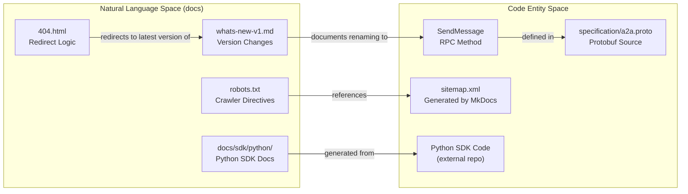
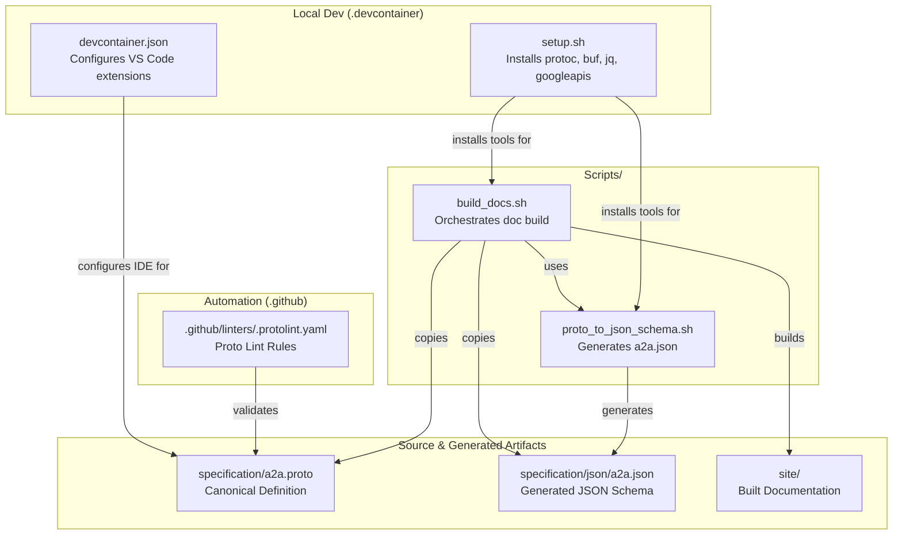

<!-- source: DeepWiki mcp.deepwiki.com · repo a2aproject/A2A · page 1.2 Repository Structure · fetched 2026-10-21 -->

# Repository Structure

Relevant source files

The following files were used as context for generating this wiki page:

- [.devcontainer/README.md](.devcontainer/README.md)
- [.devcontainer/devcontainer.json](.devcontainer/devcontainer.json)
- [.devcontainer/setup.sh](.devcontainer/setup.sh)
- [.gitattributes](.gitattributes)
- [.github/linters/.protolint.yaml](.github/linters/.protolint.yaml)
- [.gitignore](.gitignore)
- [docs/404.html](docs/404.html)
- [docs/README.md](docs/README.md)
- [docs/robots.txt](docs/robots.txt)
- [requirements-docs.txt](requirements-docs.txt)
- [scripts/build_docs.sh](scripts/build_docs.sh)

This page documents the organization of the A2A Protocol repository, explaining the purpose of each directory and how files relate to the protocol development workflow. As the canonical repository for the protocol (`github.com/a2aproject/A2A`), it serves as the definitive source of truth for specifications, user documentation, development automation, and tooling configurations.

## Directory Layout Overview

The repository is organized into distinct functional areas that separate the canonical protocol definition (`specification/`), human-readable user documentation (`docs/`), architectural decision records (`adrs/`), automation scripts (`scripts/`), container environments (`.devcontainer/`), and CI workflows (`.github/`).

**Title: Repository Organization Overview**

```mermaid
graph TB
    Root["Repository Root<br/>(github.com/a2aproject/A2A)"]
    
    Root --> Spec["specification/<br/>Canonical Protocol Definition"]
    Root --> Docs["docs/<br/>User Documentation"]
    Root --> ADRs["adrs/<br/>Architectural Decisions"]
    Root --> GitHub[".github/<br/>CI/CD & Automation"]
    Root --> DevContainer[".devcontainer/<br/>Dev Environment"]
    Root --> Types["types/<br/>TypeScript Definitions"]
    Root --> Scripts["scripts/<br/>Build & Utility Scripts"]
    
    Spec --> Proto["a2a.proto<br/>Normative Source of Truth"]
    Spec --> JSON["json/a2a.json<br/>Generated Schema"]
    
    Docs --> Index["index.md<br/>Homepage"]
    Docs --> Assets["assets/<br/>Images & Media"]
    Docs --> Robots["robots.txt<br/>Crawler Directives"]
    Docs --> Error404["404.html<br/>Redirect Logic"]
    
    GitHub --> Workflows["workflows/docs.yml<br/>CI/CD Pipelines"]
    GitHub --> Linters["linters/.protolint.yaml<br/>Linter Configs"]
    
    DevContainer --> DCJSON["devcontainer.json"]
    DevContainer --> Setup["setup.sh"]

    Scripts --> BuildDocs["build_docs.sh<br/>Documentation Build"]
    Scripts --> ProtoToJson["proto_to_json_schema.sh<br/>Schema Generation"]
    
    ADRs --> ADR001["adr-001-protojson-serialization.md"]
```

**Sources:** [docs/README.md:1-47](), [.devcontainer/devcontainer.json:1-33](), [.devcontainer/README.md:7-23](), [scripts/build_docs.sh:1-98](), [docs/robots.txt:1-39](), [docs/404.html:1-52]()

## Top-Level Directory Structure

| Directory | Purpose | Key Contents |
|-----------|---------|--------------|
| `specification/` | Canonical protocol definition and generated artifacts | `a2a.proto`, `json/a2a.json` |
| `docs/` | User-facing documentation and site configuration | `index.md`, `assets/`, `whats-new-v1.md`, `robots.txt`, `404.html` |
| `adrs/` | Architectural Decision Records (ADRs) | `adr-001-protojson-serialization.md`, `adr-template.md` |
| `scripts/` | Automation scripts for building and validation | `build_docs.sh`, `proto_to_json_schema.sh` |
| `.github/` | CI/CD, automation workflows, and global linter configs | `linters/.protolint.yaml` |
| `.devcontainer/` | Reproducible development environment | `devcontainer.json`, `setup.sh` |
| `types/` | TypeScript type definitions | `src/types.ts` |

**Sources:** [docs/README.md:1-47](), [.devcontainer/devcontainer.json:1-33](), [.github/linters/.protolint.yaml:1-4](), [.devcontainer/setup.sh:1-72](), [scripts/build_docs.sh:1-98](), [docs/robots.txt:1-39](), [docs/404.html:1-52]()

## Core Specification and Types

The `specification/` directory contains the authoritative protocol definition. The `a2a.proto` file serves as the universal, normative source of truth for all language-specific SDKs and protocol bindings.

### Protocol Source and Generation
The repository includes build scripts to ensure that the protocol definitions remain accessible to non-Protobuf environments:
- **`specification/a2a.proto`**: The primary definition file containing service definitions and core messages such as `Task`, `Message`, and `AgentCard`.
- **`specification/json/a2a.json`**: A non-normative JSON Schema representation generated dynamically from the proto file [.gitignore:8-11](). This schema is used for validating JSON payloads and is generated during builds using `protoc-gen-jsonschema` [.devcontainer/README.md:9-10](). The generation process is managed by `scripts/proto_to_json_schema.sh` and orchestrated via `scripts/build_docs.sh` [scripts/build_docs.sh:34-40]().
- **`types/src/types.ts`**: TypeScript definitions maintained to support JavaScript/TypeScript ecosystem integration.

### Linting and Quality Control
The specification is strictly governed by linting tooling:
- **Protolint**: Configured via `.github/linters/.protolint.yaml` to manage specific formatting constraints, such as overriding `MAX_LINE_LENGTH` rules [.github/linters/.protolint.yaml:1-4]().
- **Buf**: The `buf` CLI is integrated into the development setup to handle linting and breaking change detection [.devcontainer/setup.sh:31-37]().

**Sources:** [.devcontainer/README.md:9-10](), [.github/linters/.protolint.yaml:1-4](), [.devcontainer/setup.sh:31-37](), [scripts/build_docs.sh:34-40](), [.gitignore:8-11]()

## Architectural Decision Records (ADRs)

The `adrs/` directory tracks major design decisions that shape the protocol. Each record follows a standardized structure covering Context, Decision Drivers, and Consequences. These ADR files are copied to the `site/adrs` directory during the documentation build execution [scripts/build_docs.sh:85-96]().

### Key Decisions
- **ADR-001: ProtoJSON Serialization**: Establishes the ProtoJSON specification as the normative approach for JSON payloads, mandating `SCREAMING_SNAKE_CASE` for enums in JSON serialization to maintain cross-language interoperability.

**Sources:** [scripts/build_docs.sh:85-96]()

## Documentation System

The `docs/` directory contains Markdown content rendered via `mkdocs` with the `mkdocs-material` theme [docs/README.md:14-19](). It includes version-specific guides like `whats-new-v1.md`, site configuration files, and search crawlers policies [docs/whats-new-v1.md:1-74](), [docs/robots.txt:1-39]().

### Site Configuration and Deployment
- **Site Content & Navigation**: Defined in `mkdocs.yml` at the repository root [docs/README.md:18-19]().
- **Robots.txt**: Managed via `docs/robots.txt`, configuring web crawlers and explicitly allowing generative AI and LLM crawlers like `GPTBot`, `ClaudeBot`, and `PerplexityBot`, while pointing to `sitemap.xml` [docs/robots.txt:1-39]().
- **404.html**: Client-side JavaScript redirect logic in `docs/404.html` that intercepts missing resource lookups and routes users from unversioned paths to the `latest` documentation version [docs/404.html:8-41]().
- **SDK Documentation**: Python SDK documentation is built using Sphinx (`sphinx-build`) and integrated into the main documentation site structure [docs/README.md:29-47](). The script `scripts/build_docs.sh` coordinates this build phase [scripts/build_docs.sh:63-69]().

**Title: Mapping Documentation to Specification**

**Sources:** [docs/README.md:1-47](), [docs/whats-new-v1.md:1-74](), [docs/robots.txt:1-39](), [docs/404.html:1-52](), [scripts/build_docs.sh:63-69]()

## Development Infrastructure

The `.devcontainer/` and `scripts/` directories provide the build pipeline, local execution environments, and validation automation needed for protocol development.

### Local Development Environment
The `.devcontainer/` setup ensures a containerized, reproducible toolchain across contributor machines:
- **`devcontainer.json`**: Configures a container running Python 3.12, Go, and Node.js (LTS), along with VS Code extensions such as `ms-python.python`, `pylance`, and `bufbuild.vscode-buf` [.devcontainer/devcontainer.json:4-23]().
- **Pre-installed Tooling**: Installs `protoc` (v28.3), `protoc-gen-jsonschema`, `buf`, and `jq` [.devcontainer/README.md:7-12]().
- **`setup.sh`**: Automates system package installation, protocol buffer compiler downloads, and cloning the `googleapis` definitions into `third_party/googleapis` [.devcontainer/setup.sh:1-50]().

### Build and Utility Scripts
The `scripts/` directory houses workflow automation:
- **`build_docs.sh`**: Acts as the unified documentation build script. It verifies schema freshness between `specification/a2a.proto` and `specification/json/a2a.json`, invokes `scripts/proto_to_json_schema.sh` if needed [scripts/build_docs.sh:16-43](), copies normative spec files into `docs/spec/` [scripts/build_docs.sh:45-61](), builds SDK documentation [scripts/build_docs.sh:62-69](), and executes `mkdocs build` or `mike deploy` [scripts/build_docs.sh:76-83]().
- **`proto_to_json_schema.sh`**: Handles translation of protobuf definitions into JSON Schema [scripts/build_docs.sh:14]().

### Repository Automation & Metadata
- **`.gitattributes`**: Marks `/docs/**` as documentation via linguist overrides and sets `CHANGELOG.md` to use the `union` merge strategy [.gitattributes:1-8]().
- **`.gitignore`**: Excludes ephemeral schema builds (`specification/json/a2a.json`), SDK doc outputs (`docs/sdk/*`), and local virtual environments (`.doc-venv`, `venv/`) from version control [.gitignore:2-25]().

**Title: Dev Environment to Build Pipeline**

**Sources:** [.devcontainer/devcontainer.json:1-33](), [.devcontainer/README.md:1-83](), [.gitattributes:1-8](), [scripts/build_docs.sh:1-98](), [.gitignore:1-25](), [.devcontainer/setup.sh:1-72]()

---

