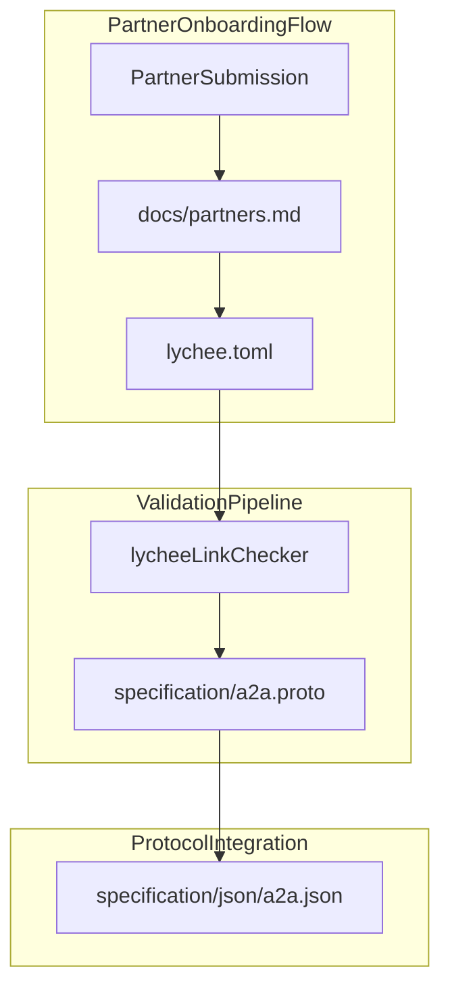
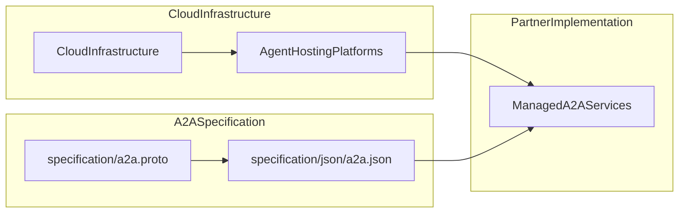
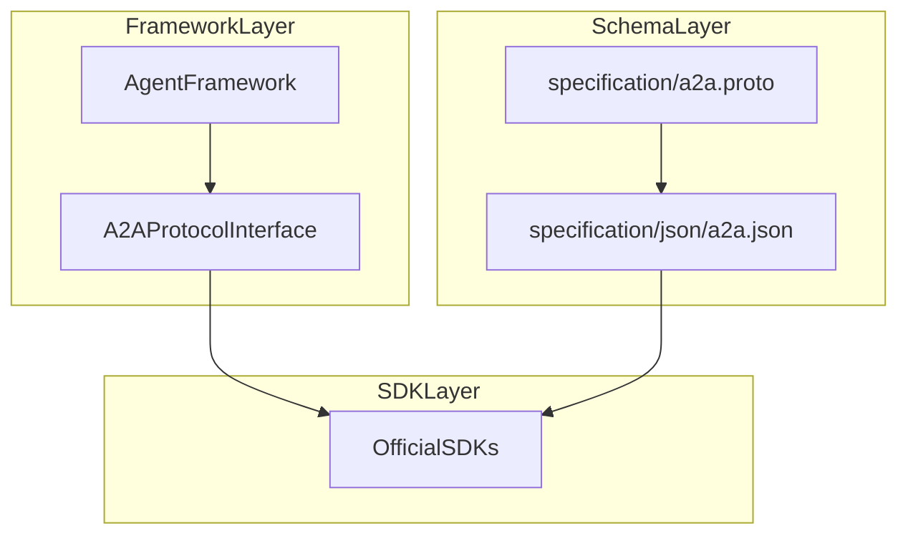

<!-- source: DeepWiki mcp.deepwiki.com · repo a2aproject/A2A · page 5.1 Partner Ecosystem & Industry Adoption · fetched 2026-10-21 -->

# Partner Ecosystem & Industry Adoption

Relevant source files

The following files were used as context for generating this wiki page:

- [docs/partners.md](docs/partners.md)
- [lychee.toml](lychee.toml)

## Purpose and Scope

This document catalogs the A2A Protocol's partner ecosystem and provides evidence of industry adoption. It details the 170+ partner organizations across enterprise technology, cloud platforms, framework providers, and infrastructure vendors as listed in `docs/partners.md`, categorizes them by industry segment, documents framework integrations, and describes mechanisms for joining the partner program [docs/partners.md:1-152](). The A2A Protocol serves as a canonical specification and reference implementation for agent-to-agent communication, enabling diverse AI agents to discover, communicate, and collaborate across heterogeneous technology stacks [docs/partners.md:3-6]().

For information about the governance structure and Technical Steering Committee composition, see **5.2 Governance Structure & TSC**. For details on community engagement channels and contribution processes, see **5.3 Contributing to A2A** and **5.4 Community Resources & Support**.

---

## Partner Ecosystem Overview

The A2A Protocol has achieved significant industry adoption with over 170 partner organizations committed to building, codifying, and adopting A2A as the standard protocol for AI agents to communicate and collaborate effectively [docs/partners.md:1-7](). These partnerships span technology companies, consulting firms, AI/ML platforms, and enterprise software vendors. The ecosystem is supported by a Technical Steering Committee (TSC) representing major technology leaders, including AWS, Cisco, IBM Research, Microsoft, Salesforce, SAP, and ServiceNow [docs/partners.md:31, 45, 84, 108, 138, 139, 141]().

### Partner Commitment Model

Partners contribute to the A2A ecosystem through various technical and community activities:

| Activity | Description | Code / Specification Mapping |
|----------|-------------|----------------------------|
| **Protocol Adoption** | Implementing A2A in existing products and services [docs/partners.md:3-6]() | `specification/a2a.proto` |
| **Framework Integration** | Building native A2A support into agent frameworks like LangChain, LlamaIndex, and AG2 [docs/partners.md:13, 98, 101]() | `specification/json/a2a.json` |
| **Multi-Protocol Bindings** | Deploying agents across JSON+HTTP, gRPC, and JSON-RPC for heterogeneous environment support | Protocol Bindings |
| **Evangelism & Documentation** | Publishing blog posts, tutorials, and case studies to drive standardization [docs/partners.md:3-6]() | `docs/partners.md` |

**Sources:** [docs/partners.md:1-152]()

---

## Partner Directory

### Complete Partner List

The A2A project maintains an official partner directory listing organizations that have publicly committed to the protocol. Each partner entry includes optional links to announcement blog posts or integration documentation [docs/partners.md:3-6]().

**Partner Onboarding and Validation Workflow**

The partner directory is maintained in [docs/partners.md:8-152]() and follows an alphabetical structure. To prevent CI failures from external links in partner announcements, the file `docs/partners.md` is explicitly excluded from the `lychee` link checker via `exclude_path` rules [lychee.toml:81]().

**Sources:** [docs/partners.md:1-152](), [lychee.toml:1-118]()

---

## Partner Categories

### Tech Giants & Cloud Providers

Major technology companies providing cloud infrastructure, AI platforms, and developer tools.

| Partner | A2A Announcement |
|---------|------------------|
| **AWS** | [Website](https://aws.amazon.com) [docs/partners.md:31]() |
| **Microsoft** | [Empowering Multi-Agent Apps](https://www.microsoft.com/en-us/microsoft-cloud/blog/2025/05/07/empowering-multi-agent-apps-with-the-open-agent2agent-a2a-protocol) [docs/partners.md:108]() |
| **IBM Research** | [ACP Joins Forces with A2A](https://lfaidata.foundation/communityblog/2025/08/29/acp-joins-forces-with-a2a-under-the-linux-foundations-lf-ai-data) [docs/partners.md:84]() |
| **Cisco** | [Website](https://www.cisco.com) [docs/partners.md:45]() |
| **AliCloud** | [Website](http://www.alibabacloud.com) [docs/partners.md:20]() |
| **Red Hat** | [Website](https://www.redhat.com) [docs/partners.md:134]() |

**Cloud Integration Mapping**

**Sources:** [docs/partners.md:20-134]()

### Consulting & System Integrators

Professional services firms implementing A2A solutions for enterprise clients to solve interoperability challenges.

| Partner | A2A Announcement |
|---------|------------------|
| **Accenture** | [Website](https://www.accenture.com) [docs/partners.md:10]() |
| **Deloitte** | [Expanding Alliances](https://www.prnewswire.com/news-releases/deloitte-expands-alliances-with-google-cloud-and-servicenow-to-accelerate-agentic-ai-adoption-in-the-enterprise-302423941.html) [docs/partners.md:61]() |
| **KPMG** | [AgentSpace Adoption](https://kpmg.com/us/en/media/news/kpmg-google-cloud-alliance-expansion-agentspace-adoption.html) [docs/partners.md:95]() |
| **PWC** | [Website](https://www.pwc.com) [docs/partners.md:130]() |
| **BCG** | [Website](https://www.bcg.com) [docs/partners.md:33]() |
| **McKinsey** | [Website](https://www.mckinsey.com) [docs/partners.md:110]() |

**Sources:** [docs/partners.md:10-110]()

### AI/ML Platforms & Frameworks

Companies and projects providing AI infrastructure and orchestration.

#### Framework Integrations

| Framework | Partner Context |
|-----------|--------------------------|
| **LangChain** | Native integration provider [docs/partners.md:98]() |
| **LlamaIndex** | Data framework for agents [docs/partners.md:101]() |
| **AG2** | Multi-agent conversation framework [docs/partners.md:13]() |
| **MindsDB** | [A2A Support Blog](https://mindsdb.com/blog/mindsdb-now-supports-the-agent2agent-(a2a)-protocol) [docs/partners.md:109]() |

**Framework Integration Architecture**

**Sources:** [docs/partners.md:13-109]()

#### AI Infrastructure & Data Partners

| Partner | Specialization |
|---------|---------------|
| **MongoDB** | Document database and vector search [docs/partners.md:111]() |
| **Neo4j** | Graph database for agentic RAG [docs/partners.md:113]() |
| **DataStax** | Real-time AI data [docs/partners.md:58]() |
| **Elastic** | Search and analytics [docs/partners.md:66]() |
| **Arize** | [Embracing A2A Protocol](https://arize.com/blog/arize-ai-and-future-of-agent-interoperability-embracing-googles-a2a-protocol) [docs/partners.md:24]() |

**Sources:** [docs/partners.md:24-113]()

### Enterprise Software Vendors

Companies providing business applications with embedded agent capabilities that interoperate via A2A.

| Partner | Domain |
|---------|--------|
| **Salesforce** | CRM and business applications [docs/partners.md:138]() |
| **SAP** | [Enterprise AI Open Collaboration](https://news.sap.com/2025/04/sap-google-cloud-enterprise-ai-open-agent-collaboration-model-choice-multimodal-intelligence) [docs/partners.md:139]() |
| **ServiceNow** | IT service management [docs/partners.md:141]() |
| **Atlassian** | Team collaboration and workflow [docs/partners.md:27]() |
| **Adobe** | Creative Cloud and document services [docs/partners.md:12]() |
| **Autodesk** | Design and engineering software [docs/partners.md:29]() |

**Sources:** [docs/partners.md:12-141]()

---

## Industry Adoption Indicators

### Public Announcements and Blog Posts
Partner adoption is evidenced through public announcements and community highlights:

| Partner | Announcement Topic |
|---------|-------------|
| **Auth0** | [A2A and Identity](https://auth0.com/blog/auth0-google-a2a) [docs/partners.md:28]() |
| **Poppulo** | [Future of Workplace Communication](https://www.poppulo.com/blog/poppulo-google-a2a-the-future-of-workplace-communication) [docs/partners.md:127]() |
| **Articul8** | [Unleashing the Next Frontier](https://www.articul8.ai/blog/unleashing-the-next-frontier-of-enterprise-ai-introducing-model-mesh-dock-and-inter-lock-and-our-a2-a-partnership-with-google) [docs/partners.md:25]() |
| **Supertab** | [Enabling AI Agents](https://www.supertab.co/post/supertab-connect-partners-with-google-cloud-to-enable-ai-agents) [docs/partners.md:149]() |

**Sources:** [docs/partners.md:25-149]()

---

## Geographic Distribution

Representative partners by region:

- **North America:** Microsoft, AWS, Salesforce, ServiceNow, Adobe, Intuit, Oracle [docs/partners.md:12-141]().
- **Europe:** SAP, Siemens AG, Deutsche Telekom, MasOrange, Magyar Telekom, Almawave.it [docs/partners.md:21-152]().
- **Asia-Pacific:** Kakao, Cafe 24, LG CNS, SoftBank Corp, AliCloud, NTT DATA [docs/partners.md:20-142]().
- **Middle East:** AI71 (UAE) [docs/partners.md:16]().

**Sources:** [docs/partners.md:12-152]()

---

## Joining the Partner Program

Organizations wishing to be listed in the partner directory [docs/partners.md:1-152]() should follow the community contribution guidelines:

1.  **Protocol Compliance:** Implement A2A by following the canonical `specification/a2a.proto` or using official SDKs.
2.  **Submission:** Open an issue or Pull Request to add the company name, website URL, and an optional link to an A2A announcement to `docs/partners.md` [docs/partners.md:3-6]().
3.  **Link Validation:** Ensure URLs are reachable. Note that certain patterns are excluded from CI checks via `lychee.toml` configuration to avoid false positives from rate-limiting sites [lychee.toml:35-81]().

**Sources:** [docs/partners.md:1-6](), [lychee.toml:35-81]()

---

