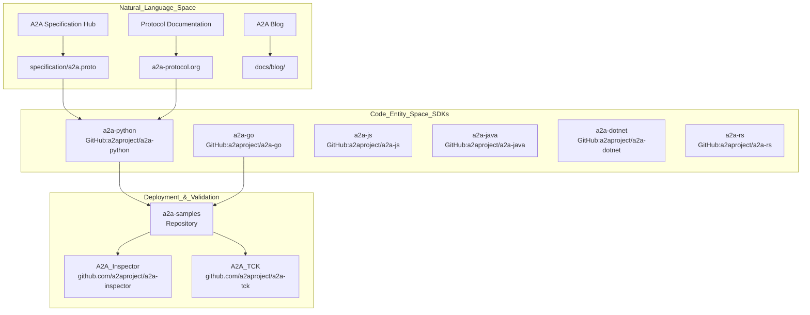
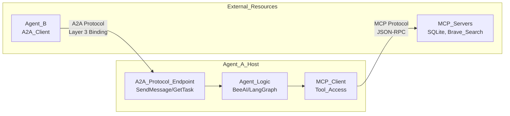

<!-- source: DeepWiki mcp.deepwiki.com · repo a2aproject/A2A · page 5.4 Community Resources & Support · fetched 2026-10-21 -->

# Community Resources & Support

Relevant source files

The following files were used as context for generating this wiki page:

- [docs/blog/index.md](docs/blog/index.md)
- [docs/blog/posts/a2a-joins-aaif.md](docs/blog/posts/a2a-joins-aaif.md)
- [docs/blog/posts/announcing-1.0.md](docs/blog/posts/announcing-1.0.md)
- [docs/community.md](docs/community.md)
- [docs/roadmap.md](docs/roadmap.md)
- [docs/sdk/index.md](docs/sdk/index.md)
- [docs/tutorials/index.md](docs/tutorials/index.md)

This document provides technical details about the support channels, community engagement mechanisms, learning resources, and integration ecosystem available to developers working with the A2A Protocol. It serves as an exhaustive reference for navigating official communication forums, utilizing multi-language tutorials, leveraging the broader partner ecosystem, and tracking the technical roadmap governed by the Technical Steering Committee (TSC).

## Official Support Channels

The A2A project maintains several primary channels for community communication, each suited to a different type of interaction. These channels are the primary touchpoints for the Technical Steering Committee (TSC) and the broader contributor base.

### GitHub & Community Hub
GitHub serves as the central hub for asynchronous technical communication, specification management, and project tracking.
- **Discord**: Join the [A2A Discord server](https://discord.gg/a2aprotocol) to chat with contributors, ask questions, and stay connected with the community [docs/community.md:7]().
- **Discussions**: Recommended for architectural questions, design conversations, and general protocol clarification.
- **Issues**: Used for tracking bug reports, feature requests, and community SDK submissions [docs/community.md:73-105]().
- **Community Spotlight**: Highlights featured contributions such as the Python Quickstart (PR#202), LlamaIndex sample implementation (PR#179), and Autogen sample server (PR#232) [docs/community.md:38-42]().

### Educational Resources & Announcements
- **A2A Protocol Documentation**: The canonical site for comprehensive protocol documentation hosted at `a2a-protocol.org` [docs/blog/posts/announcing-1.0.md:53-54]().
- **Recent News & Blog Posts**: The community maintains an active blog covering deep-dive technical topics such as the Agent Payments Protocol (AP2), A2A Extensions, and task-versus-message semantics [docs/community.md:9-17]().
- **A2A v1.0 Launch**: The release of v1.0 represents a significant maturation of the protocol with enhanced clarity, stronger specifications, and important structural improvements [docs/roadmap.md:7-8]().

Sources: [docs/community.md:1-105](), [docs/roadmap.md:1-30](), [docs/blog/posts/announcing-1.0.md:1-62]()

## Learning Resources & Tutorials

The A2A project provides a structured set of tutorials across multiple languages and frameworks to facilitate developer onboarding and enterprise integration.

### Multi-Language Tutorial Index
The project categorizes tutorials by language and difficulty to guide developers from basic implementations to complex multi-agent systems.

| Language | Tutorial | Description | Difficulty |
|:---------|:---------|:------------|:-----------|
| **Python** | [A2A Python Quickstart](./python/1-introduction.md) | Learn to build a simple Python-based "echo" A2A server and client [docs/tutorials/index.md:7](). | Easy |
| | [ADK facts](https://github.com/a2aproject/a2a-samples/tree/main/samples/python/agents/adk_facts) | Build and test a simple Personal Assistant agent using the Agent Development Kit (ADK) that can provide interesting facts [docs/tutorials/index.md:8](). | Easy |
| | [ADK agent on Cloud Run](https://github.com/a2aproject/a2a-samples/tree/main/samples/python/agents/adk_cloud_run) | Deploy, manage, and observe an ADK-based agent as a scalable, serverless service on Google Cloud Run [docs/tutorials/index.md:9](). | Easy |
| | [Multi-agent collaboration using A2A](https://github.com/a2aproject/a2a-samples/tree/main/demo) | Learn how to set up an orchestrator (host agent) that routes and manages requests among several specialized A2A-compatible agents [docs/tutorials/index.md:10](). | Easy |
| | [Airbnb and weather multi-agent](https://github.com/a2aproject/a2a-samples/tree/main/samples/python/agents/airbnb_planner_multiagent) | Build a complex multi-agent system where agents collaborate using A2A to plan a trip, finding both Airbnb accommodations and weather information [docs/tutorials/index.md:11](). | Medium |
| | [A2A Client-Server example using remote ADK agent](https://goo.gle/adk-a2a) | Learn how a local A2A client agent discovers and consumes the capabilities of a separate, remote ADK-based agent (for example, a prime number checker) [docs/tutorials/index.md:12](). | Easy |
| | [Colab Notebook](https://github.com/a2aproject/a2a-samples/blob/main/notebooks/multi_agents_eval_with_cloud_run_deployment.ipynb) | Use Colab Notebook to deploy A2A agents to Cloud Run from your browser, and then evaluate their performance with Vertex AI [docs/tutorials/index.md:13](). | Easy |
| **Java** | [Weather Agent](https://github.com/a2aproject/a2a-samples/tree/main/samples/java/agents/weather_mcp) | Build a weather information agent using an MCP server [docs/tutorials/index.md:19](). | Easy |
| | [Content Writer Agent](https://github.com/a2aproject/a2a-samples/tree/main/samples/java/agents/content_writer) | Build a content writer agent that generates engaging pieces of content from outlines [docs/tutorials/index.md:20](). | Easy |
| | [Content Editor Agent](https://github.com/a2aproject/a2a-samples/tree/main/samples/java/agents/content_editor) | Build a content editor agent that proof-reads and polishes content [docs/tutorials/index.md:21](). | Easy |
| | [Dice Agent (Multi-Transport)](https://github.com/a2aproject/a2a-samples/tree/main/samples/java/agents/dice_agent_multi_transport) | Build a multi-transport agent that rolls dice and checks for prime numbers [docs/tutorials/index.md:22](). | Medium |
| | [Magic 8 Ball Agent (Security)](https://github.com/a2aproject/a2a-samples/tree/main/samples/java/agents/magic_8_ball_security) | Build a Magic 8 Ball agent to learn how to secure A2A servers with Keycloak using bearer token authentication and configure an A2A client to obtain and pass the required token [docs/tutorials/index.md:23](). | Medium |
| **JavaScript** | [Movie research agent using JavaScript](https://github.com/a2aproject/a2a-samples/tree/main/samples/js) | Build an A2A agent with Node.js that uses the TMDB (The Movie Database) API to handle movie searches and queries [docs/tutorials/index.md:29](). | Easy |
| **C#/.NET** | [All .NET samples](https://github.com/a2aproject/a2a-dotnet/tree/main/samples) | Repository of foundational samples showing how to build A2A clients and servers, including an Echo Agent, using the C#/.NET SDK [docs/tutorials/index.md:35](). | Easy |

Sources: [docs/tutorials/index.md:3-35]()

### Technical Learning Path
The documentation structure bridges high-level conceptual spaces with low-level protocol code entities and validation tooling.

**Diagram: Learning Path from Specification to Code Entities**

Sources: [docs/sdk/index.md:5-14](), [docs/roadmap.md:22](), [docs/tutorials/index.md:3-35](), [docs/community.md:1-105]()

## Integration Ecosystem

The A2A protocol is supported by a broad range of official SDKs, community-maintained implementations, and framework integrations.

### Official SDKs
The A2A project hosts SDKs in six languages to ensure broad platform compatibility:
- **Python**: `a2a-python` [docs/sdk/index.md:7]()
- **Go**: `a2a-go` [docs/sdk/index.md:8]()
- **Java**: `a2a-java` [docs/sdk/index.md:9]()
- **JavaScript**: `a2a-js` [docs/sdk/index.md:10]()
- **C#/.NET**: `a2a-dotnet` [docs/sdk/index.md:11]()
- **Rust**: `a2a-rs` [docs/sdk/index.md:12]()

### Community SDKs
In addition to official SDKs, the community has developed robust implementations for other environments:
- **Rust (v1.0.0)**: `a2a-rust` by `tomtom215` (Full SDK with JSON-RPC, REST, WebSocket, and gRPC transports) [docs/community.md:77-81]().
- **Rust (v0.3.0)**: `a2a-rs` by `EmilLindfors` (Modular workspace with AP2 extension support) [docs/community.md:83-87]().
- **Swift**: `A2AClient` by `tolgaki` (Swift Package Manager, iOS 15+, macOS 12+) [docs/community.md:89-93]().
- **Elixir**: `a2a` by `actioncard` (OTP-native with Agent behaviour and TaskStore) [docs/community.md:95-99]().
- **C++**: `a2a-cpp` by `MisterVVP` (C++20 SDK with TCK conformance and vcpkg support) [docs/community.md:101-105]().

### Framework Integrations
The protocol is integrated into major agentic frameworks:
- **Agent Development Kit (ADK)**: [google.github.io/adk-docs/a2a/](https://google.github.io/adk-docs/a2a) [docs/community.md:59]()
- **Agno**: [docs.agno.com/agent-os/interfaces/a2a/introduction](https://docs.agno.com/agent-os/interfaces/a2a/introduction) [docs/community.md:60]()
- **AG2**: [docs.ag2.ai/latest/docs/user-guide/a2a/](https://docs.ag2.ai/latest/docs/user-guide/a2a) [docs/community.md:61]()
- **BeeAI Framework**: [framework.beeai.dev/integrations/a2a](https://framework.beeai.dev/integrations/a2a) [docs/community.md:62]()
- **CrewAI**: [docs.crewai.com/en/learn/a2a-agent-delegation](https://docs.crewai.com/en/learn/a2a-agent-delegation) [docs/community.md:63]()
- **Hector**: [github.com/kadirpekel/hector](https://github.com/kadirpekel/hector) [docs/community.md:64]()
- **LangGraph**: [docs.langchain.com/langsmith/server-a2a](https://docs.langchain.com/langsmith/server-a2a) [docs/community.md:65]()
- **LiteLLM**: [docs.litellm.ai/docs/a2a](https://docs.litellm.ai/docs/a2a) [docs/community.md:66]()
- **Microsoft Agent Framework**: [learn.microsoft.com/en-us/agent-framework/user-guide/agents/agent-types/a2a-agent](https://learn.microsoft.com/en-us/agent-framework/user-guide/agents/agent-types/a2a-agent) [docs/community.md:67]()
- **Noorle**: [noorle.com/docs/reference/a2a/overview](https://noorle.com/docs/reference/a2a/overview) [docs/community.md:68]()
- **Pydantic AI**: [pydantic.dev/docs/ai/overview/](https://pydantic.dev/docs/ai/overview) [docs/community.md:69]()
- **Slide (Tyler)**: [slide.mintlify.app/guides/a2a-integration](https://slide.mintlify.app/guides/a2a-integration) [docs/community.md:70]()
- **Strands Agents**: [strandsagents.com/docs/user-guide/concepts/multi-agent/agent-to-agent/](https://strandsagents.com/docs/user-guide/concepts/multi-agent/agent-to-agent) [docs/community.md:71]()

### A2A and MCP Synergy
A2A and the **Model Context Protocol (MCP)** are complementary. A2A acts as the horizontal orchestration layer for peer-to-peer collaboration, while MCP serves as the vertical integration layer connecting individual agents to tools [docs/blog/posts/a2a-joins-aaif.md:12-14]().

**Diagram: A2A vs MCP Code Responsibility**

Sources: [docs/sdk/index.md:5-12](), [docs/community.md:47-105](), [docs/blog/posts/a2a-joins-aaif.md:10-15]()

## Protocol Roadmap & Evolution

The A2A roadmap is managed by the Technical Steering Committee (TSC) and focuses on specification maturation and ecosystem expansion.

### Near-term Initiatives
The release of A2A v1.0 marks a significant maturation with enhanced clarity and structural improvements [docs/roadmap.md:7]().
- **Extension Support**: Continued support for **A2A extensions** with SDK integration [docs/roadmap.md:9]().
- **Governance**: A2A has joined the **Agentic AI Foundation (AAIF)** as a Growth Stage project under the Linux Foundation to ensure neutral, multi-vendor governance [docs/blog/posts/a2a-joins-aaif.md:10, 22-24]().
- **New Protocols**: Introduction of the **Agent Payments Protocol (AP2)** for handling financial transactions between agents [docs/community.md:13]().

### Validation Infrastructure
To ensure ecosystem compatibility, the community provides specialized tooling:
- **A2A Inspector**: Tooling for traffic inspection and debugging [docs/roadmap.md:22]().
- **A2A TCK (Technology Compatibility Kit)**: Formal validation suite for protocol compliance [docs/roadmap.md:22]().

### Community Best Practices
As deployments accelerate across supply chains, financial services, and enterprise mobile platforms, the community focuses on collecting and sharing success stories and architectural patterns [docs/roadmap.md:30](), [docs/blog/posts/a2a-joins-aaif.md:18]().

Sources: [docs/roadmap.md:1-30](), [docs/community.md:9-17](), [docs/blog/posts/a2a-joins-aaif.md:8-26]()

---

