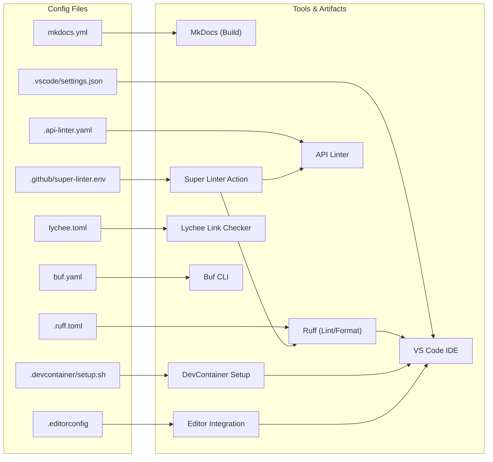

<!-- source: DeepWiki mcp.deepwiki.com · repo a2aproject/A2A · page 6.2 Configuration Files Reference · fetched 2026-10-21 -->

# Configuration Files Reference

Relevant source files

The following files were used as context for generating this wiki page:

- [.devcontainer/README.md](.devcontainer/README.md)
- [.devcontainer/devcontainer.json](.devcontainer/devcontainer.json)
- [.devcontainer/setup.sh](.devcontainer/setup.sh)
- [.editorconfig](.editorconfig)
- [.gemini/config.yaml](.gemini/config.yaml)
- [.gitattributes](.gitattributes)
- [.github/linters/.protolint.yaml](.github/linters/.protolint.yaml)
- [.github/workflows/docs.yml](.github/workflows/docs.yml)
- [.github/workflows/linter.yaml](.github/workflows/linter.yaml)
- [.ruff.toml](.ruff.toml)
- [.vscode/settings.json](.vscode/settings.json)

This page documents the key configuration files that control the A2A repository's development environment, build system, documentation generation, and code quality checks. These files define the standards for Python linting, Protocol Buffer validation, editor hygiene, and the automated CI/CD pipelines.

**Related pages:**
- For protocol specification artifacts (`a2a.proto`, `a2a.json`), see [Specification Artifacts](6.1)
- For the documentation build system and deployment pipeline, see [Documentation Build System](4.1)
- For CI/CD workflows that consume these configurations, see [Code Quality & CI Checks](4.3)

---

## Configuration Files Ecosystem

The following diagram illustrates how configuration files bridge the "Natural Language Space" (documentation and developer intent) to the "Code Entity Space" (linters, compilers, and CI runners).

### Configuration Data Flow

```mermaid
graph TD
    subgraph "NaturalLanguageSpace" ["Natural Language & Intent"]
        STYLE["Google Python Style Guide"]
        AIP["Google API Improvement Proposals"]
        DOC_PLAN["Documentation Navigation & Theme"]
        CODE_FORMAT["Consistent Code Formatting"]
        LINK_VALIDATION["Valid External Links"]
    end

    subgraph "BridgeSpace" ["Configuration Files (The Bridge)"]
        RUFF_CFG[".ruff.toml"]
        API_LINT_CFG[".api-linter.yaml"]
        MKDOCS_CFG["mkdocs.yml"]
        DEVCONTAINER_JSON[".devcontainer/devcontainer.json"]
        SUPER_LINTER_ENV[".github/super-linter.env"]
        EDITORCONFIG[".editorconfig"]
        LYCHEE_CFG["lychee.toml"]
        BUF_CFG["buf.yaml"]
    end

    subgraph "CodeEntitySpace" ["Code Entity Space (Execution)"]
        RUFF_EXE["ruff linter/formatter"]
        API_LINT_EXE["api-linter binary"]
        MKDOCS_EXE["mkdocs static generator"]
        DEV_ENV["VS Code / DevContainer"]
        LINTER_ACTION["GitHub Super Linter"]
        EDITOR_INTEGRATION["Editor Integration"]
        LYCHEE_EXE["lychee link checker"]
        BUF_EXE["buf CLI"]
    end

    STYLE --> RUFF_CFG
    AIP --> API_LINT_CFG
    DOC_PLAN --> MKDOCS_CFG
    CODE_FORMAT --> EDITORCONFIG
    LINK_VALIDATION --> LYCHEE_CFG

    RUFF_CFG --> RUFF_EXE
    API_LINT_CFG --> API_LINT_EXE
    MKDOCS_CFG --> MKDOCS_EXE
    DEVCONTAINER_JSON --> DEV_ENV
    SUPER_LINTER_ENV --> LINTER_ACTION
    RUFF_CFG --> DEV_ENV
    EDITORCONFIG --> EDITOR_INTEGRATION
    LYCHEE_EXE --> LYCHEE_EXE
    BUF_CFG --> BUF_EXE
```

Sources: [.ruff.toml:1-125](), [.devcontainer/devcontainer.json:1-33](), [.github/super-linter.env:1-22](), [.github/workflows/linter.yaml:22-30](), [.editorconfig:1-12](), [lychee.toml:1-10](), [buf.yaml:1-10]()

---

## Protocol Linting and Validation

The repository employs specialized linters to ensure the `a2a.proto` specification adheres to industry standards.

### API Linter (.api-linter.yaml)
The `api-linter` tool is executed via the `api-linter` job in the CI workflow `[.github/workflows/linter.yaml:31-63]()`.
- **Execution**: The workflow downloads `api-linter` v1.67.6 and runs it against `specification/a2a.proto` using configuration rules `[.github/workflows/linter.yaml:53-63]()`.
- **Protobuf Dependencies**: It utilizes `buf` to export `googleapis` definitions to a `.googleapis` directory, which is passed as a `--proto-path` to the linter `[.github/workflows/linter.yaml:47-63]()`.

### Super Linter Configuration (.github/super-linter.env)
This file provides environment variables to the `super-linter/super-linter/slim` action `[.github/workflows/linter.yaml:22-30]()`.
- **Validation Controls**: Specifically enables `VALIDATE_PROTOBUF`, `VALIDATE_PYTHON_RUFF`, `VALIDATE_YAML`, and `VALIDATE_MARKDOWN` `[.github/super-linter.env:13-19]()`.
- **Linter Mapping**: Maps specific config files to linters, such as `PROTOBUF_CONFIG_FILE=.protolint.yaml` and `MARKDOWN_CONFIG_FILE=.markdownlint.json` `[.github/super-linter.env:21-22]()`.
- **Exclusions**: Uses `FILTER_REGEX_EXCLUDE` to skip linting for metadata files like `CHANGELOG.md` and `GOVERNANCE.md` `[.github/super-linter.env:3]()`.

### Buf Configuration (buf.yaml)
The `buf.yaml` file configures the `buf` CLI tool for Protocol Buffer linting and management.
- **Version**: Specifies `version: "v1"` for the configuration format `[buf.yaml:1]()`.
- **Breaking Change Detection**: Configures `buf` to check for breaking changes against the `main` branch of the `a2aproject/A2A` repository `[buf.yaml:5-7]()`. This ensures backward compatibility of the `a2a.proto` schema.
- **Linting Rules**: Applies a set of linting rules defined by `DEFAULT` and `COMMENTS` categories `[buf.yaml:8-10]()`.

Sources: [.github/workflows/linter.yaml:31-63](), [.github/super-linter.env:1-22](), [buf.yaml:1-10]()

---

## Python Linting and Formatting (.ruff.toml)

The `.ruff.toml` file configures [Ruff](https://docs.astral.sh/ruff), a high-performance Python linter and formatter. The repository strictly follows the **Google Python Style Guide** `[.ruff.toml:5-6]()`.

### Core Standards
- **Line Length**: Limited to 80 columns per Google Style Guide §3.2 `[.ruff.toml:8]()`.
- **Indentation**: 4 spaces `[.ruff.toml:9]()`.
- **Target Version**: Python 3.12 `[.ruff.toml:11]()`.

### Rule Selection
The configuration selects a comprehensive set of rules, including:
- `E`, `W`: pycodestyle errors and warnings (PEP 8) `[.ruff.toml:35-36]()`.
- `I`: isort for import sorting (Google Style §3.1.2) `[.ruff.toml:38]()`.
- `D`: pydocstyle for Google-style docstrings `[.ruff.toml:39, 98]()`.
- `ANN`: flake8-annotations for type hint enforcement `[.ruff.toml:42, 100-103]()`.
- `PL`: Pylint rules ported to Ruff `[.ruff.toml:50]()`.
- `B`: flake8-bugbear for potential logic errors `[.ruff.toml:44]()`.
- `T20`: flake8-print to discourage print statements in favor of logging `[.ruff.toml:47]()`.

### Formatting and VS Code Integration
The formatter uses single quotes for strings and spaces for indentation `[.ruff.toml:124-125]()`. In VS Code, the `charliermarsh.ruff` extension is set as the default formatter for Python files `[.vscode/settings.json:4]()`, with `editor.formatOnSave` enabled and `source.organizeImports` triggered on save `[.vscode/settings.json:5-8]()`.

Sources: [.ruff.toml:1-125](), [.vscode/settings.json:1-19]()

---

## Development Environment Configuration

The repository provides a standardized development environment using VS Code Dev Containers and shared settings.

### DevContainer Configuration (.devcontainer/devcontainer.json & setup.sh)
The devcontainer configuration defines a reproducible environment based on `ubuntu` `[.devcontainer/devcontainer.json:3]()`.
- **Setup Script**: Executes `[.devcontainer/setup.sh:1-72]()`, which installs `protoc` (v28.3), `protoc-gen-jsonschema`, `buf`, and `googleapis` dependencies `[.devcontainer/setup.sh:17-49]()`.
- **Features**: Includes Python 3.12, Go (latest), and Node.js (LTS) `[.devcontainer/devcontainer.json:4-14]()`.
- **Extensions**: Automatically installs `ms-python.python`, `ms-python.vscode-pylance`, `bufbuild.vscode-buf`, and `streetsidesoftware.code-spell-checker` `[.devcontainer/devcontainer.json:18-23]()`.

### VS Code Settings (.vscode/settings.json)
Standardizes the local editor experience:
- **Formatting**: Enables `editor.formatOnSave` globally `[.vscode/settings.json:2]()`.
- **Python**: Configures `ruff` as the default formatter and sets the import strategy to `fromEnvironment` `[.vscode/settings.json:4, 10]()`.
- **Markdown**: Uses `.github/linters/.markdownlint.json` for linting rules `[.vscode/settings.json:11]()`.
- **File Hygiene**: Automatically trims trailing whitespace and inserts final newlines `[.vscode/settings.json:16-17]()`.

### EditorConfig (.editorconfig)
The `.editorconfig` file helps maintain consistent coding styles across different editors and IDEs.
- **Root**: `root = true` indicates this is the top-level `.editorconfig` file `[.editorconfig:2]()`.
- **General Settings**: Applies `end_of_line = lf`, `charset = utf-8`, `trim_trailing_whitespace = true`, and `insert_final_newline = true` to all files `[.editorconfig:5-8]()`.
- **Shell Scripts**: Specifically sets `indent_style = space` and `indent_size = 2` for `.sh` files `[.editorconfig:10-12]()`.

Sources: [.devcontainer/devcontainer.json:1-33](), [.devcontainer/setup.sh:1-72](), [.vscode/settings.json:1-19](), [.editorconfig:1-12]()

---

## Documentation Configuration (mkdocs.yml)

The `mkdocs.yml` file defines the structure, theme, and plugins for the A2A documentation site.

### Site Metadata and Theme
- **Site Info**: Defines the name as "A2A Protocol" and the URL as `https://a2a-protocol.org/` `[mkdocs.yml:2-3]()`.
- **Theme**: Uses the `material` theme with `Google Sans` for text and `Roboto Mono` for code `[mkdocs.yml:81-86]()`.
- **Versioning**: Integrated with `mike` for version management `[mkdocs.yml:127-128]()`.

### Navigation and Extensions
- **Navigation**: Defines the hierarchical structure for "Documentation", "Extensions", "Specification", and "Resources" `[mkdocs.yml:21-62]()`.
- **Markdown Extensions**: Enables `admonition`, `pymdownx.details`, `pymdownx.superfences` (with Mermaid support), and `toc` with permalinks `[mkdocs.yml:131-161]()`.
- **Plugins**: Includes `search`, `macros`, and a comprehensive `redirects` map to handle legacy paths like `announcing-1.0.md` `[mkdocs.yml:164-173]()`.

### Link Checker (lychee.toml)
The `lychee.toml` file configures the `lychee` link checker to validate URLs within the documentation.
- **Concurrency & Timeout**: Sets max concurrency to 6 and timeout to 30 seconds `[lychee.toml:5-8]()`.
- **Excluded URLs**: Specifies patterns for URLs to ignore, such as `localhost`, `127.0.0.1`, and external sites that block CI requests `[lychee.toml:14-69]()`.
- **Excluded File Patterns**: Excludes `CHANGELOG.md`, `.mkdocs`, and build directories from link checking `[lychee.toml:74-97]()`.

Sources: [mkdocs.yml:1-194](), [lychee.toml:1-118]()

---

## Configuration Mapping to Development Tools

The following diagram maps specific configuration files to the tools and processes used during development, linking human intent and project standards to executable code entity workflows.

### Development Tooling Flow

Sources: [.ruff.toml:1-125](), [.vscode/settings.json:1-19](), [mkdocs.yml:1-194](), [.github/super-linter.env:1-22](), [.devcontainer/setup.sh:1-72](), [.editorconfig:1-12](), [lychee.toml:1-118](), [buf.yaml:1-10](), [.github/workflows/linter.yaml:31-63]()

---

