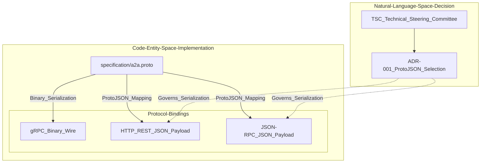
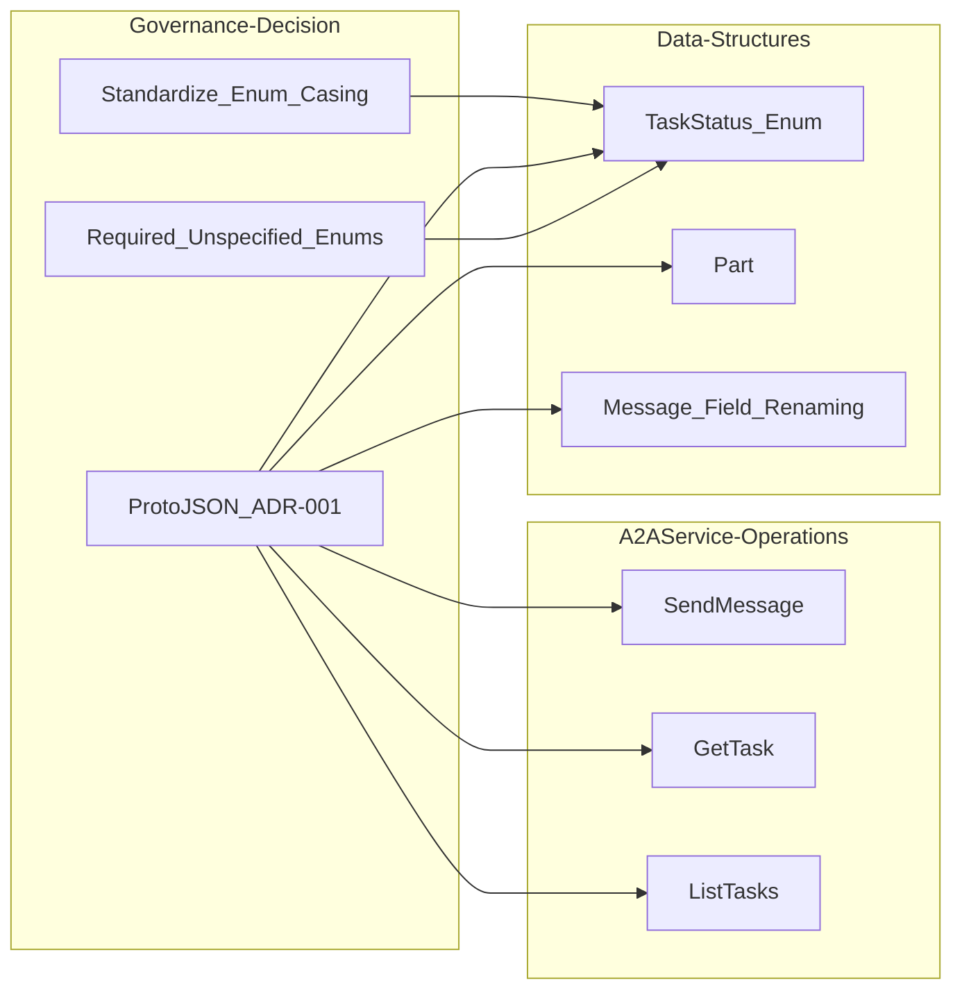

<!-- source: DeepWiki mcp.deepwiki.com · repo a2aproject/A2A · page 6.4 Architectural Decision Records · fetched 2026-10-21 -->

# Architectural Decision Records

Relevant source files

The following files were used as context for generating this wiki page:

- [adrs/adr-001-protojson-serialization.md](adrs/adr-001-protojson-serialization.md)
- [adrs/adr-template.md](adrs/adr-template.md)

This page documents the formal process for making architectural decisions within the A2A Protocol project and maintains a record of the decisions that shape the protocol's evolution.

## The ADR Process

Architectural Decision Records (ADRs) are used to capture significant design choices, the context in which they were made, and their long-term consequences. This process ensures that the Technical Steering Committee (TSC) and the broader community have a shared understanding of the protocol's architectural foundation [adrs/adr-template.md:1-113]().

### Governance and Decision Making
The A2A project is governed by a Technical Steering Committee (TSC) consisting of voting members from partner organizations. The TSC is responsible for technical oversight, including approving system proposals and coordinating technical direction. Approved ADRs serve as the authoritative guidance for protocol implementers and SDK developers [adrs/adr-001-protojson-serialization.md:32-34]().

### ADR Template Structure
All ADRs follow a standardized format defined in `adrs/adr-template.md` to ensure consistency and clarity:

| Section | Description |
| :--- | :--- |
| **Status** | Current state: `Proposed`, `Accepted`, `Deprecated`, or `Superseded` [adrs/adr-template.md:3-3](). |
| **Date** | The date the decision was recorded in YYYY-MM-DD format [adrs/adr-template.md:5-5](). |
| **Decision Makers** | List of individuals or bodies (e.g., TSC) involved [adrs/adr-template.md:7-7](). |
| **Context** | The problem statement and motivating factors for the change [adrs/adr-template.md:11-13](). |
| **Decision Drivers** | Key requirements such as performance, maintainability, or cost [adrs/adr-template.md:15-21](). |
| **Considered Options** | The alternative approaches evaluated during the process [adrs/adr-template.md:22-27](). |
| **Decision Outcome** | The chosen option and the rationale for its selection [adrs/adr-template.md:28-32](). |
| **Consequences** | Documented Positive, Negative, and Neutral impacts [adrs/adr-template.md:34-49](). |

Sources: [adrs/adr-template.md:1-113](), [adrs/adr-001-protojson-serialization.md:1-73]()

---

## ADR-001: ProtoJSON Serialization

**Status:** Accepted
**Date:** 2025-11-18
**Decision Makers:** Technical Steering Committee (TSC) [adrs/adr-001-protojson-serialization.md:3-7]()

### Context
The A2A specification defines its canonical data model using Protocol Buffers (`specification/a2a.proto`). However, the protocol must support JSON serialization for HTTP/REST-based communication and JSON-RPC payloads [adrs/adr-001-protojson-serialization.md:11-13](). A normative approach was required to ensure that JSON payloads remain consistent across different implementations to prevent interoperability issues [adrs/adr-001-protojson-serialization.md:15-16]().

### Decision
The TSC decided to leverage the **ProtoJSON specification** (the canonical JSON encoding for Protocol Buffers) as the normative approach for serializing JSON based on the proto definition referenced by the specification [adrs/adr-001-protojson-serialization.md:32-34]().

### Key Implementation Impacts

#### 1. Enum Casing
A significant breaking change introduced by this ADR is the requirement for `SCREAMING_SNAKE_CASE` for enum values in JSON payloads to comply with ProtoJSON standards [adrs/adr-001-protojson-serialization.md:52-52](). Developers should note that this may be perceived as non-idiomatic for standard JSON, but it is necessary for Protobuf ecosystem alignment [adrs/adr-001-protojson-serialization.md:55-55]().

#### 2. Field Naming and Keywords
Certain field names in the protocol were adjusted to avoid conflicts with proto keywords (e.g., the `message` field) while maintaining compatibility with ProtoJSON mapping rules [adrs/adr-001-protojson-serialization.md:58-58]().

#### 3. Data Type Handling
The decision removes the need to define custom rules for complex types like dates and numbers in the A2A specification, deferring instead to the standard ProtoJSON mappings [adrs/adr-001-protojson-serialization.md:48-48]().

### ADR-001 Logic Flow
The following diagram illustrates how the ADR-001 decision bridges the gap between the Protobuf definition and the multi-binding JSON output.

**Title: ADR-001 Serialization Pipeline**

Sources: [adrs/adr-001-protojson-serialization.md:30-58](), [adrs/adr-001-protojson-serialization.md:67-67]()

---

## Architectural Impact on Protocol Evolution

The ADR process directly influences the protocol specification and its versioning. Major changes documented in ADRs are reflected in the protocol structure and enforced via the implementation of the `specification/a2a.proto` schema. Updates to the `specification/` directory trigger downstream notifications to SDK repositories via the `dispatch-a2a-update.yml` workflow.

### Relationship Between ADRs and Specification
The following diagram maps governance decisions to specific code entities and protocol operations defined in the A2A service.

**Title: Decision to Code Entity Mapping**

Sources: [adrs/adr-001-protojson-serialization.md:30-38](), [adrs/adr-001-protojson-serialization.md:52-52](), [adrs/adr-001-protojson-serialization.md:57-58]()

## References
* **ADR Template:** [adrs/adr-template.md:1-113]()
* **ADR-001:** [adrs/adr-001-protojson-serialization.md:1-73]()
* **ProtoJSON Specification:** [https://protobuf.dev/programming-guides/json/](https://protobuf.dev/programming-guides/json) [adrs/adr-001-protojson-serialization.md:67-67]()

---

