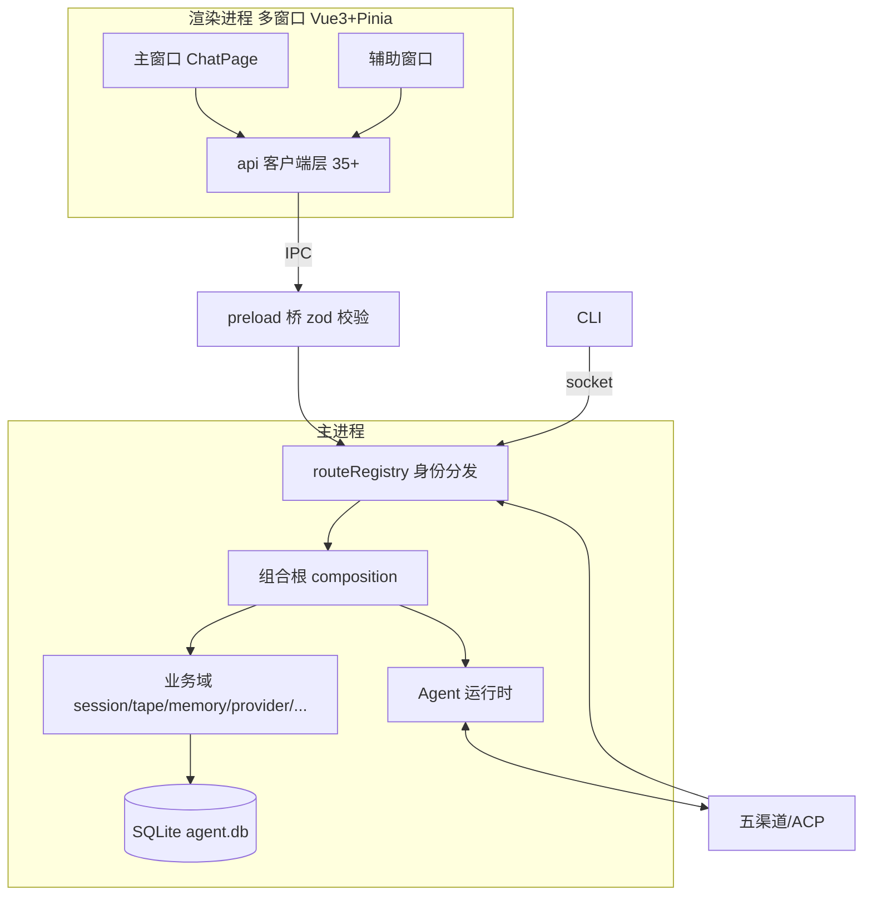
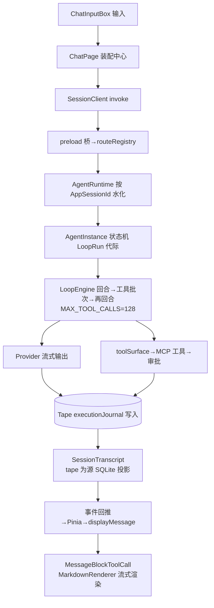

# DeepChat 新人上手指南（ONBOARDING）

> 基于知识图谱（7093 节点/16655 边，commit `c3cf25c5`）与 16 步代码导览整理。本文是地图：给出"是什么+关键路径+去哪深读"。

## 1. 这是什么系统

DeepChat（ThinkInAIXYZ/DeepChat，v1.1.3-beta.6）是开源 AI 桌面聊天客户端与智能体平台：以多供应商 LLM 对话为入口，长出完整的桌面 Agent 运行时——工具调用循环、MCP 工具生态、技能与插件、记忆与知识库、子代理编排，并能经 ACP 接入 Claude Code 等外部编码代理；同一会话还可经五渠道与 CLI 投递到桌面之外。它不是套壳聊天框，而是以 tape 事实日志为底座、端口驱动架构的本地智能体操作系统雏形。

技术栈：Electron + electron-vite 三进程；主进程 TypeScript + SQLite（SQLCipher）+ DuckDB；渲染层 Vue 3 + Pinia + vue-i18n + TipTap，UI 用 shadcn-vue + reka-ui；跨进程契约 zod 双端校验；工程侧 pnpm + vitest + electron-builder。规模：图谱分析 2570 文件、15 个架构层；`src/main/agent` 有 187 文件；i18n 覆盖 23 语言 × 22 命名空间。

## 2. 进程模型与整体架构

标准 Electron 三进程，外加 utility 子进程、多窗口与 CLI 控制面；构建入口在 `electron.vite.config.ts`。

- **主进程**：`src/main/index.ts` 调 `src/main/appMain.ts` 的 startApp()；心脏是 `src/main/app/composition.ts` 约 3450 行组合根 createMainProcessControl——**找任何服务的构造处都先来这里**；数据库地基同在 `src/main/app/`。
- **preload 桥**：`src/preload/createBridge.ts` 注入 `window.deepchat`，做路由名校验、zod 双端校验、事件订阅。
- **渲染进程**：多窗口共享主进程——主窗口 `src/renderer/src/main.ts`、设置窗口 `src/renderer/settings/`。
- **CLI 通道**：`src/main/cli/server.ts` 在 Unix socket 暴露 RPC/流式/上传端点，终端客户端 `src/cli/`。



铁律：**渲染进程绝不直接碰 Electron API，一切经 preload 桥回主进程**；工具越权必经 `src/main/approval/approvalBroker.ts` 审批闸。

## 3. 目录地图

| 目录 | 图谱层 | 职责与关键内容 |
|---|---|---|
| `src/shared/` | L0 契约（225） | 跨进程通用语言：`contracts/` 的 routes/events/common（ROUTE/EVENT_CATALOG + 50+ zod schema） |
| `src/main/` | L1-L8 | 主进程全域，子目录见下 |
| `src/preload/` | L8 边界 | 桥工厂 + index.d.ts 类型 |
| `src/renderer/` | L9-L11（528） | `api/`（35+ 客户端）、stores/router、`src/components/`（184 文件）、`features/chat-page/` |
| `src/shadcn/` + `src/dc-ui/` | L12（351） | shadcn-vue 原子组件 + DcButton 等品牌封装；`shadcn/lib/utils.ts` 的 cn() 入度最高（222） |
| `src/cli/` | L8 | 终端客户端；errors.ts 9 档退出码 |

`src/main/` 子目录：`app/`（组合根+数据库）、`session/`+`tape/`、`remote/`+`sync/`、`memory/`（63）、`knowledge/`、`provider/`（72）、`mcp|skill|tool|plugin|approval/`、`agent/`（187+ACP）、`orchestration/`、外围域（ocr/scheduler/exporter）、`routes/`+`cli/`。

## 4. 核心数据流：一条消息的生命周期

以"用户发一条消息"为主线，串联 tour 步骤 12→4→7→9→10→5→13：



关键落点：输入框 `src/renderer/src/components/chat/ChatInputBox.vue`、装配中心 `src/renderer/src/features/chat-page/ChatPage.vue`；Agent 循环 `src/main/agent/deepchat/loop/deepChatLoopEngine.ts`；投影 `src/main/session/data/transcript.ts`；流式渲染 `src/renderer/src/components/markdown/MarkdownRenderer.vue`。

## 5. 关键子系统深读

### 5.1 Agent 运行时与循环

一切从 `src/main/agent/shared/agentSessionIds.ts` 的 branded type 开始（AppSessionId/AcpRemoteSessionId 不可混用）。`deepChatAgentInstance.ts` 持有 LoopRun 代际与权限队列；`loop/ports.ts` 声明 ProviderPort/ToolCatalogPort 等端口——端口化让换 Provider、换工具面都不动循环内核。

两类扩展智能：`src/main/orchestration/` 的 live delegation 子代理（token 预算、约 1400 行 SQLite 持久化、safety 冻结权限快照）；`src/main/agent/acp/` 把外部 agent 包装成同构会话实例，同一套 UI 驱动两类 agent。

### 5.2 Tape 事件溯源

`src/main/tape/domain/entry.ts` 与 `executionJournal.ts`（run_started/dispatch_committed/tool_outcome 严格写入器）构成"发生过什么"的**唯一事实源**。

其上，`src/main/session/data/transcript.ts` 的 SessionTranscript 以 tape 为源、SQLite 表为投影；渲染层有 Tape 检查器 `src/renderer/src/components/tape-inspector/model.ts`。编辑/重试/fork 都建立在事实可回放上——这是 DeepChat 区别于普通聊天客户端的底座。

### 5.3 记忆与知识系统

`src/main/memory/`（63 文件）是六边形端口架构：`ports.ts` 定义读写仓储/嵌入/检索端口；`context.ts` 以栅栏令牌防过期异步写入。

检索核心在 `core/scoring.ts`：按**认知分层半衰期**算新近度与置信加成，RRF 融合多路召回。旁路两套来源——`src/main/knowledge/`（DuckDB 向量底座）与 `src/main/nowledgeMem/`（Mem0 云端）——都汇入 agent 上下文组装；测试守卫见 `pnpm test:memory`。

### 5.4 MCP 工具面与安全边界

`src/main/mcp/` 三件套：settings 双通道持久化、serverManager 管服务器进程、toolManager 交出工具目录；`schemaValidation.ts` 对入参 schema 做有界克隆（字节/深度/键数上限）；技能由 `src/main/skill/` 的 claudeCodeAdapter（解析 SKILL.md）支撑。

安全闸门：`src/main/tool/runtimePorts.ts` 声明工具运行时全部端口，approvalBroker 以 domain/scopeKey/operation 三维建审批并哈希去重——**工具越权在这里过闸**。

### 5.5 Provider 模型接入层

`src/main/provider/settings.ts`（50 入度）是查询模型与凭据的单一入口；`baseProvider.ts` 是全部供应商抽象基类（fetchProviderModels/completions/summarize 模板方法）。

实例化与数据面：`providerRegistry.ts` 声明 runtimeKind 与路由策略，`aiSdk/providerFactory.ts` 按 providerKind 实例化。

## 6. 如何跑起来

从 `package.json`（90+ 脚本）提炼最小集（须 pnpm）：

```bash
pnpm install        # postinstall 自动装 electron 依赖
pnpm dev            # electron-vite dev --watch（开发主循环）
pnpm dev:linux      # 无沙箱；dev:inspect 主进程调试 9229
pnpm typecheck      # tsc(node) + vue-tsc(web)
pnpm lint           # oxlint + 两道契约守卫
pnpm test           # vitest run；test:main/test:renderer 分域
pnpm test:memory    # 记忆域守卫；agent:eval 评测；e2e:smoke 冒烟
pnpm build          # typecheck + electron-vite build + cli:build
pnpm build:unpack   # 本地验证 electron-builder 目录包
```

注意：prebuild 拉取图标/Provider DB/ACP 注册表三个远程资源，首次构建需网络。

## 7. 新人常见任务路标

| 任务 | 路径与要点 |
|---|---|
| 改聊天 UI | `src/renderer/src/components/` + `features/chat-page/`；先去 shadcn/dc-ui 找积木；文案进 `src/renderer/src/i18n/zh-CN/*.json` |
| 加 Provider | 继承 `baseProvider.ts` → `providerRegistry.ts` 声明策略 → `aiSdk/providerFactory.ts` 加分支 → 设置页就绪校验 |
| 加 IPC 契约 | `src/shared/contracts/` 定义 route/event + zod 汇入 CATALOG → 主进程域内 `routes.ts` 注册（RouteCaller）→ `src/renderer/api/` 客户端 → store |
| 给 agent 加工具 | `src/main/tool/runtimePorts.ts` 声明端口；涉权过 approvalBroker；MCP 路线在 `mcp/serverManager.ts` + `inMemoryServers/builder.ts` |
| 动数据库表 | 继承 `src/main/data/baseTable.ts`（45 处在用）；连接只走 `databaseConnection.ts` |
| CLI/跨进程疑难 | 终端 `src/cli/`；控制面 `src/main/cli/server.ts`；疑难查 routeRegistry 身份 |

## 8. 深入资源

- **知识图谱**：`/usr-data/data1/browser/deepchat/.understand-anything/knowledge-graph.json`（7093 节点/16655 边）+ 同目录 `layers.json`（15 层）、`tour.json`（16 步）。入度之王可当必读清单：`agent-interface.d.ts`（221）、`shadcn/lib/utils.ts` 的 cn()（222）、`agentSessionIds.ts`（47）。
- **DeepWiki 文档**：`~/ai/work4ai/讲透DeepChat/deepwiki/`（INDEX.md，9 章 56 页）。
- **16 步导览清单**：①全景与三进程 ②启动与组合根 ③共享契约 ④进程边界 ⑤Tape 与投影 ⑥记忆与知识 ⑦Agent 运行时 ⑧编排与 ACP ⑨Provider ⑩工具与安全 ⑪辅助域 ⑫渲染 API ⑬主界面装配 ⑭辅助窗口 ⑮组件库 ⑯i18n。
- 仓库自带 `AGENTS.md`/`CONTRIBUTING.md`，改前必读。
