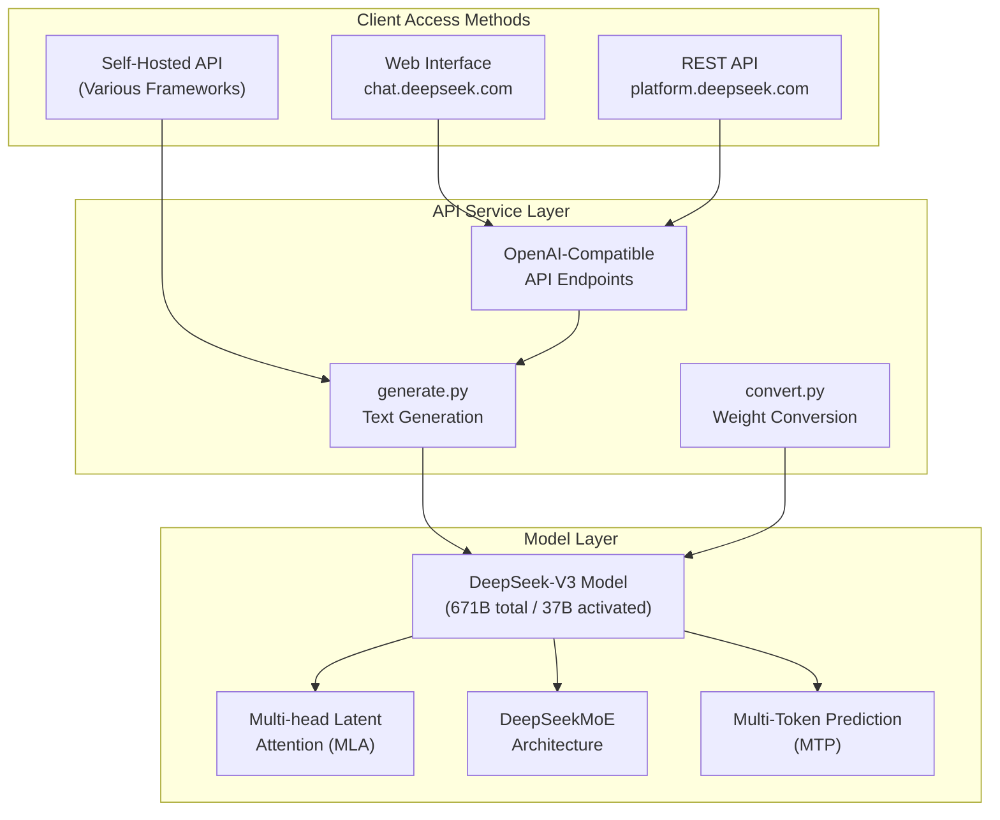
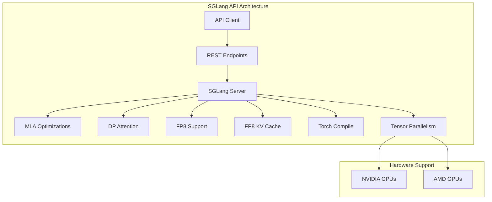

<!-- source: DeepWiki mcp.deepwiki.com · repo deepseek-ai/DeepSeek-V3 · page 2.3 Web Interface and API Access · fetched 2026-10-30 -->

# Web Interface and API Access

<details>
<summary>Relevant source files</summary>

The following files were used as context for generating this wiki page:

- [README.md](README.md)

</details>


This document provides a comprehensive guide to accessing and utilizing DeepSeek-V3 models through official web interfaces and APIs. It covers both the official hosted services provided by DeepSeek and the various options for self-hosting the API. For information about local deployments without API functionality, see [Local Deployment Options](#2.2).

## 1. Official Hosted Services

DeepSeek provides two official platforms for interacting with the DeepSeek-V3 models:

### 1.1 Chat Website

The official DeepSeek Chat website allows direct interaction with the DeepSeek-V3 model through a user-friendly web interface.

- **URL**: [chat.deepseek.com](https://chat.deepseek.com)
- **Features**:
  - Interactive chat interface
  - User account management
  - Chat history storage
  - Conversation management
  - Access to various DeepSeek models, including DeepSeek-V3

### 1.2 DeepSeek Platform API

For developers requiring programmatic access, DeepSeek offers an OpenAI-compatible API through its platform.

- **URL**: [platform.deepseek.com](https://platform.deepseek.com)
- **Features**:
  - OpenAI-compatible API endpoints
  - API key management
  - Usage tracking and quotas
  - Developer documentation

**API Compatibility**: The API is designed to be compatible with OpenAI's API format, allowing developers to easily migrate existing applications built for OpenAI's models to DeepSeek-V3.

Sources: [README.md:223-225]()

## 2. Self-Hosted API Options

DeepSeek-V3 can be self-hosted using various frameworks, each offering different optimization techniques and hardware support options.

### 2.1 Available Frameworks

The following table summarizes the key features of each self-hosting framework:

| Framework | FP8 Support | BF16 Support | MTP Support | NVIDIA Support | AMD Support | Huawei Ascend NPU | Multi-node Support |
|-----------|-------------|--------------|-------------|----------------|-------------|-------------------|-------------------|
| DeepSeek-Infer Demo | ✓ | ✓ | ✗ | ✓ | ✗ | ✗ | ✓ |
| SGLang | ✓ | ✓ | Coming soon | ✓ | ✓ | ✗ | ✓ |
| LMDeploy | ✓ | ✓ | ✗ | ✓ | ✗ | ✗ | ✓ |
| TensorRT-LLM | ✗ | ✓ | ✗ | ✓ | ✗ | ✗ | ✓ |
| vLLM | ✓ | ✓ | ✗ | ✓ | ✓ | ✗ | ✓ |
| LightLLM | ✓ | ✓ | ✗ | ✓ | ✗ | ✗ | ✓ |

Sources: [README.md:229-239]()

### 2.2 Framework Selection Guide

```mermaid
flowchart TD
    start[Choose Self-Hosted API]
    amd{AMD GPU?}
    nvidia{NVIDIA GPU?}
    huawei{Huawei NPU?}
    mtp{MTP Support?}
    fp8{FP8 Required?}
    
    start --> amd
    
    amd -->|Yes| amd_options[SGLang or vLLM]
    amd -->|No| nvidia
    
    nvidia -->|Yes| fp8
    nvidia -->|No| huawei
    
    huawei -->|Yes| huawei_option[Huawei MindIE]
    huawei -->|No| other_hw[Unsupported Hardware]
    
    fp8 -->|Yes| mtp
    fp8 -->|No| bf16_options[Any framework with BF16]
    
    mtp -->|Yes| sglang_soon[SGLang (Coming Soon)]
    mtp -->|No| nvidia_options[DeepSeek-Infer, SGLang, LMDeploy, vLLM, or LightLLM]
```

Sources: [README.md:229-342]()

## 3. API Implementation Details

Below is a technical overview of how the API implementations connect to the underlying DeepSeek-V3 model architecture.



Sources: [README.md:45-54](), [README.md:229-305]()

## 4. Setting Up Self-Hosted API

The general process for setting up a self-hosted API involves:

1. Download model weights from Hugging Face
2. Convert the weights to the required format
3. Run the appropriate inference server

### 4.1 Weight Conversion

Since DeepSeek-V3 uses FP8 precision natively, conversion to BF16 might be required for some frameworks:

```shell
cd inference
python fp8_cast_bf16.py --input-fp8-hf-path /path/to/fp8_weights --output-bf16-hf-path /path/to/bf16_weights
```

Sources: [README.md:240-248]()

### 4.2 Example Server Setup with DeepSeek-Infer Demo

This is a basic example showing how to set up a DeepSeek-V3 server using the DeepSeek-Infer demo:

1. **Convert weights**:
```shell
python convert.py --hf-ckpt-path /path/to/DeepSeek-V3 --save-path /path/to/DeepSeek-V3-Demo --n-experts 256 --model-parallel 16
```

2. **Run the server**:
```shell
torchrun --nnodes 2 --nproc-per-node 8 --node-rank $RANK --master-addr $ADDR generate.py --ckpt-path /path/to/DeepSeek-V3-Demo --config configs/config_671B.json --interactive --temperature 0.7 --max-new-tokens 200
```

Sources: [README.md:284-297]()

## 5. Framework-Specific API Details

### 5.1 SGLang

SGLang provides comprehensive support for DeepSeek-V3 and is recommended for most deployments, especially when AMD GPU support is needed.



Additional features:
- Multi-node tensor parallelism for distributed deployment
- Multi-Token Prediction (MTP) support in development

For detailed setup instructions, refer to the SGLang documentation: https://github.com/sgl-project/sglang/tree/main/benchmark/deepseek_v3

Sources: [README.md:307-316]()

### 5.2 Other Recommended Frameworks

- **LMDeploy**: Offers flexible deployment options with both offline pipeline processing and online serving capabilities.
- **TensorRT-LLM**: Provides BF16 and INT4/INT8 weight-only quantization options, with FP8 support in development.
- **vLLM**: Supports both tensor parallelism and pipeline parallelism for distributed deployments.
- **LightLLM**: Offers single-machine and multi-machine tensor parallel deployment with mixed-precision options.

Sources: [README.md:318-335]()

## 6. Hardware Considerations

### 6.1 NVIDIA GPUs

All the frameworks mentioned above support NVIDIA GPUs, which are the primary target hardware for DeepSeek-V3.

### 6.2 AMD GPUs

For AMD GPU deployment, the recommended options are:
- SGLang: Full support for both FP8 and BF16 precision
- vLLM: Support for DeepSeek-V3 inference

Sources: [README.md:338-339]()

### 6.3 Huawei Ascend NPUs

The MindIE framework from Huawei Ascend community supports the BF16 version of DeepSeek-V3.

Sources: [README.md:341-342]()

## 7. API Usage Examples

When using the OpenAI-compatible API (either through the official platform or a self-hosted solution), the interface follows a similar pattern to other LLM APIs:

### 7.1 Basic Completion Request

```python
import requests
import json

API_URL = "https://platform.deepseek.com/v1/chat/completions"  # Or your self-hosted endpoint
API_KEY = "your_api_key"

headers = {
    "Content-Type": "application/json",
    "Authorization": f"Bearer {API_KEY}"
}

data = {
    "model": "deepseek-v3",
    "messages": [
        {"role": "system", "content": "You are a helpful assistant."},
        {"role": "user", "content": "Explain how multi-head latent attention works."}
    ],
    "temperature": 0.7,
    "max_tokens": 500
}

response = requests.post(API_URL, headers=headers, data=json.dumps(data))
print(response.json())
```

Sources: [README.md:225-226]()

## 8. Troubleshooting

If you encounter issues with the web interface or API access, consider the following common solutions:

1. **API Rate Limits**: Check if you've exceeded your rate limits on the official platform
2. **Hardware Requirements**: Ensure your hardware meets the minimum requirements for self-hosted deployments
3. **Weight Conversion**: Verify that weight conversion was successful if using BF16 precision
4. **Framework Compatibility**: Confirm that your chosen framework supports your specific hardware configuration

For additional support, you can contact DeepSeek at [service@deepseek.com](mailto:service@deepseek.com).

Sources: [README.md:359-361]()

---

