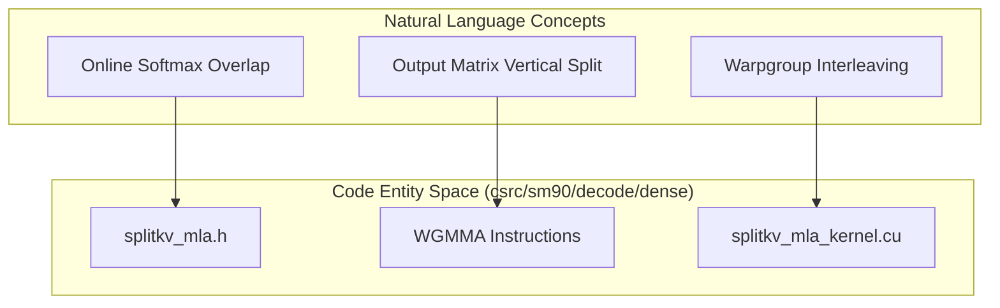
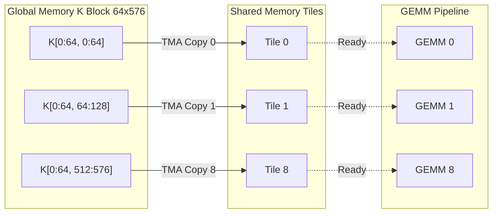
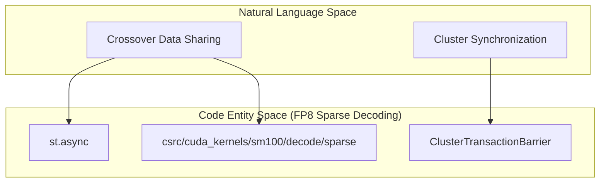

<!-- source: DeepWiki mcp.deepwiki.com · repo deepseek-ai/FlashMLA · page 4.4 Kernel Performance Optimizations · fetched 2026-10-30 -->

# Kernel Performance Optimizations

Relevant source files

The following files were used as context for generating this wiki page:

- [docs/20250422-new-kernel-deep-dive.md](docs/20250422-new-kernel-deep-dive.md)
- [docs/20250929-hopper-fp8-sparse-deep-dive.md](docs/20250929-hopper-fp8-sparse-deep-dive.md)
- [docs/assets/MLA Kernel Sched.drawio.svg](docs/assets/MLA Kernel Sched.drawio.svg)

## Purpose and Scope

This page documents the core performance optimization techniques employed across FlashMLA's CUDA kernels to achieve high utilization of GPU resources. These optimizations enable FlashMLA to reach up to 660 TFlops for dense decoding, 410 TFlops for FP8 sparse decoding, and 640 TFlops for sparse prefill on Hopper and newer architecture GPUs.

The techniques described here are implemented across multiple kernel variants. For architecture-specific kernel implementations, see architecture-specific backend pages. For details on the FP8 KV cache format that motivates some optimizations, see [KV Cache Formats and Quantization](#4.2). For the tile scheduling mechanism that distributes work, see [Scheduling and Split-KV Strategy](#4.3).

Sources: [docs/20250422-new-kernel-deep-dive.md:1-57](), [docs/20250929-hopper-fp8-sparse-deep-dive.md:1-50]()

---

## Compute-Bound vs Memory-Bound Classification

FlashMLA kernels are designed to handle both compute-bound and memory-bound scenarios, with optimization strategies varying based on workload characteristics.

### Theoretical Analysis

The kernel performance bottleneck depends on the ratio of floating-point operations (FLOPs) to memory access volume. For a decoding kernel with:
- `h_q`: number of query heads
- `s_q`: number of query tokens per sequence (1 for standard decoding, >1 for speculative decoding)
- `s_k`: number of KV tokens per sequence
- `d_k`: key head dimension (576 for MLA)
- `d_v`: value head dimension (512 for MLA)

The compute-to-memory ratio is approximately `2 * h_q * s_q`.

On NVIDIA H800 SXM5:
- Peak memory bandwidth: 3.35 TB/s
- Practical peak FLOPs (with throttling to ~1600 MHz): 865 TFlops
- Critical threshold: `h_q * s_q >= 128`

When `h_q = 128` (full query heads without tensor parallelism), the kernel is **compute-bound**, requiring optimization for maximum tensor core utilization. When `h_q * s_q < 128`, the kernel is **memory-bound**, requiring optimization for memory bandwidth. [docs/20250422-new-kernel-deep-dive.md:7-16]()

### Performance Targets

| Configuration | Bottleneck | Optimization Focus | Achieved Performance |
|--------------|------------|-------------------|---------------------|
| h_q=128, s_q=1 | Compute-bound | Tensor Core utilization | 660 TFlops (dense), 410 TFlops (FP8 sparse) |
| h_q=16, s_q=1 | Memory-bound | Memory bandwidth | 3000 GB/s |
| h_q=128, s_q≥2 | Compute-bound | Tensor Core + memory latency | Up to 640 TFlops (sparse prefill) |

Sources: [docs/20250422-new-kernel-deep-dive.md:7-16](), [docs/20250929-hopper-fp8-sparse-deep-dive.md:48-52]()

---

## Seesaw Scheduling for Compute-Bound Workloads

Seesaw scheduling is a warp-level execution strategy implemented in `splitkv_mla.h` that overlaps Tensor Core (WGMMA) operations with CUDA Core (softmax) operations to maximize hardware utilization in compute-bound scenarios. [docs/20250422-new-kernel-deep-dive.md:17-47]()

### The Register Constraint Problem

The primary challenge is register scarcity. The output matrix from WGMMA operations must remain in registers throughout the mainloop. For a single 64×512 output matrix:
- Register usage: 32,768 32-bit registers
- Available registers per SM: 65,536 32-bit registers
- Constraint: Only **one** output matrix can fit per SM [docs/20250422-new-kernel-deep-dive.md:21-21]()

This eliminates traditional ping-pong buffering approaches used in FlashAttention-3, where two complete output matrices alternate between compute and accumulate phases.

### Seesaw Schedule and Code Entity Mapping

The following diagram bridges the natural language conceptual model of the seesaw schedule to the actual code entities and routines found in `splitkv_mla.h` and associated CUDA kernel sources.

*Figure: Bridging Seesaw Schedule Concepts to Code Entities (`csrc/sm90/decode/dense/splitkv_mla.h`) [docs/20250422-new-kernel-deep-dive.md:25-47]()*

Sources: [docs/20250422-new-kernel-deep-dive.md:17-47]()

---

## TMA-GEMM Pipelining

TMA (Tensor Memory Accelerator) - GEMM pipelining addresses memory latency in compute-bound kernels by overlapping data movement with active matrix multiplication.

### Fine-Grained TMA Copy Strategy

For a 64×576 K block, the kernel launches **9 separate TMA copies**, each transferring a 64×64 sub-block. GEMM operations begin as soon as each individual sub-block arrives in shared memory. [docs/20250422-new-kernel-deep-dive.md:54-54]()

*Figure: Fine-grained TMA Copy and GEMM Pipelining Workflow [docs/20250422-new-kernel-deep-dive.md:54-54]()*

### Cache Hints for L2 Optimization

TMA operations use `cute::TMA::CacheHintSm90::EVICT_FIRST` to improve L2 cache hit rates for frequently reused data like query tensors by preventing KV data from polluting the cache. [docs/20250422-new-kernel-deep-dive.md:55-55]()

Sources: [docs/20250422-new-kernel-deep-dive.md:50-57]()

---

## Crossover Technique with Distributed Shared Memory

The crossover technique solves the dequantization bottleneck in FP8 sparse decoding kernels on Hopper architectures. [docs/20250929-hopper-fp8-sparse-deep-dive.md:14-45]()

### The Dequantization Bottleneck

Dequantizing a token's FP8 cache (512 elements) requires ~50 cycles on CUDA cores, while the corresponding MMA operations only take ~34 cycles. This makes the kernel **dequantization-bound**. [docs/20250929-hopper-fp8-sparse-deep-dive.md:17-25]()

### Crossover Implementation via Distributed Shared Memory

Using **Distributed Shared Memory (DSM)** and CTA clusters of size 2, each CTA dequantizes only **half** of the KV cache and shares it with the other CTA via asynchronous stores (`st.async`). [docs/20250929-hopper-fp8-sparse-deep-dive.md:33-45]()

*Figure: Bridging Crossover Concepts to Code Entities in Sparse Decoding [docs/20250929-hopper-fp8-sparse-deep-dive.md:33-45]()*

Sources: [docs/20250929-hopper-fp8-sparse-deep-dive.md:14-50]()

---

## Optimization Summary Table

| Optimization Technique | Target Bottleneck | Architectures | Performance Gain |
|----------------------|------------------|---------------|-----------------|
| **Seesaw Scheduling** | Tensor Core idle time | SM90, SM100 | Up to 660 TFlops [docs/20250422-new-kernel-deep-dive.md:3()] |
| **TMA-GEMM Pipelining** | Memory latency | SM90, SM100 | 80% TC Utilization [docs/20250422-new-kernel-deep-dive.md:57()] |
| **Crossover + DSM** | FP8 dequantization | SM90 | 250 → 410 TFlops [docs/20250929-hopper-fp8-sparse-deep-dive.md:48()] |
| **Cache Hints** | L2 cache pollution | SM90, SM100 | Improved hit rates [docs/20250422-new-kernel-deep-dive.md:55()] |

Sources: [docs/20250422-new-kernel-deep-dive.md:1-62](), [docs/20250929-hopper-fp8-sparse-deep-dive.md:1-52]()

---

